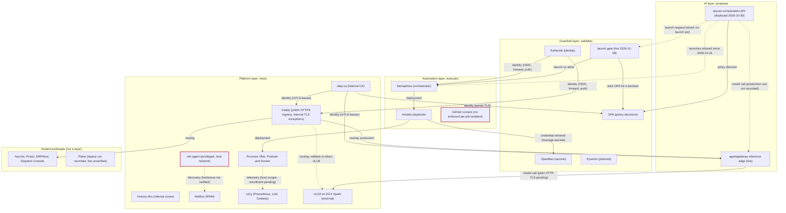

# agent-cloud Architecture

The 5-minute map — read it first, human or AI. It tells you *what* agent-cloud is,
*how the pieces fit*, and *where to go next* for depth.

agent-cloud is the uhstray.io **"business-as-code" homelab platform**: a single public
monorepo running real privacy-focused infrastructure (NetBox, Authentik, OpenBao,
Semaphore, Caddy, an inference plane, AI agents), where every control is version-controlled
config a tool applies idempotently — never a UI click. It is deliberately open *because*
site identity (real IPs, FQDNs, credentials, topology) is a parameter living only in the
private **site-config** repo; this repo holds templates, placeholders, and code.

## The Three Doc Layers (read in this order)

```
   PRINCIPLES.md      The durable constitution. Small set of rules + deliberate trade-offs
   (the WHY,           every service, playbook, and agent must obey. The TIEBREAKER: when a
    the tiebreaker)    deeper doc disagrees, this wins; when it is silent, defer downward.

   ARCHITECTURE.md    >> YOU ARE HERE << The map. The 4-layer model, how the subsystems
   (the MAP)           connect, and a pointer from each subsystem to the doc that owns it.
                       Connective tissue — it simplifies, it does not re-state.

   plan/architecture/  The per-area HOW and why-in-depth (00..06 and 08..09, deep + dense).
   plan/development/   The execution ROADMAP — service-by-service implementation plans.
   CLAUDE.md           The turn-by-turn operational rules an agent follows while editing.
```

If you only read one thing, read `PRINCIPLES.md`. If you only read two, add this file.

For what is running now, read [service-architecture.md](plan/architecture/service-architecture.md) (services, layers, status) and [network-architecture.md](plan/architecture/network-architecture.md) (ingress, TLS, firewall, control paths). Both are current-state records; this file does not repeat their status.

## Four-layer architecture

Every privileged change flows top-to-bottom and **never the inverse**. The diagram shows the
as-built state recorded in [service-architecture.md](plan/architecture/service-architecture.md)
and [network-architecture.md](plan/architecture/network-architecture.md), which are the
recorded as-built sources; this document did not re-verify live state. The inference route state is as recorded
on 2026-10-14 and was not re-checked live for this document.



**Legend.** A solid arrow is live: it is in code or a deployment record. A dashed arrow is
planned, unverified, refused, or a rollback path. Edge labels name the kind of edge: model call,
policy decision, credential retrieval, deployment, identity, routing, telemetry, or discovery.
A red border marks a risk: a privileged or host-networked process, or missing enforced isolation.

**What the diagram does not show.**

- Semaphore does not ask OPA. Agent-initiated decisions come only from skynet's client and the
  launch gate. `deploy-opa.yml` calls OPA only in its own verify step (`/health` and a sample
  decision), per the deploy table in AGENTS.md. Sources: `platform/playbooks/deploy-skynet.yml`,
  `deploy-launch-gate.yml`, `deploy-opa.yml`.
- Semaphore launches from skynet were refused after 2026-10-31, when the svc-skynet role was
  demoted to read-only `guest`.
- DNS names are served by hickory-dns, but no edge is drawn for name resolution.
- The Caddy-to-agentgateway hop uses the internal CA. The gateway-to-vLLM hop is plain HTTP;
  its TLS is pending.
- Plain-HTTP and the firewall: backends speak plain HTTP only where the default-deny host
  firewall is applied, and that firewall is not declared on every host.

### Why four layers and not three (the AI Invariant)

A conventional platform has three layers: something proposes, automation runs it,
infrastructure hosts it. agent-cloud inserts a **fourth, non-optional** guardrail layer
*between* AI and automation, making the AI a strictly upstream proposer.

It exists for one load-bearing safety property, the **AI Invariant**
([PRINCIPLES §4](PRINCIPLES.md#4-the-ai-invariant)): *AI proposes, guardrails validate,
automation executes — never the inverse.* An agent may recommend improvements to anything,
**including its own pipelines and prompts, but may never apply them without human review** —
self-improvement is propose-only. No AI agent may *be* a standing autonomous reconciler, nor
author the human-unmediated target of a reconciliation controller. The shape this forbids: an
unattended convergence loop with an LLM authoring its own target and destructive (`down -v`)
reach. Collapsing guardrails back into automation re-opens exactly that shape. Weakening this
rule requires an explicit, recorded human decision.

## Component Map

Each major subsystem has exactly one owning doc. Start at the layer in the diagram, then
jump to that doc.

| Subsystem | What it is | Layer | Owning doc |
|---|---|---|---|
| **skynet** | Orchestration API and its agent roles (`infra-agent`, `security-agent`, `o11y-agent`, `service-agent`, `network-agent`, `skynet-eval`): runs the onboarding workflow, asks OPA for each decision, calls models through agentgateway. Deployed 2026-10-30; the gateway's `/skynet/` route is not yet in production | AI | [skynet/deployment/CLAUDE.md](platform/services/skynet/deployment/CLAUDE.md) |
| **OpenBao** | Sole source of truth for every credential | Guardrail | [04-credentials-access.md](plan/architecture/04-credentials-access.md) |
| **OPA / Kyverno** | Policy-as-code: agent-action authorization (OPA now), k8s admission (Kyverno, post-migration) | Guardrail | [plan/development/03-guardrails-governance.md](plan/development/03-guardrails-governance.md) |
| **Authentik** | Central IdP/SSO; groups are the source of truth for human identity → roles | Guardrail | [04-credentials-access.md](plan/architecture/04-credentials-access.md) |
| **Semaphore** | Orchestrator; every privileged, state-changing action runs through it for audit + AppRole injection | Automation | [01-automation-model.md](plan/architecture/01-automation-model.md), [04-credentials-access.md](plan/architecture/04-credentials-access.md) |
| **Ansible + composable task library** | Idempotent playbooks; the credential boundary lives here, not in `deploy.sh` | Automation | [01-automation-model.md](plan/architecture/01-automation-model.md) |
| **Proxmox / Podman / Docker** | VM hosting + container runtimes (rootless Podman default; Docker is a named exception) | Infrastructure | [05-platform-infra.md](plan/architecture/05-platform-infra.md) |
| **Caddy** | Public HTTPS ingress (LE via Cloudflare DNS-01), with internal TLS exceptions such as the Caddy-to-agentgateway hop | Infrastructure | [05-platform-infra.md](plan/architecture/05-platform-infra.md) |
| **step-ca / hickory-dns** | Internal private CA (stable root) + internal DNS (zones-as-code) | Infrastructure | [05-platform-infra.md](plan/architecture/05-platform-infra.md) |
| **NetBox** | Authority for network / IPAM, populated by the Diode discovery pipeline | Infrastructure | [plan/development/04-netbox-discovery.md](plan/development/04-netbox-discovery.md) |
| **Observability** (Grafana, Prometheus, Loki, Alloy, Tempo) | Self-hosted telemetry; opt-in by declaration, `service.name` is the join key | cross-cut | [06-observability-instrumentation.md](plan/architecture/06-observability-instrumentation.md) |
| **Service onboarding & tiers** | The one-shape-per-tier model + onboarding checklist for new services | cross-cut | [02-service-onboarding.md](plan/architecture/02-service-onboarding.md) |
| **Testing / CI / quality gates** | The lint + test + leak-prevention gates every PR passes | cross-cut | [03-testing-ci-quality.md](plan/architecture/03-testing-ci-quality.md) |
| **agentgateway** | Inference edge: per-client keys and token budgets in front of the external vLLM; route switched 2026-10-14 | AI | [service-architecture.md](plan/architecture/service-architecture.md) |
| **GitHub runners** | Self-hosted CI for private repos; no enforced per-job isolation | Automation | [service-architecture.md](plan/architecture/service-architecture.md) |
| **launch gate** | The only path from agents to Semaphore launches; live in production since 2026-11-09 | Guardrail | [service-architecture.md](plan/architecture/service-architecture.md) |
| **orb-agent** | NetBox discovery worker; runs privileged on the host network | Infrastructure | [service-architecture.md](plan/architecture/service-architecture.md) |
| **vLLM (DGX Spark)** | Model serving on the GPU pair; external, owned by the dgx-spark repository | Infrastructure (external) | [service-architecture.md](plan/architecture/service-architecture.md) |
| **Hosted workloads** | honcho, Postiz, ERPNext, Dispatch Console, Plane (deploy run recorded, live unverified); not a layer | Hosted | [service-architecture.md](plan/architecture/service-architecture.md) |
| **Doc standards & index** | How docs are structured, status values, the full doc index | cross-cut | [00-foundation-standards.md](plan/architecture/00-foundation-standards.md) |

## Load-Bearing Decisions (one line each)

Every line below is a *rule*; follow the link for the *why* and the as-built caveats.

- **Config-as-code** — configuration is data a tool applies idempotently, never a UI click or ad-hoc curl; a control you can't diff is a control you can't review. ([PRINCIPLES §1](PRINCIPLES.md#1-config-as-code))
- **One codebase, no forks** — environments differ only by inventory vars + compose overlays + `{{ }}` references; site identity is a parameter, kept entirely in site-config. ([PRINCIPLES §1](PRINCIPLES.md#1-config-as-code))
- **Composability / tiers** — one service shape per tier (auxiliary minimal → infra/AI/automation full ceremony); tier is the *input* to the shape, and deviations are documented; machine-readable `shape: bespoke` declarations are **[TARGET]**. ([PRINCIPLES §2](PRINCIPLES.md#2-composability), [02](plan/architecture/02-service-onboarding.md))
- **Build foundationally** — fix the mechanism not the symptom; encode every one-off as reusable automation — a fix that lives only in your shell history is a defect. ([PRINCIPLES §2](PRINCIPLES.md#2-composability))
- **Rootless Podman default** — reach for rootful/Docker only when a capability rootless cannot grant forces it, and the deploy must name that capability. ([PRINCIPLES §2](PRINCIPLES.md#2-composability), [05](plan/architecture/05-platform-infra.md))
- **The guardrail triad** — OpenBao (secrets) + OPA/Kyverno (policy) + Authentik (identity) sit between AI and automation; one authority per concern, reflections are read-only. ([PRINCIPLES §3](PRINCIPLES.md#3-identity-secrets--the-guardrail-triad))
- **deploy.sh boundary** — `deploy.sh` is container-lifecycle-only (pull, `up`, wait, migrate); it may *never* touch OpenBao — the credential path is OpenBao → Ansible → Jinja2 → `.env`. ([PRINCIPLES §3](PRINCIPLES.md#3-identity-secrets--the-guardrail-triad), [01](plan/architecture/01-automation-model.md))
- **Bootstrap (genesis) exception** — OpenBao + Semaphore manage their own credentials on a fresh local deploy (the secret store + orchestrator can't fetch from a system that doesn't exist yet); this is the *single* sanctioned carve-out from the deploy.sh boundary. ([PRINCIPLES §3](PRINCIPLES.md#3-identity-secrets--the-guardrail-triad), [04](plan/architecture/04-credentials-access.md))
- **Bounded credentials** — the shared task defaults to a 90-day SecretID lifetime and 25 uses per issued token; SecretID logins remain unlimited within that lifetime; rotate Create → Verify → Retire, and an identity reads only its own enumerated paths (no wildcards). ([PRINCIPLES §3](PRINCIPLES.md#3-identity-secrets--the-guardrail-triad), [04](plan/architecture/04-credentials-access.md))
- **RBAC: Org > Dept > Team > Role + Access Level** — identity decomposes into org structure with an orthogonal privilege tier (Admin → Maintainer → Developer → User); Org is the tenant boundary; access is provisioned from Authentik groups by role, never hand-granted. **[TARGET]** ([PRINCIPLES §3](PRINCIPLES.md#3-identity-secrets--the-guardrail-triad), [04](plan/architecture/04-credentials-access.md))
- **AI Invariant** — AI proposes, guardrails validate, automation executes, never the inverse; self-improvement is propose-only; no agent is a standing reconciler. (hard constitutional limit) ([PRINCIPLES §4](PRINCIPLES.md#4-the-ai-invariant), [01 §8](plan/architecture/01-automation-model.md))
- **Everything through Semaphore** — every privileged, state-changing action flows through Semaphore for audit + AppRole injection; direct SSH is read-only break-glass, reconciled by a later redeploy. ([PRINCIPLES §5](PRINCIPLES.md#5-automation--promotion), [04](plan/architecture/04-credentials-access.md))
- **Authored convergence + liveness** — the only always-on loop is liveness (a crashed/rebooted container self-heals); config convergence is always from a *human-authored* Git target, on a trigger or a timer, never free-running. ([PRINCIPLES §5](PRINCIPLES.md#5-automation--promotion))
- **Reversibility tags [TARGET]** — each deploy carries `reversible: true|false`; an irreversible (migration) deploy off a non-main branch surfaces a confirmation gate + snapshot. ([PRINCIPLES §5](PRINCIPLES.md#5-automation--promotion))
- **TLS at the edge** — Caddy is the public HTTPS ingress and terminates public TLS. Internal hops are exceptions that use the internal CA (the Caddy-to-agentgateway hop is the first). Backends speak plain HTTP only on a firewall-enforced trusted network, and the host firewall is not declared on every host yet, so that condition does not hold everywhere. Consume public TLS, run a private CA, never become one. ([PRINCIPLES §6](PRINCIPLES.md#6-infrastructure--resilience), [05](plan/architecture/05-platform-infra.md))
- **Runtime-artifacts + tmpfs secrets** — target hosts get rendered runtime artifacts (no repo clone) and tmpfs-mounted secrets from OpenBao (no persistent `.env`), so leaks fail closed by construction. **[TARGET]** ([PRINCIPLES §6](PRINCIPLES.md#6-infrastructure--resilience), [01](plan/architecture/01-automation-model.md))
- **SPOFs carry a recovery story** — any infra/edge SPOF (Caddy, OpenBao, step-ca, DNS) ships a documented, tested rebuild-from-OpenBao+site-config path before it carries traffic. ([PRINCIPLES §6](PRINCIPLES.md#6-infrastructure--resilience))
- **Observability by declaration** — logs are free, metrics are two labels, traces are two env vars, `service.name` joins all three; no per-service `prometheus.yml` edits, dashboards/alerts as code. ([PRINCIPLES §7](PRINCIPLES.md#7-observability), [06](plan/architecture/06-observability-instrumentation.md))

## As-Built vs Target (honesty note)

PRINCIPLES.md states the rules the platform commits to; several describe a **target not yet
built**, tagged **[TARGET]** there. Do not reason as if a `[TARGET]` guarantee already holds.
The big ones, roughly in priority order:

- **Runtime-dir / tmpfs-secrets model — top build priority, NOT yet true.** Today
  `manage-secrets.yml` renders `.env` into a full repo clone on the target. Until
  artifact-render/copy + sparse-checkout + engine-secret delivery ship, `.gitignore` + the
  pre-commit/CI trufflehog gate are the *only* (fragile) secret boundary. The liveness loop and
  every "secrets never in the clone" claim depend on this landing first.
- **RBAC role-based provisioning — designed, not built.** The Org>Dept>Team>Role + Access-Level
  schema and the (identity → per-service role) provisioning automation don't exist yet;
  the operator's Semaphore admin role was hand-set as a stopgap. `manage-semaphore-access.yml` now holds system admins to a declared roster and fails an undeclared admin by name; whether production matches that roster is not checked here. See [04](plan/architecture/04-credentials-access.md).
- **AppRole rotation remains incomplete.** The shared task now defaults to `secret_id_ttl: 2160h`
  and reuses stored credentials. Expiry-aware rotation and finite SecretID login counts remain
  targets; `token_num_uses` limits issued tokens, not SecretID authentications.
- **Scheduled config reconciliation** is INVESTIGATE/[TARGET]; today convergence is
  trigger-only and only liveness self-heals.
- **Alerting before tracing**, the host firewall rollout (partial: applied on some hosts, not all) backing the "trusted network" claim,
  and the `assert-orchestrated.yml` wiring are all in flight, not done.

For the full caveats and open tensions (static DB passwords vs. dynamic leases, conformance
ceremony vs. velocity, one dependency DAG vs. two), read the as-built notes inline in
**PRINCIPLES.md** and the **Open tensions** section at its end.
