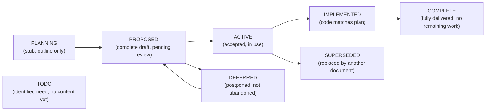
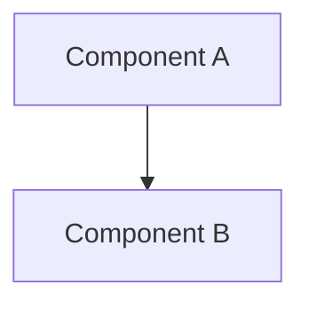

# 00 — Architecture Foundation & Doc Standards
> **Constitution:** the repo-root [`PRINCIPLES.md`](../../PRINCIPLES.md) is the platform constitution this doc set elaborates. When a doc disagrees with PRINCIPLES.md, PRINCIPLES.md wins; when PRINCIPLES.md is silent, defer to these architecture docs.
>
> **Consolidates:** architecture-reference.md (originals archived in `plan/archive/`)
>
> **Depends on:** —
>
> Part of the dependency-ordered `plan/architecture/` set (00–06, 08, 09). Source docs merged verbatim below under provenance dividers to preserve all detail.


<!-- ======================= source: architecture-reference.md ======================= -->

# Architecture Reference

**Date:** 2026-05-06
**Status:** ACTIVE
**Context:** Master index of all architecture and development plan documents in the agent-cloud repository. Defines document standards, naming conventions, required sections, and diagram standards.

---

## Purpose

Master index and standard reference for the architecture/doc set, including the repo-root constitution (`PRINCIPLES.md`) and map (`ARCHITECTURE.md`). Ensures cross-document consistency, makes the full set discoverable, and defines the plan-document lifecycle from proposal through completion or supersession.

The repo-root [`PRINCIPLES.md`](../../PRINCIPLES.md) constitution sits above these docs and is the tiebreaker (see the doc header). [`ARCHITECTURE.md`](../../ARCHITECTURE.md) is the entry-point map into this set.

---

## Document Standards

### Naming Convention

Plan documents generally use **SCREAMING-KEBAB-CASE** filenames with `.md` (e.g. `AUTOMATION-COMPOSABILITY.md`, `CREDENTIAL-LIFECYCLE-PLAN.md`, `DEV-PROXMOX-CLUSTER-PLAN.md`). Existing lowercase and unnumbered files are also valid where already established (for example, `dev-merge-guard.md` and `o11y-dashboard-accuracy.md`); do not rename them solely to enforce this convention. `IMPLEMENTATION_PLAN.md` retains its legacy underscore for link stability.

### Required Sections

Every architecture or development plan document must include all of these (content may be brief, but each must be present):

1. **Title** -- H1 heading matching the document purpose
2. **Frontmatter** -- Date, Status (see below), Context (one paragraph on why this document exists)
3. **Problem** -- What gap or issue this plan addresses
4. **Design Principles** -- Guiding constraints (align with the platform constitution in `PRINCIPLES.md`)
5. **Architecture** -- Solution design with at least one mermaid diagram
6. **Implementation Phases** -- Ordered steps with per-phase acceptance criteria
7. **Validation Criteria** -- Table of checks and pass conditions
8. **Security Considerations** -- Credential handling, blast radius, access control, network exposure
9. **Cross-references** -- Links to related `plan/` documents and root `CLAUDE.md`
10. **Revision History** -- Date and summary of significant changes (optional for initial drafts)

Stub documents (PLANNING or TODO) may defer sections 5-8 with a pending note.

---

## Status Values

Every document carries a `**Status:**` frontmatter field. Valid values:



| Status | Meaning |
|---|---|
| **PLANNING** | Stub or outline only. Sections may be incomplete. |
| **PROPOSED** | Complete draft ready for review. Not yet accepted. |
| **ACTIVE** | Accepted and in use. Implementation may be ongoing. |
| **IMPLEMENTED** | Core implementation matches the plan. May have planned extensions. |
| **COMPLETE** | Fully delivered. No remaining work items. Candidate for archival. |
| **SUPERSEDED** | Replaced by another document. Retained for historical reference. Move to `plan/archive/`. |
| **DEFERRED** | Postponed intentionally. Not abandoned. Will return to PROPOSED when conditions change. |
| **TODO** | Identified need with no substantive content yet. |

---

## Diagram Standards

**ALL diagrams MUST use mermaid fenced blocks.** ASCII art box-drawing (Unicode U+2500-U+257F) is NOT permitted in `plan/` markdown files; CI enforces this via the `No ASCII art in plan docs` lint step. Convert existing ASCII art to mermaid in the next PR that touches the file.

### Supported Mermaid Types

| Mermaid Type | Use For |
|---|---|
| `flowchart TD` / `flowchart LR` | Decision trees, process flows, deployment flows |
| `graph TD` with `subgraph` | Layer diagrams, architecture stacks, topology |
| `sequenceDiagram` | Runtime interactions between services |
| `stateDiagram-v2` | Credential lifecycle states, document status transitions |
| `gantt` | Implementation timelines (if needed) |
| `classDiagram` | Data models, API contracts (rare) |
| `erDiagram` | Database schemas, entity relationships |

### Diagram Guidelines

- Keep diagrams focused. One concept per diagram.
- Use `subgraph` for grouping related components (layers, VLANs, VMs).
- Use descriptive node IDs (`OPENBAO`, `WEBUI`) not single letters.
- Use `<br/>` for line breaks within node labels, not `\n`.
- Escape special characters in labels with HTML entities (`&lt;`, `&gt;`, `&amp;`).
- Use dashed lines (`-. "label" .->`) for optional or future connections.

---

## Architecture Documents Index

Documents in `plan/architecture/` define cross-cutting patterns and standards. Above the numbered set sit two repo-root documents:

| Document | Status | Purpose |
|---|---|---|
| [PRINCIPLES.md](../../PRINCIPLES.md) | ACTIVE | **00-prime / the constitution.** Durable rules + deliberate trade-offs every service, playbook, and AI agent must obey. The tiebreaker (see doc header). |
| [ARCHITECTURE.md](../../ARCHITECTURE.md) | ACTIVE | Central architecture reference: the entry-point map into this doc set, pointing from the constitution into the *how* and *why-in-depth*. |

| Document | Status | Purpose |
|---|---|---|
| [architecture-reference.md](../archive/architecture/architecture-reference.md) | SUPERSEDED | Master index and document standards; successor: [00-foundation-standards.md](00-foundation-standards.md). |
| [AUTOMATION-COMPOSABILITY.md](../archive/architecture/AUTOMATION-COMPOSABILITY.md) | SUPERSEDED | Composable task library, 4-phase deploy pattern, secret lifecycle, runtime directory separation; successor: [01-automation-model.md](01-automation-model.md). |
| [AUTOMATION-DECLARATIVE-VS-IMPERATIVE.md](../archive/architecture/AUTOMATION-DECLARATIVE-VS-IMPERATIVE.md) | SUPERSEDED | Reference standard for declarative versus imperative automation; successor: [01-automation-model.md](01-automation-model.md). |
| [BRANCH-TESTING-WORKFLOW.md](../archive/architecture/BRANCH-TESTING-WORKFLOW.md) | SUPERSEDED | Branch deploy and validation workflow via Semaphore survey variables; successor: [03-testing-ci-quality.md](03-testing-ci-quality.md). |
| [CREDENTIAL-LIFECYCLE-PLAN.md](../archive/architecture/CREDENTIAL-LIFECYCLE-PLAN.md) | SUPERSEDED | Credential governance: TTL requirements, Create-Verify-Retire rotation, metadata standard, vault paths, audit requirements; successor: [04-credentials-access.md](04-credentials-access.md). |
| [SERVICE-INTEGRATION-PLAN.md](../archive/architecture/SERVICE-INTEGRATION-PLAN.md) | SUPERSEDED | Standard onboarding checklist for new services; successor: [02-service-onboarding.md](02-service-onboarding.md). |
| [TESTING-AND-LINTING-PLAN.md](../archive/architecture/TESTING-AND-LINTING-PLAN.md) | SUPERSEDED | CI pipeline design: ruff, shellcheck, ansible-lint, yamllint, hadolint, pytest, BATS, trufflehog, bandit; successor: [03-testing-ci-quality.md](03-testing-ci-quality.md). |
| [ACCESS-BOUNDARIES.md](../archive/architecture/ACCESS-BOUNDARIES.md) | SUPERSEDED | SSH key scoping, Semaphore versus direct access, AppRole blast-radius boundaries; successor: [04-credentials-access.md](04-credentials-access.md). |
| [CADDY-REVERSE-PROXY.md](../archive/architecture/CADDY-REVERSE-PROXY.md) | SUPERSEDED | Caddy reverse-proxy architecture, TLS DNS-01, routing patterns, credential management; successor: [05-platform-infra.md](05-platform-infra.md). |
| [CI-TESTING-SPECIFICATION.md](../archive/architecture/CI-TESTING-SPECIFICATION.md) | SUPERSEDED | Test standards, templates, and onboarding requirements for all services; successor: [03-testing-ci-quality.md](03-testing-ci-quality.md). |
| [PODMAN-VS-DOCKER-COMPOSE.md](../archive/architecture/PODMAN-VS-DOCKER-COMPOSE.md) | SUPERSEDED | Compatibility guide for Podman versus Docker across all services; successor: [05-platform-infra.md](05-platform-infra.md). |
| [SECURITY-TESTING-STANDARDS.md](../archive/architecture/SECURITY-TESTING-STANDARDS.md) | SUPERSEDED | Security testing standards for code, playbooks, templates, and configuration; successor: [03-testing-ci-quality.md](03-testing-ci-quality.md). |
| [skills-recommendation.md](skills-recommendation.md) | ACTIVE | Maps Claude Code skills to agent-cloud development activities. |
| [08-ansible-automation-standards.md](08-ansible-automation-standards.md) | ACTIVE | Ansible standards from the official docs, each rule linked: check mode as the dry run, the three check-mode task classes, `--tags verify`, `set_stats` for machine-read results, recorded deviations. |
| [09-console-ui-principles.md](09-console-ui-principles.md) | PROPOSED | Console UI principles: through the platform never around it, work first, single-sourced scope, red explains itself, vertical owned plans, Grafana for per-asset telemetry, secret names never values; the console interaction loop and how operators work with agent-cloud through it. |
| [network-architecture.md](network-architecture.md) | ACTIVE | Current-state network map: Cloudflare edge, Caddy route shapes, the inference path with its mutual-TLS hop, internal CA and DNS, host firewall, control-plane and provisioning paths, local-dev network; status per component, decision criteria, in-flight work. |
| [service-architecture.md](service-architecture.md) | ACTIVE | Current-state service map: every service and agent by layer with runtime, edge authentication and status; identity, shared-secret and runtime-dependency maps; deploy lifecycle, AI propose-validate-execute path, deployment workflow, lifecycle states. |

---

## Development Plans Index

Documents in `plan/development/` define service-specific implementation plans.

| Document | Status | Purpose |
|---|---|---|
| [03-guardrails-governance.md](../development/03-guardrails-governance.md) (OPA section; original in `plan/archive/development/OPA-INTEGRATION-PLAN.md`) | IN PROGRESS | OPA policy engine deployment, agent authorization, Rego policies, Semaphore governance. |
| [DEV-PROXMOX-CLUSTER-PLAN.md](../archive/development/DEV-PROXMOX-CLUSTER-PLAN.md) | PLANNING | Dev Proxmox cluster with ZimaBoard + nested VMs, VLAN isolation, MAAS assessment. |
| [SPARSE-CHECKOUT-MIGRATION.md](../archive/development/SPARSE-CHECKOUT-MIGRATION.md) | PROPOSED | Migrate from full clone to sparse checkout + runtime directory separation. |
| [NETBOX-DISCOVERY-EXPANSION.md](../archive/development/NETBOX-DISCOVERY-EXPANSION.md) | IMPLEMENTED | NetBox discovery pipeline architecture (Diode, proxmox_discovery, pfsense_sync). |
| [OPENSSF-SCORECARD-PLAN.md](../archive/development/OPENSSF-SCORECARD-PLAN.md) | TODO | OpenSSF Scorecard integration for supply chain security. |
| [SNMPV3-UPGRADE-PLAN.md](../archive/development/SNMPV3-UPGRADE-PLAN.md) | DEFERRED | Migration from SNMPv2c to SNMPv3 for discovery agents. |
| [01-secrets-credentials.md, "Solution: Custom Callback Plugin"](../development/01-secrets-credentials.md#solution-custom-callback-plugin) | PARTLY BUILT | Ansible callback plugin for credential redaction in Semaphore logs. Request stripping shipped as `callback_plugins/redact_requests.py`; value-pattern redaction still planned. (The standalone `ANSIBLE-CREDENTIAL-REDACTION-PLAN.md` was merged into plan 01.) |
| [APPROLE-TTL-ENFORCEMENT-PLAN.md](../archive/development/APPROLE-TTL-ENFORCEMENT-PLAN.md) | PROPOSED | Enforce 90-day TTL and bounded token_num_uses on all AppRoles. |
| [DISASTER-RECOVERY-PLAN.md](../archive/development/DISASTER-RECOVERY-PLAN.md) | PLANNING | Disaster recovery procedures for critical infrastructure failures. |
| [PODMAN-UPGRADE-PLAN.md](../archive/development/PODMAN-UPGRADE-PLAN.md) | PLANNING | Podman-compose upgrade strategy for services using Podman. |
| [CREDENTIAL-LIFECYCLE-IMPLEMENTATION.md](../archive/development/CREDENTIAL-LIFECYCLE-IMPLEMENTATION.md) | PROPOSED | Implementation phases for credential rotation, metadata, dynamic secrets, site lifecycle. |
| [ARCHITECTURE-REVIEW-FOLLOWUP.md](../archive/development/ARCHITECTURE-REVIEW-FOLLOWUP.md) | TODO | Deferred items from the 2026-05-07 architecture review. |
| [ERPNEXT-DEPLOYMENT.md](../archive/development/ERPNEXT-DEPLOYMENT.md) | PROPOSED | ERPNext + LLM integration: dev/prod VMs, accounting cutover, backup cross-mirror, read-only MCP, llm-gate service. |
| [LOCAL-DEV-DEPLOYMENT.md](../archive/development/LOCAL-DEV-DEPLOYMENT.md) | ACTIVE | Local dev instance via podman: make bootstraps, local Semaphore operates; slim overlays; promotion pipeline; local DNS (hickory-dns), ERPNext/OPA local tiers. |
| [DNS-SERVER-DEPLOYMENT.md](../archive/development/DNS-SERVER-DEPLOYMENT.md) | PROPOSED | hickory-dns internal DNS platform service: zones-as-code, pfSense delegation, decision-gated internal ACME (RFC 2136 + TSIG). |
| [NETBOX-LOCAL-ENGINE.md](../archive/development/NETBOX-LOCAL-ENGINE.md) | PROPOSED | Fix for local NetBox: podman-VM Semaphore can't reach Docker Desktop — run app-tier under podman (profile-gated, discovery excluded). |
| [AUTH-SSO-DEPLOYMENT.md](../archive/development/AUTH-SSO-DEPLOYMENT.md) | IMPLEMENTED | Authentik central IdP / SSO. Phase 0 (local): composable service deployed + healthy via local Semaphore (server+worker+Postgres+Redis); blueprints config-as-code. Caddy `forward_auth`/OIDC gating is the next phase. |
| [LOCAL-DEV-TLS-TRUST.md](../archive/development/LOCAL-DEV-TLS-TRUST.md) | SUPERSEDED | `make local-tls-trust` built + working; the CA *source* is now step-ca (INTERNAL-CA-DEPLOYMENT), and tls-trust extracts the step-ca root. |
| [INTERNAL-CA-DEPLOYMENT.md](../archive/development/INTERNAL-CA-DEPLOYMENT.md) | IMPLEMENTED | step-ca internal CA deployed via local Semaphore: stable root, serves the `*.agent-cloud.test` wildcard Caddy presents (token-mint locally; ACME dns-01 is the prod path). |
| [05-observability.md](../development/05-observability.md) | ACTIVE | Minimal local observability stack (Grafana + Prometheus + Loki + Alloy), composable + local-first; OpenBao-audit→Loki + orb-agent OTel consumers; Mimir/Tempo/MinIO/Alertmanager are prod additions. |
| [15-service-deployment-workflow-agents.md](../development/15-service-deployment-workflow-agents.md) | PROPOSED | The 22-step service deployment workflow as code: step registry, step-result and proposal contracts, four skynet agent roles (OPA identities), OPA-only gate, collector + NetBox custom fields + Loki + Grafana tracking; agentgateway backfill → estate sweep → greenfield pilot. |
| [17-dispatch-console.md](../development/17-dispatch-console.md) | PROPOSED | Dispatch Console build plan: all-Rust Dioxus fullstack (WASM client + JSON `/v1` API in one binary), API-first, proposals-only change path (skynet → OPA → Semaphore), bounded context per authority, phases 0–7 and traceability to the 22 console requirements; design in `plan/product/dispatch-console/`. |
| [18-semaphore-task-retention.md](../development/18-semaphore-task-retention.md) | PROPOSED | Semaphore task history kept 30 days via a daily API prune (paged /tasks/last, 400 re-check, floor/skew/cap guards); storage measured first; VACUUM FULL conditional and operator-side; orchestrator root-disk alert. |
| [19-proxmox-ca-pinning.md](../development/19-proxmox-ca-pinning.md) | PROPOSED | Pin the Proxmox cluster root CA for every Ansible Proxmox API call: one `proxmox_ca_pem` in site-config, a shared runner-scratch trust task, a read-only canary before the switch, no off switch, `curl -k` fallback replaced |
| [20-semantic-versioning.md](../development/20-semantic-versioning.md) | PROPOSED | Semantic versioning from pull request titles: a `Version` check on every pull request, `vX.Y.Z-dev.N` tags on `dev` and `vX.Y.Z` tags plus Releases on `main`, starting at v0.13.0 (16 tags backfilled from past promotions); 1.0.0 and every later major only through an approved manual release. |
| [21-test-suite-runtime.md](../development/21-test-suite-runtime.md) | PROPOSED | Test suite runtime and redundancy: measured CI baseline (Python core ~20 min, 11,318 Python worker-seconds), the forged-extra-var matrix reduced only where the guard reads names, fixed waits given public knobs, self-balancing pytest shards from a committed durations file, a shared playbook runner with timeouts, GNU parallel for BATS, a pre-push fast lane. |
| [22-console-access-requests.md](../development/22-console-access-requests.md) | PROPOSED | Console access requests and the skynet iam-agent: requests become site-config pull requests, Plane membership follows Authentik groups, decisions A1–A8 and questions Q1–Q6 pending the operator |

### Archived Plans

Documents in `plan/archive/` have reached terminal status (COMPLETE or SUPERSEDED).

| Document | Status | Reason |
|---|---|---|
| [LINT-COMPLIANCE-PLAN.md](../archive/LINT-COMPLIANCE-PLAN.md) | COMPLETE | All violations fixed in PR #7. |

---

## Document Template

Copy this template when creating a new architecture or development plan document:

````markdown
# DOCUMENT-TITLE

**Date:** YYYY-MM-DD
**Status:** PLANNING
**Context:** One paragraph explaining why this document exists and what triggered its creation.

---

## Problem

What gap, risk, or need does this plan address?

## Design Principles

1. **Principle name** -- How it constrains the solution
2. **Principle name** -- How it constrains the solution

## Architecture



## Implementation Phases

### Phase 1: Name (Timeline)

**Goal:** One sentence.

**Tasks:**
1. Task description
2. Task description

**Acceptance criteria:**
- Criterion 1
- Criterion 2

## Validation Criteria

| Check | Pass Condition |
|---|---|
| Check name | Expected outcome |

## Security Considerations

- Bullet point per consideration

## Cross-references

| Document | Relationship |
|---|---|
| DOCUMENT.md (relative path) | How this plan relates |

## Revision History

| Date | Change |
|---|---|
| YYYY-MM-DD | Initial draft |
````

---

## Composability and Translation

Designed for the uhstray.io datacenter platform, but the patterns translate to other projects:

- **4-phase deploy pattern** (AUTOMATION-COMPOSABILITY.md) -- any Docker Compose + Ansible stack
- **Create-Verify-Retire rotation** (CREDENTIAL-LIFECYCLE-PLAN.md) -- any secrets manager (Vault, AWS Secrets Manager, Azure Key Vault)
- **Service integration checklist** (SERVICE-INTEGRATION-PLAN.md) -- any multi-service platform
- **Branch testing workflow** (BRANCH-TESTING-WORKFLOW.md) -- any Semaphore/CI orchestrated deployment

To adapt for another project: replace `OpenBao` with your secrets manager, `Semaphore` with your CI/CD orchestrator, `Proxmox` with your hypervisor/cloud provider; keep the structural patterns (composable tasks, runtime/source separation, tiered service classification).

---

## Testing Requirements

All plan-document changes must pass CI before merging:

1. **No ASCII art** -- `No ASCII art in plan docs` step rejects Unicode box-drawing (U+2500-U+257F) in `plan/**/*.md`
2. **No credentials or IPs** -- security scan rejects hardcoded private IPs and credential patterns
3. **YAML lint** -- yamllint validates embedded YAML blocks
4. **BASH lint** -- shellcheck validates bash code blocks
5. **Python lint** -- ruff validates Python code (pylint not currently in CI, may be added)
6. **Markdown rendering** -- mermaid diagrams must use valid syntax (test locally with a mermaid-capable renderer)

See [TESTING-AND-LINTING-PLAN.md](../archive/architecture/TESTING-AND-LINTING-PLAN.md), [SECURITY-TESTING-STANDARDS.md](../archive/architecture/SECURITY-TESTING-STANDARDS.md), and [CI-TESTING-SPECIFICATION.md](../archive/architecture/CI-TESTING-SPECIFICATION.md) for the full testing strategy and CI pipeline reference.

---

## Revision History

| Date | Change |
|---|---|
| 2026-05-06 | Initial creation as part of architecture review. Indexes all existing plan documents, defines document standards, diagram standards, and status values. |
| 2026-05-10 | Reviewed by @jestyr27, updated some naming conventions and added references to missing documents. |
| 2026-10-27 | Indexed `network-architecture.md` and `service-architecture.md`. |
