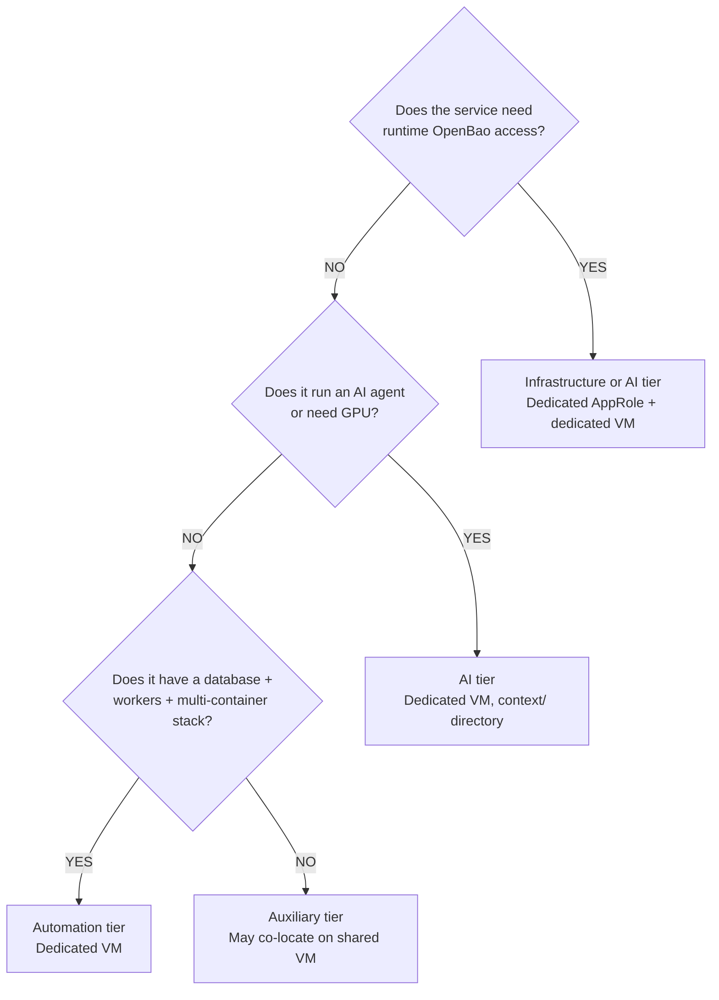
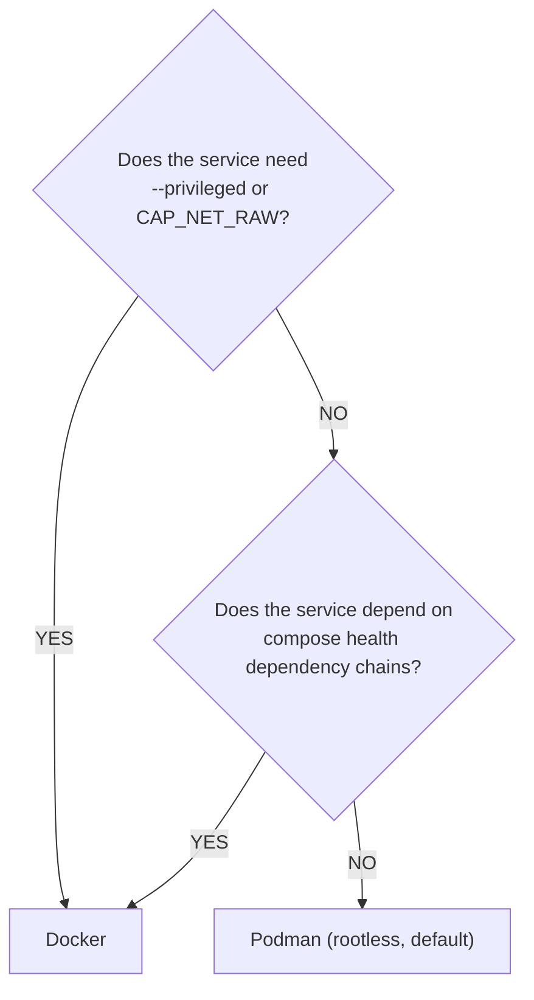

# 02 — Service Onboarding & Tier Classification
> **Consolidates:** SERVICE-INTEGRATION-PLAN.md (originals archived in `plan/archive/`)
>
> **Depends on:** 00, 01
>
> Part of the dependency-ordered `plan/architecture/` set (00–09). Source docs
> merged verbatim below under provenance dividers to preserve all detail.


<!-- ======================= source: SERVICE-INTEGRATION-PLAN.md ======================= -->

# Service Integration Plan

**Date:** 2026-04-22
**Status:** ACTIVE
**Contributors:** Architecture, Security, Automation, Infrastructure, DevOps review agents

**References:**
- [AUTOMATION-COMPOSABILITY.md](../archive/architecture/AUTOMATION-COMPOSABILITY.md) — Composable task library and deploy patterns
- [CREDENTIAL-LIFECYCLE-PLAN.md](../archive/architecture/CREDENTIAL-LIFECYCLE-PLAN.md) — Secret generation, storage, rotation
- [TESTING-AND-LINTING-PLAN.md](../archive/architecture/TESTING-AND-LINTING-PLAN.md) — CI/CD, linting, and testing requirements
- [BRANCH-TESTING-WORKFLOW.md](../archive/architecture/BRANCH-TESTING-WORKFLOW.md) — Branch deploy and validation workflow

---

## Purpose

This plan defines the standard process for integrating any new service into the agent-cloud platform. It ensures every service follows consistent patterns for deployment, credential management, testing, monitoring, and documentation — regardless of complexity.

---

## Service Classification

New services fall into one of four tiers, each with different integration weight:

| Tier | Examples | Integration Weight | Typical VM Size |
| ---- | -------- | ------------------ | --------------- |
| **Infrastructure** | OpenBao, Semaphore, NetBox, Caddy | Full (5-phase playbook, dedicated VM, AppRole if runtime vault access) | Small-Medium |
| **Automation** | GitHub runners | Full (5-phase playbook, dedicated VM) | Medium |
| **AI/Agent** | skynet, agentgateway | Full + agent context directory | Large (GPU for inference) |
| **Auxiliary** | Postiz, honcho, a2a-registry | Simplified (3-phase playbook, may co-locate on shared VM) | Small-Medium |

### Classification Decision



---

## Onboarding Checklist

### Observability signal contract

For every deployed service, record its stable identity (`service` and
`service.name`), owner, cluster and environment context, applicable signal
methods, profile support, and the finite value set for each indexed label.
`service`, `cluster`, and `environment` are the shared bounded dimensions;
`owner` and `severity` are bounded alert labels. Container and instance identity
are drill-down details. Do not index request or user identifiers, trace IDs,
timestamps, raw paths, addresses, prompts, or secrets as metric labels or Loki
stream labels. Keep them in log bodies or structured metadata when needed.

Declare remote metrics targets in private inventory and verify their exact
service and endpoint. A missing signal is a coverage gap, never a healthy
default. Profile producers are opt-in and require a supported endpoint, privacy
review, measured resource headroom, retention budget, and a successful sample
receipt before wider rollout. Record the signal proof and capacity evidence
without private addresses or credentials.

### Phase 0: Planning

- [ ] Classify the service (infrastructure / automation / AI / auxiliary)
- [ ] Determine VM requirements: dedicated vs co-located, CPU/RAM/disk (see sizing table)
- [ ] Determine container runtime: Docker (privileged/health-deps) or Podman (default)
- [ ] Determine if runtime OpenBao access is needed (dedicated AppRole) or deploy-time only (Semaphore's AppRole)
- [ ] Identify all secrets the service needs (database passwords, API tokens, etc.)
- [ ] Identify the health check endpoint (URL + path + expected status code)

### Phase 1: Infrastructure Provisioning

- [ ] Allocate static IP and VMID in `site-config/proxmox/vm-specs.yml`
- [ ] Provision VM via Semaphore "Provision VM" template (clone VMID 9000, configure cloud-init)
- [ ] Install container runtime via "Install Docker" template (if Docker needed)
- [ ] Generate SSH key pair, store in OpenBao at `secret/services/ssh/<service>`
- [ ] Back the pair up into site-config at `secrets/ssh/<service>/id_ed25519` —
      `generate-service-ssh-key.yml` does this in the same run when passed
      `site_config_dir`, or the `Back Up Service SSH Key` Semaphore template copies an
      existing pair out onto a new site-config branch.
      This is not filing: a pair that exists only in OpenBao means no operator holds a
      key, so the workstation direction of the two-path access proof cannot be produced
      and `harden-ssh.yml` must not run. Verified missing on a real host 2026-08-26
- [ ] Distribute SSH keys via "Distribute SSH Keys" template
- [ ] Verify SSH key auth works, then harden SSH via "Harden SSH" template

**Co-location exception:** Auxiliary-tier services may skip VM provisioning and deploy to an existing shared VM. Add the service to the existing host's inventory groups.

### Phase 2: Repository Setup

- [ ] Create `platform/services/<name>/deployment/` directory structure:
  ```text
  platform/services/<name>/
    deployment/
      deploy.sh            # Container lifecycle only (no secrets, no OpenBao)
      compose.yml          # Docker Compose service definitions
      templates/
        <name>.env.j2      # Jinja2 env file template(s)
      CLAUDE.md            # Service-specific operational reference
      README.md            # Quick-start deployment notes
  ```
- [ ] For AI/Agent tier, additionally create `context/` with skills, prompts, MCP configs
- [ ] Ensure `deploy.sh` is container-lifecycle only — no `gen_secret`, `put_secret`, `get_secret`, or OpenBao calls
- [ ] All secrets in Jinja2 templates use `{{ variable }}` references, never hardcoded values
- [ ] Add compose healthchecks on every container that supports them

### Phase 3: Credential Setup

- [ ] Define `_secret_definitions` list (each secret: name, type, length):
  - `random` — auto-generated passwords
  - `django` — extended charset (for Django SECRET_KEY etc.)
  - `user` — operator-managed, never auto-generated (external API keys, etc.)
- [ ] Define `_env_templates` list mapping Jinja2 sources to runtime destinations
- [ ] Secrets stored at `secret/data/services/<service_name>` in OpenBao
- [ ] If runtime vault access needed: provision AppRole via `tasks/manage-approle.yml`
  - Create least-privilege HCL policy at `platform/services/openbao/deployment/config/policies/<service>.hcl`
  - Scope to exactly the paths the service needs — no wildcards
  - Store AppRole credentials at `secret/data/services/approles/<service>`

**Decision: AppRole scope**

| Scenario | AppRole | Rationale |
| -------- | ------- | --------- |
| Deploy-time secrets only (DB password, API key injected via .env) | Semaphore's orchestrator | No runtime vault access needed |
| Service authenticates to OpenBao at runtime | Dedicated per-service | Blast radius isolation — compromised service can only read its own secrets |
| Agent that reads multiple services' secrets | Dedicated with enumerated paths | Never use `secret/data/services/*` wildcard for new services |

### Phase 4: Automation Setup

- [ ] Create `platform/playbooks/deploy-<service>.yml` following the composable pattern:

  ```text
  Phase 1: Clone repo + manage-secrets (fetch/generate → template .env)
  Phase 2: Run deploy.sh (container lifecycle)
  Phase 3: Application bootstrap (migrations, superuser creation — if needed)
  Phase 4: Runtime credential sync (if service creates runtime creds — if needed)
  Phase 5: Health verification (HTTP check against service_url + health_path)
  ```

- [ ] Create `platform/playbooks/clean-deploy-<service>.yml` using `tasks/clean-service.yml`
- [ ] Add service to `validate-all.yml` (HTTP health check play block)
- [ ] Add service credentials to `validate-secrets.yml` (DB/Redis/API auth tests)
- [ ] Add Semaphore templates to `platform/semaphore/templates.yml`:

  | Template | Playbook | survey_vars |
  | -------- | -------- | ----------- |
  | Deploy \<Service\> | `deploy-<service>.yml` | `service_branch` (default: main) |
  | Clean Deploy \<Service\> | `clean-deploy-<service>.yml` | `service_branch` (default: main) |

- [ ] Run `setup-templates.yml` to apply new templates to Semaphore

**Auxiliary-tier simplification:** Services with no Phase 3 or Phase 4 use a 3-phase playbook (secrets → deploy → verify). This is a recognized "simple deploy" variant — not every service needs the full 5-phase pattern.

### Phase 5: Inventory and Configuration

- [ ] Add host to `site-config/inventory/production.yml`:
  ```yaml
  <service>_svc:
    hosts:
      <service>:
        ansible_host: <ip>
        service_name: <service>
        monorepo_deploy_path: platform/services/<service>/deployment
        monorepo_repo: https://github.com/uhstray-io/agent-cloud.git
        service_url: "http://<ip>:<port>"
        health_path: "/health"
        container_engine: podman  # or docker
  ```
- [ ] Verify no real IPs, passwords, or usernames are committed to the public repo

### Phase 6: Testing and Validation

- [ ] Run pre-push audit: `git diff --staged | grep -iE '^\+.*192\.168\.'` and credential patterns
- [ ] Create PR from feature branch, wait for all checks:
  - gitleaks secret scan
  - ShellCheck on `deploy.sh`
  - ansible-lint on playbooks
  - Ruff on Python code (if any)
  - IP/credential audit grep
  - CodeRabbit review
- [ ] Address all review findings, confirm checks pass
- [ ] Merge the reviewed feature PR into `dev`, then deploy the `dev`-bound Semaphore template
- [ ] Run validation templates (Validate All, Validate Secrets)
- [ ] Capture the Semaphore observability verification task ID and output: a fresh Loki line with the service's `service` label; for a metrics-enabled service, pass its declared `host:port` as `expected_instance` and require that exact Prometheus target at `up == 1`. An absent or unreachable expected target fails onboarding with the service and endpoint named; a healthy sibling target cannot mask it. Run the local unreachable-endpoint drill when changing the shared verification mechanism.
- [ ] Add the private `estate_coverage_inventory` declaration for every deployed service or managed target. Record stable `target_id`, target type, lifecycle, owner, runtime, canonical service identity, environment, explicit logs/metrics/health/traces applicability or reviewed exceptions, selectors and methods, budgets, and intended per-signal Semaphore task references. A declared reference is an audit lookup key, not proof that the task verified the target. Keep hostnames, endpoints, and network paths in `site-config`; repository directories remain candidates until declarations and independently read-back task records classify them.
- [ ] Run the Dev-bound read-only Coverage Census against the exact reviewed repository SHA and declared private inventory revision. Resolve duplicate identities, undeclared targets, missing Semaphore template references, and unclassified scaffolds. For each applicable signal, run `Verify o11y Target Receipt` with the exact target and signal selector plus bounded freshness and observation window. The verifier emits an exact-target observation with `task_reference_unattributed: true`; Census must leave coverage incomplete until it independently reads back a successful Semaphore task record and binds the assigned task ID to that target and signal. The strict verifier returns `unverifiable_target` when only `service` or `service.name` identifies the source; add the bounded `target_id` label before claiming exact coverage.
- [ ] On pass: promote the reviewed change from `dev` to `main`
- [ ] Re-deploy from main to confirm

### Phase 7: Documentation

- [ ] `CLAUDE.md` in deployment directory (operational reference — see NetBox exemplar):
  - Service stack (what containers run)
  - Configuration layers (env files, config files, mounts)
  - Common commands (deploy, manage, troubleshoot)
  - File structure
  - Container runtime notes
- [ ] `README.md` (quick-start for operators)
- [ ] Update `CLAUDE.md` at repo root if the service adds new cross-cutting patterns

---

## VM Resource Sizing

| Tier | Cores | Memory | Disk | Use When |
| ---- | ----- | ------ | ---- | -------- |
| **Small** | 2 | 2 GB | 20 GB | Single-process, low-state (OpenBao, Semaphore) |
| **Medium** | 2-4 | 4 GB | 40 GB | App + database + workers (NetBox, honcho) |
| **Large** | 4+ | 8+ GB | 60-100 GB | Container registry, GPU workloads |

Co-location guideline: two small-tier services may share a medium VM. Never co-locate services with independent failure domain requirements (OpenBao, databases, privileged containers).

---

## Credential Lifecycle Tiers

Not all secrets need the same rotation rigor. New services should classify their credentials:

| Tier | Examples | Rotation | Rationale |
| ---- | -------- | -------- | --------- |
| **Critical** | OpenBao root token, SSH keys, AppRole secret_ids | 90-day (secret_ids), annual (SSH) | Compromise grants broad platform access |
| **Standard** | Database passwords, API tokens, Redis passwords | On incident or annual | Service-scoped, rotated via clean-deploy |
| **Static** | SNMP community strings, external vendor tokens | Manual, on change | Managed externally, rotation controlled by vendor |

New auxiliary-tier services with standard-tier credentials do not need scheduled rotation automation from day one. Critical-tier credentials always require it.

---

## Container Runtime Decision



Set `container_engine` per-host in site-config inventory.

---

## Integration Touchpoints (Dependency Order)

A new service integrates with these platform systems in order:

1. **OpenBao** — secret path created, credentials generated/stored
2. **site-config** — inventory entry with host vars
3. **Semaphore** — template entries for deploy + clean-deploy
4. **SSH** — key pair in OpenBao, distributed to target VM
5. **Container runtime** — Docker or Podman installed on target
6. **Monitoring** — health endpoint added to `validate-all.yml`
7. **NetBox** (auto) — Proxmox discovery auto-populates the VM as a VirtualMachine entity

Prerequisites: OpenBao must be running, Semaphore must have the orchestrator AppRole, SSH keys must be distributed, and the container runtime must be installed before the first deploy can succeed.

---

## Anti-Patterns

| Anti-Pattern | Correct Pattern | Source |
| ------------ | --------------- | ------ |
| deploy.sh generates secrets or calls OpenBao | deploy.sh is container lifecycle only; Ansible manages credentials | NetBox migration lesson |
| Secrets in a `secrets/` directory on the VM | `.env` files in runtime dir, templated by Ansible, mode 0600 | Composable pattern |
| Flat 5-step deploy.sh conflating secrets + containers | Ansible phases 1-2,4-5; deploy.sh owns phase 3 only | Legacy deploy pattern |
| Wildcard AppRole policies (`secret/data/services/*`) | Enumerate specific paths in HCL policy | `semaphore-read` policy needs tightening |
| Hardcoded IPs or credentials in committed files | Jinja2 `{{ variable }}` references; real values in site-config only | Public/private repo split |
| SSH and run deploy.sh directly on VM | All deploys go through Semaphore | Critical Deployment Rule #1 |
| Merging PRs before checks complete | Wait for all checks, address findings, confirm pass, then merge | PR Merge Rules |

---

## Known Gaps

1. **No automated volume backup** — persistent compose volumes lack backup automation. Gap flagged by infrastructure review.
2. **No ephemeral test environments** — single production cluster. Branch testing workflow mitigates but doesn't replace proper staging.
3. **Template creation semi-manual** — Proxmox VM template from ISO requires manual serial console steps. Fully automated template provisioning not yet viable.
4. **Credential rotation not wired** — `manage-approle.yml` hardcodes `secret_id_ttl: 0` despite the lifecycle plan requiring 90-day TTL.
5. **Sparse checkout not implemented** — All services currently use full git clone. The sparse checkout + runtime directory separation pattern is designed but not yet implemented as reusable tasks.

- **Provisioning does not consult IPAM for a free address (recorded 2026-09-17).** NetBox
  is the address authority and `netbox-allocate-ip.yml` can report and reserve, but
  Phase 1 still starts from a human reading `inventory/production.yml` and picking an
  address that is not declared there. The agentgateway VM (first allocated as 216, which collided with a GitHub runner; provisioned as 218 on 2026-09-18) was addressed that way
  because NetBox was unavailable at the time. The first address chosen that way
  belonged to an undeclared GitHub runner (docs/MISTAKES.md 3.6); the VM now runs at a
  network-swept address that carries an "ADDRESS PROVENANCE" note in site-config and is
  still NOT reserved in NetBox, because the IPAM automation token cannot currently be
  minted on the live instance. Reserve it when the IPAM is back. The
  future feature: `provision-vm.yml` (or a preflight it imports) asks NetBox whether the
  declared address is free or already reserved for this host, and refuses a declaration
  the authority contradicts — so the ledger and the inventory cannot drift apart.

- **Provisioning trusts vmid+name+node after its waits (recorded 2026-09-18).** `provision-vm.yml`
  refuses a foreign VM at the declared vmid and re-checks name and node after the pre-migrate
  wait (PR #188), but a concurrent actor that deleted and recreated the same vmid AND name on
  the declared node during a wait would not be detected. The stronger form, raised in review
  and deferred: capture the clone's `smbios1` UUID before the wait and require it after, and
  send the config `digest` on every config PUT so a concurrent write is rejected. Deferred
  because the platform has one sanctioned Proxmox writer (Semaphore) and the pair comes from a
  committed declaration; revisit if a second writer ever exists.

- **Proxmox API calls accept the cluster's self-signed certificate (recorded 2026-09-18).**
  Every Proxmox play (`provision-vm.yml`, `destroy-vm.yml`, `proxmox-validate.yml`,
  `resize-vm.yml`) sets `validate_certs: false`; the transport guard refuses cleartext but a
  spoofed HTTPS endpoint on the path would not be detected. Raised in the PR #189 review. The
  fix is platform-wide, not per play: pin the cluster CA (distribute it to the controller and
  set `ca_path`), then flip `validate_certs` on everywhere at once.

- **Compose `env_file` values reach the container runtime's argv (recorded 2026-09-22).**
  podman-compose 1.6.0 expands `env_file` entries into `-e KEY=VALUE` arguments on the
  `podman` command line, so every secret a service reads from its rendered `.env` is
  briefly visible in the host's process table. It is not written to Semaphore output
  (podman-compose logs the command only at verbose levels). Platform-wide, not
  agentgateway-specific; the fix is a runtime-level one (a secrets mount or
  `--env-file` passed through to podman) in one change for every service.
