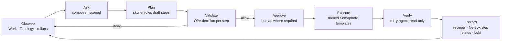

# 09 — Console UI Principles

**Date:** 2026-10-20
**Status:** PROPOSED
**Author:** Joseph A. Wisneski IV
**Context:** The agent-cloud administration console (the "Dispatch Console",
[`plan/development/16-dispatch-console.md`](../development/16-dispatch-console.md)) is the first
human interface that spans every authority on the platform. Without shared principles it would
drift into a second control plane: a place that writes around Semaphore, shows secrets, or
invents its own picture of the estate. This document states how the console looks and behaves,
and how people use it to work with agent-cloud. The principles were drawn from the 2026-10-20
design session, where three prototypes were reviewed and the Dispatch layout was chosen and
refined through review comments. The visual system is recorded in
[`plan/product/dispatch-console/DESIGN.md`](../product/dispatch-console/DESIGN.md).

> **Depends on:** 00 (doc standards), 01 (automation model), 04 (credentials), 06
> (observability). Elaborates [`PRINCIPLES.md`](../../PRINCIPLES.md) for the UI; where they
> disagree, PRINCIPLES.md wins.

---

## Problem

The platform already has an authority for every concern: Authentik, OpenBao, OPA, Semaphore,
skynet, NetBox, Proxmox, agentgateway, GitHub and the o11y stack. People still need one place
to see a tenant's estate, the work running against it, who or what is doing that work, and a
safe way to ask for change. That surface can strengthen the platform's rules or quietly break
them. These principles keep it doing the first.

## Design Principles

### Behaviour

1. **Through the platform, never around it.** The console is a proposal surface. It reads from
   authorities and proposes changes; skynet plans them, OPA decides, Semaphore executes or a PR
   lands. It never calls an authority's write API, never edits declared state, never runs a
   command (`PRINCIPLES.md` §4; plan 15 D3, D9).
2. **Work first.** The home page is the work: what is awaiting approval, queued, running,
   blocked, failed or done. Health, topology and governance pages exist to explain and create
   work.
3. **Scope is explicit and single-sourced.** The tenant is shown and changed in exactly one
   place (the sidebar). Org, site and environment live in the scope bar. A tree row, a map
   selection or a shift-click group narrows the scope further. Everything on screen respects
   the active scope, and every request carries it.
4. **Every red explains itself and offers the next step.** A degraded or down item shows why
   (the rule that denied it, the log line that failed it, the reason it paused) and one action:
   verify health, ask skynet to fix, propose a policy change, resume.
5. **Plain words in, evidence out.** Composers accept natural language. Answers cite the work
   items, steps, owning roles and receipts they are built from. A request returns a plan, and
   nothing runs until it is approved.
6. **Plans are vertical and owned.** Execution and drafted plans render as a numbered vertical
   stepper. Every step names the role that owns it (`infra-agent`, `security-agent`,
   `service-agent`, `o11y-agent`, an approver, a change window), and the step that runs
   automation expands into its Semaphore templates and receipt.
7. **Fewest steps.** One-row forms, suggestion chips, scope carried into every request,
   identity pulled from Access rather than retyped, and one-click verify / fix / assess.

### Presentation

8. **Status is shape, label and color.** Healthy, Degraded, Down, Running and Idle each have an
   icon and a word. Color alone never carries meaning.
9. **Color is for state.** The surface is grey; red and amber mean "look here"; one accent
   marks what you can act on.
10. **Fine-grained telemetry lives in Grafana.** The console draws rollups by tenant, org, site
    and cluster. Anything about a single service, node, host or VM is a link to Grafana,
    pre-filtered to it.
11. **Names, never values.** Secrets appear as paths, field counts, readers and rotation age.
    No screen, API response or log carries a secret value.
12. **Planned and example are labelled.** A capability that does not exist yet (the `net-agent`
    role, Tempo traces, an unwrapped deploy playbook) says "planned". Example data says so
    wherever it could be mistaken for real.

## Architecture

### The interaction loop

Every change the console makes follows one loop. It is the platform's propose → validate →
execute model with a human checkpoint and a verification step made visible.

### Information architecture

| Area | Pages | Authority behind it |
|---|---|---|
| Sidebar | Tenant switcher, Dashboard, Work (with red badges), Agent roles | Authentik (tenant membership), skynet |
| Infrastructure | Topology (compute, network, data flows), Services, Compute, Telemetry | NetBox, Proxmox, Prometheus / Loki → Grafana |
| Governance | Access, Secrets, Policy | Authentik, OpenBao (metadata), OPA |
| Automation | AI Gateway, LLM access, CI/CD | agentgateway, GitHub |

Each page states its source of truth in its header. A page with no authority behind it does
not belong in the console.

### Working with agent-cloud through the console

| Situation | Path in the console | What runs underneath |
|---|---|---|
| Something is red | Badge or tile → item → **Verify health** or **Fix with skynet** → approve | `o11y-agent` read-only checks (Inspect Service Runtime, Verify Service Persistence); then a plan of named templates |
| Where can this work fit? | Compute → Site / Cluster / Node → **Assess resource** | Read-only assessment (Snapshot Service Assessment); any resize returns as a proposal |
| What is happening to X? | Scope to X (tree, map selection or tile) → scope banner → Work filtered to X | Read models only |
| Why is AC-n stuck? | Work composer: "Why is AC-n blocked?" | skynet answers from the plan, OPA decision and receipts |
| Give someone LLM access | LLM access → user from Access → scopes → agents → **Request key** → approve | Inventory change + `Deploy agentgateway`; key handed off through `Back Up Credentials to site-config` |
| Change what agents may do | Policy → **Propose a change** → drafted plan → approve | Rego change + test on a branch, `opa test`, replay, PR review, deploy |
| Add a person | Access → one-row form → approve | Authentik blueprint deploy (plan 12) |
| Ship a change | CI/CD → delivery context: review, checks, promotion stage | GitHub; `main` required checks from `.github/rulesets/protect-main.json` |

### Visual system

Defined in [`plan/product/dispatch-console/DESIGN.md`](../product/dispatch-console/DESIGN.md):
control-room HMI greys, process-blue accent, system type stacks, flight-progress work strips,
vertical steppers, dashed cluster containers and chat-style composers. The reference
implementation is `plan/product/dispatch-console/prototype/dispatch.html`.

## Implementation Phases

### Phase 1 — Ratify

Review and accept this document alongside plan 16 and the PRINCIPLES.md Tenant-tier amendment.

**Acceptance:** status moves to ACTIVE; plan 16 links here as its principles.

### Phase 2 — Apply in the build

Each plan-16 phase is reviewed against the validation table below before it merges.

**Acceptance:** every merged console PR records the checklist result in its description.

### Phase 3 — Revisit

Revisit after the first production month: add principles that real use exposed, retire any
that did not hold.

**Acceptance:** a revision-history entry with the outcome.

## Validation Criteria

| Check | Pass condition |
|---|---|
| Authority badge | Every page header names its source of truth |
| No write-around | The page's mutations all create work items; none calls an authority write API |
| Scope | The page honours tenant (sidebar) and org / site / env (scope bar); requests carry scope |
| Red explains | Every non-healthy item shows a reason and exactly one primary next action |
| Status encoding | Icon + label on every status; no color-only signal |
| Telemetry | No per-service / node / host / VM chart; a Grafana link instead |
| Secrets | No secret value anywhere on the page or in its API responses |
| Plans | Every plan step names an owning role; the automation step lists its Semaphore templates |
| Labels | Planned capabilities and example data are labelled |
| Fewest steps | The page's primary task completes without retyping known data |

## Security Considerations

- **The UI is never the control.** Hiding a button is convenience. Authorisation lives in the
  console API (Authentik groups) and in OPA, both server-side.
- **Proposals, not actions.** The console's blast radius is bounded by the proposal path: a
  compromised session can create a proposal, and OPA and an approver must still pass it.
- **No secret display.** Principle 11 is a security property. Tests assert it (plan 16
  validation table).
- **Truthful state.** A console that shows example data, stale data or "planned" capabilities
  as live misleads operators into unsafe actions. Principle 12 and the authority badge exist
  to prevent that.

## Cross-references

- [16 — Dispatch Console](../development/16-dispatch-console.md): the build plan
- [`plan/product/dispatch-console/`](../product/dispatch-console/): brief, design system, prototype
- [01 — Automation model](01-automation-model.md) · [04 — Credentials & access](04-credentials-access.md) · [06 — Observability](06-observability-instrumentation.md)
- [15 — Service Deployment Workflow & Agents](../development/15-service-deployment-workflow-agents.md): roles and the step registry
- [`PRINCIPLES.md`](../../PRINCIPLES.md) · root [`AGENTS.md`](../../AGENTS.md)

## Revision History

| Date | Change |
|---|---|
| 2026-10-20 | Initial draft from the Dispatch Console design session |
