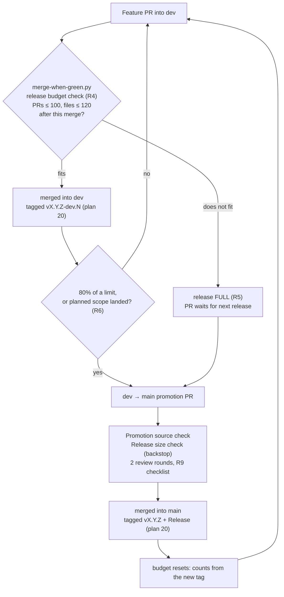

# 10 — Release Policy

**Date:** 2026-11-10
**Status:** ACTIVE (rules in force); enforcement PROPOSED in [plan 22](../development/22-release-train.md)
**Author:** Joseph A. Wisneski IV
**Context:** A release is one `dev` → `main` promotion. Plan 20 gave each release a version
number. Nothing limited how much one release carries, and v0.14.0 carried 26 days of work.
This document sets hard size limits on a release and the rules that keep every release
inside them. The two limits were set by the operator on 2026-11-10. The counting rules,
intake gate and planning rules below make those limits enforceable.

---

## Problem

v0.14.0 (promotion #1003, merged 2026-11-10) was the first release under semantic
versioning, and the largest promotion so far:

| Release | Pull requests | Files changed | Commits | Window |
|---|---|---|---|---|
| v0.12.0 (#607) | 80 | 276 | — | — |
| v0.13.0 (#656) | 46 | 160 | — | ~1 day |
| v0.14.0 (#1003) | 279 | 876 | 1,541 | 26 days (2026-10-15 → 2026-11-10) |

Counts come from `git diff --name-only` and the pull request merge commits between the
release tags. #1003's own `changedFiles` is 876, which matches the diff.

A promotion that size cost far more than the sum of its parts:

- **Review did not scale.** CodeRabbit could not review it, so both review rounds fell to
  the fallback reviewer (Hindsight, outcome 2026-11-10).
- **Findings piled up at the gate.** CodeQL failed the promotion with a backlog of alerts,
  including two real backtracking regexes. They were triaged at promotion time instead of
  when each pull request merged.
- **Production prerequisites surfaced late.** Two `main`-bound templates that declare
  isolated environments had no `main` copies. This was found during the promotion.
- **Blast radius.** Every `main`-bound Semaphore template changed at once, so a regression
  could not be traced to a small set of changes.

## Design Principles

- **Small, frequent, complete.** A release is small enough for one normal review and
  complete enough to deploy. Releases are the unit of planning, not an afterthought of it.
- **Hard limits, enforced at the cheapest point.** A limit checked only on the promotion
  pull request comes too late. `dev` would already be over the limit, and because a
  promotion must come from `dev`'s head, it could not ship. The limit is checked when work
  enters `dev`.
- **One implementation of every count.** The counts come from `scripts/semver.py` and from
  git, the same sources plan 20 uses. No second parser.
- **Through the platform, not around it** (`PRINCIPLES.md`). An over-limit release is
  split, never waived.

## The rules

**Terminology.** In this policy, a *major release* means a numbered `dev` → `main`
promotion: v0.15.0, v0.16.0, and so on. It is **not** a semantic-versioning major.
Plan 20's rules still apply: on 0.x a `feat` makes a minor release and a fix makes a
patch, and a new major (1.0.0 and later) is cut only by the operator's launch of
`Release Major Version (Dev)`.

| # | Rule |
|---|---|
| R1 | **A release is exactly one `dev` → `main` promotion pull request**, merged with a merge commit. Plan 20's release run tags it. |
| R2 | **Hard limit: at most 100 pull requests per release.** Count: the lines printed by `python3 scripts/semver.py notes --from <last release tag> --to origin/dev`. This counts feature pull requests merged into `dev`. Promotion merges and the `main` → `dev` sync merge are excluded, as in plan 20. |
| R3 | **Hard limit: at most 120 files changed per release.** Count: `git diff --name-only origin/main...origin/dev \| wc -l`, the distinct paths the promotion pull request changes. This equals GitHub's changed-files count for the promotion (876 = 876 for #1003). Every path counts the same, including generated artifacts such as `.codebase-memory/graph.db.zst` and deleted files. |
| R4 | **The limits are checked at intake.** A pull request merges into `dev` only if `dev` stays within both limits after the merge. Count that pull request as one more pull request, and count its files as the union with the files already counted. If `dev` would go over either limit, the release is **full**. |
| R5 | **A full release is promoted, not stretched.** While a release is full, nothing else merges into `dev` until its promotion merges. An urgent fix waits for that promotion. The promotion is small enough that this takes hours, not days. |
| R6 | **Cut a release when either trigger fires:** its planned scope has landed, or either count reaches 80% of its limit (80 pull requests or 96 files). The limit is a ceiling, not a target. |
| R7 | **Every release is planned.** Before work starts, a release has a declared scope: OpenSpec changes or task groups, listed in dependency order, with a file budget of at most **100 files**. The remaining 20 files are headroom for fixes found along the way. A change too large for one release is split by task group across consecutive releases. |
| R8 | **A pull request that does not fit waits or splits.** A pull request larger than the remaining budget waits for the next release or is split. A pull request over 120 files can never merge and must be split. |
| R9 | **Fixed promotion checklist.** Every promotion meets all of these: two review rounds with every finding answered (standing rule for pull requests into `main`); every required check green, including `Promotion source (dev -> main)` and, once built, `Release size`; the `main` copies of isolated-environment templates provisioned before merge; release notes in the standing format (Summary and Major Updates, then Features, Fixes and Documentation Updates, a collapsed list of other changes, and contributors). |
| R10 | **No waivers.** The only override is the existing `protect-main` admin break-glass. A release merged through it says so in its release notes, with the reason. |

### Why the file limit, not the PR limit, sets the pace

Files per pull request across the last three releases: 3.5 (v0.12.0), 3.5 (v0.13.0),
3.1 (v0.14.0). At that ratio the 120-file limit is reached at about **35–40 pull
requests**, long before 100. Intake into `dev` was 132 pull requests from 2026-11-03 to
2026-11-10. At that rate a release fills every 2–3 days. Plan 22 shapes the work and
lowers the cost of each promotion to fit that pace.

Merged pull requests into `dev` since 2026-10-27 (198) have a median of 5 changed files,
a 90th percentile of 17 and a maximum of 85. None exceeds 120, so R8 splits rarely.

## Architecture



## Enforcement status

| Rule | Mechanism | Status |
|---|---|---|
| R2, R3 counting | a `release-budget` subcommand in `scripts/semver.py` | **Not built** (plan 22, phase 1) |
| R4, R5 intake gate | `scripts/merge-when-green.py` refuses a merge into `dev` that would exceed a limit | **Not built** (plan 22, phase 2) |
| R2, R3 backstop | a `Release size` step on pull requests into `main` | **Not built** (plan 22, phase 3) |
| R6–R8 planning | the release scope in plan 22 and in Plane cycles | **Convention** until plan 22, phase 5 |
| R9 checklist | review receipts, required checks, release notes | Partly enforced (required checks); the rest is convention |

**Until the gates exist**, whoever merges into `dev` runs both counts first, from an
up-to-date clone:

```bash
git fetch origin
python3 scripts/semver.py notes --from "$(git describe --tags --abbrev=0 --exclude '*-dev.*' origin/main)" --to origin/dev | wc -l
git diff --name-only origin/main...origin/dev | wc -l
```

On 2026-11-10 these printed `5` and `25`: the release after v0.14.0 has 95 pull requests
and 95 files of room left.

If either result, plus the pull request about to merge, would exceed its limit, the
release is full (R5).

## Implementation Phases

The enforcement phases and the release roadmap live in
[plan 22 — Release train](../development/22-release-train.md).

## Validation Criteria

| Check | Passes when |
|---|---|
| Counts agree | `semver.py`'s PR count equals the merged pull requests listed in the release notes, and the file count equals the promotion pull request's `changedFiles` |
| Limits hold | Every release after this policy merges with ≤ 100 pull requests and ≤ 120 files, or its notes record an R10 break-glass |
| Intake gate | A merge into `dev` that would exceed a limit is refused by the guard, with both counts and the limit named |
| Cadence | The time from one promotion's merge to the next is days, not weeks |

## Security Considerations

- **Smaller blast radius.** Each release changes at most 120 files that `main`-bound
  templates run, so a production regression can be traced to a short list.
- **Review that actually happens.** A promotion of this size fits a normal review instead
  of exceeding the reviewer's limits, so the two review rounds read the whole change.
- **No new credentials.** Counting reads git history from a clone. The intake gate runs
  inside the existing merge guard. The backstop needs only `contents: read`.
- **Break-glass stays visible.** R10 requires every bypass to be named in the release notes.

## Cross-references

- [plan 22 — Release train](../development/22-release-train.md): enforcement phases and the dependency-ordered release roadmap
- [plan 20 — Semantic versioning](../development/20-semantic-versioning.md): how a release is numbered, tagged and published
- [dev merge guard](../development/dev-merge-guard.md): where the intake gate is added
- `.github/workflows/enforce-promotion-source.yml`: where the backstop is added
- [03 — Testing & CI Quality](03-testing-ci-quality.md)
- Root `AGENTS.md` → "Branch Workflow"

## Revision History

| Date | Change |
|---|---|
| 2026-11-10 | Initial policy: 100-PR and 120-file limits per release (operator), counting rules, intake gate, planning rules. |
