# Network Architecture

**Date:** 2026-10-27
**Status:** ACTIVE
**Author:** Joseph A. Wisneski IV
**Context:** agent-cloud's network design is spread across the Cloudflare edge code, the Caddy
templates, the internal CA and DNS services, the host firewall playbook, the inference gateway and
a dozen dated decision records. No single document showed how a packet actually travels, which hop
authenticates it, or which parts of that path are running versus decided versus planned. This
document is that map: the current state of the network as of the date above, every component
tagged with its status, every claim cited to the file that establishes it. It points into the
owning documents for depth and does not restate them.

> **Site identity is a parameter.** This repository is public. Real addresses, the public zone,
> the internal site label, node names, VM ids and per-host port bindings live only in the private
> site-config repository. In this document `<zone>` is the public DNS zone, `<site>` the internal
> site label, `<gpu-head>` and `<gpu-worker>` the two GPU nodes. No diagram or table below carries
> a real value.

---

## How to read this document

Every component and every connection carries one status. The status is the strongest claim the
repository's own evidence supports; where the repository has no evidence either way the entry says
UNVERIFIED rather than guessing.

| Status | Meaning |
|---|---|
| **LIVE** | Running in production, with a dated record in the repository |
| **LIVE-LOCAL** | Running in the local-dev instance only |
| **BUILT** | Code is merged; no production run is recorded |
| **DECIDED** | An accepted decision; the build is pending |
| **PROPOSED** | A decision record exists but has not been accepted |
| **PLANNED** | Tracked work that has not started, or has barely started |
| **WITHDRAWN** | Built or decided, then deliberately removed |
| **UNVERIFIED** | The repository holds no evidence of the live state |

In diagrams, a solid line is LIVE or BUILT and a dashed line is DECIDED, PROPOSED or PLANNED,
following the house diagram standard [1].

---

## Problem

Three questions kept costing time because their answers were scattered:

1. **"How does a request reach a service?"** The answer crosses Cloudflare, Caddy, sometimes
   Authentik, sometimes agentgateway, and the host firewall, each documented in a different place.
2. **"Is this hop encrypted and authenticated?"** The constitution says TLS terminates once, at the
   edge [2], but the platform now runs mutual TLS between Caddy and agentgateway and has planned
   TLS to vLLM. A reader of the principle alone gets the wrong picture.
3. **"Is this running, or only decided?"** Several older documents still describe states that
   have since changed (see [Where older documents disagree](#where-older-documents-disagree)).

## Design Principles

These are the constraints the network obeys. Each is quoted from, and subordinate to, the
constitution in `PRINCIPLES.md` [2].

1. **One front door.** Caddy is the sole HTTPS ingress for platform services. Internal services are
   not exposed to the internet directly [2][3].
2. **TLS terminates at the edge; a plain-HTTP backend needs an enforced trusted network.** A backend
   may speak plain HTTP only on a host where the default-deny firewall is applied [2]. Where a hop
   carries a credential the platform must not expose, it uses the internal CA instead (the Caddy to
   agentgateway hop is the first) [4].
3. **Consume public TLS, run a private CA, never become a public CA** [2].
4. **Network state is code.** Edge records and rules are OpenTofu [5]; Caddy routes, DNS records,
   certificates and firewall rules are rendered from inventory by playbooks run through Semaphore.
   Nothing reproducible is changed by hand [6].
5. **One authority per concern.** NetBox is the authority for addresses; DNS and certificates
   follow it, never the reverse (IPAM to DNS to PKI) [7].
6. **Infrastructure single points of failure carry a recovery story** before they carry traffic [2].

---

## Architecture

### 1. The network at a glance

The diagram below shows the trust zones a request can cross, from the public internet to the GPU
nodes, and the out-of-band paths that sit beside them. Read it left to right: everything public
enters through Cloudflare and then Caddy; the control plane reaches every host over SSH; the GPU
nodes are reached only through the inference gateway.

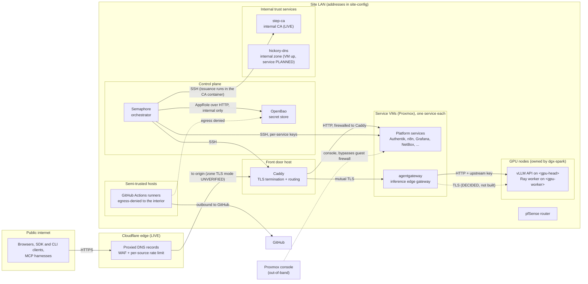

What each zone is, at a glance:

| Zone | What lives there | Status | Owning document |
|---|---|---|---|
| Cloudflare edge | Proxied records for every platform hostname, WAF, rate limit | LIVE [5] | `plan/development/13-cloudflare-iac.md`, `platform/infra/cloudflare/` |
| Front door | One Caddy container, the only HTTPS ingress | LIVE [8] | `05-platform-infra.md` |
| Service VMs | One service per Proxmox VM | LIVE (per-service status in `service-architecture.md`) | `02-service-onboarding.md` |
| Control plane | Semaphore and OpenBao | LIVE | `04-credentials-access.md` |
| Internal trust | step-ca (LIVE), hickory-dns (VM provisioned, service not deployed in production) | mixed [9][10] | `05-platform-infra.md` |
| GPU nodes | vLLM, managed by the dgx-spark repository, not agent-cloud | LIVE (outside this repo) | `plan/development/06-inference-skynet.md` |
| Semi-trusted | Self-hosted CI runners | LIVE [11] | `platform/services/github-runner/CLAUDE.md` |

### 2. The public edge: Cloudflare

Every platform hostname is a proxied A record pointing at the Caddy origin, declared once as a list
in OpenTofu and applied through the `Apply Cloudflare Tofu` Semaphore template; state lives in an
R2 bucket [5][12]. Seventeen labels are declared today, from `auth` and `inference` to `mcp` and
`admin.inference` [12]. The origin address is a variable whose real value lives in site-config.

A request then passes the zone's custom firewall ruleset, in order. The flowchart shows that order
and where each class of client leaves it: browsers fall through to Cloudflare's managed challenge,
while machine clients on a few exact API paths skip the challenge and are then rate limited.

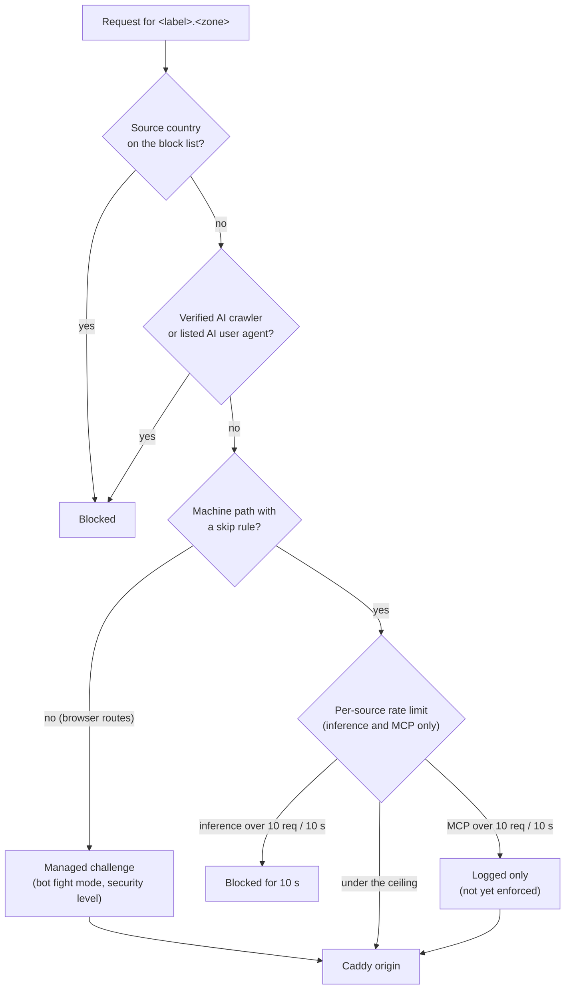

The machine paths that skip the challenge are deliberately narrow. Each skip covers only the bot
checks (`bic`, security level); the country and AI-bot blocks still apply [13].

| Hostname | Paths that skip the challenge | Extra condition | Source |
|---|---|---|---|
| `memory.<zone>` (honcho) | `/v3*`, `/health` | none | [13] |
| `semaphore.<zone>` | `/api/*` | an `Authorization` header is present | [13] |
| `o11y.<zone>` (Grafana) | `/api/*` | an `Authorization` header is present | [13] |
| `inference.<zone>` | `/v1/*`, `/health` | none: a keyless caller gets a cheap 401 from Caddy instead of a challenge page | [13] |
| `auth.<zone>` (Authentik) | the OIDC machine endpoints only (token, userinfo, revoke, introspect, device, discovery, JWKS) | browser login pages stay challenged | [13] |
| `mcp.<zone>` | exactly `/mcp` | none | [13] |

The rate limit is one ruleset on the zone's Pro plan, which allows two rules [14]. The inference
rule counts `/v1/*` on both the inference host and the gateway's operator-UI host per source
address and data center, and blocks at 10 requests per 10 seconds for 10 seconds; it has enforced
since 2026-09-15 [14]. The MCP rule has its own bucket of the same shape, in log-only mode until
real traffic is measured [14].

Two edge decisions shape every proxied hostname:

- **Cloudflare's 125-second read timeout is accepted.** A response or idle stream longer than that
  is cut with a 524. Only the Enterprise plan raises it, and taking the hostname off the proxy would
  remove the WAF and rate limit and publish the origin address. The fix is an origin-side
  keep-alive in the dgx-spark repository [15].
- **The origin is not locked to Cloudflare's address ranges.** A source-address allowlist was
  shipped on 2026-09-15, failed closed in production because the Caddy container does not see the
  Cloudflare peer address, and was reverted the same day. The operator then decided against any
  form of range lockdown, per route or on the host firewall. A caller that reaches the origin
  directly still faces the Bearer check at Caddy and the key check behind it [15][16].

### 3. The front door: Caddy

Caddy is a dedicated Infrastructure-tier host [3]. In production it is one rootless podman
container run from a hand-maintained directory, not from the monorepo's compose file; the inventory
records that directory as `compose_working_dir` so the persistence checks find it [8]. The
monorepo's compose file publishes ports 80 and 443 and uses a Caddy build with the Cloudflare DNS
plugin [17]. Every browser route in the production declaration obtains a Let's Encrypt
certificate through the Cloudflare DNS-01 challenge, the platform's public TLS strategy [3][50],
as the repository's legacy Caddyfile blocks do [49]; the inference, operator-UI and MCP routes add
the mutual-TLS upstream transport to agentgateway [50]. The zone's Cloudflare SSL mode, which
decides how Cloudflare connects to the origin, is not in the repository and is UNVERIFIED.

Production routes are raw Caddyfile blocks in site-config's `caddy_managed_sites`, written into a
marked region of the live Caddyfile by `Manage Caddy Sites`, which validates the result and
restores the previous file on failure; `caddy_retire_sites` hands a hand-written block over to
inventory ownership [6][18]. Local-dev renders the same route shapes from `caddy_routes` flags in
`Caddyfile.local.j2`, which is the locally testable copy of the production blocks [19].

A route takes one of five shapes. The diagram shows each shape and what it checks before
forwarding.

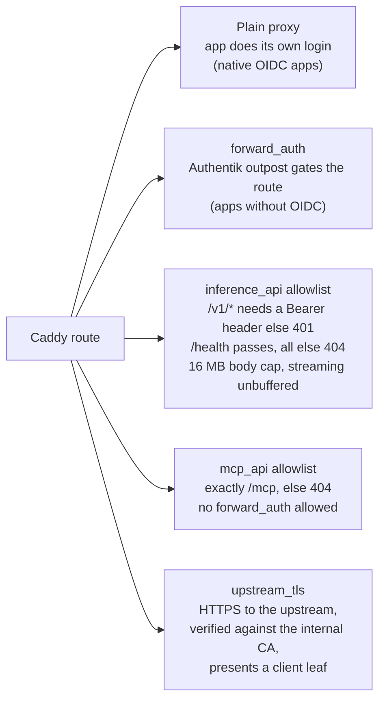

The `forward_auth` shape is worth seeing in motion, because it is the only shape where Caddy
itself enforces identity. The sequence below shows a browser reaching a forward-auth service: Caddy
strips any identity headers the client sent, asks the Authentik outpost, and forwards only with the
headers the outpost returned [19].

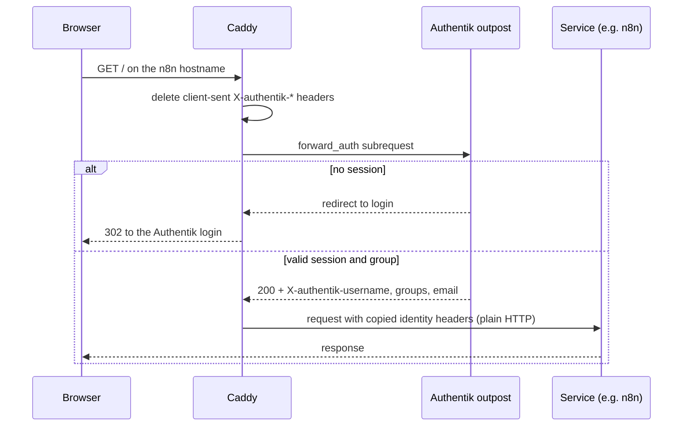

The `inference_api` shape follows the vLLM security guide's allowlist, because vLLM's own
`--api-key` protects `/v1` but not its control and metrics routes [19][20]. The 16 MB body cap and
unbuffered streaming are part of that shape [19].

### 4. The inference path

Inference is the one path with three authentication layers and the only internal hop that already
runs mutual TLS. Since 2026-10-14 the production `/v1/*` route goes to agentgateway; `/health`
still goes straight to the vLLM head node [21]. The sequence shows one chat completion end to end.

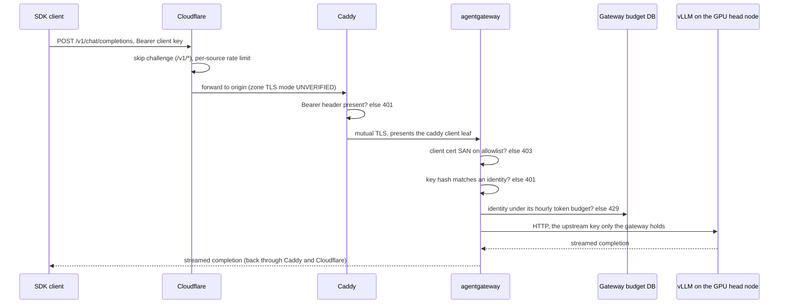

Each layer has a single job:

| Hop | Check | Status | Source |
|---|---|---|---|
| Cloudflare | Challenge skip on `/v1/*` and `/health`; 10 requests per 10 s per source | LIVE | [13][14] |
| Caddy | Bearer shape, path allowlist, body cap | LIVE | [19][21] |
| Caddy to gateway | Mutual TLS: Caddy presents its step-ca client leaf; the gateway admits only client certificates whose SAN is on `agw_client_cert_allowlist` (default `caddy`), before any key check | BUILT; measured 2026-10-02 | [4][22] |
| agentgateway | Per-identity API key, stored only as a sha256 hash; per-identity hourly token budget in its own Postgres | LIVE | [20][23] |
| Gateway to vLLM | Plain HTTP with the upstream key | LIVE | [24] |
| Gateway to vLLM, TLS | vLLM serving the internal CA's leaf, server-only first, then mutual | DECIDED 2026-10-16, waiting on the operator's go | [25] |

The gateway exposes more than the client listener. The listener set is fixed in its rendered
configuration [4]:

| Listener | Purpose | Reachable from |
|---|---|---|
| Client listener | `/v1`, and `/mcp` when MCP is enabled | Caddy only, under listener TLS |
| Loopback listener | The gateway's own MCP-to-`/v1` self-call | the gateway process's own loopback (any other source is 403) |
| UI listener | Operator UI behind the gateway's own OIDC login against Authentik, admin group required | Caddy, as `admin.inference.<zone>` |
| Admin API | Gateway administration | never published |

**MCP** is served on its own hostname, `mcp.<zone>`, with the exact path `/mcp`, so the inference
allowlist and its rate limit stay unchanged; only personal administrator identities may use it.
Its architecture record is still PROPOSED (2026-10-15) while the endpoint itself was probed live in
production on 2026-10-14 and 2026-10-15 [26][27].

**Rollback.** The route has a declared mode, `inference_route_mode`, that switches `/v1/*` between
the gateway and vLLM directly; `/health` goes to vLLM in both. The state diagram shows the three
rollback-playbook modes and why `restore` stays incomplete today [21][28].

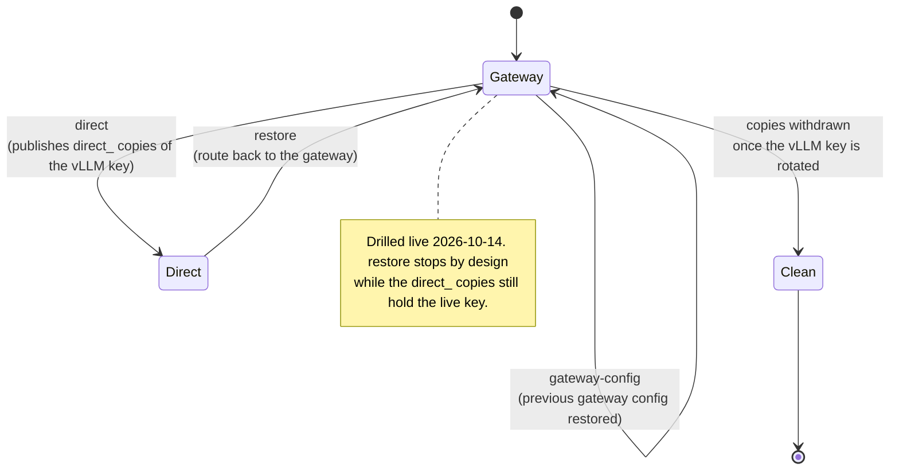

**Shared-key retirement.** Before the gateway, every client sent vLLM's one key. The gateway
admits that key as a `legacy-shared` identity until **2026-11-13**; a deploy on or after that date
drops the identity and fails until dgx-spark rotates the vLLM key [24].

**skynet's route.** agentgateway can carry a `/skynet/` route to the skynet orchestration API,
admitting only enrolled identities and presenting skynet's own bearer token [29]. In production
skynet has no published port and shares no network with the gateway, so nothing reaches it yet;
the public Caddy allowlist carries no `/skynet/` path [29][19].

### 5. Internal trust: certificates and names

**The internal CA.** step-ca runs on its own production host since 2026-09-29, with its API on the
host loopback and no ACME provisioner. Two JWK provisioners issue the two leaf profiles,
`issuer-server` (serverAuth) and `issuer-client` (clientAuth), and an authority name policy allows
only the SANs declared in site-config's `internal_leaves` [9][30]. No consumer contacts the CA over
the network: the key and certificate request are made on the consumer host, and Semaphore signs
over SSH by running `step` inside the CA container [9]. The sequence shows one issuance.

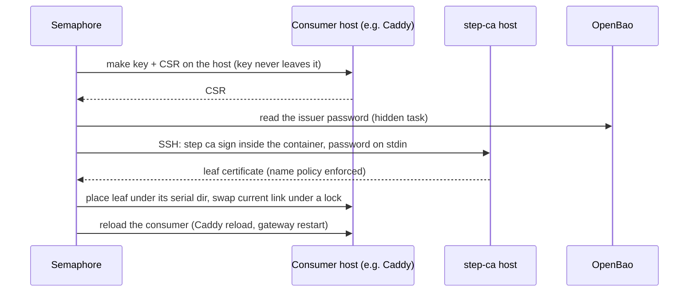

Renewal runs daily at 04:17 as `Renew Internal Certs (Dev)`: when any leaf on a host has less than
a third of its lifetime left, every leaf on that host is re-issued, the consumer reloaded once,
and each renewed leaf proven in use; expiry lines go to Loki and alert rules are deployed [9][31].
No real renewal has re-issued a leaf yet, and the CA backup is coded but has never run [9].

**The internal zone and naming.** hickory-dns is authoritative for one internal zone rendered from
inventory and forwards everything else; its recursor is off [10]. The production VM is provisioned
and firewalled, but the service is not deployed in production and host resolvers are not yet
repointed [32]. The naming scheme it will serve was decided by the operator on 2026-09-28 and is
still recorded as PROPOSED [33]. It has four name families, shown below with the rule that a
service name resolves to its load balancer wherever one exists.

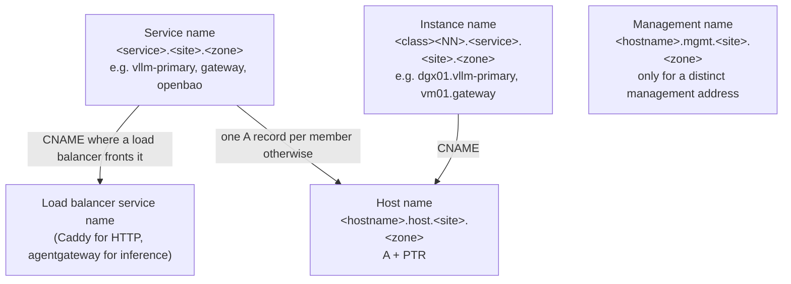

Clients use service names only; instance ordinals are never reused; hardware appears only in the
instance class; production renders no wildcard so a mistyped name answers NXDOMAIN [33].

**Who may resolve internal names.** Only declared clients: every agent-cloud host, the GPU nodes,
and a planned Tailscale subnet router for work laptops. pfSense does not forward the zone, and the
DNS host's firewall admits port 53 per declared source, one rule per inventory group member; that
firewall was applied on 2026-09-29 [34]. One public name, the identity provider's, will be answered
internally with the internal Caddy address as a split-horizon exception, declared in its own
site-config list (DECIDED 2026-09-29, build pending) [34].

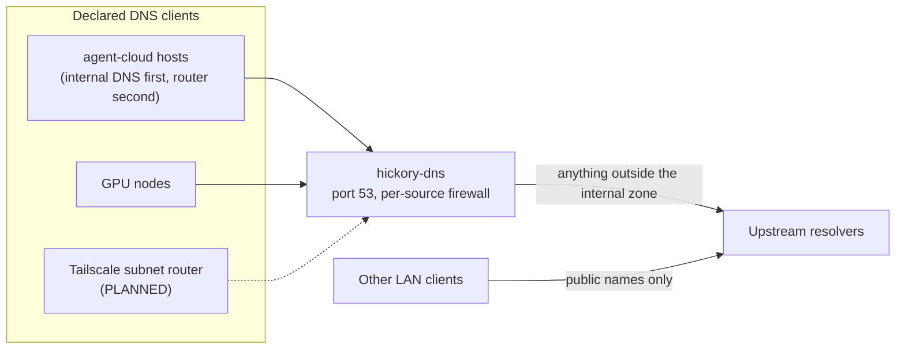

### 6. Host firewall and segmentation

The host firewall is UFW, applied by `apply-firewall.yml` through Semaphore: default-deny inbound,
allow outbound, SSH only from declared admin ranges, and each published port only from its intended
source [35]. Its anti-lockout rule adds the SSH allows before enabling and then forces a fresh SSH
handshake; the Proxmox console stays a guaranteed out-of-band path because a guest firewall cannot
filter it [35]. The flowchart shows how an inbound connection is judged.

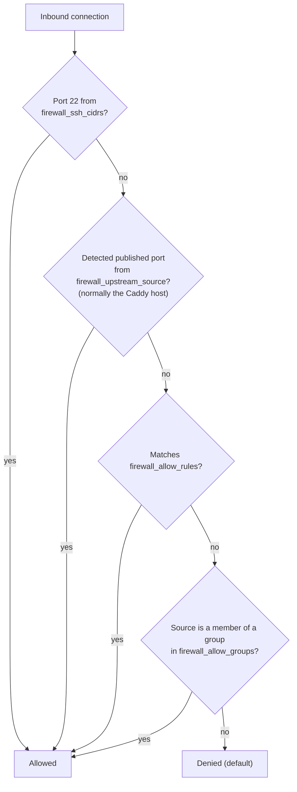

Rules are tagged, so a re-run adds only missing declared rules and prunes tagged rules that are no
longer declared, while untagged rules are kept [6][35]. Rootful podman and Docker publish through
DNAT, so the playbook writes route rules for them as well [35].

Where the firewall is recorded as applied:

| Host class | Inbound shape | Status | Source |
|---|---|---|---|
| DNS host | Port 53 per declared client | LIVE 2026-09-29 | [34] |
| o11y receiver | Grafana from the Caddy host; Loki push from the GPU node addresses | LIVE 2026-10-02 | [36] |
| Internal CA host | Default deny; CA API on loopback only | LIVE (group 3.1 done) | [9] |
| Services probed from their own host (tududi, honcho, n8n, o11y) | Service ports loopback-only or firewalled to the Caddy host | LIVE 2026-09-26 | [37] |
| CI runner hosts | **Egress deny** to the secret store, orchestrator and hypervisors (inbound shape not recorded) | LIVE, verified from inside a job | [11] |
| Caddy host | No firewall declaration found in this repository | UNVERIFIED | — |
| Every other service host | Per-host declaration in site-config | UNVERIFIED | — |

**Egress deny for semi-trusted hosts.** `firewall_deny_egress` writes `ufw deny out` rules so that a
credential leaking into a CI job cannot be used from that host: the control is denial at the network
boundary, not merely a credential withheld [35]. Runner registration tokens are minted on the
controller for exactly this reason: the runner hosts cannot reach OpenBao [11][38].

**Segmentation beyond the host.** The repository records OpenBao as sitting on an internal VLAN
[39], but holds no VLAN or subnet layout; that lives in site-config and on pfSense. No gateway-level
segmentation exists for the runner hosts; the host-level egress deny is the built control [11].

### 7. Control-plane paths

The control plane's connections are few and each has a guard. The diagram shows who talks to whom.

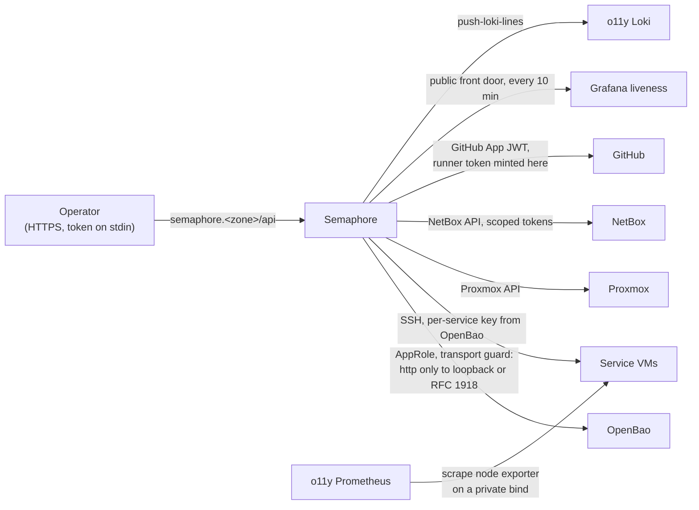

- **Every state-changing action goes through Semaphore.** Direct SSH is read-only break-glass
  [2][40].
- **Secrets never cross public cleartext.** Every play that reaches OpenBao first includes
  `assert-bao-transport.yml`, which allows `http://` only to loopback and RFC 1918 addresses [39].
- **Observability enrolment is network-checked.** `instrument-host-o11y.yml` runs a node exporter on
  each host's declared private address, proves the receiver can reach it before declaring the
  scrape, and requires the series to arrive [41]. The liveness watcher probes Grafana through the
  public front door, so the firewall needs no exception for it [42].

### 8. Provisioning: how a VM gets its address

Addresses are allocated in NetBox first, checked against the live network, and only then written
into a VM. The flowchart shows the order the service deployment workflow enforces.

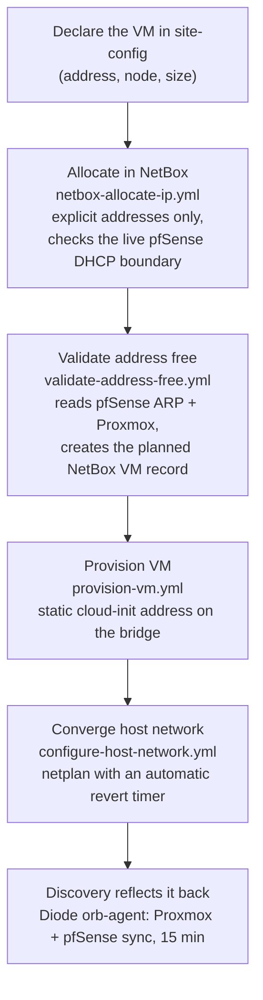

Each step exists because of a recorded incident: one host was found answering on an address
declared for a different host, and a deploy authenticated against the wrong machine for hours while
every credential check passed [43]. Allocation refuses "the next free address", because two runs a
minute apart would resolve it differently [44]; the ARP check refuses an address already live
unless every MAC seen for it belongs to the declared VM [45].

### 9. The local-dev network

Local-dev runs the same playbooks inside a podman machine VM on the operator's Mac. The diagram
shows how a browser on the Mac reaches a local service by name, and how the control plane reaches
the services [46].

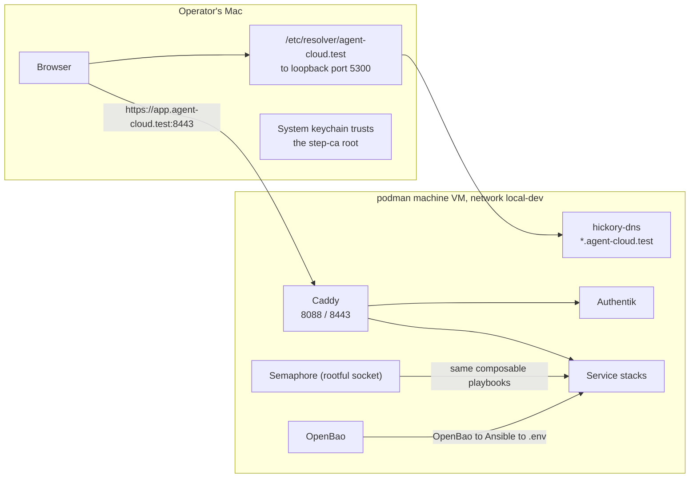

The local zone is the RFC 6761 reserved name `agent-cloud.test`; `make local-dns-resolver` and
`make local-tls-trust` wire the Mac to it, and `make local-https` optionally forwards 443 and 80 to
Caddy's high ports [46][47].

---

## Decision Criteria

The network's shape comes from a small number of choices. Each row names the options that were on
the table, the criteria that decided it, and why the chosen option won. Rejected options are kept
visible so a later reader does not reopen them without new evidence.

| Decision | Options considered | Criteria | Chosen, and why | Source |
|---|---|---|---|---|
| Where public TLS and bot defence live | Cloudflare proxy in front of Caddy; DNS-only records with Caddy alone | WAF, rate limiting and challenge at the edge; origin address not published | **All platform records proxied.** DNS-only would drop the WAF, the challenge bypass and the rate limit, and publish the origin address. | [12][15] |
| How long a request may run | Accept the 125 s proxy timeout; Enterprise plan; take the inference hostname off the proxy | Cost; keeping the edge controls | **Accept the timeout**, fix idle streams with an origin-side keep-alive. The other two options remove controls or add a plan tier. | [15] |
| Whether the origin answers only Cloudflare | Per-route source allowlist; host firewall on 80/443; no lockdown | Failure mode; observability of the control; exposure it closes | **No lockdown.** The allowlist failed closed in production (Caddy does not see the peer address); the host-firewall variant would block other hostnames on the same host. A direct caller still meets two key checks. | [15][16] |
| Where to rate-limit inference | Cloudflare per source; per Authorization header; at Caddy | Plan-tier limits; one shared key at the time; Caddy has no limiter without a third-party module | **Cloudflare, per source address**, with per-identity token budgets later moved into the gateway. Header keying would have been one bucket for the whole team. | [14][16][48] |
| Where the inference gateway runs | Its own VM; on the Caddy host; on the GPU head node | Blast radius of a gateway fault; node memory; keeping non-vLLM software off the GPU nodes | **Its own VM behind Caddy.** A gateway upgrade must not touch the front door for every hostname, and GPU node memory is the binding constraint. | [20] |
| How Caddy reaches the gateway | Plain HTTP on the LAN; mutual TLS with internal-CA leaves | The operator's 2026-09-27 requirement that every hop on the inference path be encrypted and that the gateway know its caller is Caddy | **Mutual TLS**, with a SAN allowlist checked before the API key, so only Caddy's leaf is admitted. The same requirement is why the platform runs a production internal CA at all. | [4][22][51] |
| Where MCP is served | Under the inference host; LAN-only; under the admin-UI host; its own hostname | Not widening an allowlist that exists because vLLM leaves control routes open; reachable by harnesses off the LAN; no browser challenge | **Its own hostname, `mcp.<zone>`**, exact path only, gateway key check. | [26] |
| How internal names are shaped | No site label; flat names; always several A records; hardware in names; four families under a site label | Adding a second site without renaming; delegation; health handled by a load balancer, not DNS | **Four families under a site label**, service names resolve to a load balancer where one exists. | [33] |
| Who may resolve internal names | pfSense domain-override forwarding; the whole LAN subnet; declared clients | Narrowest set that needs the names | **Declared clients only**, admitted per source. pfSense forwarding answers every LAN client; the subnet rule was the first declaration and was narrowed a day later. | [34] |
| How the CA is reached | ACME over the network; SSH-driven signing inside the container | Attack surface of the CA that signs every internal identity | **SSH-driven signing, API on loopback, no ACME**, on a host that runs nothing else. | [9] |

## Source Context

This document synthesises material that already exists; it adds no new decision. The pieces it
rests on, by area:

- **Constitution.** `PRINCIPLES.md` §6 sets the TLS, private-CA and recovery rules, and its as-built
  caveat records where the host firewall is applied and that it is not yet universal [2].
- **Edge.** The Cloudflare zone is OpenTofu under `platform/infra/cloudflare/`: one proxied record
  list [12], a custom firewall ruleset whose order matters [13], and a rate-limit ruleset whose own
  comments record the staged log-then-block rollout [14]. The rationale for the timeout and the
  withdrawn lockdown is in `05-platform-infra.md`, "Cloudflare-proxied hostnames" [15], with the
  archived edge-controls design recording the rejected alternatives [16].
- **Caddy.** The architecture is `05-platform-infra.md` [3]; the route shapes are defined in the
  local template's header and macros [19]; the production layout is recorded in the Caddy context
  README [8].
- **Inference.** The gateway's role beside skynet was accepted on 2026-10-12 [20]; its listeners
  and TLS rules are in its rendered configuration template [4][22]; the route switch, rollback drill
  and upstream TLS plan are in the `inference-gateway-agentgateway` OpenSpec change [21][25]; the
  shared-key retirement is in the service's architecture record [24].
- **Internal trust.** The CA's production record [9], its issuance policy [30] and renewal schedule
  [31]; the DNS service's own record [10] and the naming and client decisions in `05-platform-infra.md`
  [33][34]; the production DNS deploy status in the `internal-dns-naming` change [32].
- **Firewall and provisioning.** The firewall playbook's header documents its model [35]; the
  provisioning playbooks' headers document the address checks and the incident behind them
  [43][44][45]; the authority table in plan 03 fixes NetBox as the address authority [7].

---

## Implementation Phases

This is a current-state map, so its "phases" are the network work in flight. Each is owned by the
change or plan named, and each acceptance criterion is what would let this document move the item's
status forward.

### Phase A: retire the shared inference key (due 2026-11-13)

**Owner:** `inference-gateway-agentgateway` task 5.1, with dgx-spark rotating the vLLM key [24].
**Acceptance:** a deploy after 2026-11-13 passes with no `legacy-shared` identity; rollback
`restore` completes and withdraws every `direct_` copy.

### Phase B: TLS from the gateway to vLLM

**Owner:** gateway task 6.3 and dgx-spark ADR-0017 [25].
**Acceptance:** the gateway's model entry uses an `https://` base URL verified against the internal
CA; vLLM serves a renewed leaf without a restart; mutual TLS once every caller presents a leaf.

### Phase C: production internal DNS

**Owner:** `internal-dns-naming` group 6 [32].
**Acceptance:** hickory-dns serves the production zone; every agent-cloud host resolves internal
names first and the router second; the NetBox `dns_name` reconcile check passes; the split-horizon
IdP name answers internally [34].

### Phase D: finish the edge controls

**Owner:** `agentgateway-mcp` [26][27].
**Acceptance:** the MCP rate-limit rule moves from `log` to `block` after measurement; the MCP and
naming records receive their acceptance lines.

### Phase E: close the trust-boundary gaps

**Owners:** `production-internal-ca` groups 3 and 7 [9]; `PRINCIPLES.md` §6 [2].
**Acceptance:** a firewall declaration for every service host, read back by Semaphore; the CA
backup has run and a restore drill is recorded; the Caddy host's own firewall declaration exists.

### Later: Tailscale router and the Kubernetes tier

The Tailscale subnet router for work laptops is DECIDED in shape (SNAT, separate device) but not
started [34]. The Kubernetes tier and its address pools are PLANNED in plan 03 [7].

## Target Outcome

When the phases above land, the network looks like this: every hop that carries a credential is
encrypted with the internal CA, every host resolves internal names from the platform's own DNS, and
the shared inference key no longer exists. The diagram shows that end state; dashed lines are the
pieces not yet built.

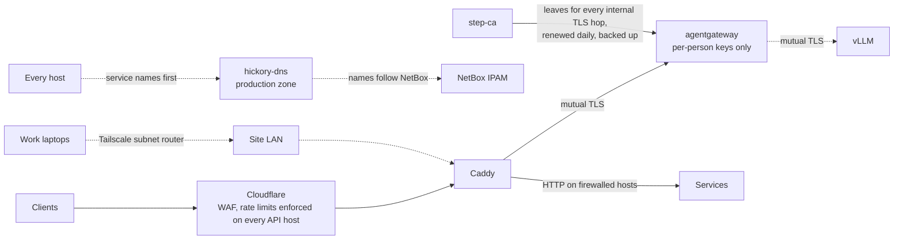

## Validation Criteria

These checks keep this document honest. Each pass condition is something a reader can verify
without trusting the prose.

| Check | Pass condition |
|---|---|
| Edge records | Every hostname named here appears in `platform/infra/cloudflare/dns.tf`, and `Apply Cloudflare Tofu` plans zero changes |
| Edge machine paths | `/v1/models` on `inference.<zone>` without a key answers 401 with no `cf-mitigated` header |
| Gateway mutual TLS | `Probe agentgateway Gate (Dev)` passes: both keyless and wrong-key `/v1/models` answer 401 through the verifier leaf |
| Rollback mode | `Rollback Inference Route` read-back reports `/v1/*` on exactly the declared mode's upstream and `/health` on vLLM |
| Certificates | `Renew Internal Certs (Dev)` with `--tags verify` proves every declared leaf in use |
| Firewall | `Snapshot Firewall` for a host lists default-deny inbound and only the declared sources |
| Status drift | Any status in this document older than its newest cited record is updated, with the date |

## Security Considerations

- **This document carries no site identity.** Addresses, zones, node names and per-host bindings
  stay in site-config; diagrams use placeholders. Keep it that way when updating.
- **Known exposures are tracked where they were found, not here.** OpenBao's API listener runs
  without TLS on the internal network, recorded as risk R1 in plan 03 [7]; the step-ca first-boot
  log exposure is a recorded risk in the CA's record [9]. This document does not compile a list of
  weak points beyond those records.
- **Blast radius.** The front door is a single point of failure for every public hostname, which is
  why the gateway does not share its host [20]. The CA's intermediate key signs every internal
  identity, which is why its host runs nothing else and its API is loopback-only [9].
- **Semi-trusted code.** CI runners execute workflow code the platform did not write; their
  isolation is egress denial plus workspace destruction, and per-job containerisation is explicitly
  not an enforced control [11].
- **No credential crosses public cleartext.** The transport guard refuses it before any request
  [39]; client keys reach probes through files or pipes, never a command line.

## Where older documents disagree

On 2026-10-27 the stale statements this survey found in `05-platform-infra.md`, `PRINCIPLES.md`,
AGENTS.md, plan 06 and the agentgateway record were corrected in place. One known disagreement
remains; the table gives the newer fact and its date so a reader can resolve it.

| Older statement | Newer fact | Date and source |
|---|---|---|
| Internal DNS, CA and Caddy authorities "LIVE (local-dev)" (plan 03 authority table) | Production CA deployed; production DNS VM provisioned, service not deployed | 2026-09-29 [9][32] |

## Cross-references

| Document | Relationship |
|---|---|
| [`PRINCIPLES.md`](../../PRINCIPLES.md) §6 | The rules this network obeys |
| [`ARCHITECTURE.md`](../../ARCHITECTURE.md) | The repository map that points here |
| [`service-architecture.md`](service-architecture.md) | The companion map of services, identities, secrets and deploys |
| [`05-platform-infra.md`](05-platform-infra.md) | Caddy, TLS, Cloudflare, gateway, MCP and DNS decision records |
| [`04-credentials-access.md`](04-credentials-access.md) | SSH, AppRole and Semaphore access rules |
| [`06-observability-instrumentation.md`](06-observability-instrumentation.md) | What the o11y receiver scrapes and why |
| [`plan/development/03-guardrails-governance.md`](../development/03-guardrails-governance.md) | One authority per concern; IPAM to DNS to PKI |
| [`plan/development/13-cloudflare-iac.md`](../development/13-cloudflare-iac.md) | Cloudflare edge as code |
| [`AGENTS.md`](../../AGENTS.md) | Operational rules and the workflow catalog |

## References

Repository paths are relative to the repository root. Line ranges are as of the date of this
document; for the long, frequently edited documents the section name is given as well.

1. `plan/architecture/00-foundation-standards.md:97-104` (Diagram Guidelines)
2. `PRINCIPLES.md:320-367` (§6 Infrastructure & Resilience)
3. `plan/architecture/05-platform-infra.md:26-79` (Purpose, Role, Traffic Flow) and `:215-260` (TLS and DNS Integration)
4. `platform/services/agentgateway/deployment/templates/config.yaml.j2:38-51` (listener TLS) and `:236-262` (listeners)
5. `platform/infra/cloudflare/versions.tf:1-40`; `platform/infra/cloudflare/README.md:1-40`
6. `AGENTS.md`, "Policy and Configuration Changes — Code Only" and the Independent Workflows table (`Manage Caddy Sites`, `Apply Firewall`)
7. `plan/development/03-guardrails-governance.md:1217-1234` (Per-concern authority table)
8. `platform/services/caddy/context/README.md:52-59`
9. `platform/services/step-ca/context/architecture.md:35-89` (Production, deployed 2026-09-29)
10. `platform/services/dns/context/architecture.md:9-20`
11. `platform/services/github-runner/CLAUDE.md:28-35` and `:68-78` (What isolation you actually get)
12. `platform/infra/cloudflare/dns.tf:1-48`; `platform/infra/cloudflare/imports-inference.tf:1-23`
13. `platform/infra/cloudflare/waf.tf:14-196`
14. `platform/infra/cloudflare/ratelimit.tf:1-116`
15. `plan/architecture/05-platform-infra.md:261-291` (Cloudflare-proxied hostnames)
16. `plan/development/openspec/changes/archive/2026-09-15-inference-edge-cloudflare-controls/design.md:60-110` (rate-limit keying alternatives; decision 3, superseded 2026-09-15: no origin lockdown)
17. `platform/services/caddy/deployment/compose.yml:1-35`
18. `platform/playbooks/manage-caddy-sites.yml:1-30`
19. `platform/services/caddy/deployment/templates/Caddyfile.local.j2:1-160`
20. `plan/architecture/05-platform-infra.md:292-351` (Inference gateway: agentgateway alongside skynet; accepted 2026-10-12)
21. `plan/development/openspec/changes/inference-gateway-agentgateway/tasks.md:513-535` (route switch, 2026-10-14)
22. `AGENTS.md`, Independent Workflows table, `Deploy agentgateway` and `Probe agentgateway Gate (Dev)` rows
23. `platform/services/agentgateway/context/architecture.md:1-80`
24. `platform/services/agentgateway/context/architecture.md:225-247` (Shared-key retirement) and `:278-282` (upstream table)
25. `plan/development/openspec/changes/inference-gateway-agentgateway/tasks.md:884-930` (task 6.3)
26. `plan/architecture/05-platform-infra.md:352-394` (MCP endpoint and the one admin list; PROPOSED 2026-10-15)
27. `plan/development/openspec/changes/agentgateway-mcp/tasks.md:453-460` and `:596-612`
28. `platform/playbooks/rollback-inference-route.yml:1-140`; `plan/development/openspec/changes/inference-gateway-agentgateway/tasks.md:644-672`
29. `platform/services/skynet/deployment/CLAUDE.md:1-25` and `:66-72`
30. `platform/playbooks/vars/step-ca-issuance.yml:1-28`
31. `platform/semaphore/templates.yml:945-950` (`Renew Internal Certs (Dev)` schedule)
32. `plan/development/openspec/changes/internal-dns-naming/tasks.md:170-182`; `AGENTS.md`, Deployment Status, "Internal DNS and CA hosts (2026-09-28)"
33. `plan/architecture/05-platform-infra.md:395-503` (Internal DNS naming)
34. `plan/architecture/05-platform-infra.md:504-534` (Internal DNS clients and split-horizon names)
35. `platform/playbooks/apply-firewall.yml:1-190`
36. `plan/development/openspec/changes/inference-telemetry-production/tasks.md:143-148` (task 1.4)
37. `AGENTS.md`, Deployment Status, "Service boot persistence and health (prod, 2026-09-26)"
38. `platform/services/github-runner/CLAUDE.md:355-362`
39. `platform/playbooks/tasks/assert-bao-transport.yml:1-22`
40. `plan/architecture/04-credentials-access.md:325-340` and `:415-420`
41. `platform/playbooks/instrument-host-o11y.yml:1-30`
42. `platform/playbooks/check-o11y-liveness.yml:1-22`
43. `platform/playbooks/configure-host-network.yml:1-30`
44. `platform/playbooks/netbox-allocate-ip.yml:1-30`
45. `platform/playbooks/validate-address-free.yml:1-14`
46. `LOCAL-DEV-README.md:25-60` and `:150-165`
47. `docs/LOCAL-DEV.md:205-224`
48. `platform/infra/cloudflare/ratelimit.tf:1-30` (plan tier and per-data-center counting)
49. `platform/services/caddy/deployment/Caddyfile:9-16`
50. site-config `inventory/production.yml`, `caddy_managed_sites` (private repository; TLS directives read 2026-10-27, no values reproduced)
51. `plan/development/openspec/changes/production-internal-ca/proposal.md:1-25`

## Revision History

| Date | Change |
|---|---|
| 2026-10-27 | Initial version: current-state network map with status per component, decision criteria, in-flight phases and target outcome |
