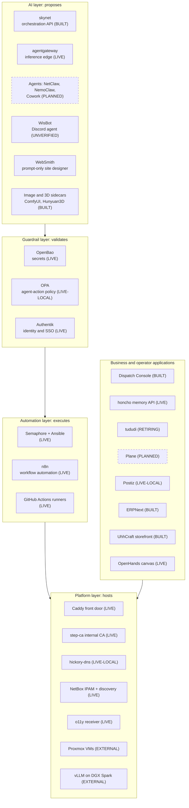
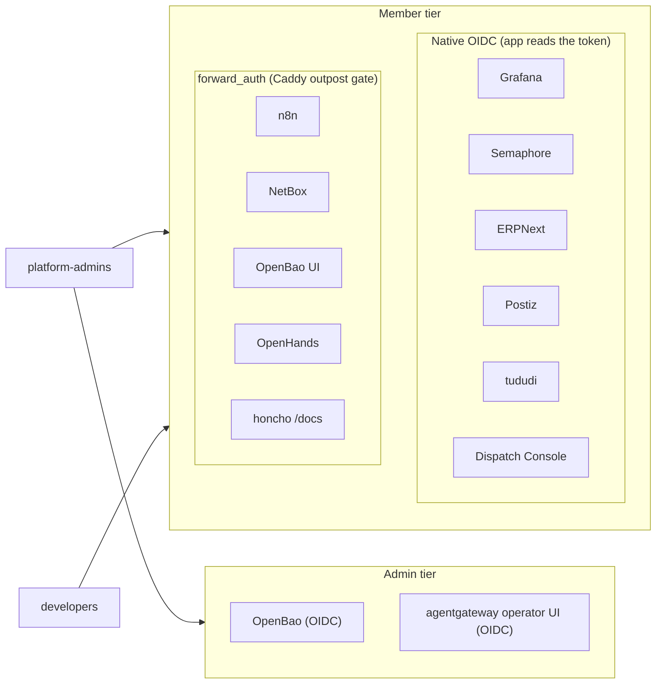
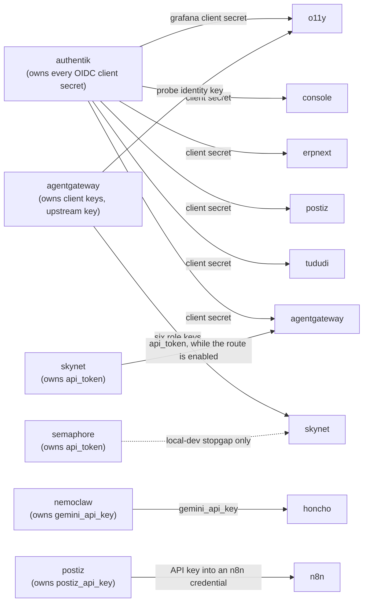
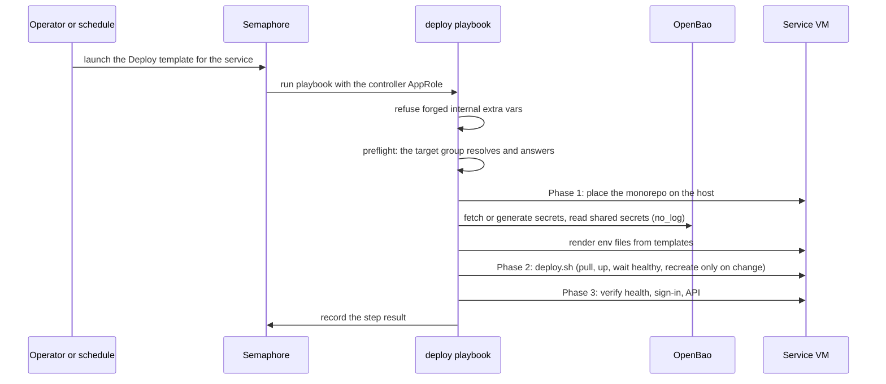
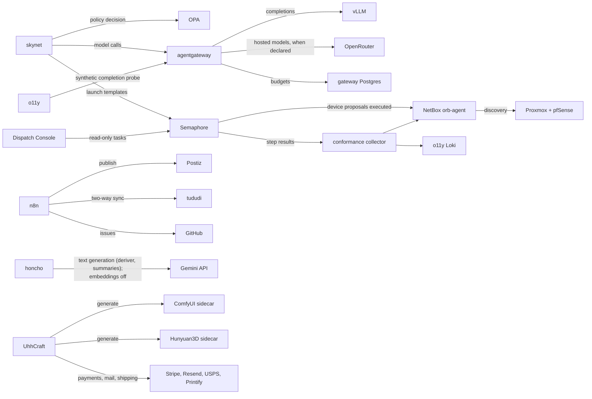
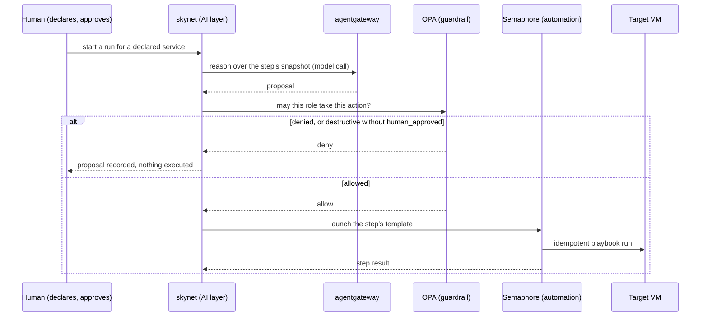
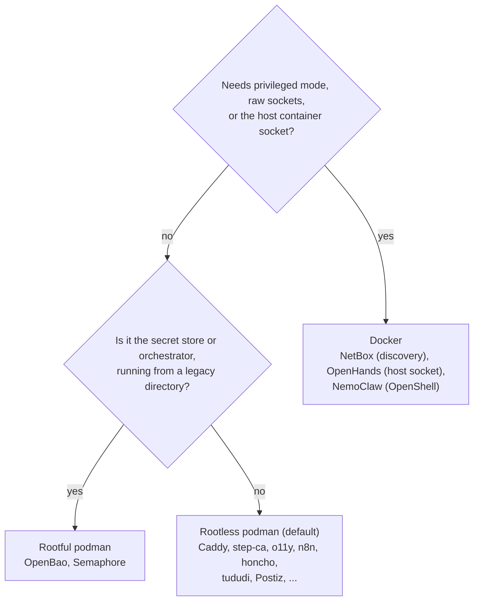
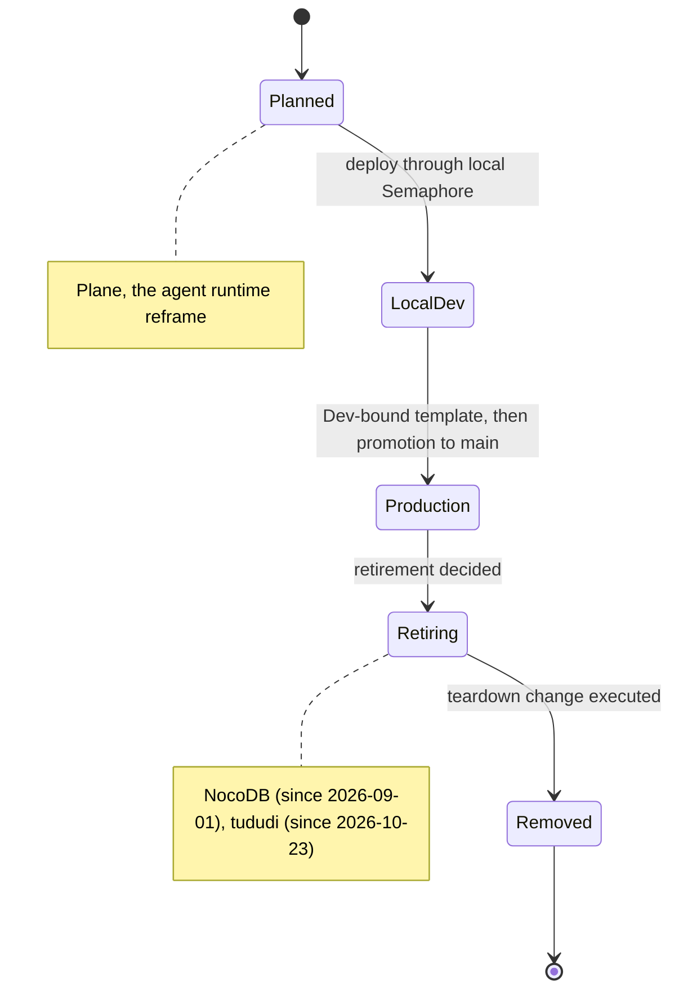
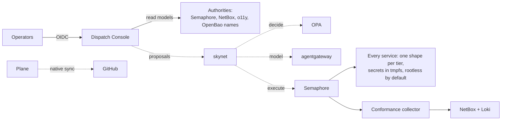

# Service Architecture

**Date:** 2026-10-27
**Status:** ACTIVE
**Author:** Joseph A. Wisneski IV
**Context:** agent-cloud runs more than twenty services and agents, each with its own deploy
playbook, identity integration, secret path and status, and each documented in its own directory.
What was missing was the view across them: which layer each service belongs to, how a person or an
agent is authenticated to it, whose secrets it reads, how it gets deployed, what it calls at
runtime, and whether it is actually running. This document is that view, as of the date above. It
is a map: each section points to the document that owns the detail and does not restate it. Its
companion, [`network-architecture.md`](network-architecture.md), covers how traffic reaches these
services.

> **Site identity is a parameter.** Hostnames appear as `<label>.<zone>`; addresses, node names,
> VM ids and account names live only in the private site-config repository.

---

## How to read this document

Every service carries one status, the strongest claim the repository's own evidence supports.

| Status | Meaning |
|---|---|
| **LIVE** | Running in production, with a dated record in the repository |
| **LIVE-LOCAL** | Running in the local-dev instance only |
| **BUILT** | Deploy code is merged; no production run is recorded |
| **PLANNED** | Decided or tracked, not built |
| **RETIRING** | Retired by decision but still running |
| **PLACEHOLDER** | A directory exists; nothing is deployable from it |
| **EXTERNAL** | Owned by another repository or by the substrate |
| **UNVERIFIED** | The repository holds no evidence of the live state |

In diagrams a solid line is LIVE or BUILT and a dashed line is PLANNED, following the house diagram
standard [1].

---

## Problem

A newcomer asking "what does agent-cloud run, and how do the pieces depend on each other?" had to
read the four-layer summary in `ARCHITECTURE.md` [2], the workflow catalog in `AGENTS.md` [3], the
Authentik app catalog [4], each service's `CLAUDE.md` or `context/` record, and the dated Deployment
Status list. Those sources also disagree in places, because statuses moved faster than the older
documents (see [Where older documents disagree](#where-older-documents-disagree)). The cost was
paid every time: a deploy planned against a service that had been retired, or a dependency missed
because it was recorded only in another service's playbook.

## Design Principles

Each principle below is a rule from the constitution [5] that shapes how services are built; this
document only shows where each one lands.

1. **The AI Invariant.** AI proposes, guardrails validate, automation executes, never the inverse;
   no agent is a standing reconciler [5][6].
2. **Everything through Semaphore.** Every privileged, state-changing action runs as a Semaphore
   template, for audit and credential injection [3][6].
3. **OpenBao is the only source of truth for credentials.** Secrets flow OpenBao to Ansible memory
   to Jinja2 templates to compose-readable env files; `deploy.sh` only manages containers and never
   touches OpenBao. OpenBao and Semaphore themselves are the one bootstrap exception [3][6].
4. **One shape per tier.** A service's tier decides its deploy shape and VM placement [7].
5. **Rootless podman by default.** Rootful podman or Docker only when a capability rootless cannot
   grant forces it, and the deploy names that capability [6][7].
6. **One authority per concern.** NetBox for addresses, Git for desired state, the runtime for live
   state, OpenBao for secrets, OPA for agent-action policy, o11y for telemetry [8].
7. **Observability by declaration.** Logs are collected without per-service work, metrics are two
   labels, `service.name` joins every signal [6].

---

## Architecture

### 1. Services by layer

The platform's four layers are AI, Guardrail, Automation and Platform; a privileged change flows
down through them and never up [2]. The diagram places every service and agent in its layer, with
the shared front door and substrate underneath. Dashed boxes are planned.

### 2. Service catalog

This table is the one-line record per service. "Edge" is how a caller is authenticated before or at
the service; the network path itself is in the companion document. The runtime column says
"podman" where the repository does not state rootless or rootful.

| Service | Purpose | Tier | Runtime | Edge authentication | Status | Owning record |
|---|---|---|---|---|---|---|
| OpenBao | Credential store, AppRoles | Infrastructure | Rootful podman, legacy directory | Authentik forward_auth (members) and OIDC (admins); token auth | LIVE [9] | `platform/services/openbao/` |
| Semaphore | Orchestrator for every privileged action | Infrastructure | Rootful podman, legacy directory | Native OIDC; API token | LIVE [9] | `platform/semaphore/README.md` |
| Authentik | Central IdP and SSO | Infrastructure | Podman, 4 containers | Is the IdP | LIVE [10] | `authentik/deployment/context/architecture.md` |
| Caddy | Sole HTTPS ingress | Infrastructure | Rootless podman, legacy directory | Per route (see network doc) | LIVE [11] | `05-platform-infra.md` |
| step-ca | Internal CA, two issuing profiles | Infrastructure | Rootless podman, own VM | None: API on host loopback | LIVE 2026-09-29 [12] | `step-ca/context/architecture.md` |
| hickory-dns | Internal zone, forwarder | Infrastructure | Podman | None (DNS) | LIVE-LOCAL; production VM provisioned [13] | `dns/context/architecture.md` |
| NetBox | IPAM authority + Diode discovery | Infrastructure | Docker, 12 services | Authentik forward_auth | LIVE; discovery freshness UNVERIFIED [14] | `netbox/deployment/CLAUDE.md` |
| o11y | Prometheus, Loki, Alloy, Tempo, Pyroscope, Grafana, node exporter | Infrastructure | Rootless podman, own VM | Grafana native OIDC | LIVE [15] | `o11y/deployment/CLAUDE.md` |
| agentgateway | Inference edge gateway with per-identity keys and budgets | Infrastructure | Podman, gateway + its own Postgres | API key per identity; UI by gateway OIDC (admins) | LIVE since 2026-10-14 [16] | `agentgateway/context/architecture.md` |
| OPA | Agent-action authorization (Rego) | Guardrail | Podman | None in Phase 1 (decisions, not secrets) | LIVE-LOCAL [17] | `opa/deployment/context/architecture.md` |
| GitHub runners | Self-hosted CI for private repos | Automation | Host service; jobs in rootless podman | None (outbound only) | LIVE, two hosts [18] | `github-runner/CLAUDE.md` |
| n8n | Workflow automation, queue mode | Automation | Rootless podman, 4 containers | Authentik forward_auth + n8n owner login | LIVE since 2026-09-02 [19] | `n8n/deployment/README.md` |
| skynet | Orchestration API: runs the onboarding workflow, asks OPA, calls the model through agentgateway, runs Ansible through Semaphore | AI | Podman, API + its own Postgres | agentgateway key + skynet bearer | BUILT; no production route [20] | `skynet/deployment/CLAUDE.md` |
| Dispatch Console | Operator administration UI (Rust) | Operator app | Podman, image built on the host | Native OIDC | BUILT; no production run recorded [21] | `console/deployment/CLAUDE.md` |
| honcho | Memory API for team memory | Auxiliary | Rootless podman, 4 containers | JWT on `/v3`; Authentik forward_auth on `/docs` | LIVE [22] | `honcho/deployment/CLAUDE.md` |
| tududi | To-do tracker | Auxiliary | Rootless podman | Native OIDC | RETIRING: retired 2026-10-23, replaced by Plane [23] | `tududi/deployment/CLAUDE.md` |
| Plane | Work tracker replacing tududi | Auxiliary | Own VM (planned) | Authentik OIDC (planned) | PLANNED, 0 of 85 tasks [23] | `plan/development/16-plane-work-management.md` |
| Postiz | Social publishing | Auxiliary | Rootless podman, 5 containers + search node | Native OIDC; public API path keyed by the app | LIVE-LOCAL; production host hardened, app pending [24] | `postiz/deployment/CLAUDE.md` |
| OpenHands | Agent canvas | Auxiliary | Docker (host socket for session containers) | Authentik forward_auth | LIVE [25] | `openhands/context/architecture.md` |
| ERPNext | ERP, system of record for storefront revenue | Business | Podman, 9 containers | Native OIDC | BUILT; local deploy pending image pull [26] | `erpnext/deployment/context/architecture.md` |
| UhhCraft | Storefront, first WebSmith-built site | Website | Podman, 4 containers | Public storefront | BUILT; go-live smoke pending hardware [27] | `uhhcraft/CLAUDE.md` |
| ComfyUI, Hunyuan3D | Image and 3D generation sidecars for UhhCraft | AI | Podman with GPU | Internal only | BUILT; GPU readiness unproven [28] | each service's `CLAUDE.md` |
| WisBot | Discord voice and chat agent | AI | Podman or Docker via runtime detection | None (Discord bot; health on loopback) | UNVERIFIED [29] | `agents/wisbot/deployment/CLAUDE.md` |
| NemoClaw | Agent sandbox (legacy reference) | AI | Docker (OpenShell requires it) | None declared | Legacy reference; reframed onto skynet, PLANNED [30] | `agents/nemoclaw/deployment/CLAUDE.md` |
| NocoDB | Former table store | Automation | Podman, legacy `deploy.sh` | Hand-maintained route | RETIRING since 2026-09-01 [31] | `plan/development/09-service-migrations-tooling.md` |
| vLLM | Model serving on the GPU pair | External | Owned by dgx-spark | Upstream key held by agentgateway | EXTERNAL [16] | dgx-spark repository |

Directories that exist with nothing deployable: `a2a-registry`, `nextcloud`, `wikijs`, `inference`,
and the agents `cowork`, `netclaw`, `workflows` [32]. WebSmith has no runtime by design: it writes a
signed `SPEC.md` that a service deploy consumes [33].

### 3. Identity: how people and agents are authenticated

Authentik is the single identity provider. Its app catalog declares, per application, whether the
app logs users in itself (native OIDC) or is gated by Authentik's outpost at Caddy (`forward_auth`),
and whether members or only administrators may use it [4]. The diagram groups every catalogued app
by those two choices.

Native OIDC is preferred because the application then knows who the user is. `forward_auth` is
for applications that cannot do OIDC; Caddy strips any identity headers the client sent before
asking the outpost [4][34]. The gateway's operator UI moved from an external forward-auth gate to
native OIDC because the gateway could not see an identity it did not authenticate itself [35].

Machines authenticate differently, and each kind has one mechanism:

| Caller | Mechanism | Source |
|---|---|---|
| Inference clients and MCP harnesses | Per-identity agentgateway key, stored only as a sha256 hash; one personal identity per declared administrator | [16][36] |
| Semaphore runs | OpenBao AppRole, injected through the Semaphore environment | [3] |
| Dispatch Console reading Semaphore | Its own read-only Semaphore account (`guest` role, cannot launch), never the controller token | [21] |
| honcho members | Per-member JWT minted inside honcho, stored in OpenBao | [22] |
| skynet | agentgateway key, then skynet's own bearer token presented by the gateway | [20] |
| CI runners | GitHub App credentials minted on the controller; the runner hosts cannot reach OpenBao | [18] |

Who counts as an administrator is one declared list, `platform_admins` in site-config, which renders
both the Authentik admin accounts and the gateway's personal identities; an account is removed by
listing it in `platform_retired_accounts` and redeploying Authentik [36]. Role-based provisioning
below the admin tier (Org, Department, Team, Role and Access Level) is a TARGET, not built [2].

### 4. Secrets: who owns what, and who reads whose

Every service with OpenBao-managed credentials owns one path, `secret/services/<service>`, and
writes nothing elsewhere; external systems such as vLLM own no path (the gateway holds the vLLM
key under its own), and services with no secrets, such as OPA and OpenHands, have none. When
a service needs another's secret, it reads it read-only through `_shared_reads` in its deploy, and
never stores a copy under its own path [3]. The diagram draws every shared read declared in the
deploy playbooks, plus the Postiz API key that `provision-n8n-postiz-credential.yml` reads into an
n8n credential; the arrow points from the owner to the reader [3][46].

The secret flow on every deploy is the same four steps: OpenBao to Ansible memory (credential tasks
only carry `no_log`), Jinja2 templates, compose-readable env files that are gitignored and
overwritten on every deploy, and `deploy.sh` that only reads them [3]. The skynet read of the
Semaphore token is a recorded stopgap refused outside local mode [3][20].

Two security properties are recorded as targets rather than facts: secrets rendered to persistent
env files inside a full repository clone today, where the target is tmpfs-mounted engine secrets and
rendered runtime artifacts only [6]; and two policies, `nemoclaw-read` and `semaphore-read`, still
grant wildcard access over `secret/data/services/*`, against the "enumerated paths only" rule
[2][37].

### 5. Deploy lifecycle

Composable services are deployed the same way, by a Semaphore template that runs their
`deploy-<name>.yml`. Legacy wrappers (OpenBao, Semaphore, NocoDB, NemoClaw), host services (the CI
runners) and external systems follow the paths their own records describe, and planned services
have none yet. The sequence shows one composable deploy, using tududi as the example [38].

The phases and their guards are shared tasks, not per-service code: `place-monorepo`,
`manage-secrets`, `refuse-internal-extra-vars`, `preflight-target-group`, `clean-service` with its
`confirm_reset` guard on every Clean Deploy, and `emit-step-result` [3]. A `(Dev)` template runs the
same playbook from the `dev` branch, so a change can be proven in production before promotion [3].

### 6. Runtime dependencies

At runtime, services call each other through a small number of edges. The diagram shows those calls
(not deploy-time secret reads, which are in section 4). Everything also depends on Caddy for its
public route and on Authentik for user login; those edges are left out to keep the picture
readable.

Notable edges, each recorded where it lives:

- **skynet to Semaphore.** skynet never runs Ansible itself; it launches templates, so every action
  it proposes is executed by the automation layer [20].
- **agentgateway to OpenRouter.** A model declared with `provider: openrouter` is served through the
  gateway with a key only the gateway holds; it is optional and absent unless declared [16].
- **n8n to tududi and GitHub.** The two-way task and issue sync runs as n8n workflows; it ends with
  tududi's teardown in Plane's final phase [23][39].
- **Semaphore to NetBox.** A device creation proposed by skynet and allowed by OPA is executed by
  the `Create NetBox Device` playbook with a scoped NetBox token [3].

### 7. The AI path: propose, validate, execute

The AI Invariant is easiest to see as a sequence. The diagram shows skynet taking a declared service
through one workflow step, with each layer doing only its own job [6][20][40].

The four agent roles that may act are infrastructure, security, observability and service, each an
OPA identity; destructive actions also need `human_approved` [40]. In production this path is not
connected yet: skynet has no production route and the WisAI-to-skynet migration is PLANNED [20][41].

### 8. The service deployment workflow

New and existing services move through one 23-step workflow, declared in a registry and executed
step by step through Semaphore; light-blue reasoning steps are where the agent roles above propose
[40][42]. The flowchart shows the 23 steps in registry order, with consecutive steps grouped under
the purpose they share; each box lists its registry step ids.

```mermaid
flowchart LR
    S1["1-5 Machine<br/>vm-template, lookup-inventory,<br/>validate-address, provision-vm,<br/>cloud-init"]
    S2["6-8 Access<br/>ssh-keys, ssh-key-backup,<br/>access-harden"]
    S3["9-10 Assess and size<br/>service-assess, vm-rightsize"]
    S4["11 Secrets<br/>secrets-approle"]
    S5["12 Host telemetry<br/>instrument-host"]
    S6["13-14 Service<br/>service-deploy, service-validate"]
    S7["15-16 Edge<br/>edge-route, edge-dns"]
    S8["17-18 Firewall<br/>fw-assess, fw-harden"]
    S9["19-20 Service telemetry and boot<br/>instrument-service,<br/>systemd-enablement"]
    S10["21-23 Close-out<br/>access-assess, oidc-config,<br/>credential-backup"]
    S1 --> S2 --> S3 --> S4 --> S5 --> S6 --> S7 --> S8 --> S9 --> S10
```

The collector, `Collect Service Conformance`, is the workflow's only status writer: it reads each
template's recent Semaphore history and writes the newest result per service and step to NetBox
custom fields and to Loki for the `service-conformance` dashboard [3][42]. The registry file is the
authority for the order; the grouping is a reading aid [42].

### 9. Runtime choice and boot persistence

A service runs rootless podman unless it needs something rootless cannot give. The onboarding
standard decides on privileged mode, raw sockets and compose health chains [7]; the flowchart
combines that rule with where today's services actually landed, including the two control-plane
services that still run rootful from their original directories [3][9].

Containers must survive a reboot without a person. Every compose service declares `restart: always`
(or `"no"` for a labelled one-shot); rootless services need linger plus podman's user boot unit,
rootful ones the system restart unit, and a legacy rootful container off `always` gets its own
`agent-cloud-boot-<service>` unit [3]. On 2026-09-26 eight production services passed the
persistence check and seven passed the health check (Caddy declares no health path); no boot path
has yet been exercised by a real reboot [43].

### 10. Service lifecycle

Services enter and leave the platform through a fixed path. The state diagram shows it, with the
services currently in each non-running state [23][31][41].

---

## Decision Criteria

The service architecture follows from a handful of choices. Each row keeps the rejected options
visible so they are not reopened without new evidence.

| Decision | Options considered | Criteria | Chosen, and why | Source |
|---|---|---|---|---|
| Who may change state | Agents act directly; agents propose and automation executes | Safety of an LLM with destructive reach; audit | **Propose only.** The fourth, guardrail layer exists so no agent can author its own target and apply it. | [6] |
| Where credentials live and who handles them | Per-service secret generation in `deploy.sh`; OpenBao with Ansible as the only handler | One source of truth; secrets kept out of logs and repo | **OpenBao, handled only by credential tasks in Ansible**; `deploy.sh` is lifecycle-only, with OpenBao and Semaphore as the bootstrap exception. | [3][6] |
| How applications authenticate users | Gate everything at Caddy; native OIDC where the app supports it | The app must know who the user is; fewer moving parts per request | **Native OIDC first, `forward_auth` for apps without OIDC.** The gateway's UI is the worked example of moving from a gate to native OIDC. | [4][35] |
| How shared secrets reach a second service | Copy into the reader's path; read from the owner's path | Rotation in one place | **Read-only shared reads**, never stored back. | [3] |
| Inference gateway versus orchestrator | agentgateway replaces skynet; skynet fronts vLLM directly; both, with distinct jobs | Per-client keys and limits for SDK clients; placement and policy across the estate | **Both.** agentgateway owns transport, keys and budgets; skynet owns placement, policy and orchestration, and reaches models through the gateway. | [44] |
| Container runtime | Docker everywhere; rootless podman everywhere; rootless by default with named exceptions | Least privilege; the capabilities a few services require | **Rootless podman by default**; Docker only where privileged mode or the host socket is required. | [6][7] |
| How the console reads the platform | Its own database; the controller token; read models from each authority with a read-only identity | Never a second source of truth; least privilege | **Read models from the authorities**, through a `guest` Semaphore identity that cannot launch. | [21][45] |
| Work tracking | Keep tududi with a GitHub sync; Plane with native GitHub sync and OIDC | Native integration over a maintained sync | **Plane**, decided 2026-10-23; tududi's teardown is Plane's last phase. | [23] |

## Source Context

This document synthesises existing records; it adds no new decision.

- **Layers and principles.** `ARCHITECTURE.md` gives the four-layer model and the one-line rules [2];
  `PRINCIPLES.md` §3 to §5 state the secret, AI and automation rules in full [6].
- **Workflow catalog and deployment status.** `AGENTS.md` lists every Semaphore workflow, the shared
  task library, the OpenBao layout and the dated Deployment Status entries this document's status
  column relies on [3].
- **Identity.** The Authentik app catalog is the authority for which app uses which integration and
  tier [4]; the single admin list is recorded in `05-platform-infra.md` [36].
- **Secrets.** Each `_shared_reads` edge is read from the service's own deploy playbook [38][46].
- **Per-service facts.** Each service's `CLAUDE.md`, `README.md` or `context/architecture.md`, cited
  per row in the catalog.
- **In-flight work.** Plan 15 for the deployment workflow [40], plan 16 for Plane [23], plan 17 for
  the console [45], plan 06 for skynet [41], and the active OpenSpec changes under
  `plan/development/openspec/changes/`.

---

## Implementation Phases

This is a current-state map, so its phases are the service work in flight that would change a row
above. Each has an owner and the acceptance criterion that moves its status.

### Phase A: Plane replaces tududi

**Owner:** plan 16 and OpenSpec `deploy-plane-work-management` [23].
**Acceptance:** Plane LIVE with Authentik OIDC and native GitHub sync; tududi and its n8n sync torn
down; tududi's row removed.

### Phase B: the console in production

**Owner:** plan 17 and OpenSpec `add-dispatch-console` [21][45].
**Acceptance:** a production deploy proves `/healthz` and an unauthenticated 401 on its API; its
read-only Semaphore identity is proven unable to launch.

### Phase C: skynet and the agent roles in production

**Owner:** plan 06 gates and plan 15 phases 4 to 7 [40][41].
**Acceptance:** a production network path from agentgateway to skynet exists by decision; the
Semaphore-token stopgap is replaced by a role-scoped token; one greenfield service is onboarded
end to end by the workflow.

### Phase D: Postiz, ERPNext and UhhCraft go live

**Owners:** plan 14, plan 08, plan 07 [24][26][27].
**Acceptance:** each service LIVE with its verify play passing in production; UhhCraft's sidecars
proven on GPU.

### Phase E: retire NocoDB and close the boundary violations

**Owners:** `plan/development/09-service-migrations-tooling.md` [31]; `ARCHITECTURE.md` as-built notes
[2].
**Acceptance:** NocoDB's containers, volumes and route removed; no `deploy.sh` outside the bootstrap
pair sources the OpenBao client; wildcard read policies narrowed to enumerated paths.

### Later: runtime artifacts and the Kubernetes tier

Rendered runtime artifacts with tmpfs secrets are the constitution's top build priority and a
TARGET [6]; the Kubernetes tier, Harbor and Kyverno are PLANNED in plan 03 [8].

## Target Outcome

When the phases land, every repository-managed service in the catalog is either LIVE or removed
(EXTERNAL systems such as vLLM stay EXTERNAL), and the AI layer is
connected end to end through the guardrails. The diagram shows that end state; dashed lines are the
connections not yet built.

## Validation Criteria

These checks let a reader confirm the catalog without trusting the prose.

| Check | Pass condition |
|---|---|
| Status of a LIVE service | Its `Verify Service Persistence` template passes, and so does `Verify Service Health` for every service that declares a health path (Caddy declares none: its check is that a known route is served) |
| Conformance | `Collect Service Conformance` reports a result for every tracked service, none `history_incomplete` |
| Identity | Every native-OIDC app enabled in production passes Deploy Authentik's post-apply redirect check (`verify_redirect`); every forward_auth app enabled in production redirects an unauthenticated request to the Authentik login |
| Secrets | `Check Secrets` lists every path in this document's secrets diagram; no service path holds a copy of another's secret |
| Drift | Any status here older than its newest cited record is updated, with the date |

## Security Considerations

- **Least privilege per identity.** Each machine caller has its own identity and scope (section 3);
  the controller token is never handed to a service.
- **Secrets never printed.** Credential handling is isolated in `no_log` tasks, and the repository
  callback strips request headers and error detail from those tasks [3].
- **Known gaps are tracked where they were found.** The wildcard read policies, the NocoDB
  boundary violation, and secrets in a full repository clone are recorded in `ARCHITECTURE.md` and
  `PRINCIPLES.md` as targets [2][6]; this document points to them rather than duplicating them.
- **Semi-trusted code.** CI runners serve only the private repositories in their declared list;
  per-job containerisation is not an enforced control, so nothing sensitive may sit on a runner
  host [18].
- **Destructive operations are double-gated.** Every Clean Deploy requires `confirm_reset` naming
  the target host, and destructive agent proposals need `human_approved` in OPA [3][40].

## Where older documents disagree

These older statements predate the facts above and are not corrected in place; the table gives
the newer fact and its date.

| Older statement | Newer fact | Date and source |
|---|---|---|
| tududi listed as a deployed production service (AGENTS.md, Completed) | Retired by decision; Plane replaces it | 2026-10-23 [23] |
| Dispatch Console plan "PROPOSED" (plan 17) | Code and deploy templates merged; production run not recorded | 2026-10-26 [21] |
| WisBot's `/wisllm` depends on the WisAI endpoint | The WisAI plane was never built; skynet supersedes it | 2026-06-23 [29][41] |

## Cross-references

| Document | Relationship |
|---|---|
| [`network-architecture.md`](network-architecture.md) | How traffic reaches these services |
| [`ARCHITECTURE.md`](../../ARCHITECTURE.md) | The four-layer map and one-line rules |
| [`PRINCIPLES.md`](../../PRINCIPLES.md) | The constitution these services obey |
| [`01-automation-model.md`](01-automation-model.md) | The composable deploy pattern |
| [`02-service-onboarding.md`](02-service-onboarding.md) | Tiers, onboarding checklist, runtime decision |
| [`04-credentials-access.md`](04-credentials-access.md) | Secrets, AppRoles and access rules |
| [`06-observability-instrumentation.md`](06-observability-instrumentation.md) | The signal contract every service follows |
| [`plan/development/15-service-deployment-workflow-agents.md`](../development/15-service-deployment-workflow-agents.md) | The deployment workflow and agent roles |
| [`AGENTS.md`](../../AGENTS.md) | Workflow catalog, OpenBao layout, deployment status |

## References

Repository paths are relative to the repository root. Line ranges are as of the date of this
document; for long, frequently edited documents the section name is given as well.

1. `plan/architecture/00-foundation-standards.md:97-104` (Diagram Guidelines)
2. `ARCHITECTURE.md:30-151` (4-Layer Model, Component Map, Load-Bearing Decisions, As-Built vs Target)
3. `AGENTS.md`: "Secrets Management", "Composable Task Library", "Independent Workflows", "Container Runtime", "Deployment Status"
4. `platform/services/authentik/deployment/app-catalog.yml:1-117`
5. `PRINCIPLES.md:1-15`
6. `PRINCIPLES.md:121-319` (§3 Identity, Secrets & the Guardrail Triad; §4 The AI Invariant; §5 Automation & Promotion) and `:320-367` (§6, runtime artifacts [TARGET])
7. `plan/architecture/02-service-onboarding.md:32-64` (Service Classification) and `:253-270` (Container Runtime Decision)
8. `plan/development/03-guardrails-governance.md:1217-1234` (Per-concern authority table)
9. `AGENTS.md`, Deployment Status, "Service boot persistence and health (prod, 2026-09-26)"; `platform/services/openbao/deployment/README.md:40-55`
10. `AGENTS.md`, Deployment Status, "Authentik deployed (prod)"; `platform/services/authentik/deployment/compose.yml:1-100`
11. `platform/services/caddy/context/README.md:52-59`
12. `platform/services/step-ca/context/architecture.md:35-89`
13. `platform/services/dns/context/architecture.md:1-72`; `AGENTS.md`, Deployment Status, "Internal DNS and CA hosts (2026-09-28)"
14. `AGENTS.md`, Deployment Status, "NetBox deployment recorded; discovery recovery unverified"; `platform/services/netbox/deployment/docker-compose.yml:1-260`
15. `platform/services/o11y/deployment/CLAUDE.md:1-30`
16. `platform/services/agentgateway/context/architecture.md:1-80`, `:225-247` and `:278-300`; `plan/development/openspec/changes/inference-gateway-agentgateway/tasks.md:513-535`
17. `platform/services/opa/deployment/context/architecture.md:1-45`
18. `platform/services/github-runner/CLAUDE.md:1-80`
19. `platform/services/n8n/deployment/README.md:1-20`; `AGENTS.md`, Deployment Status, "n8n composable cutover (prod, 2026-09-02)"
20. `platform/services/skynet/deployment/CLAUDE.md:1-25` and `:66-72`
21. `platform/services/console/deployment/CLAUDE.md:1-115`; `plan/development/17-dispatch-console.md:1-60`
22. `platform/services/honcho/deployment/CLAUDE.md:1-19`
23. `plan/development/16-plane-work-management.md:1-110`; `plan/development/openspec/changes/deploy-plane-work-management/tasks.md` (0 of 85 checked)
24. `platform/services/postiz/deployment/README.md:1-30`; `AGENTS.md`, Deployment Status, "Postiz local bring-up recorded"
25. `platform/services/openhands/context/architecture.md:1-20`
26. `platform/services/erpnext/deployment/context/architecture.md:1-20`; `AGENTS.md`, Sub-directory Documentation (erpnext row)
27. `platform/services/uhhcraft/CLAUDE.md:1-60`; `plan/development/07-websmith-uhhcraft.md:1-20`
28. `platform/services/inference-comfyui/deployment/README.md:70-84`; `platform/services/inference-hunyuan3d/deployment/README.md:75-84`
29. `agents/wisbot/deployment/CLAUDE.md:1-20`
30. `agents/nemoclaw/deployment/CLAUDE.md:1-20`
31. `plan/development/09-service-migrations-tooling.md:1-30`; `AGENTS.md`, Deployment Status, "NocoDB decommission"
32. Directory listings of `platform/services/{a2a-registry,nextcloud,wikijs,inference}` and `agents/{cowork,netclaw,workflows}`
33. `agents/websmith/CLAUDE.md:1-20`
34. `platform/services/caddy/deployment/templates/Caddyfile.local.j2:10-20` and `:129-160`
35. `plan/development/openspec/changes/inference-gateway-agentgateway/design.md:183-191` (the forward-auth gate corrected to native OIDC)
36. `plan/architecture/05-platform-infra.md:352-394` (MCP endpoint and the one admin list)
37. `platform/services/openbao/deployment/config/policies/nemoclaw-read.hcl:3-6`; `platform/services/openbao/deployment/config/policies/semaphore-read.hcl:8-10`
38. `platform/playbooks/deploy-tududi.yml:1-157`
39. `platform/services/tududi/context/github-sync-contract.md:1-30`
40. `plan/development/15-service-deployment-workflow-agents.md:40-180` (Decisions, Design principles, Architecture, Workflow table)
41. `plan/development/06-inference-skynet.md:1-30` and `:236-300`
42. `platform/workflows/service-onboarding/registry.yml` (23 step ids)
43. `AGENTS.md`, Deployment Status, "Service boot persistence and health (prod, 2026-09-26)"
44. `plan/architecture/05-platform-infra.md:292-351` (Inference gateway: agentgateway alongside skynet; accepted 2026-10-12)
45. `plan/development/17-dispatch-console.md:30-60` (Decisions D1 to D21)
46. `platform/playbooks/deploy-{honcho,o11y,skynet,agentgateway,console,postiz,tududi,erpnext}.yml`, each playbook's `_shared_reads`; `platform/playbooks/provision-n8n-postiz-credential.yml`

## Revision History

| Date | Change |
|---|---|
| 2026-10-27 | Initial version: service catalog with status, identity, secret and dependency maps, deploy and AI paths, decision criteria, in-flight phases and target outcome |
