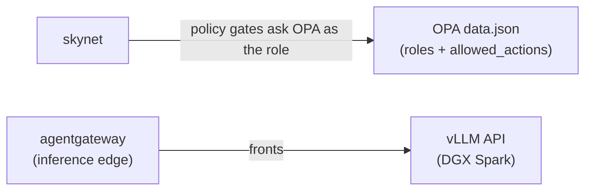

# 06 — Inference Plane & Agents (skynet)
> **Depends on:** 00, 01, 03
>
> **Status:** ACTIVE (2026-11-04) — skynet is deployed in production (`Deploy skynet (Dev)`, recorded in `AGENTS.md` Deployment Status, 2026-10-30).

> **skynet (read first):** skynet is the local-first, OPA-gated `/v1` inference plane and LangGraph agent platform. Its agents are the only AI agents in agent-cloud, and each one runs as a skynet sub-agent role.

> **Inference edge.** agentgateway now fronts the DGX Spark vLLM API as the inference edge (per-client keys, per-key token budgets, request telemetry), alongside skynet, not instead of it. Record: `plan/architecture/05-platform-infra.md`, "Inference gateway: agentgateway alongside skynet" (**Accepted** 2026-10-12; in the production `/v1` path since 2026-10-14). Service: `platform/services/agentgateway/`. Change: `plan/development/openspec/changes/inference-gateway-agentgateway`.

## Inference plane

Production `/v1` traffic goes to agentgateway, which fronts the DGX Spark vLLM API. vLLM itself is managed from the `dgx-spark` repository, not from agent-cloud (`plan/architecture/network-architecture.md`, GPU nodes row).

skynet's OpenAI-compatible `/v1` adds multi-backend placement scheduling and pre-inference policy gates. The gateway's `/skynet/` route is not yet enabled in production.

The intended endpoint indirection is the OpenBao value `secret/services/inference/endpoint` (URL and bearer token). Consumers are meant to resolve the endpoint from OpenBao at render time and never hardcode it.

## Agent roles and the OPA contract

skynet runs the agents as sub-agent roles. Each role is an OPA identity plus its LangGraph use-case set. The roles are `infra-agent`, `security-agent`, `o11y-agent`, `service-agent`, `network-agent` and `skynet-eval`.

The OPA role catalog (`platform/services/opa/deployment/policies/agentcloud/data.json`) and its policy (`platform/services/opa/deployment/policies/agentcloud/agent_actions.rego`) are the authorization contract. skynet queries OPA as the role, so each identity keeps least-privilege permissions. Roles keep separate identities rather than sharing one, so no role inherits another role's permissions. The catalog has entries for `infra-agent`, `security-agent`, `o11y-agent`, `service-agent` and `network-agent`; it has no entry for `skynet-eval`.

Policy gates in skynet ask OPA as the role before inference.

Agent launches reach Semaphore only through the launch gate, the only identity that may ask Semaphore to launch a task on behalf of an agent (`platform/services/launch-gate/deployment/CLAUDE.md`).

## Use-case catalog

skynet's `use-case-catalog.yaml`, in the private `uhstray-io/skynet` repository, is the single source of truth for AI workloads. Each use-case is recorded with an `id`, `consumer`, `caller(role)`, `capability`, `io_contract`, `output_consumer`, `privacy`, an OPA `{agent, service, action}` triple and a category (A, B, C or D).

Build #1, NetBox device add, landed on `dev`. Its OPA triple is `infra-agent` / `netbox` / `create`, which `data.json` allows.
