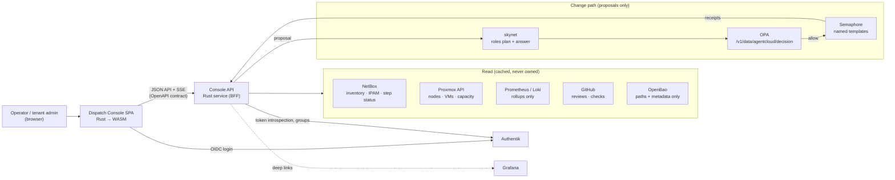

# 16 — Dispatch Console (agent-cloud administration UI)

**Date:** 2026-10-20
**Status:** PROPOSED
**Author:** Joseph A. Wisneski IV
**Context:** agent-cloud has authorities for every concern (Authentik, OpenBao, OPA,
Semaphore, skynet, Proxmox, NetBox, agentgateway, GitHub Actions, the o11y stack) but no single
place to see a tenant's estate, the work running against it and who or what is doing that work,
or to ask for a change and watch it go through the guardrails. Plan 15 (decision D4) already
names a **standalone dashboard service** as the long-term outcome of the service deployment
workflow. This plan builds it. The design was settled in a session on 2026-10-20: three layout
prototypes were compared, the **Dispatch** (work-first) layout was chosen, and it was refined
through review comments. The product brief, design system and prototype are saved in
[`plan/product/dispatch-console/`](../product/dispatch-console/). The UI principles are
[`plan/architecture/09-console-ui-principles.md`](../architecture/09-console-ui-principles.md).

> **Depends on:** 02 (SSO / Authentik OIDC), 03 (guardrails: one authority per concern),
> 05 (observability), 06 (skynet), 12 (RBAC user provisioning), 15 (workflow agents, step
> registry, conformance collector). **Reference design:** `plan/product/dispatch-console/prototype/dispatch.html`.

---

## Problem

1. **No single pane.** Operators move between Semaphore, NetBox, Grafana, Authentik, OpenBao,
   Proxmox and GitHub to answer "what is wrong, who is fixing it, and what is next".
2. **No visible work.** skynet roles and Semaphore templates run work, but nothing shows a
   work item end to end: request → plan → OPA decision → approval → Semaphore receipts →
   verification.
3. **No safe request path for non-operators.** Tenant admins have no way to ask for a change
   that is guaranteed to pass through OPA and run as a reviewed template.
4. **Scope is implicit.** Nothing makes the tenant, org, site, environment or group being
   acted on explicit and consistent across tools.

## Decisions (settled 2026-10-20)

| # | Decision | Alternatives rejected | Why |
|---|---|---|---|
| D1 | **Dispatch layout**: the home screen is the work (lanes of strips), with a details panel; Ask's request dashboard and Atlas's scope tree are folded in | Ask (request-first home), Atlas (map-first home) | Operators manage active work; the board answers "what is happening" fastest |
| D2 | **All Rust.** A client-side WASM SPA plus a Rust API service (backend-for-frontend) | Server-rendered + HTMX; a JS frontend | Operator's requirement; the API service keeps every authority credential server-side |
| D3 | **API-first.** The console API is specified (OpenAPI) before UI code; the SPA is one client of it | UI-driven endpoints | Agents and scripts can use the same API; contracts are reviewable |
| D4 | **The console never writes declared state.** Every mutation becomes a proposal that skynet plans, OPA decides and Semaphore executes, or a PR (plan 15 D3, D9) | Direct API writes to authorities | The platform rule: AI proposes, guardrails validate, automation executes |
| D5 | **Tenant above Organization.** Tenant is chosen only in the sidebar; Org / Site / Env in the scope bar | Tenant = Org (current PRINCIPLES.md wording) | Operator's call; PRINCIPLES.md must be amended (Phase 0) |
| D6 | **Per-asset telemetry lives in Grafana.** The console draws tenant / org / site / cluster rollups only and deep-links to Grafana for any single service, node, host or VM | Embedding panels | Grafana is the telemetry authority; duplicating panels drifts |
| D7 | **skynet roles** are `infra-agent`, `security-agent`, `service-agent`, `o11y-agent` (plan 15 D7); `net-agent` is planned; NetClaw and NemoClaw are not used | Showing legacy agents | Matches the OPA identities and the step registry |
| D8 | **Authentik OIDC for login; RBAC from Authentik groups**, enforced in the API, never only in the UI | Console-local users | PRINCIPLES.md identity model; plan 12 |
| D9 | **Read models come from the authorities**: work from skynet and Semaphore; step status from NetBox custom fields written by Collect Service Conformance; inventory from NetBox and Proxmox; rollups from Prometheus and Loki | A console-owned database of record | One authority per concern (plan 03); the console caches, it does not own. The single exception is each user's own UI preferences (profile), which no other authority holds |
| D10 | **The prototype is the visual reference, not code to port.** Tokens and components carry over; JavaScript does not | Porting the prototype | The prototype's data and logic are illustrative |

### Open decisions (owner: Joseph A. Wisneski IV)

| # | Question | How it gets decided |
|---|---|---|
| O1 | Rust UI framework for the WASM SPA | Phase 0 spike: build the Work page shell in the candidates; compare bundle size, component ergonomics, SSE support, testability |
| O2 | Where the code lives: a new repository, or `platform/services/console/` here | Decide before Phase 1; the deployment (`deploy-console.yml`, templates) lives in this repo either way |
| O3 | skynet API contract for plans, work state, role assignment and Q&A | Agree with the skynet repository (the plan-15 graph already holds the state) |
| O4 | Live updates: server-sent events, WebSocket or polling | Phase 2; default to SSE from the API service |
| O5 | Where business-domain tags are stored (Products, Professional Services, Automation, Administration, IT) | Edited in Organization settings; storage (NetBox tag vs inventory field) decided in Phase 3 |
| O6 | The real developer agents and workflows on the development gateway | Operator to list; prototype entries are examples |

## Design Principles

Detailed in [`plan/architecture/09-console-ui-principles.md`](../architecture/09-console-ui-principles.md).
In short: through the platform, never around it; work-first; scope explicit and single-sourced;
status is shape + label + color; every red explains itself and offers the next action; plain
words in, evidence out; plans are vertical and owned; fine-grained telemetry in Grafana; secret
names, never values; fewest steps; planned and example are labelled.

## Architecture

### Bounded contexts

| Context | Authority | Console reads | Console proposes |
|---|---|---|---|
| Work | skynet, Semaphore | Work items, steps, owning role, receipts, logs | New work, approve, pause/resume, retry |
| Scope & inventory | NetBox, Proxmox | Tenant → org → site → cluster → host, services, placement, network segments | Assess resource, verify health |
| Identity & access | Authentik | People, groups, scoped roles; the signed-in user's OIDC claims (locked on the profile) | Add user, role change (blueprint deploy) |
| Profile & preferences | Console API (preferences store) | Display name, avatar, pronouns, timezone, theme, notifications, default scope | — (the user's own preferences; the one thing the console stores itself) |
| Tenant & org settings | site-config inventory, Authentik, NetBox tags | Tenant defaults, organizations, sites, approvers, business-domain tags | Settings change (proposal → PR) |
| Service catalog | Semaphore templates, service inventory | Approved services and their deploy templates | Service request (approved → deploy template; new → onboarding review) |
| Secrets | OpenBao | Paths, field counts, rotation age, readers | Rotation (Semaphore template) |
| Policy | OPA (Rego in Git) | Packages, decisions, denies | Policy change (plan → PR → deploy) |
| AI gateway | agentgateway | Groups, clients, budgets, models | Key request (inventory change + `Deploy agentgateway`) |
| Delivery | GitHub | PRs, reviews, required checks, promotion stage | Re-run (where permitted) |
| Telemetry | Prometheus, Loki, Grafana | Rollups by tenant / org / site / cluster | — (Grafana links) |

### API surface (draft; finalised in the Phase 1 OpenAPI document)

| Method | Path | Purpose |
|---|---|---|
| GET | `/v1/tenants` · `/v1/tenants/{t}/tree` | Tenants the caller may see; scope tree with rollups |
| GET | `/v1/work?scope=…&domain=…&group=…` | Work in scope, with lane, owning role, steps |
| GET | `/v1/work/{key}` | Detail: plan steps, OPA decision, receipts, log tail |
| POST | `/v1/proposals` | Natural-language or structured request → skynet plan (returns the plan, nothing runs) |
| POST | `/v1/work/{key}/approve` · `/pause` · `/resume` · `/retry` | Lifecycle actions; each is re-checked by OPA |
| POST | `/v1/questions` | "Ask about current work" → skynet answer with cited work items |
| GET | `/v1/resources/{kind}/{id}` | Site / cluster / node / service panel data |
| POST | `/v1/assessments` · `/v1/verifications` | Read-only assess (rightsizing) / verify health plans |
| GET | `/v1/telemetry/rollups?level=…` | Rollups; per-asset requests return a Grafana link instead |
| GET | `/v1/access` · `/v1/secrets` · `/v1/policies` · `/v1/gateway` · `/v1/delivery` | Governance and delivery read models |
| GET | `/v1/proposals?state=awaiting` · POST `/v1/proposals/{key}/comments` · PUT `/v1/proposals/{key}/plan` · POST `/approve` · `/deny` | Proposal queue: review, comment, edit plan (OPA re-checks), decide |
| GET · PUT | `/v1/me` | The caller's profile: OIDC claims read-only, preferences writable |
| GET | `/v1/tenants/{t}/settings` · `/v1/orgs/{o}/settings` | Settings read models; changes go through `POST /v1/proposals` |
| GET | `/v1/catalog` · POST `/v1/service-requests` | Approved services; request one into a scope, or a new one for onboarding |
| GET | `/v1/events` | Server-sent events for work and status changes |

## Implementation Phases

### Phase 0 — Decide and amend

- Amend PRINCIPLES.md (identity: Tenant above Organization).
- Run the O1 framework spike; decide O2 (code location).
- Write the OpenSpec change for the console (`openspec propose`), carrying this plan.

**Acceptance:** PRINCIPLES.md amendment merged; O1 and O2 recorded in this document's revision
history; OpenSpec change validates (`openspec validate --all --store agent-cloud`).

### Phase 1 — Skeleton, login and deployment path

- Console API with health, OIDC session (Authentik client; secret owned under
  `secret/services/authentik`, shared-read per the AGENTS.md pattern), tenant list and scope tree.
- SPA shell: sidebar (tenant switcher, nav, agent roles, admin settings entries, account →
  profile), scope bar, empty states, tokens from `DESIGN.md`.
- Profile page: OIDC claims locked, preferences stored by the console API.
- Onboard as a service per `plan/architecture/02-service-onboarding.md`: `deploy-console.yml`
  using `place-monorepo.yml` → `manage-secrets.yml` → `deploy.sh` → verify; `manage-approle.yml`
  for its own scoped AppRole; route through `Manage Caddy Sites`; Semaphore template in
  `platform/semaphore/templates.yml`.

**Acceptance:** login through Authentik on local-dev; the Semaphore template deploys and the
verify step passes; an unauthenticated request to the API answers 401.

### Phase 2 — Work (read-only)

- Work lanes, filters (asset, group, domain), red badges, details panel with the vertical
  stepper, summary rail, scope banner, SSE updates.

**Acceptance:** live work from skynet and Semaphore appears within one update interval; every
item shows its owning role and a Semaphore receipt link when one exists.

### Phase 3 — Scope and inventory (read-only)

- Compute topology (click / shift-click selection), network topology, data flows, resource
  panel, service detail, Compute levels, Services table, business-domain tiles.

**Acceptance:** every host, VM and service shown exists in NetBox or Proxmox; nothing is drawn
from console-local data.

### Phase 4 — Proposals

- Work, Topology and Services composers, "Ask about current work" answers from skynet, new
  requests, the Dashboard proposal queue (review, comment, edit plan, approve, deny), Assess
  resource, Verify health, approve / pause / resume / retry, all OPA-gated.

**Acceptance:** a request produces a plan with no side effects until approval; an OPA deny is
shown with its rule; an approved plan runs only named Semaphore templates.

### Phase 5 — Governance pages

- Access (scoped roles, add user via blueprint), Secrets (metadata only, rotation), Policy
  (propose → PR → deploy), LLM access (scopes → agents keys, admin access requests), AI
  Gateway (production and development groups, role pages), Tenant and Organization settings
  (proposals; business-domain tags), Request a service (catalog and onboarding).

**Acceptance:** no secret value is ever returned by the API (tested); every change creates a
work item; role pages list only that role's work.

### Phase 6 — Delivery and telemetry

- CI/CD delivery context (reviews, required checks, promotion path), Telemetry rollups, Grafana
  deep links everywhere a per-asset chart would otherwise appear.

**Acceptance:** required-check names match `.github/rulesets/protect-main.json`; no per-asset
chart renders in the console.

### Phase 7 — Harden and promote

- Accessibility audit, error and permission-denied states, load test of the API and SSE, `dev`
  validation, then promotion to production through the branch workflow.

**Acceptance:** the validation table below passes on `dev`; promotion PR merged.

## Requirements traceability

The 22 requirements from the 2026-10-20 brief, mapped to where the design meets them.

| # | Requirement | Where | Phase |
|---|---|---|---|
| 1 | Entirely Rust | D2 | 0–1 |
| 2 | Visualise tenant → org → site | Sidebar tenant, scope bar, hierarchy, compute and network topology | 1, 3 |
| 3 | Queue work per tenant / org / site / cluster / host | "+" on every hierarchy row, map selection, composers | 3–4 |
| 4 | Queue work per service | Service detail, Services table | 3–4 |
| 5 | Track current work and which agent | Work lanes, owning role on every step, Agent roles pages | 2, 5 |
| 6 | Red / amber / green status | Status vocabulary (`DESIGN.md`), badges, rollups | 1–3 |
| 7 | Modern UI and icons | `DESIGN.md` | 1 |
| 8 | Fewest steps | One-row forms, chips, scope carry-over, one-click verify / fix | all |
| 9 | API-first, DDD, agile-compatible | D3, bounded contexts, work keys and iteration | 1–2 |
| 10 | Drill into agent → tasks → workflows | Vertical stepper in the details panel | 2 |
| 11 | Users at tenant / org / site / env; map RBAC | Access page, role map | 5 |
| 12 | Live telemetry from o11y | Rollups + Grafana deep links (D6) | 6 |
| 13 | Natural-language requests | Work and Topology composers | 4 |
| 14 | Relationships, integrations, data flows | Data flows map (API, OIDC, MCP, logs, metrics, traces), network topology | 3 |
| 15 | Authentik OIDC and RBAC | D8 | 1 |
| 16 | Semaphore | Change path; receipts | 2, 4 |
| 17 | OpenBao | Secrets page (metadata only) | 5 |
| 18 | OPA | Policy page, decisions on every plan | 4–5 |
| 19 | Proxmox | Compute levels, topology, resource panel | 3 |
| 20 | agentgateway | AI Gateway and LLM access pages | 5 |
| 21 | skynet | Plans, roles, answers | 2, 4 |
| 22 | GitHub Actions | CI/CD delivery context | 6 |

## Validation Criteria

| Check | Pass condition |
|---|---|
| Login | Authentik OIDC login works; API rejects unauthenticated calls with 401 |
| RBAC | A Developer cannot approve; a tenant admin sees only their tenant (API-enforced tests) |
| No direct writes | Code search and tests show no authority write call outside the proposal path |
| Secrets | No API response contains a secret value (test fixture with a canary value) |
| Proposals | Every mutation produces a work item with an OPA decision before any Semaphore task |
| Telemetry | No per-asset chart in the SPA; every per-asset view links to Grafana |
| Status | Every status rendering has an icon and a label (component test) |
| Accessibility | Keyboard-only path through Work, composer, stepper and topology selection |
| Deployment | `deploy-console.yml` via Semaphore converges on re-run (idempotent) |

## Security Considerations

- **Credential custody:** only the Console API holds authority credentials, through its own
  AppRole scoped to the paths it needs (`manage-approle.yml`). The SPA holds only its session.
- **Secrets:** OpenBao is read for metadata (paths, field names, counts, rotation age). Values
  are never requested.
- **Authorisation:** every request is authorised server-side from Authentik groups; OPA decides
  every proposal; the UI hiding a control is never the control.
- **Blast radius:** the console cannot run a command, write a host or change declared state;
  the worst case of a compromised console session is a proposal that OPA and an approver must
  still pass.
- **Exposure:** served behind Caddy with TLS; API and SPA on one origin; CSRF protection on
  state-changing requests; SSE authenticated like every other route.
- **Audit:** every proposal, approval and lifecycle action is a work item with its requester,
  decision and receipts.

## Cross-references

- [`plan/architecture/09-console-ui-principles.md`](../architecture/09-console-ui-principles.md): UI design principles
- [`plan/product/dispatch-console/`](../product/dispatch-console/): brief, design system, prototype
- [15 — Service Deployment Workflow & Agents](15-service-deployment-workflow-agents.md): roles (D7), dashboard service (D4), collector
- [12 — RBAC user provisioning](12-rbac-user-provisioning.md) · [02 — SSO](02-sso-auth.md) · [03 — Guardrails](03-guardrails-governance.md) · [06 — skynet](06-inference-skynet.md) · [05 — Observability](05-observability.md)
- [`plan/architecture/02-service-onboarding.md`](../architecture/02-service-onboarding.md) · root [`AGENTS.md`](../../AGENTS.md) · [`PRINCIPLES.md`](../../PRINCIPLES.md)

## Revision History

| Date | Change |
|---|---|
| 2026-10-20 | Initial plan from the design session; Dispatch layout chosen; decisions D1–D10, open O1–O6 |
| 2026-10-21 | Added profile, tenant/org settings, proposal queue, services ask and service requests from final review comments; O5 answered: Organization settings owns business-domain tags |
