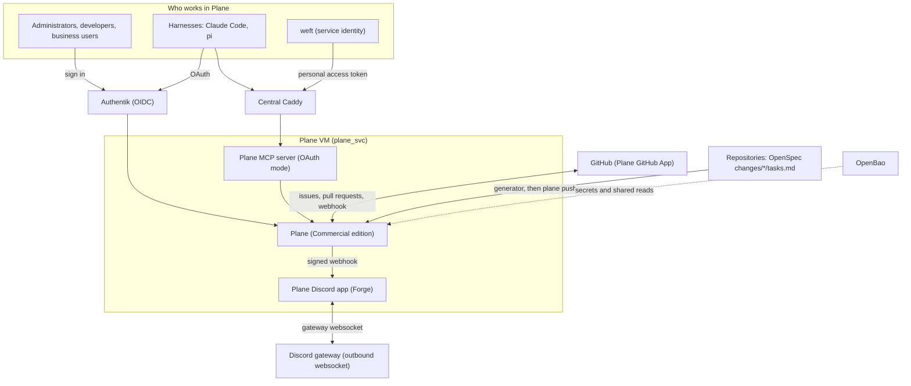

# 16 — Plane Work Management

> **Depends on:** 00 (local-dev), 01 (secrets), 02 (sso-auth), 12 (rbac-user-provisioning), 13 (cloudflare-iac), 15 (service-deployment-workflow-agents)
>
> Part of the dependency-ordered `plan/development/` set (00–16). Read 14 first: this plan follows the same composable-service shape as Postiz, applied to a different application.

Author: Joseph A. Wisneski IV <stray@uhstray.io>

**Date:** 2026-10-23

**Status:** ACTIVE. Decisions D1–D9 were settled on 2026-10-23. No phase has started.

This document is the human-readable summary of the plan. The executable task list lives in the OpenSpec change [`deploy-plane-work-management`](openspec/changes/deploy-plane-work-management/). Read the change's `tasks.md` for what to do, and its `design.md` for the risks, the rejected alternatives and the dated Phase 0 findings. This file does not repeat the task list.

## Context

The team has no single place where GitHub issues, the per-repository plans and the work cards are linked together. tududi was the tracker. Joe retired it on 2026-10-23, and Plane replaces it as an agent-cloud platform service. Plane deploys through the service-deployment workflow and has these properties:

- Administrators, developers and business users sign in through Authentik OIDC.
- GitHub issues and pull requests sync to Plane cards.
- Each repository's OpenSpec changes appear in Plane as modules with work items.
- Harnesses (local Claude Code and pi) and weft update work through the Plane MCP server.
- A Plane app on the Forge (platform) Discord bot posts notifications, takes slash commands and unfurls links.
- tududi is torn down at the end of the plan.

**Base ref:** `origin/dev` at commit `391a4f7c`. All implementation work starts from that ref in a fresh worktree, not from the local `local-dev-run` checkout.

## Decisions

These decisions belong to Joe, dated 2026-10-23. The change's `design.md` records the rejected alternatives for each one.

| # | Decision | Why and evidence |
|---|---|---|
| D1 | **Commercial edition on the Pro plan on production.** | OIDC is listed under `Plan: Pro, Business` in the developer docs (`self-hosting/govern/oidc-sso.mdx`). The GitHub integration is a Pro feature. OAuth app registration, which Plane Apps and MCP OAuth need, is not in the Community edition (`mcp-server-self-host`). The approved plan cites a price of $6 per user per month on the annual plan (`plane.so/pricing`). That price was not re-checked when this plan was written. |
| D2 | **Local-dev runs the Commercial Free tier.** | A license key binds to one workspace and one machine. Local-dev proves the deploy, Caddy, backup and restore, Compose, MCP in personal-access-token mode, and the Discord app. The OIDC and GitHub-sync gates move to production. The approved plan follows the Postiz precedent, where the connect leg was proven in production. |
| D3 | **Roles.** `platform-admins` maps to Owner. `platform-developers` and `platform-business` map to Member. `platform-user` is denied. | The group model is in `plan/development/12-rbac-user-provisioning.md:22`. The Plane OIDC documentation, as cited in the approved plan, describes no group-to-role mapping, so a playbook reconciles roles. |
| D4 | **An OpenSpec change becomes a Plane module, and its `tasks.md` items become work items** with a link back to the plan file. | The repository stays the source of intent, and Plane holds status. The generator creates items and never rewrites their status. |
| D5 | **Plane MCP server in OAuth mode, behind Caddy.** agentgateway is not in the path. | agentgateway's MCP federates only OpenAPI targets, admits only admins, and replaces the caller's credential (`platform/services/agentgateway/deployment/templates/config.yaml.j2`, the `` block). OAuth attributes each edit to the real user. |
| D6 | **weft uses a service identity.** A Plane personal access token for a `weft` bot user is sent to `/http/api-key/mcp` with the `x-workspace-slug` header. | weft's builder is a headless container and cannot complete a browser OAuth flow. The token lives in OpenBao. |
| D7 | **Forge is the platform bot.** The token is `secret/services/discord:bot_token`. Features are notifications, slash commands and link previews. | The bot connects through Discord's gateway websocket, which is outbound only, so no third public route is needed. The token is shared-read and never copied. |
| D8 | **The tududi teardown is the final phase of this plan.** | This is Joe's decision. The order of Phase 7 is fixed by the sync traps described in Phase 3. |
| D9 | **Hostnames** `plane.uhstray.io` and `plane-mcp.uhstray.io` in production, and `plane.agent-cloud.test` and `plane-mcp.agent-cloud.test` locally. Plane runs on its **own VM** in the `plane_svc` group. | The hostnames are placeholders that Joe can change. The own-VM rule follows `plan/architecture/02-service-onboarding.md:38-41`. |

## Architecture

Plane runs as a composable Compose stack on its own VM, as Postiz does. Only the reverse proxy is reachable from outside the VM. The GitHub webhook and the Discord gateway are the only other external paths, and both are described under Phase 3 and Phase 6. The GitHub webhook path is public, and it is admitted only after spike 0.16 shows that Plane verifies the GitHub webhook signature.

## Phases

The phases follow the change's `tasks.md` one for one. Phase 0 is the set of verify-first spikes. Each spike writes a dated finding into the change's `design.md`, and no guessed answer carries forward.

| Phase | What it delivers | Proven by (scenario in the change) |
|---|---|---|
| 0. Verify-first spikes | Eight spikes from the approved plan, covering the Compose licence, the Commercial service list, the UI-only configuration paths, the member-role API, Compose state semantics, OpenTelemetry, hardware sizing and the OAuth endpoints. Three checks added on 2026-10-24 cover the external identifier field used by the migration, the webhook digest encoding and delivery identity, and the GitHub webhook signature, which decides whether the webhook path may bypass the challenge. | Spike findings are recorded before dependent phases start |
| 1. Plane service | A composable service on its own VM, modelled on Postiz. It covers the Compose files, `deploy.sh`, the templates, deploy, clean-deploy, backup and restore playbooks, Semaphore templates, the OPA catalog entry, edge routes, the firewall and the tests. Long-lived containers restart `always`, and the one-shot migrator restarts `no` with its label. | Local deployment is reachable over TLS |
| 2. SSO and roles | Invitation-only sign-up is turned on first, then the reconcile playbook invites members and sets roles under D3 and must succeed. Only after that are the OIDC settings applied through the Phase 0 code path, and the reconcile schedule registered. | Member signs in through Authentik |
| 3. GitHub integration | The tududi kill switch is thrown and the refresh schedules of both refresher templates, production and local, are removed first. Then the Plane GitHub App is created from a committed manifest, each project's repository is connected, and the trigger labels `plane` and `github` are set. | Labelled issue appears in Plane |
| 4. Projects as code | A declaration file, a stdlib-only generator that writes modules and work items without status, a shared Compose schema, and a scheduled sync that runs under a read-only controller token. The `plane-compose` CLI is a new controller dependency, approved by Joseph A. Wisneski IV on 2026-10-23. Its version is pinned at implementation time. | Second sync run makes zero changes |
| 5. MCP | The Plane MCP server behind Caddy in OAuth mode, a script that installs one secret-free HTTP MCP entry into the harnesses, and weft's service identity. | Harness edit is attributed to the signed-in user |
| 6. Forge Discord app | A Python service with a webhook receiver that verifies the raw body and claims each delivery once, so a redelivery is never posted twice. Slash commands are received over the Gateway and answered over the HTTP interaction callback. `/plane create` and `/plane assign` are limited to declared Discord roles mapped to Plane members. Link previews need the `MESSAGE_CONTENT` intent, and the bot token is read from the shared store. The `discord.py` and `plane-sdk` dependencies are approved by Joseph A. Wisneski IV on 2026-10-23, and their versions are pinned at implementation time. | Signed event posts to the project channel |
| 7. tududi retirement | Open tasks migrate under a marker label, each linked to its tududi task, and a rerun skips anything already present. The sync workflows and templates are removed, the tududi sync GitHub App is uninstalled, and the teardown first checks its confirmation value against the VM id before any backup. The edge, identity provider, OPA and inventory entries are removed, and `AGENTS.md` is updated. | Retirement leaves no tududi surface |

## Verification

Local validation runs on the Free tier through local Semaphore. It covers the deploy, the TLS endpoint, backup and restore with data intact, the sync's idempotence, the MCP endpoint listing tools from Claude Code, and the Discord app's posts, slash command and link unfurl.

Production validation covers the parts that depend on the Pro plan and the real identity provider. It covers Authentik sign-in for one user from each group with roles matching D3, an issue carrying the `plane` label reaching Plane and an edit flowing back, a pull request with a work-item key linking to its card, an MCP OAuth login that updates a work item under the user's name, the observability verification, and a zero-diff Cloudflare plan after apply.

## Open questions

Two points raised while writing this plan were resolved on 2026-10-23, and one stays open.

1. **Step-result emit in the Plane deploy.** Phase 1 has the deploy playbook emit a step result. `platform/playbooks/deploy-authentik.yml` is the only `deploy-*.yml` file that includes the emit task, and it records only its `oidc-config` step. The entry for `tasks/emit-step-result.yml` in `AGENTS.md` says that per-service deploy playbooks do not include the task, and that the `service-deploy` step records none. **Resolved:** a successful deploy run records no `service-deploy` result, and a failed run is recorded as `fail` with its last output lines (`platform/workflows/service-onboarding/lib/step_results.py:239-249`). The Plane deploy follows the convention that every per-service deploy follows. A `pass` for `service-deploy` is a platform-wide question for a separate change, and this plan does not depend on it.
2. **Meaning of "its own host" in D5.** D5 says the MCP server runs "on its own host". Phase 5 adds the MCP container to the Plane Compose stack on the Plane VM, behind its own hostname `plane-mcp.<zone>`. **Resolved:** it means its own public hostname, as the question Joe answered stated.
3. **Open: vendor facts not re-checked.** The plan cites the Plane licence terms, the tier gating, the price and the documentation URLs. None of them was fetched again for this plan. The Phase 0 spikes confirm or correct them.

## Execution

- The docs come first. This plan and its OpenSpec change land as one pull request into `dev`.
- After that, each phase gets its own branch and worktree, cut from `origin/dev`. Implementation briefs are split by area: service files, playbooks, Authentik, edge and tests.
- Pull requests merge after one review round, with every finding fixed or answered and the checks green. Merges are merge commits only.
- Production runs use Dev-bound Semaphore templates. Each one runs read-only or in check mode first, then applies.
- After each phase, the outcome and the rejected alternatives are recorded in Hindsight. Each mistake that misled the work is recorded in `docs/MISTAKES.md`.

## Related documents

- [`14-postiz-social-publishing.md`](14-postiz-social-publishing.md): the composable-service pattern this plan reuses.
- [`12-rbac-user-provisioning.md`](12-rbac-user-provisioning.md): the group model that D3 maps to Plane roles.
- [`15-service-deployment-workflow-agents.md`](15-service-deployment-workflow-agents.md): the service-deployment workflow and its step results.
- [`openspec/changes/deploy-plane-work-management/`](openspec/changes/deploy-plane-work-management/): the proposal, design, tasks and specs for this plan.
- `platform/services/tududi/sync/github-mapping.yml`: the nine repository pairs that seed the projects declaration in Phase 4.
- `plan/architecture/01-automation-model.md`, section 5: the FORCED and DEBT classification used for UI-only configuration.
