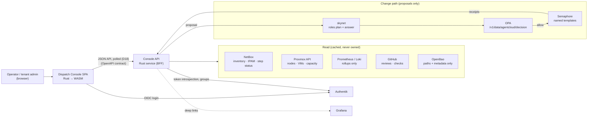

# 17 — Dispatch Console (agent-cloud administration UI)

**Date:** 2026-10-20
**Status:** PROPOSED
**Author:** Joseph A. Wisneski IV
**Context:** agent-cloud has authorities for every concern (Authentik, OpenBao, OPA,
Semaphore, skynet, Proxmox, NetBox, agentgateway, GitHub Actions, the o11y stack) but no single
place to see a tenant's estate, the work running against it and who or what is doing that work,
or to ask for a change and watch it go through the guardrails. Plan 15 (decision D4) already
names a **standalone dashboard service** as the long-term outcome of the service deployment
workflow. This plan builds it. The design was settled in a session on 2026-10-20: three layout
prototypes were compared, the **Dispatch** (work-first) layout was chosen, and it was refined
through review comments. The product brief, design system and prototype are saved in
[`plan/product/dispatch-console/`](../product/dispatch-console/). The UI principles are
[`plan/architecture/09-console-ui-principles.md`](../architecture/09-console-ui-principles.md).

> **Depends on:** 02 (SSO / Authentik OIDC), 03 (guardrails: one authority per concern),
> 05 (observability), 06 (skynet), 12 (RBAC user provisioning), 15 (workflow agents, step
> registry, conformance collector). **Reference design:** `plan/product/dispatch-console/prototype/dispatch.html`.

---

## Problem

1. **No single pane.** Operators move between Semaphore, NetBox, Grafana, Authentik, OpenBao,
   Proxmox and GitHub to answer "what is wrong, who is fixing it, and what is next".
2. **No visible work.** skynet roles and Semaphore templates run work, but nothing shows a
   work item end to end: request → plan → OPA decision → approval → Semaphore receipts →
   verification.
3. **No safe request path for non-operators.** Tenant admins have no way to ask for a change
   that is guaranteed to pass through OPA and run as a reviewed template.
4. **Scope is implicit.** Nothing makes the tenant, org, site, environment or group being
   acted on explicit and consistent across tools.

## Decisions (D1–D10 settled 2026-10-20; D11–D15 settled 2026-10-25; D16–D21 settled 2026-10-26)

| # | Decision | Alternatives rejected | Why |
|---|---|---|---|
| D1 | **Dispatch layout**: the home screen is the work (lanes of strips), with a details panel; Ask's request dashboard and Atlas's scope tree are folded in | Ask (request-first home), Atlas (map-first home) | Operators manage active work; the board answers "what is happening" fastest |
| D2 | **All Rust.** A client-side WASM SPA plus a Rust API service (backend-for-frontend) | Server-rendered + HTMX; a JS frontend | Operator's requirement; the API service keeps every authority credential server-side |
| D3 | **API-first.** The console API is specified (OpenAPI) before UI code; the SPA is one client of it | UI-driven endpoints | Agents and scripts can use the same API; contracts are reviewable |
| D4 | **The console never writes declared state.** Every mutation becomes a proposal that skynet plans, OPA decides and Semaphore executes, or a PR (plan 15 D3, D9) | Direct API writes to authorities | The platform rule: AI proposes, guardrails validate, automation executes |
| D5 | **Tenant above Organization.** Tenant is chosen only in the sidebar; Org / Site / Env in the scope bar | Tenant = Org (the PRINCIPLES.md wording before Phase 0) | Operator's call; PRINCIPLES.md must be amended (Phase 0) |
| D6 | **Per-asset telemetry lives in Grafana.** The console draws tenant / org / site / cluster rollups only and deep-links to Grafana for any single service, node, host or VM | Embedding panels | Grafana is the telemetry authority; duplicating panels drifts |
| D7 | **skynet roles** are `infra-agent`, `security-agent`, `service-agent`, `o11y-agent` (plan 15 D7); `net-agent` is planned; NetClaw and NemoClaw are not used | Showing legacy agents | Matches the OPA identities and the step registry |
| D8 | **Authentik OIDC for login; RBAC from Authentik groups**, enforced in the API, never only in the UI | Console-local users | PRINCIPLES.md identity model; plan 12 |
| D9 | **Read models come from the authorities**: work from skynet and Semaphore; step status from NetBox custom fields written by Collect Service Conformance; inventory from NetBox and Proxmox; rollups from Prometheus and Loki | A console-owned database of record | One authority per concern (plan 03); the console caches, it does not own. The single exception is each user's own UI preferences (profile), which no other authority holds |
| D10 | **The prototype is the visual reference, not code to port.** Tokens and components carry over; JavaScript does not | Porting the prototype | The prototype's data and logic are illustrative |
| D11 | **Dioxus 0.7.10 fullstack.** The WASM client and the Rust axum server build from one crate and ship as one binary (see the Architecture note). D2 still holds: all Rust, and the server keeps every authority credential | Separate SPA and API services, the packaging D2 first described. No other framework is recorded as a candidate | Decided by Joseph on 2026-10-25 (O1). No O1 spike result is recorded in this document |
| D12 | **Code home: `platform/services/console/` in this repository.** The Cargo crate is in `app/` and the deployment in `deployment/` | A new repository (the O2 alternative) | Decided by Joseph on 2026-10-25 (O2). The deployment lives in this repo either way, and AGENTS.md sets one codebase, no forks |
| D13 | **The image is built on the host at deploy time.** `deploy.sh` builds it with the container engine. A CI build pushed to GHCR with a digest pin is deferred to Phase 7 | A CI build pushed to GHCR with a digest pin, now (deferred, not rejected) | The Phase 1 contract has no registry. The NetBox deploy calls `build_netbox_image` (`platform/services/netbox/deployment/deploy.sh:128`, defined at `platform/services/netbox/deployment/lib/common.sh:446`) |
| D14 | **Preferences in SQLite** through `rusqlite` (bundled), in `/data/prefs.db` on the `console-data` named volume, one row per subject | None recorded | Decided by Joseph on 2026-10-25. The console stores only the profile preferences, the one exception in D9 |
| D15 | **Phase 1 tenants and scope tree come from the inventory declaration.** The `console_tenants` variable renders to `scope.json`, and example data is labelled as example. Live NetBox and Proxmox reads wait for Phase 3 | Reading NetBox or Proxmox in Phase 1 (deferred to Phase 3, not rejected) | Decided by Joseph on 2026-10-25. The real tenant values stay in site-config |
| D16 | **The tenant is the hard isolation boundary.** Organizations inside a tenant share it; nothing crosses from one tenant to another | The organization as the boundary (the PRINCIPLES.md wording before Phase 0) | Decided by Joseph on 2026-10-26; PRINCIPLES.md amended to match |
| D17 | **Phase 2 work source = Semaphore tasks, joined to the workflow registry.** A task launched by skynet carries the message `skynet <workflow_id> <step_id>` (skynet repository, `src/skynet/orchestrator/service_onboarding.py:285`), which gives the run id and the step id. The owning role is the registry step's `owner` (`platform/workflows/service-onboarding/registry.yml`, `steps[].id`, `order` and `owner`). Skynet is not read in Phase 2 | Reading skynet in Phase 2: it has no list route, no read-only credential and no timestamps (skynet repository, `src/skynet/server.py:199-247`). A console-owned work store (rejected in D9) | Semaphore is the executor and holds every task. A skynet read API is proposed to the skynet repository (O3), not assumed |
| D18 | **Phase 2 live updates = polling.** The server polls Semaphore every 10 s into an in-memory cache; the client re-fetches `/v1/work` every 10 s and pauses while the tab is hidden. Closes O4 | Server-sent events now, the O4 default. Deferred: Phase 2 has no push source (contract, D18), so an event stream would sit on top of the same poll. WebSocket, named in O4, with no reason recorded for rejecting it | SSE returns once a push source exists. Until then the poll meets the Phase 2 acceptance line |
| D19 | **`/v1/work*` answers only callers in group `platform-admins`** (403 `{"error":"forbidden"}` for anyone else). Phase 2 is admin-only until Phase 3 | Showing Semaphore work to tenant members. Semaphore tasks are platform-wide and carry no tenant, so a tenant member would see work across the hard boundary (D16). Per-tenant work arrives in Phase 3, when tasks map to inventory | The tenant boundary (D16) and API-enforced RBAC from Authentik groups (D8). The group is declared in `platform/services/authentik/deployment/blueprints/platform-groups.yaml:18` |
| D20 | **The console's Semaphore credential is a dedicated user, `svc-console`, at project role `guest`** (read-only). Its token is stored at `secret/services/console:semaphore_api_token` (with `semaphore_password`). Never the controller token at `secret/services/semaphore` | The controller token, and any project role that can launch tasks. Launch rights are runner rights (`platform/semaphore/README.md:72`). Guest is read-only: upstream Semaphore v2.19.11 `db/ProjectUser.go` gives guest no write permissions, and `api/projects/project.go:97` lets project members read through GET (contract citations; the upstream files are not in this repository and were not re-read in this session) | Least privilege: the console reads and never launches. The controller credential stays with the executor |
| D21 | **The console in production runs on its own VM** (host group `console_svc`). Production steps are in "Production site-config checklist" below | None recorded | Decided by Joseph on 2026-10-26 |

### Open decisions (owner: Joseph A. Wisneski IV)

| # | Question | How it gets decided |
|---|---|---|
| O3 | skynet read API (list runs, read-only token) — proposal to the skynet repo | Agree with the skynet repository (the plan-15 graph already holds the state) |
| O5 | Where business-domain tags are stored (Products, Professional Services, Automation, Administration, IT) | Edited in Organization settings; storage (NetBox tag vs inventory field) decided in Phase 3 |
| O6 | The real developer agents and workflows on the development gateway | Operator to list; prototype entries are examples |

## Design Principles

Detailed in [`plan/architecture/09-console-ui-principles.md`](../architecture/09-console-ui-principles.md).
In short: through the platform, never around it; work-first; scope explicit and single-sourced;
status is shape + label + color; every red explains itself and offers the next action; plain
words in, evidence out; plans are vertical and owned; fine-grained telemetry in Grafana; secret
names, never values; fewest steps; planned and example are labelled.

## Architecture

> **Packaging (D11).** The SPA and the console API are not two services. Both build from one
> Rust crate and ship as one Dioxus fullstack binary, and the image copies the client bundle beside
> the server binary. The API routes stay plain JSON under `/v1`, so the routes in the API surface
> table below are still HTTP routes any client can call. The diagram shows the logical split
> between the browser client and the API.

### Bounded contexts

| Context | Authority | Console reads | Console proposes |
|---|---|---|---|
| Work | skynet, Semaphore | Work items, steps, owning role, receipts, logs | New work, approve, pause/resume, retry |
| Scope & inventory | NetBox, Proxmox | Tenant → org → site → cluster → host, services, placement, network segments | Assess resource, verify health |
| Identity & access | Authentik | People, groups, scoped roles; the signed-in user's OIDC claims (locked on the profile) | Add user, role change (blueprint deploy) |
| Profile & preferences | Console API (preferences store) | Display name, avatar, pronouns, timezone, theme, notifications, default scope | — (the user's own preferences; the one thing the console stores itself) |
| Tenant & org settings | site-config inventory, Authentik, NetBox tags | Tenant defaults, organizations, sites, approvers, business-domain tags | Settings change (proposal → PR) |
| Service catalog | Semaphore templates, service inventory | Approved services and their deploy templates | Service request (approved → deploy template; new → onboarding review) |
| Secrets | OpenBao | Paths, field counts, rotation age, readers | Rotation (Semaphore template) |
| Policy | OPA (Rego in Git) | Packages, decisions, denies | Policy change (plan → PR → deploy) |
| AI gateway | agentgateway | Groups, clients, budgets, models | Key request (inventory change + `Deploy agentgateway`) |
| Delivery | GitHub | PRs, reviews, required checks, promotion stage | Re-run (where permitted) |
| Telemetry | Prometheus, Loki, Grafana | Rollups by tenant / org / site / cluster | — (Grafana links) |

### API surface (draft; finalised in the Phase 1 OpenAPI document)

| Method | Path | Purpose |
|---|---|---|
| GET | `/v1/tenants` · `/v1/tenants/{t}/tree` | Tenants the caller may see; scope tree with rollups |
| GET | `/v1/work` | Work from Semaphore with lane, owning role, run and step (Phase 2: `platform-admins` only, D19; scope filters arrive with Phase 3 inventory) |
| GET | `/v1/work/{key}` | Detail: plan steps, OPA decision, receipts, log tail |
| POST | `/v1/proposals` | Natural-language or structured request → skynet plan (returns the plan, nothing runs) |
| POST | `/v1/work/{key}/approve` · `/pause` · `/resume` · `/retry` | Lifecycle actions; each is re-checked by OPA |
| POST | `/v1/questions` | "Ask about current work" → skynet answer with cited work items |
| GET | `/v1/resources/{kind}/{id}` | Site / cluster / node / service panel data |
| POST | `/v1/assessments` · `/v1/verifications` | Read-only assess (rightsizing) / verify health plans |
| GET | `/v1/telemetry/rollups?level=…` | Rollups; per-asset requests return a Grafana link instead |
| GET | `/v1/access` · `/v1/secrets` · `/v1/policies` · `/v1/gateway` · `/v1/delivery` | Governance and delivery read models |
| GET | `/v1/proposals?state=awaiting` · POST `/v1/proposals/{key}/comments` · PUT `/v1/proposals/{key}/plan` · POST `/approve` · `/deny` | Proposal queue: review, comment, edit plan (OPA re-checks), decide |
| GET · PUT | `/v1/me` | The caller's profile: OIDC claims read-only, preferences writable |
| GET | `/v1/tenants/{t}/settings` · `/v1/orgs/{o}/settings` | Settings read models; changes go through `POST /v1/proposals` |
| GET | `/v1/catalog` · POST `/v1/service-requests` | Approved services; request one into a scope, or a new one for onboarding |
| GET | `/v1/events` | Server-sent events for work and status changes. Deferred (D18) until a push source exists |

## Implementation Phases

### Phase 0 — Decide and amend

- Amend PRINCIPLES.md (identity: Tenant above Organization). Made in the Phase 0 commit.
- O1 and O2 decided on 2026-10-25 (D11 and D12). No O1 spike result is recorded in this document.
- Write the OpenSpec change `add-dispatch-console` (`plan/development/openspec/changes/add-dispatch-console/`), carrying this plan.

**Acceptance:** PRINCIPLES.md amendment merged; O1 and O2 recorded in this document's revision
history; OpenSpec change validates (`openspec validate --all --store agent-cloud`).

### Phase 1 — Skeleton, login and deployment path

- Console API with health, OIDC session (Authentik client; secret owned under
  `secret/services/authentik`, shared-read per the AGENTS.md pattern), tenant list and scope tree.
- SPA shell: sidebar (tenant switcher, nav, agent roles, admin settings entries, account →
  profile), scope bar, empty states, tokens from `DESIGN.md`.
- Profile page: OIDC claims locked, preferences stored by the console API.
- Onboard as a service per `plan/architecture/02-service-onboarding.md`: `deploy-console.yml`
  using `place-monorepo.yml` → `manage-secrets.yml` → `deploy.sh` → verify; `manage-approle.yml`
  for its own scoped AppRole; route through `Manage Caddy Sites`; Semaphore template in
  `platform/semaphore/templates.yml`.

**Acceptance:** login through Authentik on local-dev; the Semaphore template deploys and the
verify step passes; an unauthenticated request to the API answers 401.

### Phase 2 — Work (read-only)

- Work source: Semaphore tasks, the executor, joined to the workflow registry (D17). A task
  launched by skynet is recognised by its `skynet <workflow_id> <step_id>` message, and its
  owning role is the registry step's `owner`. Skynet is not read in Phase 2.
- Live updates by polling (D18): the server polls Semaphore every 10 s into an in-memory cache,
  and the client re-fetches `/v1/work` every 10 s, pausing while the tab is hidden. No SSE.
- Admin only (D19): `/v1/work*` answers callers in `platform-admins` alone, until Phase 3. Any
  other signed-in caller gets a 403, and the console shows an empty state that explains why.
- Semaphore reads use the read-only `svc-console` user at project role `guest` (D20).
- Work lanes (queued, running, awaiting, blocked, failed, done; done collapsed by default) of
  strips showing title, role chip, status label and age. Filters for role, lane and text
  (service or template). A red badge on Active Work counts blocked and failed items.
- Scope banner "N running", labelled tenant-wide in Phase 2. Details panel with the vertical
  stepper for skynet runs, minimizable to a summary rail. Every item links its Semaphore receipt.

**Acceptance:** live work from Semaphore appears within one 10 s poll; skynet-launched items show
run, step and owning role; every item links its Semaphore receipt.

### Phase 3 — Scope and inventory (read-only)

- Compute topology (click / shift-click selection), network topology, data flows, resource
  panel, service detail, Compute levels, Services table, business-domain tiles.

**Acceptance:** every host, VM and service shown exists in NetBox or Proxmox; nothing is drawn
from console-local data.

### Phase 4 — Proposals

- Work, Topology and Services composers, "Ask about current work" answers from skynet, new
  requests, the Dashboard proposal queue (review, comment, edit plan, approve, deny), Assess
  resource, Verify health, approve / pause / resume / retry, all OPA-gated.

**Acceptance:** a request produces a plan with no side effects until approval; an OPA deny is
shown with its rule; an approved plan runs only named Semaphore templates.

### Phase 5 — Governance pages

- Access (scoped roles, add user via blueprint), Secrets (metadata only, rotation), Policy
  (propose → PR → deploy), LLM access (scopes → agents keys, admin access requests), AI
  Gateway (production and development groups, role pages), Tenant and Organization settings
  (proposals; business-domain tags), Request a service (catalog and onboarding).

**Acceptance:** no secret value is ever returned by the API (tested); every change creates a
work item; role pages list only that role's work.

### Phase 6 — Delivery and telemetry

- CI/CD delivery context (reviews, required checks, promotion path), Telemetry rollups, Grafana
  deep links everywhere a per-asset chart would otherwise appear.

**Acceptance:** required-check names match `.github/rulesets/protect-main.json`; no per-asset
chart renders in the console.

### Phase 7 — Harden and promote

- Accessibility audit, error and permission-denied states, load test of the API (and of server-sent events, if D18 has been revisited by then), `dev`
  validation, then promotion to production through the branch workflow.

**Acceptance:** the validation table below passes on `dev`; promotion PR merged.

### Production site-config checklist

The console runs in production on its own VM (D21). This checklist lists what must exist before the
first production deploy, in the order it is needed. It names variables, playbooks and templates
only. No address, token or tenant value belongs in this document: real values stay in the private
site-config repository. A step marked **[TARGET]** is not built yet.

1. **VM declaration.** Declare the console VM in `site-config/proxmox/vm-specs.yml`, the file that
   `resize-vm.yml` reads its desired state from (`platform/tests/test_resize_vm.bats:32-35`).
2. **Address reservation.** Reserve the static address with `netbox-allocate-ip.yml` run with
   `-e reserve=true` and the explicit address. Reservation never picks the next free address
   (`AGENTS.md`, Independent Workflows table).
3. **Provision.** Run `provision-vm.yml`. Pass `-e target_host=` when the group declares more than
   one host (`AGENTS.md`, Independent Workflows table).
4. **Per-service SSH key.** Run `generate-service-ssh-key.yml` with `site_config_dir` pointing at a
   clone, so the pair also reaches site-config (`AGENTS.md`, step 8 of Adding a New Service).
5. **Distribute, verify, harden.** Run `distribute-ssh-keys.yml`, then `verify-host-access.yml`, then
   `harden-ssh.yml`. Hardening follows a passing key-only verify, never the reverse.
6. **Inventory group `console_svc`.** One host in this group, with the host vars `service_name`,
   `monorepo_deploy_path`, `container_engine`, `console_bind`, `console_port`, `console_base_url`,
   `console_oidc_issuer` and `console_tenants`. The consumers are `platform/playbooks/deploy-console.yml`
   (`hosts: console_svc`, and `config/scope.json` rendered at line 54), and the templates `env.j2`
   and `scope.json.j2`. The Semaphore connection variables `console_semaphore_api_url`,
   `console_semaphore_ui_url` and `console_semaphore_project` are **[TARGET]** for Phase 2. No
   playbook in this repository reads them yet.
7. **Authentik.** Set the production host vars `console_redirect_uri` and `console_launch_url`.
   Add `console` to `authentik_apps`; `deploy-authentik.yml:223` uses that list when it is defined.
   The catalog entry is `platform/services/authentik/deployment/app-catalog.yml:112-113`
   (`prod_required` and `verify_redirect`). The promotion guard in `deploy-authentik.yml:234-270`
   refuses a value that still resolves to an `agent-cloud.test` default or to an unresolved template.
   The blueprint is `platform/services/authentik/deployment/blueprints/console-oidc.yaml`.
8. **Caddy route.** Add the console hostname block to `caddy_managed_sites` in site-config and run
   `Manage Caddy Sites` (`platform/playbooks/manage-caddy-sites.yml:24`). If a hand-maintained block
   already serves that hostname, retire it through `caddy_retire_sites` in the same run, because
   Caddy rejects a hostname defined twice (`AGENTS.md`, Caddy routes are readable).
9. **Semaphore project team.** Declare `svc-console` at role `guest` in `semaphore_project_members`
   (top-level `all.vars` in site-config), then run `Manage Semaphore Access`
   (`platform/playbooks/manage-semaphore-access.yml:15`; `platform/semaphore/README.md:77`).
10. Run the remaining workflows in this order: **Deploy Authentik**, **Manage Caddy Sites**,
    **Manage Semaphore Access**, **Provision Console Semaphore Access** **[TARGET]**, then
    **Deploy console** (the template in `platform/semaphore/templates.yml`, the one that deploys
    `platform/playbooks/deploy-console.yml`). The Provision step places the `svc-console` user and
    its token (D20). No template of that name exists in `platform/semaphore/templates.yml` yet.

## Requirements traceability

The 22 requirements from the 2026-10-20 brief, mapped to where the design meets them.

| # | Requirement | Where | Phase |
|---|---|---|---|
| 1 | Entirely Rust | D2 | 0–1 |
| 2 | Visualise tenant → org → site | Sidebar tenant, scope bar, hierarchy, compute and network topology | 1, 3 |
| 3 | Queue work per tenant / org / site / cluster / host | "+" on every hierarchy row, map selection, composers | 3–4 |
| 4 | Queue work per service | Service detail, Services table | 3–4 |
| 5 | Track current work and which agent | Work lanes, owning role on every step, Agent roles pages | 2, 5 |
| 6 | Red / amber / green status | Status vocabulary (`DESIGN.md`), badges, rollups | 1–3 |
| 7 | Modern UI and icons | `DESIGN.md` | 1 |
| 8 | Fewest steps | One-row forms, chips, scope carry-over, one-click verify / fix | all |
| 9 | API-first, DDD, agile-compatible | D3, bounded contexts, work keys and iteration | 1–2 |
| 10 | Drill into agent → tasks → workflows | Vertical stepper in the details panel | 2 |
| 11 | Users at tenant / org / site / env; map RBAC | Access page, role map | 5 |
| 12 | Live telemetry from o11y | Rollups + Grafana deep links (D6) | 6 |
| 13 | Natural-language requests | Work and Topology composers | 4 |
| 14 | Relationships, integrations, data flows | Data flows map (API, OIDC, MCP, logs, metrics, traces), network topology | 3 |
| 15 | Authentik OIDC and RBAC | D8 | 1 |
| 16 | Semaphore | Change path; receipts | 2, 4 |
| 17 | OpenBao | Secrets page (metadata only) | 5 |
| 18 | OPA | Policy page, decisions on every plan | 4–5 |
| 19 | Proxmox | Compute levels, topology, resource panel | 3 |
| 20 | agentgateway | AI Gateway and LLM access pages | 5 |
| 21 | skynet | Plans, roles, answers | 2, 4 |
| 22 | GitHub Actions | CI/CD delivery context | 6 |

## Validation Criteria

| Check | Pass condition |
|---|---|
| Login | Authentik OIDC login works; API rejects unauthenticated calls with 401 |
| RBAC | A Developer cannot approve; a tenant admin sees only their tenant (API-enforced tests) |
| No direct writes | Code search and tests show no authority write call outside the proposal path |
| Secrets | No API response contains a secret value (test fixture with a canary value) |
| Proposals | Every mutation produces a work item with an OPA decision before any Semaphore task |
| Telemetry | No per-asset chart in the SPA; every per-asset view links to Grafana |
| Status | Every status rendering has an icon and a label (component test) |
| Accessibility | Keyboard-only path through Work, composer, stepper and topology selection |
| Deployment | `deploy-console.yml` via Semaphore converges on re-run (idempotent) |

## Security Considerations

- **Credential custody:** only the Console API holds authority credentials, through its own
  AppRole scoped to the paths it needs (`manage-approle.yml`). The SPA holds only its session.
- **Secrets:** OpenBao is read for metadata (paths, field names, counts, rotation age). Values
  are never requested.
- **Authorisation:** every request is authorised server-side from Authentik groups; OPA decides
  every proposal; the UI hiding a control is never the control.
- **Blast radius:** the console cannot run a command, write a host or change declared state;
  the worst case of a compromised console session is a proposal that OPA and an approver must
  still pass.
- **Exposure:** served behind Caddy with TLS; API and SPA on one origin; CSRF protection on
  state-changing requests; any future event stream is authenticated like every other route.
- **Audit:** every proposal, approval and lifecycle action is a work item with its requester,
  decision and receipts.

## Cross-references

- [`plan/architecture/09-console-ui-principles.md`](../architecture/09-console-ui-principles.md): UI design principles
- [`plan/product/dispatch-console/`](../product/dispatch-console/): brief, design system, prototype
- [15 — Service Deployment Workflow & Agents](15-service-deployment-workflow-agents.md): roles (D7), dashboard service (D4), collector
- [12 — RBAC user provisioning](12-rbac-user-provisioning.md) · [02 — SSO](02-sso-auth.md) · [03 — Guardrails](03-guardrails-governance.md) · [06 — skynet](06-inference-skynet.md) · [05 — Observability](05-observability.md)
- [`plan/architecture/02-service-onboarding.md`](../architecture/02-service-onboarding.md) · root [`AGENTS.md`](../../AGENTS.md) · [`PRINCIPLES.md`](../../PRINCIPLES.md)

## Revision History

| Date | Change |
|---|---|
| 2026-10-20 | Initial plan from the design session; Dispatch layout chosen; decisions D1–D10, open O1–O6 |
| 2026-10-21 | Added profile, tenant/org settings, proposal queue, services ask and service requests from final review comments; O5 answered: Organization settings owns business-domain tags |
| 2026-10-25 | Phase 0: O1 decided as Dioxus 0.7.10 fullstack (D11); O2 decided as `platform/services/console/` in this repository (D12); D13–D15 recorded (host-built image, SQLite preferences, inventory scope tree); architecture note on the single binary; plan renumbered from 16 to 17 because `16-plane-work-management.md` holds 16; PRINCIPLES.md identity amended so that tenant sits above organization; OpenSpec change `add-dispatch-console` added |
| 2026-10-26 | D16: the tenant is the hard isolation boundary (PRINCIPLES.md amended). Build-only tools in the image builder, `binaryen` (apt) and `esbuild` (npm tarball, sha512-checked), accepted by Joseph alongside the D13 host build |
| 2026-10-26 | Phase 2 decisions: D17 (work source is Semaphore tasks joined to the workflow registry), D18 (polling, which closes O4), D19 (`/v1/work*` admin-only until Phase 3), D20 (read-only `svc-console` credential). D21: the console runs in production on its own VM. O3 reworded to a proposal to the skynet repository. Phase 2 bullets and acceptance line matched to the decisions. Production site-config checklist added. RBAC group names are labels, and the group tuple and per-project access level are structured site-config data (plan 04 and plan 12) |
