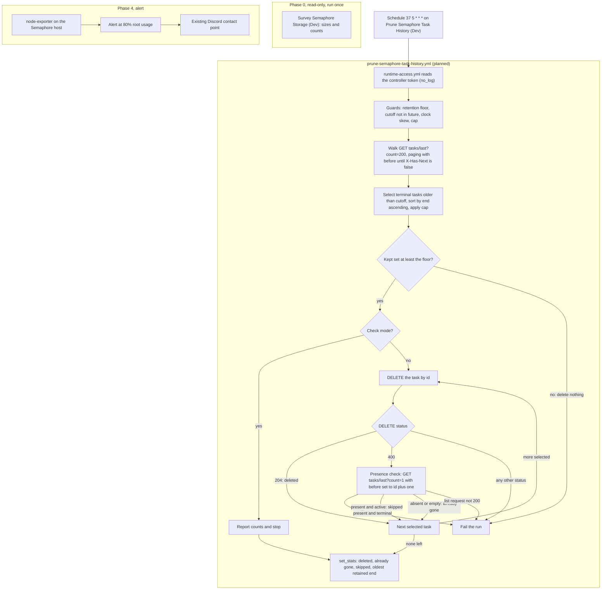

# 18 — Semaphore task-history retention and orchestrator disk headroom

**Date:** 2026-10-27
**Status:** PROPOSED
**Author:** Joseph A. Wisneski IV
**Context:** On 2026-10-27 a production task failed while cloning the repository on the Semaphore
host: `fatal: write error: No space left on device` (task 9541). The scheduled jobs five minutes
later ran normally, so the disk was full at the peak, not permanently. The same VM filled once
before (`docs/MISTAKES.md` 1.18). That time Postgres failed WAL recovery and every API call answered
401 until the root volume was grown. The immediate fix is to grow the disk. The Proxmox disk went
from 32G to 64G on 2026-10-27 (site-config #121 and #122; Resize VM task 9802). The guest-side
growth, `Grow Semaphore Root (Dev)`, is in PR #752, which was still open when this revision was
written. This plan is the follow-up. It keeps task history to 30 days so the disk stops growing
without bound, and it adds the disk alert that 1.18 proposed and nobody built.

> **Depends on:** [01 — automation model](../architecture/01-automation-model.md) (config as code,
> Semaphore as the executor), [05 — observability](05-observability.md), and
> [15 — service deployment workflow agents](15-service-deployment-workflow-agents.md) (the
> conformance collector reads Semaphore task history).
> **Retention period:** 30 days, set by Joe on 2026-10-27.

> **Source convention.** Every `api/`, `db/`, `util/`, `pkg/` and `migrations/` path in this plan is
> from the upstream Semaphore source at tag `v2.19.11`. The repository's default image tag is the
> same (`platform/services/semaphore/deployment/compose.yml:23`).

---

## Problem

1. **Task history is kept forever.** Semaphore stores every task and every output line in its
   Postgres database. Output lines go to `task__output`, keyed by task id (`db/sql/task.go:243-258`).
   Nothing deletes them. The cron expressions in `platform/semaphore/templates.yml` set the floor on
   how fast history grows. Each row below counts the runs one declared schedule produces in a day:

   | Schedule | Cron | `templates.yml` line | Tasks a day |
   |---|---|---|---|
   | Check o11y Liveness (Dev) | `*/10 * * * *` | 258 | 144 |
   | Collect Service Conformance (Dev) | `*/15 * * * *` | 1430 | 96 |
   | Refresh tududi-sync GitHub Token | `*/45 * * * *` | 692 | 48 |
   | Renew Internal Certs (Dev) | `17 4 * * *` | 949 | 1 |
   | Stock GitHub Runner JIT (Dev) | `*/10 * * * *` | 3166 | 144 |

   Without the JIT template the rows total 289 a day, and with it 433. The `*/45` row is two runs an
   hour, because cron fires at minutes 0 and 45 (`templates.yml:686-689` says so in its own
   comment). The tududi refresh is a main-bound base with `dev_variant: true` (`templates.yml:690`).
   Per `platform/semaphore/setup-templates.yml:373-374`, schedules attach to the base template only,
   and a (Dev) variant never inherits one, so this schedule runs on the main-bound base alone. Production
   task history for 2026-10-26 and 2026-10-27 shows about 288 tasks a day, with no JIT runs. Phase 0
   measures the real count.

2. **Semaphore has no age-based retention.** Its only built-in control is `max_tasks_per_template`,
   set by the environment variable `SEMAPHORE_MAX_TASKS_PER_TEMPLATE` (`util/config.go:567`). It keeps
   the newest N tasks of each template (`clearTasks`, `db/sql/task.go:121`). That is a count, not an
   age. One N cannot mean 30 days for a template that runs every 10 minutes and for one that runs
   once a month. It is also a server setting, so using it means changing the server's configuration.
   That is operator-side work, never a Semaphore job.

3. **The disk is not measured.** Production Prometheus has node-exporter targets for three hosts. The
   Semaphore host is not one of them, so there is no usage history and no alert. Both fills were found
   by a failing task.

4. **What actually fills the disk is unmeasured.** Task output is the obvious candidate. Two others
   exist:
   - **Per-template clones.** Each template keeps its own clone of the repository. Task 9541 failed
     while it was cloning into a per-template directory under the tmp volume
     (`repository_5_template_353`). Production has 251 templates.
   - **Per-template collection installs.** Each template has its own Ansible home with the collections
     installed into it (`repository_5_template_354_home/.ansible/collections`, task 9533).

   Phase 0 ranks the three by bytes before any of them is pruned.

5. **The backlog is bounded by the task id count.** The highest task id was about 9,800 on
   2026-10-27 (production history). Ids are distinct, so the task table holds at most about 9,800
   rows, and the backlog older than 30 days is a subset of them. Phase 0 measures the exact count.

---

## Decisions

| # | Decision | Rejected | Why |
|---|---|---|---|
| D1 | Task history (each task and its output) is kept for **30 days** after it ends. | Keeping it forever. A per-template count. | Joe's call. Age is what an operator reasons about ("last month's runs"). A count means a different age for every template. |
| D2 | Prune through Semaphore's own API: `DELETE /api/project/{p}/tasks/{id}`, which runs `DeleteTaskWithOutputs` (`api/projects/tasks.go:418-450`, `db/sql/task.go:384-398`). | Raw SQL against the database. `max_tasks_per_template`. | The API refuses a queued or running task (400) and deletes the output rows before the task row. Raw SQL that deleted only the task row would also remove its output, because `task__output` cascades on delete (`db/sql/migrations/v0.0.0.sql:111`). So the output loss is not the reason to refuse SQL. The real costs of SQL are that it skips the server's active-task refusal and couples the prune to the schema. The count setting is ruled out by Problem 2. |
| D3 | The prune is a **scheduled Semaphore template**, declared with `schedule:` in `platform/semaphore/templates.yml`, like the other schedules. | A cron job on the host. An operator-run script. | It goes through the executor like every other job, is reviewed, and leaves a task record. Deleting history is a data operation through the API. It does not restart or reconfigure Semaphore, so the rule against a Semaphore job reconfiguring its own container does not apply. |
| D4 | The prune authenticates with the controller's runtime token. `platform/semaphore/tasks/runtime-access.yml` reads it from `secret/services/semaphore`, or takes an injected `SEMAPHORE_TOKEN`. The prune calls the loopback API `http://127.0.0.1:3000`, the URL that `platform/playbooks/provision-console-semaphore-access.yml:65` uses. | A new service account. The console's `svc-console` token. | Deleting a task requires a system admin. A non-admin token gets a bare 401 with an empty body (`api/projects/tasks.go:437-439`). Phase 0 confirms that the controller token's user is a system admin. The console playbook's own comment says the console never holds the controller token (`provision-console-semaphore-access.yml:8`). The prune is controller-side, so it uses the controller token and never the console's. A new admin account would add a second admin credential and buy nothing. |
| D5 | A check run reports what would go: the count of tasks older than the cutoff, per template, and the oldest end time. A real run deletes at most `semaphore_prune_max_per_run` tasks, default 2000, hard maximum 5000, oldest end first. | Deleting the whole backlog in one run. | A cap bounds the I/O and the length of each run. The backlog is bounded by the task id count (Problem 5). At the default cap, it drains in at most five daily runs. |
| D6 | Disk space is given back to the filesystem only by a **conditional**, one-time `VACUUM FULL` of `task__output` (Phase 2). It runs operator-side, and only when measured numbers show that re-use of freed space is not enough. | `VACUUM FULL` from a Semaphore job. Running it by default. | Plain `VACUUM` makes the space in deleted rows available for re-use within the same table. In most cases it does not return that space to the operating system ([PostgreSQL 16, VACUUM](https://www.postgresql.org/docs/16/sql-vacuum.html)). Inserts after the prune can re-use that space. `VACUUM FULL` takes an `ACCESS EXCLUSIVE` lock on the table, and it writes a new copy of the table before it releases the old one, so it needs free disk space. A Semaphore job would hold that lock against the output writes of every running task, its own included. |
| D7 | Clones and collection homes are pruned **only if Phase 0 ranks them first**. | Pruning them now. | A clone or home that a running task is using would break that task if it were deleted. Measure before adding a moving part. |
| D8 | The Semaphore host gets a node-exporter target and a Grafana alert at 80% root usage. | No alert. | This is the guard 1.18 proposed. A filling disk then pages before a task or Postgres fails. |
| D9 | The prune template is **Dev-bound**: `Prune Semaphore Task History (Dev)`, with `repository: agent-cloud dev`, declared with cron `37 5 * * *` and `active: false` until a reviewed change flips it after the check run. Its siblings are Check o11y Liveness (Dev), Collect Service Conformance (Dev), Renew Internal Certs (Dev) and Stock GitHub Runner JIT (Dev). | A main-bound template. Any other minute. | A main-bound template would run the `main` branch, which lacks the playbook until promotion. Minute 37 is not a minute that any declared schedule uses (see Architecture). The cost of Dev binding is real, and Security Considerations states it. |
| D10 | Guards refuse a run before any deletion: a retention below 7 days, a cutoff in the future, a newest task created more than one day ahead of the controller clock, or a kept set below `semaphore_prune_min_kept` (default 1000). | Trusting the variables as given. | A mistyped retention value or a skewed clock would otherwise delete recent history, and a deletion cannot be undone. The skew check compares two timestamps from one clock, so it cannot see a clock that jumped forward. The kept-set floor refuses a large forward jump (about 26 days or more at the measured rate); a smaller jump is not caught, and the per-run cap bounds what it can delete. |

---

## Design Principles

These principles follow the platform rules in [AGENTS.md](../../AGENTS.md) and the constitution in
[PRINCIPLES.md](../../PRINCIPLES.md).

1. **Through the platform, never around it.** The prune is a Semaphore template that calls
   Semaphore's own API. It does not write to Postgres and does not SSH to the host. Its config is
   code: the schedule lives in `templates.yml`, and the playbook lives in `platform/playbooks/`.
2. **Measure before pruning.** Phase 0 records the sizes and counts first. Phases 1 to 3 are ranked
   by the bytes that were measured, not by estimates.
3. **Nothing reconfigures Semaphore from its own job.** The prune does not restart or reconfigure the
   Semaphore container. A Semaphore job that restarts Semaphore is circular.
4. **Fail loud.** A run that cannot prove what it did must fail. A 400 on `DELETE` is checked, and a
   task that is still terminal fails the run. No run reports green after an error it did not handle.
5. **Re-running converges.** A second run on the same history deletes nothing that is not yet past the
   cutoff.
6. **Deletion is irreversible, so check first.** Check mode reports what would go. The first real run
   is watched by an operator. The retention floor, skew, kept-set floor and cap guards refuse a run before any deletion.
   [PRINCIPLES.md](../../PRINCIPLES.md) section 5 records a `[TARGET]` to tag irreversible operations
   and to gate them when they launch from a non-main branch (`PRINCIPLES.md:311-316`). That gate is
   not built. Security Considerations explains how this plan handles the gap.
7. **Reuse the existing building blocks.** The token comes from the reusable
   `platform/semaphore/tasks/runtime-access.yml`, and the schedule uses the same `schedule:` declaration
   as the other scheduled templates.

---

## Architecture

Semaphore's own API is the only path into the task store that this plan adds. The one exception is
the Phase 0 survey, which reads Postgres with `SELECT` statements and nothing else.

### Flow

The prune has five parts: a token read, the guards, a paged read of the project's task list, a
selection with its sort, and a delete loop with a presence check. Paging covers the whole project on
every run, so the cost grows with history. At 200 tasks a page, the walk costs one request per 200
tasks.

### Why a presence check and not a re-read of the task

A `GET` on one task passes through the same middleware as the `DELETE`. That middleware answers 400
for a missing task and for a database error alike (`api/projects/tasks.go:196-212`, routes at
`api/router.go:497-503`). A status code cannot tell those two apart. The list endpoint,
`GET /api/project/{p}/tasks/last` (`api/router.go:323`), is not behind that middleware. Its keyset
filter is `task.id < ?` (`db/sql/task.go:323-324`), and the comment at `db/sql/task.go:318-322`
says the query is ordered `id desc`. So a list request for one row, with `before` set to the task id
plus one, returns the task itself if it still exists. Otherwise it returns a different row, or nothing. A list
request that fails is a database error (`api/projects/tasks.go`, the 400 path in `writeTasksList`).

### Interaction with the conformance collector

`Collect Service Conformance (Dev)` runs every 15 minutes. For each workflow template it reads the
newest 1000 tasks, then the raw output of the newest finished task per template and service
(`platform/playbooks/collect-service-conformance.yml`, header lines 1-7). Its raw output read sets no
`status_code`, and it is marked `no_log: true` (lines 155-166). A task deleted between the list read and
the raw output read fails that read, and the failure text is hidden. The prune selects only tasks older
than 30 days. So this can happen only when a step's newest finished task is itself older than 30 days.
The failure text of that read is hidden by `no_log`, so the operator sees a failed read with no text.
This plan does not change that behaviour, and the collector is outside its scope.

The prune minute, 37, is not used by any other declared schedule. The collector's minutes are 0, 15,
30 and 45, and the liveness and JIT schedules use multiples of 10. So the two jobs never start in the
same minute.

After pruning, NetBox is the only record of a step whose newest finished task is older than 30 days.
The collector merges each service's status already in NetBox under each run's results
(`collect-service-conformance.yml:8-14` and `:266`). That status therefore stays in NetBox, the report
and Loki. The raw output of such a run does not survive the prune.

---

## Implementation Phases

### Phase 0 — Measure (read-only)

A new read-only template, `Survey Semaphore Storage (Dev)`, runs against `semaphore_svc`. It reports
sizes and counts only, never any content:

- Root filesystem size, used and free.
- The live container layout. Production runs the legacy standalone project from the directory in its
  inventory `compose_working_dir`, not the monorepo path. The monorepo compose file names the volumes
  `semaphore_db_data`, `semaphore_tmp`, `semaphore_data` and `semaphore_config`, but the live names must
  be read, not assumed.
- The running Semaphore image tag. The repository default is
  `docker.io/semaphoreui/semaphore:v2.19.11` (`platform/services/semaphore/deployment/compose.yml:23`).
  Production may override it through `SEMAPHORE_IMAGE`, so the survey records what is running.
- Whether the controller token's user is a system admin. The read used for that check is chosen in
  this phase against the pinned source.
- Bytes in each of: the Postgres data directory, the repository clones under the tmp volume, the
  per-template `_home` directories, and container images.
- From Postgres, read-only: `pg_total_relation_size` for `task__output`, `task` and `event`; the count
  of tasks older than 30 days and their output rows; and `SHOW autovacuum`.

**Gate:** the numbers are recorded in this plan, and Phases 1 to 3 are re-ranked by bytes.

**Acceptance:** the survey run is green and issues no write, no `DELETE` and no DDL. Its numbers are
recorded here with the date. The running image tag and the token's admin status are recorded beside
them.

### Phase 1 — Prune task history to 30 days

Files: `platform/playbooks/prune-semaphore-task-history.yml` (new), and the template
`Prune Semaphore Task History (Dev)` in `platform/semaphore/templates.yml`. Templates are applied with
`setup-templates.yml`, as [AGENTS.md](../../AGENTS.md) requires.

1. **Read the token.** Include `platform/semaphore/tasks/runtime-access.yml`. Every credential step is
   `no_log`. The task takes an injected `SEMAPHORE_TOKEN` when one is present (`runtime-access.yml:33`).
   Otherwise it reads `secret/services/semaphore` through the controller AppRole. The URL is
   `http://127.0.0.1:3000`, which `runtime-access.yml` accepts as loopback HTTP.
2. **Guards.** Assert that `semaphore_task_retention_days` is at least 7, and that
   `semaphore_prune_max_per_run` is at most 5000. Compute the cutoff from the controller clock. Refuse
   the run if the cutoff is in the future, or if the newest task's `created` time is more than one day
   ahead of the controller clock. All guards run before any `DELETE`.
3. **Walk the list.** Request `GET /api/project/{p}/tasks/last?count=200`. Then request the same path
   with `before` set to the smallest id of the previous page. Stop when the `X-Has-Next` response header
   is false. The walk visits every task in the project on every run. The list requests carry
   `check_mode: false`, because `ansible.builtin.uri` is skipped under `--check` unless a task says
   otherwise (`plan/architecture/08-ansible-automation-standards.md:20-23`).
4. **Select.** From each row, read `id`, `status`, `end` and `created`. Select tasks whose status is
   one of the three terminal statuses that `IsFinished` defines: `success`, `error` and `stopped`
   (`pkg/task_logger/task_logger.go:99-101`, with the values at lines 18 to 20). Keep only those whose
   `end` is older than the cutoff. A non-terminal task is never selected. A row whose `end` is absent
   or `null` is never selected either, and it is never read as the epoch. `end` is a pointer tagged
   `omitempty` on the base `Task` struct (`db/Task.go:64`), which `TaskWithTpl` embeds
   (`db/Task.go:209`). While walking, count the kept set: the terminal tasks whose `end` is newer than
   the cutoff. If the selection is not empty and that count is below `semaphore_prune_min_kept`
   (default 1000), refuse the run. Fail it and delete nothing, in check mode and in a real run alike.
   An empty selection ends the run green with nothing to delete, whatever the kept count.
5. **Sort.** Sort the selection by `end`, oldest first. `end` is not monotonic in id, so id order is not
   age order.
6. **Check mode stops here.** Under check mode (`params.dry_run: true` at launch), report the counts (per template, and the oldest end time)
   and make no `DELETE` request.
7. **Delete, up to the cap.** Walk the sorted selection, up to `semaphore_prune_max_per_run`, and send
   `DELETE /api/project/{p}/tasks/{id}` for each task:
   - 204: counted as deleted.
   - 400: go to the presence check in step 8.
   - Any other status, including 401: fail the run at that task. The counts so far are still reported.
8. **Presence check after a 400.** Request `GET /api/project/{p}/tasks/last?count=1` with `before` set to
   the task id plus one.
   - The first row has the target id, and its status is terminal: fail the run. The task still exists,
     so the 400 came from something else.
   - The first row has the target id, and its status is not terminal: count the task as
     "skipped (active)" and continue.
   - The first row has another id, or the list is empty: count the task as "already gone" and continue.
   - The list request does not return 200: fail the run.
9. **Report.** Publish the counts with `set_stats`, as [08 — Ansible automation standards](../architecture/08-ansible-automation-standards.md)
   requires for machine-read results. The counts are: deleted, already gone, skipped, the cutoff used, and
   the oldest end time among the tasks that were kept.

**Implementation check.** Before the delete step is enabled, confirm on the live instance that rows from
`/tasks/last` carry the `id`, `status`, `end` and `created` fields that steps 2 to 5 and 8 read. The test
fixture pins that shape. The live check confirms it. This is an implementation check, and this plan does
not assert it as a fact.

**Tests.** The tests live with the repository's existing test suites
(`platform/tests/`, run by CI as described in [03 — Testing, CI and quality](../architecture/03-testing-ci-quality.md)).

- Selection is pure: a fixed clock and a fixture list give exactly the expected ids, in `end` order.
- Non-terminal tasks are never selected.
- Paging: a multi-page fixture is walked completely, and the walk stops on `X-Has-Next` false. The cursor
  is the smallest id of the previous page.
- The cap holds at the default. A value above 5000 is refused.
- Each guard refuses the run before any `DELETE`: retention below 7, a future cutoff, and clock skew above
  one day.
- The kept-set floor refuses the run when fewer than `semaphore_prune_min_kept` terminal tasks would remain
  with `end` newer than the cutoff. A fixture whose cutoff leaves fewer than 1000 newer tasks refuses the
  run and issues no `DELETE`. The refusal holds in check mode too.
- A row with no `end`, absent or `null`, is never selected, and it is never read as the epoch. A fixture
  with a terminal-status row that has no `end` pins this.
- `DELETE` 204 counts as deleted.
- `DELETE` 400 with the task still terminal fails the run.
- `DELETE` 400 with the task gone counts as "already gone".
- `DELETE` 400 with the task active counts as "skipped (active)".
- `DELETE` 401 fails the run.
- Check mode issues zero `DELETE` requests.
- The tests assert status codes and fixture states only. They never assert response body text.
- No visible task loops over a registered result from a request that carried the token. This is
  enforced by `platform/tests/test_no_request_in_loop_items.py`.

**Schedule activation.** The template is first declared with
`schedule: {cron: "37 5 * * *", active: false}`. `setup-templates.yml` reads `active` and applies it to
the schedule (`platform/semaphore/setup-templates.yml:520,546`). An operator then launches the template
once in check mode: `POST /api/project/{p}/tasks` with `template_id` and `params` containing
`"dry_run": true` (`platform/semaphore/README.md:117-119`). The template passes no arguments to the
playbook, so check mode comes from the task parameters. The operator reviews the output. A reviewed
change then flips the declaration to `active: true`.

**Acceptance:** the tests above pass in CI. The check-mode run's counts match the walk, and an operator
reviewed them before the flip. After the backlog drains, the walk finds no terminal task older than 30
days. Each real run leaves a Semaphore task record with its counts.

### Phase 2 — Give the space back (conditional, operator-side)

Run this phase only if Phase 0 or the post-prune numbers show that re-use of freed space is not enough.
The playbook is `reclaim-semaphore-task-storage.yml`, and it is designed when the phase is triggered. It
runs operator-side, and it is never a Semaphore job, because a Semaphore job would hold the table lock
against its own output writes. [AGENTS.md](../../AGENTS.md) says tasks run through Semaphore. Operator-side
placement is therefore an exception, and it needs its own decision when Phase 2 is triggered.

Gates, all checked and recorded in the run output before the lock is taken:

- **(a) Free space.** Free space on the root filesystem is at least the measured total size of
  `task__output` (`pg_total_relation_size`, heap plus indexes) plus a 20% margin. The size is measured
  immediately before the run. `VACUUM FULL` writes a new copy of the table before it releases the old one
  ([PostgreSQL 16, VACUUM](https://www.postgresql.org/docs/16/sql-vacuum.html)).
- **(b) No active task.** No task is queued or running at the start.
- **(c) The lock.** `VACUUM FULL` takes an `ACCESS EXCLUSIVE` lock, so output inserts from any running
  task wait for it. How long they wait, and what a running task does while it waits, is UNVERIFIED. The
  first run is measured on `dev` before any production run. No window exists without a scheduled task
  nearby: the liveness schedule fires at every 10-minute mark. So the run starts right after a scheduled
  task has finished, as a mitigation and not a guarantee. The table is kept small first by Phase 1.

**Acceptance:** gates (a) to (c) are recorded in the run output. The before and after sizes are recorded in
this plan. The operator confirms in the Semaphore task list that no task failed during the window.

### Phase 3 — Clones and collection homes (conditional)

Run this phase only if Phase 0 ranks clones or collection homes first. The candidate is a scheduled prune of
the clone and `_home` directories of templates that have not run in 30 days, skipping any template with an
active task. It is designed then, against the measured layout. Its design must first verify how Semaphore
re-uses a template's clone on the next run. This plan does not assert that behaviour.

**Acceptance:** Phase 0 records the ranking. The design is amended with the measured layout before any code
is written.

### Phase 4 — Alert

Add the Semaphore host as a node-exporter target in the o11y stack, through the existing scrape
configuration path. Add an alert rule at 80% root usage that routes to the existing Discord contact point.
The o11y design this phase joins is [plan 05 — observability](05-observability.md).

**Acceptance:** the Prometheus target for the Semaphore host reports up. The alert fires in a test against
a lowered threshold and routes to the Discord contact point. The threshold is then reset to 80%.

---

## Validation Criteria

| Phase | Check | Pass condition |
|---|---|---|
| 0 | Survey is read-only | `Survey Semaphore Storage (Dev)` is green, and it issues no `DELETE`, no write and no DDL. |
| 0 | Numbers recorded | Root usage, Postgres sizes, clone and home bytes, counts, `SHOW autovacuum`, the running image tag and the token's admin status are recorded in this plan, dated. |
| 1 | Selection is pure | A fixture gives exactly the expected ids, in `end` order. |
| 1 | Non-terminal tasks excluded | Queued and running fixtures never appear in the selection. |
| 1 | Paging is complete | A multi-page fixture is walked completely, and the walk stops on `X-Has-Next` false. |
| 1 | Cap holds | The selection never exceeds `semaphore_prune_max_per_run`. A value above 5000 is refused. |
| 1 | Guards refuse early | Retention below 7, a future cutoff and clock skew above one day each refuse the run before any `DELETE`. |
| 1 | Kept-set floor | Fewer than `semaphore_prune_min_kept` newer terminal tasks refuses the run with no `DELETE`. |
| 1 | Missing `end` excluded | A terminal row with no `end` is never selected and never read as the epoch. |
| 1 | `DELETE` 204 | The task is counted as deleted. |
| 1 | `DELETE` 400, still terminal | The run fails. |
| 1 | `DELETE` 400, gone | The task is counted as "already gone". |
| 1 | `DELETE` 400, active | The task is counted as "skipped (active)". |
| 1 | `DELETE` 401 | The run fails. |
| 1 | Check mode | Zero `DELETE` requests are issued. |
| 1 | Token not in loops | `platform/tests/test_no_request_in_loop_items.py` passes. |
| 1 | Live field shape | Rows from `/tasks/last` carry `id`, `status`, `end` and `created`. |
| 1 | Backlog drained | The walk finds no terminal task older than 30 days. |
| 2 | Gates recorded | Gates (a), (b) and (c) are recorded in the run output before the lock. |
| 2 | Space returned | Before and after sizes are recorded in this plan. |
| 3 | Ranking first | Phase 0 ranks clones and homes first before any design work begins. |
| 4 | Target up | The Prometheus target for the Semaphore host reports up. |
| 4 | Alert fires | A lowered-threshold test fires the alert and routes it to the Discord contact point. |
| 4 | Threshold reset | The rule is back at 80%. |
| All | Schedule declared | `Prune Semaphore Task History (Dev)` is in `templates.yml` with `schedule: {cron: "37 5 * * *", active: false}` until the reviewed flip, and `repository: agent-cloud dev`. |
| All | Changes reviewed | Each change to the prune playbook or its tests passes the repository's review gate before merge. |

---

## Security Considerations

- **Credential handling.** The token is the controller's runtime token, read from
  `secret/services/semaphore` by `runtime-access.yml`. It is read only in credential steps marked
  `no_log`, and it never appears on a command line. The task output carries counts and task ids, never
  the token and never task output text.
- **Scope of the token.** A system-admin token can delete task logs. This plan narrows how the token is
  used: one loopback URL, one purpose, and each `DELETE` names a project id. It does not narrow what the
  token itself can do. That remains a property of the controller token.
- **Network exposure.** The prune calls only `http://127.0.0.1:3000`. `runtime-access.yml` asserts that the
  transport is HTTPS or loopback HTTP. The plan adds no listener and no published port.
- **Blast radius and irreversibility.** A deleted task and its output cannot be restored by this plan.
  The retention floor, the skew guard, the kept-set floor and the cap bound each run. Phase 0 measures how much a full-backlog run
  would remove, before the first real run.
- **Dev binding.** The prune is Dev-bound (D9), so it runs the `dev` branch against production. A merge
  to `dev` that changes the prune playbook changes production deletion behaviour before promotion.
  [PRINCIPLES.md](../../PRINCIPLES.md) section 5 describes a gate for this case, and that gate is not
  built. Until it is, the controls are these: each change to the playbook and its tests passes review
  before merge; the check-mode run is reviewed before the schedule is flipped to active; the floor, skew, kept-set and cap
  guards apply to every run; and an operator watches the first real run. `templates.yml` names a
  repository record, and `agent-cloud dev` is the record for the `dev` branch
  ([AGENTS.md](../../AGENTS.md) describes one record per branch). So a run uses whatever `dev` holds when
  the schedule fires. This plan does not pin a reviewed commit.
- **Clock.** The prune calls only `127.0.0.1`, and the controller and the Semaphore server share one
  clock. The skew guard therefore compares two timestamps from the same clock. It catches a timezone or
  parse error, and it cannot catch a clock that jumped. A clock that jumped forward 60 days moves the
  cutoff forward, and the run would select recent tasks. The kept-set floor refuses a large jump: a jump of J days leaves about (30 - J) x 289 tasks kept,
  which falls below 1000 only past about 26 days. A smaller jump is not caught; the per-run cap bounds what
  such a run can delete. The default is not raised to cover small jumps, because a floor near the normal
  kept count would refuse runs whenever the task rate drops (for example while the JIT schedule is idle).
  In normal operation about 289 tasks a day over 30 days leave roughly 8,700 terminal tasks kept
  (289 x 30 = 8,670, from the cron arithmetic in Problem 1). After a large forward jump the kept set is
  near zero, so the run refuses. The floor applies only when something is selected, so a young
  instance with little history and nothing older than the cutoff ends green with nothing deleted.
- **Audit loss.** Citations of task numbers in committed files point at deleted tasks after 30 days. See O1.
- **Lock and availability.** Phase 2 blocks output writes for the duration of the lock. The gates and the
  open items are in Phase 2.
- **No self-restart.** Nothing in this plan restarts Semaphore from a Semaphore job.
- **Survey access.** The Phase 0 Postgres access is read-only. It uses `SELECT` statements only.

---

## Open questions

- **O1. Task numbers cited as evidence.** 1,162 task-number citations appear across 110 committed files
  (`git grep -oE '[Tt]asks? #?[0-9]{3,5}'` over `docs`, `plan`, `platform` and `AGENTS.md`, excluding `plan/development/18-semaphore-task-retention.md`, measured in
  this worktree on 2026-10-27). Once retention runs, each citation older than 30 days points at a task
  that no longer exists.
  - **Recommended: accept it.** The committed text already states the finding, and the task number is a
    pointer, not the evidence.
  - **Alternative:** before deleting, export each task's output to a compressed archive in durable
    storage. That is a new storage dependency, so it needs its own decision.
- **O2. A shorter cutoff for the high-frequency schedules?** Liveness and conformance output decays in hours,
  not weeks. Task 9541 failed while it was cloning, which makes clone storage a candidate for the
  largest share of the disk. If Phase 0 shows that the high-frequency templates dominate the measured
  storage, O2 moves up. If it does not, a shorter cutoff buys little, and O2 stays closed. Phase 0 decides.

---

## Cross-references

- [01 — Automation model](../architecture/01-automation-model.md)
- [03 — Testing, CI and quality](../architecture/03-testing-ci-quality.md)
- [05 — Observability](05-observability.md)
- [08 — Ansible automation standards](../architecture/08-ansible-automation-standards.md)
- [15 — Service deployment workflow agents](15-service-deployment-workflow-agents.md)
- [Architecture reference and document standards](../architecture/00-foundation-standards.md)
- [PRINCIPLES.md](../../PRINCIPLES.md)
- [AGENTS.md](../../AGENTS.md), with [CLAUDE.md](../../CLAUDE.md) as its symlink
- [Semaphore operating guide](../../platform/semaphore/README.md)
- [Semaphore templates as code](../../platform/semaphore/templates.yml)
- [docs/MISTAKES.md](../../docs/MISTAKES.md), entry 1.18

---

## Revision History

| Date | Change |
|---|---|
| 2026-10-27 | Proposed after task 9541 hit a full disk. The disk is grown to 64G separately (site-config, Resize VM, Grow Semaphore Root). 30-day retention set by Joe. |
| 2026-10-27 | Revised after review: pagination through `/tasks/last`; presence check on a 400 from `DELETE`; VACUUM FULL made conditional and operator-side; guards on floor, skew and cap; Dev binding stated with its risk; design principles, validation criteria, security considerations and cross-references added. |
| 2026-10-27 | Second review nits: kept-set floor, schedule `active: false` first, missing `end` never selected, citation fixes. |
