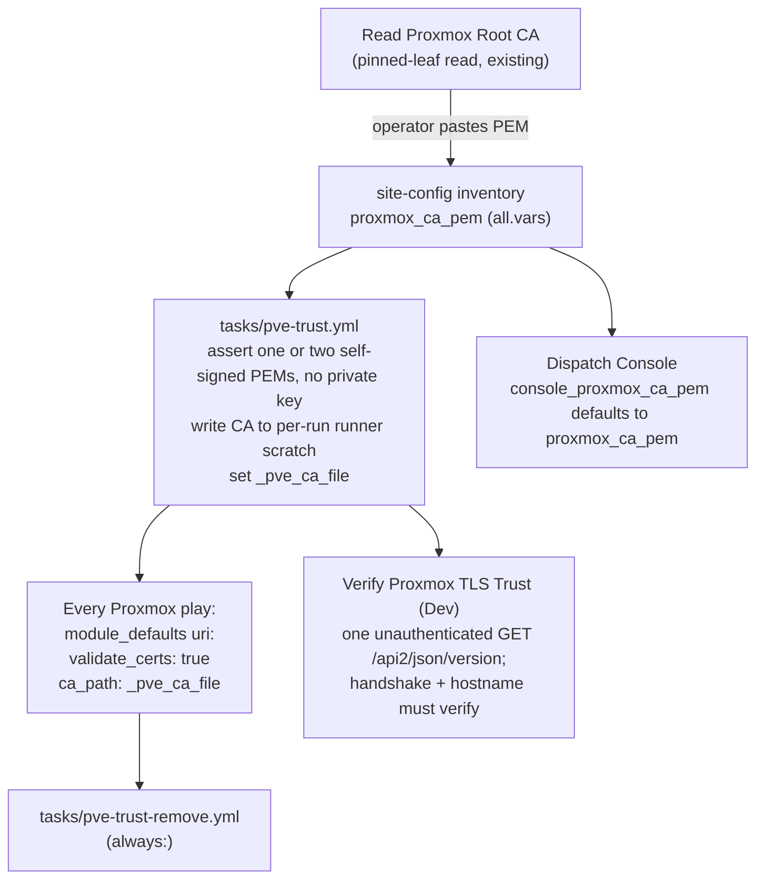

# 19 — Pin the Proxmox cluster CA for every Ansible Proxmox API call

**Date:** 2026-11-05
**Status:** PROPOSED
**Author:** Joseph A. Wisneski IV
**Context:** Closes the "Proxmox API calls accept the cluster's self-signed certificate" gap recorded in `plan/architecture/02-service-onboarding.md` (2026-09-18). The Dispatch Console already verifies Proxmox against its pinned root CA (plan 17, D22 and D33); the playbooks that create, resize, migrate, snapshot and destroy VMs do not. This plan carries the console's pin to every Ansible call to the Proxmox VE API.

## Problem

Ansible playbooks send the Proxmox API token to the cluster without verifying who answers. A spoofed HTTPS endpoint on the path would receive the token, and the transport guard (which refuses cleartext) would not notice.

Where verification is off today (origin/dev, 2026-11-05):

- **Play-level `validate_certs: false`:** `provision-template.yml`, `provision-vm.yml`, `proxmox-validate.yml`, `destroy-vm.yml`, `migrate-vm.yml`, `snapshot-vm.yml`.
- **Task-level `validate_certs: false`:** two calls in `validate-address-free.yml`.
- **The `proxmox_validate_certs` switch** (defaults to off; the value lives only in private inventory): about a dozen PBS and backup playbooks plus shared tasks, among them `resize-vm.yml`, `reconcile-o11y-backup-job.yml`, `attach-pbs-data-disk.yml`, `enable-o11y-pbs-import-content.yml` and `tasks/o11y-backup-artifact-census.yml`.
- **`curl -k` with the token on the command line:** the seed-ISO upload fallback in `provision-template.yml`. Any process on the runner can read a command line.
- **Verification on but no CA pinned:** several PBS playbooks (`configure-pbs-backup-access.yml`, `backup-o11y-to-pbs.yml`, `register-o11y-pbs-restore-storage.yml` and others) call Proxmox with `validate_certs: true` and no `ca_path`, so they trust the runner's public store. Whether they pass against the self-signed cluster certificate is unverified.
- **Shared tasks with no setting of their own** (`tasks/assert-node-cpu-model.yml`, `tasks/o11y-pbs-physical-storage-survey.yml`) inherit whatever their caller sets.

Out of scope: the NetBox Proxmox discovery worker (`verify_ssl` defaults to off in `proxmox_discovery/__init__.py`), the PBS API on its own port, pfSense, and service health checks. The discovery worker is the follow-up in Phase 4.

## Design Principles

- **One pin, one place.** The cluster root CA is declared once, in site-config inventory, and every consumer reads that one value. The console's existing value is promoted, not copied.
- **No off switch.** Verification has no inventory or launch-time knob. A knob that disables verification is a bypass, so `proxmox_validate_certs` is retired, and a run that still sets it is refused by name.
- **Fail before the token leaves.** A missing or malformed CA stops the run before any request carries the token.
- **Fix the mechanism.** One shared task provides the trust file to every Ansible caller. The console's token playbook, the one playbook that writes its own copy today, moves onto the shared task in Phase 3.
- **Respect the check-mode contract.** The CA file is runner scratch (`plan/architecture/08`, 2026-09-28 decision), so the shared task joins the contract's closed set of pinned scratch targets, the way the console's CA directory did on 2026-10-29.
- **Canary before the flip.** A read-only probe proves the stored Proxmox URL verifies against the pinned CA before any writer depends on it.

## Architecture

**The CA value.** `proxmox_ca_pem` in site-config `all.vars` holds the cluster root (`pve-root-ca.pem`) as printed by `Read Proxmox Root CA`. The console's host variable `console_proxmox_ca_pem` defaults to it (`console_proxmox_ca_pem | default(proxmox_ca_pem)`) and is removed from site-config once the default is live.

**The shared task** `platform/playbooks/tasks/pve-trust.yml`, delegated to the runner, with no `vars:`:

1. Refuse when `proxmox_validate_certs` is defined, naming it and saying to remove it from inventory.
2. Refuse unless `proxmox_ca_pem` holds one or two `BEGIN CERTIFICATE` blocks, each self-signed, and no `PRIVATE KEY`. Two are allowed so a CA rotation can overlap: the new root is added beside the old one, the cluster switches, then the old one is removed. With one certificate only, a rotation would stop every Proxmox play between the cluster switch and the site-config PR.
3. Create a per-run 0700 directory under the temp root (`tempfile`, prefix `.pve-ca-`) and write the CA as 0600 `ca.pem`. The `tempfile`, the `copy` and the removal each carry `check_mode: false`, `delegate_to: localhost` and `changed_when: false`, so a dry run verifies TLS the same way a real run does.
4. Before the `copy`, assert the directory's real path sits directly under the temp root and its name starts with `.pve-ca-`, as the console does before its own write (`provision-console-proxmox-token.yml:216-222`). The contract test reads source only; this is the runtime half the contract header asks for (`test_check_mode_contract.py:26-27`).
5. Set `_pve_ca_file`. `tasks/pve-trust-remove.yml` repeats the path assertion, then deletes the directory, and is included from each play's `always:`. Unlike `remove-ssh-key.yml`, which sets its own name, it reads the directory register `pve-trust.yml` defines. The contract's definition check allows that, because it pins where a name is defined, not where it is read.

**Check-mode contract changes** (`platform/tests/test_check_mode_contract.py` and `plan/architecture/08-ansible-automation-standards.md`), following the console's 2026-10-29 entry:

- `_in_runner_scratch` gains a branch for `tasks/pve-trust.yml`: a `tempfile` with `state: directory`, prefix `.pve-ca-` and the pinned scratch root.
- `SCRATCH_TARGETS` gains `tasks/pve-trust.yml` (the CA file and its directory) and `tasks/pve-trust-remove.yml` (the directory).
- `PINNED_DEFINITIONS` gains the directory's register name, defined once, in `tasks/pve-trust.yml`.
- The 08 doc's list of shared scratch files (the paragraph naming `materialise-ssh-key.yml`) names the two new task files.
- The seed-ISO header file is not added. It is written only under `when: not ansible_check_mode`, so the contract does not apply to it.

**The plays.** Each Proxmox play:

- Declares `_pve_ca_file: ""` in its play `vars:`. `module_defaults` is templated for every task in the play, including tasks before the trust step (`provision-template.yml:48-52`), so the name must always be defined. The placeholder is not a scratch target, and the trust task's `set_fact` outranks it.
- Includes `pve-trust.yml` before its first Proxmox request, with `tags: [always]` and the same tag applied to the included tasks (`apply: {tags: [always]}`), so a `--tags verify` run still gets the CA.
- Sets, in `module_defaults` for `ansible.builtin.uri`, `validate_certs: true` and `ca_path: "{{ _pve_ca_file }}"`.
- Removes task-level `validate_certs: false` lines. Shared tasks without their own setting keep inheriting from the caller, now the pinned one.

**Calls to anything other than Proxmox in the same play.** `ca_path` replaces the trust store rather than adding to it (ansible-core 2.21 `module_utils/urls.py:483,490-492`). A play-wide `ca_path` would therefore also apply to the NetBox calls in `validate-address-free.yml` and `provision-vm.yml`, and to any OpenBao `uri` call in a Proxmox play. Every such call sets `ca_path: null` and an explicit `validate_certs`. The restore-target guard already does this for its OpenBao login inside Proxmox plays (`tasks/guard-o11y-restore-target.yml:82`). The opposite design, a `ca_path` on every Proxmox task as `provision-console-proxmox-token.yml:244` does, was rejected because the Proxmox calls far outnumber the others in these plays. Either way, a call that misses its override fails its TLS check rather than skipping it.

**The seed-ISO fallback.** `curl -k` becomes `curl --cacert "{{ _pve_ca_file }}"`, and the `Authorization` header moves from the command line into a 0600 header file in the same scratch directory, passed with `-H @<file>`. This keeps the working binary upload and removes both the skipped check and the token on the command line. Implementation must confirm the runner's curl supports `-H @file` before relying on it.

**The canary.** A new read-only playbook, `verify-proxmox-tls-trust.yml`, with template `Verify Proxmox TLS Trust (Dev)`:

- It includes `pve-trust.yml` and sends one `GET /api2/json/version` to the stored Proxmox URL, with `validate_certs: true`, the pinned `ca_path`, `follow_redirects: none`, and no token.
- Any completed HTTP response is a pass, and its status is reported. Getting a status at all means the handshake and the hostname check succeeded against the pinned CA. Without a token, 401 is the expected status.
- `uri` accepts only 200 unless told otherwise (`status_code` defaults to `[200]`, ansible-core 2.21.0 `modules/uri.py:603`), and a failed connection or TLS check returns `status: -1` (`module_utils/urls.py:1238,1307`). So the probe sets `failed_when: _pve_probe.status | int < 100`, then reports the status in a separate task.
- A TLS or hostname error fails the run and names it.
- It is identical under `--check`.
- It proves only the node that answered the stored URL. The first production result, its status and the node it reached, is recorded in this plan's Implementation Phases table.

## Implementation Phases

| # | Phase | Acceptance |
|---|---|---|
| 0 | Declare `proxmox_ca_pem` in site-config `all.vars`, with the value from the current `console_proxmox_ca_pem` (a private PR) | The value is one self-signed PEM certificate with no private key (a second is added only during a rotation), and its SHA-256 matches the subject and digest printed by the last `Read Proxmox Root CA` run. `proxmox_validate_certs` is checked and confirmed absent from site-config, so Phase 2's refusal cannot stop a production run |
| 1 | Add `tasks/pve-trust.yml`, `tasks/pve-trust-remove.yml`, the canary playbook and its template; extend the check-mode contract as described above; default the console's CA to `proxmox_ca_pem` | Tests: the shared task refuses a missing CA, a CA with a private key, three certificates, a certificate that is not self-signed, and a defined `proxmox_validate_certs`, and the directory is removed in `always:`. The check-mode contract test passes with the new entries. Production: `Verify Proxmox TLS Trust (Dev)` passes and reports its HTTP status. If it fails on the hostname check, stop: the stored URL and the certificate names disagree, and Phase 2 waits for that to be resolved |
| 2 | Switch every Proxmox play: include the trust task; set `validate_certs: true` and `ca_path` in `module_defaults`; remove task-level `false`; retire `proxmox_validate_certs` from playbooks and their refusal lists; replace the `curl -k` fallback; update the four tests that pin the old values (`test_service_o11y.bats` snapshot-vm play, `test_resize_vm.bats`, `test_o11y_private_artifact.py`, `test_pbs_backup_access.py`) | The PBS playbooks that already verify without a pin are switched too: `backup-o11y-to-pbs.yml`, `configure-pbs-backup-access.yml`, `verify-o11y-protected-pbs-copy.yml`, `register-o11y-pbs-restore-storage.yml`. A repository test identifies a Proxmox VE call as a `uri` whose URL is built from a variable holding the stored `secret/services/proxmox` URL, listed in the test: `_pve_host` (most plays), `_pve_url` (`backup-o11y-to-pbs.yml`) and `_pve_origin` (`register-o11y-pbs-restore-storage.yml`). Any other `uri` whose URL contains `api2/json` fails the test unless it is on a named exemption list, so a new variable name cannot slip past. The exemptions, each with its reason: the Proxmox Backup Server calls on port 8007 in `configure-pbs.yml` and `tasks/configure-pbs-datastore.yml` (a different API, out of scope above); `read-proxmox-root-ca.yml` (the pinned-leaf read that runs before any CA is declared); `probe-console-sources.yml` (verifies against the CA file rendered on the console host); and `provision-console-proxmox-token.yml` until Phase 3 (pins its own copy today). For every identified call's play, the test fails unless: the play's `module_defaults` for `ansible.builtin.uri` set `validate_certs: true` and `ca_path: "{{ _pve_ca_file }}"`; the play declares the `_pve_ca_file` placeholder; the trust include (tagged `always`) comes before the first Proxmox request; no task sets `validate_certs: false` or uses `proxmox_validate_certs`; no task overrides `ca_path` with anything but `null`; and every `uri` call to a non-Proxmox URL sets `ca_path: null`. Production dry runs pass for Validate Proxmox Cluster, Resize VM, Snapshot VM and one PBS survey |
| 3 | Remove `console_proxmox_ca_pem` from site-config; move `provision-console-proxmox-token.yml` onto `pve-trust.yml` and drop its own CA directory from the check-mode contract (`PROVISION`, `CONSOLE_CA_*`); update `02-service-onboarding.md` (gap closed) and the o11y and console docs | The console deploy renders the same CA file as before (unchanged digest). The token playbook's dry run still verifies Proxmox, and the contract test passes with the console entries removed |
| 4 | Follow-up, separate change: the NetBox discovery worker reads the same CA and turns `verify_ssl` on | Out of scope here |

## Validation Criteria

| Check | Passes when |
|---|---|
| Canary in production | `Verify Proxmox TLS Trust (Dev)` completes an HTTP exchange with verification on and reports the status (401 expected) |
| No unpinned Proxmox call | The Phase 2 repository test passes |
| Non-Proxmox calls unaffected | Every NetBox and OpenBao `uri` call in a Proxmox play sets `ca_path: null` (test), and the Phase 2 production dry runs reach NetBox |
| No token on a command line | No playbook passes `PVEAPIToken` in a command's arguments (test) |
| Refusals | Each refusal in `pve-trust.yml` is covered by a test that watches it fail, and a mutation that removes it turns the test red |
| Check-mode contract | `test_check_mode_contract.py` passes with the new pinned scratch targets |
| Read-only dry runs | Production dry runs of Validate Proxmox Cluster, Resize VM and Snapshot VM complete |
| Console unchanged | Console deploy renders an identical `proxmox-ca.pem` |

## Security Considerations

- **Blast radius.** Phase 2 changes every Proxmox writer at once. A wrong CA or a hostname mismatch stops all VM lifecycle work. The Phase 1 canary is the guard against that, and reverting the Phase 2 PR restores the previous behaviour.
- **What the CA is.** `pve-root-ca.pem` is public material: no private key ever leaves the cluster, and the shared task refuses any value carrying one.
- **Rotation.** A planned rotation adds the new root beside the old one in `proxmox_ca_pem` (at most two), switches the cluster, then removes the old root. An unplanned CA change makes every Proxmox play fail its TLS check until `proxmox_ca_pem` is updated through `Read Proxmox Root CA` and a site-config PR. That is the intended behaviour: an unexplained CA change must not be trusted silently.
- **One address, one node.** The stored URL names one node. If that node is down, every Proxmox play fails even though the cluster still has quorum. This is the same availability as today; verification does not make it worse. Removing that single point needs a name that every node's certificate covers, or a failover list, which is a separate change.
- **Hostname checks.** `uri` with `validate_certs: true` checks the certificate name against the URL host. The stored URL must use a name or address the cluster leaf certificate lists, which is what the canary proves.
- **Which URL the playbooks use.** The playbooks take the Proxmox URL from `secret/services/proxmox:url` (`_pve_host: "{{ _pve_data.url }}"`, for example `provision-vm.yml:45`). The console instead reaches a node's own address (`console_proxmox_url` in site-config), and its pinned check passes in production. The stored URL was not read for this plan. If it reaches Proxmox through Caddy, which serves Let's Encrypt certificates and has a `pve` route, the pinned cluster CA will not verify it and the canary fails. In that case Phase 2 waits, and the stored URL is changed to a node address the cluster certificate covers, through `Seed OpenBao Key`, before the switch.
- **Scratch files.** The CA and the curl header file live in a per-run 0700 directory on the runner and are removed in `always:`. The header file holds the token, so its task is `no_log`.
- **URL overrides.** `snapshot-vm.yml` and `provision-template.yml` let a launch-time value replace the stored Proxmox URL. With verification on, an override to a host the pinned CA does not cover fails the handshake before the token is sent. Removing those overrides is a separate decision.

## Cross-references

- `plan/architecture/02-service-onboarding.md`: the known gap this plan closes
- `plan/architecture/08-ansible-automation-standards.md`: the check-mode contract and the runner-scratch class
- `plan/development/17-dispatch-console.md`: D22 and D33, the console's Proxmox CA pin
- `platform/playbooks/read-proxmox-root-ca.yml` and `platform/lib/pve_pinned_get.py`: how the root CA is read and pinned
- `plan/architecture/03-testing-ci-quality.md`: the discovery worker's `verify_ssl` default (Phase 4)
- Root `CLAUDE.md`
