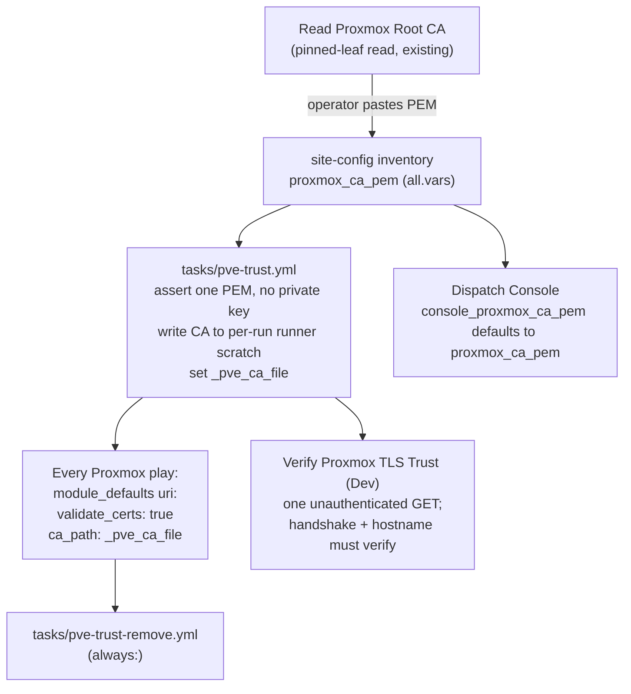

# 19 — Pin the Proxmox cluster CA for every Ansible Proxmox API call

**Date:** 2026-11-05
**Status:** PROPOSED
**Author:** Joseph A. Wisneski IV
**Context:** Closes the "Proxmox API calls accept the cluster's self-signed certificate" gap recorded in `plan/architecture/02-service-onboarding.md` (2026-09-18). The Dispatch Console already verifies Proxmox against its pinned root CA (plan 17, D22 and D33); the playbooks that create, resize, migrate, snapshot and destroy VMs do not. This plan carries the console's pin to every Ansible call to the Proxmox VE API.

## Problem

Ansible playbooks send the Proxmox API token to the cluster without verifying who answers. A spoofed HTTPS endpoint on the path would receive the token, and the transport guard (which refuses cleartext) would not notice.

Where verification is off today (origin/dev, 2026-11-05):

- **Play-level `validate_certs: false`:** `provision-template.yml`, `provision-vm.yml`, `proxmox-validate.yml`, `destroy-vm.yml`, `migrate-vm.yml`, `snapshot-vm.yml`.
- **Task-level `validate_certs: false`:** two calls in `validate-address-free.yml`.
- **The `proxmox_validate_certs` switch** (defaults to off; the value lives only in private inventory): about a dozen PBS and backup playbooks plus shared tasks, among them `resize-vm.yml`, `reconcile-o11y-backup-job.yml`, `attach-pbs-data-disk.yml`, `enable-o11y-pbs-import-content.yml` and `tasks/o11y-backup-artifact-census.yml`.
- **`curl -k` with the token on the command line:** the seed-ISO upload fallback in `provision-template.yml`. Any process on the runner can read a command line.
- **Verification on but no CA pinned:** several PBS playbooks (`configure-pbs-backup-access.yml`, `backup-o11y-to-pbs.yml`, `register-o11y-pbs-restore-storage.yml` and others) call Proxmox with `validate_certs: true` and no `ca_path`, so they trust the runner's public store. Whether they pass against the self-signed cluster certificate is unverified.
- **Shared tasks with no setting of their own** (`tasks/assert-node-cpu-model.yml`, `tasks/o11y-pbs-physical-storage-survey.yml`) inherit whatever their caller sets.

Out of scope: the NetBox Proxmox discovery worker (`verify_ssl` defaults to off in `proxmox_discovery/__init__.py`), the PBS API on its own port, pfSense, and service health checks. The discovery worker is the follow-up in Phase 4.

## Design Principles

- **One pin, one place.** The cluster root CA is declared once, in site-config inventory, and every consumer reads that one value. The console's existing value is promoted, not copied.
- **No off switch.** Verification has no inventory or launch-time knob. A knob that disables verification is a bypass, so `proxmox_validate_certs` is retired, and a run that still sets it is refused by name.
- **Fail before the token leaves.** A missing or malformed CA stops the run before any request carries the token.
- **Fix the mechanism.** One shared task provides the trust file to every caller. No playbook writes its own copy.
- **Respect the check-mode contract.** The CA file is runner scratch (`plan/architecture/08`, 2026-09-28 decision), so the shared task joins the contract's closed set of pinned scratch targets, the way the console's CA directory did on 2026-10-29.
- **Canary before the flip.** A read-only probe proves the stored Proxmox URL verifies against the pinned CA before any writer depends on it.

## Architecture

**The CA value.** `proxmox_ca_pem` in site-config `all.vars` holds the cluster root (`pve-root-ca.pem`) as printed by `Read Proxmox Root CA`. The console's host variable `console_proxmox_ca_pem` defaults to it (`console_proxmox_ca_pem | default(proxmox_ca_pem)`) and is removed from site-config once the default is live.

**The shared task** `platform/playbooks/tasks/pve-trust.yml`, delegated to the runner, with no `vars:`:

1. Refuse when `proxmox_validate_certs` is defined, naming it and saying to remove it from inventory.
2. Refuse unless `proxmox_ca_pem` holds exactly one `BEGIN CERTIFICATE` block and no `PRIVATE KEY`.
3. Create a per-run 0700 directory under the temp root (`tempfile`) and write the CA as 0600 `ca.pem`.
4. Set `_pve_ca_file`. `tasks/pve-trust-remove.yml` deletes the directory and is included from each play's `always:`.

**The plays.** Each Proxmox play includes `pve-trust.yml` before its first Proxmox request and sets, in `module_defaults` for `ansible.builtin.uri`, `validate_certs: true` and `ca_path: "{{ _pve_ca_file }}"`. Task-level `validate_certs: false` lines are removed. Shared tasks without their own setting keep inheriting from the caller, now the pinned one.

**The seed-ISO fallback.** `curl -k` becomes `curl --cacert "{{ _pve_ca_file }}"`, and the `Authorization` header moves from the command line into a 0600 header file in the same scratch directory, passed with `-H @<file>`. This keeps the working binary upload and removes both the skipped check and the token on the command line. Implementation must confirm the runner's curl supports `-H @file` before relying on it.

**The canary.** A new read-only playbook, `verify-proxmox-tls-trust.yml`, with template `Verify Proxmox TLS Trust (Dev)`:

- It includes `pve-trust.yml` and sends one request to the stored Proxmox URL with `validate_certs: true` and the pinned `ca_path`, without the token.
- A 401 is a pass: the handshake and the hostname check completed against the pinned CA, and authentication was not attempted.
- A TLS or hostname error fails the run and names it.
- It is identical under `--check`.

## Implementation Phases

| # | Phase | Acceptance |
|---|---|---|
| 0 | Declare `proxmox_ca_pem` in site-config `all.vars`, with the value from the current `console_proxmox_ca_pem` (a private PR) | The value is one PEM certificate with no private key, and its SHA-256 matches the subject and digest printed by the last `Read Proxmox Root CA` run |
| 1 | Add `tasks/pve-trust.yml`, `tasks/pve-trust-remove.yml`, the canary playbook and its template; extend `test_check_mode_contract.py`'s pinned scratch set with the new task file; default the console's CA to `proxmox_ca_pem` | Tests: the shared task refuses a missing CA, a CA with a private key, two certificates, and a defined `proxmox_validate_certs`, and the directory is removed in `always:`. Production: `Verify Proxmox TLS Trust (Dev)` passes with a 401. If it fails on the hostname check, stop: the stored URL and the certificate names disagree, and Phase 2 waits for that to be resolved |
| 2 | Switch every Proxmox play: include the trust task; set `validate_certs: true` and `ca_path` in `module_defaults`; remove task-level `false`; retire `proxmox_validate_certs` from playbooks and their refusal lists; replace the `curl -k` fallback; update the four tests that pin the old values (`test_service_o11y.bats` snapshot-vm play, `test_resize_vm.bats`, `test_o11y_private_artifact.py`, `test_pbs_backup_access.py`) | A repository test fails if any playbook or task that calls the Proxmox API sets `validate_certs: false`, uses the `proxmox_validate_certs` switch, or calls it without `ca_path`. Production dry runs pass for Validate Proxmox Cluster, Resize VM, Snapshot VM and one PBS survey |
| 3 | Remove `console_proxmox_ca_pem` from site-config; update `02-service-onboarding.md` (gap closed) and the o11y and console docs | The console deploy renders the same CA file as before (unchanged digest) |
| 4 | Follow-up, separate change: the NetBox discovery worker reads the same CA and turns `verify_ssl` on | Out of scope here |

## Validation Criteria

| Check | Passes when |
|---|---|
| Canary in production | `Verify Proxmox TLS Trust (Dev)` answers 401 with verification on |
| No unpinned Proxmox call | The new repository test finds no `validate_certs: false`, no `proxmox_validate_certs` and no Proxmox `uri` without `ca_path` |
| No token on a command line | No playbook passes `PVEAPIToken` in a command's arguments (test) |
| Refusals | Each refusal in `pve-trust.yml` is covered by a test that watches it fail, and a mutation that removes it turns the test red |
| Check-mode contract | `test_check_mode_contract.py` passes with the new pinned scratch targets |
| Read-only dry runs | Production dry runs of Validate Proxmox Cluster, Resize VM and Snapshot VM complete |
| Console unchanged | Console deploy renders an identical `proxmox-ca.pem` |

## Security Considerations

- **Blast radius.** Phase 2 changes every Proxmox writer at once. A wrong CA or a hostname mismatch stops all VM lifecycle work. The Phase 1 canary is the guard against that, and reverting the Phase 2 PR restores the previous behaviour.
- **What the CA is.** `pve-root-ca.pem` is public material: no private key ever leaves the cluster, and the shared task refuses any value carrying one.
- **Rotation.** If the cluster's root CA changes, every Proxmox play refuses with a TLS error until `proxmox_ca_pem` is updated through `Read Proxmox Root CA` and a site-config PR. That is the intended behaviour: an unexplained CA change must not be trusted silently.
- **Hostname checks.** `uri` with `validate_certs: true` checks the certificate name against the URL host. The stored URL must use a name or address the cluster leaf certificate lists, which is what the canary proves.
- **Scratch files.** The CA and the curl header file live in a per-run 0700 directory on the runner and are removed in `always:`. The header file holds the token, so its task is `no_log`.
- **URL overrides.** `snapshot-vm.yml` and `provision-template.yml` let a launch-time value replace the stored Proxmox URL. With verification on, an override to a host the pinned CA does not cover fails the handshake before the token is sent. Removing those overrides is a separate decision.

## Cross-references

- `plan/architecture/02-service-onboarding.md`: the known gap this plan closes
- `plan/architecture/08-ansible-automation-standards.md`: the check-mode contract and the runner-scratch class
- `plan/development/17-dispatch-console.md`: D22 and D33, the console's Proxmox CA pin
- `platform/playbooks/read-proxmox-root-ca.yml` and `platform/lib/pve_pinned_get.py`: how the root CA is read and pinned
- `plan/architecture/03-testing-ci-quality.md`: the discovery worker's `verify_ssl` default (Phase 4)
- Root `CLAUDE.md`
