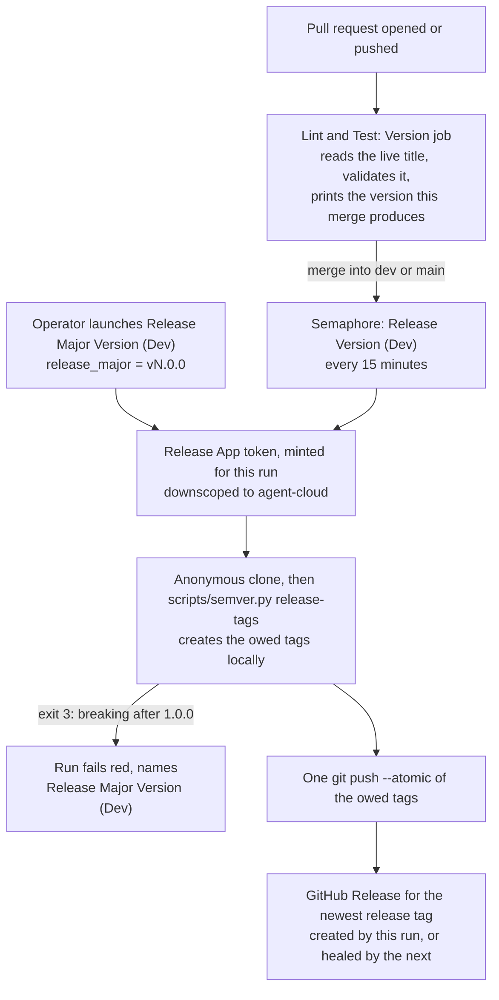

# 20 — Semantic versioning for agent-cloud

**Date:** 2026-11-09
**Status:** PROPOSED
**Author:** Joseph A. Wisneski IV
**Context:** agent-cloud has more than 3,900 commits on `dev` and 21 `dev` → `main` promotions, but no version number. A deployed state can only be named by a commit SHA, and nothing says whether a promotion was a fix or a feature. This plan adds [Semantic Versioning 2.0.0](https://semver.org/), computed from pull request titles on every pull request and applied as git tags when a pull request merges into `dev` or `main`.

## Problem

- Nothing names a release. Operators, the Dispatch Console and site-config can refer to "what is on `main`" only by SHA.
- Nothing classifies a change. A promotion that only fixes bugs looks the same as one that adds features or breaks an inventory contract.
- The release history exists only in pull request metadata: 873 merged pull requests, 21 promotions, 6 of them squashed. Nothing in git records it.

## Decisions

**Revision 2026-11-09.** The release moved from GitHub Actions to Semaphore. The GitHub Actions release workflow (`.github/workflows/release-version.yml`) pushed its tags with the job's `GITHUB_TOKEN`. Its first two runs failed on the first backfill push, which was the tag `v0.1.0`, with `refusing to allow a GitHub App to create or update workflow .github/workflows/lint-and-test.yml without workflows permission`. No `v*` tag reached the remote, and the workflow was disabled the same day (`docs/MISTAKES.md` 10.35). The decisions in the table below stand. What changed is the mechanism: the release now runs from two Semaphore templates with a token from a dedicated GitHub App, `uhstray-io-release-automation`, described under "Release runs". The GitHub environment `release-major`, which was meant to gate the manual major release, was never applied (GitHub lists only the `Production` environment). The operator's launch of `Release Major Version (Dev)` replaces it.

| Question | Decision | Why |
|---|---|---|
| Starting line | **0.x.y**, not 1.x | Operator's call (2026-11-09). semver.org rule 4: major version zero is initial development, and the public API is not yet stable. |
| Going to 1.0.0, or any later major | **Manual approval only** | Operator's call. Automation never produces a new major version; the operator's launch of `Release Major Version (Dev)` with the exact major is the approval. |
| Where the version lives | **Annotated git tags** (`vX.Y.Z` on `main`, `vX.Y.Z-dev.N` on `dev`) plus a GitHub Release per `main` version | No bot commits: nothing but tags is ever pushed to `dev` or `main`. The `v` prefix is a tag convention; the version is `X.Y.Z` (semver.org FAQ). |
| What decides the bump | **The pull request title**, in Conventional Commits form | 784 of the last 873 merged titles already use it. The title is written into the merge commit's body (verified on `e5391c82`), so the release run reads it from git with no API call. |
| A title not in that form | **The `Version` check fails** | A mis-titled feature would otherwise ship without its bump. |
| History | **Backfill 16 tags** on past promotions from a committed table | Gives `git describe` and a browsable release history. A table, not inference, because 6 promotions were squashed and leave no merge to find. |

The Baeldung article in the request was not readable (HTTP 403), so this plan rests on semver.org and the AWS DevOps article only.

## The public API

semver.org rule 1 requires a declared public API. For agent-cloud it is the set of contracts that operators, site-config and other repositories depend on:

- Semaphore template names and their survey variables (`platform/semaphore/templates.yml`)
- Playbook inputs: extra variables a template or operator passes in
- Inventory variables that site-config must or may declare
- OpenBao secret paths and field names (the layout table in `CLAUDE.md`)
- Published service hostnames, ports and API routes

A **breaking change** removes or renames one of these, or changes what an existing one means or requires. It is marked with `!` in the pull request title (`feat(semaphore)!: rename Deploy NetBox`). The `!` is the only breaking marker: a `BREAKING CHANGE:` footer in a pull request body never reaches the merge commit, so it cannot be read from git.

## Bump rules

| Title type | Bump |
|---|---|
| `!` on any type | **breaking** |
| `feat` | minor |
| `fix`, `perf`, `security`, `revert` | patch |
| `docs`, `chore`, `test`, `ci`, `refactor`, `build`, `style`, `plan`, `promote` | none |

Title form: `type(optional-scope)!: description`, lower-case type, a colon and one space, a non-empty description. Any other type fails the check. GitHub's **Revert** button titles its pull request `Revert "…"`; the check rejects it because `Revert` is not a lower-case type. Retitle it `revert: …`, or the merge guard refuses it.

The highest bump among the pull requests in a release decides the release:

- **While on 0.x:** breaking → minor, feature → minor, fix → patch (semver.org rule 4 allows any change in 0.y.z).
- **From 1.0.0 on:** breaking → major, but the automatic release stops and asks for the manual major release instead of tagging.
- **No bump at all** (only docs, tests, chores): no release tag. The pull requests ship in the next release that has one.

## Starting version: the backfill

Replaying every promotion from the first production promotion (#60, 2026-06-16) as `0.1.0`, one minor per promotion that carried a `feat` pull request and one patch per promotion that carried only fixes (classification from the merged pull request titles in each promotion's window):

| Version | Promotion | Commit on `main` |
|---|---|---|
| v0.1.0 | #60 | `aef0c092d1` |
| v0.2.0 | #74 | `c2ed79c314` |
| v0.3.0 | #76 | `bc5832db27` |
| v0.4.0 | #79 | `e640f59380` |
| v0.4.1 | #82 | `1eb385e11e` |
| v0.5.0 | #88 | `e6b3958bd9` |
| v0.5.1 | #93 | `abff97682e` |
| v0.5.2 | #97 | `d174fb3b2c` |
| v0.6.0 | #100 | `24193f11ce` |
| v0.7.0 | #104 | `c95d229bf7` |
| v0.8.0 | #112 | `e7843d4e33` |
| v0.9.0 | #132 | `44c8e3aed9` |
| v0.10.0 | #447 | `c81ada2ab1` |
| v0.11.0 | #515 | `293b1e0c57` |
| v0.12.0 | #607 | `67ce3d4dd7` |
| v0.13.0 | #656 | `9874f30ee8` (`main` today) |

Five promotions (#64, #67, #70, #84, #90) carried only documentation and chores and get no tag. No merged title carried `!`. `dev` holds 247 pull requests since #656, 88 of them `feat`, so the next release is **v0.14.0**, and `dev`'s pre-releases are `v0.14.0-dev.N`.

## Architecture

### `scripts/semver.py` (standard library only)

One script holds every rule, so the pull request check and the release run cannot disagree:

- `title -- TITLE`: prints the bump (`major`, `minor`, `patch`, `none`), exit 2 with a reason for a title not in the form. The `--` keeps a title that starts with a dash from being read as an option (a title of `--help` would otherwise exit 0 and pass).
- `next --channel dev|main [--ref REF] [--title TITLE]`: prints the tag the channel would get at `REF` (default `HEAD`), counting `TITLE` as one more pull request when given (the pull request check passes its own title, not yet merged). Prints nothing and exits 0 when `main` would get no release; exits 3 when a breaking change after 1.0.0 needs the manual major release.
- `notes --from TAG --to REF`: Markdown list of the pull request titles in the range, for the GitHub Release. `release-tags` returns the same notes in its JSON output.
- `dev-tags [--ref REF]`: one `vX.Y.Z-dev.N SHA` line per pull request merge on `dev` that still needs a tag, oldest first (see catch-up below). Computes only.
- `backfill [--apply] [--push]`: creates each tag in the committed table `scripts/semver-backfill.tsv` that does not exist yet; every row is checked first, and a tag pointing elsewhere refuses the whole run, so no tag is ever moved.
- `release-tags --main-ref REF --dev-ref REF [--major VERSION]`: the planner the release runs call. It creates, in the local clone only, the tags the release owes, in order: the committed history, then main's next release at `--main-ref`, then each dev pull request still owed at `--dev-ref`, so dev counts from the release just made. With `--major VERSION` (`vN.0.0`), it checks that VERSION is the next major and tags it at `--main-ref`, with no dev tags. It prints one JSON object: the tags it created, in order, and the release they make up with its notes. It never pushes; the caller pushes the tags it reads from the output.
- `major`: prints the next major version after the highest release tag. Computes only; it never tags. The manual release tags through `release-tags --major`.

**Reading pull requests from git.** A merge commit `Merge pull request #N from OWNER/BRANCH` carries the title as the first body line; a squash merge's subject is `TITLE (#N)`. Promotion merges (branch `dev`) are skipped, so a promotion is never counted as a pull request of its own. The main-to-dev sync merge, which `sync-main-to-dev.yml` writes as `Merge remote-tracking branch 'origin/main' into dev`, matches neither form and is ignored. `dev` reads its first-parent chain since the last release tag; `main` reads every commit since the last release tag.

**Pre-release numbering on `dev`.** The next version is the highest release tag in the repository bumped by the pull requests merged since, with a floor of a patch (anything merged after a release is at least a patch candidate). Release tags exist only on `main`, so a `dev` merge that lands before the main-to-dev sync brings the promotion into `dev` still counts from the shipped release, not from an older one that `dev` reaches. `N` is one more than the highest existing `-dev.N` tag for that version, starting at 1. When a feature lifts the next version (say from `0.14.1` to `0.15.0`), numbering restarts at `-dev.1`; semver precedence still orders them (`0.14.1-dev.3 < 0.15.0-dev.1`).

**Catch-up.** `Release Version (Dev)` runs every 15 minutes, and each run tags every pull request merge on `dev` that is still owed a tag, oldest first, after the newest commit that already carries a `-dev` tag. A merge therefore waits up to 15 minutes for its tag, and a run that does not happen is covered by the next one. When no pull request on the chain carries a `-dev` tag (the first run, or the first after a release), only `dev`'s head is offered, and only when the head is a pull request merge. The first run therefore does not tag every merge since `v0.13.0`.

### Pull request check: a `Version` job in `lint-and-test.yml`

A new job, `version`, named `Version`, with `contents: read` and `pull-requests: read`. It reads the **live** title through the API (`gh api`), not the event payload, so re-running the job after a title edit sees the new title. It fails on a title not in the form, and writes the predicted tag to the job summary.

The merge guard pins `lint-and-test.yml` by blob SHA, so this is the guard's **eighth transition**: from the ruff-pinned blob `98e7aca96851979464f36bffc48444eba93d39f0` (kept as the fixture `platform/tests/fixtures/lint-and-test-ruff-pinned.txt`) to the exact versioned blob, with a new policy state requiring the `version` job, and `Version` added to the guard's expected and required jobs.

### Release runs: `Release Version (Dev)` and `Release Major Version (Dev)`

The release runs on Semaphore, not GitHub Actions. Both templates are declared in `platform/semaphore/templates.yml`, both are `Dev`-bound, and both run `platform/playbooks/release-version.yml`.

- **`Release Version (Dev)`** runs on the schedule `*/15 * * * *` and takes no survey. Each run tags the owed `dev` pre-releases and, when `main` has one, the next `main` release.
- **`Release Major Version (Dev)`** is launched by the operator. Its required survey `release_major` names the exact major version expected, for example `v1.0.0`. The run refuses unless the next major it computes equals that value. The launch is the approval.

Each run does the following, in order:

1. Refuses internal extra variables (`refuse-internal-extra-vars.yml`).
2. Logs in to OpenBao with the controller AppRole and reads `release_app_key` and `release_app_client_id` from `secret/services/github`.
3. Mints an installation token for the release App through `platform/lib/github_app_token.py`, downscoped to `contents: write`, `workflows: write` and `metadata: read` on agent-cloud only. The signer refuses a wider grant (exit 6).
4. Creates a 0700 temporary directory. The token is written only to a 0600 git credential-store file there. Git runs with `GIT_CONFIG_GLOBAL=/dev/null`, `GIT_CONFIG_NOSYSTEM=1` and `GIT_TERMINAL_PROMPT=0`, so no other credential can answer (`docs/MISTAKES.md` 2.36).
5. Clones the repository anonymously into the temporary directory.
6. Runs `python3 -I scripts/semver.py --repo <clone> release-tags --main-ref origin/main --dev-ref origin/dev`, adding `--major vN.0.0` for the major run. The command creates the owed tags locally and prints them as JSON, together with the release they make up.
7. Pushes those tags in one `git push --atomic`. The push never uses `--force`.
8. Self-heals the release: when the newest release tag has no GitHub Release (a `GET` returns 404), creates one, with the pull request titles since the previous release as its notes.
9. In an `always:` block, deletes the temporary directory and revokes the token.

Check mode (`--check`) runs steps 1 to 6. The token mint and the local tagging in the throwaway clone are included, so a check-mode run mints a real token. It pushes nothing and creates no Release. Its output is therefore the exact list of tags a real run would push.

**Exit 3.** When a breaking change after 1.0.0 counts, `scripts/semver.py` exits 3 (the `NeedsMajor` path in `main()`, reached by `release-tags` through `_main_version`). The scheduled run then fails red and names `Release Major Version (Dev)` as the run that cuts that major.

**Merging this change.** The guard refuses any pull request whose changed files include a `.github/workflows/` path other than `lint-and-test.yml`, and any pull request that changes a path in `RELEASE_SCRIPTS`, which lists `scripts/semver.py`, `scripts/semver-backfill.tsv` and `platform/playbooks/release-version.yml` (`changed_files()` in `scripts/merge-when-green.py`). The changed-file list includes the deleted path, so deleting `.github/workflows/release-version.yml` counts as touching that workflow path. This pull request does both: it deletes that workflow and changes files in `RELEASE_SCRIPTS`. The operator therefore merges it, not the guard. Every later pull request that touches none of those paths goes through the guard as before. At merge the guard reads the live title again and refuses one that is not in the form: the `Version` job does not run again on a title edit, so a merge outside the guard relies on the `Version` run, which a later title edit does not refresh.

## Implementation phases

| # | Phase | Acceptance |
|---|---|---|
| 1 | `scripts/semver.py`, `scripts/semver-backfill.tsv` and `platform/tests/test_semver.py` | Tests cover every title type, the `!` marker, rejected titles, 0.x and post-1.0 bumps, the exit-3 refusal, the patch floor, `-dev.N` numbering and restart, both merge-commit formats, skipped promotion and sync merges, and backfill (create, idempotent rerun, refusal of a moved tag), on throwaway git repositories. `backfill` without `--apply`, run in this repository, lists exactly the 16 tags above, and `next --channel main --ref origin/main` prints nothing (`main` is `v0.13.0` with nothing new) once they exist |
| 2 | The `Version` job and the guard's eighth transition | Guard tests prove the exact transition is accepted, its edge cases refused, and `Version` required; the job passes on this pull request's own title and fails a deliberately bad one |
| 3 | `platform/playbooks/release-version.yml`, the templates `Release Version (Dev)` and `Release Major Version (Dev)` in `platform/semaphore/templates.yml`, and the playbook's entry in `RELEASE_SCRIPTS` | The release App's token is proven first: it pushed and then deleted a probe tag outside the `v*` namespace, at the commit `v0.1.0` points to (`docs/MISTAKES.md` 10.35, 2.36). The playbook's tests pass in CI |
| 4 | Merge into `dev` (operator), then publish the templates with `setup-templates.yml` | The two templates exist in Semaphore with the declared schedule and survey |
| 5 | Dry run: `Release Version (Dev)` in check mode, on `dev` | Its output lists the tags a real run would push. When `dev`'s head is a pull request merge, that is the 16 backfill tags and `v0.14.0-dev.1`. When the head is the main-to-dev sync merge, it is the 16 backfill tags alone, and no `-dev` tag is owed until the next pull request merges. Nothing is pushed and no Release is created |
| 6 | First real run, and observe | The next scheduled run creates the owed tags. Each pull request merged into `dev` after that gets the next `-dev.N` within 15 minutes, in order |
| 7 | `dev` → `main` promotion pull request | The `Version` job predicts `v0.14.0`. After the operator merges it, the next scheduled run on `main` tags `v0.14.0` and creates its Release |

## Validation criteria

| Check | Passes when |
|---|---|
| Rules agree everywhere | The pull request check and the release run both call `scripts/semver.py`; no rule is written twice |
| History | `git tag -l 'v0.*'` lists the 16 backfill tags, each on its promotion commit |
| `dev` channel | Each pull request merged into `dev` gets exactly one `-dev.N` tag, in order |
| `main` channel | A promotion with a feature or fix gets exactly one release tag and Release; a documentation-only promotion gets none |
| Major gate | Automation creates a new major version only when the operator launches `Release Major Version (Dev)` with `release_major` set to the exact next major, and the run refuses otherwise. No release path moves or deletes a tag. A person with write access can still push, move or delete a `v*` tag by hand until a tag ruleset protects `refs/tags/v*` (Known limits) |
| Credential | The release App's token is proven before the merge: it pushed and then deleted a disposable tag outside the `v*` namespace, at the commit `v0.1.0` points to (`docs/MISTAKES.md` 10.35). Each run mints its own token and revokes it |
| Guard | Every later pull request passes the guard with the `Version` job required |

## Security considerations

- **A token that writes.** Each release run mints a token from the release GitHub App, downscoped to `contents: write`, `workflows: write` and `metadata: read` on agent-cloud alone. The token lives for one run. It is written only to a 0600 git credential-store file inside a 0700 temporary directory, git runs with its global and system configuration disabled (`docs/MISTAKES.md` 2.36), and an `always:` block deletes the directory and revokes the token. The App has no webhook, so no repository event starts a run; the runs start on their schedule or by the operator's launch.
- **The token's reach is wider than tagging.** `contents: write` lets the token push branches, and `workflows: write` lets it push changes under `.github/workflows/`. On `dev`, that means the token could push workflow files as well as branches. `dev` is protected only against deletion and non-fast-forward updates (`.github/rulesets/protect-dev.json`, with no bypass actor and no pull request or check rule), so a push of a new commit to `dev` is not refused by a ruleset. `main` is protected by `.github/rulesets/protect-main.json`, which adds a pull request rule and names the Repository admin role as its only bypass actor. Remote enforcement of either ruleset was not queried for this revision; `AGENTS.md` makes the same caveat for the checked-in rulesets. This is a recorded risk: the token can push more than tags.
- **Untrusted text.** Pull request titles are untrusted text, and `scripts/semver.py` reads them from the merge commits in the clone. They reach the script only through git: `platform/playbooks/release-version.yml` runs every command as an `argv` list, never a shell line. The release notes built from them go to the Releases API as a JSON body through the `uri` module. A tag name enters the push only after it matches `vX.Y.Z` or `vX.Y.Z-dev.N` and its commit is a full SHA, so a title cannot add a refspec or an option to the push (`platform/tests/test_release_version_playbook.py`).
- **Automation never moves a tag.** `scripts/semver.py` refuses to create a tag that already exists, and it refuses a backfill row whose tag points at another commit (`_create_tags` and `_backfill_plan`). `release-tags` creates tags and never moves one. Nothing yet stops a person with write access from moving or deleting one by hand (Known limits), so semver.org rule 3 (a released version's contents never change) holds only while nothing does.
- **The promotion.** The promotion, the last phase above, carries every `dev` change since #656 (247 pull requests) to `main`, which `main`-bound Semaphore templates then run. Merging it is a production promotion and the operator's decision, separate from versioning.

## Known limits

- **A breaking change after 1.0.0.** Once the last release is 1.x or later, `scripts/semver.py` exits 3 whenever a `!` change counts. The `!` pull request therefore fails its own `Version` check on `dev`, so the guard refuses it. A `!` pull request merged by hand makes the scheduled run fail red, naming `Release Major Version (Dev)`, until it is promoted and the manual major release is cut. Revisit before 1.0.0 (for example, name `dev` pre-releases of the next major).
- **A squashed promotion.** A promotion squashed to scrub sensitive content leaves one commit on `main`, whose subject is the promotion's `promote:` title, so the pull requests inside it are invisible to `next` and no release tag is created. Add the release by hand through a row in `scripts/semver-backfill.tsv` in the follow-up pull request. A merge-style promotion is unaffected.
- **No tag ruleset.** Nothing protects `refs/tags/v*`, so a person with write access can push, move or delete a release tag by hand. Follow-up: a tag ruleset, config-as-code under `.github/rulesets/`, that blocks updates and deletions of `refs/tags/v*`.
- **A release that fails after its tag was pushed is healed by the next run.** The release run pushes the tags, then creates the GitHub Release for the newest release tag. When that Release is missing (a `GET` returns 404), the next run creates it, with the pull request titles since the previous release as its notes.
- **Schedule lag.** A pull request merged into `dev` or `main` gets its tag at the next scheduled run, up to 15 minutes later, not at once. Nothing in this design depends on a tag push starting another workflow. Whether a tag pushed with the App token starts a workflow was not checked for this revision, and nothing relies on it.

## Cross-references

- [semver.org](https://semver.org/) (Semantic Versioning 2.0.0)
- [AWS DevOps Blog: Using semantic versioning to simplify release management](https://aws.amazon.com/blogs/devops/using-semantic-versioning-to-simplify-release-management/)
- `plan/development/dev-merge-guard.md`: the pinned workflow transitions and the release-script refusal
- `.github/rulesets/README.md`: the configuration-as-code pattern for the tag ruleset follow-up (Known limits)
- `docs/MISTAKES.md` 10.35 (the failed GitHub Actions release and the rule it earned) and 2.36 (the credential probe and the isolated git configuration)
