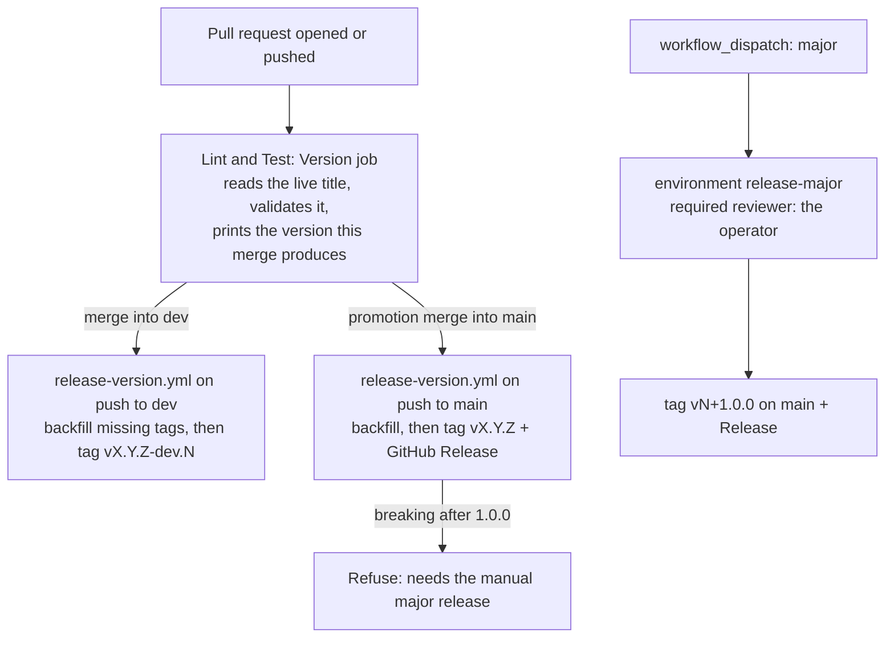

# 20 — Semantic versioning for agent-cloud

**Date:** 2026-11-09
**Status:** PROPOSED
**Author:** Joseph A. Wisneski IV
**Context:** agent-cloud has more than 3,900 commits on `dev` and 21 `dev` → `main` promotions, but no version number. A deployed state can only be named by a commit SHA, and nothing says whether a promotion was a fix or a feature. This plan adds [Semantic Versioning 2.0.0](https://semver.org/), computed from pull request titles on every pull request and applied as git tags when a pull request merges into `dev` or `main`.

## Problem

- Nothing names a release. Operators, the Dispatch Console and site-config can refer to "what is on `main`" only by SHA.
- Nothing classifies a change. A promotion that only fixes bugs looks the same as one that adds features or breaks an inventory contract.
- The release history exists only in pull request metadata: 873 merged pull requests, 21 promotions, 6 of them squashed. Nothing in git records it.

## Decisions

| Question | Decision | Why |
|---|---|---|
| Starting line | **0.x.y**, not 1.x | Operator's call (2026-11-09). semver.org rule 4: major version zero is initial development, and the public API is not yet stable. |
| Going to 1.0.0, or any later major | **Manual approval only** | Operator's call. Automation never produces a new major version. |
| Where the version lives | **Annotated git tags** (`vX.Y.Z` on `main`, `vX.Y.Z-dev.N` on `dev`) plus a GitHub Release per `main` version | No bot commits: nothing but tags is ever pushed to `dev` or `main`. The `v` prefix is a tag convention; the version is `X.Y.Z` (semver.org FAQ). |
| What decides the bump | **The pull request title**, in Conventional Commits form | 784 of the last 873 merged titles already use it. The title is written into the merge commit's body (verified on `e5391c82`), so the release job reads it from git with no API call. |
| A title not in that form | **The `Version` check fails** | A mis-titled feature would otherwise ship without its bump. |
| History | **Backfill 16 tags** on past promotions from a committed table | Gives `git describe` and a browsable release history. A table, not inference, because 6 promotions were squashed and leave no merge to find. |

The Baeldung article in the request was not readable (HTTP 403), so this plan rests on semver.org and the AWS DevOps article only.

## The public API

semver.org rule 1 requires a declared public API. For agent-cloud it is the set of contracts that operators, site-config and other repositories depend on:

- Semaphore template names and their survey variables (`platform/semaphore/templates.yml`)
- Playbook inputs: extra variables a template or operator passes in
- Inventory variables that site-config must or may declare
- OpenBao secret paths and field names (the layout table in `CLAUDE.md`)
- Published service hostnames, ports and API routes

A **breaking change** removes or renames one of these, or changes what an existing one means or requires. It is marked with `!` in the pull request title (`feat(semaphore)!: rename Deploy NetBox`). The `!` is the only breaking marker: a `BREAKING CHANGE:` footer in a pull request body never reaches the merge commit, so it cannot be read from git.

## Bump rules

| Title type | Bump |
|---|---|
| `!` on any type | **breaking** |
| `feat` | minor |
| `fix`, `perf`, `security`, `revert` | patch |
| `docs`, `chore`, `test`, `ci`, `refactor`, `build`, `style`, `plan`, `promote` | none |

Title form: `type(optional-scope)!: description`, lower-case type, a colon and one space, a non-empty description. Any other type fails the check.

The highest bump among the pull requests in a release decides the release:

- **While on 0.x:** breaking → minor, feature → minor, fix → patch (semver.org rule 4 allows any change in 0.y.z).
- **From 1.0.0 on:** breaking → major, but the automatic release stops and asks for the manual major release instead of tagging.
- **No bump at all** (only docs, tests, chores): no release tag. The pull requests ship in the next release that has one.

## Starting version: the backfill

Replaying every promotion from the first production promotion (#60, 2026-06-16) as `0.1.0`, one minor per promotion that carried a `feat` pull request and one patch per promotion that carried only fixes (classification from the merged pull request titles in each promotion's window):

| Version | Promotion | Commit on `main` |
|---|---|---|
| v0.1.0 | #60 | `aef0c092d1` |
| v0.2.0 | #74 | `c2ed79c314` |
| v0.3.0 | #76 | `bc5832db27` |
| v0.4.0 | #79 | `e640f59380` |
| v0.4.1 | #82 | `1eb385e11e` |
| v0.5.0 | #88 | `e6b3958bd9` |
| v0.5.1 | #93 | `abff97682e` |
| v0.5.2 | #97 | `d174fb3b2c` |
| v0.6.0 | #100 | `24193f11ce` |
| v0.7.0 | #104 | `c95d229bf7` |
| v0.8.0 | #112 | `e7843d4e33` |
| v0.9.0 | #132 | `44c8e3aed9` |
| v0.10.0 | #447 | `c81ada2ab1` |
| v0.11.0 | #515 | `293b1e0c57` |
| v0.12.0 | #607 | `67ce3d4dd7` |
| v0.13.0 | #656 | `9874f30ee8` (`main` today) |

Five promotions (#64, #67, #70, #84, #90) carried only documentation and chores and get no tag. No merged title carried `!`. `dev` holds 247 pull requests since #656, 88 of them `feat`, so the next release is **v0.14.0**, and `dev`'s pre-releases are `v0.14.0-dev.N`.

## Architecture

### `scripts/semver.py` (standard library only)

One script holds every rule, so the pull request check and the release job cannot disagree:

- `title -- TITLE`: prints the bump (`major`, `minor`, `patch`, `none`), exit 2 with a reason for a title not in the form. The `--` keeps a title that starts with a dash from being read as an option (a title of `--help` would otherwise exit 0 and pass).
- `next --channel dev|main [--ref REF] [--title TITLE]`: prints the tag the channel would get at `REF` (default `HEAD`), counting `TITLE` as one more pull request when given (the pull request check passes its own title, not yet merged). Prints nothing and exits 0 when `main` would get no release; exits 3 when a breaking change after 1.0.0 needs the manual major release.
- `notes --from TAG --to REF`: Markdown list of the pull request titles in the range, for the GitHub Release.
- `dev-tags [--ref REF]`: one `vX.Y.Z-dev.N SHA` line per pull request merge on `dev` that still needs a tag, oldest first (see catch-up below). Computes only.
- `backfill [--apply] [--push]`: creates each tag in the committed table `scripts/semver-backfill.tsv` that does not exist yet; every row is checked first, and a tag pointing elsewhere refuses the whole run, so no tag is ever moved.
- `major [--ref REF]`: prints the next major version on `main`, for the manual release only. Computes only; the workflow tags.

**Reading pull requests from git.** A merge commit `Merge pull request #N from OWNER/BRANCH` carries the title as the first body line; a squash merge's subject is `TITLE (#N)`. Promotion merges (branch `dev`) are skipped, so a promotion is never counted as a pull request of its own. The main-to-dev sync merge, which `sync-main-to-dev.yml` writes as `Merge remote-tracking branch 'origin/main' into dev`, matches neither form and is ignored. `dev` reads its first-parent chain since the last release tag; `main` reads every commit since the last release tag.

**Pre-release numbering on `dev`.** The next version is the last release tag reachable from `dev` bumped by the pull requests merged since, with a floor of a patch (anything merged after a release is at least a patch candidate). `N` is one more than the highest existing `-dev.N` tag for that version, starting at 1. When a feature lifts the next version (say from `0.14.1` to `0.15.0`), numbering restarts at `-dev.1`; semver precedence still orders them (`0.14.1-dev.3 < 0.15.0-dev.1`).

**Catch-up.** The release workflow runs one at a time per branch (a `concurrency` group keyed by ref), and GitHub keeps only the newest pending run of a group, cancelling an older pending one. A burst of merges can therefore skip a run. `dev-tags` covers that: each run tags every pull request merge after the newest commit that already carries a `-dev` tag, in order. When no commit since the last release carries one (the first run, or the first after a release), it tags only `HEAD`, so the first run does not tag every merge since `v0.13.0`.

### Pull request check: a `Version` job in `lint-and-test.yml`

A new job, `version`, named `Version`, with `contents: read` and `pull-requests: read`. It reads the **live** title through the API (`gh api`), not the event payload, so re-running the job after a title edit sees the new title. It fails on a title not in the form, and writes the predicted tag to the job summary.

The merge guard pins `lint-and-test.yml` by blob SHA, so this is the guard's **eighth transition**: from the ruff-pinned blob `98e7aca96851979464f36bffc48444eba93d39f0` (kept as the fixture `platform/tests/fixtures/lint-and-test-ruff-pinned.txt`) to the exact versioned blob, with a new policy state requiring the `version` job, and `Version` added to the guard's expected and required jobs.

### Release job: `.github/workflows/release-version.yml`

- Triggers: `push` to `dev` and `main`; `workflow_dispatch` for the manual major release.
- `permissions: contents: write`. Concurrency is per branch (`release-version-<ref>`), so a push to `dev` never replaces a pending run on `main`, and a running run is never cancelled. The manual major release has its own group (`release-version-major`), so a run waiting for approval holds nothing else. A pending run of the same branch is replaced by a newer one: on `dev`, `dev-tags` tags the merges the replaced run skipped; on `main`, the next run counts every pull request since the last release. The first runs on `dev` and `main` at the same moment could both try the backfill; the remote refuses the second tag push (`already exists`), and a re-run finds the tags and converges.
- Checks out full history and tags, runs `backfill --apply --push`, then tags the branch pushed. On `dev` it tags what `dev-tags` lists (see catch-up above); on `main` it tags what `next --channel main` prints and creates a GitHub Release with `notes`.
- The manual major release runs in the GitHub environment **`release-major`**, whose required reviewer is the operator, so no major version is cut without that approval.
- Tags are annotated, made as `github-actions[bot]` (`41898282+github-actions[bot]@users.noreply.github.com`).

The environment is configuration as code: `.github/environments/release-major.json` and `.github/environments/apply.sh`, the same pattern as `.github/rulesets/`.

**Merging this change.** The guard refuses any pull request that adds or changes a workflow other than `lint-and-test.yml` (`changed_files()` in `scripts/merge-when-green.py`). A workflow that can push tags is exactly what that rule exists for, so the pull request that adds `release-version.yml` is merged by the operator, not through the guard. The guard also refuses any pull request that changes `scripts/semver.py` or `scripts/semver-backfill.tsv`, because this workflow runs them with a write token on every push to `dev` and `main`; those pull requests are operator-merged too. Every later pull request goes through the guard as before. At merge the guard reads the live title again and refuses one that is not in the form: the `Version` job does not run again on a title edit, so a merge outside the guard relies on the `Version` run, which a later title edit does not refresh.

## Implementation phases

| # | Phase | Acceptance |
|---|---|---|
| 1 | `scripts/semver.py`, `scripts/semver-backfill.tsv` and `platform/tests/test_semver.py` | Tests cover every title type, the `!` marker, rejected titles, 0.x and post-1.0 bumps, the exit-3 refusal, the patch floor, `-dev.N` numbering and restart, both merge-commit formats, skipped promotion and sync merges, and backfill (create, idempotent rerun, refusal of a moved tag), on throwaway git repositories. `backfill` without `--apply`, run in this repository, lists exactly the 16 tags above, and `next --channel main --ref origin/main` prints nothing (`main` is `v0.13.0` with nothing new) once they exist |
| 2 | The `Version` job and the guard's eighth transition | Guard tests prove the exact transition is accepted, its edge cases refused, and `Version` required; the job passes on this pull request's own title and fails a deliberately bad one |
| 3 | `release-version.yml` and the `release-major` environment as code | `actionlint`/`yamllint` clean; the environment applied with the operator as required reviewer |
| 4 | Merge into `dev` (operator) and observe | The push run creates the 16 backfill tags and `v0.14.0-dev.1` on the merge commit; the next merged pull request gets `v0.14.0-dev.2` |
| 5 | `dev` → `main` promotion pull request | The `Version` job predicts `v0.14.0`. After the operator merges it, the push run on `main` tags `v0.14.0` and creates its Release |

## Validation criteria

| Check | Passes when |
|---|---|
| Rules agree everywhere | The pull request check and the release job both call `scripts/semver.py`; no rule is written twice |
| History | `git tag -l 'v0.*'` lists the 16 backfill tags, each on its promotion commit |
| `dev` channel | Each pull request merged into `dev` gets exactly one `-dev.N` tag, in order |
| `main` channel | A promotion with a feature or fix gets exactly one release tag and Release; a documentation-only promotion gets none |
| Major gate | No path but the `release-major` environment creates a new major version |
| Guard | Every later pull request passes the guard with the `Version` job required |

## Security considerations

- **A workflow that writes.** `release-version.yml` holds `contents: write` and runs only on pushes to `dev` and `main` and on a manual dispatch, never on `pull_request`, so no fork or feature branch can run it. It pushes tags only; branch rules are unchanged.
- **Untrusted text.** The pull request title is read into an environment variable and passed to the script as an argument, never interpolated into a shell line, so a crafted title cannot run a command.
- **Tags are not moved.** `backfill` refuses a tag that points elsewhere; a released version's contents never change (semver.org rule 3).
- **The promotion.** Phase 5's pull request carries every `dev` change since #656 (247 pull requests) to `main`, which `main`-bound Semaphore templates then run. Merging it is a production promotion and the operator's decision, separate from versioning.

## Known limits

- **A breaking change after 1.0.0.** Once the last release is 1.x or later, `scripts/semver.py next` exits 3 whenever a `!` change counts. The `!` pull request therefore fails its own `Version` check on `dev`, so the guard refuses it. A `!` pull request merged by hand makes the `dev` channel exit 3 for every later `dev` pull request and every `dev` release run, until it is promoted and the manual major release is cut. Revisit before 1.0.0 (for example, name `dev` pre-releases of the next major).
- **A squashed promotion.** A promotion squashed to scrub sensitive content leaves one commit on `main`, whose subject is the promotion's `promote:` title, so the pull requests inside it are invisible to `next` and no release tag is created. Add the release by hand through a row in `scripts/semver-backfill.tsv` in the follow-up pull request. A merge-style promotion is unaffected.

## Cross-references

- [semver.org](https://semver.org/) (Semantic Versioning 2.0.0)
- [AWS DevOps Blog: Using semantic versioning to simplify release management](https://aws.amazon.com/blogs/devops/using-semantic-versioning-to-simplify-release-management/)
- `plan/development/dev-merge-guard.md`: the pinned workflow transitions
- `.github/rulesets/README.md`: the configuration-as-code pattern the environment follows
