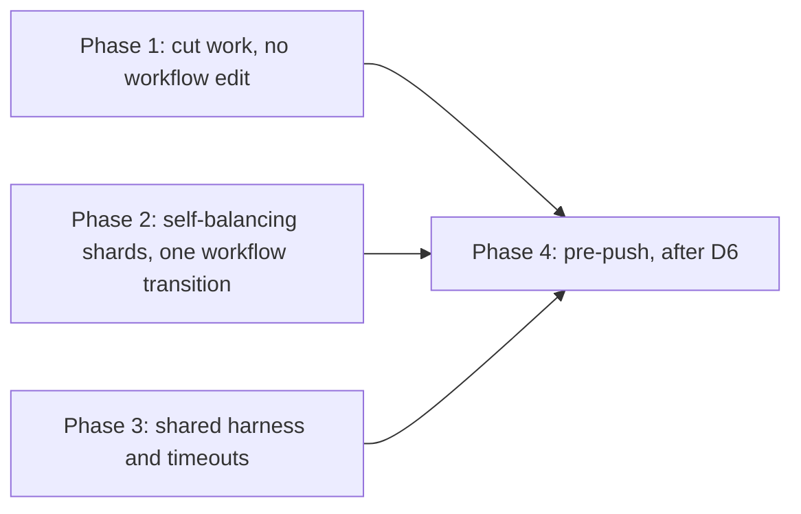

# 21 — Test suite runtime and redundancy

**Date:** 2026-11-10
**Status:** PROPOSED
**Author:** Joseph A. Wisneski IV
**Context:** A pull request into `dev` waits about 20 to 24 minutes for CI, almost all of it in the `Python core` job, and that job has hit its 30-minute timeout twice (`docs/MISTAKES.md` 5.22). Each earlier fix moved test files into another hand-listed job. The pre-push hook, added for `docs/MISTAKES.md` 5.2 (repeated as 5.5 and 5.6), is routinely skipped because the full suite does not finish on the shared workstation (observed 2026-10-26, 2026-10-28, 2026-11-03, 2026-11-09). This plan cuts the work the suites do, then replaces the hand-listed shards with a partition that balances itself. It extends [`CI-TEST-RUNTIME.md`](CI-TEST-RUNTIME.md) (the 2026-09-29 split) and [`../architecture/03-testing-ci-quality.md`](../architecture/03-testing-ci-quality.md); neither is superseded.

## Baseline (measured 2026-11-10)

Source: run 42768444354 (PR #1001, green), job step timings from `gh run view --json jobs`, per-test worker time computed from the `-v` log timestamps of each xdist worker. Runners are GitHub-hosted `ubuntu-latest`; every Python job except NetBox runs `-n auto`, which started 4 workers in core.

| Job | Wall | Tests | Worker-seconds | Note |
|---|---|---|---|---|
| Python core | 20m39s | 7,853 | 4,663 | Critical path. Three other runs that day: 18m04s, 23m18s, 23m42s |
| Python Playbook Runs | 9m47s | 957 | 2,207 | Six files moved out of core by PR 808 |
| Python Agentgateway | 8m45s | 761 | 1,913 | `test_agw_conformance.py` alone 802 |
| Python Playbook Safety | 7m39s | 1,659 | 1,727 | `test_executor_internal_overrides.py` 971, `test_rollback_inference_route.py` 756 |
| Python Semaphore | 5m10s | 76 | 807 | One test is 275 s of the 289 s run |
| Bash Tests (BATS) | 7m09s | 1,279 | ~406 serial | No parallelism |
| Static Analysis | 2m58s | | | `ansible-lint` 146 s |
| Rust (console) | 3m19s | 705 | | |

Python total: **11,318 worker-seconds** over 4,885 test functions. The cost is not concentrated in a few functions: the top 50 functions are 33% of it, the top 400 are 70%. Install steps cost 9 to 19 s per job, so setup is not the problem.

What the time is spent on: 136 test files start `ansible-playbook` as a subprocess, and the slow files start hundreds each (`test_executor_internal_overrides.py` 1,052, `test_clean_deploy_confirm.py` 510, `test_instrument_host_o11y.py` 236; static counts from the test source). Per start, CI pays about 0.9 s for a run the guard refuses in its first play, and 5 to 9 s for a run that executes a real playbook. The same start is about 0.3 s on an idle workstation, so CI is dominated by process count, not by Python logic.

Two jobs have a floor no worker count can lower, set by one test: Semaphore's `test_all_generated_dev_branch_surveys_preserve_other_fields` (275 s) and `test_authentik_audit_recovery.py` (one test, 61 s).

## Findings

### F1. The forged-extra-var matrix re-proves one guard about 1,000 times

1,801 tests (1,725 worker-seconds, **15% of all Python time**) parametrize over `forgeries.templated_forgeries`, which yields three spellings of a forged extra var: plain, context-keyed and stateful (`platform/tests/forgeries.py:35-58`). `test_extra_var_refusal_tests.py` requires every refusal test to use all three; that rule is the enforcement of `docs/MISTAKES.md` 1.15, and it is right for a refusal that reads what a value **renders** to.

Most of these tests do not reach such a refusal. They reach `refuse-internal-extra-vars.yml`, which asserts on `hostvars[inventory_hostname].keys()` (`platform/playbooks/refuse-internal-extra-vars.yml:101`) and the `extra_var_names` filter, which returns names only (`platform/playbooks/filter_plugins/extra_var_names.py:16,25-32`). No value is rendered, so the three spellings cannot produce different outcomes. The test file says so: "the guard reads the key, so the rendering cannot matter" (`platform/tests/test_executor_internal_overrides.py:243-244`). The target playbook never starts: each test asserts exactly one `PLAY [` (`:350`).

| Test | Runs | Worker-s | What multiplies |
|---|---|---|---|
| `test_executor_internal_overrides.py::test_every_launchable_playbook_refuses_a_forged_internal_name` | 735 | 566 | 245 launchable playbooks × 3 spellings (`:341-350`). Guard-first is already proved statically for every one of them (`:86-94`) |
| `test_instrument_host_o11y.py::test_refuses_an_extra_var_forging_an_internal_name` | 180 | 266 | 60 internal names × 3 (`:717-727`), each asserting the guard's refusal. That every computed name carries the reserved prefix is already proved statically (`test_executor_internal_overrides.py:181-187`) |
| `test_agw_conformance.py` forgery tests (`:1328`, `:1468`, `:1482`) | 63 | 108 | 21 names × 3, each asserting the guard's message (`_refused_first`, `:1324-1325`) |
| `test_a_forged_internal_name_is_refused_by_the_real_executor` | 60 | 44 | 20 executors × 3; the 20 are a subset of the 245 above (`:274-285`) |

The guard renders no value, and that is checkable, not only argued: a stateful forgery of `_forged_by_launch` sent to `deploy-opa.yml` was refused by the guard, and its render counter file was never created (run 2026-11-10 on ansible-core 2.20.8).

Two forgery families are **not** in this class and keep all three spellings:

- `test_clean_deploy_confirm.py::test_a_forged_internal_fact_cannot_satisfy_the_confirmation` (360 runs, 312 worker-s): 20 clean-deploys × 2 limits × 3 × 3 (`:125-141`). The launch strips the guard play (`_destroy_only`, `:73-83`), so the refusal comes from `tasks/assert-reset-confirmed.yml`, the gate that must hold under `--limit`. The forged names are the gate's old fact names, which it no longer sets (`assert-reset-confirmed.yml:18-19`); the matrix exists so that re-adding them would fail, and then the spellings would matter. What repeats is the **includer** dimension: all 20 clean-deploys include the same task.
- `test_connection_identity_vars.py::test_a_forged_connection_identity_is_refused` (96 runs, 93 worker-s): Ansible renders a connection variable itself to set up the guard task's connection (`:134-136`), so the spelling reaches a renderer.

### F2. Fixed waits that tests sit through

| Wait | Where | Cost | Why it is reached |
|---|---|---|---|
| 30 s after SIGKILL | `platform/services/github-runner/deployment/deploy.sh:548` (`deadline=$((SECONDS + 30))`, loop `:550-554`) | ~61 s of BATS wall time, serial | Two quiesce tests use a fake `/proc` entry that survives the kill, so the loop runs to its deadline (measured 30.8 s and 30.6 s). The deadline is not configurable; `RUNNER_STOP_GRACE_SECONDS` governs only the SIGINT phase |
| Prometheus wait 8 × 5 s | `platform/playbooks/instrument-host-o11y.yml:464-465`, `:615-623` | 53 s (`test_a_declared_host_without_series_fails`) | The failing case retries until exhausted. The knobs are underscore names, which the guard refuses as extra vars, so a test cannot shorten them |
| Gate probe 5 × 3 s | `platform/playbooks/deploy-console.yml:486-488` | ~15 s | The failing branch of `test_console_phase3_creds.py:1655` |
| Stub streaming delays | `platform/tests/test_agw_conformance.py:89` (`first_delay=0.4`, `gap=0.1`) | ~3.6 s per conformance run, derived | Four thinking streams per run (`conformance.sh:517-518` × 2 targets); only the timing tests need real delays |

`renew-internal-certs.yml` already shows the fix: its retry knobs are public (`renew_proof_retries`, `renew_proof_delay`), and `test_renew_internal_certs.py:518` sets them to 2 and 1.

### F3. Single tests that set a job's floor

- `test_scoped_publication.py::test_all_generated_dev_branch_surveys_preserve_other_fields` (`platform/semaphore/tests/test_scoped_publication.py:468-492`) loops over the 22 Dev templates that carry a `service_branch` survey and runs `setup-templates.yml` once per template, in sequence, inside one test. xdist cannot spread a loop.
- `test_authentik_audit_recovery.py` is one test with nine sequential playbook runs (`:100-162`).
- `test_o11y_workflow_environment.py::test_real_wrapper_and_shared_provisioner_converge_one_direct_dev_template` runs the full wrapper twice per case (37 s each).

### F4. Repeated parsing of the same repository files

- `platform/semaphore/templates.yml` (3,816 lines) is `yaml.safe_load`ed at **92** sites in 72 test files, uncached, mostly with the pure-Python loader. `playbook_yaml.load` already caches by mtime and uses the C loader, which the repository measured at 0.067 s against 0.635 s for 217 files (`platform/tests/playbook_yaml.py:22-24`, `:38-46`).
- `test_workflow_registry.py` spends 195 s on 34 playbook runs because `_emitted_evidence()` parses all 255 playbooks per call (`:783-809`) and is called inside each of the 20 review-stamp cases (`:892-904`).
- `test_ci_python_partition.py` runs `pytest --collect-only` over the whole suite four times (`:39-73`, called at `:137-139`): 36 s.

### F5. Duplicated harness code and missing timeouts

- 65 test files define their own `ansible-playbook` runner (`_run`, `run`, `_play`, `_plays`, `_ansible`). One pair is byte-identical (`test_agw_model_pool.py:56`, `test_agw_tier_budgets.py:49`), two pairs are identical apart from names, four more are near copies.
- **48 of the 65 set no timeout** on the subprocess, and `pyproject.toml` sets no pytest timeout. A hung playbook in one of them holds its xdist worker until the job's 30-minute limit. `harness_sandbox.run` already bounds a child at 120 s (`platform/tests/harness_sandbox.py:31`) but only 12 runners use it. 27 runners set `ANSIBLE_CONFIG` while `harness_sandbox.env_for` deliberately drops it (`:57-60`), so two conventions coexist.
- 31 files start their own `ThreadingHTTPServer` or `HTTPServer`; all handlers already share `fake_http.DrainingHandler`, but there is no shared server factory. `FakeBao` exists twice (`seed_harness.py:25`, nested in `test_o11y_restore_capabilities.py:171`), as do `FakeSemaphore` and a Semaphore `Fake`.

### F6. BATS

- 84 files, run serially. Classified: 43 static (grep or parse), 18 run repository scripts with stubs, 20 start `ansible-playbook`, 1 drives a container engine. No file uses `setup_file`, so every fixture is rebuilt per test.
- `test_service_skynet.bats` starts `ansible-playbook` about 76 times and `test_service_caddy.bats` about 21 times, mostly to render one template and grep it.
- `test_credential_leaks.bats:310-333` runs a nine-process pipeline for each of 953 tracked files (about 8,600 processes) where one `grep` over the file list would do.
- **Parallel-safety audit** (prerequisite for running files concurrently): no executed path writes to a fixed `/tmp` name, binds a fixed port, or writes into the repository tree. One gap: `test_credential_leaks.bats` runs `git -C "$repo" init` at `:236`, `:287`, `:300` without unsetting `GIT_DIR`, the `docs/MISTAKES.md` 3.7 class. The pre-push hook unsets those variables first, so it is latent, not live.
- `bats --jobs` needs GNU `parallel` or `rush`, neither of which CI installs (`lint-and-test.yml:467-476`).
- `test_github_runner_ephemeral.bats:55` passes silently without `shellcheck`: no assertion and no skip.

### F7. Redundant and stale tests

Few tests are dead. The sweep found **no** test referencing a path that no longer exists (66 missing literals, all fixtures or negative cases). Confirmed redundancies:

| Test | Covered by |
|---|---|
| `test_netbox_business_domains.bats:3-21` (template entry, preflight order) | `test_ensure_netbox_business_domains.py:269-277` (exact dict equality) and `:115` |
| `test_netbox_business_domains.bats:23-35` (no delete, no secret path) | `test_ensure_netbox_business_domains.py:122-126`, `:186` |
| `test_mistakes_doc.bats:120-143` (four named tests exist; non-exhaustive by its own comment) | `test_ledger_test_citations.py:169-174` (every cited test exists) |
| `test_a_forged_internal_name_is_refused_by_the_real_executor` | `test_every_launchable_playbook_refuses_a_forged_internal_name` (same playbooks, same guard), except its `CUSTOM STATS` assertion (`:285`) |

Retired services: tududi was retired on 2026-11-09 (#988), but `platform/services/tududi/`, `deploy-tududi.yml` and `clean-deploy-tududi.yml` are still in the tree, so `test_service_tududi.bats` still tests code that ships. NocoDB is the same: retired by decision, code present, no pytest coverage. Their tests go when their code goes, in the decommission change, not here.

Six of the eight ratchet allowlists (`platform/tests/known_*.txt`, `check_mode_allowlist.txt`) are empty: those migrations finished. The tests that read them still prevent regressions and cost nothing; they stay.

13 test functions assert rows in `AGENTS.md`, service `CLAUDE.md` files or openspec task lists. They spawn nothing and enforce the repository's own documentation rule; they stay.

### F8. Pre-push

`.githooks/pre-push` runs BATS serially, then a full `pytest --collect-only`, then pytest. Observed outcomes in working sessions: 77 minutes on a loaded workstation (2026-10-28), past 30 minutes at 2% with Homebrew Python 3.14 (2026-11-03), unable to finish in 40 minutes at load average ~100 (2026-11-09). Pushes use `SKIP_TESTS=1` as a matter of course, so the gate that `docs/MISTAKES.md` 5.2 asked for is not in effect.

## Decisions

| # | Question | Recommendation | Why |
|---|---|---|---|
| D1 | How a refusal test proves the by-name guard | Run all three spellings **against the guard** (already done: `test_the_guard_ends_the_run_before_any_other_play`, `:230-249`), and make that test also assert the stateful forgery's render counter (`forgery-renders-<name>` in `tmp_path`) was never written. Per playbook, run the **plain** spelling only. Add `forgeries.by_name(name)`; `test_extra_var_refusal_tests.py` accepts it only in a test that asserts the guard's own message (`Refusing to run: <name> set from outside the playbook`) for an underscore name | Keeps MISTAKES 1.15's rule (a guarantee is stated only for inputs a test exercises): "the guard renders nothing" becomes a tested fact, so plain per playbook rests on a test. A refusal that reads values, a gate run without the guard, and a connection variable still require all three |
| D2 | Per-playbook guard runs | Keep one plain run per launchable playbook (245 runs) | The static check proves the guard is listed first; one real run proves Ansible resolves and executes it first. Dropping to a sample saves another ~190 s but loses that proof per playbook |
| D3 | How CI partitions pytest | One matrix job, shard chosen by a stdlib hook in a root `conftest.py` from `PYTEST_SHARD=k/N`, files assigned by greedy bin-packing over a committed durations file | Complete and disjoint by construction. Rebalancing is a data change, not a workflow edit, so it needs no merge-guard transition (`plan/development/dev-merge-guard.md`; every workflow edit is a numbered pinned-blob transition). A third-party sharding plugin is the alternative and is a new dependency |
| D4 | How BATS runs in parallel | CI: a small matrix (2 or 3 shards) choosing files by sorted index modulo N. Pre-push: files in parallel through `xargs -P`, each file's output captured and printed in order | No new dependency. `bats --jobs` needs GNU `parallel` (Joseph's call if preferred) |
| D5 | Fixed waits in playbooks | Every retry count and delay a test must shorten becomes a public, non-underscore variable with the production default, as `renew_proof_retries` already is | A shorter wait can only make a run fail sooner, never pass falsely, so exposing it to a launcher adds no forgery risk. Underscore names stay refused |
| D6 | What pre-push runs | **Joseph's call.** Option A: unchanged scope, parallel BATS, BATS and pytest concurrently. Option B: a fast lane (tests under 1 s in the durations file, plus every test in a changed test file), CI keeps the full suite | B is the one that will finish on the shared workstation; it is also a narrower gate than 5.2 asked for, so it is a decision, not a cleanup |
| D7 | tududi and NocoDB tests | Out of scope; removed with their service code | A test of shipped code is not dead |

## Phases

Each phase is its own pull request into `dev`, or a small set of them. Projections are derived from the measured worker-seconds above, not measured; each pull request reports its own CI numbers against this baseline.

Phases 1 and 2 are independent. **Phase 2 is the wall-clock win** for pull requests; phase 1 cuts compute, which shortens every shard and is what makes a local run feasible.

### Phase 1 — Cut the work (no workflow edit)

| Item | Change | Saves (worker-s, est.) |
|---|---|---|
| 1.1 | D1 + D2: the counter assertion, `forgeries.by_name`, and the meta-test condition; apply to the four guard-class tests in F1 (Safety ~420, Runs ~180, Agentgateway ~70). Fold `..._by_the_real_executor` into the per-playbook test, keeping its `CUSTOM STATS` assertion. Update `docs/MISTAKES.md` 1.15 "Enforced by" in the same change | ~670 |
| 1.1b | Clean-deploy gate: the full 2 × 3 × 3 matrix (`:125-141`) and the `inventory_hostname` forgery (`:112-116`) against **one** clean-deploy; the other 19 keep one plain refusal each plus their acceptance test (`:144-150`). Add a static check that every `clean-deploy-*.yml` includes `tasks/clean-service.yml`, which includes the gate. New `NOT_TEMPLATED`-style entry naming the reason: one shared task | ~310 (Runs) |
| 1.2 | D5: configurable kill deadline in `github-runner/deploy.sh:548` (default 30, tests 1); public wait knobs in `instrument-host-o11y.yml` and the gate probe in `deploy-console.yml`; tests pass short values | ~70 Python + ~59 BATS wall |
| 1.3 | Conformance stub: default `first_delay`/`gap` to 0.04/0.01. The long-stream and keep-alive tests pass their own values (`:451`, `:535`, `:712`, `:858`); first list every test that compares timings under the defaults (time to first token, longest silence) and give those explicit delays, so a shorter default cannot turn a timing comparison into noise | ~300 to 400 (derived) |
| 1.4 | Split F3's floors: the 22-template loop becomes 22 generated test methods (or one run selecting all 22, if `setup-templates.yml` takes a multi-name selection; verify first); `test_authentik_audit_recovery.py` becomes one test per scenario | 0 worker-s; Semaphore job 5m10s to ~1.5 min |
| 1.5 | One cached loader for `templates.yml` in `playbook_yaml` (mtime cache, C loader), used by the 92 sites; cache `_emitted_evidence()` per session | ~150 (test_workflow_registry alone ~100) |
| 1.6 | BATS: one `grep` over the file list in `test_credential_leaks.bats:310-360`; `unset GIT_DIR …` in its setup; delete the three redundant tests in F7; `test_github_runner_ephemeral.bats:55` skips loudly without `shellcheck` | ~15 BATS wall |

Phase 1 total: Python about **11,300 to 9,700 worker-seconds** (-14%), BATS about 7m09s to 5m30s. Per job, with today's shards and 4 workers:

| Job | Today | After phase 1 (est.) | Where the saving comes from |
|---|---|---|---|
| Python core | 20m39s | ~19 to 20 min | `test_workflow_registry` caching, console wait, parse caching, partition test: ~200 to 300 worker-s |
| Python Playbook Runs | 9m47s | ~7 min | clean-deploy includer dimension, instrument-host forgeries and wait |
| Python Agentgateway | 8m45s | ~6 to 7 min | conformance stub delays and forgeries |
| Python Playbook Safety | 7m39s | ~5.5 min | per-playbook guard spellings |
| Python Semaphore | 5m10s | ~1.5 min | the 22-template loop split |

The critical path barely moves: core keeps almost all of its work. Phase 2 is what shortens it.

Each 1.1 change carries the CONTRIBUTING mutation check: remove the guard import from one playbook, or change `refuse-internal-extra-vars.yml:101` to read one value, and watch the reduced tests go red.

### Phase 2 — Self-balancing shards (one workflow transition)

1. Root `conftest.py`: `pytest_collection_modifyitems` keeps only the items of files assigned to shard `k` when `PYTEST_SHARD=k/N` is set, and does nothing otherwise (local runs unchanged). Assignment: files sorted by recorded duration, largest first, each to the least-loaded shard; a file missing from the durations file is weighted by its test count × the median per-test time. Deterministic, so every xdist worker deselects the same items.
2. `platform/tests/test_durations.json`, generated from a CI run's `--durations=0` output by a small script, refreshed when a shard drifts above its target.
3. Workflow: the five `Python …` test jobs become one matrix job (N = 8 at 4 workers each; the projection below), `fail-fast: false`. `Python NetBox` stays separate: it has no Ansible collections. Each shard prints its own duration against its `timeout-minutes` and warns above 50%, which graduates 5.22's runtime half out of Convention. BATS becomes 2 shards per D4.
4. `test_ci_python_partition.py` shrinks to a unit test of the assignment function (every file in exactly one shard for N = 1 to 12) plus a check that the matrix and `Unit Tests` `needs` agree. No `--collect-only` subprocesses.
5. `scripts/merge-when-green.py`: the ninth transition (pinned blob, predecessor kept as a fixture, `EXPECTED` updated to the matrix job names), per `dev-merge-guard.md`. `Unit Tests` keeps its name, so the `protect-main` ruleset needs no change (`.github/rulesets/protect-main.json` requires `Static Analysis`, `Security Scan`, `Unit Tests`, `Promotion source`).

Projection: today's 11,318 worker-seconds over 8 shards × 4 workers is ~355 s per shard, plus ~30 s collection and ~20 s install: **about 7 minutes per Python shard**, against today's 20 to 24 minutes; after phase 1 (~9,700), about 6 minutes. BATS at 2 shards: about 3 minutes. Rust (3m19s) and Static Analysis (2m58s) then become the next-longest jobs. Whole-PR CI wall time: about 6 to 7 minutes. agent-cloud is public; confirm how Actions minutes are billed for this repository before choosing N above 8.

### Phase 3 — Shared harness (maintainability, hang safety)

1. `platform/tests/ansible_run.py`: one `run_playbook(playbook, tmp_path, *args, inventory="localhost,", env=None, timeout=120)` with one environment convention (NOCOLOR, LOCAL and REMOTE temp under `tmp_path`, stdin from `/dev/null`, `cwd` the repository). Migrate the 65 runners file by file, starting with the 48 that have no timeout. A guard test refuses a new `subprocess.run(["ansible-playbook", …])` outside the helper, with an allowlist that only shrinks.
2. `fake_http.serve(handler)` context manager (ephemeral port, thread, shutdown), replacing the 31 hand-built servers; merge the duplicate `FakeBao`, `FakeSemaphore` and `Fake`.
3. BATS `setup_file` for the render-once files: `test_service_skynet.bats` and `test_service_caddy.bats` render each template once per file and grep many times.
4. `CONTRIBUTING.md`, "Writing tests": use the shared runner; a refusal test picks `by_name` or `templated_forgeries` by what the refusal reads; a playbook wait a test must sit through gets a public knob; a new fixture server takes its delays as parameters.

### Phase 4 — Pre-push (after D6)

Option A: BATS files in parallel, BATS and pytest started together, the separate `--collect-only` pass folded into the pytest run's own collection. Option B adds the fast-lane selection from the phase 2 durations file. Either way the hook keeps its fail-open contract and its branch lock.

## Validation

| Check | Pass condition |
|---|---|
| Nothing lost | For each phase-1 pull request, the collected node IDs before and after, diffed; every removed ID is listed in the pull request with the test that still covers it |
| Guard coverage | The 1.1 mutation checks fail the reduced tests |
| Partition | Assignment unit test passes; each shard's collected count summed across shards equals root collection on the pull request |
| Runtime | The pull request's CI timings reported per job against the baseline table; no projection reported as a result |
| Timeouts | After phase 3, no `ansible-playbook` spawn in the suite without a timeout (guard test) |

## Citations to update

- `docs/MISTAKES.md` 1.15 "Enforced by" (1.1), and 5.22 "Enforced by" (phase 2: the duration report).
- `CLAUDE.md` / `AGENTS.md`: the `test_clean_deploy_confirm.py` mention in the task-library table (`tasks/assert-reset-confirmed.yml` row) stays valid; the Testing and Linting section gains the shard mechanism.
- `plan/development/dev-merge-guard.md`: the ninth transition.
- `plan/development/CI-TEST-RUNTIME.md`: a pointer to this plan for the matrix layout.

## Security considerations

Nothing here touches a credential path. The guard reductions are the only coverage change on a security control, and D1 confines them to refusals that read names, with a meta-test enforcing the condition and a mutation check per change. The matrix shards run with the same `persist-credentials: false` checkout and `contents: read` permission as today's jobs.

## Cross-references

- [`CI-TEST-RUNTIME.md`](CI-TEST-RUNTIME.md), the first split
- [`dev-merge-guard.md`](dev-merge-guard.md), the workflow transitions
- [`../architecture/03-testing-ci-quality.md`](../architecture/03-testing-ci-quality.md)
- `docs/MISTAKES.md` 1.15, 3.7, 5.2, 5.22
