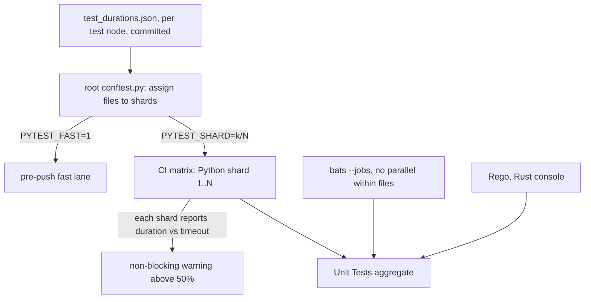

# 21 — Test suite runtime and redundancy

**Date:** 2026-11-10
**Status:** PROPOSED
**Author:** Joseph A. Wisneski IV
**Context:** A pull request into `dev` waits about 20 to 24 minutes for CI, almost all of it in the `Python core` job, and that job has hit its 30-minute timeout twice (`docs/MISTAKES.md` 5.22). Each earlier fix moved test files into another hand-listed job. The pre-push hook, added for `docs/MISTAKES.md` 5.2 (repeated as 5.5 and 5.6), is routinely skipped because the full suite does not finish on the shared workstation (observed 2026-10-26, 2026-10-28, 2026-11-03, 2026-11-09). This plan cuts the work the suites do, replaces the hand-listed shards with a partition that balances itself, and gives pre-push a lane that finishes. It extends [`CI-TEST-RUNTIME.md`](CI-TEST-RUNTIME.md) (the 2026-09-29 split) and [`../architecture/03-testing-ci-quality.md`](../architecture/03-testing-ci-quality.md); neither is superseded.

## Problem

### Baseline (measured 2026-11-10)

Source: run 42768444354 (PR #1001, green), job step timings from `gh run view --json jobs`, per-test worker time computed from the `-v` log timestamps of each xdist worker. Runners are GitHub-hosted `ubuntu-latest`; every Python job except NetBox runs `-n auto`, which started 4 workers in core. Static counts below are at `dev` after the tududi removal (`e6214688b`); timings are from the run above.

| Job | Wall | Tests | Worker-seconds | Note |
|---|---|---|---|---|
| Python core | 20m39s | 7,853 | 4,663 | Critical path. Three other runs that day: 18m04s, 23m18s, 23m42s |
| Python Playbook Runs | 9m47s | 957 | 2,207 | Six files moved out of core by PR 808 |
| Python Agentgateway | 8m45s | 761 | 1,913 | `test_agw_conformance.py` alone 802 |
| Python Playbook Safety | 7m39s | 1,659 | 1,727 | `test_executor_internal_overrides.py` 971, `test_rollback_inference_route.py` 756 |
| Python Semaphore | 5m10s | 76 | 807 | One test is 275 s of the 289 s run |
| Bash Tests (BATS) | 7m09s | 1,279 | ~406 serial | No parallelism |
| Static Analysis | 2m58s | | | `ansible-lint` 146 s |
| Rust (console) | 3m19s | 705 | | |

Python total: **11,318 worker-seconds** over 4,885 test functions. The cost is not concentrated in a few functions: the top 50 functions are 33% of it, the top 400 are 70%. Install steps cost 9 to 19 s per job, so setup is not the problem.

What the time is spent on: 131 test files contain the literal `"ansible-playbook"` (`grep -l '"ansible-playbook"'` over the four test paths; a few only in skip guards), most of them to start it as a subprocess, and the slow files start hundreds each (`test_executor_internal_overrides.py` about 1,050, `test_clean_deploy_confirm.py` about 490, `test_instrument_host_o11y.py` 236; static counts from the test source). Per start, CI pays about 0.9 s for a run the guard refuses in its first play, and 5 to 9 s for a run that executes a real playbook. The same start is about 0.3 s on an idle workstation, so CI is dominated by process count, not by Python logic.

Two jobs have a floor no worker count can lower, set by one test: Semaphore's `test_all_generated_dev_branch_surveys_preserve_other_fields` (275 s) and `test_authentik_audit_recovery.py` (one test, 61 s).

### F1. The forged-extra-var matrix re-proves one guard about 1,000 times

1,801 tests (1,725 worker-seconds, **15% of all Python time**) parametrize over `forgeries.templated_forgeries`, which yields three spellings of a forged extra var: plain, context-keyed and stateful (`platform/tests/forgeries.py:35-58`). `test_extra_var_refusal_tests.py` requires every refusal test to use all three; that rule is the enforcement of `docs/MISTAKES.md` 1.15, and it is right for a refusal that reads what a value **renders** to.

Most of these tests do not reach such a refusal. They reach `refuse-internal-extra-vars.yml`, whose refusal asserts on `hostvars[inventory_hostname].keys()` (`platform/playbooks/refuse-internal-extra-vars.yml:101`) and the `extra_var_names` filter, which returns names only (`platform/playbooks/filter_plugins/extra_var_names.py:16,25-32`). The target playbook never starts: each test asserts exactly one `PLAY [` (`test_executor_internal_overrides.py:350`).

| Test | Runs | Worker-s | What multiplies |
|---|---|---|---|
| `test_executor_internal_overrides.py::test_every_launchable_playbook_refuses_a_forged_internal_name` | 732 | 566 | 244 launchable playbooks × 3 spellings (`:341-350`). Guard-first is already proved statically for every one of them (`:86-94`) |
| `test_instrument_host_o11y.py::test_refuses_an_extra_var_forging_an_internal_name` | 180 | 266 | 60 internal names × 3 (`:717-727`), each asserting the guard's refusal. That every one of them carries the reserved prefix is already proved statically (`test_instrument_host_o11y.py:713`) |
| `test_agw_conformance.py` forgery tests (`:1328`, `:1468`, `:1482`) | 63 | 108 | 21 names × 3, each asserting the guard's message (`_refused_first`, `:1324-1325`) |
| `test_a_forged_internal_name_is_refused_by_the_real_executor` | 60 | 44 | 20 executors × 3; the 20 are a subset of the 244 above (`:274-285`) |

For an underscore name the guard does not itself reference, its refusal happens before anything renders that name's value, and that is checkable: a stateful forgery of `_forged_by_launch` sent to `deploy-opa.yml` was refused by the guard, and its render counter file was never created (run 2026-11-10 on ansible-core 2.20.8). **The names the guard references are the exception.** Its `when:` reads `_extra_var_guard_nested is defined` (`refuse-internal-extra-vars.yml:110`, `:159`), and a stateful forgery of that name writes the counter (reproduced in review of this plan); its second task computes `_conn_names` and `_conn_forged` (`:112-159`), reached only after the first task has passed. The outcome does not depend on the rendering today, because the nested condition's second clause reads the key; tests of any name the guard references keep all three spellings anyway (D1).

Two more forgery families are **not** in the by-name class and keep all three spellings:

- `test_clean_deploy_confirm.py::test_a_forged_internal_fact_cannot_satisfy_the_confirmation` (342 runs, 312 worker-s at 20 includers): 19 clean-deploys × 2 limits × 3 × 3 (`:125-141`). The launch strips the guard play (`_destroy_only`, `:73-83`), so the refusal comes from `tasks/assert-reset-confirmed.yml`, the gate that must hold under `--limit`. The forged names are the gate's old fact names, which it no longer sets (`assert-reset-confirmed.yml:18-19`); the matrix exists so that re-adding them would fail, and then the spellings would matter. What repeats is the **includer** dimension: 17 clean-deploys reach the gate only through `tasks/clean-service.yml`; `clean-deploy-o11y.yml` and `clean-deploy-step-ca.yml` include it directly and earlier. That every clean-deploy composes `clean-service.yml` is already checked (`test_clean_deploy_confirm.py:44-49`).
- `test_connection_identity_vars.py::test_a_forged_connection_identity_is_refused` (96 runs, 93 worker-s): Ansible renders a connection variable itself to set up the guard task's connection (`:134-136`), so the spelling reaches a renderer.

### F2. Fixed waits that tests sit through

| Wait | Where | Cost | Why it is reached |
|---|---|---|---|
| 30 s after SIGKILL | `platform/services/github-runner/deployment/deploy.sh:548` (`deadline=$((SECONDS + 30))`, loop `:550-554`) | ~61 s of BATS wall time, serial | Two quiesce tests use a fake `/proc` entry that survives the kill, so the loop runs to its deadline (measured 30.8 s and 30.6 s). The deadline is not configurable; `RUNNER_STOP_GRACE_SECONDS` governs only the SIGINT phase |
| Prometheus wait 8 × 5 s | `platform/playbooks/instrument-host-o11y.yml:464-465`, `:615-623` | 53 s (`test_a_declared_host_without_series_fails`) | The failing case retries until exhausted. The knobs are underscore names, which the guard refuses as extra vars, so a test cannot shorten them |
| Gate probe 5 × 3 s | `platform/playbooks/deploy-console.yml:486-488` | ~15 s | The failing branch of `test_console_phase3_creds.py:1655` |
| Stub streaming delays | `platform/tests/test_agw_conformance.py:89` (`first_delay=0.4`, `gap=0.1`) | ~3.6 s per conformance run, derived | Four thinking streams per run (`conformance.sh:517-518` × 2 targets); only the timing tests need real delays |

`renew-internal-certs.yml` already shows the fix: its retry knobs are public (`renew_proof_retries`, `renew_proof_delay`), and `test_renew_internal_certs.py:518` sets them to 2 and 1.

### F3. Single tests that set a job's floor

- `test_scoped_publication.py::test_all_generated_dev_branch_surveys_preserve_other_fields` (`platform/semaphore/tests/test_scoped_publication.py:468-492`) loops over the 21 Dev templates (22 before tududi's removal) that carry a `service_branch` survey and runs `setup-templates.yml` once per template, in sequence, inside one test. xdist cannot spread a loop.
- `test_authentik_audit_recovery.py` is one test with nine sequential playbook runs (`:100-162`).
- `test_o11y_workflow_environment.py::test_real_wrapper_and_shared_provisioner_converge_one_direct_dev_template` runs the full wrapper twice per case (37 s each).

### F4. Repeated parsing of the same repository files

- `platform/semaphore/templates.yml` (3,796 lines) is `yaml.safe_load`ed at **92** sites in 72 test files, uncached, mostly with the pure-Python loader. `playbook_yaml.load` already caches by mtime and uses the C loader, which the repository measured at 0.067 s against 0.635 s for 217 files (`platform/tests/playbook_yaml.py:22-24`, `:38-46`).
- `test_workflow_registry.py` spends 195 s on 34 playbook runs because `_emitted_evidence()` parses all 254 playbooks per call (`:783-809`) and is called inside each of the 20 review-stamp cases (`:892-904`).
- `test_ci_python_partition.py` runs `pytest --collect-only` seven times, the root and each of six shards (`_node_ids`, `:39-74`, called at `:134` and `:136`): 36 s.

### F5. Duplicated harness code and missing timeouts

- 66 test files define their own `ansible-playbook` runner, a function named `_run`, `run`, `_play`, `_plays` or `_ansible` whose body contains `"ansible-playbook"` (AST scan of `platform/tests/test_*.py`). One pair is byte-identical (`test_agw_model_pool.py:56`, `test_agw_tier_budgets.py:49`), two pairs are identical apart from names, four more are near copies.
- **19 of the 66 call `subprocess.run` with no `timeout`** (same AST scan), and `pyproject.toml` sets no pytest timeout. A hung playbook in one of them holds its xdist worker until the job's 30-minute limit. `harness_sandbox.run` already bounds a child at 120 s (`platform/tests/harness_sandbox.py:31`), and where `sandbox-exec` (macOS) or `bwrap` is present it confines writes to `tmp_path` and the temp roots (`:70-90`); the GitHub runner has neither (`:16-18`, `:38`), so in CI it confines nothing. 41 test files call it (`grep -l 'harness_sandbox.run('`), 40 of them with `"ansible-playbook"`, so about 91 of the 131 files above do not. Of the 66 runner helpers, 28 drop `ANSIBLE_CONFIG` themselves, 25 build their environment with `harness_sandbox.env_for`, which drops it too (`:57-60`), and 13 inherit whatever the caller has set (same AST scan, classified by whether the helper names `ANSIBLE_CONFIG`, then whether it calls `env_for`).
- 31 files start their own `ThreadingHTTPServer` or `HTTPServer`; all handlers already share `fake_http.DrainingHandler`, and a shared factory already exists, `seed_harness.serve` (`platform/tests/seed_harness.py:46-63`: ephemeral port, daemon thread, raised listen backlog), used by 13 test files (`grep -lE 'seed_harness\.serve\(|from seed_harness import.*serve'`). `FakeBao` exists twice (`seed_harness.py:25`, nested in `test_o11y_restore_capabilities.py:171`), as do `FakeSemaphore` and a Semaphore `Fake`.

### F6. BATS

- 83 files, run serially. Classified: about 43 static (grep or parse), 18 run repository scripts with stubs, 20 start `ansible-playbook`, 1 drives a container engine. No file uses `setup_file`, so every fixture is rebuilt per test.
- `test_service_skynet.bats` starts `ansible-playbook` about 76 times and `test_service_caddy.bats` about 21 times, mostly to render one template and grep it.
- `test_credential_leaks.bats:310-333` runs a nine-process pipeline for each of 953 tracked files (about 8,600 processes) where one `grep` over the file list would do.
- **Parallel-safety audit** (prerequisite for running files concurrently): no executed path writes to a fixed `/tmp` name, binds a fixed port, or writes into the repository tree. One gap: `test_credential_leaks.bats` runs `git -C "$repo" init` at `:236`, `:287`, `:300` without unsetting `GIT_DIR`, the `docs/MISTAKES.md` 3.7 class. The pre-push hook unsets those variables first, so it is latent, not live.
- `bats --jobs` needs GNU `parallel` or `rush`, neither of which CI installs (`lint-and-test.yml:467-476`).
- `test_github_runner_ephemeral.bats:55` passes silently without `shellcheck`: no assertion and no skip.

### F7. Redundant and stale tests

Few tests are dead. The sweep found **no** test referencing a path that no longer exists (66 missing literals, all fixtures or negative cases). Candidates found by the sweep, and what implementation established (corrected 2026-11-10):

| Test | Covered by |
|---|---|
| `test_netbox_business_domains.bats:3-21` (template entry, preflight order) | **Not redundant, kept.** `test_ensure_netbox_business_domains.py:269-277` and `:115` cover the entry and the preflight, but nothing else checks the template's position right after `Ensure NetBox Prefix` (`:14`) |
| `test_netbox_business_domains.bats:23-35` (no delete, no secret path) | `test_ensure_netbox_business_domains.py:122-126`, `:186`; kept with the file, since the file stays and the check costs milliseconds |
| `test_mistakes_doc.bats:120-143` (four named tests exist; non-exhaustive by its own comment) | **Not redundant, kept.** `test_ledger_test_citations.py:169-174` checks that cited names exist, not that each name appears in the ledger (`:139`) |
| `test_a_forged_internal_name_is_refused_by_the_real_executor` | Overlaps `test_every_launchable_playbook_refuses_a_forged_internal_name` (same guard), but forges each executor's own internal name and checks `CUSTOM STATS` (`:285`); kept, to be reduced to the plain spelling by item 1.1 (#1041) |

Retired services: tududi's code and tests were removed together (`e6214688b`). NocoDB is retired by decision but its code is still present (`platform/services/nocodb/`, `deploy-nocodb.yml`); no test is specific to it (`test_service_opa.bats:170`, `:226` and `test_caddyfile_sites.py:38`, `:90` use the name as sample data). The generic catalog tests include its templates, `Deploy NocoDB` and `Update NocoDB`, as cases, and drop them when the templates go.

Six of the eight ratchet allowlists (`platform/tests/known_*.txt`, `check_mode_allowlist.txt`) are empty: those migrations finished. The tests that read them still prevent regressions and cost nothing; they stay.

13 test functions assert rows in `AGENTS.md`, service `CLAUDE.md` files or openspec task lists. They spawn nothing and enforce the repository's own documentation rule; they stay.

### F8. Pre-push

`.githooks/pre-push` runs BATS serially, then a full `pytest --collect-only`, then pytest. Observed outcomes in working sessions: 77 minutes on a loaded workstation (2026-10-28), past 30 minutes at 2% with Homebrew Python 3.14 (2026-11-03), unable to finish in 40 minutes at load average ~100 (2026-11-09). Pushes use `SKIP_TESTS=1` as a matter of course, so the gate that `docs/MISTAKES.md` 5.2 asked for is not in effect.

## Design Principles

- **Remove repetition, never a property.** A test is reduced only when another test still exercises the same property on the same code, and the reduction names that test.
- **A guarantee rests on a test, not an argument** (`docs/MISTAKES.md` 1.15). Where this plan relies on "the guard renders nothing", a test asserts it.
- **Balance with data, not workflow edits.** Every workflow edit is a numbered merge-guard transition (`dev-merge-guard.md`); the partition must rebalance without one.
- **Fail sooner, never pass falsely.** A wait made shorter for tests can only shorten a failure; production defaults stay.
- **CI is the full gate; pre-push is the fast one.** Both stay; they check different things at different costs.

## Decisions

| # | Question | Decision | Why |
|---|---|---|---|
| D1 | How a refusal test proves the by-name guard | Run all three spellings **against the guard** (already done: `test_the_guard_ends_the_run_before_any_other_play`, `test_executor_internal_overrides.py:230-249`), and make that test also assert the stateful forgery's render counter (`forgery-renders-<name>` in `tmp_path`) was never written. Per playbook, run the **plain** spelling only. Add `forgeries.by_name(name)`; `test_extra_var_refusal_tests.py` accepts it only in a test that asserts the guard's own message (`Refusing to run: <name> set from outside the playbook`) for an underscore name **the guard does not reference**. The meta-test derives the excluded set itself by parsing `refuse-internal-extra-vars.yml` for underscore variable names outside comments (today `_extra_var_guard_nested`, `_conn_names`, `_conn_forged`; the `_pass` and `_password` fragments of the refusal pattern at `:101` are regex text, not variables), so a later guard edit that reads another name's value excludes it automatically | "The guard renders nothing" becomes a tested fact for the names it covers, and the names it does read are excluded by a rule computed from the guard, not by memory. A refusal that reads values, a gate run without the guard, and a connection variable still require all three |
| D2 | Per-playbook guard runs | Keep one plain run per launchable playbook (244 runs) | The static check proves the guard is listed first; one real run proves Ansible resolves and executes it first. Dropping to a sample saves another ~190 s but loses that proof per playbook |
| D3 | How CI partitions pytest | One matrix job, shard chosen by a stdlib hook in a root `conftest.py` from `PYTEST_SHARD=k/N`, files assigned by greedy bin-packing over a committed durations file | Complete and disjoint by construction. Rebalancing is a data change, not a workflow edit. A third-party sharding plugin is the alternative and is a new dependency |
| D4 | How BATS runs in parallel | **GNU `parallel` and `bats --jobs`** (Joseph, 2026-11-10): installed by apt in CI and through the repository's `Brewfile` locally (`brew bundle`), with `--no-parallelize-within-files`, so files run concurrently and tests within a file keep their order. Pre-push falls back to serial BATS when `parallel` is absent, with a warning, under its fail-open contract | One flag instead of hand-rolled sharding; the cross-file audit in F6 is the safety precondition. It is a new dependency, approved |
| D5 | Fixed waits in playbooks | Every retry count and delay a test must shorten becomes a public, non-underscore variable with the production default, as `renew_proof_retries` already is | A shorter wait can only make a run fail sooner, never pass falsely, so exposing it to a launcher adds no forgery risk. Underscore names stay refused |
| D6 | What pre-push runs | **A fast lane** (Joseph, 2026-11-10; the cutoff was moved from 1 s to below one Ansible start in the revision he approved the same day): pytest runs, by whole file, every test file the push changes, every file holding a test missing from the durations file, and every file whose recorded tests all ran under 0.25 s of CI time with none skipped in CI; BATS runs in full with `--jobs`. CI keeps the full suite | It finishes on the shared workstation, so it gets run. The cutoff sits below the cost of one `ansible-playbook` start in CI (the guard-refusal tests in F1 average at least 0.7 s), so the lane does not pay for the forgery matrix on every push. It is a narrower gate than 5.2 asked for, and the hook says so in its output |
| D7 | NocoDB | Out of scope: it has no service-specific tests; its code and templates go in its own decommission change | The generic catalog tests drop its cases with its templates |
| D8 | Order | **Phases 1 and 2 run in parallel** (Joseph, 2026-11-10), each in its own worktree and pull requests; phase 4 waits on phase 2's durations file | They touch different files: phase 1 tests and playbooks, phase 2 the workflow, `conftest.py` and the partition test |

## Architecture

The durations file is per test node: the shard hook sums it per file (a file's module fixtures stay on one shard), and the fast lane reads it per file (below). It is built from a green CI run's `--junitxml` report (a run stopped by `-x` is partial), written with `-o junit_family=xunit1` so each testcase carries its `file` and maps back to a node ID; its `time` per testcase covers every test, setup, call and teardown summed (`junit_duration_report` defaults to `total`), not from `--durations` output, which hides entries under 5 ms at the verbosity CI uses. Skipped testcases are kept in it with a skip flag, never dropped, so a CI-skipped test is not mistaken for a missing one; a missing test is found statically, by comparing a file's `def test_` names with the file's entries, without importing it. A file missing from it is weighted by its count of `def test_` lines × the median per-test time, read without importing it (an undercount for parametrized tests, corrected at the next refresh); a file holding a test missing from it **is** in the fast lane, so a gap runs more, never less. The file is regenerated by a small script and refreshed when a shard drifts above its target; refreshing it is a data commit, never a workflow edit.

## Status (2026-11-10)

What has landed against the phases below. Counts and timings are from each pull request, except 1.3, which names its measurement; the baseline above stays as measured.

| Item | Pull request | Outcome |
|---|---|---|
| 1.1 by-name forgeries | #1041 (open) | `forgeries.by_name` for guard-class refusals, with the counter proof and a meta-test rule. The real-executor test is reduced to the plain spelling rather than folded into the per-playbook test. About 700 fewer runs per CI pass |
| 1.1b clean-deploy gate | #1040 (open) | Full matrix on `o11y`, `step-ca` and `agentgateway`; plain on the other 16. 399 → 111 runs |
| 1.2 fixed waits | #1026, #1031 (merged) | `RUNNER_KILL_WAIT_SECONDS` in the runner's `deploy.sh`; `ih_wait_*` and `console_gate_probe_*` playbook knobs. The two runner quiesce tests went from about 30 s to 1.5 s each |
| 1.3 stub delays | none (dropped) | Measured 2026-11-10 on the shared workstation: `pytest -n 12 platform/tests/test_agw_conformance.py --junitxml`, `time` summed over its 172 testcases, 910.5 s with the stub's defaults at 0.4/0.1 and 890.9 s at 0.04/0.01. The cost is process start-up, not the stub's sleeps, so the estimate above was wrong and the change was not worth carrying |
| 1.4 single-test floors | #1030 (merged) | 21 generated per-template tests (22 before tududi's removal). `test_authentik_audit_recovery.py` is not split yet |
| 1.5 parse caching | #1028 (merged) | `test_workflow_registry.py` only: 178 s to 44.5 s locally. The other `templates.yml` readers are not migrated |
| 1.6 BATS | #1027, #1029 (merged) | Loud shellcheck skip; one shared git-environment unset in `assert_helpers.bash`, held equal to the pre-push hook's list by a test. The redundancy deletions were not made (F7). The `test_credential_leaks.bats` batching is not done |
| Phase 2 steps 1-2 | #1032 (open) | The shard hook, `shards.py`, the durations builder and their tests, inert until `PYTEST_SHARD` is set |

## Implementation Phases

Projections are derived from the measured worker-seconds above, not measured; each pull request reports its own CI numbers against the baseline table.

### Phase 1 — Cut the work (no workflow edit)

| Item | Change | Saves (worker-s, est.) |
|---|---|---|
| 1.1 | D1 + D2: the counter assertion, `forgeries.by_name`, and the meta-test condition with the exclusion set derived from the guard; apply to the four guard-class tests in F1 (Safety ~420, Runs ~180, Agentgateway ~70). Fold `..._by_the_real_executor` into the per-playbook test, keeping its `CUSTOM STATS` assertion. Update `docs/MISTAKES.md` 1.15 "Enforced by" in the same change | ~670 |
| 1.1b | Clean-deploy gate: the full 2 × 3 × 3 matrix (`:125-141`) and the `inventory_hostname` forgery (`:112-116`) against **one** clean-deploy that reaches the gate through `clean-service.yml`, and against each of the two that include it directly (`clean-deploy-o11y.yml`, `clean-deploy-step-ca.yml`); the other 16 keep one plain refusal each plus their acceptance test (`:144-150`). Cite the existing composition check (`:44-49`). New `NOT_TEMPLATED`-style entry naming the reason: one shared task | ~250 (Runs) |
| 1.2 | D5: configurable kill deadline in `github-runner/deploy.sh:548` (default 30, tests 1); public wait knobs in `instrument-host-o11y.yml` and the gate probe in `deploy-console.yml`; tests pass short values | ~70 Python + ~59 BATS wall |
| 1.3 | Conformance stub: default `first_delay`/`gap` to 0.04/0.01. The long-stream and keep-alive tests pass their own values (`:451`, `:535`, `:712`, `:858`); first list every test that compares timings under the defaults (time to first token, longest silence) and give those explicit delays, so a shorter default cannot turn a timing comparison into noise | ~300 to 400 (derived) |
| 1.4 | Split F3's floors: the 21-template loop becomes 21 generated test methods (or one run selecting all 21, if `setup-templates.yml` takes a multi-name selection; verify first); `test_authentik_audit_recovery.py` becomes one test per scenario | 0 worker-s; lowers the floor |
| 1.5 | Cache `_emitted_evidence()` per session (`functools.cache`), then move the hottest `templates.yml` readers onto the existing `playbook_yaml.load` (mtime cache, C loader, `platform/tests/playbook_yaml.py:38-46`; its result is shared, so a caller that mutates it deep-copies first). Measure before migrating the rest of the 92 sites | ~150 (test_workflow_registry alone ~100) |
| 1.6 | BATS: one `grep` over the file list in `test_credential_leaks.bats:310-360`; one unset of the hook's full list of git repository variables (`.githooks/pre-push:70-71`: `GIT_DIR`, `GIT_WORK_TREE`, `GIT_INDEX_FILE`, `GIT_COMMON_DIR`, `GIT_OBJECT_DIRECTORY` and three more) in the shared `assert_helpers.bash`, which each file loads at file level, replacing the seven copies in `test_graph_artifact_guard.bats`, `test_local_dev_foundation_down.bats`, `test_netbox_change_aware.bats`, `test_pre_push_branch_lock.bats`, `test_pre_push_git_env.bats`, `test_pre_push_uv.bats` and `test_scripts_set_pipefail.bats` (each file loads the helper first; check, since a partial list reopens `docs/MISTAKES.md` 3.7); delete the three redundant tests in F7; `test_github_runner_ephemeral.bats:55` skips loudly without `shellcheck` | ~15 BATS wall |

Phase 1 total: Python about **11,300 to 9,800 worker-seconds** (-13%), serial BATS about 7m09s to 5m55s. Per job, with today's shards and 4 workers:

| Job | Today | After phase 1 (est.) | Where the saving comes from |
|---|---|---|---|
| Python core | 20m39s | ~19 to 20 min | `test_workflow_registry` caching, console wait, parse caching: ~200 to 300 worker-s |
| Python Playbook Runs | 9m47s | ~7 min | clean-deploy includer dimension, instrument-host forgeries and wait |
| Python Agentgateway | 8m45s | ~6 to 7 min | conformance stub delays and forgeries |
| Python Playbook Safety | 7m39s | ~5.5 min | per-playbook guard spellings |
| Python Semaphore | 5m10s | ~3.5 to 4 min | the 21-template loop split; 807 worker-s over 4 workers is a ~200 s floor |

The critical path barely moves: core keeps almost all of its work. Phase 2 is what shortens it.

**Acceptance.** For each pull request: the collected node IDs before and after, diffed, with every removed ID listed in the pull request beside the test that still covers it; the mutation checks below fail the reduced tests; CI timings reported per job. Mutation checks for 1.1: remove the guard import from one playbook; make `refuse-internal-extra-vars.yml:101` read one value; and a negative fixture in the meta-test (in the style of `test_the_scan_finds_a_refusal_test_by_its_name`, `test_extra_var_refusal_tests.py:85`) where a test uses `by_name` for a name the guard references, which the meta-test must refuse. For 1.1b: re-add the old `set_fact` pair (`_reset_hosts`, `_reset_confirm`, as before `254b07624`) to `assert-reset-confirmed.yml`; every kept includer must then fail on every spelling and both limits (measured in review: 18 of 18 red for one includer). Reading the two names with defaults is not a valid mutant: a stateful forgery renders the honest value on its first read, so the gate still refuses on those spellings (measured: 6 to 8 of 18 stay green).

### Phase 2 — Self-balancing shards and parallel BATS (one workflow transition)

1. Root `conftest.py`: a `pytest_ignore_collect` hook (`_pytest/hookspec.py:303`) returns True for every test file not assigned to shard `k` when `PYTEST_SHARD=k/N` is set, and does nothing otherwise (local runs unchanged). Skipping at the file keeps each worker from importing the other shards' modules: with 8 shards × 4 workers, filtering items after collection would import the whole suite 32 times per pull request. Assignment: files sorted by recorded duration, largest first, each to the least-loaded shard; a file missing from the durations file is weighted as described under Architecture. Ties break by path, so the assignment is deterministic and every xdist worker skips the same files. A file the hook does not know is never skipped: it runs in shard 1, so a gap duplicates work and never loses a file. The hook returns `None`, never `False`, for directories and non-test paths (the hook is first-result, and `False` would override `collect_ignore` and `__pycache__` handling). Cited at pytest 9.2.0, the locked version.
2. `platform/tests/test_durations.json` and the script that regenerates it (Architecture above).
3. Workflow: the six `Python …` test jobs become one matrix job (N = 8 at 4 workers each), `fail-fast: false`. NetBox joins the matrix: root collection already includes its tests. Every shard sets up as the Python jobs do today, `astral-sh/setup-uv` then `uv sync --locked` and the collection install (`lint-and-test.yml:260-275`), with the uv download cache kept between runs if the pinned setup-uv supports it (verify the input on v10.3.3), and runs under core's environment, `PYTHONPATH` included; core already imports every test file under it, since `--deselect` removes items only after collection. Each shard prints its own duration against its `timeout-minutes` and warns, without failing, above 50%. The BATS job installs `parallel` and runs `bats --jobs 4 --no-parallelize-within-files platform/tests/` (D4).
4. `test_ci_python_partition.py`: one `pytest --collect-only` of the root, then the hook's own assignment function applied to those real node IDs for k = 1..N, asserting the shards are pairwise disjoint and their union equals root by node ID; an assertion that the hook's own file enumeration equals the root's file set; one subprocess run of the hook on a small temporary test tree passed as a directory (paths given on the command line bypass the hook) with `PYTEST_SHARD` set, proving the wiring; and a check that the matrix and `Unit Tests` `needs` agree. One collection instead of seven; `_node_ids` (`:39-74`) and the disjoint and union assertions are kept, and the named-job assertions (`timeout-minutes`, `persist-credentials`, the deselect set) and `test_unit_tests_aggregate_requires_playbook_safety_success_for_every_result` (`:161-186`, which names the six `PYTHON_*_RESULT` variables) are rewritten for the matrix.
5. `scripts/merge-when-green.py`: the ninth transition (pinned blob, predecessor kept as a fixture, `EXPECTED` updated to the matrix job names), per `dev-merge-guard.md`. `Unit Tests` keeps its name, so the `protect-main` ruleset needs no change (`.github/rulesets/protect-main.json` requires `Static Analysis`, `Security Scan`, `Unit Tests`, `Promotion source (dev -> main)`).

Projection: today's 11,318 worker-seconds over 8 shards × 4 workers is ~355 s per shard, plus ~30 s collection and ~20 s install: **about 7 minutes per Python shard**, against today's 20 to 24 minutes; after phase 1 (~9,800), about 6 minutes. BATS with `--jobs 4`: about 2 to 2.5 minutes, its floor the slowest file: `test_service_github_runner.bats` (~65 s) until 1.2 removes its 30 s waits, then `test_service_skynet.bats` (~56 s). Rust (3m19s) and Static Analysis (2m58s) then become the next-longest jobs. Whole-PR CI wall time: about 6 to 7 minutes. agent-cloud is public; confirm how Actions minutes are billed for this repository before choosing N above 8.

Verify before relying on it: that the apt `bats` CI installs supports `--jobs` and `--no-parallelize-within-files` (confirmed only on Homebrew bats 1.13.0 so far; the install step discards its output, `lint-and-test.yml:473`); how GNU `parallel` behaves non-interactively on first use in CI (its citation notice); and whether any BATS file shares state across its own tests that `--no-parallelize-within-files` would not already cover.

**Acceptance.** The partition test passes; every shard and the BATS job green on the transition's pull request; the merge guard passes when run from that pull request's head; per-shard durations reported against the projection.

### Phase 3 — Shared harness (maintainability, hang safety)

1. Extend `harness_sandbox` rather than add a module: `run` gains `stdin=DEVNULL`, and a `run_playbook(playbook, tmp_path, *args, inventory="localhost,", env=None, timeout=120)` convenience builds the command with `env_for` (NOCOLOR, LOCAL and REMOTE temp under `tmp_path`). Migrate the remaining spawners file by file, starting with the 19 runners whose `subprocess.run` has no timeout; `run` confines writes under a kernel sandbox and not in CI, so a migrated test that writes outside `tmp_path` passes CI and fails only where a sandbox exists (a macOS pre-push, or a Linux workstation with `bwrap`): check each migrated test's write paths, and check `ANSIBLE_CONFIG` in the 13 runner helpers that inherit it today, since `env_for` drops it (the other 53 already drop it). A guard test refuses a new `subprocess.run(["ansible-playbook", …])` outside the helper, with an allowlist that only shrinks.
2. Move `seed_harness.serve` into `fake_http` (which `seed_harness` already imports) and re-export it, then replace the 31 hand-built servers; merge the duplicate `FakeBao` into `seed_harness.FakeBao`, and the `FakeSemaphore` and `Fake` copies (`test_semaphore_drain_template.py:39`, `test_semaphore_inventory_sync.py:35`, `test_promote_semaphore_admins.py:33`, `test_manage_semaphore_access.py:28`) into `fake_semaphore.py`.
3. BATS `setup_file` for the render-once files: `test_service_skynet.bats` and `test_service_caddy.bats` render each template once per file and grep many times.
4. `CONTRIBUTING.md`: the `setup_file` guidance goes in "Writing BATS Tests"; a new Python test-writing section says: use the shared runner; a refusal test picks `by_name` or `templated_forgeries` by what the refusal reads; a playbook wait a test must sit through gets a public knob; a new fixture server takes its delays as parameters.

**Acceptance.** The guard test passes with an allowlist no longer than the remaining unmigrated runners; no `ansible-playbook` spawn in a migrated file without a timeout; node-ID diff shows no test lost.

### Phase 4 — Pre-push fast lane (after phase 2)

1. The conftest hook gains `PYTEST_FAST=1`. It keeps, by whole file: every test file changed between the pushed ref and its merge base with `dev`; every file holding a test missing from the durations file; and every file whose recorded tests all ran under 0.25 s with none recorded as skipped. Every other file is skipped through `pytest_ignore_collect`. Selection is by whole file, because junit charges a module- or session-scoped fixture's playbook run to the first test that uses it (for example the memoized render in `test_agw_mcp_render.py:77`), so its siblings record near zero; per-test filtering inside a file, if ever needed, belongs in `pytest_collection_modifyitems`, since `pytest_ignore_collect` sees only paths. A file with a test CI skips is left out unless changed, because CI never measured what that test costs where it does run: `test_materialise_ssh_key.py:445` skips without a kernel sandbox and `:471` without `sandbox-exec`, so both skip on the GitHub runner and run on macOS, and the file's 12 Ansible-backed tests would otherwise run on every push. Leaving it out costs no coverage CI has; it narrows only local-only coverage, which runs again whenever the file changes.
2. `.githooks/pre-push`: BATS with `--jobs` (serial fallback without `parallel`), started together with the fast pytest lane. The separate `--collect-only` pass (`.githooks/pre-push:308`) is folded into the run's own collection, reading collection errors from the run's output, and keeps the classifier's outcomes (`:310-338`): clean collection runs the suite; on the python3 fallback a missing dependency warns, names the module and skips; anything else blocks the push, a missing module on the locked uv environment included. The hook prints which lane ran and that CI runs the full suite. It keeps its fail-open contract and its branch lock.

**Acceptance.** On the shared workstation the hook finishes in under 10 minutes on a typical branch, measured and recorded; `test_pre_push_branch_lock.bats` and `test_pre_push_git_env.bats` still pass; `test_pre_push_uv.bats` already drives the missing-module outcome on both environments (`:129-138`); a new case in its harness covers the non-module collection failure, which no test drives today. The duration-selected files start no `ansible-playbook`, counted once with a PATH shim that logs each start; changed files and files holding a missing test may, by design. Folding `--collect-only` into the run changes what the fake python in `test_pre_push_uv.bats` dispatches on (`:48`), so its cases at `:129-138` are ported in the same change.

## Validation Criteria

| Check | Pass condition |
|---|---|
| Nothing lost | For each phase-1 and phase-3 pull request, the collected node IDs before and after, diffed; every removed ID listed with the test that still covers it |
| Guard coverage | The 1.1 and 1.1b mutation checks fail the reduced tests |
| Partition | Shards pairwise disjoint and their union equal to root collection, by node ID, from the hook's own assignment function; hook wiring proven by subprocess |
| Runtime | Each pull request's CI timings reported per job against the baseline table; no projection reported as a result |
| Timeouts | After phase 3, no `ansible-playbook` spawn in the suite without a timeout (guard test) |
| Pre-push | The fast lane's measured duration on the shared workstation recorded in phase 4's pull request |

## Citations to update

- `docs/MISTAKES.md` 1.15 "Enforced by" (1.1). 5.22 "Enforced by" (phase 2): the partition stays a test; the runtime half becomes "CI warning (non-blocking)", which is not enforcement and stays labelled as such.
- `docs/MISTAKES.md` 5.2: the pre-push entry gains the fast-lane scope (phase 4).
- `AGENTS.md`: the `test_clean_deploy_confirm.py` mention in the task-library table stays valid; the Testing and Linting and "Test check on push" sections gain the shard mechanism, `parallel`, and the fast lane.
- `plan/development/dev-merge-guard.md`: the ninth transition, and its description of the Python shards and the partition test (the paragraph that lists core's deselections and the six shards).
- `plan/development/CI-TEST-RUNTIME.md`: a pointer to this plan for the matrix layout.
- `CONTRIBUTING.md`: the BATS command and `parallel` (`:87`, `:111-114`), the claim that `bats platform/tests/` is byte-identical to CI's (`:165`), the two-gates paragraph (`:171`) for the fast lane, and "Writing BATS Tests" for `setup_file` (phases 2 to 4).
- `Brewfile`: `parallel` beside `bats-core` (phase 2).

## Security considerations

Nothing here touches a credential path. The guard reductions are the only coverage change on a security control, and D1 confines them to refusals that read names, with a meta-test enforcing the condition, the names the guard itself references excluded by a rule computed from the guard, and a mutation check per change. Every matrix shard checks out with `persist-credentials: false`, which among today's Python test jobs only Safety, Agentgateway and Playbook Runs set, and runs under the workflow's `contents: read` permission. GNU `parallel` comes from the runner's distribution packages, as `bats` already does.

## Cross-references

- [`CI-TEST-RUNTIME.md`](CI-TEST-RUNTIME.md), the first split
- [`dev-merge-guard.md`](dev-merge-guard.md), the workflow transitions
- [`../architecture/03-testing-ci-quality.md`](../architecture/03-testing-ci-quality.md)
- `docs/MISTAKES.md` 1.15, 3.7, 5.2, 5.22
