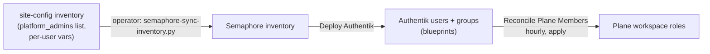
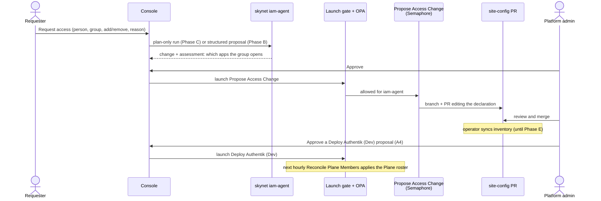

# 22 — Console access requests and the iam-agent

> **Depends on:** 12 (rbac-user-provisioning), 16 (plane-work-management), 17 (dispatch-console), and the
> launch gate (`skynet-launch-containment`).

Author: Joseph A. Wisneski IV <stray@uhstray.io>

**Date:** 2026-11-09

**Status:** DRAFT, a handoff plan. Every decision below (A1–A7) is a recommendation that needs the operator's
call. No code has been written. Before coding starts, the plan becomes an OpenSpec change under
`plan/development/openspec/changes/` (proposed name `add-console-access-requests`).

## Goal

Platform admins add and remove people from Plane, and from the platform services generally, through
the Dispatch Console. Any signed-in user can ask for access there. A new skynet role, `iam-agent`,
turns a request into a reviewed change. A human approves every change, and automation applies it.

## Where things stand (verified 2026-11-09)

### The two grants that started this plan

On 2026-11-09 the operator asked for one platform admin to hold Plane's Owner role and one business
user to hold Member. Both were already in place in production, so nothing had to be granted. Real
names stay in site-config (plan 12, D5).

| Account | Authentik group (site-config) | Plane role | Plane state |
|---|---|---|---|
| The platform admin | `platform-admins` (declared in `platform_admins`) | Owner (`plane_admin_role: owner`, set 2026-11-09) | Invitation pending. Role set to owner by Semaphore task 14302 |
| The business user | `platform-business` | Member | Invitation pending since Semaphore task 11753 |

A dry run of `Reconcile Plane Members` on 2026-11-09 planned no changes. Each person joins the
workspace by signing in to Plane through Authentik and accepting the invitation. Plane's sign-in is
admitted for `platform-admins`, `platform-developers` and `platform-business`
(`app-catalog.yml:96-99` tier `member`, `zz-sso-bindings.yaml.j2:25`).

Unverified: whether Plane honours the `owner` role on an invitation at acceptance. If the admin lands
as Member, the next hourly reconcile run sets the Owner role. The production sign-in check is open as
task 2.8 of `deploy-plane-work-management`.

### How membership works today

1. **The authority is the site-config declaration.** Users are Authentik blueprints. The admins
   come from a list, `platform_admins`, rendered by `templates/platform-admins.yaml.j2`. Developer
   and business users are fixed blocks with per-user variables in `blueprints/platform-users.yaml`
   (lines 39-47 are the business user's). Retirements are declared in `platform_retired_accounts`
   (`deploy-authentik.yml:117-150`), which renders one `state: absent` user per name
   (`templates/platform-retired.yaml.j2:22-23`). A retirement deletes the Authentik account, so
   it cuts the person off from every app, not only Plane.
2. **Plane is derived.** `reconcile_members.py` builds the wanted roster from Authentik groups and
   removes anyone outside it. An applying run is scheduled hourly
   (`templates.yml`, `Reconcile Plane Members Scheduled (Dev)`, cron `23 * * * *`). An edit made
   directly in Plane is therefore reverted within the hour.
3. **Inventory sync is manual.** After a site-config merge, an operator runs
   `scripts/semaphore-sync-inventory.py` with their own token. No Semaphore template does this.

### What the console has

- The Access page is read-only. Its Add user button is disabled with the title "Access changes
  arrive with proposals (Phase 4)" (`console/app/src/ui/access.rs:21-26`).
- It reads Authentik through `svc-console-directory`, whose role holds `view_user` and
  `view_group` only (`blueprints/console-oidc.yaml:58-65`). A deploy fails if that token can write
  (`platform/tests/test_authentik_console_directory.py`).
- Proposals exist, but only of kind `assess` or `verify` (`server/proposals.rs:58`), and every
  proposal route is platform-admin only (`proposals.rs:810-815`, `scope.rs:11,34-36`).
- The console launches only through the launch gate, as caller `console`, acting as one of five
  role agents (`deploy-launch-gate.yml:89-93`). The gate asks OPA, and OPA allows a role only the
  templates in its `allowed_templates` (`opa/.../agentcloud/data.json`).
- Groups are read once at login and kept in the session for 8 hours of inactivity
  (`server/auth.rs:199`, `server/mod.rs:269-277`). A revoked admin keeps console rights until the
  session ends.
- The console's own sign-in is tier `member` (`app-catalog.yml:117-120`), so developers and business
  users can sign in. Only admins can make proposals.

### What skynet has (origin/main, `031863d`)

- A role is a pack under `roles/<name>/ROLE.md`. Five exist: infra, network, o11y, security and
  service. `iam-agent` appears nowhere in skynet or agent-cloud.
- Plan-only runs and an approval interrupt exist for one graph, `service_onboarding`
  (`server.py:111`, approval node `service_onboarding.py:864-891`). The console token scope can start
  a plan-only run and approve it (`server.py:36-40`). agent-cloud's skynet deploy does not wire
  `SKYNET_CONSOLE_TOKEN` yet.
- skynet launches only through the launch gate (`semaphore.py:294`).
- Registering a new role touches six places: the role pack, the OPA catalog entry, an agentgateway
  identity and key (`client_iam-agent`, plus skynet's `agentgateway.py:39-46` list), the gate's role
  list and caller map, and a registry step owner if the role owns a workflow step.

## Target flow

## Decisions to make

| # | Recommendation | Alternative | Why |
|---|---|---|---|
| A1 | **The site-config declaration stays the only authority.** The console and the iam-agent never write to Authentik or Plane directly. They produce a change to the declaration. | A privileged Authentik token that edits groups through the API | A direct Plane edit is reverted by the hourly reconcile. A direct Authentik edit leaves the declaration and the live state disagreeing, with nothing to say which is right. The platform rule is config as code. |
| A2 | **Access is a group grant.** A request names a platform group, not an app. Plane follows the group. | A Plane-only group, such as `plane-members` | No Plane-only grant exists today. `platform-business` also opens ERPNext and other member-tier apps. If someone needs Plane alone, a new group is a separate decision, recorded in plan 12. |
| A3 | **The change is a site-config pull request. Merging it is the approval of record.** Console approval only starts the drafting. | A playbook that commits straight to site-config `main` | A PR is reviewable, revertible and already how site-config changes. |
| A4 | **The iam-agent may launch only `Propose Access Change` and `Reconcile Plane Members`.** `Deploy Authentik` stays operator-launched, or a console proposal that a platform admin approves. | Give the iam-agent `Deploy Authentik` | That deploy reconfigures the identity provider for every app. One agent mistake there locks everyone out. |
| A5 | **Any signed-in user may request access, for themselves only. Only platform admins approve.** | Admin-only requests, as proposals are today | "Request access through the console" means a non-admin must be able to ask. Limit: the console's sign-in tier is `member`, so a `platform-user`, or anyone in no member group, cannot sign in to ask. See Q5. |
| A7 | **Two request kinds: change a group, and offboard.** Removing someone from Plane removes the group from their `platform_members` entry. Offboarding adds them to `platform_retired_accounts`, which deletes the Authentik account, and the console warns that every app is cut off. | One "remove" that retires the account | A retirement is `state: absent` on the user. Using it to leave Plane would lock the person out of everything. |
| A6 | **New people come after existing people.** Phase B moves existing users between groups. Creating a new account waits for prod SMTP and enrollment links. | Create accounts now and hand out passwords through `Print User Credentials` | That template prints a live password into Semaphore task output (plan 12, D2 and its open item). |

## Phases

### Phase A — Declare members as data (agent-cloud and site-config)

This is plan 12's open item. Without it, adding a developer or business user means writing a new
blueprint block, which no agent should do.

1. Add a `platform_members` list to site-config (username, name, email, groups), rendered by a new
   `templates/platform-members.yaml.j2`, modelled on `platform-admins.yaml.j2`.
2. Move the per-user blocks out of `platform-users.yaml` into that list. The deploy's read-back
   check (`verify-users.py.j2`) proves each user is present, active and in at least one group. It
   does not compare group sets, so record each user's groups before the move and compare after.
3. Validate the list in `deploy-authentik.yml`: known groups only, no duplicates, no name that is
   also in `platform_admins` or `platform_retired_accounts`.
4. Tests: render the template from a fixture, and refuse each invalid shape.

Done when Deploy Authentik (Dev) in production reports no user change after the move, and every
user's group set is unchanged.

### Phase B — Console access requests, structured, no skynet

The console path works end to end before any agent is involved.

1. New playbook `propose-access-change.yml`, template `Propose Access Change`. Input: person, group,
   add or remove, request id. It clones site-config with the deploy key, as the backup playbooks do
   (`tasks/site-config-clone.yml`), edits one entry's groups in `platform_members` (A7), pushes
   `access/<request id>`, and opens a PR. Opening a PR needs a GitHub credential with
   `pull_requests: write` on site-config. None exists yet. See open question Q2.
2. Console: proposal kind `access` beside `assess` and `verify`, a new route that lets any signed-in
   user create one for themselves (A5), and the Access page's Add user button enabled as
   "Request access". Approval stays platform-admin only, with the existing origin check and atomic
   approve (plan 17 D53).
3. OPA: the template goes into one role's `allowed_templates`. Until Phase C, that is an existing
   role. `security-agent` is the closest fit.
4. The proposal shows the PR link and its state.

Done when a request made in local-dev produces a site-config PR that, once merged and deployed,
changes the Plane roster on the next reconcile.

### Phase C — The iam-agent in skynet

1. skynet: role pack `roles/iam-agent/ROLE.md`, and a graph `access_request` built like
   `service_onboarding` (plan-only, approval interrupt). It reads the declaration and the app
   catalog, and it reports what the group opens and who else holds it. Then it proposes the same
   change Phase B makes by hand. Register the graph in `PLAN_GRAPHS`.
2. agent-cloud: register `iam-agent` in the six places listed above. Its `allowed_templates` are
   exactly `Propose Access Change` and `Reconcile Plane Members` (A4).
3. Wire `SKYNET_CONSOLE_TOKEN` in agent-cloud's skynet deploy, and add the console's client for
   skynet's plan-only run and approve routes.
4. Phase B's proposals move from `security-agent` to `iam-agent`.

### Phase D — Removal and offboarding

1. Removing a group edits the person's `platform_members` entry, and the next reconcile removes them
   from Plane if no member group is left. Offboarding is the second request kind (A7): it moves the
   person to `platform_retired_accounts`, which deletes the Authentik account, and the console shows
   that warning before approval.
2. Owners are the exception. The reconcile never demotes or removes a Plane Owner (site-config
   comment on `plane_admin_role`), so removing a platform admin from Plane stays a manual step.
   Record it in the proposal as an operator task.
3. Shorten the console's group staleness: re-read the caller's groups on each approve, rather than
   trusting the 8-hour session.

### Phase E — Close the manual sync

Inventory sync after a site-config merge is operator-side today. Either a reviewed template runs it
after a merge, or the operator keeps it as the deliberate human step. Decide once Phases B to D have
run for a while.

## Open questions for the operator

- **Q1.** Should a Plane-only group exist (A2), or do platform groups cover every case?
- **Q2.** Which GitHub identity opens the site-config PR: a new GitHub App with `pull_requests:
  write` on site-config alone, or the console's existing App, widened?
- **Q3.** Do two people have to approve an access change (the console admin and the PR reviewer),
  or may one admin approve in the console and merge?
- **Q4.** Is the iam-agent in scope for other services' roles (Grafana, NetBox, OpenBao), or Plane
  only at first?
- **Q5.** Should a `platform-user`, who cannot sign in to the console today, be admitted to it for
  access requests only (A5)?

## Out of scope

- Creating Authentik accounts before prod SMTP exists (A6).
- Plane project-level membership. Workspace roles only.
- Any write path for `svc-console-directory`. It stays read-only.
