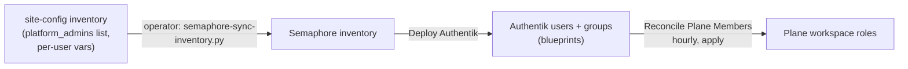
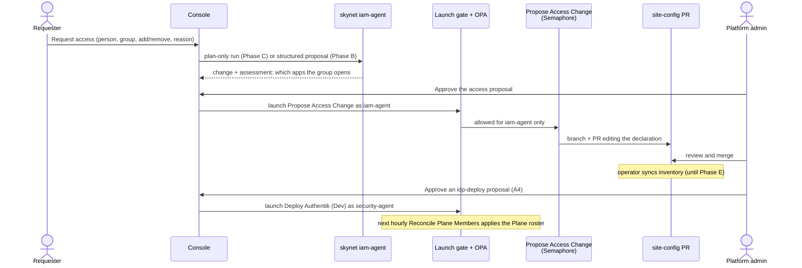

# 22 — Console access requests and the iam-agent

> **Depends on:** 12 (rbac-user-provisioning), 16 (plane-work-management), 17 (dispatch-console), and the
> launch gate (`skynet-launch-containment`).

Author: Joseph A. Wisneski IV <stray@uhstray.io>

**Date:** 2026-11-09

**Status:** PROPOSED. Every decision below (A1–A8) is a recommendation that needs the operator's call.
No code has been written. Before coding starts, the plan becomes an OpenSpec change under
`plan/development/openspec/changes/` (proposed name `add-console-access-requests`).

**Context:** On 2026-11-09 the operator asked for two people to get Plane access, and then for a way to
add and remove members through the Dispatch Console, with a skynet `iam-agent` handling requests. This
plan records how membership works today, where an access-change path has to plug in, and the phases
to build it without giving an agent more reach than the change needs.

## Problem

Membership changes today are hand-written edits to the private site-config inventory, followed by an
operator-run inventory sync and `Deploy Authentik`. Nobody can ask for access except by messaging an
admin, the console's Access page is read-only, and no agent identity is scoped to access changes: the
one agent role that can touch the identity provider, `security-agent`, can also run `Deploy Authentik`
(below). The goal is a request path in the console that ends in a reviewed change to the declaration,
applied by automation, with a human approving every step.

## Design principles

1. **The declaration is the authority** (`PRINCIPLES.md`, config as code). Requests change the
   site-config declaration. Nothing writes to Authentik or Plane directly.
2. **Least reach per identity.** The identity that drafts an access change cannot also redeploy the
   identity provider or override a safety guard.
3. **A human approves, automation applies.** AI proposes, OPA and the launch gate validate, Semaphore
   executes.
4. **Template, not instance.** This repository holds the mechanism; Uhstray.io's people, hostnames and
   group assignments stay in site-config.

## Where things stand (verified 2026-11-09, citations re-checked 2026-11-11)

### The two grants that started this plan

The operator asked for one platform admin to hold Plane's Owner role and one business user to hold
Member. Both were already in place in production, so nothing had to be granted. Real names stay in
site-config.

| Account | Authentik group (site-config) | Plane role | Plane state |
|---|---|---|---|
| The platform admin | `platform-admins` (declared in `platform_admins`) | Owner | Invitation pending. Semaphore task 14302 set the invitation's role to owner |
| The business user | `platform-business` | Member | Invitation pending since Semaphore task 11753 |

`plane_admin_role: owner` is not a per-person setting: the reconcile gives that role to **every**
member of `platform-admins` (`reconcile-plane-members.yml:111`). Task 14302 applied it to the three
pending admin invitations. Whether Plane keeps the owner role when an invitation is accepted, and
whether its member API accepts a later `PATCH` to `role_slug: owner` for an active member
(`reconcile_members.py:110`), are **unverified**; the production sign-in check is task 2.8 of
`deploy-plane-work-management`. Known drift: the playbook header still says production keeps the
default role (`reconcile-plane-members.yml:9`).

Plane's sign-in is admitted for `platform-admins`, `platform-developers` and `platform-business`, plus
Authentik superusers (`app-catalog.yml:96-99` tier `member`, `zz-sso-bindings.yaml.j2:25-26`).

### How membership works today

1. **The authority is the site-config declaration.** Users are Authentik blueprints. Admins come from
   a list, `platform_admins`, rendered by `templates/platform-admins.yaml.j2`; each entry's `key` must
   equal today's name, because its upper-cased form is the env prefix of the stored password
   (`vars/platform-admins.yml:8-10`). The only other active user is the business user, a fixed block
   in `blueprints/platform-users.yaml:37-47`; no developer user is declared. That file also holds a
   legacy retirement block (`platform-users.yaml:71-79`). Retirements are otherwise declared in
   `platform_retired_accounts` (`deploy-authentik.yml:117-150`), which renders one `state: absent`
   user per name (`templates/platform-retired.yaml.j2:22-23`). A retirement **deletes** the Authentik
   account, cutting the person off from every app.
2. **Plane is derived.** `reconcile_members.py` builds the wanted roster from Authentik groups and
   removes anyone outside it, with a guard against removing most of the workspace at once. An applying
   run is scheduled hourly (`templates.yml:2073-2077`, `Reconcile Plane Members Scheduled (Dev)`, cron
   `23 * * * *`), so an edit made directly in Plane is reverted within the hour. **Owners are outside
   its reach:** it never demotes or removes one (`reconcile_members.py:22,69,74,85`). With
   `plane_admin_role: owner`, that now covers every admin.
3. **Inventory sync is manual.** After a site-config merge, an operator runs
   `scripts/semaphore-sync-inventory.py` with their own token. No Semaphore template does this.

### What the console has

- The Access page is read-only. Its Add user button is disabled (`console/app/src/ui/access.rs:99`)
  with the title "Access changes arrive with proposals (Phase 4)" (`access.rs:26`).
- It reads Authentik through `svc-console-directory`, whose role holds `view_user` and `view_group`
  only (`blueprints/console-oidc.yaml:58-65`). Every deploy fails if that token can write
  (`templates/verify-users.py.j2:188-194`; shape pinned by
  `platform/tests/test_authentik_console_directory.py`).
- Proposals exist, but only of kind `assess` or `verify` (`server/proposals.rs:58`), and every
  proposal route is platform-admin only (`proposals.rs:810-815`, `scope.rs:11,34-36`).
- The console launches only through the launch gate, as caller `console`, acting as one of five role
  agents (`deploy-launch-gate.yml:89-93`). OPA allows a role only the templates in its
  `allowed_templates` (`opa/.../agentcloud/data.json`), and the gate also allows each one's `(Dev)`
  variant (`filter_plugins/launch_gate.py:38`).
- **`security-agent` can already launch `Deploy Authentik`** (its `allowed_templates` in `data.json`),
  and both callers, `skynet` and `console`, may act as `security-agent`.
- The gate checks survey values for shape and length only (`launch_gate.py`, `_survey`). OPA bounds
  two survey values, `target_service` and `target_host` (`agent_actions.rego:324-347`); nothing bounds
  `Reconcile Plane Members`' `apply` or `allow_mass_removal` (`templates.yml:2054,2060`).
- Groups are read once at login and kept in the session for 8 hours of inactivity
  (`server/auth.rs:195,199`, `server/mod.rs:269-277`). A revoked admin keeps console rights until the
  session ends.
- The console's own sign-in is tier `member` (`app-catalog.yml:117-120`), so developers and business
  users can sign in; only admins can make proposals.

### What skynet has (origin/main, `6697390`)

- A role is a pack under `roles/<name>/ROLE.md`. Five exist: infra, network, o11y, security and
  service. `iam-agent` appears nowhere in skynet or agent-cloud.
- Plan-only runs and an approval interrupt exist for one graph, `service_onboarding` (`server.py:111`,
  approval node `service_onboarding.py:864-891`). The console token scope can start a plan-only run
  and approve it (`server.py:36-40`). agent-cloud's skynet deploy does not wire `SKYNET_CONSOLE_TOKEN`.
- skynet launches only through the launch gate (`semaphore.py:294`).

## Architecture

## Decisions to make

| # | Recommendation | Alternative | Why |
|---|---|---|---|
| A1 | **The site-config declaration stays the only authority.** The console and the iam-agent never write to Authentik or Plane directly. They produce a change to the declaration. | A privileged Authentik token that edits groups through the API | A direct Plane edit is reverted by the hourly reconcile. A direct Authentik edit leaves the declaration and the live state disagreeing, with nothing to say which is right. |
| A2 | **Access is a group grant.** A request names a platform group, not an app. Plane follows the group. | A Plane-only group, such as `plane-members` | No Plane-only grant exists. `platform-business` also opens ERPNext and every other member-tier app. A Plane-only group is a separate decision for plan 12 (Q1). |
| A3 | **The change is a site-config pull request. Merging it is the approval of record.** Console approval only starts the drafting. | A playbook that commits straight to site-config `main` | A PR is reviewable, revertible and already how site-config changes. |
| A4 | **A new `iam-agent` identity holds exactly `Propose Access Change` and `Reconcile Plane Members`, and nothing else; it arrives in Phase B, before skynet uses it.** `Deploy Authentik` stays where it is today, with `security-agent`, launched only through an admin-approved console proposal of kind `idp-deploy`. | Put `Propose Access Change` on `security-agent` | `security-agent` can already redeploy the identity provider. Adding the drafting template to it would put drafting and the IdP deploy in one identity. Whether `security-agent` should keep `Deploy Authentik` at all is Q6. |
| A5 | **Any signed-in user may request access, for themselves only. Only platform admins approve.** | Admin-only requests, as proposals are today | A non-admin must be able to ask. Limit: the console's sign-in tier is `member`, so a `platform-user`, or anyone in no member group, cannot sign in to ask (Q5). |
| A6 | **New people come after existing people.** Phase B moves existing users between groups. Creating a new account waits for prod SMTP and enrollment links. | Create accounts now and hand out passwords through `Print User Credentials` | That template prints a live password into Semaphore task output (plan 12, D2 and its open item). |
| A7 | **Two request kinds: change a group, and offboard.** Leaving Plane removes the group from the person's `platform_members` entry. Offboarding adds them to `platform_retired_accounts`, which deletes the Authentik account, and the console warns that every app is cut off. | One "remove" that retires the account | A retirement is `state: absent` on the user. Using it to leave Plane would lock the person out of everything. |
| A8 | **OPA pins `Reconcile Plane Members`' `allow_mass_removal` to `false` for every agent launch.** | Trust the caller | The gate checks shape only, so without a rule an agent launch could switch off the reconcile's guard against emptying the workspace. OPA already bounds survey values this way (`agent_actions.rego:324-347`). |

## Implementation phases

### Phase A — Declare members as data (agent-cloud and site-config)

Plan 12's open item (`12-rbac-user-provisioning.md:80`, which calls the variable `authentik_users`).
This plan names it `platform_members` to match `platform_admins` and `platform_retired_accounts`, and
updates plan 12's item to point here. Without it, adding a user means writing a new blueprint block,
which no agent should do.

1. Add a `platform_members` list to site-config with `key`, `username`, `name`, `email` and `groups`,
   rendered by a new `templates/platform-members.yaml.j2` modelled on `platform-admins.yaml.j2`. `key`
   follows the admin list's rule: it must equal the existing env prefix, or the stored password is
   re-keyed.
2. Move the business user's block out of `platform-users.yaml` into the list, and move the legacy
   retirement block's name into `platform_retired_accounts`, so each concern has one declaration.
3. Validate the list in `deploy-authentik.yml`: known groups only, `platform-admins` refused (admins
   stay in `platform_admins`), no duplicate key or username, no name that is also in
   `platform_admins` or `platform_retired_accounts`.
4. Tests: render the template from a fixture, and refuse each invalid shape.

**Done when** Deploy Authentik (Dev) in production reports no user change after the move, and every
user's group set is unchanged. `verify-users.py.j2` proves present, active and in at least one group
only, so the group sets are recorded before the move and compared after.

### Phase B — Console access requests, structured, no skynet

1. **iam-agent identity, agent-cloud side.** Add `iam-agent` to OPA's catalog with
   `allowed_templates` exactly `Propose Access Change` and `Reconcile Plane Members` (A4), to the gate's
   role list and to the `console` caller's map (`deploy-launch-gate.yml:89-93`), and to the tests that
   pin role lists (`test_launch_gate_allowlist.py`, `test_workflow_registry.py`,
   `workflow_agents_test.rego`, `test_launch_gate_playbooks.bats`).
2. **OPA rule (A8):** deny an agent launch of `Reconcile Plane Members` unless
   `settings.allow_mass_removal` is `"false"`, with a rego test.
3. **Playbook** `propose-access-change.yml`, template `Propose Access Change` declared in
   `templates.yml` (the gate refuses a template OPA names that is not declared). Input: person key,
   group, add or remove, request id, all validated before use (see Security considerations). It clones
   site-config with the deploy key through `tasks/site-config-clone.yml`, edits one entry's `groups` in
   `platform_members`, pushes `access/<request id>`, and opens a PR. Opening a PR needs a GitHub
   credential with `pull_requests: write` on site-config; none exists (Q2).
4. **Console:** proposal kinds `access` and `idp-deploy` beside `assess` and `verify`; a route that
   lets any signed-in user create an `access` proposal for themselves (A5); the Access page's Add user
   button enabled as "Request access". Approval stays platform-admin only, with the existing origin
   check and atomic approve (plan 17 D53). The proposal shows the PR link and its state.

**Done when** a request made in local-dev reaches a pull request against the declaration local-dev
reads, and after merge and Deploy Authentik the next reconcile changes the Plane roster. Which
declaration local-dev's Deploy Authentik reads is not yet established and is settled first.

### Phase C — The iam-agent in skynet

1. skynet: role pack `roles/iam-agent/ROLE.md`, and a graph `access_request` built like
   `service_onboarding` (plan-only, approval interrupt). It reads the declaration and the app catalog,
   reports what the group opens and who else holds it, then proposes the change Phase B makes by hand.
   Register the graph in `PLAN_GRAPHS`.
2. agent-cloud: give `iam-agent` an agentgateway identity. That touches at least: `agw_clients` and
   the identity lists (`bootstrap-local-dev.yml:1690`, `inventory/local-dev.yml.example:390`), skynet's
   `IDENTITIES` (`agentgateway.py:39-47`), Deploy skynet's shared read of the role key
   (`deploy-skynet.yml:94-99`) and its env line (`skynet/deployment/templates/env.j2:100-102`), and the
   tests that pin them. `git grep network-agent` lists every place a role is named.
3. Wire `SKYNET_CONSOLE_TOKEN` in agent-cloud's skynet deploy, and add the console's client for
   skynet's plan-only run and approve routes. Add the `skynet` caller to `iam-agent` in the gate map.

**Done when** a console request starts a plan-only `access_request` run, an admin approves it in the
console, and the launch it makes is tagged `skynet <run> <step>` and produces the same PR as Phase B.

### Phase D — Removal and offboarding

1. Removing a group edits the person's `platform_members` entry; the next reconcile removes them from
   Plane when no member group is left. Offboarding (A7) moves the person to
   `platform_retired_accounts`, and the console shows the account-deletion warning before approval.
2. Owners are the exception: the reconcile never demotes or removes one (`reconcile_members.py:22,74,85`).
   With `plane_admin_role: owner` that is every platform admin, so removing an admin from Plane stays a
   manual Plane step, recorded on the proposal as an operator task.
3. Re-read the caller's groups on each approve, rather than trusting the 8-hour session.

**Done when** an offboarding request in local-dev deletes the account and removes the person from
Plane, and an approve by a user who left `platform-admins` after signing in is refused.

### Phase E — Close the manual sync

Inventory sync after a site-config merge is operator-side today. Either a reviewed template runs it
after a merge, or the operator keeps it as the deliberate human step.

**Done when** the operator has decided, after Phases B to D have run for a while, and the decision is
recorded here.

## Validation criteria

| Check | Pass condition |
|---|---|
| Members as data | Deploy Authentik (Dev) reports no user change and identical group sets after Phase A |
| iam-agent scope | OPA allows `iam-agent` exactly two templates and their `(Dev)` variants; `Deploy Authentik` as `iam-agent` is denied |
| Mass-removal pin | An agent launch of `Reconcile Plane Members` with `allow_mass_removal=true` is denied by OPA |
| Request path | A non-admin's `access` proposal cannot be approved by its author; an admin's approval produces one site-config PR and nothing else |
| Input validation | A request id, key or group outside its pattern is refused before any clone |
| Offboarding warning | An offboarding proposal shows the account-deletion warning and needs an admin approval |
| Directory token | `svc-console-directory` stays read-only (the existing deploy check passes) |

## Security considerations

- **Agent reach.** `security-agent` can already redeploy the identity provider, and both callers can
  act as it (above). This plan does not widen it: access drafting gets its own identity (A4). Whether
  to narrow `security-agent` is Q6.
- **Survey values.** The gate checks shape only. A8 pins the reconcile's mass-removal guard in OPA;
  `apply` stays allowed, because applying is the point of the reconcile.
- **Owners.** Every platform admin is a Plane Owner, outside the reconcile's reach. A compromised or
  departed admin is removed from Plane only by hand.
- **Injection.** Person key, group, and request id come from a requester and reach a playbook that
  edits YAML and names a git branch. Each is matched against a strict pattern (key: the admin list's
  slug rule; group: one of the declared platform groups other than `platform-admins`; request id: the
  console's proposal id format) before use, and the YAML is edited as data, never by text substitution.
- **Push scope.** The site-config deploy key can push any branch. The playbook pushes only
  `access/<request id>` and never `main`; branch protection on site-config is the backstop.
- **PR credential.** The PR opener needs `pull_requests: write` on site-config only (Q2). It is minted
  per run, like the console's GitHub token, and never stored on a host.
- **Stale sessions.** Console groups are fixed at login for up to 8 hours; Phase D re-reads them on
  approve.
- **Admin membership** has no request path: `platform_admins` changes stay operator-written PRs.

## Open questions for the operator

- **Q1.** Should a Plane-only group exist (A2), or do platform groups cover every case?
- **Q2.** Which GitHub identity opens the site-config PR: a new GitHub App with `pull_requests:
  write` on site-config alone, or the console's existing App, widened?
- **Q3.** Do two people have to approve an access change (the console admin and the PR reviewer), or
  may one admin approve in the console and merge?
- **Q4.** Is the iam-agent in scope for other services' roles (Grafana, NetBox, OpenBao), or Plane
  only at first?
- **Q5.** Should a `platform-user`, who cannot sign in to the console today, be admitted to it for
  access requests only (A5)?
- **Q6.** Should `security-agent` keep `Deploy Authentik`, or should the IdP deploy be operator-only?

## Out of scope

- Creating Authentik accounts before prod SMTP exists (A6).
- Granting or revoking platform admin through a request.
- Plane project-level membership. Workspace roles only.
- Any write path for `svc-console-directory`. It stays read-only.

## Cross-references

- [12 — RBAC user provisioning](12-rbac-user-provisioning.md): users as blueprints, the open item Phase A closes.
- [16 — Plane work management](16-plane-work-management.md) and the OpenSpec change `deploy-plane-work-management`: the member reconcile and task 2.8.
- [17 — Dispatch Console](17-dispatch-console.md): proposals, the launch gate caller (D49), approval rules (D52, D53).
- OpenSpec change `skynet-launch-containment`: the launch gate.
- Root [`AGENTS.md`](../../AGENTS.md): the template-versus-instance convention, OpenBao layout, launch gate.

## Revision history

| Date | Change |
|---|---|
| 2026-11-09 | First draft, as plan 21 |
| 2026-11-11 | Renumbered to 22; review round: `iam-agent` arrives in Phase B with exactly two templates, OPA pins `allow_mass_removal`, owner role covers every admin, Phase A keeps `key`, standard sections added, status PROPOSED |
