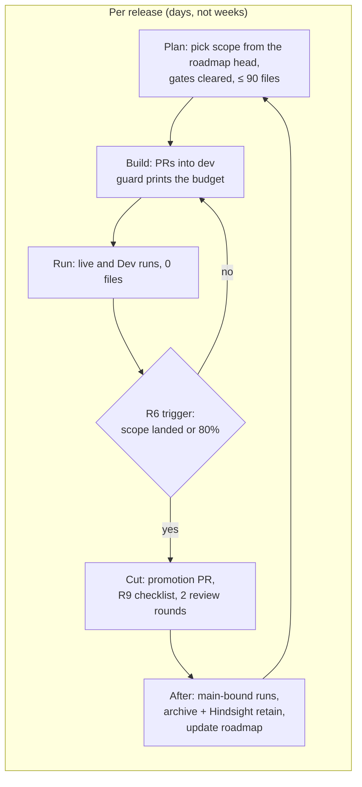
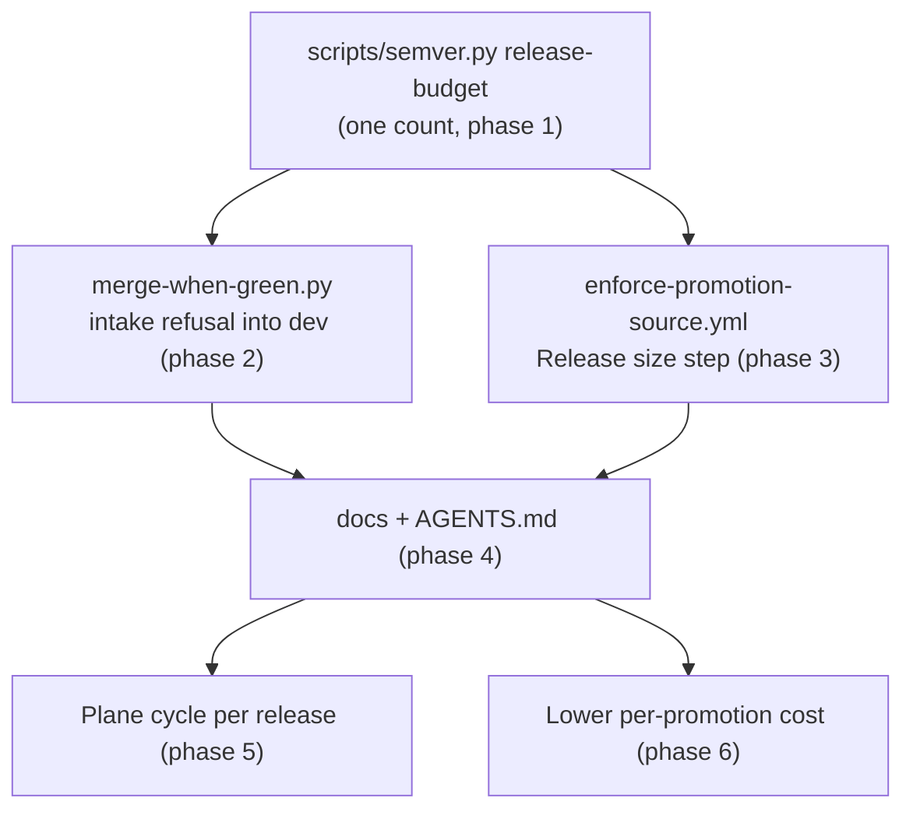

# 22 — Release train: iterative releases in dependency order

**Date:** 2026-11-10
**Status:** PROPOSED (not started; nothing in this plan has been executed)
**Author:** Joseph A. Wisneski IV
**Context:** [`plan/architecture/10-release-policy.md`](../architecture/10-release-policy.md)
caps a release, one `dev` → `main` promotion, at 100 pull requests and 120 changed files.
This plan builds the gates that enforce those caps. It then cuts the remaining planned work
into releases that fit them, in dependency order. Inputs: the 24 active OpenSpec changes,
read from `origin/dev` at `4c819b53` on 2026-11-10, the open pull request queue, and
the size of the last three releases. Three read-only scouts gathered the OpenSpec facts. The
claims this plan depends on were re-checked at their cited lines.

---

## Problem

- **The work is not cut to release size.** 24 OpenSpec changes are active, with 1,124
  checkbox tasks: 521 done, 603 open (direct `tasks.md` counts on `origin/dev`).
  The `openspec` CLI on this machine resolves the store to another, stale checkout and still
  lists an archived change, so the counts here come from the files.
- **The next release is already nearly full.** `dev` is 5 pull requests and 25 files ahead of
  `main`. Merging every open pull request into `dev` would make it **119 distinct files**
  (union of the files of the 13 open pull requests and `git diff --name-only origin/main...origin/dev`,
  2026-11-10). One draft, weft #743, is 49 of those files. Without it the total is 70.
- **Most remaining work costs operator time, not files.** Across the changes, most open tasks
  are live runs, operator decisions or work in other repositories (dgx-spark, skynet, site-config).
  Those tasks change at most a `tasks.md` tick. The file budget goes to a few code-heavy
  changes, listed under "Code weight" below.
- **Some runs can only happen after a promotion.** Several tasks run `main`-bound templates
  "after `dev` → `main` promotion". Examples: `inference-personal-keys` 6.4,
  `recover-netbox-discovery` 5.4, `deploy-postiz-social-publishing` 6.6. Infrequent
  promotions held them back. Frequent releases unblock them.
- **A deadline falls inside the first release window.** The gateway's legacy shared key
  expires on **2026-11-13** (`openspec/changes/inference-gateway-agentgateway/tasks.md:697`,
  which records site-config #81). The live site-config value was not re-read for this plan.
  The task records that the rotation is held: dgx-spark ADR-0018 is not approved (`:701`).

## Design Principles

- **A release is the planning unit** (policy R7). Each release has a declared scope with a
  file budget of at most 90, ordered so that nothing waits on a later release.
- **Plan about 60 files, not 90.** Recent work produces fixes during live runs, and
  documentation and ledger pull requests arrive without being planned. A planned scope of 40–70
  files leaves room for them, so the release is cut when its scope lands (R6), not when it fills.
- **Hot files are cheap.** `AGENTS.md`, `platform/semaphore/templates.yml`,
  `docs/MISTAKES.md` and the graph artifact count once per release, however many pull requests
  touch them. Changes that share those files can share a release.
- **Separate the code from its runs.** A change's code lands in one release. Its live runs
  and gates follow without taking file budget, and its archive lands in a later release.
  An archive is not free: it moves the change directory (5–6 files today) and updates its
  spec, about 6–7 files per change.
- **Decisions come before code.** A change whose design questions are open (`DECISION`) does
  not enter a release until they are answered.

## Architecture

The enforcement path (built in phases 1–4) and the loop each release follows:

### Enforcement design decisions

| Question | Decision | Why |
|---|---|---|
| Where the counts live | A new `release-budget` subcommand in `scripts/semver.py`, printing JSON: `prs`, `files`, both limits, remaining, `warn` (≥ 80%), `full` | Plan 20 keeps every release rule in one script. The guard already imports `semver` (`scripts/merge-when-green.py`, `check_title`) |
| The limits' source | Constants in `scripts/semver.py`, 100 and 120 | One value, one place. Policy R2/R3 cite the script |
| How intake counts the PR being merged | PRs: `prs + 1`. Files: the union of `git diff --name-only origin/main...origin/dev` and the PR's changed files, which the guard already reads (`changed_files()`) | A union is conservative: a PR that restores a file to `main`'s content is still counted. No merge-ref fetch, no new API call |
| What intake does when over | Refuses the merge, naming both counts, both limits and "release full: promote first" | Policy R4/R5 |
| Backstop | A `Release size` step in the existing `Promotion source (dev -> main)` job | That job is already a required check on `protect-main`, so no ruleset change is needed |
| Merges outside the guard | Operator merges (those that change `RELEASE_SCRIPTS` or other workflow files) run the guard read-only first, as the budget readout | The guard refuses those merges by design (plan 20, "Merging this change"). The readout keeps the budget honest anyway |

## Implementation Phases

### Part A — enforcement (lands in Release 1)

| # | Phase | Files (est.) | Merge path | Acceptance |
|---|---|---|---|---|
| 1 | `release-budget` in `scripts/semver.py`, tests in `platform/tests/test_semver.py` | 2 | **Operator merge** (`scripts/semver.py` is in `RELEASE_SCRIPTS`) | On throwaway repositories, the tests cover: counts that match `notes` and `git diff`, the 80% warn flag, `full` at 101 PRs and at 121 files, and exclusion of promotion and sync merges. Run on this repository on 2026-11-10, it prints 5 and 25 |
| 2 | Intake refusal in `scripts/merge-when-green.py` for base `dev`, its tests, `plan/development/dev-merge-guard.md` | 3 | Guard (no `RELEASE_SCRIPTS` path) | Guard tests prove the refusal at the limit, the union count, the +1, and the readout in a read-only run. A real read-only run prints the budget |
| 3 | `Release size` step in `.github/workflows/enforce-promotion-source.yml`, tests in `platform/tests/test_promotion_source_guard.py` | 2 | **Operator merge** (workflow path) | The step fails a promotion over either limit and passes the first promotion under this policy |
| 4 | `AGENTS.md` "Branch Workflow" points to policy 10, and the policy's enforcement table is marked built | 2 | Guard | Docs name the gates and the interim commands are retired |

### Part B — iteration mechanics (lands with Release 2)

| # | Phase | Acceptance |
|---|---|---|
| 5 | **Plane cycle per release.** In the agent-cloud Plane project, each release is one cycle. Its work items are the OpenSpec tasks in scope. The modules already exist, one per OpenSpec change (`Sync Plane Projects`). Convention first. Automate only if keeping it by hand proves too slow | Each release in the roadmap below has a cycle, and the cycle's work items match the declared scope |
| 6 | **Lower the cost of each promotion.** (a) A read-only promotion-readiness check lists `main`-bound templates that declare `isolated_environment` but have no `main` copy (v0.14.0 found two missing at promotion time). (b) Reuse the release-notes renderer already in flight, not a second one. (c) Try CodeRabbit on the first promotion of ≤ 120 files; whether its limits allow this is **unverified**. (d) Check whether CodeQL default setup (`configured`, verified 2026-11-10) analyses pull requests into `dev`, so alerts appear when a PR merges, not at promotion; **unverified** | Release 2's promotion uses the readiness check. Release 1's review records whether CodeRabbit reviewed it |

### Part C — release roadmap, in dependency order

Versions are not fixed here. Plan 20 assigns each one at cut time (a minor if the release
carries a `feat`, else a patch). Release N cannot start its code until every earlier release
whose output it needs has merged. Each release's runs continue after its promotion, alongside
the next release's build.

**Urgent, before Release 1 is cut (no repository files):** decide how the 2026-11-13 legacy
shared key expiry is handled (`inference-gateway-agentgateway` 5.1). One option is rotating
the vLLM key under dgx-spark#34's two-step plan. The other is moving `legacy_shared_expires`
again in site-config. Either is site-config or dgx-spark work, outside this repository's budget.

| Release | Scope (OpenSpec change: tasks) | Planned files | Gates that must clear first | Unblocks |
|---|---|---|---|---|
| **1 — Guardrails** | What is on `dev` now (25). The small open PRs, by policy R8: #1010, #1008, #999, #998, #997, #994, #990, #952, #951, #911, #761 and #535. Together with `dev` they make 70 distinct files. This plan and policy 10 (4). Part A, phases 1–4 (about 8 new). Tick-only bookkeeping where the scouts found evidence, one `tasks.md` each: `add-dispatch-console` 1.x–5.x with operator receipts; `deploy-plane-work-management` 0.3/0.5/0.7/0.8/0.11/0.13/0.14; `production-internal-ca` 6.0, plus the stale text in its 5.2 and 3.3; `add-github-actions-runners` 12. Runs, 0 files: `skynet-launch-containment` 4.4 local gate; `agentgateway-openrouter` 3.1 credit cap | ~88 | Operator merges for phases 1 and 3. #998 claims plan number 21, which `21-test-suite-runtime.md` already holds, so #998 renumbers before it merges | All later releases (the gate exists) |
| **2 — Trust foundation and archives** | Archives, about 20 files (an archive moves the change directory and updates its spec): `pbs-thick-lvm-allocation-preflight` (2/2 done); `skynet-launch-containment` and `agentgateway-openrouter` once Release 1's runs pass. `production-internal-ca`: the remaining code (5) and its runs: 6.1 real renewal, 6.3 rotation drill, 6.5 alert drill, 7.1–7.3 backup and restore drill. `internal-dns-naming` sections 1–2 and 4 (~12). `pbs-vm-and-restore-gate` code (2–6) and runs 2.3–4.3. Part B, phases 5–6 | ~50 | DECISIONS: `internal-dns-naming` 1.1–1.4 naming values (operator); the PBS package-source choice (`pbs-vm-and-restore-gate/tasks.md:79`); authorising the 512 GiB disk (`:16`); a window for the rotation drill (`production-internal-ca` 6.3) | Gateway TLS (6.3), split-horizon DNS (7.x), personal keys 5.3, bench leaf, observability 6.3. The PBS restore receipt unblocks `estate-wide` 4.x, telemetry retention 4.1 and Plane 1.7 |
| **3 — Gateway observability** | `agentgateway-observability` sections 1–5 code (14–17; several are already on `dev` and only need ticks, e.g. 1.2, 1.3, 1.5). `agentgateway-mcp` 6.6 rate-limit flip (1, `ratelimit.tf`). `inference-gateway-agentgateway` 6.3 model TLS (≈4) | ~25 | Release 2's `production-internal-ca` 4.1/5.4/5.4a; dgx-spark vLLM HTTPS (PR 38) for 6.3; `agentgateway-mcp` 0.4 decisions G1–G6 | Personal keys (team marker), `observability-estate` 5.7/7.4 access-log source, `o11y-dashboard-accuracy` 3.4/3.5 |
| **4 — Personal inference keys** | `inference-personal-keys` sections 2–6 code (22–28). `agentgateway-observability` 2.3 lands here if Release 3 did not take it, because both edit key rendering in `config.yaml.j2` | ~30 | DECISION 0.2 (design Q1–Q5); verification runs 1.2–1.5; Release 3 merged | `agentgateway-mcp` close-out. Personal-keys 6.4 runs in production after this release's promotion |
| **5 — Delivery pipeline** | `service-deployment-workflow` remaining code (3–6). `add-dispatch-console` 7.8, 10.4, 10.4a (3–6). `add-github-actions-runners` code: mint task, clean-deploy and deregister playbooks, verify playbook, templates, docs (14–18) | ~30 | GitHub App re-grant for private repositories (`service-deployment-workflow` 2.5, blocked since 2026-10-14). OPA review stamp for `service-assess` (`add-dispatch-console` 10.4a). The skynet-repository tasks (SDW 3.4–3.6, 7.6). Choice of private repository (runners 7.1) | `add-ephemeral-github-runners` rollout; the console's dev → main gate 10.5 |
| **6 — Observability estate waves** | `estate-wide-observability-instrumentation` code (10–15). `observability-estate` code (3–8). `internal-dns-naming` section 6, production DNS. `recover-netbox-discovery` sections 1–2 (about half its ~15) | ~40 | Release 2's PBS restore receipt and the seven-day baselines (`estate-wide` 1.3; `o11y-signal-labeling-profiling-alerting` 5.3). The o11y root-disk growth decision (`estate-wide` 4.2). `recover-netbox-discovery` status conflict resolved (PROPOSED vs APPLY IN PROGRESS) | Telemetry retention (4.1), `o11y-signal-labeling-profiling-alerting` 5.5, gateway 7.x split-horizon |
| **7 — Plane and runners finish** | `deploy-plane-work-management` sections 3, 4, 6 (Discord app) and 7 (tududi teardown), about 25. `add-ephemeral-github-runners` 8.2 and rollout runs. `recover-netbox-discovery` sections 3–5 | ~40 | Plane GitHub App creation (3.3); Discord bot settings (6.x); weft companion (5.4) | Archive of Plane, both runner changes and NetBox recovery |
| **8 — Inference benchmarking** | `inference-benchmarking` code (15–20), then its runs | ~25 | DECISION 0.2 and 5.1; bench VM and its client leaf (`production-internal-ca` 5.2); dgx-spark allow rule (0.3, 1.5) | Gateway 4.2 rate-limit figures (from bench 4.3), then the gateway change's close-out |

**Rides any release, when unblocked:**

| Work | Size | Note |
|---|---|---|
| weft #743 | 49 files | Too large to share Release 1 (R8). It takes the first release with ≥ 50 files of room, or splits into a deploy PR and a backup/rollback PR |
| `shared-automation-helpers` | 60–80 files | **Not approved** (`tasks.md:3`: "Proposal awaiting operator approval — do not start"). If approved, one helper section per release, each ≤ 20 files. Sections 2 and 3 migrate 46 and 12 call sites, so each spans two releases |
| `deploy-postiz-social-publishing` | 0 files | Only runs and decisions left, last touched 2026-09-05. Either schedule its production rollout runs after a promotion, or park the change by operator decision |
| `o11y-dashboard-accuracy`, `inference-telemetry-production`, `o11y-signal-labeling-profiling-alerting` | 0–2 files each | Runs only, waiting on Releases 2, 3 and 6. Each archives in the release after its last gate passes |
| Old pull requests into `main`: #467, #185, #184, #183, #182, #156 | 1–6 files each | `Promotion source` refuses them by design. Retarget each to `dev`, or close it; operator's call |

### Code weight (where the file budget goes)

| Change | Remaining code, est. distinct files | Source |
|---|---|---|
| `shared-automation-helpers` | 60–80 | scout; 46 login sites at `tasks.md:23` |
| `inference-personal-keys` | 22–28 | scout |
| `deploy-plane-work-management` | ~25 | scout |
| `inference-benchmarking` | 15–20 | scout |
| `agentgateway-observability` | 14–17 | scout |
| `add-github-actions-runners` | 14–18 | scout |
| `recover-netbox-discovery` | ~15 | scout; its tasks name no files |
| `internal-dns-naming` | ~12 | scout |
| `estate-wide-observability-instrumentation` | 10–15 | scout |
| all other changes | 0–9 each | scout |

All of these are estimates from the scouts' reading of `tasks.md` and `design.md`. Release
scope is re-sized from the real diff when each release is planned.

## Validation Criteria

| Check | Passes when |
|---|---|
| Gate exists | The guard refuses a merge into `dev` that would make 101 PRs or 121 files, and the promotion check fails an over-limit promotion |
| Releases fit | Every promotion after Release 1 is ≤ 100 PRs and ≤ 120 files with no break-glass |
| Order holds | No release's code waits on a later release. A gate that slips moves its work down the table and pulls the next ready release forward. The order is not violated |
| Cadence | Promotions land days apart, not weeks |
| Runs follow | Each change's live gates run within the next release window after its code merges, and each finished change is archived with a Hindsight outcome retained |

## Security Considerations

- **No new credentials.** Phases 1–3 read git and the APIs the guard and CI already use.
  The backstop needs `contents: read`.
- **Operator merges stay operator merges.** Phases 1 and 3 touch release scripts and a workflow
  file. Plan 20's guard refusal for those paths stands, so a person merges them.
- **Smaller production changes.** Each `main`-bound promotion changes at most 120 files,
  which shortens rollback analysis when something regresses.
- **The 2026-11-13 deadline is a credential event.** Whatever is decided, the vLLM key copies
  in OpenBao (`direct_*`, `inference-gateway-agentgateway/tasks.md:653`) are part of it.

## Cross-references

- [10 — Release Policy](../architecture/10-release-policy.md): the rules this plan enforces
- [20 — Semantic versioning](20-semantic-versioning.md): numbering, tagging, release runs
- [dev merge guard](dev-merge-guard.md): intake gate location
- [16 — Plane work management](16-plane-work-management.md): cycles and modules for release planning
- OpenSpec store: `plan/development/openspec/changes/`, the source of every scope line above
- Root `AGENTS.md` → "Branch Workflow"

## Revision History

| Date | Change |
|---|---|
| 2026-11-10 | Initial plan: enforcement phases, iteration loop, eight-release roadmap from the 24 active OpenSpec changes and the open PR queue. |
