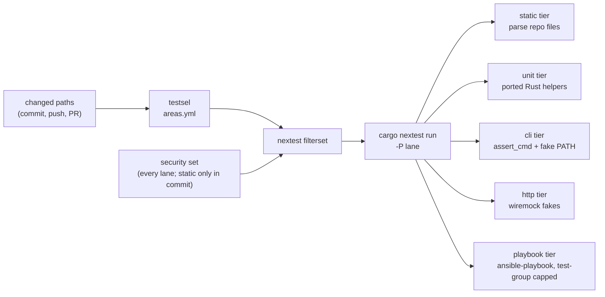

# 24 — Rust test platform: one fast suite, run by lane

**Date:** 2026-11-12
**Status:** PROPOSED (Phases 0 to 3 in review: #1109, #1110 and #1115, #1119, #1118; the pre-push fix AC-743 is #1114; Phases 4 to 10 not started)
**Author:** Joseph A. Wisneski IV
**Context:** The repository's tests are pytest and BATS. They have grown to a size where no lane finishes
quickly: the Python suite costs about 11,400 worker-seconds per pull request, spread over eight shards of 282 to 495 s
each after plan 21's sharding (run 42931485014), and the pre-push hook is routinely skipped
([plan 21](21-test-suite-runtime.md), Baseline). This plan replaces both runners with one Rust test crate
run by `cargo-nextest`. It ports the Python product code those tests exercise to Rust wherever the runtime
is ours. It also defines test **lanes**, so a commit, a push and a pull request each run only the tests their
change can break. Plan 21 is not superseded: its findings F1 to F6 are the reduction work this port carries
out, area by area. The testing principles this plan implements are in
[`../architecture/03-testing-ci-quality.md`](../architecture/03-testing-ci-quality.md), Part 1.

---

## Problem

### What the suite is (measured 2026-11-12, `dev` at `6d78e084`)

| Measure | Value | Source |
|---|---|---|
| Python test files in the four pytest paths | 275 | `git ls-files` over `testpaths` in `pyproject.toml`, names `test_*.py` |
| BATS files | 82 | `git ls-files '*.bats'` |
| Lines of test code | 145,436 | `wc -l` over both sets |
| Python test worker-seconds in CI | 11,429 | sum of `time` in `platform/tests/test_durations.json` |
| Python product code the tests exercise | 117 files, 42,704 lines | `git ls-files '*.py'` minus test files, conftest and `tests/` directories |
| Test files the mistakes ledger cites as enforcement | 82 | distinct `platform/tests/*.{py,bats}` paths in `docs/MISTAKES.md` |

The Python test files fall into four classes. The classifier reads each file's source text: a file that
contains `"ansible-playbook"` or `harness_sandbox.run(` is *playbook*; one that otherwise uses `subprocess`
is *subprocess*; one that imports repository code is *import*; the rest are *static*.

| Class | Files | Tests | Worker-seconds | Share |
|---|---|---|---|---|
| playbook | 130 | 5,812 | 9,992 | 87% |
| subprocess | 60 | 2,591 | 660 | 6% |
| import | 52 | 2,419 | 752 | 7% |
| static | 33 | 916 | 25 | 0.2% |

### What that means for a rewrite

1. **The runner is not the cost.** 87% of Python test time is spent inside `ansible-playbook` processes.
   Each one costs about 0.9 s in CI for a run the guard refuses in its first play, and 5 to 9 s for a run
   that executes a real playbook ([plan 21](21-test-suite-runtime.md), Baseline). A Rust harness starts
   the same process in the same time. The speed has to come from three places:
   - fewer process starts, by proving structural properties statically (plan 21 F1, F3, F4);
   - no fixed waits (F2);
   - running only the lanes a change can affect.
2. **Rust parses the repository fast.** Static tests (YAML structure, template rules, catalog invariants)
   run in milliseconds in Rust. Many of today's playbook and BATS tests prove a structural property by
   starting a process, or by matching a source line with `grep`. Those move to the static tier.
3. **Python code can only be reached through a process from Rust.** The 52 *import* files test Python
   functions in-process. A Rust test reaches Python only by starting an interpreter (30 to 60 ms each,
   unverified on CI). The operator decided on 2026-11-12 to port that Python to Rust wherever the runtime
   is ours (D4), so the code under test becomes native Rust tested in-process.
4. **Not all Python can move.** Some code runs inside a host framework that only loads Python:
   - Ansible filter and callback plugins (13 files: 11 in `platform/playbooks/filter_plugins`, one in
     `platform/semaphore/filter_plugins`, and `callback_plugins/redact_requests.py`);
   - scripts run inside the Plane, NetBox and Authentik containers through their Django shells;
   - NetBox orb-agent workers and NetBox configuration.

   These stay Python (D5).
5. **Where code runs decides how it ships.** Some helper scripts run on the Semaphore controller (for
   example `argv: [python3, "{{ playbook_dir }}/files/inspect_pbs_backup_access.py", ...]`). Others are
   copied to a target host and run there (`grow-root-lvm.py` through `tasks/grow-root-lvm.yml`). A Rust
   replacement for a host-side script is a binary that has to reach the host for each architecture, which
   is a deployment change (D6).

### Lanes do not exist today

Every push runs the pre-push fast lane (plan 21, D6). Every pull request runs the whole Python suite in
eight shards, plus BATS. Nothing maps a changed path to the tests it can break. The `Unit Tests` aggregator
also requires `success` from every job it needs, and a job skipped by a path filter is not `success`
(`.github/workflows/lint-and-test.yml`, the comment above `rust-console`). Path-gated jobs therefore fail
the required check.

---

## Design Principles

The principles are [03 Part 1](../architecture/03-testing-ci-quality.md): what earns a test, the rules for
writing one, one test binary, the security set (secret-handling, guard and ledger-enforced tests) in every
lane, and coverage as a map.
This plan's own choices are decisions D1 to D9 below. One rule is specific to the port: **delete before
porting**. Each test is judged against 03 Part 1, "What earns a test", first, and a test that pins source
text, restates another test or proves nothing a reader relies on is deleted and listed in the port's map.

---

## Architecture



### Crate layout

```text
platform/tests/
  Cargo.toml            agent-cloud-tests, its own [workspace]; Cargo.lock committed
  .config/nextest.toml  lanes as profiles, the ansible test-group
  areas.yml            area -> path globs (D3)
  src/lib.rs            shared support: repo root, YAML 1.1 loader, task walker, process runner
  src/bin/testsel.rs    changed paths -> nextest filterset (Phase 2)
  suite/main.rs         the one test binary
  suite/<module>.rs     one area and one tier each (an area may have several modules)
```

The crate sits in `platform/tests/` beside the Python files it replaces. Ledger citations keep their
directory, and the console crate (`platform/services/console/app/Cargo.toml`, its own `[workspace]`) is
unaffected. From `platform/tests/`, `cargo nextest run` runs everything and
`cargo nextest run -E 'test(/^<module>::/)'` runs one module.

### Decisions

| # | Decision | Why the alternatives lost |
|---|---|---|
| D1 | **Runner: `cargo-nextest` 0.9.151.** Profiles are lanes. A `playbook` test-group caps concurrent `ansible-playbook` runs. `slow-timeout` bounds every test, which is plan 21 F5's missing timeout | `cargo test` runs one binary's tests on threads in one process, so a hung child holds the run and per-test timeouts need custom code. `rustest` 0.3.1 replaces the libtest harness (`harness = false`), was last released 2025-06-04 and has 82 downloads a month (lib.rs, read 2026-11-12) |
| D2 | **Libraries.** `assert_cmd` + `predicates` (process tests), `insta` with `yaml` and `json` (snapshots of rendered output and refusal messages), `proptest` (properties of parsers and resolvers), `wiremock` + `tokio` (HTTP fakes, replacing the 31 hand-rolled servers of plan 21 F5), `yaml-rust2` (YAML), `tempfile`, `globset`, `serde_json`. Approved by the operator on 2026-11-12 | `quickcheck` duplicates `proptest`, and `proptest` keeps failing cases in `proptest-regressions/`. `trybuild` tests compile errors of macros and types, and the repository has none. `serde_yaml` is deprecated (`0.9.34+deprecated` on crates.io) |
| D3 | **Lanes from `areas.yml`.** YAML, read with the suite's own loader, so no TOML dependency. Each area names its path globs; the file also lists the `full` triggers and the ignored paths, which select nothing (documentation). `testsel` maps changed paths to areas and emits `-E` filtersets over the selected modules (`test(/^(?:<module>|...)::/)`). The security set is added in every lane (its static tests in `commit`), with the touched areas' tiers the lane allows. A change to the test crate, `areas.yml` or a shared task selects everything | Hand-listed path filters in the workflow drift from the tests. Running everything is today's problem |
| D4 | **Port Python where the runtime is ours.** Controller-side helpers (`scripts/*.py`, `platform/lib/*.py`, `platform/playbooks/files/*.py` run on the controller) become subcommands of one Rust CLI. Host-side helpers follow once D6 is decided. Operator decision, 2026-11-12 | Keeping a thin pytest lane was the recommended option. Shim tests (`python3 -c` per case) are slower than in-process pytest |
| D5 | **Framework-bound Python stays Python, kept thin.** Filter and callback plugins are loaded by Ansible. Plane, NetBox and Authentik scripts run in their Django shells. NetBox workers and configuration run in NetBox. Each keeps its logic in a pure function, and the function's cases run through the tier that can load it: playbook tier for plugins, a fake-module `python3` run for Django scripts. One test per behaviour, cases looped inside one run | A Rust port of these is impossible: the host only loads Python |
| D6 | **Host-side binary distribution: OPEN, operator decision.** Proposed: CI builds static musl binaries for `x86_64` and `aarch64` and publishes them on the release. Deploys fetch them by pinned sha256, the pattern Deploy Plane uses for Plane's Compose files, and copy them instead of `script:` | Building on the controller needs a Rust toolchain in the Semaphore image. A host has no toolchain |
| D7 | **YAML 1.1 booleans.** `.yamllint.yml` allows bare `yes`/`no`, which Ansible (PyYAML, YAML 1.1) reads as booleans and `yaml-rust2` (YAML 1.2) reads as strings. The support library resolves scalars with YAML 1.1 rules wherever a test compares booleans, and a table test in `suite/support.rs` pins the resolver to PyYAML's bool and null sets (`yaml/resolver.py`) | Banning bare `yes`/`no` repository-wide is a separate change |
| D8 | **CI: one always-running `Rust (tests)` job, selection inside it.** It runs `testsel` against the pull request's base, then nextest with the `ci` profile, and the `Unit Tests` aggregator needs it. Promotion pull requests into `main`, and the nightly run on `dev`, use the `full` profile | A job skipped by a path filter fails the aggregator (Problem, "Lanes do not exist today") |
| D9 | **The ledger learns Rust.** The citation check (`test_ledger_test_citations.py`) is ported first and resolves `platform/tests/suite/<module>.rs::<fn>`. A ported test's old citation is ratcheted with the replacing test named in the reason. The ledger is append-only, so its old text stays | Deleting a cited file before the checker reads Rust turns the check red (`docs/MISTAKES.md` 8.2) |

### Lanes

| Lane | Trigger | Selection | Budget (target) |
|---|---|---|---|
| `commit` | pre-commit hook | static tier of areas touched by staged paths, plus the security set's static tests | under 10 s |
| `push` | pre-push hook | every tier of touched areas, plus the security set; playbook tier included | under 2 min on a workstation |
| `ci` | pull request into `dev` | as `push`, against the pull request base | under 8 min wall |
| `full` | nightly on `dev`, every promotion into `main`, a change to the crate, the area map or a shared task | everything | under 15 min wall |
| `live` | Semaphore templates (`Verify Service Health`, the probes) | not in CI | unchanged |

A changed path that matches no area, no `full` trigger and no ignored path (D3) runs everything in `push`
and `ci`; in `commit` it adds nothing. Every suite module is listed in exactly one lane slot, an area tier or
the security set, so a test outside every lane cannot exist (Phase 2 adds the test that enforces it). The
budgets are targets until Phase 1 measures them. A lane that exceeds its budget fails nothing, but
it reports the overrun in the job summary, as the shards do today.

---

## Implementation Phases

One Plane work item per phase, in module `rust-test-platform`, milestone `v0.16.0` (see "Release fit" below the phase table). A
port phase is split into one sub-item per area when it starts.

| Phase | Work | Blocked by | Done when |
|---|---|---|---|
| 0 | This plan, and 03 Part 1 (testing principles) | none | Merged into `dev` |
| 1 | Crate, nextest `default` and `ci` profiles, shared support library (YAML 1.1 loader, task walker, scrubbed bounded runner). Pilot: `test_restart_policy.bats` (static) and `test_common.bats` (cli) ported **additively**; the BATS files stay until Phase 3. The `Rust (tests)` CI job and the merge guard's new workflow state are a separate operator-merged pull request (AC-744). The `playbook` test-group arrives with the first playbook-tier test (Phase 6) | 0 | `cargo nextest run --profile ci` passes in CI (after AC-744); both pilots fail when their guarded code is mutated |
| 2 | Lanes: `areas.yml`, `testsel`, the `commit` and `push` hooks, selection in the CI job | 1 | A docs-only pull request runs only the static tier and the security set; a playbook change runs its area's playbook tier; a test refuses a suite module listed in no lane slot or in two |
| 3 | Ledger citation check ported to Rust and taught `.rs` (D9); pilot BATS files deleted | 1 | The ledger check is green with both pilots cited by their Rust paths |
| 4 | Port BATS (82 files) by area; delete the `bats` job | 2, 3 | `bats` gone from the workflow; every deleted test mapped |
| 5 | Port the static and subprocess Python tests (93 files) | 2, 3 | Those files deleted, every test mapped |
| 6 | Port the playbook tests (130 files) with plan 21 F1 to F3 reductions; HTTP fakes to `wiremock` | 2, 3 | Playbook-tier process starts measured and at least halved against the 2026-11-10 baseline |
| 7 | Decide D6 (host-side binary distribution) | 0 | Decision recorded in `plan/architecture/` |
| 8 | Port controller-side Python to one Rust CLI, with its import tests (D4) | 5 | No controller-side `.py` left outside D5; callers invoke the CLI |
| 9 | Port host-side Python per D6 | 7, 8 | No host-side `.py` left outside D5 |
| 10 | Retire pytest and BATS: workflow jobs, `conftest.py` sharding, `test_durations.json`, the `test` dependency group, the pre-push Python lane; update `AGENTS.md`, `CONTRIBUTING.md`, 03 | 4, 5, 6, 9 | CI and hooks run only nextest (plus the D5 runs); lane budgets measured and recorded |

The workflow changes in Phases 1, 2, 4 and 10 touch `.github/workflows/`, so they are operator merges
(plan 23, Part A). The main-to-dev sync cannot carry them.

**Release fit.** The whole module ships from v0.16.0. Phases 0 to 3 were built during the v0.15.0
carry-over promotion and are held until v0.15.0 is released, since nothing merges into `dev` before then
(operator decision, 2026-11-12). Phases 4 to 10 port about 140,000 lines of tests and 42,000 lines of
product code. The release limits apply from v0.16.0, so each port phase is cut into area pull requests that
fit the 100-PR and 120-file budget, and phases may spread over later releases.

---

## Validation Criteria

| Criterion | Measure |
|---|---|
| Lanes are fast | `commit`, `push`, `ci` and `full` within the Lanes table budgets, measured from CI job timings and from a workstation run |
| Nothing lost | Every deleted pytest or BATS test appears in its port's map with a replacement or a reason |
| Guards still bite | Each ported security test is mutated once and goes red (03 Part 1, rule 9) |
| Ledger honest | The Rust citation check is green, and no "Enforced by" names a test that does not exist |
| Selection safe | A change to the crate, `areas.yml` or a shared task runs `full`; the security set runs in every lane |

---

## Security Considerations

- The security set runs in every lane, so `push`, `ci` and `full` never skip a secret-handling, guard or
  ledger-enforced test; the `commit` lane runs its static tests only, and `push` runs the rest before the
  change leaves the workstation.
- Process tests run with a scrubbed environment: no `ANSIBLE_CONFIG`, no OpenBao or Semaphore variables,
  `HOME` and temp directories inside the test's `tempfile` directory. This is today's
  `harness_sandbox.env_for` rule, centralised in the support library.
- `wiremock` fakes listen on loopback only, on ephemeral ports.
- A fake credential in a test is a literal that is no credential. Tests never read OpenBao or
  `site-config`.
- New dependencies come from crates.io with `Cargo.lock` committed and `--locked` in CI. Each was approved
  by the operator on 2026-11-12.

---

## Cross-references

- [`../architecture/03-testing-ci-quality.md`](../architecture/03-testing-ci-quality.md): Part 1, the
  testing principles
- [`21-test-suite-runtime.md`](21-test-suite-runtime.md): measured baseline and reduction findings F1 to F6
- [`23-release-train.md`](23-release-train.md) and
  [`../architecture/10-release-policy.md`](../architecture/10-release-policy.md): release fit, operator
  merges
- `docs/MISTAKES.md` 8.2 (citations), 5.2/5.5/5.6 (committing with a failing test), 5.22 (CI timeouts)

---

## Revision History

| Date | Change |
|---|---|
| 2026-11-12 | Review: the security set includes the ledger-enforced tests (03 item 2), as the original principles had it; modules are per area and tier, not one per area; an unclassified path runs everything in `push` and `ci` but adds nothing in `commit`, to keep the commit lane inside its 10 s budget. |
| 2026-11-12 | Phases 0 to 3 also move to v0.16.0: no merges into `dev` until v0.15.0 is released (operator decision). |
| 2026-11-12 | Phases 4 to 10 moved to milestone v0.16.0 (operator decision). |
| 2026-11-12 | Created. Operator decisions the same day: Rust replaces pytest and BATS; Python product code is ported to Rust where the runtime is ours (D4); the six support dependencies and `cargo-nextest` are approved (D1, D2) |
