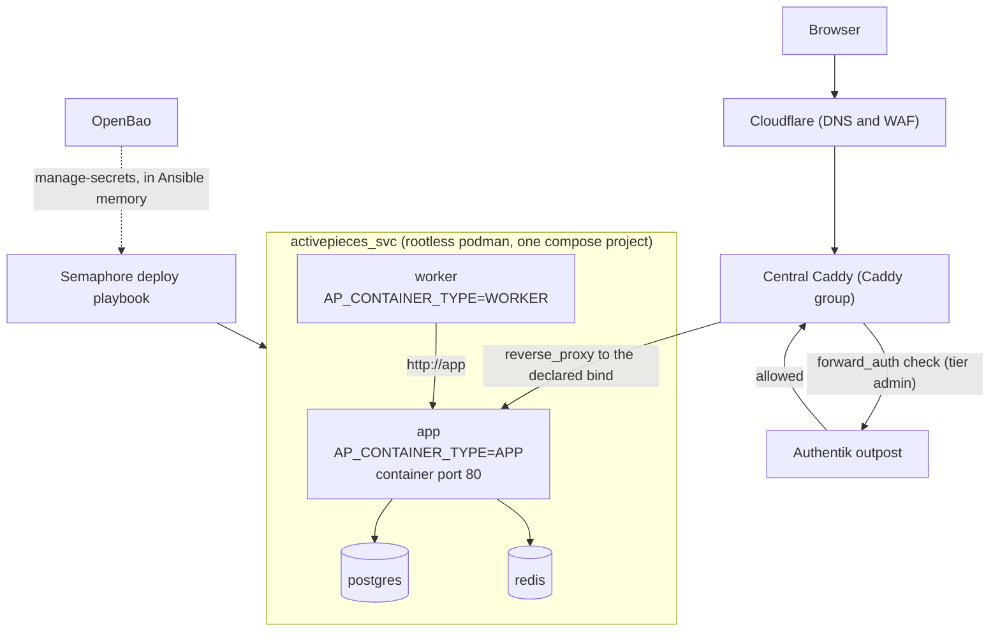
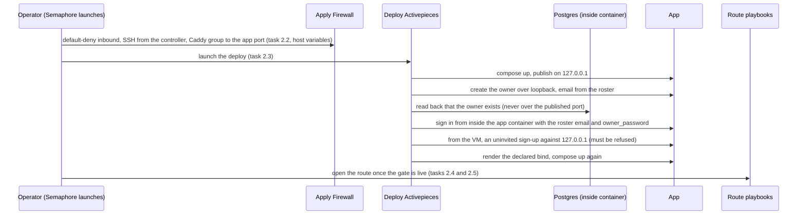

# 26 — Activepieces Workflow Automation

> **Depends on:** 00 (local-dev, `00-foundation-local-dev.md`), 01 (secrets, `01-secrets-credentials.md`), 02 (sso-auth, `02-sso-auth.md`), 14 (Postiz, the closest composable-service precedent), 16 (Plane, the first-admin precedent)
>
> Read 14 and 16 first. This plan reuses their mechanisms and does not copy their instance details.

Author: Joseph A. Wisneski IV <stray@uhstray.io>

**Date:** 2026-11-16

**Status:** PROPOSED. D1 and D3 to D6 come from Plane work item AC-768, and D2 comes from AC-767. Both were decided on 2026-11-12. D7 records Joseph's 2026-11-12 decision to migrate nothing from n8n (Hindsight bank, not a Plane item). D8 to D13 are the design of this plan.

**Plane:** module `deploy-activepieces`. AC-767 and AC-768 record the decisions. AC-769 is this plan. AC-770 to AC-781 are the tasks of the OpenSpec change `deploy-activepieces` in `plan/development/openspec/changes/deploy-activepieces/`.

**Context:** Activepieces is the platform's workflow-automation service. It replaces n8n, whose retirement was decided on 2026-11-10. Activepieces was chosen on 2026-11-12; Temporal was considered for the same role and dropped that day as the wrong tool for low-code flows. Plans 27 and 28 build on this service: plan 27 is in this repository, plan 28 is not yet.

## Problem

The platform has no workflow-automation service. Scheduled and event-triggered flows that call other services would otherwise become one-off scripts on individual hosts, with no shared runtime and no common credential handling.

Two upstream properties drive the design. Stored connections are encrypted with `AP_ENCRYPTION_KEY`, and without that key they cannot be decrypted, even from a full database backup (F5). A deploy must therefore never generate a new key. The first account to sign up on a fresh instance becomes its platform administrator (F20), so the instance must not be reachable before its owner exists. Plane has the same first-admin risk (R2).

## Design Principles

The platform rules in `AGENTS.md` (Critical Deployment Rules, Engineering Principles) and `PRINCIPLES.md` apply unchanged. Service-specific constraints:

- The encryption key is generated once and never regenerated (D8, F5).
- The worker starts only after the app has finished migrating, because the app awaits its migrations before it starts serving (F28, R11).
- The first-account window is closed by the publish bind, with the firewall as backstop, not by captcha (D10).
- No container is privileged (D3).

Three further lessons from the n8n retirement (idempotent writes keyed by a stored external id, no correlation of fan-in items by position, a kill switch per flow) bind the flows of plan 28, not this service.

## Decisions

Each rationale cites the fact or repository fact it rests on. The alternatives that lost are recorded in `design.md`.

| # | Decision | Rationale and source |
|---|---|---|
| D1 | **Community edition, with `AP_EDITION=ce` set explicitly.** No licence. | Community is the edition without `AP_EDITION` (F2). Its enum value is `ce` (F1). Whether this edition offers an API key is the risk below (F27). AC-768. |
| D2 | **Sign-in through Authentik forward-auth at Caddy, bound to `platform-admins`.** The app-catalog entry uses `tier: admin` (R4, R5). Each administrator also keeps a local Activepieces login. Webhook paths are exempt by exact path only (D12). | Forward-auth is the platform's existing pattern for NetBox and honcho docs (R4, R14). The second, local login is the accepted cost. AC-767. |
| D3 | **`AP_EXECUTION_MODE=SANDBOX_CODE_ONLY`.** | The sandbox that needs privileged containers is `SANDBOX_PROCESS` (F12). Upstream's separate-worker page recommends the same mode (F16). npm is unavailable inside Code steps (F12). AC-768. |
| D4 | **`AP_FILE_STORAGE_LOCATION=DB`.** S3 is deferred. | Upstream calls S3 a hard requirement for its throughput figures (F13). The setting is an option of F11. Accepted for a single-tenant, low-volume instance, and revisited when an object store exists. AC-768. |
| D5 | **One app (`AP_CONTAINER_TYPE=APP`) and one worker (`WORKER`), with Postgres and Redis, in one compose project under rootless podman.** The worker sets `AP_FRONTEND_URL=http://app`. | Upstream runs five worker replicas (F14). This instance is single-tenant and low-volume. The worker reaches the app by service name (F15). AC-768. |
| D6 | **Image `ghcr.io/activepieces/activepieces:0.93.0`, pinned by digest.** Task 1.2 records the digest. | Upstream compose names this tag (F14), and the release date is in F24. AC-768. |
| D7 | **Greenfield.** Nothing is migrated from n8n. | Decided 2026-11-12. |
| D8 | **Secrets at `secret/services/activepieces`, generated once and reused, never rotated by a deploy:** `encryption_key`, `jwt_secret`, `db_password`, `owner_password` and `redis_password`. `worker_token` only if O2 finds it needed. | `encryption_key` is 32 alphanumeric characters, which the startup validator requires (F29, F30), although the upstream docs describe it as hexadecimal (F4), and `manage-secrets` with `type: random` and length 32 produces that (R1). A new encryption key makes every stored connection unreadable (F5). `jwt_secret` is `type: random` with length 64 (F31). `redis_password` is required in production (F35). The worker gets no secret beyond what task 1.2 proves it needs. Before secrets are resolved, the deploy checks whether the Postgres data volume already exists; if it does, it passes `encryption_key`, `jwt_secret`, `db_password` and `owner_password` as `_required_existing_secrets`, so a missing OpenBao path fails the run before anything is generated or written back, whether or not the containers are running (R26). Only a host with no data volume is a first install. |
| D9 | **`AP_TELEMETRY_ENABLED=false` and `AP_QUEUE_UI_ENABLED=false`.** | The upstream default for both is `true` (F7, F9). The queue UI would add a web surface and a credential that the platform does not need. |
| D10 | **The first-account window is closed by the publish bind.** (a) While no owner exists, the deploy publishes the app on `127.0.0.1`, a fixed value that inventory cannot override. (b) The deploy creates the owner over loopback from the VM, with the email taken from the platform-admins roster entry named by `activepieces_owner` and the password from `owner_password`. On every run it signs in with that email and `owner_password` (a `no_log` task) from inside the app container, against the container's own port 80, which needs no host publish (upstream `docker-compose.yml#L7` maps `8080:80`); a failed sign-in fails the run and leaves the bind as rendered. (c) The declared `activepieces_publish_bind` (site-config) is rendered only after the deploy has read back, from inside the Postgres container, that the owner exists. That read never goes over the published port. A failed read, or an owner whose email differs from the roster's, fails the run and leaves the bind as rendered. (d) The Caddy route opens only after the owner exists and the gate is live. `AP_ALLOW_OPEN_SIGN_UP` is never set, the template refuses it, and the deploy proves that an uninvited sign-up is refused against `127.0.0.1` before it renders the declared bind (F19). Steps (a) to (c) run in one deploy run. The firewall admits the Caddy group to the app port from task 2.2 onward, with detected-port admission off (R7, R19); before the owner exists that admission reaches nothing, because the app publishes on `127.0.0.1` only. The firewall (Apply Firewall) and the route (task 2.5, Manage Caddy Sites and Apply Cloudflare Tofu) are separate playbooks. On local-dev, `compose.local.yml` joins the `local-dev` network, so the bind does not gate container peers there. | The bind is the gate. The firewall is the backstop (R6, R7). Captcha does not gate this: `assertSolved` returns unless both Turnstile keys are set (F26). Owner creation is F20, the oldest-platform rule that picks a sign-up's platform is F32, and the sign-up call is F21. AC-776, AC-771. |
| D11 | **`AP_NETWORK_MODE=STRICT`, best-effort only.** `AP_SSRF_ALLOW_LIST` is declared in inventory and is empty by default. Host egress is declared as code in `apply-firewall`: audit mode from task 2.2, enforce mode from task 2.6 (see the publish bind and firewall section). Whether that covers the containers' outbound traffic is open item O11. The inference-gateway entry is added by plan 27, not here. | The guard runs in-process and is best-effort, so it is not a boundary (F34). The default is `UNRESTRICTED` (F23). Whether the engine reaches `http://app` under `STRICT` is open item O10 (F37). |
| D12 | **No inbound webhook is exempt by default.** A flow that needs one gets an exact-path exemption declared in inventory: a Caddy forward-auth skip, and a Cloudflare WAF skip only if the path is challenged. The operator approves each flow, and no exemption is declared before O11 is closed and egress is in enforce mode, because an anonymous webhook feeding an outbound step would otherwise reach the LAN from the worker. Scheduled flows need no inbound path. | Webhook routes are `/v1/webhooks/:flowId`, served under `/api` as the health route is (F22, F17). The exemption covers `/api/v1/webhooks/<flowId>` only. The `/sync`, `/draft/sync`, `/draft` and `/test` variants are never exempt (F33). The per-flow decision is open item O7. |
| D13 | **Out of scope:** the inference-gateway client certificate and identity (plan 27, `agentgateway-content-generation`, AC-785, AC-825, AC-826). The content flows (plan 28, `social-content-automation`). S3. SAML and paid SSO. Any data migration. | Each item belongs to a later plan or to a decision not yet taken. |

## Upstream facts

Each fact is read from the Activepieces source or docs at tag `0.93.0`. The base of every link is `https://github.com/activepieces/activepieces/blob/0.93.0/`. Every line number was checked against the file at that tag on 2026-11-16. A fact marked UNVERIFIED was not confirmed.

| # | Fact | Source |
|---|---|---|
| F1 | The edition enum has three values: `ce` (Community), `ee` (Enterprise) and `cloud` (Cloud). | [flag.ts#L15-L19](https://github.com/activepieces/activepieces/blob/0.93.0/packages/core/shared/src/lib/core/flag/flag.ts#L15-L19) |
| F2 | Without `AP_EDITION` the instance runs the Community edition. The docs show `AP_EDITION=ee` for a licensed install. | [docker-compose.mdx#L64-L72](https://github.com/activepieces/activepieces/blob/0.93.0/docs/install/options/docker-compose.mdx#L64-L72) |
| F3 | Every setting is read from an environment variable named `AP_` followed by the setting name. | [system-props.ts#L173-L174](https://github.com/activepieces/activepieces/blob/0.93.0/packages/server/api/src/app/helper/system/system-props.ts#L173-L174) |
| F4 | `AP_ENCRYPTION_KEY` is 32 hexadecimal characters (16 bytes), generated with `openssl rand -hex 16`. `AP_JWT_SECRET` is described as 32 hexadecimal characters, but the docs show `openssl rand -hex 32`, which produces 64. The upstream docs disagree with themselves about the JWT length. | [environment-variables.mdx#L64-L65](https://github.com/activepieces/activepieces/blob/0.93.0/docs/install/reference/environment-variables.mdx#L64-L65) |
| F5 | Without `AP_ENCRYPTION_KEY`, stored connections cannot be decrypted, even from a full database backup. | [docker-compose.mdx#L108](https://github.com/activepieces/activepieces/blob/0.93.0/docs/install/options/docker-compose.mdx#L108) |
| F6 | `AP_FRONTEND_URL` is the public URL. The app uses it to build redirect and webhook URLs. | [environment-variables.mdx#L63](https://github.com/activepieces/activepieces/blob/0.93.0/docs/install/reference/environment-variables.mdx#L63) |
| F7 | `AP_TELEMETRY_ENABLED` defaults to `true`. | [environment-variables.mdx#L69](https://github.com/activepieces/activepieces/blob/0.93.0/docs/install/reference/environment-variables.mdx#L69) |
| F8 | `AP_DB_TYPE` defaults to `POSTGRES`. `AP_REDIS_TYPE` defaults to `STANDALONE`. | [environment-variables.mdx#L161](https://github.com/activepieces/activepieces/blob/0.93.0/docs/install/reference/environment-variables.mdx#L161) and [#L184](https://github.com/activepieces/activepieces/blob/0.93.0/docs/install/reference/environment-variables.mdx#L184) |
| F9 | `AP_QUEUE_UI_ENABLED` defaults to `true`. When it is enabled, `AP_QUEUE_UI_USERNAME` and `AP_QUEUE_UI_PASSWORD` are required. | [environment-variables.mdx#L198-L200](https://github.com/activepieces/activepieces/blob/0.93.0/docs/install/reference/environment-variables.mdx#L198-L200) |
| F10 | `AP_EXECUTION_MODE` defaults to `UNSANDBOXED`. `AP_CONTAINER_TYPE` takes `APP`, `WORKER` or `WORKER_AND_APP`, and defaults to `WORKER_AND_APP`. | [environment-variables.mdx#L217-L218](https://github.com/activepieces/activepieces/blob/0.93.0/docs/install/reference/environment-variables.mdx#L217-L218) |
| F11 | `AP_FILE_STORAGE_LOCATION` is `DB` (the default) or `S3`. | [environment-variables.mdx#L270](https://github.com/activepieces/activepieces/blob/0.93.0/docs/install/reference/environment-variables.mdx#L270) |
| F12 | `SANDBOX_PROCESS` needs `CAP_SYS_ADMIN`, which in practice means `privileged: true`. `SANDBOX_CODE_ONLY` gives the worker no special capabilities. Its Code step runs in a fresh V8 isolate with no `require`, no filesystem and no npm. | [sandboxing.mdx#L19-L26](https://github.com/activepieces/activepieces/blob/0.93.0/docs/install/architecture/sandboxing.mdx#L19-L26) |
| F13 | The production setup page calls S3 "a hard requirement" for its throughput figures. | [production-setup.mdx#L21-L23](https://github.com/activepieces/activepieces/blob/0.93.0/docs/install/configure-operate/production-setup.mdx#L21-L23) |
| F14 | The upstream `docker-compose.yml` runs `app` (`AP_CONTAINER_TYPE=APP`, port `8080:80`), `worker` (`AP_CONTAINER_TYPE=WORKER`, five replicas), `pgvector/pgvector:0.8.0-pg14` and `redis:7.0.7`. The image tag is `ghcr.io/activepieces/activepieces:0.93.0`. | [docker-compose.yml#L1-L50](https://github.com/activepieces/activepieces/blob/0.93.0/docker-compose.yml#L1-L50) |
| F15 | In compose, the worker's `AP_FRONTEND_URL` must be `http://app`, the app's service name. The public URL is wrong for the worker. | [docker-compose.mdx#L76-L85](https://github.com/activepieces/activepieces/blob/0.93.0/docs/install/options/docker-compose.mdx#L76-L85) |
| F16 | A separate worker needs `AP_WORKER_TOKEN`, minted with `npx @activepieces/cli workers token` from the JWT secret. The upstream compose worker sets no worker token. The same page recommends `AP_EXECUTION_MODE=SANDBOX_CODE_ONLY` for workers. | [separate-workers.mdx#L14-L36](https://github.com/activepieces/activepieces/blob/0.93.0/docs/install/configure-operate/separate-workers.mdx#L14-L36) |
| F17 | The health route `GET /v1/health` is public. It returns 200 with `Healthy`, or 503 with `Unhealthy`. The served path is `/api/v1/health`. | [health.module.ts#L9-L27](https://github.com/activepieces/activepieces/blob/0.93.0/packages/server/api/src/app/health/health.module.ts#L9-L27) and [docker-compose.mdx#L115](https://github.com/activepieces/activepieces/blob/0.93.0/docs/install/options/docker-compose.mdx#L115) |
| F18 | `isHealthy()` checks worker status on a worker and database health on the app. It does not check whether migrations have finished. | [health.service.ts#L33-L44](https://github.com/activepieces/activepieces/blob/0.93.0/packages/server/api/src/app/health/health.service.ts#L33-L44) |
| F19 | Sign-up after a platform exists requires an invitation, unless `AP_ALLOW_OPEN_SIGN_UP=true`. | [authentication.service.ts#L46-L51](https://github.com/activepieces/activepieces/blob/0.93.0/packages/server/api/src/app/authentication/authentication.service.ts#L46-L51) |
| F20 | The invitation and domain checks run only inside a guard that tests whether the sign-up carries a platform id. The guard starts at line 37, and the invitation check is at lines 46 to 51. The docs state that "the first account you create becomes the platform administrator." Which platform id a sign-up carries is F32. | [authentication.service.ts#L37](https://github.com/activepieces/activepieces/blob/0.93.0/packages/server/api/src/app/authentication/authentication.service.ts#L37) and [#L46-L51](https://github.com/activepieces/activepieces/blob/0.93.0/packages/server/api/src/app/authentication/authentication.service.ts#L46-L51); [docker-compose.mdx#L103](https://github.com/activepieces/activepieces/blob/0.93.0/docs/install/options/docker-compose.mdx#L103) |
| F21 | The sign-up API is `POST /v1/authentication/sign-up`, served under `/api`. The handler calls a Turnstile assertion before it creates the account. | [authentication.module.ts#L6](https://github.com/activepieces/activepieces/blob/0.93.0/packages/server/api/src/app/authentication/authentication.module.ts#L6) and [authentication.controller.ts#L22-L35](https://github.com/activepieces/activepieces/blob/0.93.0/packages/server/api/src/app/authentication/authentication.controller.ts#L22-L35) |
| F22 | Webhook routes use the prefix `/v1/webhooks` and the path `/:flowId`. The variants are listed in F33. | [webhook-module.ts#L75](https://github.com/activepieces/activepieces/blob/0.93.0/packages/server/api/src/app/webhooks/webhook-module.ts#L75) and [webhook-controller.ts#L49](https://github.com/activepieces/activepieces/blob/0.93.0/packages/server/api/src/app/webhooks/webhook-controller.ts#L49) |
| F23 | `AP_NETWORK_MODE` defaults to `UNRESTRICTED`. `STRICT` installs the SSRF guard, which blocks user code from reaching private, loopback, link-local and cloud-metadata addresses. `AP_SSRF_ALLOW_LIST` is a comma-separated list of IPs and CIDRs that bypass the block. | [network-security.mdx#L21-L31](https://github.com/activepieces/activepieces/blob/0.93.0/docs/install/architecture/network-security.mdx#L21-L31) |
| F24 | The latest release is 0.93.0, published 2026-11-08T14:30:22Z, as the GitHub release API reports it. | [release 0.93.0](https://github.com/activepieces/activepieces/releases/tag/0.93.0) |
| F25 | The database connection settings are `AP_POSTGRES_HOST`, `AP_POSTGRES_PORT`, `AP_POSTGRES_DATABASE`, `AP_POSTGRES_USERNAME` and `AP_POSTGRES_PASSWORD`. The docs suggest `openssl rand -hex 32` for the password. The upstream compose file passes the last three from `.env` to its Postgres service. The Redis settings are `AP_REDIS_HOST`, `AP_REDIS_PORT` and `AP_REDIS_PASSWORD`. | [environment-variables.mdx#L163-L167](https://github.com/activepieces/activepieces/blob/0.93.0/docs/install/reference/environment-variables.mdx#L163-L167) and [#L186-L189](https://github.com/activepieces/activepieces/blob/0.93.0/docs/install/reference/environment-variables.mdx#L186-L189); [docker-compose.yml#L1-L50](https://github.com/activepieces/activepieces/blob/0.93.0/docker-compose.yml#L1-L50) |
| F26 | The Turnstile settings are `AP_TURNSTILE_SITE_KEY` and `AP_TURNSTILE_SECRET_KEY`, both unset by default. `assertSolved` returns without checking anything unless both keys are configured. | [environment-variables.mdx#L289-L290](https://github.com/activepieces/activepieces/blob/0.93.0/docs/install/reference/environment-variables.mdx#L289-L290); [turnstile.ts#L20-L22](https://github.com/activepieces/activepieces/blob/0.93.0/packages/server/api/src/app/authentication/lib/turnstile.ts#L20-L22) and [#L39](https://github.com/activepieces/activepieces/blob/0.93.0/packages/server/api/src/app/authentication/lib/turnstile.ts#L39) |
| F27 | API keys are generated under the platform dashboard. The docs say that dashboard is "only available in the Platform and Enterprise editions". The API takes the key as a Bearer token. The flow update endpoint is `POST /v1/flows/{id}`. | [overview.mdx#L7](https://github.com/activepieces/activepieces/blob/0.93.0/docs/endpoints/overview.mdx#L7); [overview.mdx#L13-L15](https://github.com/activepieces/activepieces/blob/0.93.0/docs/endpoints/overview.mdx#L13-L15); [flows/update.mdx#L3](https://github.com/activepieces/activepieces/blob/0.93.0/docs/endpoints/flows/update.mdx#L3) |
| F28 | The app runs database migrations under a distributed lock, awaited, before `setupServer()` and `start(app)`. A healthy `/api/v1/health` therefore means the migrations have finished. | [main.ts#L58-L77](https://github.com/activepieces/activepieces/blob/0.93.0/packages/server/api/src/main.ts#L58-L77) |
| F29 | The startup validator requires the encryption key to match `^[A-Za-z0-9]{32}$`. | [system-validator.ts#L329-L331](https://github.com/activepieces/activepieces/blob/0.93.0/packages/server/api/src/app/helper/system-validator.ts#L329-L331) |
| F30 | The cipher is `aes-256-cbc`, and the key is `Buffer.from(secret, 'binary')`, so a 32-character secret gives a 32-byte key. | [encryption.ts#L14](https://github.com/activepieces/activepieces/blob/0.93.0/packages/server/api/src/app/helper/encryption.ts#L14) and [#L29-L31](https://github.com/activepieces/activepieces/blob/0.93.0/packages/server/api/src/app/helper/encryption.ts#L29-L31) |
| F31 | The JWT secret is checked by `stringValidator`, and it must not be nil. | [system-validator.ts#L159](https://github.com/activepieces/activepieces/blob/0.93.0/packages/server/api/src/app/helper/system-validator.ts#L159) and [#L348-L349](https://github.com/activepieces/activepieces/blob/0.93.0/packages/server/api/src/app/helper/system-validator.ts#L348-L349) |
| F32 | On a non-cloud edition, sign-up uses the oldest platform id, and the id is null when no platform exists. This settles the question F20 left open. | [platform.utils.ts#L10-L24](https://github.com/activepieces/activepieces/blob/0.93.0/packages/server/api/src/app/platform/platform.utils.ts#L10-L24) |
| F33 | Webhook routes in the controller are `/:flowId/sync` (line 19), `/:flowId` (line 49), `/:flowId/draft/sync` (line 78), `/:flowId/draft` (line 95) and `/:flowId/test` (line 109). | [#L19](https://github.com/activepieces/activepieces/blob/0.93.0/packages/server/api/src/app/webhooks/webhook-controller.ts#L19), [#L49](https://github.com/activepieces/activepieces/blob/0.93.0/packages/server/api/src/app/webhooks/webhook-controller.ts#L49), [#L78](https://github.com/activepieces/activepieces/blob/0.93.0/packages/server/api/src/app/webhooks/webhook-controller.ts#L78), [#L95](https://github.com/activepieces/activepieces/blob/0.93.0/packages/server/api/src/app/webhooks/webhook-controller.ts#L95) and [#L109](https://github.com/activepieces/activepieces/blob/0.93.0/packages/server/api/src/app/webhooks/webhook-controller.ts#L109) |
| F34 | The engine SSRF guard is best-effort, in-process protection. The docs say a multi-tenant deployment must enforce the real egress boundary in infrastructure. | [network-security.mdx#L42-L46](https://github.com/activepieces/activepieces/blob/0.93.0/docs/install/architecture/network-security.mdx#L42-L46) |
| F35 | Settings marked ❗ are required for a self-hosted production deployment. The Redis settings marked this way are `AP_REDIS_HOST`, `AP_REDIS_PORT`, `AP_REDIS_USER` and `AP_REDIS_PASSWORD`. | [environment-variables.mdx#L18](https://github.com/activepieces/activepieces/blob/0.93.0/docs/install/reference/environment-variables.mdx#L18) and [#L186-L189](https://github.com/activepieces/activepieces/blob/0.93.0/docs/install/reference/environment-variables.mdx#L186-L189) |
| F36 | Workers lack direct access to Redis and the database, according to the separate-worker page. | [separate-workers.mdx#L10](https://github.com/activepieces/activepieces/blob/0.93.0/docs/install/configure-operate/separate-workers.mdx#L10) |
| F37 | The guard's policy takes its allow list from `AP_SSRF_ALLOW_LIST` and exempts the sandbox RPC port on loopback. | [ssrf-guard.ts#L46-L56](https://github.com/activepieces/activepieces/blob/0.93.0/packages/server/engine/src/lib/network/ssrf-guard.ts#L46-L56) |
| F38 | Upstream mounts `./cache` at `/usr/src/app/cache` in both `app` and `worker`. | [docker-compose.yml#L15](https://github.com/activepieces/activepieces/blob/0.93.0/docker-compose.yml#L15) and [#L29](https://github.com/activepieces/activepieces/blob/0.93.0/docker-compose.yml#L29) |

Repository facts, read on the base commit `1ae46279` of this branch. Each row is a location this plan relies on, and every component section below cites these rows by number.

| # | Fact | Location |
|---|---|---|
| R1 | `manage-secrets` generates only alphanumeric values (`type: random`) or Django-charset values (`type: django`). It has no hexadecimal type. | `platform/playbooks/tasks/manage-secrets.yml` lines 96 to 104 |
| R2 | The Plane first-admin claim is closed by opening the route only after the deploy has completed first-run setup. | `plan/development/openspec/changes/deploy-plane-work-management/tasks.md`, task 1.11 |
| R3 | The Plane OpenSpec sync builds each item's `external_id` as `<owner/repo>/<change>/<task id>` (line 159). The task id pattern needs at least one dot (line 67). Checked lines are skipped as done before import (lines 27 to 31). The sync reads `main` (`sync-plane-projects.yml` line 152). | `platform/services/plane/lib/openspec_to_plane.py`, `platform/playbooks/sync-plane-projects.yml` |
| R4 | The app catalog's `tier` field: `member` admits platform-admins and developers, and `admin` binds the shared admin policy, which admits members of `platform-admins` and any Authentik superuser (`templates/zz-sso-bindings.yaml.j2:33-41`). The NetBox entry is `tier: member`, so it is not copied for this service. | `platform/services/authentik/deployment/templates/zz-sso-bindings.yaml.j2:33-41`; `app-catalog.yml` lines 63 to 65 (NetBox tier) |
| R5 | The rendered policy follows the tier. `admin` binds `policy-platform-admin`, and every other tier binds `policy-platform-member`. | `platform/services/authentik/deployment/templates/zz-sso-bindings.yaml.j2` line 69 |
| R6 | skynet publishes on `skynet_publish_bind`, which defaults to `127.0.0.1`, and refuses a wildcard bind. | `platform/playbooks/deploy-skynet.yml` line 29 and lines 188 to 191 |
| R7 | `firewall_detect_ports` defaults to true and admits detected published ports from `firewall_upstream_source`. `firewall_allow_groups` admits a port from each member of an inventory group. The egress variables are `firewall_allow_egress`, `firewall_deny_egress`, `firewall_egress_mode` (`audit` keeps outgoing traffic allowed by default, `enforce` restricts it) and `firewall_egress_probes`. | `platform/playbooks/apply-firewall.yml` lines 118 to 122, lines 136 to 139, lines 160 to 175, line 190 and lines 464 to 467 |
| R8 | The platform-admins roster is one list. Its schema is at lines 7 to 14, and the entries start at line 35. Each entry carries `key`, `username`, `name` and `email`. | `platform/playbooks/vars/platform-admins.yml` |
| R9 | `compose_up_if_changed` is at line 262. It calls a caller's `compose_staged_up` when one is defined, as line 290 shows. The staged-start convention is described at lines 125 to 126. `wait_for_healthy` is at line 344. | `platform/lib/common.sh` |
| R10 | Plane's `compose_staged_up` removes its proxy, starts the other services, waits for the API, and starts the proxy only once the instance is closed. | `platform/services/plane/deployment/deploy.sh` lines 79 to 100 |
| R11 | Postiz's `postiz` app service waits on its dependencies with `condition: service_healthy`. | `platform/services/postiz/deployment/compose.yml` lines 116 to 122 |
| R12 | `dev_variant: true` makes setup-templates also emit a `(Dev)` copy of a template bound to the `agent-cloud dev` record. | `platform/semaphore/templates.yml` lines 16 to 19 |
| R13 | `probe-reachability.yml` takes `probe_from` (a group), `probe_to` (a host) and `probe_ports_json` (a list of port and `expect`, which is `open` or `closed`). | `platform/playbooks/probe-reachability.yml` lines 6 to 7 and lines 33 to 38 |
| R14 | The honcho docs forward-auth blueprint reads its external host with `!Env`. The NetBox blueprint uses `!Context` with a local default, so this plan follows honcho. | `platform/services/authentik/deployment/blueprints/honcho-docs-forward-auth.yaml` line 24; `netbox-forward-auth.yaml` lines 25 and 33 |
| R15 | `deploy-authentik.yml` collects the `prod_required` values only from apps whose type is `oidc`, so a forward_auth app is not in that check. | `platform/playbooks/deploy-authentik.yml` lines 239 to 243 |
| R16 | The shared pattern files exist: `backup-plane-db.yml`, `restore-plane-db.yml`, `reconcile-plane-members.yml`, `probe-reachability.yml` and `tasks/clean-service.yml`. | `platform/playbooks/` |
| R17 | Plane's first-run script signs up the instance admin only when `is_setup_done` is false, and signs in instead when the instance is already set up, so a re-run creates nothing. | `platform/services/plane/deployment/configure_instance.py:26-33` |
| R18 | `scripts/local-dev.sh` dispatches a repo-bound template, which runs that record's branch and not the working tree, when a playbook has no `(Local)` template in `platform/semaphore/templates-local.yml`. | `scripts/local-dev.sh:154` |
| R19 | `apply-firewall.yml` reads its rules from host variables, including the outbound allowlist and denials and the audit or enforce mode. | `platform/playbooks/apply-firewall.yml:118-121`, `:136-139`, `:160-175` |
| R20 | `compose_inputs_digest` hashes the compose files, `.env` and `env/*.env`, so a changed `.env` makes `compose_up_if_changed` recreate. | `platform/lib/common.sh:190-198` (inputs), `:262-271` (recreate decision) |
| R21 | `assert-containers-stable.yml` fails a deploy when a container of the project is not running at the second read, or restarted inside the settle window (MISTAKES 2.34). | `platform/playbooks/tasks/assert-containers-stable.yml:13-17`, `:74-110` |
| R22 | The roster default is built from per-user variables that exist only on the Authentik host, and `load-platform-admins.yml` loads it only when `agw_admin_identities_enabled` is set. | `platform/playbooks/vars/platform-admins.yml:38`, `:56`; `platform/playbooks/tasks/load-platform-admins.yml:16-41` |
| R23 | The Postiz key capture reads its database with `exec <container> psql -tAc`, `changed_when: false`, `check_mode: false`. | `platform/playbooks/store-postiz-api-key.yml:70-87` |
| R24 | The repository Caddyfile imports `sites/*.caddy` fragments for new services. | `platform/services/caddy/deployment/Caddyfile:10` |
| R25 | `deploy-authentik.yml` enables only the apps listed in `authentik_apps`; an app missing from it gets no blueprint and no binding, and the deploy still passes. | `platform/playbooks/deploy-authentik.yml:226-234` (enabled list and catalog check), `:293-297` (blueprint set), `:315-321` (bindings rendered from the enabled set) |
| R26 | `manage-secrets` checks `_required_existing_secrets` before any missing value is resolved or written back; without it, a missing value is generated. | `platform/playbooks/tasks/manage-secrets.yml:24-26`, `:87` |

## Architecture

The app publishes on a loopback bind until its owner exists. The declared bind is rendered afterwards. The firewall admits the Caddy group to the app port from task 2.2 onward, which reaches the app only once the declared bind is rendered. The app is the only container that publishes a port.

The first run follows one fixed order, so that no route or remote host reaches the app before the owner exists:

## Component design

### Service directory: `platform/services/activepieces/deployment/`

| File | Role |
|------|------|
| `compose.yml` | Four services: `app`, `worker`, `postgres` and `redis`. Each has `restart: always`, the rule for repo compose services (AGENTS.md, Starting at boot). Only `app` publishes a port, on the bind the deploy renders. `app` has a healthcheck on `/api/v1/health` (F17, F28), and `worker` has `depends_on: app` with `condition: service_healthy`. The worker reaches the app at `http://app` (F15). One named `cache` volume is mounted at `/usr/src/app/cache` in `app` and `worker`, the path upstream uses (F38). The image digest is pinned (D6). |
| `compose.local.yml` | The local-dev overlay. It attaches the services to the `local-dev` network, so the publish bind does not gate container peers there (D10). Its contents are set in task 1.2. |
| `deploy.sh` | Container lifecycle only. It calls `compose_up_if_changed` and `wait_for_healthy` from `platform/lib/common.sh` (R9). The worker's start order comes from the app healthcheck. The first-account hold is the publish bind, which is rendered into `.env`; `compose_up_if_changed` hashes `.env` (R20), so the second compose up in a first run recreates the project with the app on the declared bind. Plane's staged start (R10) is not needed. After compose up, the deploy verify runs `tasks/assert-containers-stable.yml` (R21), so a worker that is down, or restarts inside the settle window, fails the run instead of passing behind a healthy app. It holds no secret handling. |
| `templates/env.j2` | The env files, rendered from OpenBao values and inventory: one for the app and one for the worker. They set the variables in the table below. The worker's file carries only the secrets task 1.2 proves it needs (O2); it never gets `owner_password`. |
| `CLAUDE.md`, `README.md`, `AGENTS.md` | Operator and agent notes. `AGENTS.md` is a symlink to `CLAUDE.md`, as in the other service directories. |
| `.gitignore` | Keeps rendered env files out of git. |

Pipeline. Each playbook has one `templates.yml` entry with `dev_variant: true` (R12), and no hand-written `(Dev)` copy. Clean Deploy includes `tasks/clean-service.yml` and then imports the deploy playbook, as `clean-deploy-postiz.yml` does (AGENTS.md, Adding a New Service, step 6; R16). Local runs use `(Local)` entries in `platform/semaphore/templates-local.yml` for deploy, clean deploy, backup and restore. Without them, `scripts/local-dev.sh` (line 154) dispatches a repo-bound template, and the run executes that branch rather than the working tree (R18).

### Secrets: `secret/services/activepieces`

| Key | Type | Behaviour |
|---|---|---|
| `encryption_key` | `type: random`, length 32 | 32 alphanumeric characters, which the startup validator requires (F29, F30), although the upstream docs describe it as hexadecimal (F4). Generated once and reused. Never regenerated (D8, F5). |
| `jwt_secret` | `type: random`, length 64 | The startup validator only requires it to be present (F31). Generated once and reused. |
| `db_password` | `type: random`, length 32 | Generated once and reused. The upstream docs suggest `openssl rand -hex 32` for this variable (F25); no upstream validator for it was read (UNVERIFIED). |
| `owner_password` | Generated once | Creates the owner on the first run and signs in as the owner on every run (D10b); also the owner's local login. Handed to the owner through `Back Up Credentials to site-config` with `credential_service=activepieces` and `credential_fields=owner_password` (task 1.4), never printed. |
| `worker_token` | Generated once, only if O2 finds it needed | Minted by a playbook task, not by a manual `npx` step (F16), following `mint-honcho-team-jwt.yml`, which runs the service's own mint command inside its container and stores the result in OpenBao. |
| `redis_password` | `type: random`, length 32 | Generated once and reused. Redis starts with it, and it is required in production (F35). Whether `AP_REDIS_USER` is also needed with password-only auth is checked in task 1.2. |

### Environment settings

Variables the templates set, each read as `AP_<NAME>` (F3). Any variable not listed keeps its upstream default. Every variable below goes in the app's file unless its row names the worker. The worker's file carries only the variables task 1.2 proves it needs (O2), and never `owner_password`.

| Variable | Value | Source |
|---|---|---|
| `AP_EDITION` | `ce` | D1 |
| `AP_ENCRYPTION_KEY` | from `encryption_key` | D8 |
| `AP_JWT_SECRET` | from `jwt_secret` | D8 |
| `AP_DB_TYPE` | `POSTGRES` | F8, set explicitly |
| `AP_POSTGRES_HOST`, `AP_POSTGRES_PORT`, `AP_POSTGRES_DATABASE`, `AP_POSTGRES_USERNAME`, `AP_POSTGRES_PASSWORD` | the `postgres` service name, the port, and the values from `db_password` | F25. The database name, user name and port are set in task 1.2. |
| `AP_REDIS_TYPE` | `STANDALONE` | F8, set explicitly |
| `AP_REDIS_HOST`, `AP_REDIS_PORT` | the `redis` service name and its port | F25. The port is set in task 1.2. |
| `AP_REDIS_PASSWORD` | from `redis_password` | F35. `AP_REDIS_USER` is decided in task 1.2. |
| `AP_CONTAINER_TYPE` | `APP` on `app`, `WORKER` on `worker` | D5, F10 |
| `AP_FRONTEND_URL` | the public URL on `app`, `http://app` on `worker` | D5, F6, F15 |
| `AP_EXECUTION_MODE` | `SANDBOX_CODE_ONLY` | D3 |
| `AP_FILE_STORAGE_LOCATION` | `DB` | D4 |
| `AP_TELEMETRY_ENABLED` | `false` | D9 |
| `AP_QUEUE_UI_ENABLED` | `false` | D9 |
| `AP_NETWORK_MODE` | `STRICT` | D11 |
| `AP_SSRF_ALLOW_LIST` | from inventory, empty by default | D11 |
| `AP_WORKER_TOKEN` | from `worker_token`, only if O2 requires it | O2 |
| `AP_ALLOW_OPEN_SIGN_UP` | never set; the template refuses it | D10 |

### Admin gate

The blueprint `activepieces-forward-auth.yaml` is a proxy provider in `forward_single` mode. It follows the honcho blueprint and reads its external host with `!Env` (R14). The app-catalog entry is `file: activepieces-forward-auth.yaml`, `type: forward_auth`, `tier: admin`. The decided rule is platform-admins only (D2). The `admin` tier binds the shared admin policy, which today also admits Authentik superusers (R4, R5); that gap is open item O13. The NetBox entry's `tier: member` is not copied (R4). The rendered environment gets `ACTIVEPIECES_EXTERNAL_HOST`, beside `HONCHO_EXTERNAL_HOST` in `platform/services/authentik/deployment/templates/env.j2` at line 45 (R14).

Open item O9: `deploy-authentik.yml` collects `prod_required` only from `oidc` apps (R15). A forward_auth app is therefore not part of that production check. Widening the filter is owned by task 2.4.

### Owner identity

The owner is a key in the platform-admins roster (R8). Inventory variable `activepieces_owner` names that key. The deploy takes the owner's email from the roster entry and the password from `owner_password`. The roster file's own default is built from per-user variables that exist only on the Authentik host and resolves to placeholder addresses elsewhere (R22), so the deploy refuses to run unless `platform_admins` is declared for the Activepieces host and `activepieces_owner` names exactly one user entry in it with an email. The shared loader `tasks/load-platform-admins.yml` loads the list only behind the agentgateway flag (R22); task 1.4 makes that gate a parameter rather than copying the loader.

The read-back looks up any owner account (D10c) and then compares its email with the roster's. No owner: the loopback bind. Owner with the roster email: the declared bind. Owner with another email: the run fails and the bind stays as rendered, so a roster edit never moves the bind. The query follows the Postiz database read (R23) but is not credential handling, so it does not take that task's `no_log`. On every run the deploy signs in with the roster email and `owner_password` from inside the app container (D10b); a failed sign-in fails the run and leaves the bind as rendered, so an account planted on loopback with the roster email, whose password the deploy does not hold, never passes as the owner. A re-run creates nothing: the read-back finds the owner and no second sign-up is made, as Plane's first-run script signs in instead when the instance is already set up (R17). Removing someone from the roster blocks them at the gate (D2). Their local Activepieces account remains until it is reconciled (O6).

### Edge

The production route is a Caddy block in site-config `caddy_managed_sites`, with `forward_auth` pointed at the Authentik outpost. `Manage Caddy Sites` places it. This follows the production Caddy, which is a flat-Caddyfile site (AGENTS.md, Deployment Status). The repository's `sites/<name>.caddy` fragment path (R24) is not used, because production does not run it today; moving every route to fragments is a platform change, not this plan's. The DNS record lives in `platform/infra/cloudflare/dns.tf`, and `Apply Cloudflare Tofu` applies it. The route opens last (D10d). Webhook exemptions, where approved, are exact paths declared per flow (D12).

### Publish bind and firewall

The publish bind is the gate. While no owner exists, the deploy publishes the app on `127.0.0.1`, a fixed value. The read-back that the owner exists runs inside the Postgres container and never goes over the published port. A failed read, or an owner whose email differs from the roster's, fails the run and leaves the bind as rendered (the full rule is in the Owner identity section). Once the read finds the roster's owner, the deploy renders the declared `activepieces_publish_bind` from site-config. The precedent for a declared publish bind is skynet's `skynet_publish_bind` (R6).

The firewall is the backstop. Its host variables are declared in site-config inventory (task 2.1), not passed as launch variables, so a later plain `Apply Firewall` run keeps them (R19). They are `firewall_detect_ports: false`, which stops detection from admitting the published port from `firewall_upstream_source` before the owner exists (R7), and `firewall_allow_groups`, which admits the app port from the Caddy group (R7). SSH is admitted from the controller only (task 2.2). Task 2.3 runs `Probe Reachability (Dev)` twice, once expecting the app port open from the Caddy group and once expecting it closed from another LAN group (R13).

Egress is enforced as code, because the in-process guard is best-effort (F34). `firewall_allow_egress` and `firewall_deny_egress` are declared through `apply-firewall` (R7). The egress mode is `audit` from task 2.2, which keeps outgoing traffic allowed by default. It becomes `enforce`, with `firewall_egress_probes`, in task 2.6, before the 2.8 gate. Audit and enforce are rules on traffic the host itself sends (`apply-firewall.yml:176-178`, `:185-188`); the firewall's comments say rootless podman, in its own network namespace, never crosses host UFW, though only in the context of inbound DNS (`:156-158`, `:209-211`). Whether a rootless container's outbound traffic is audited and refused is open item O11, proved from inside the worker before the 2.8 gate relies on it.

### Backup and restore

The dump and staged-swap steps of `backup-plane-db.yml` and `restore-plane-db.yml` are extracted into shared tasks, parameterised by group, container, database, user, data services and a post-restore hook (R16). The Activepieces playbooks are built on them. Converting the Plane playbooks is a follow-up, not part of this change, because it touches the live Plane restore path. It is tracked as AC-917, blocked by AC-780. The backup needs task 2.3, which provides a running database, and does not need the edge. The local-dev proof of "A restore swaps in only a fully loaded copy" is task 2.7's, and production runs one real dump-and-restore in task 2.8. The encryption key is backed up with `Back Up Credentials to site-config` (`credential_service=activepieces`, `credential_fields=encryption_key`), because a dump without it cannot decrypt stored connections (F5).

## Implementation phases

The change `deploy-activepieces` has two phases. Each phase ends with a validation gate that names the scenarios it proves (`plan/development/openspec/config.yaml`, tasks rule).

### Phase 1: plan, service and local-dev (tasks 1.1 to 1.5)

The O8 spike runs once, before task 1.2 starts, or cites the result AC-796 has already recorded. Task 1.2 settles O2, O4 and O10. O1 and O3 are closed (F28 to F31), so the first key is generated as `type: random` with length 32.

**Acceptance:** the gate in task 1.5 holds.

### Phase 2: production (tasks 2.1 to 2.8)

Production follows the order in the sequence diagram. The owner exists before the declared bind is rendered, so nothing outside the VM reaches the app before then, whatever the firewall admits. Task 2.3 records the evidence for that order, and task 2.8 cites it.

**Acceptance:** the gate in task 2.8 holds.

## Validation criteria

| Check | Spec requirement | Pass condition |
|---|---|---|
| A redeploy keeps the encryption key | Encryption key and idempotent re-runs | After a redeploy, the encryption key in the secret store is unchanged, and a connection stored before the redeploy still decrypts. |
| A re-run reports no change | Encryption key and idempotent re-runs | A second run with unchanged inputs reports no changed task. |
| A scheduled flow runs on the local stack | Flows run without privileged containers | A scheduled flow runs on local-dev under `SANDBOX_CODE_ONLY`, and no container in the project is privileged. |
| A scheduled flow runs in production | Flows run without privileged containers | The same check passes on the production instance. |
| The deploy creates the owner before the port is reachable | Account creation is closed after the owner | The owner exists before the declared bind is rendered, and until then no host other than the service host reached the port. |
| An uninvited sign-up is refused | Account creation is closed after the owner | After the owner exists, a sign-up for an address with no invitation is refused, and no account is created. |
| A platform-admin passes the gate | Only platform-admins reach the application | A member of `platform-admins` signs in through Authentik and reaches the application. |
| A non-admin is refused at the edge | Only platform-admins reach the application | A signed-in user outside `platform-admins` is refused at Caddy, before the application. |
| A direct connection from another LAN host is refused | The application port is reachable from the Caddy host only | A connection from another LAN host to the app port fails, and one from the Caddy group succeeds. |
| An undeclared outbound connection is refused | Outbound traffic from the service follows a declared allowlist | With egress in enforce mode, a connection from the host and from inside the worker container to an undeclared destination is refused, and every declared egress probe succeeds. |
| An undeclared webhook path stays gated | Webhook paths are exempted by exact path only | A webhook path that no inventory entry declares stays behind the gate. |
| A restore swaps in only a fully loaded copy | The database can be backed up and restored | A restore that fails part-way leaves the live database unchanged, and only a fully loaded copy is swapped in. |
| A dump restores into a running instance | The database can be backed up and restored | A dump taken by the backup playbook restores into a running instance that answers its health route, with its flows and connections present. |

## Security considerations

- **Access.** The decided rule is that only members of `platform-admins` reach the application (D2), apart from approved exact webhook paths (D12). Until O13 is decided, the shared admin policy also admits Authentik superusers. Sign-up closes once the owner exists (D10). Each administrator also holds a local login (D2).
- **Credentials.** Secrets are generated once and never rotated by a deploy (D8). The encryption key is backed up (F5). Credential tasks run under `no_log`, as `manage-secrets` does. Captcha is not a control here; see D10.
- **Network exposure.** The app publishes on `127.0.0.1` until the owner exists, and the firewall is the backstop (D10). No webhook is exempt unless a flow is approved for one (D12). Outbound traffic the host sends is audited from task 2.2 and refused outside the allowlist from task 2.6 (D11, F34). Whether the same holds for the containers' outbound traffic is open item O11.
- **Blast radius.** No container is privileged (D3). User code runs inside the worker container, so the worker is the boundary that matters.
- **Accepted residual risk.** The worker shares the compose network with Postgres and Redis, which no host firewall separates. The mitigations are that only platform-admins author flows (D2), that Code steps run in a V8 isolate with no environment or filesystem (F12), and that the worker holds only the secrets O2 proves it needs; Redis requiring a password (`redis_password`, D8, F35) protects it from other containers, not from a worker that holds the password. Under `STRICT`, whether the engine reaches `http://app` is O10 (F37). If it does, the allow list names the app container's address only, never the compose subnet, which would expose Postgres and Redis.

## Release budget

One list, with the status of each file. The counts are estimates, so they can be checked. Exact counts come from `python3 scripts/semver.py release-budget` before each pull request. The release limits are in `plan/architecture/10-release-policy.md`.

| File | Status |
|---|---|
| `platform/services/activepieces/deployment/compose.yml` | new |
| `platform/services/activepieces/deployment/compose.local.yml` | new |
| `platform/services/activepieces/deployment/deploy.sh` | new |
| `platform/services/activepieces/deployment/templates/env.j2` | new |
| `platform/services/activepieces/deployment/CLAUDE.md` | new |
| `platform/services/activepieces/deployment/AGENTS.md` (symlink) | new |
| `platform/services/activepieces/deployment/README.md` | new |
| `platform/services/activepieces/deployment/.gitignore` | new |
| `platform/playbooks/deploy-activepieces.yml` | new |
| `platform/playbooks/clean-deploy-activepieces.yml` | new |
| `platform/playbooks/backup-activepieces-db.yml` | new |
| `platform/playbooks/restore-activepieces-db.yml` | new |
| `platform/services/authentik/deployment/blueprints/activepieces-forward-auth.yaml` | new |
| Shared dump task under `platform/playbooks/tasks/` (task 2.7, extracted from `backup-plane-db.yml`) | new |
| Shared staged-restore task under `platform/playbooks/tasks/` (task 2.7, extracted from `restore-plane-db.yml`) | new |
| One or two test files | new |
| `plan/development/26-activepieces.md` | new (this pull request) |
| `plan/development/openspec/changes/deploy-activepieces/.openspec.yaml` | new (this pull request) |
| `plan/development/openspec/changes/deploy-activepieces/proposal.md` | new (this pull request) |
| `plan/development/openspec/changes/deploy-activepieces/design.md` | new (this pull request) |
| `plan/development/openspec/changes/deploy-activepieces/tasks.md` | new (this pull request) |
| `plan/development/openspec/changes/deploy-activepieces/specs/platform/activepieces-automation/spec.md` | new (this pull request) |
| `platform/semaphore/templates.yml` | changed |
| `platform/semaphore/templates-local.yml` | changed |
| `platform/services/opa/deployment/policies/agentcloud/data.json` | changed (`service_deploy_templates` entry) |
| `platform/playbooks/validate-all.yml` | changed |
| `platform/inventory/local-dev.yml.example` | changed |
| `platform/playbooks/bootstrap-local-dev.yml` | changed |
| `platform/services/authentik/deployment/app-catalog.yml` | changed |
| `platform/playbooks/tasks/load-platform-admins.yml` | changed (its agentgateway gate becomes a parameter, task 1.4) |
| `platform/services/authentik/deployment/templates/env.j2` | changed |
| `platform/infra/cloudflare/dns.tf` | changed |
| `AGENTS.md` | changed |
| `README.md` | changed |
| `plan/architecture/service-architecture.md` | changed |
| `plan/architecture/network-architecture.md` | changed |
| `platform/playbooks/README.md` | changed |

The list has about 22 new files (one row may be two test files) and about 15 changed files, so about 37 in total. `platform/playbooks/deploy-authentik.yml` is changed only if task 2.4 widens its `prod_required` filter (O9), which would make the total about 38. Site-config changes do not count against this repository's budget.

## Risk: no API key on Community edition

D1 chooses the Community edition. The 0.93.0 docs say API keys come from a dashboard that is "only available in the Platform and Enterprise editions" (F27). The API takes the key as a Bearer token (F27), and the flow update endpoint is `POST /v1/flows/{id}` (F27).

If a Community instance has no supported way to create an API key, the planned uses in plan 28 (`social-content-automation`, items AC-796 to AC-798), flows managed as code and connections set by playbook, have no authenticated path. The docs do not name Community as an edition with keys, so the implication that Community has none is UNVERIFIED at runtime.

This plan designs no workaround. A workaround would change the edition decision, and that decision belongs to the operator (decided 2026-11-12, AC-767 and AC-768). Spike O8, referenced by task 1.5, proves or refutes one authenticated API call on Community at 0.93.0. It runs once, before task 1.2 starts. If AC-796 has already recorded a result, that result is cited instead of re-running the spike. A refuted result returns the edition decision to the operator, and no alternative is built without that decision.

## Open items

Each open item is owned by one task. None is stated as fact in this plan.

| # | Question | Owner | Status |
|---|---|---|---|
| O1 | Readiness: does `/api/v1/health` prove migrations have run? | Task 1.2 | Closed by F28: migrations finish before the server listens, although the health check itself does not test them (F18). Design in the service directory section. |
| O2 | Does a co-located compose worker need `AP_WORKER_TOKEN`, and which database and Redis credentials does it hold? F16 describes a separate worker, and workers lack direct access to Redis and the database (F36). The upstream compose worker sets no token (F14). | Task 1.2 (question), task 1.3 (mint) | Open. Task 1.2 decides the credentials. If a token is needed, a playbook task mints it and stores it as `worker_token`. |
| O3 | Secret format for `encryption_key` and `jwt_secret`. | Task 1.3 | Closed by F29 to F31; values in D8. |
| O4 | Does the image need pgvector, as upstream's `pgvector/pgvector:0.8.0-pg14` suggests (F14), or does plain Postgres suffice? | Task 1.2 | Open. The chosen image is pinned by digest. |
| O5 | With no Turnstile key configured, does the deploy create the owner without a captcha token? The code returns from `assertSolved` when either key is unset (F26), but live behaviour is not yet observed. | Task 1.4 | Open. The code reading suggests yes. The deploy must prove it. |
| O6 | Local accounts for administrators without SMTP. An invitation link is a bearer credential (accepting one needs only its token), so it is handed over like a password, never posted in chat. Invitation links take the form `/sign-up?email=…`, and the classic password path applies when SMTP is absent ([breaking-changes.mdx#L463-L465](https://github.com/activepieces/activepieces/blob/0.93.0/docs/install/reference/breaking-changes.mdx#L463-L465)). Other administrators' local accounts follow the roster through a reconcile step modelled on `reconcile-plane-members.yml`, but only if O8 proves an API. | Task 1.4 decides the interim measure | Open. Until a reconcile exists, invitations by hand are the interim measure. |
| O7 | Which flows, if any, need an exact-path webhook exemption? | Task 2.5 | Open. Each exemption needs the operator's approval (D12). |
| O8 | Does a Community instance at 0.93.0 allow one authenticated API call? F27 says the dashboard that creates keys is available only in the Platform and Enterprise editions. | Task 1.5 (run once, before task 1.2) | Open. See the risk section. A refuted result goes to the operator. |
| O9 | The production check at `deploy-authentik.yml:243` takes `prod_required` only from `oidc` apps (R15), so a forward_auth app is not guarded. | Task 2.4 | Open. Widening that filter is a change to the shared Authentik deploy, decided within task 2.4. |
| O10 | Under `AP_NETWORK_MODE=STRICT`, does the engine call the app at `http://app`? The SSRF guard exempts the sandbox RPC port on loopback and the `AP_SSRF_ALLOW_LIST` entries (F37). | Task 1.2 | Open. If it does, allow-list the app container's address only, never the compose subnet, which would expose Postgres and Redis. |
| O11 | Does the host firewall's enforce mode refuse a rootless container's outbound traffic? Enforce restricts host-sent traffic (`apply-firewall.yml:185-188`); the firewall's comments say rootless podman never crosses host UFW, in the inbound DNS context only (`:156-158`, `:209-211`). | Task 2.6 | Open. Prove it with a connection from inside the worker container to an undeclared address. If it is not refused, task 2.6 stops before the 2.8 gate and the control for the containers' outbound traffic is planned as a new Plane sub-item of AC-779, with its mechanism recorded here first. |
| O12 | Does `/api/v1/authentication/sign-in` create an account for an unknown email at 0.93.0? | Task 1.4 | Answered from source: the password check throws `INVALID_CREDENTIALS` when no identity has the email (`user-identity-service.ts:48-55` at tag 0.93.0), so sign-in creates nothing. Task 1.4 still probes an uninvited sign-in and an `/otp/request` once, as defence in depth. |
| O13 | The shared admin policy also admits Authentik superusers who are not in `platform-admins` (R4). Should the Activepieces gate admit them? | Task 2.4 | Open, the operator's decision. Narrowing it means a group-only policy for this app or a change to the shared template, which affects every admin-tier app. The spec keeps the decided rule (platform-admins only, AC-767); until O13 is decided, the shared policy also admits superusers, which the 2.4 read-back reports. |

## Instance values (in site-config)

This repository holds templates and placeholders. The values below live in the private `site-config` repository (AGENTS.md, Standing convention).

| Placeholder | Meaning | Where the value is set |
|---|---|---|
| `activepieces.<zone>` | The public hostname. The public URL built from it is the value of `AP_FRONTEND_URL` on the app. | site-config inventory and `caddy_managed_sites` |
| `activepieces_svc` | The inventory group for the VM. | site-config inventory |
| `activepieces_owner` | The roster key of the owner account (D10b). | site-config inventory |
| `platform_admins` | The declared admin roster for the Activepieces host; the deploy refuses without it (R22). | site-config inventory |
| `authentik_apps` entry `activepieces` | Enables the gate's blueprint and binding (R25). | site-config inventory |
| `activepieces_publish_bind` | The declared LAN bind, rendered only after the owner exists (D10c). A wildcard bind (`0.0.0.0`, `::`) is refused, as skynet refuses one (R6). Before that the deploy uses `127.0.0.1`, which is not configurable. | site-config inventory |
| Firewall host variables: `firewall_detect_ports`, `firewall_allow_groups` and the egress variables | Host variables in site-config inventory, declared in task 2.1 and not passed at launch (R19). | site-config inventory |
| VM address and VM id | The VM's declared address and id, with the NetBox reservation for the address. | site-config `vm-specs` and inventory |
| Caddy group | The inventory group admitted to the app port (D10, R7). | site-config inventory |
| `AP_SSRF_ALLOW_LIST` entries | Reviewed exemptions from the SSRF guard (D11). | site-config inventory |
| Exempt webhook paths | One exact path per approved flow (D12). | site-config inventory |

## Cross-references

- `plan/development/14-postiz-social-publishing.md`: the closest precedent for composable rootless-podman services, and its Option B config pattern. It names hostnames that are debt, and this plan does not copy them.
- `plan/development/16-plane-work-management.md`: the first-admin precedent (R2), the Plane backup and restore pattern, and the OpenSpec sync (R3).
- `plan/development/00-foundation-local-dev.md`, `plan/development/01-secrets-credentials.md`, `plan/development/02-sso-auth.md`: local-dev, secret handling and SSO.
- `plan/development/openspec/changes/deploy-activepieces/`: the OpenSpec change that holds the proposal, design, tasks and specification for this plan.
- `plan/architecture/01-automation-model.md`: the rule on declarative and imperative automation. The UI-only steps in this plan are encoded as playbooks.
- `plan/architecture/02-service-onboarding.md`: the onboarding checklist this service follows.
- `plan/architecture/00-foundation-standards.md`: the required sections for plan documents, which this file follows.
- `plan/architecture/10-release-policy.md`: the release limits.
- `AGENTS.md`, section "Adding a New Service": the steps this service follows.
- Plans 27 (`agentgateway-content-generation`) and 28 (`social-content-automation`) are named for scope only. Plan 27 is in this repository; plan 28 is not yet.

## Revision history

- **2026-11-16:** initial draft. Status PROPOSED. Facts F1 to F27 checked against tag 0.93.0.
- **2026-11-16, revision 1 (after /simplify):** the admin gate is the app-catalog `tier: admin`. The owner is taken from the platform-admins roster. The loopback publish bind is the gate, with the firewall as backstop. `common.sh` and `dev_variant` are reused. Secrets and backup steps are reduced to the shared mechanisms. Duplication between the plan, design, proposal and tasks is removed.
- **2026-11-16, revision 2 (review of PR #1171):** the migration order (F28), the encryption and JWT key formats (F29 to F31), the oldest-platform sign-up rule (F32), the webhook variants (F33), best-effort egress and its enforcement (F34, D11), the Redis password (F35), the local-dev templates are in the component design, and the rollback is in the change's proposal. O1 and O3 are closed, and O10 is added. Owner read-back moves inside the Postgres container.
