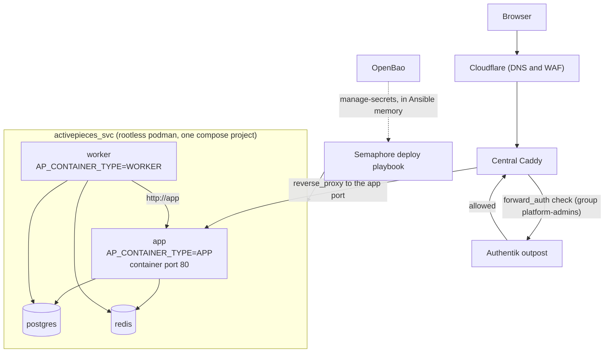
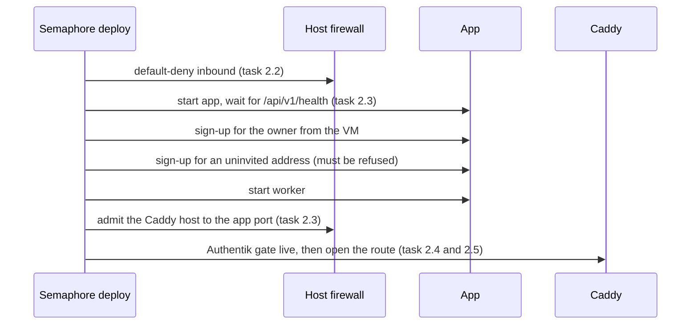

# 26 — Activepieces Workflow Automation

> **Depends on:** 00 (local-dev, `00-foundation-local-dev.md`), 01 (secrets, `01-secrets-credentials.md`), 02 (sso-auth, `02-sso-auth.md`), 14 (Postiz, the closest composable-service precedent), 16 (Plane, the first-admin precedent)
>
> Read 14 and 16 first. This plan follows the composable rootless-podman shape of Postiz and the first-account reasoning of Plane. It does not copy their instance details.

Author: Joseph A. Wisneski IV <stray@uhstray.io>

**Date:** 2026-11-16

**Status:** PROPOSED. Decisions D1 to D13 are the owner's design for this plan. D1 and D3 to D6 come from Plane work item AC-768, and D2 comes from AC-767. Both were accepted by Joseph on 2026-11-12.

**Plane:** module `deploy-activepieces`. Work items AC-767 and AC-768 record the decisions. AC-769 is this plan. AC-770 to AC-781 are the tasks of the OpenSpec change `deploy-activepieces`, in `plan/development/openspec/changes/deploy-activepieces/`.

**Context:** Activepieces is a self-hostable workflow automation platform with a visual flow builder. It becomes the platform's workflow-automation service. It replaces n8n, which Joseph retired on 2026-11-12. Temporal was considered for the same role and dropped that day as the wrong tool for low-code flows. Plans 27 and 28 build on this service. Neither is written yet, and neither is in this repository at the base of this branch.

## Problem

The platform has no workflow-automation service. Scheduled and event-triggered flows that call other services would otherwise be written as one-off scripts on individual hosts. Those scripts have no shared runtime, no shared credential handling and no common place to see what ran.

This plan deploys one Activepieces instance on its own VM, managed by the same Semaphore, OpenBao and OpenSpec workflow as the other services. Two upstream properties drive most of the design:

1. **The encryption key cannot be regenerated.** Stored connections are encrypted with `AP_ENCRYPTION_KEY`, and without that key they cannot be decrypted, even from a full database backup (F5). A deploy that generated a new key would silently make every stored connection unreadable. The key therefore has to be generated once and reused.
2. **The first account owns the instance.** Before a platform exists, the invitation check does not run, and the first account becomes the platform administrator (F20). An instance that is reachable before its owner exists can be claimed by whoever signs up first. Plane has the same risk class (plan 16, first-admin claim).

## Design Principles

The platform rules in `AGENTS.md` apply without change:

- Deploys run through Semaphore playbooks, never by hand on the VM.
- Secrets come from OpenBao and flow to compose env files through Ansible memory. No secret lives in git.
- `deploy.sh` handles container lifecycle only. Ansible owns the credential lifecycle.
- Every deploy step is idempotent and re-runnable. A re-run with unchanged inputs reports no change.
- Environment differences go through inventory variables and compose overlays. There are no forked files.
- Verify before hardening. Access is proven before anything that removes a fallback.

Four lessons from the n8n service carry over. Joseph's 2026-11-12 decision made Activepieces greenfield, so no data moves from n8n. The lessons still apply:

1. Never regenerate the encryption key. Losing it loses every stored connection.
2. Gate the worker start on readiness, not liveness. Open item O1 records that no readiness signal for migration completion has been found yet, so the deploy starts the app first and waits for its health route.
3. Writes to external systems are idempotent and keyed by a stored external identifier.
4. Fan-in items are never correlated by position. Every automation flow has a kill switch.

The last two lessons bind the flows of plan 28, not this service. They are recorded here so that the service design does not work against them.

## Decisions

| # | Decision | Rationale and source |
|---|---|---|
| D1 | **Community edition, with `AP_EDITION=ce` set explicitly.** No licence. | Without `AP_EDITION` the instance runs Community (F2). The enum value for Community is `ce` (F1). AC-768. |
| D2 | **Sign-in through Authentik forward-auth at Caddy.** The Authentik proxy provider runs in `forward_single` mode and is bound to the `platform-admins` group. No paid SSO tier. Each administrator also keeps a local Activepieces login, so an administrator signs in twice. Webhook paths are exempted from the gate by exact path only (D12). | Forward-auth is the same mechanism the platform already uses for NetBox and honcho docs (R2). The Postiz plan chose in-app OIDC instead, because forward-auth would also gate its API path (plan 14, D3). Activepieces has no API path that needs the gate removed, except the webhook paths in D12. AC-767. |
| D3 | **`AP_EXECUTION_MODE=SANDBOX_CODE_ONLY`.** No privileged containers. | `SANDBOX_PROCESS` needs `CAP_SYS_ADMIN`, which in practice means `privileged: true` (F12). `SANDBOX_CODE_ONLY` gives the worker no special capabilities, and it fits rootless podman. Upstream's separate-worker page recommends the same mode (`separate-workers.mdx#L14-L36`, F16). Cost: npm is not available inside Code steps (F12). AC-768. |
| D4 | **File storage in the database (`AP_FILE_STORAGE_LOCATION=DB`).** S3 is deferred. | The platform has no object store yet. Upstream calls S3 "a hard requirement" for its throughput figures (F13). That is accepted for a single-tenant, low-volume instance. The decision is revisited when an object store exists or flow volume grows. AC-768. |
| D5 | **One app container (`AP_CONTAINER_TYPE=APP`), one worker (`AP_CONTAINER_TYPE=WORKER`), Postgres and Redis.** One compose project on its own VM, under rootless podman. The worker sets `AP_FRONTEND_URL=http://app`. | Upstream compose runs five worker replicas (F14). This plan runs one, because the instance is single-tenant and low-volume. The worker reaches the app by its service name, not by the public URL (F15). AC-768. |
| D6 | **Image `ghcr.io/activepieces/activepieces:0.93.0`, pinned by digest.** The digest is recorded by task 1.2. | Upstream compose names this tag (F14). The release was published 2026-11-08 (F24). AC-768. |
| D7 | **Greenfield.** Nothing is migrated from n8n. The n8n lessons are design principles (see above). | Joseph's decision of 2026-11-12. |
| D8 | **Secrets at `secret/services/activepieces`, all generated once and reused, never rotated by a deploy.** The keys are `encryption_key`, `jwt_secret`, `db_password` and `owner_password`. `worker_token` is added only if spike O2 shows the worker needs one. | `encryption_key` is 32 hexadecimal characters (F4), and a new key makes every stored connection unreadable (F5). `manage-secrets` cannot yet emit hexadecimal values (R1), so task 1.3 adds that type (O3). The worker receives no secret beyond what spike 1.2 proves it needs. |
| D9 | **`AP_TELEMETRY_ENABLED=false`** (the upstream default is `true`, F7). **`AP_QUEUE_UI_ENABLED=false`** (the upstream default is `true`, and enabling it requires its own username and password, F9). | The first removes a call to an external analytics service. The second removes a web surface and a credential the platform does not need. |
| D10 | **The first-account window is closed three ways.** (a) The deploy creates the owner account itself through `POST /api/v1/authentication/sign-up`, from the VM, before the application port is reachable from any other host. The email comes from inventory variable `activepieces_owner_email` and the password from `owner_password` in OpenBao (F21). (b) The host firewall holds the application port closed to every host until the owner exists, and then admits the Caddy host only. (c) The Caddy route opens only after the owner exists and the forward-auth gate is live. `AP_ALLOW_OPEN_SIGN_UP` is never set. The template refuses it, and the deploy verify proves that an uninvited sign-up is refused (F19). | The risk is F20. The default firewall posture is default-deny inbound (AGENTS.md, Apply Firewall), so the port stays closed until task 2.3 admits the Caddy host. Captcha is not the control: `assertSolved` returns without checking unless both Turnstile keys are set (`turnstile.ts#L39`), so the closure relies on the invitation check. AC-776 and the owner-creation work in AC-771. |
| D11 | **`AP_NETWORK_MODE=STRICT`.** `AP_SSRF_ALLOW_LIST` is declared in inventory and is empty by default. The inference-gateway entry is added by plan 27, not here. | The default is `UNRESTRICTED` (F23). `STRICT` blocks user code from reaching private, loopback, link-local and cloud-metadata addresses. Exemptions are comma-separated IPs and CIDRs (F23). |
| D12 | **No inbound webhook is exempt by default.** A flow that needs one gets an exact-path exemption declared in inventory: a Caddy forward-auth skip, and a Cloudflare WAF skip only if the path is challenged. Joseph approves each flow. Scheduled flows need no inbound path. | Webhook routes are `/v1/webhooks/:flowId` and are served publicly as `/api/v1/webhooks/<flowId>` (F22, and the `/api` serving prefix shown by F17). Decision deferred to task 2.5 (O7). |
| D13 | **Out of scope.** The inference-gateway client certificate and identity (plan 27, `agentgateway-content-generation`, items AC-785, AC-825 and AC-826). The content flows (plan 28, `social-content-automation`). S3. SAML and paid SSO. Any data migration. | Each item belongs to a later plan or to a deferred decision. |

## Upstream facts

Each fact is read from the Activepieces source or docs at tag `0.93.0`. The base of every link is `https://github.com/activepieces/activepieces/blob/0.93.0/`. Every line number was checked against the file at that tag on 2026-11-16. Facts marked UNVERIFIED were not confirmed.

| # | Fact | Source |
|---|---|---|
| F1 | The edition enum has three values: `ce` (Community), `ee` (Enterprise) and `cloud` (Cloud). | [flag.ts#L15-L19](https://github.com/activepieces/activepieces/blob/0.93.0/packages/core/shared/src/lib/core/flag/flag.ts#L15-L19) |
| F2 | Without `AP_EDITION` the instance runs the Community edition. The docs show `AP_EDITION=ee` for a licensed install. | [docker-compose.mdx#L64-L72](https://github.com/activepieces/activepieces/blob/0.93.0/docs/install/options/docker-compose.mdx#L64-L72) |
| F3 | Every setting is read from an environment variable named `AP_` followed by the setting name. | [system-props.ts#L173-L174](https://github.com/activepieces/activepieces/blob/0.93.0/packages/server/api/src/app/helper/system/system-props.ts#L173-L174) |
| F4 | `AP_ENCRYPTION_KEY` is 32 hexadecimal characters (16 bytes), generated with `openssl rand -hex 16`. `AP_JWT_SECRET` is described as 32 hexadecimal characters, but the docs show `openssl rand -hex 32`, which produces 64. The upstream docs disagree with themselves about the JWT length. | [environment-variables.mdx#L64-L65](https://github.com/activepieces/activepieces/blob/0.93.0/docs/install/reference/environment-variables.mdx#L64-L65) |
| F5 | Without `AP_ENCRYPTION_KEY`, stored connections cannot be decrypted, even from a full database backup. | [docker-compose.mdx#L108](https://github.com/activepieces/activepieces/blob/0.93.0/docs/install/options/docker-compose.mdx#L108) |
| F6 | `AP_FRONTEND_URL` is the public URL. The app uses it to build redirect and webhook URLs. | [environment-variables.mdx#L63](https://github.com/activepieces/activepieces/blob/0.93.0/docs/install/reference/environment-variables.mdx#L63) |
| F7 | `AP_TELEMETRY_ENABLED` defaults to `true`. | [environment-variables.mdx#L69](https://github.com/activepieces/activepieces/blob/0.93.0/docs/install/reference/environment-variables.mdx#L69) |
| F8 | `AP_DB_TYPE` defaults to `POSTGRES`. `AP_REDIS_TYPE` defaults to `STANDALONE`. | [environment-variables.mdx#L161](https://github.com/activepieces/activepieces/blob/0.93.0/docs/install/reference/environment-variables.mdx#L161) and [#L184](https://github.com/activepieces/activepieces/blob/0.93.0/docs/install/reference/environment-variables.mdx#L184) |
| F9 | `AP_QUEUE_UI_ENABLED` defaults to `true`. When it is enabled, `AP_QUEUE_UI_USERNAME` and `AP_QUEUE_UI_PASSWORD` are required. | [environment-variables.mdx#L198-L200](https://github.com/activepieces/activepieces/blob/0.93.0/docs/install/reference/environment-variables.mdx#L198-L200) |
| F10 | `AP_EXECUTION_MODE` defaults to `UNSANDBOXED`. `AP_CONTAINER_TYPE` takes `APP`, `WORKER` or `WORKER_AND_APP`, and defaults to `WORKER_AND_APP`. | [environment-variables.mdx#L217-L218](https://github.com/activepieces/activepieces/blob/0.93.0/docs/install/reference/environment-variables.mdx#L217-L218) |
| F11 | `AP_FILE_STORAGE_LOCATION` is `DB` (the default) or `S3`. | [environment-variables.mdx#L270](https://github.com/activepieces/activepieces/blob/0.93.0/docs/install/reference/environment-variables.mdx#L270) |
| F12 | `SANDBOX_PROCESS` needs `CAP_SYS_ADMIN`, which in practice means `privileged: true`. `SANDBOX_CODE_ONLY` gives the worker no special capabilities. Its Code step runs in a fresh V8 isolate with no `require`, no filesystem and no npm. | [sandboxing.mdx#L19-L26](https://github.com/activepieces/activepieces/blob/0.93.0/docs/install/architecture/sandboxing.mdx#L19-L26) |
| F13 | The production setup page calls S3 "a hard requirement" for its throughput figures. | [production-setup.mdx#L21-L23](https://github.com/activepieces/activepieces/blob/0.93.0/docs/install/configure-operate/production-setup.mdx#L21-L23) |
| F14 | The upstream `docker-compose.yml` runs `app` (`AP_CONTAINER_TYPE=APP`, port `8080:80`), `worker` (`AP_CONTAINER_TYPE=WORKER`, five replicas), `pgvector/pgvector:0.8.0-pg14` and `redis:7.0.7`. The image tag is `ghcr.io/activepieces/activepieces:0.93.0`. | [docker-compose.yml#L1-L50](https://github.com/activepieces/activepieces/blob/0.93.0/docker-compose.yml#L1-L50) |
| F15 | In compose, the worker's `AP_FRONTEND_URL` must be `http://app`, the app's service name. The public URL is wrong for the worker. | [docker-compose.mdx#L76-L85](https://github.com/activepieces/activepieces/blob/0.93.0/docs/install/options/docker-compose.mdx#L76-L85) |
| F16 | A separate worker needs `AP_WORKER_TOKEN`, minted with `npx @activepieces/cli workers token` from the JWT secret. The upstream compose worker sets no worker token. | [separate-workers.mdx#L14-L36](https://github.com/activepieces/activepieces/blob/0.93.0/docs/install/configure-operate/separate-workers.mdx#L14-L36) |
| F17 | The health route `GET /v1/health` is public. It returns 200 with `Healthy`, or 503 with `Unhealthy`. The served path is `/api/v1/health`. | [health.module.ts#L9-L27](https://github.com/activepieces/activepieces/blob/0.93.0/packages/server/api/src/app/health/health.module.ts#L9-L27) and [docker-compose.mdx#L115](https://github.com/activepieces/activepieces/blob/0.93.0/docs/install/options/docker-compose.mdx#L115) |
| F18 | `isHealthy()` checks worker status on a worker and database health on the app. It does not check whether migrations have finished. | [health.service.ts#L33-L44](https://github.com/activepieces/activepieces/blob/0.93.0/packages/server/api/src/app/health/health.service.ts#L33-L44) |
| F19 | Sign-up after a platform exists requires an invitation, unless `AP_ALLOW_OPEN_SIGN_UP=true`. | [authentication.service.ts#L46-L51](https://github.com/activepieces/activepieces/blob/0.93.0/packages/server/api/src/app/authentication/authentication.service.ts#L46-L51) |
| F20 | The invitation and domain checks run only inside a guard that tests whether the sign-up carries a platform id. The guard starts at line 37, and the invitation check is at lines 46 to 51. The docs state that "the first account you create becomes the platform administrator." Whether a fresh instance sends no platform id was not read (UNVERIFIED, see O1 and task 1.4). | [authentication.service.ts#L37](https://github.com/activepieces/activepieces/blob/0.93.0/packages/server/api/src/app/authentication/authentication.service.ts#L37) and [#L46-L51](https://github.com/activepieces/activepieces/blob/0.93.0/packages/server/api/src/app/authentication/authentication.service.ts#L46-L51); [docker-compose.mdx#L103](https://github.com/activepieces/activepieces/blob/0.93.0/docs/install/options/docker-compose.mdx#L103) |
| F21 | The sign-up API is `POST /v1/authentication/sign-up`, served under `/api`. The handler calls a Turnstile assertion before it creates the account. | [authentication.module.ts#L6](https://github.com/activepieces/activepieces/blob/0.93.0/packages/server/api/src/app/authentication/authentication.module.ts#L6) and [authentication.controller.ts#L22-L35](https://github.com/activepieces/activepieces/blob/0.93.0/packages/server/api/src/app/authentication/authentication.controller.ts#L22-L35) |
| F22 | Webhook routes use the prefix `/v1/webhooks` and the path `/:flowId`. The variants `/sync`, `/draft` and `/test` were not read (UNVERIFIED). | [webhook-module.ts#L75](https://github.com/activepieces/activepieces/blob/0.93.0/packages/server/api/src/app/webhooks/webhook-module.ts#L75) and [webhook-controller.ts#L49](https://github.com/activepieces/activepieces/blob/0.93.0/packages/server/api/src/app/webhooks/webhook-controller.ts#L49) |
| F23 | `AP_NETWORK_MODE` defaults to `UNRESTRICTED`. `STRICT` installs the SSRF guard, which blocks user code from reaching private, loopback, link-local and cloud-metadata addresses. `AP_SSRF_ALLOW_LIST` is a comma-separated list of IPs and CIDRs that bypass the block. | [network-security.mdx#L21-L31](https://github.com/activepieces/activepieces/blob/0.93.0/docs/install/architecture/network-security.mdx#L21-L31) |
| F24 | The latest release is 0.93.0, published 2026-11-08T14:30:22Z, as the GitHub release API reports it. | [release 0.93.0](https://github.com/activepieces/activepieces/releases/tag/0.93.0) |
| F25 | The database connection settings are `AP_POSTGRES_HOST`, `AP_POSTGRES_PORT`, `AP_POSTGRES_DATABASE`, `AP_POSTGRES_USERNAME` and `AP_POSTGRES_PASSWORD`. The docs suggest `openssl rand -hex 32` for the password. The upstream compose file passes the last three from `.env` to its Postgres service. The Redis settings are `AP_REDIS_HOST`, `AP_REDIS_PORT` and `AP_REDIS_PASSWORD`. | [environment-variables.mdx#L163-L167](https://github.com/activepieces/activepieces/blob/0.93.0/docs/install/reference/environment-variables.mdx#L163-L167) and [#L186-L189](https://github.com/activepieces/activepieces/blob/0.93.0/docs/install/reference/environment-variables.mdx#L186-L189); [docker-compose.yml#L1-L50](https://github.com/activepieces/activepieces/blob/0.93.0/docker-compose.yml#L1-L50) |
| F26 | The Turnstile settings are `AP_TURNSTILE_SITE_KEY` and `AP_TURNSTILE_SECRET_KEY`, both unset by default. `assertSolved` returns without checking anything unless both keys are configured. | [environment-variables.mdx#L289-L290](https://github.com/activepieces/activepieces/blob/0.93.0/docs/install/reference/environment-variables.mdx#L289-L290); [turnstile.ts#L20-L22](https://github.com/activepieces/activepieces/blob/0.93.0/packages/server/api/src/app/authentication/lib/turnstile.ts#L20-L22) and [#L39](https://github.com/activepieces/activepieces/blob/0.93.0/packages/server/api/src/app/authentication/lib/turnstile.ts#L39) |
| F27 | API keys are generated under the platform dashboard. The docs say that dashboard is "only available in the Platform and Enterprise editions". The API takes the key as a Bearer token. The flow update endpoint is `POST /v1/flows/{id}`. | [overview.mdx#L7](https://github.com/activepieces/activepieces/blob/0.93.0/docs/endpoints/overview.mdx#L7); [overview.mdx#L13-L15](https://github.com/activepieces/activepieces/blob/0.93.0/docs/endpoints/overview.mdx#L13-L15); [flows/update.mdx#L3](https://github.com/activepieces/activepieces/blob/0.93.0/docs/endpoints/flows/update.mdx#L3) |

Repository facts, read on the base commit `1ae46279` of this branch:

| # | Fact | Source |
|---|---|---|
| R1 | `manage-secrets` generates only alphanumeric values (`type: random`) or Django-charset values (`type: django`). It has no hexadecimal type. | `platform/playbooks/tasks/manage-secrets.yml` lines 96 to 104 |
| R2 | The Authentik forward-auth precedents are `netbox-forward-auth.yaml` and `honcho-docs-forward-auth.yaml`, both proxy providers in `forward_single` mode. The outpost binding and the per-application access gate are rendered from `templates/zz-sso-bindings.yaml.j2`, driven by `app-catalog.yml`, and rendered by `deploy-authentik.yml` around lines 315 to 318. | `platform/services/authentik/deployment/blueprints/`, `platform/services/authentik/deployment/templates/zz-sso-bindings.yaml.j2`, `platform/services/authentik/deployment/app-catalog.yml`, `platform/playbooks/deploy-authentik.yml` |
| R3 | The Plane OpenSpec sync builds each item's `external_id` as `<owner/repo>/<change>/<task id>` (`openspec_to_plane.py` line 159). The task id pattern needs at least one dot (line 67). Checked lines are skipped as done before import (lines 27 to 31). The sync reads `main` (`sync-plane-projects.yml` line 152). | `platform/services/plane/lib/openspec_to_plane.py`, `platform/playbooks/sync-plane-projects.yml` |
| R4 | The Plane first-admin claim is closed by opening the route only after the deploy has completed first-run setup (`deploy-plane-work-management` tasks.md, task 1.11). | `plan/development/openspec/changes/deploy-plane-work-management/tasks.md` |

## Architecture

The service runs on its own VM in the `activepieces_svc` group. The app is the only container that publishes a port, and the host firewall admits that port from the Caddy host only.

The first run follows a fixed order, so that no route opens before the owner exists:

## Component design

### Service directory: `platform/services/activepieces/deployment/`

| File | Role |
|------|------|
| `compose.yml` | Four services: `app`, `worker`, `postgres` and `redis`. Each service has `restart: always`, which is the rule for repo compose services (AGENTS.md, Starting at boot). Only `app` publishes a port. The worker reaches the app at `http://app` (F15). Image digest pinned (D6). |
| `compose.local.yml` | The overlay for local-dev. It attaches the services to the `local-dev` network. Its exact contents are set in task 1.2. |
| `deploy.sh` | Container lifecycle only. It starts `app`, waits for its health route, starts `worker` and records the readiness gap (O1). It holds no secret handling. |
| `templates/env.j2` | The env file rendered from OpenBao values and inventory. It sets the `AP_` variables in the table below. |
| `CLAUDE.md`, `README.md`, `AGENTS.md` | Operator and agent notes. `AGENTS.md` is a symlink to `CLAUDE.md`, as in other service directories. |
| `.gitignore` | Keeps rendered env files out of git. |

### Secrets: `secret/services/activepieces`

| Key | Type | Source and behaviour |
|---|---|---|
| `encryption_key` | 32 hexadecimal characters | Generated once with the hexadecimal type added in task 1.3 (O3), reused on every deploy. Never regenerated. Losing it loses every stored connection (F4, F5). |
| `jwt_secret` | Generated once | Reused on every deploy. Its exact length is open item O3, because the upstream docs contradict each other (F4). |
| `db_password` | Generated once | Reused on every deploy. The upstream docs suggest `openssl rand -hex 32` for this variable (F25), so the hexadecimal type is the default choice, and task 1.3 confirms it. |
| `owner_password` | Generated once | Used once by the deploy to create the owner account (D10), then kept for the owner's first local sign-in. |
| `worker_token` | Generated once, only if O2 finds it needed | Minted by a playbook task, not by a manual `npx` step (F16). |

### Environment settings

The table lists each `AP_` variable the template sets, with its value and its source. Variables not listed here are not set and keep their upstream default.

| Variable | Value | Source |
|---|---|---|
| `AP_EDITION` | `ce` | D1, F1, F2 |
| `AP_ENCRYPTION_KEY` | from `encryption_key` | D8, F4, F5 |
| `AP_JWT_SECRET` | from `jwt_secret` | D8, F4 |
| `AP_DB_TYPE` | `POSTGRES` | F8 (set explicitly) |
| `AP_POSTGRES_HOST`, `AP_POSTGRES_PORT`, `AP_POSTGRES_DATABASE`, `AP_POSTGRES_USERNAME`, `AP_POSTGRES_PASSWORD` | the `postgres` service name, the port, and the values from `db_password` | F25. The database name, user name and port are set in task 1.2. |
| `AP_REDIS_TYPE` | `STANDALONE` | F8 (set explicitly) |
| `AP_REDIS_HOST`, `AP_REDIS_PORT` | the `redis` service name and its port | F25. The port is set in task 1.2. |
| `AP_CONTAINER_TYPE` | `APP` on `app`, `WORKER` on `worker` | D5, F10, F14 |
| `AP_FRONTEND_URL` | the public URL on `app`, `http://app` on `worker` | D5, F6, F15 |
| `AP_EXECUTION_MODE` | `SANDBOX_CODE_ONLY` | D3, F10, F12 |
| `AP_FILE_STORAGE_LOCATION` | `DB` | D4, F11 |
| `AP_TELEMETRY_ENABLED` | `false` | D9, F7 |
| `AP_QUEUE_UI_ENABLED` | `false` | D9, F9 |
| `AP_NETWORK_MODE` | `STRICT` | D11, F23 |
| `AP_SSRF_ALLOW_LIST` | from inventory, empty by default | D11, F23 |
| `AP_WORKER_TOKEN` | from `worker_token`, only if O2 requires it | O2, F16 |
| `AP_ALLOW_OPEN_SIGN_UP` | never set. The template refuses it. | D10, F19 |

### Authentik forward-auth gate

A new blueprint, `platform/services/authentik/deployment/blueprints/activepieces-forward-auth.yaml`, defines a proxy provider in `forward_single` mode, following the NetBox and honcho docs precedents (R2). It is bound to the `platform-admins` group. An entry in `platform/services/authentik/deployment/app-catalog.yml` declares the application. `deploy-authentik.yml` renders the outpost binding and the access gate through `zz-sso-bindings.yaml.j2`, as it does for the other applications (R2). Task 2.4 applies it.

### Edge

The production route is a Caddy block in site-config `caddy_managed_sites`, with `forward_auth` pointed at the Authentik outpost. `Manage Caddy Sites` places it (AGENTS.md). The DNS record lives in `platform/infra/cloudflare/dns.tf`, and `Apply Cloudflare Tofu` applies it. The route opens only after the owner exists and the gate is live (D10c). Webhook exemptions, if any, are exact paths declared per flow (D12).

### Firewall

`Apply Firewall` runs with default-deny inbound (AGENTS.md). SSH is admitted from the controller only (task 2.2). The app port is admitted from the Caddy host only, after the owner exists (task 2.3). The Postiz plan (`plan/development/14-postiz-social-publishing.md`, Firewall section) records the mechanism this relies on, which is that rootless podman publishes ports on the host's INPUT chain.

### Backup and restore

The database backup and restore follow the Plane pattern. `Back Up Plane DB` writes a timestamped `pg_dump` into an owner-only 0700 directory, and `Restore Plane DB` loads a named dump into a staging database and swaps it in only after it loads completely, keeping the prior database (AGENTS.md, Independent Workflows). The Activepieces playbooks `backup-activepieces-db.yml` and `restore-activepieces-db.yml` follow that pattern (task 2.7). The encryption key is backed up separately with `Back Up Credentials to site-config`, because a database dump without `AP_ENCRYPTION_KEY` cannot decrypt its stored connections (F5).

## Implementation phases

The change `deploy-activepieces` has two phases. Each phase ends with a validation gate that names the scenarios it proves (`plan/development/openspec/config.yaml`, tasks rule).

### Phase 1: plan, service and local-dev (tasks 1.1 to 1.5)

Tasks 1.2 to 1.4 close open items O1 to O6 before any value is generated. Task 1.3 adds the hexadecimal secret type (O3), so the format is settled before the first generated key.

**Acceptance:** the local-dev gate in task 1.5 holds. The scenarios "A scheduled flow runs on the local stack", "The deploy creates the owner before the port is reachable", "An uninvited sign-up is refused" and "A re-run reports no change" are shown on local-dev.

### Phase 2: production (tasks 2.1 to 2.8)

Production follows the order in the sequence diagram above. The firewall is default-deny before the deploy. The owner is created before the port is admitted. The route opens last.

**Acceptance:** the production gate in task 2.8 holds. The ten scenarios named there are shown on the production instance.

## Validation criteria

| Scenario | Requirement | Pass condition | Exercised by |
|---|---|---|---|
| A redeploy keeps the encryption key | Deployed through Semaphore with secrets from OpenBao | After a redeploy, `encryption_key` is unchanged and a connection stored before the redeploy still decrypts. | 2.8 |
| A re-run reports no change | Deployed through Semaphore with secrets from OpenBao | A second run with unchanged inputs reports no changed task. | 1.5, 2.8 |
| A scheduled flow runs on the local stack | Flows run without privileged containers | A scheduled flow runs on local-dev under `SANDBOX_CODE_ONLY`, and no container in the project is privileged. | 1.5 |
| A scheduled flow runs in production | Flows run without privileged containers | The same check passes on the production instance. | 2.8 |
| The deploy creates the owner before the port is reachable | Account creation is closed after the owner | The owner account exists before the Caddy host is admitted, and no other host reached the port before then. | 1.4, 1.5, 2.3, 2.8 |
| An uninvited sign-up is refused | Account creation is closed after the owner | After the owner exists, a sign-up for an address with no invitation is refused, and no account is created. | 1.4, 1.5, 2.8 |
| A platform-admin passes the gate | Only platform-admins reach the application | A member of `platform-admins` signs in through Authentik and reaches the application. | 2.8 |
| A non-admin is refused at the edge | Only platform-admins reach the application | A signed-in user outside `platform-admins` is refused at Caddy, before the application. | 2.8 |
| A direct connection from another LAN host is refused | The application port is reachable from the Caddy host only | A connection to the app port from another LAN host fails, and a connection from the Caddy host succeeds. | 2.8 |
| An undeclared webhook path stays gated | Webhook paths are exempted by exact path only | A webhook path that no inventory entry declares is still behind the gate. | 2.8 |
| A restore swaps in only a fully loaded copy | The database can be backed up and restored | A restore that fails part-way leaves the live database unchanged. Only a fully loaded copy is swapped in. | 2.7 |

## Security considerations

- **Access.** The gate at Caddy admits only members of `platform-admins` (D2). A local Activepieces login is a second credential that each administrator also holds. Sign-up is closed once the owner exists, because `AP_ALLOW_OPEN_SIGN_UP` is never set (D10, F19).
- **First-account window.** The owner is created before the app port is admitted from any host. Until then the host firewall holds the port closed (D10, F20). Task 1.4 checks this ordering against a live instance (O5 covers the captcha part).
- **Captcha.** The sign-up captcha is off unless both Turnstile keys are set (F26). This plan sets neither, so closure rests on the invitation check, not on captcha. Whether to configure Turnstile is not decided here.
- **Encryption key.** `AP_ENCRYPTION_KEY` is generated once and never rotated by a deploy. Losing it loses every stored connection, even with a database backup (F5). The key is backed up with `Back Up Credentials to site-config`.
- **Execution.** `SANDBOX_CODE_ONLY` removes the need for privileged containers (D3, F12). User code still runs inside the worker container, so the worker is the boundary that matters.
- **Network.** `AP_NETWORK_MODE=STRICT` blocks user code from private, loopback, link-local and cloud-metadata addresses (D11, F23). Any exemption is a reviewed inventory entry.
- **Exposure.** The app port is admitted from the Caddy host only. No webhook is exempt unless a flow is approved for one (D12). The queue UI is off (D9).
- **Telemetry.** `AP_TELEMETRY_ENABLED=false` (D9, F7).
- **Secret handling.** Secrets reach the env file through Ansible memory and never through a command line. Task 1.3 keeps the credential steps in `no_log` tasks, as `manage-secrets` does.

## Release budget

Policy 10 sets a limit of 120 changed files and 100 pull requests per release (`plan/architecture/10-release-policy.md`). The counts below are estimates, one line per file, so they can be checked. Exact counts are measured with `python3 scripts/semver.py release-budget` before each pull request.

New (about 15):

- `platform/services/activepieces/deployment/compose.yml`
- `platform/services/activepieces/deployment/compose.local.yml`
- `platform/services/activepieces/deployment/deploy.sh`
- `platform/services/activepieces/deployment/templates/env.j2`
- `platform/services/activepieces/deployment/CLAUDE.md`
- `platform/services/activepieces/deployment/AGENTS.md` (symlink)
- `platform/services/activepieces/deployment/README.md`
- `platform/services/activepieces/deployment/.gitignore`
- `platform/playbooks/deploy-activepieces.yml`
- `platform/playbooks/clean-deploy-activepieces.yml`
- `platform/playbooks/backup-activepieces-db.yml`
- `platform/playbooks/restore-activepieces-db.yml`
- `platform/services/authentik/deployment/blueprints/activepieces-forward-auth.yaml`
- one or two test files

Changed (about 15):

- `platform/semaphore/templates.yml`
- `platform/services/opa/deployment/policies/agentcloud/data.json` (`service_deploy_templates` entry)
- `platform/playbooks/validate-all.yml`
- `platform/inventory/local-dev.yml.example`
- `platform/playbooks/bootstrap-local-dev.yml`
- `platform/services/authentik/deployment/app-catalog.yml`
- `platform/playbooks/tasks/manage-secrets.yml` (hexadecimal type, O3)
- `platform/infra/cloudflare/dns.tf`
- `AGENTS.md`
- `README.md`
- `plan/architecture/service-architecture.md`
- `plan/architecture/network-architecture.md`
- `platform/playbooks/README.md`
- `plan/development/openspec/changes/deploy-activepieces/tasks.md`

This plan's own pull request adds six new files: `plan/development/26-activepieces.md` and five files in `plan/development/openspec/changes/deploy-activepieces/`. The total is therefore about 36 files across about 8 pull requests. Site-config changes do not count against this repository's budget.

## Risk: no API key on Community edition

D1 chooses the Community edition. The 0.93.0 docs say that API keys are generated under the platform dashboard, and that this dashboard is "only available in the Platform and Enterprise editions" (F27, `overview.mdx#L7`). The API authenticates requests with an API key passed as a Bearer token (F27, `overview.mdx#L13-L15`). The flow update endpoint is `POST /v1/flows/{id}` (F27, `flows/update.mdx#L3`).

If a Community instance has no supported way to create an API key, two planned uses have no authenticated path: flows managed as code, and connections set by playbook. Plan 28 (`social-content-automation`, items AC-796 to AC-798) depends on both. The docs do not name Community as an edition with keys, so the implication that Community has none is UNVERIFIED at runtime. No Community instance has been run to test whether another route creates a key.

This plan designs no workaround. A workaround would change the edition decision, and that decision belongs to Joseph (AC-768). Early spike O8, in task 1.5, proves or refutes one authenticated API call on Community at 0.93.0. If the spike refutes it, the edition decision returns to Joseph, and no alternative is built without his decision.

## Open items

Each open item is owned by one task. None is stated as fact in this plan.

| # | Question | Owner | Status |
|---|---|---|---|
| O1 | Is there a readiness signal that shows migrations have finished before the worker starts? F18 shows that `/api/v1/health` does not report it. | Task 1.2 | Open. Until a signal is found, `deploy.sh` starts the app alone, waits for its health route, starts the worker, and records the gap. |
| O2 | Does a co-located compose worker need `AP_WORKER_TOKEN`? F16 describes a separate worker, and the upstream compose worker sets none (F14). | Tasks 1.2 and 1.3 | Open. If yes, the playbook mints the token without a manual step, and stores it as `worker_token`. |
| O3 | Which secret format and length do the JWT and encryption keys accept? `manage-secrets` cannot emit hexadecimal values (R1), and the upstream docs contradict each other on the JWT length (F4). Whether uppercase hexadecimal is accepted is also open. | Task 1.3 | Open. The format is checked before the first generate, because a generated-once key is never regenerated. |
| O4 | Does the image need pgvector, as upstream's `pgvector/pgvector:0.8.0-pg14` suggests (F14), or does plain Postgres suffice? | Task 1.2 | Open. Whichever image is used is pinned by digest. |
| O5 | With no Turnstile key configured, does the deploy create the owner without a captcha token? The code returns from `assertSolved` when either key is unset (F26), but the live behaviour is not yet observed. | Task 1.4 | Open. The code reading suggests yes. The deploy must prove it. |
| O6 | How do the platform's administrators get local accounts without SMTP? The docs show invitation links of the form `/sign-up?email=…` and the classic password path when SMTP is absent (`breaking-changes.mdx#L465`). | Task 1.4 | Open. |
| O7 | Which flows, if any, need an exact-path webhook exemption? | Task 2.5 | Open. Each exemption needs Joseph's approval (D12). |
| O8 | Does a Community instance at 0.93.0 allow one authenticated API call, for example `POST /v1/flows/{id}` with a Bearer key? F27 says keys come from a dashboard available only in the Platform and Enterprise editions. | Task 1.5 (early spike, referenced by plan 28 under AC-796) | Open. A refuted result goes to Joseph, because AC-768 is his decision. No workaround is designed. See the risk section above. |

## Instance values (in site-config)

This repository holds templates and placeholders. The values below live in the private `site-config` repository (AGENTS.md, Standing convention).

| Placeholder | Meaning | Where the value is set |
|---|---|---|
| `activepieces.<zone>` | The public hostname. The public URL built from it is the value of `AP_FRONTEND_URL` on the app. | site-config inventory and `caddy_managed_sites` |
| `activepieces_svc` | The inventory group for the VM. | site-config inventory |
| `activepieces_owner_email` | The email address of the owner account that the deploy creates (D10a). | site-config inventory |
| VM address and VM id | The VM's declared address and id, with the NetBox reservation for the address. | site-config `vm-specs` and inventory |
| Caddy host address | The one host admitted to the app port (D10b). | site-config inventory |
| `AP_SSRF_ALLOW_LIST` entries | Reviewed exemptions from the SSRF guard (D11). | site-config inventory |
| Exempt webhook paths | One exact path per approved flow (D12). | site-config inventory |

## Cross-references

- `plan/development/14-postiz-social-publishing.md`: the closest precedent for composable rootless-podman services, its firewall mechanism and its Option B config pattern. It names hostnames that are debt, and this plan does not copy them.
- `plan/development/16-plane-work-management.md`: the first-admin precedent (R4), the Plane backup and restore pattern, and the OpenSpec sync in R3.
- `plan/development/00-foundation-local-dev.md`, `plan/development/01-secrets-credentials.md`, `plan/development/02-sso-auth.md`: local-dev, secret handling and SSO, which this plan depends on.
- `plan/development/openspec/changes/deploy-activepieces/`: the OpenSpec change that holds the proposal, design, tasks and specification for this plan.
- `plan/architecture/01-automation-model.md`: the rule on declarative and imperative automation. The UI-only steps in this plan are encoded as playbooks.
- `plan/architecture/02-service-onboarding.md`: the onboarding checklist this service follows.
- `plan/architecture/00-foundation-standards.md`: the required sections for plan documents, which this file follows.
- `plan/architecture/10-release-policy.md`: the release limits used in the budget above.
- `AGENTS.md`, section "Adding a New Service": the steps this service follows.
- Plans 27 (`agentgateway-content-generation`) and 28 (`social-content-automation`) are named for scope only. Neither file exists yet in this repository.

## Revision history

- **2026-11-16:** initial draft. Status PROPOSED. Facts F1 to F27 checked against tag 0.93.0. The API-key risk and open item O8 were added after the owner's review (F27). F20's citation was corrected to the code guard and the docs line that support it.
