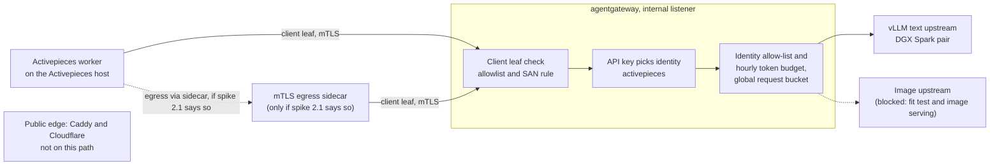

# 27 — agentgateway content generation

**Date:** 2026-11-16
**Status:** PROPOSED
**Author:** Joseph A. Wisneski IV
**Context:** Content automation drafts social posts in Activepieces flows and hands them to Postiz. Drafting needs a language model now and an image model later, both served from the DGX Spark pair through the agentgateway. This plan records what the gateway must change to serve that caller. It is built from the Plane module `agentgateway-content-generation` and the OpenSpec change of the same name. Its facts were re-checked at their cited lines on `dev` at `1ae46279`.

---

## Problem

- **The gateway has one vLLM upstream for its models.** Every vLLM entry renders one base URL, `agw_upstream_base_url` (`config.yaml.j2:430`). The only other provider the validator accepts is `openrouter`, which is opt-in per model and per identity (`secret-declarations/agentgateway.yml:309-310`; the `agentgateway-openrouter` change).
- **No image route exists.** The model entries render only the `completions` and `responses` formats (`config.yaml.j2:382-384`, `:426-428`). A repository-wide `git grep` for the images endpoint path and related terms found no match outside the OpenSpec directory. Whether the pinned image, `cr.agentgateway.dev/agentgateway:v1.5.0` (`compose.yml:36`), proxies the OpenAI images API is **UNVERIFIED**. Task 3.1 (AC-786) checks it.
- **The only per-identity control is a token budget.** Each identity has a rolling one-hour token budget (`config.yaml.j2:155-175`). The request ceiling is one bucket for the whole gateway, 120 requests a minute by default (`config.yaml.j2:367-371`). The template comment says v1.5.0 has no per-identity request bucket under the `llm` shortcut (`config.yaml.j2:358-366`). So a looping flow can use up the shared bucket for every client, whatever its token budget.
- **The content caller has no identity, budget or network path yet.** Plane AC-783 decided the network path on 2026-11-12 (D1).

## Decisions

| # | Decision | Rationale | Source |
|---|---|---|---|
| D1 | Activepieces reaches the gateway on the gateway's own internal listener, with an internal-CA (step-ca) client leaf. The public inference route is not used. | The rejected route carries a Cloudflare per-source limit of 10 requests per 10 seconds on `/v1/*` and a 125-second read timeout (AGENTS.md, Deployment Status, inference edge entry). A content flow should not sit behind either. The public edge stays unchanged. | AC-783, decided 2026-11-12 by the operator |
| D2 | Identity `activepieces`. The instance declares `agw_verify_client` as an operator identity, and `activepieces` is never the first entry of `agw_clients`. It is not in `agw_openrouter_identities`. Its `allowed_models` names the text model only for now; the image model joins after task 3.3. | The deploy's keyed verify runs as `agw_verify_client`, else the first identity of the merged list (`deploy-agentgateway.yml:968-971`, `:1165`). Naming it explicitly keeps every deploy from spending this identity's budget, whatever the list order. OpenRouter names are removed from every identity outside the union (`config.yaml.j2:55`, `:65`, `:140`). | `deploy-agentgateway.yml:968-971,1165`; `config.yaml.j2:55-65,140` |
| D3 | Token budget `tokens_per_hour` of 250,000, provisional. Task 2.3 (AC-785) sets it, and gate 2.4 (AC-791) re-measures it from the response usage fields. The value lives in site-config under `agw_client_policies.activepieces.tokens_per_hour`. | The arithmetic in "Identity and budget" below. The budget is the gateway's only per-identity control (`config.yaml.j2:163-165`), so it sits well below the default. A looping flow then cannot take a large share of the shared pair. Plane declares no numeric post cadence (AC-802, AC-836), so the figure rests on the assumptions listed there. | `config.yaml.j2:124,171`; AC-802; AC-836 |
| D4 | No studio identity for now. | A studio identity is needed only if the studio calls models directly. That is undecided. | AC-810 |
| D5 | Two phases. The text path (tasks 2.1 to 2.4) goes first. The image path (tasks 3.1 to 3.6) waits until the image model the dgx-spark fit test selects (Z-Image-Turbo first, AC-870 decision 2026-11-16) passes its fit test on the DGX Spark pair and the dgx-spark handoff names its endpoint. | The operator decided on 2026-11-16 to switch away from the first candidate model (AC-870). Image serving on the DGX Spark pair is not built. | AC-870; dgx-spark items DGXSPARK-10, DGXSPARK-12 to DGXSPARK-16 |
| D6 | A per-identity request limit is not decided here. Task 3.3 (AC-788) decides it; which identities it covers is open (see Open, in this cell). Only a limit the gateway enforces meets the image requirement in the spec, so the image model waits for one. The options: a gateway release with a per-key request limit; rewriting the gateway config into the full `binds`/`listeners`/`routes` shape, where a per-identity `conditional` limit is accepted on v1.5.0; a count kept by the calling flow, which is cooperative, not enforced, and acceptable only as a text-path stopgap; an edge rule, which is off the decided path (D1). Recommendation: the gateway release; the config rewrite if no release ships one in time. Open (operator decision pending, 2026-11-17): the spec's limit requirement names image models only, and task 3.3 is titled "images first"; whether text identities get a per-identity request limit is undecided. Until it is decided, the text path has the global request bucket alone. | The gap is gateway-wide: v1.5.0 has no per-identity request bucket under the `llm` shortcut, which the gateway config uses for every identity (`config.yaml.j2:358-366`); the `conditional` form is accepted only on `binds[].listeners[].routes[]` policies (`:362-363`). The same question was settled for token budgets on 2026-09-17, leaving "wait for the release that ships `key`" as the path to a request bucket (`inference-gateway-agentgateway` change, `design.md:439-446`). Images are the sharpest case: a response without usage is not charged (`config.yaml.j2:156-158`), and whether image responses carry usage is UNVERIFIED (task 3.1). | `config.yaml.j2:156-158,358-371`; `inference-gateway-agentgateway/design.md:439-446` |
| D7 | The key is generated once by Deploy agentgateway and reused, as `secret/services/agentgateway:client_activepieces`. It reaches Activepieces through a `no_log` playbook that reads OpenBao and writes the Activepieces connection through its API. That playbook belongs to `social-content-automation` (AC-797). No person pastes the key by hand. | Each enrolled identity gets one generated `client_<name>` field (`secret-declarations/agentgateway.yml:249-254`). One automated handout keeps the key out of chat, shell history and task output. | `secret-declarations/agentgateway.yml:249-254`; AC-797 |
| D8 | Whether an Activepieces piece can present a client certificate is UNVERIFIED. Spike 2.1 (AC-826) decides it. If a piece cannot, the fallback is a minimal mTLS egress sidecar in the Activepieces compose project, on an internal network only, holding the leaf and the CA bundle. Renewal proof: the Activepieces host sets `agw_verify_base_url` to an `https://` URL and holds one client leaf. Reload `none` is acceptable only if the piece or sidecar re-reads the leaf for each connection; otherwise task 2.2 adds a declared reload and an in-use proof through the consumer's own client path, as the Caddy client leaf has. | A caller that cannot present a leaf has no path to the listener. Renewal proves a per-call client leaf from a fresh probe on its host (`renew-internal-certs.yml:235-243`), which shows the files on disk, not that a long-running consumer presents them. The per-call client leaf proof is a fresh probe process (`:37-44`), and reload `none` elsewhere relies on the consumer re-reading `current` itself (`:20-30`); the Caddy client leaf is proven through Caddy's own route instead (`:214-222`). | AC-826; `renew-internal-certs.yml:20-30,37-44,214-222,235-243,251-254` |

## Verified facts

| Fact | Where |
|---|---|
| The gateway's identities are `agw_clients` plus admin-derived identities. Each gets one generated `client_<name>` field of 48 characters. | `platform/playbooks/vars/secret-declarations/agentgateway.yml:42-50`, `:249-254` |
| Budget: a rolling one-hour token budget. The chain is the identity's `tokens_per_hour`, then its tier figure, then `agw_rate_tokens_per_hour`, which defaults to 2,000,000. It is charged after the response, from reported usage. | `platform/services/agentgateway/deployment/templates/config.yaml.j2:155-175` (comment `:155-165`; amount `:171`) |
| Per-identity model allow-list: `agw_client_policies.<name>.allowed_models`. OpenRouter names are removed from identities outside the union. | `config.yaml.j2:136-140`; `:55`, `:65`, `:140` |
| The deploy's keyed verify runs as `agw_verify_client`, and defaults to the first identity of the merged list when that is unset. | `platform/playbooks/deploy-agentgateway.yml:968-971`, `:1165` |
| `agw_client_cert_allowlist` defaults to `['caddy']`. An entry that names no declared client-profile leaf is refused before render. | `deploy-agentgateway.yml:125`, `:294-305` |
| A client leaf with reload `none` on a host other than the gateway is proof class `probe-client` only when that host sets `agw_verify_base_url`. The URL must be `https://` when the gateway's listener TLS is on. More than one `probe-client` leaf per host is refused. The proof text is "probe path answered 401, refused without a client certificate". A leaf with no proof path stops renewal before anything is issued. | `platform/playbooks/renew-internal-certs.yml:235-243`, `:251-254`, `:958`, `:301-302` |
| `Probe agentgateway Client TLS (Dev)` refuses a leaf that is on the allowlist, by name or by a shared SAN. | `platform/playbooks/probe-agentgateway-client-tls.yml:17-20`, `:108-115` |
| The pinned image is `cr.agentgateway.dev/agentgateway:v1.5.0`, set by `AGW_IMAGE`, rendered from `agw_image`. Model entries render the `completions` and `responses` formats only. | `platform/services/agentgateway/deployment/templates/env.j2:8` (the rendered value `deploy.sh` exports; `compose.yml:36` is only its fallback); `config.yaml.j2:382-384`, `:426-428` |
| The vLLM entries render one base URL, `agw_upstream_base_url`. The validator refuses any `provider` other than `openrouter`. | `config.yaml.j2:430`; `secret-declarations/agentgateway.yml:309-310` |
| One global request bucket, 120 a minute by default. The comment says v1.5.0 has no per-identity request bucket under the `llm` shortcut. The `key` field was on main only as of 2026-09-17. | `config.yaml.j2:367-371`; comment `:358-366` |
| The budget is a spend guard, not a hard cap. The request that crosses the limit completes. The global request bucket is named as the hard admission control. | `config.yaml.j2:155-162` |
| Conformance cases are built in `body_for()`. The direct side is one vLLM URL, `AGW_CONF_DIRECT_URL`. | `platform/services/agentgateway/deployment/tests/conformance.sh:172`; `platform/playbooks/run-agw-conformance.yml:407` |
| Two gateway dashboards exist, `agentgateway-client-view.json` and `agentgateway-traffic.json`. `Verify o11y Dashboard Data (Dev)` checks that a dashboard renders data. | `platform/services/o11y/deployment/config/grafana/dashboards/` (both files); AGENTS.md, workflow table, `Verify o11y Dashboard Data (Dev)` row |
| The OpenSpec sync keys each item as `<owner/repo>/<change>/<task id>` and each module as `<owner/repo>/<change>`. Checked tasks are skipped as "done before import". | `platform/services/plane/lib/openspec_to_plane.py:159`, `:188`, `:148-150` |
| The operator decided the network path on 2026-11-12. The item is Done. | Plane AC-783 |
| No numeric post cadence is declared. AC-802 names a declared cadence, derived from a topic backlog, but gives no figure. AC-836 names five target accounts across two brands. | Plane AC-802, AC-836 |
| Every scheduling or publishing step needs a person's approval. Drafts may be created automatically. | Plane AC-795, AC-801 |
| The image model is switched: the dgx-spark work fit-tests Z-Image-Turbo first, with a fallback order. Agent-cloud image tasks stay blocked until the fit test passes and the dgx-spark handoff names the endpoint and model. | Plane AC-870 (Done 2026-11-16, decision comment; module `social-content-automation`); DGXSPARK-10, DGXSPARK-12 to DGXSPARK-16 |
| Whether a studio identity is needed is undecided. | Plane AC-810 |

Facts marked as Plane items come from the Plane records named in the table, read on 2026-11-16.

## Design Principles

- **Through the platform.** Deploys run through Semaphore templates. Keys come from OpenBao. Identities, budgets and allow-lists are declared in inventory, never hand-edited on a host (AGENTS.md, "Conform to the platform").
- **Least privilege.** The content caller gets its own identity and budget, a text-only allow-list at first, and no OpenRouter model.
- **No edge widening.** The content path does not use the public edge, and this plan does not change it.
- **Do not design past what is verified.** The image route's shape, the image format type and any second-upstream keys stay open until tasks 3.1 and 3.2 verify them.
- **One codebase.** This repository holds the mechanism and placeholders. Instance values (the identity list, the budget, the allowlist entry, the leaf and the host names) live in site-config.

## Architecture



The Activepieces worker presents its client leaf to the gateway's internal listener. The listener checks the leaf against the allowlist before it checks the API key. The key picks the identity, and that identity's allow-list and budget apply. The request then goes to the vLLM text upstream. The image upstream is dashed because it is blocked. The public edge is not on this path.

### Identity and budget

The identity is `activepieces` (D2). Its budget is 250,000 tokens an hour (D3). That figure comes from the arithmetic below. Every input marked `assumption:` is a planning figure, not a measurement.

```text
per draft call        prompt 3,000 + completion cap 4,000          = 7,000 tokens
one brief             up to 4 posts (one per target account)       = 28,000
                      one guardrail re-draft per post, x2          = 56,000
burst ceiling         4 briefs in one hour                         = 224,000
set budget            rounded up                                   = 250,000
```

- `assumption:` the prompt is 3,000 tokens: the brand profile, the guidelines and the brief together.
- `assumption:` the completion cap is 4,000 tokens. The flow sets `max_tokens`, and reasoning tokens count against it.
- `assumption:` one guardrail re-draft per post.
- `assumption:` at most four briefs in one hour, from scheduled runs and manual regenerations together.
- `up to 4 posts` comes from AC-836: five target accounts across two brands, four of them for one brand.

250,000 is one eighth of the 2,000,000 default (`config.yaml.j2:171`). The value is set in site-config (`agw_client_policies.activepieces.tokens_per_hour`, read at `config.yaml.j2:124` and `:171`).

The budget is charged after each response, from its usage fields. The request that crosses the limit completes, and the next one is refused (`config.yaml.j2:156-158`). Each model's transformation asks for usage on every streamed chunk, so a stream is charged even when the client disconnects early (`config.yaml.j2:159-161`). The residual: a client that disconnects before the first token is charged nothing (`platform/services/agentgateway/context/architecture.md:737`).

`Probe agentgateway Isolation (Dev)` refuses a burst identity whose budget is above 1000 tokens (`probe-agentgateway-isolation.yml:91`), so it proves the budget mechanism on a dedicated low-budget probe identity, not on `activepieces`. The `activepieces` figure itself is not drilled at cap; gate 2.4 records its measured usage instead.

### Network path

- The Activepieces host presents an internal-CA client leaf. The listener requires one (AGENTS.md, workflow table, `Deploy agentgateway` row, which says the listener is on when `agw_listener_tls` is set). In production, Caddy already reaches the gateway over mutual TLS (AGENTS.md, Deployment Status, inference edge entry).
- The `Probe agentgateway Client TLS (Dev)` pass condition requires that a request with no client certificate is stopped in the TLS handshake (AGENTS.md, that probe's row). A leaf the SAN rule does not admit gets HTTP 403 before the API key is checked (AGENTS.md, `Deploy agentgateway` row).
- The SAN rule admits a leaf named on `agw_client_cert_allowlist`, or one that shares a SAN with an allowlisted leaf (`probe-agentgateway-client-tls.yml:17-20`). The allowlist holds leaf names, not SANs. The deploy refuses any entry that names no declared client-profile leaf (`deploy-agentgateway.yml:294-305`). Task 2.2 therefore adds the leaf's **name**. AC-825's text says "add its SAN"; this plan corrects that wording.
- Proof of admission comes from renewal; Validation Criteria, "Leaf admitted", gives the pass conditions for a per-call and a long-running holder.
- **Correction to AC-825.** Its text names `Probe agentgateway Client TLS (Dev)` as the way to prove the leaf. That probe refuses an allowlisted leaf by design (`probe-agentgateway-client-tls.yml:17-20`, `:108-115`), so it cannot prove this leaf is admitted. The renewal path is the proof. The owner of AC-825 should correct the Plane text. This change does not edit Plane.

### Images

- The image path is blocked per D5.
- No image route is defined in the gateway's template, its deploy playbook or its secret declaration. Whether v1.5.0 proxies the OpenAI images API is **UNVERIFIED**. Task 3.1 (AC-786) checks it. If it does not, the pin (the `AGW_IMAGE` default in the gateway's `templates/env.j2`, which every deploy checks against the reviewed pin) moves, and the move is verified at that point.
- The image route's shape, its format type and its upstream configuration keys are open. Tasks 3.1 and 3.2 decide them.
- A second upstream needs a template branch, a wider validator (`secret-declarations/agentgateway.yml:309-310` refuses any provider value other than `openrouter` today), a new `existing` secret seeded with `Seed OpenBao Key` and never generated, and tests. The pattern to follow is the `agentgateway-openrouter` change and `platform/tests/test_agw_openrouter.py`.
- An output safety filter for the chosen image model is tracked in dgx-spark (DGXSPARK-16). Whatever it finds, a person approves each item before it is published (AC-795, AC-801).

### Limits

The gateway's only request limit is one bucket for every client (Verified facts; D6). D6 lists the options and the open scope question.

### Conformance and dashboards

- The conformance run builds each case in `body_for()` (`platform/services/agentgateway/deployment/tests/conformance.sh:172`). Its direct side is one vLLM URL (`platform/playbooks/run-agw-conformance.yml:407`). Task 3.4 adds a second direct URL for the image upstream, and an images case that compares the gateway with that upstream. The run fails any case where a side fails, or where status, shape or semantics differ (AGENTS.md, `Run agentgateway Conformance` row).
- Task 3.5 adds panels for image latency, errors and per-identity volume to the gateway dashboards (`agentgateway-client-view.json`, `agentgateway-traffic.json`). `Verify o11y Dashboard Data (Dev)` proves that the panels render data, not only that the dashboards load (AGENTS.md row of that name).

## Implementation Phases

The Plane module `agentgateway-content-generation` holds 12 items: AC-782, AC-783, AC-785 to AC-792, AC-825 and AC-826. AC-783 is done, and AC-782 is the work item for this plan. The other ten are the open tasks in `tasks.md`.

### Phase 1: text path (tasks 2.1 to 2.4)

Not blocked by the image model. It depends on `deploy-activepieces` delivering the Activepieces host, which holds the leaf. That change is not on `dev`. Task text and acceptance are in `tasks.md`.

- Rollout order follows the o11y inference probe's client leaf, the same pattern, first run in production on 2026-10-05 (`platform/services/o11y/deployment/README.md:843-849`):
  1. site-config declarations together: the leaf, the allowlist entry, the `agw_clients` entry (2.3), the gateway host's firewall rule admitting the Activepieces host, and `agw_verify_base_url`; then an inventory sync;
  2. `Deploy step-ca (Dev)`, because the CA signs only declared SANs;
  3. `Deploy agentgateway (Dev)` (allowlist rule, `client_activepieces` minted), once, so the gateway container is recreated once;
  4. `Apply Firewall (Dev)` on the gateway host;
  5. `Issue Internal Leaf (Dev)` on the Activepieces host;
  6. the Activepieces deploy places the CA bundle at `<leaf dir>/../step-ca-bundle.crt` and maps the gateway's server name on its host, as the o11y deploy does for its probe (README `:826-834`). The renewal proof reads that bundle (`renew-internal-certs.yml:826-827`) and does not resolve the name itself when `agw_verify_base_url` is set (`:847-850`). Both belong to `deploy-activepieces`;
  7. `Renew Internal Certs (Dev)`. A per-call holder is classified as a probe client. A long-running holder needs a renewal proof class that does not exist yet: renewal admits a client leaf only with reload `none`, or as the fixed Caddy or o11y-journal client (`renew-internal-certs.yml`, the proof-class branches); task 2.2 adds it.
- The gateway deploy checks that its own server and verifier leaves are issued (`deploy-agentgateway.yml:330-347`), not an allowlisted client leaf on another host: the order above is a convention, not enforced.
- If task 3.1 later moves the pin, gate 2.4 runs again on the new pin.

Phase 1 acceptance: gate 2.4 passes. The `activepieces` identity gets chat and json_schema completions through the gateway in production, from the Activepieces host, and a keyless call is refused.

### Phase 2: image path (tasks 3.1 to 3.6)

The image path is blocked per D5. Task text and acceptance are in `tasks.md`.

- The image model joins the `activepieces` allow-list only once task 3.3's request limit is in force (spec requirement "An image model is served only with a per-identity request limit in force").
- Task 3.2's recommended shape: a per-model upstream declaration on each `agw_models` entry (base URL, key secret, formats), from which the template renders each entry's `baseUrl` and conformance takes each case's direct URL, rather than a second hard-wired branch. The direct side is hard-wired to vLLM today (`config.yaml.j2:430`, `run-agw-conformance.yml:407`). Task 3.2 decides it.

Phase 2 acceptance: gate 3.6 passes.

## Validation Criteria

| Check | Pass condition |
|---|---|
| Leaf admitted | `Renew Internal Certs (Dev)` proves the leaf in use, as its consumer holds it: for a per-call leaf, a keyless 401 through the probe path and a refusal without a certificate; for a long-running holder, a reload, a matching serial and a request along the process's path (scenarios "Allowlisted leaf proven at renewal" and "Long-running holder proven at renewal"). |
| Off-allowlist leaf refused | A leaf the SAN rule does not admit is refused (inference-gateway-agentgateway scenario "Another client leaf is refused at the gateway"), with HTTP 403 before the key check (AGENTS.md, `Deploy agentgateway` row). `Probe agentgateway Client TLS (Dev)` is the drill, because it uses a leaf on no allowlist; the pass condition is its printed reading that both leaf probes were 403, not the run passing, which also accepts 401 (AGENTS.md, that probe's row). |
| No certificate refused | The no-certificate probe stops in the TLS handshake (inference-gateway-agentgateway scenario "A request without a client certificate is refused"). |
| Keyless request refused | An admitted leaf with no API key gets HTTP 401 (scenario "Keyless request with an admitted certificate"). |
| Text gate | Chat and json_schema completions from the Activepieces host succeed, and a keyless call is refused (task 2.4). |
| Budget refusal at cap | `Probe agentgateway Isolation (Dev)` on a dedicated low-budget probe identity: HTTP 429 with `budget_exceeded` for it and HTTP 200 for a control. The `activepieces` figure is not drilled at cap (it is above the probe's 1000-token limit); gate 2.4 records its usage. |
| Image cap | A request past the image cap is refused for that identity, and another identity is still served (scenario "Request past the image cap"). |
| Conformance images case | `run-agw-conformance.yml` passes its images case against both the gateway and the direct image upstream. |
| Dashboard data | `Verify o11y Dashboard Data (Dev)` passes for the image panels. |
| Image gate | Task 3.6 passes, in production. |

## Security Considerations

- **Keys.** Each identity's key is generated once and reused (`secret-declarations/agentgateway.yml:249-254`). The Activepieces key goes only to the Activepieces connection, through a `no_log` playbook (D7). The OpenRouter credential is rendered into the gateway's 0600 `.env` (`agentgateway-openrouter/proposal.md:31`). The image upstream's key is planned to follow the same pattern (task 3.2).
- **Leaf keys.** The leaf's private key is made on the Activepieces host. `Issue Internal Leaf (Dev)` inspect refuses a key that is not 0600 (AGENTS.md, `Issue Internal Leaf (Dev)` row).
- **Allowlist.** Only leaves named on `agw_client_cert_allowlist`, or sharing a SAN with one, pass the listener's SAN rule (`deploy-agentgateway.yml:125`, `:294-305`).
- **Budget.** The budget is a spend guard, not a hard cap (`config.yaml.j2:161-162`). Request limits are discussed in D6.
- **No paid models.** The identity is outside the OpenRouter union, so OpenRouter names are removed from its allow-list (`config.yaml.j2:55`, `:65`, `:140`).
- **Sidecar.** If it is needed, it sits on an internal network only, and it holds only the leaf and the CA bundle.
- **Public edge.** Unchanged (D1).
- **Published images.** An output safety filter for the chosen model is tracked in DGXSPARK-16. A person approves each item before it is published (AC-795, AC-801).

## Open Questions and Unverified Items

- **UNVERIFIED: the images API in v1.5.0.** Task 3.1 (AC-786).
- **UNVERIFIED: whether an Activepieces piece can present a client certificate.** Task 2.1 (AC-826).
- **UNVERIFIED: a per-key request limit in any gateway release.** Tasks 3.1 and 3.3 (AC-786, AC-788).
- **Open: the image model's output safety filter.** DGXSPARK-16.
- **Undeclared: the post cadence.** The budget figure rests on the assumptions in "Identity and budget". Gate 2.4 re-measures it (AC-791).
- **Open: which image model passes the fit test.** Z-Image-Turbo first (AC-870, DGXSPARK-13).
- **Open: a studio identity.** AC-810.
- **Dependency: the Activepieces host.** Phase 1 needs `deploy-activepieces`, which is not on `dev`.

## Release-Budget Cost (estimate)

A promotion carries at most 100 pull requests and 120 changed files (`plan/architecture/10-release-policy.md`). The counts below are estimates.

- **This change:** 8 files (this plan, the six OpenSpec change files, and one line in `AGENTS.md`).
- **Text path:** 0 to 3 files in this repository, or about 5 if the holder is long-running (`renew-internal-certs.yml` and its test gain a proof class). The identity, the budget, the allowlist entry and the leaf are site-config inventory. A sidecar, if one is needed, counts under `deploy-activepieces`.
- **Image path:** about 14 files: `config.yaml.j2`, the secret declaration, `env.j2`, `deploy-agentgateway.yml`, one test file, `conformance.sh`, `run-agw-conformance.yml`, the two gateway dashboards, the gateway's `architecture.md`, the OpenBao row in `AGENTS.md`, `env.j2` and the deploy's reviewed-pin checks if the pin moves, and the cap drill playbook with its `templates.yml` entry.

## Cross-references

- `AGENTS.md`: the workflow-table rows and the `secret/services/agentgateway` row cited above.
- `plan/development/06-inference-skynet.md`: skynet as the inference and agent plane.
- `platform/services/agentgateway/context/architecture.md`: the gateway's architecture note.
- `plan/architecture/10-release-policy.md`: the release caps used in the budget estimate.
- `plan/development/23-release-train.md`: the release train that orders this work.
- OpenSpec changes on `dev`: `inference-gateway-agentgateway`, `agentgateway-openrouter`, `production-internal-ca`, `deploy-postiz-social-publishing`.
- OpenSpec changes named here but not on `dev`: `deploy-activepieces`, `social-content-automation`, `social-content-studio`.
- This change: `plan/development/openspec/changes/agentgateway-content-generation/`.

## Revision History

| Date | Change |
|---|---|
| 2026-11-16 | Initial draft (PROPOSED): text path and image path, the `activepieces` identity and its budget, and the internal-listener client-leaf path decided under AC-783. |
| 2026-11-16 | Image path: AC-870 decided (switch model; Z-Image-Turbo fit-tested first); the image tasks now wait on the dgx-spark fit test and serving handoff. |
| 2026-11-17 | Follow-up (AC-925): renewal-proof scenarios aligned with production-internal-ca; owned requirements cited instead of restated; repeats cut; D6 scope gap stated open. |
