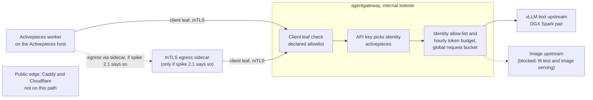

# 27 — agentgateway content generation

**Date:** 2026-11-16
**Status:** PROPOSED
**Author:** Joseph A. Wisneski IV
**Context:** Content automation drafts social posts in Activepieces flows and hands them to Postiz. Drafting needs a language model now and an image model later, both served from the DGX Spark pair through the agentgateway. This plan records what the gateway must change to serve that caller. It is built from the Plane module `agentgateway-content-generation` and the OpenSpec change of the same name. Its facts were re-checked at their cited lines on `dev` at `1ae46279`.

---

## Problem

- **The gateway has one vLLM upstream for its models.** Every vLLM entry renders one base URL, `agw_upstream_base_url` (`config.yaml.j2:430`). The only other provider the validator accepts is `openrouter`, which is opt-in per model and per identity (`secret-declarations/agentgateway.yml:309-310`; the `agentgateway-openrouter` change).
- **No image route exists.** The model entries render only the `completions` and `responses` formats (`config.yaml.j2:382-384`, `:426-428`). A repository-wide `git grep` for the images endpoint path and related terms found no match outside the OpenSpec directory. Whether the pinned image, `cr.agentgateway.dev/agentgateway:v1.5.0` (`compose.yml:36`), proxies the OpenAI images API is **UNVERIFIED**. Task 3.1 (AC-786) checks it.
- **The only per-identity usage limit is a token budget.** The request ceiling is gateway-wide (inference-gateway-agentgateway requirement "Every client has its own identity and limit"). So a looping flow can use up the shared ceiling for every client, whatever its token budget.
- **The content caller has no identity, budget or network path yet.** Plane AC-783 decided the network path on 2026-11-12 (D1).

## Decisions

| # | Decision | Rationale | Source |
|---|---|---|---|
| D1 | Activepieces reaches the gateway on the gateway's own internal listener, with an internal-CA (step-ca) client leaf. The public inference route is not used. | The rejected route carries a Cloudflare per-source limit of 10 requests per 10 seconds on `/v1/*` and a 125-second read timeout (AGENTS.md, Deployment Status, inference edge entry). A content flow should not sit behind either. The public edge stays unchanged. | AC-783, decided 2026-11-12 by the operator |
| D2 | Identity `activepieces`. The instance declares `agw_verify_client` as an operator identity, and `activepieces` is never the first entry of `agw_clients`. It is not in `agw_openrouter_identities`. Its `allowed_models` names the text model only for now; the image model joins after task 3.3. | The deploy's keyed verify runs as `agw_verify_client`, else the first identity of the merged list (Verified facts). Naming it explicitly keeps every deploy from spending this identity's budget, whatever the list order. Staying out of `agw_openrouter_identities` keeps every OpenRouter model from it (agentgateway-openrouter requirement "An OpenRouter model is declared by name and reachable only by named identities"). | `deploy-agentgateway.yml:971,1165`; agentgateway-openrouter spec |
| D3 | Token budget `tokens_per_hour` of 250,000, provisional. Task 2.3 (AC-785) sets it, and gate 2.4 (AC-791) re-measures it from the response usage fields. The value lives in site-config under `agw_client_policies.activepieces.tokens_per_hour`. | The arithmetic in "Identity and budget" below. The budget is the gateway's only per-identity usage limit (Problem), so it sits well below the default. A looping flow then cannot take a large share of the shared pair. Plane declares no numeric post cadence (AC-802, AC-836), so the figure rests on the assumptions listed there. | `config.yaml.j2:124,171`; AC-802; AC-836 |
| D4 | No studio identity for now. | A studio identity is needed only if the studio calls models directly. That is undecided. | AC-810 |
| D5 | Two phases. The text path (tasks 2.1 to 2.4) goes first. The image path (tasks 3.1 to 3.6) waits until the image model the dgx-spark fit test selects (Z-Image-Turbo first, AC-870 decision 2026-11-16) passes its fit test on the DGX Spark pair and the dgx-spark handoff names its endpoint. | The operator decided on 2026-11-16 to switch away from the first candidate model (AC-870). Image serving on the DGX Spark pair is not built. | AC-870; dgx-spark items DGXSPARK-10, DGXSPARK-12 to DGXSPARK-16 |
| D6 | A per-identity request limit is not decided here. Task 3.3 (AC-788) decides it; which identities it covers is open (see Open, in this cell). Only a limit the gateway enforces meets the image requirement in the spec, so the image model waits for one. The options: a gateway release with a per-key request limit; rewriting the gateway config into the full `binds`/`listeners`/`routes` shape, where a per-identity `conditional` limit is accepted on v1.5.0; a count kept by the calling flow, which is cooperative, not enforced, and acceptable only as a text-path stopgap; an edge rule, which is off the decided path (D1). Recommendation: the gateway release; the config rewrite if no release ships one in time. Open (operator decision pending, 2026-11-17): the spec's limit requirement names image models only, and task 3.3 is titled "images first"; whether text identities get a per-identity request limit is undecided. Until it is decided, the text path has the global request bucket alone. | The gap is the inference-gateway-agentgateway requirement "Every client has its own identity and limit": a gateway-wide request ceiling, no per-identity request bucket on v1.5.0 without the verbose route shape, and no charge for a response without usage. That change settled the token-budget question on 2026-09-17 and left "wait for the release that ships `key`" as the path to a request bucket (`design.md:439-446`). Images are the sharpest case, because whether image responses carry usage is UNVERIFIED (task 3.1). | inference-gateway-agentgateway spec and `design.md:439-446` |
| D7 | The key is generated once by Deploy agentgateway and reused, as `secret/services/agentgateway:client_activepieces`. It reaches Activepieces through a `no_log` playbook that reads OpenBao and writes the Activepieces connection through its API. That playbook belongs to `social-content-automation` (AC-797). No person pastes the key by hand. | Each enrolled identity's key is stored in OpenBao (inference-gateway-agentgateway requirement "Every client has its own identity and limit"). One automated handout keeps the key out of chat, shell history and task output. | inference-gateway-agentgateway spec; AC-797 |
| D8 | Whether an Activepieces piece can present a client certificate is UNVERIFIED. Spike 2.1 (AC-826) decides it. If a piece cannot, the fallback is a minimal mTLS egress sidecar in the Activepieces compose project, on an internal network only, holding the leaf and the CA bundle. Renewal of the leaf is the production-internal-ca requirement "Leaves are renewed on a schedule and the new certificate is in use". The leaf is declared with reload `none` only if the piece or sidecar opens the leaf files on each call: renewal classes every reload-`none` client leaf as per-call and proves it with a fresh probe of the files, so a holder that read them once would get a green proof line while still presenting the old certificate. A holder that reads once needs the reload proof that requirement mandates, which no task builds yet (AC-928). Whether the Activepieces worker re-reads on each call is not known: spike 2.1 (AC-826) must answer it, and task 2.2 (AC-825, blocked by AC-826 and AC-928) does not declare reload `none` before that answer. AC-928 closes without work if AC-826 shows the holder reads the certificate on each call. | A caller that cannot present a leaf has no path to the gateway. A reload-`none` declaration for a holder that reads once would pass renewal without proving anything. | AC-826; AC-928; production-internal-ca spec; `renew-internal-certs.yml:235-243` |

## Verified facts

| Fact | Where |
|---|---|
| The deploy's keyed verify runs as `agw_verify_client`, and defaults to the first identity of the merged list when that is unset. | `platform/playbooks/deploy-agentgateway.yml:968-971`, `:1165` |
| `Probe agentgateway Client TLS (Dev)` refuses a leaf that is on the allowlist, by name or by a shared SAN. | `platform/playbooks/probe-agentgateway-client-tls.yml:17-20`, `:108-115` |
| The pinned image is `cr.agentgateway.dev/agentgateway:v1.5.0`. Its pin sites are every reference `git grep -n 'agentgateway:v1.5.0' -- platform` returns (the `AGW_IMAGE` default rendered into `.env`, the Compose fallback, the reviewed-pin checks, and the tests and docs that assert the literal), plus the task names and `fail_msg`/`success_msg` text that state the version (`git grep -n 'v1\.5\.0' -- platform` narrowed to `name:`, `fail_msg:` and `success_msg:` lines, plus the refusal reason at `platform/playbooks/files/inspect-agentgateway-runtime.py:323`; one test indexes a task by its name). A pin move updates those together. The rule covers image references and those messages only: prose that names the release (the release link in the gateway's deployment README) is reviewed by hand with the move, and comments recording what was measured on v1.5.0 and `blob/v1.5.0/` source links stay at their tag. Through `deploy.sh` the rendered `.env` value is what runs, and the deploy refuses a rendered image that differs from the reviewed pin. Model entries render the `completions` and `responses` formats only. | the two `git grep` commands; `platform/playbooks/files/inspect-agentgateway-runtime.py:323`; `platform/services/agentgateway/deployment/deploy.sh` (exports the rendered `AGW_IMAGE`); `deploy-agentgateway.yml`, tasks "Require the rendered Compose image to match the reviewed pin" (the check) and "Refuse image pull when the rendered Compose image differs from the reviewed pin" (the refusal); `config.yaml.j2:382-384`, `:426-428` |
| The vLLM entries render one base URL, `agw_upstream_base_url`. The validator refuses any `provider` other than `openrouter`. | `config.yaml.j2:430`; `secret-declarations/agentgateway.yml:309-310` |
| Conformance cases are built in `body_for()`. The direct side is one vLLM URL, `AGW_CONF_DIRECT_URL`. | `platform/services/agentgateway/deployment/tests/conformance.sh:172`; `platform/playbooks/run-agw-conformance.yml:407` |
| Two gateway dashboards exist, `agentgateway-client-view.json` and `agentgateway-traffic.json`. `Verify o11y Dashboard Data (Dev)` checks that a dashboard renders data. | `platform/services/o11y/deployment/config/grafana/dashboards/` (both files); AGENTS.md, workflow table, `Verify o11y Dashboard Data (Dev)` row |
| The OpenSpec sync keys each item as `<owner/repo>/<change>/<task id>` and each module as `<owner/repo>/<change>`. Checked tasks are skipped as "done before import". | `platform/services/plane/lib/openspec_to_plane.py:159`, `:188`, `:148-150` |
| The operator decided the network path on 2026-11-12. The item is Done. | Plane AC-783 |
| No numeric post cadence is declared. AC-802 names a declared cadence, derived from a topic backlog, but gives no figure. AC-836 names five target accounts across two brands. | Plane AC-802, AC-836 |
| Every scheduling or publishing step needs a person's approval. Drafts may be created automatically. | Plane AC-795, AC-801 |
| The image model is switched: the dgx-spark work fit-tests Z-Image-Turbo first, with a fallback order. Agent-cloud image tasks stay blocked until the fit test passes and the dgx-spark handoff names the endpoint and model. | Plane AC-870 (Done 2026-11-16, decision comment; module `social-content-automation`); DGXSPARK-10, DGXSPARK-12 to DGXSPARK-16 |
| Whether a studio identity is needed is undecided. | Plane AC-810 |

Facts marked as Plane items come from the Plane records named in the table, read on 2026-11-16.

## Design Principles

- **Through the platform.** Deploys run through Semaphore templates. Keys come from OpenBao. Identities, budgets and allow-lists are declared in inventory, never hand-edited on a host (AGENTS.md, "Conform to the platform").
- **Least privilege.** The content caller gets its own identity and budget, a text-only allow-list at first, and no OpenRouter model.
- **No edge widening.** The content path does not use the public edge, and this plan does not change it.
- **Do not design past what is verified.** The image route's shape, the image format type and any second-upstream keys stay open until tasks 3.1 and 3.2 verify them.
- **One codebase.** This repository holds the mechanism and placeholders. Instance values (the identity list, the budget, the allowlist entry, the leaf and the host names) live in site-config.

## Architecture



The Activepieces worker presents its client leaf to the gateway's internal listener, which admits it under the inference-gateway-agentgateway requirement "The gateway admits only declared client certificates". The key picks the identity, and that identity's allow-list and budget apply. The request then goes to the vLLM text upstream. The image upstream is dashed because it is blocked. The public edge is not on this path.

### Identity and budget

The identity is `activepieces` (D2). Its budget is 250,000 tokens an hour (D3). That figure comes from the arithmetic below. Every input marked `assumption:` is a planning figure, not a measurement.

```text
per draft call        prompt 3,000 + completion cap 4,000          = 7,000 tokens
one brief             up to 4 posts (one per target account)       = 28,000
                      one guardrail re-draft per post, x2          = 56,000
burst ceiling         4 briefs in one hour                         = 224,000
set budget            rounded up                                   = 250,000
```

- `assumption:` the prompt is 3,000 tokens: the brand profile, the guidelines and the brief together.
- `assumption:` the completion cap is 4,000 tokens. The flow sets `max_tokens`, and reasoning tokens count against it.
- `assumption:` one guardrail re-draft per post.
- `assumption:` at most four briefs in one hour, from scheduled runs and manual regenerations together.
- `up to 4 posts` comes from AC-836: five target accounts across two brands, four of them for one brand.

250,000 is one eighth of the 2,000,000 default (`config.yaml.j2:171`). The value is set in site-config (`agw_client_policies.activepieces.tokens_per_hour`, read at `config.yaml.j2:124` and `:171`).

How the budget is charged is the inference-gateway-agentgateway requirement "Every client has its own identity and limit".

`Probe agentgateway Isolation (Dev)` refuses a burst identity whose budget is above 1000 tokens (`probe-agentgateway-isolation.yml:91`), so it proves the budget mechanism on a dedicated low-budget probe identity, not on `activepieces`. The `activepieces` figure itself is not drilled at cap; gate 2.4 records its measured usage instead.

### Network path

- The content caller is admitted under the inference-gateway-agentgateway requirement "The gateway admits only declared client certificates", which requires the gateway's listener TLS on. Its leaf is issued and renewed under production-internal-ca (requirements "Leaves are issued from consumer-held keys for declared names only" and "Leaves are renewed on a schedule and the new certificate is in use").
- The allowlist names leaves, not SANs (inference-gateway-agentgateway task 6.1). Task 2.2 therefore adds the leaf's **name**. AC-825's text says "add its SAN"; this plan corrects that wording.
- **Correction to AC-825.** Its text names `Probe agentgateway Client TLS (Dev)` as the way to prove the leaf. That probe refuses an allowlisted leaf by design (Verified facts), so it cannot prove this leaf is admitted. Task 2.2's renewal proof shows admission at the leaf's first renewal, and gate 2.4 proves it end to end. The owner of AC-825 should correct the Plane text. This change does not edit Plane.

### Images

- The image path is blocked per D5.
- No image route is defined in the gateway's template, its deploy playbook or its secret declaration. Whether v1.5.0 proxies the OpenAI images API is **UNVERIFIED**. Task 3.1 (AC-786) checks it. If it does not, the pin moves (every pin site in Verified facts), and the move is verified at that point.
- The image route's shape, its format type and its upstream configuration keys are open. Tasks 3.1 and 3.2 decide them.
- A second upstream needs a template branch, a wider validator (`secret-declarations/agentgateway.yml:309-310` refuses any provider value other than `openrouter` today), a new `existing` secret seeded with `Seed OpenBao Key` and never generated, and tests. The pattern to follow is the `agentgateway-openrouter` change and `platform/tests/test_agw_openrouter.py`.
- An output safety filter for the chosen image model is tracked in dgx-spark (DGXSPARK-16). Whatever it finds, a person approves each item before it is published (AC-795, AC-801).

### Limits

The gateway's only request limit is gateway-wide (inference-gateway-agentgateway requirement "Every client has its own identity and limit"). D6 lists the options and the open scope question.

### Conformance and dashboards

- The conformance run builds each case in `body_for()` (`platform/services/agentgateway/deployment/tests/conformance.sh:172`). Its direct side is one vLLM URL (`platform/playbooks/run-agw-conformance.yml:407`). Task 3.4 adds a second direct URL for the image upstream, and an images case that compares the gateway with that upstream. The run fails any case where a side fails, or where status, shape or semantics differ (AGENTS.md, `Run agentgateway Conformance` row).
- Task 3.5 adds panels for image latency, errors and per-identity volume to the gateway dashboards (`agentgateway-client-view.json`, `agentgateway-traffic.json`). `Verify o11y Dashboard Data (Dev)` proves that the panels render data, not only that the dashboards load (AGENTS.md row of that name).

## Implementation Phases

The Plane module `agentgateway-content-generation` holds 12 items: AC-782, AC-783, AC-785 to AC-792, AC-825 and AC-826. AC-783 is done, and AC-782 is the work item for this plan. The other ten are the open tasks in `tasks.md`.

### Phase 1: text path (tasks 2.1 to 2.4)

Not blocked by the image model. It depends on `deploy-activepieces` delivering the Activepieces host, which holds the leaf. That change is not on `dev`. Task text and acceptance are in `tasks.md`.

- Rollout order follows the o11y inference probe's client leaf, the same pattern, first run in production on 2026-10-05 (`platform/services/o11y/deployment/README.md:843-849`):
  1. site-config declarations together: the leaf, the allowlist entry, the `agw_clients` entry (2.3), the gateway host's firewall rule admitting the Activepieces host, and `agw_verify_base_url` (an `https://` URL; production-internal-ca task 6.1 gives the proof-path rules); then an inventory sync;
  2. `Deploy step-ca (Dev)`, because the CA signs only declared SANs;
  3. `Deploy agentgateway (Dev)` (allowlist rule, `client_activepieces` minted), once, so the gateway container is recreated once;
  4. `Apply Firewall (Dev)` on the gateway host;
  5. `Issue Internal Leaf (Dev)` on the Activepieces host;
  6. the Activepieces deploy places the CA bundle and maps the gateway's server name on its host, as the o11y deploy does for its probe (README `:826-834`). Both belong to `deploy-activepieces`;
  7. `Issue Internal Leaf (Dev)` with `leaf_action=inspect` on the Activepieces host passes for the leaf. The scheduled `Renew Internal Certs (Dev)` run that first renews it reports a proof for it (task 2.2).
- The gateway deploy checks that its own server and verifier leaves are issued (`deploy-agentgateway.yml:330-347`), not an allowlisted client leaf on another host: the order above is a convention, not enforced.
- If task 3.1 later moves the pin, gate 2.4 runs again on the new pin.

Phase 1 acceptance: gate 2.4 passes. The `activepieces` identity gets chat and json_schema completions through the gateway in production, from the Activepieces host, and a keyless call is refused.

### Phase 2: image path (tasks 3.1 to 3.6)

The image path is blocked per D5. Task text and acceptance are in `tasks.md`.

- The image model joins the `activepieces` allow-list only once task 3.3's request limit is in force (spec requirement "An image model is served only with a per-identity request limit in force").
- Task 3.2's recommended shape: a per-model upstream declaration on each `agw_models` entry (base URL, key secret, formats), from which the template renders each entry's `baseUrl` and conformance takes each case's direct URL, rather than a second hard-wired branch. The direct side is hard-wired to vLLM today (`config.yaml.j2:430`, `run-agw-conformance.yml:407`). Task 3.2 decides it.

Phase 2 acceptance: gate 3.6 passes.

## Validation Criteria

| Check | Pass condition |
|---|---|
| Leaf issued | `Issue Internal Leaf (Dev)` with `leaf_action=inspect` passes for the leaf on the Activepieces host (task 2.2). |
| Leaf renewed | The first `Renew Internal Certs (Dev)` run that renews the leaf reports a proof for it, not `left alone` (task 2.2). Task 2.2 is blocked by AC-826 and AC-928 (D8); for a holder that reads the leaf once, that line proves nothing. |
| Text gate | With the gateway's listener TLS on, shown as task 2.4 states: chat and json_schema completions from the Activepieces host succeed, and a request presenting the Activepieces leaf with no API key is refused with 401 (task 2.4). |
| Budget refusal at cap | `Probe agentgateway Isolation (Dev)` on a dedicated low-budget probe identity: HTTP 429 with `budget_exceeded` for it and HTTP 200 for a control. The `activepieces` figure is not drilled at cap (it is above the probe's 1000-token limit); gate 2.4 records its usage. |
| Image cap | A request past the image cap is refused for that identity, and another identity is still served (scenario "Request past the image cap"). |
| Conformance images case | `run-agw-conformance.yml` passes its images case against both the gateway and the direct image upstream. |
| Dashboard data | `Verify o11y Dashboard Data (Dev)` passes for the image panels. |
| Image gate | Task 3.6 passes, in production. |

## Security Considerations

- **Keys.** Each identity's key is generated once and reused (`secret-declarations/agentgateway.yml:249-254`). The Activepieces key goes only to the Activepieces connection, through a `no_log` playbook (D7). The OpenRouter credential is rendered into the gateway's 0600 `.env` (`agentgateway-openrouter/proposal.md:31`). The image upstream's key is planned to follow the same pattern (task 3.2).
- **Leaf keys.** The leaf's private key is made on the Activepieces host. `Issue Internal Leaf (Dev)` inspect refuses a key that is not 0600 (AGENTS.md, `Issue Internal Leaf (Dev)` row).
- **Allowlist.** Admission is the inference-gateway-agentgateway requirement "The gateway admits only declared client certificates". Its refusals (no certificate, a leaf off the allowlist) belong to that change's task 6.4, which is still open.
- **Budget.** The budget's semantics are the inference-gateway-agentgateway requirement "Every client has its own identity and limit". Request limits are discussed in D6.
- **No paid models.** The identity is not in `agw_openrouter_identities` (D2).
- **Sidecar.** If it is needed, it sits on an internal network only, and it holds only the leaf and the CA bundle.
- **Public edge.** Unchanged (D1).
- **Published images.** An output safety filter for the chosen model is tracked in DGXSPARK-16. A person approves each item before it is published (AC-795, AC-801).

## Open Questions and Unverified Items

- **UNVERIFIED: the images API in v1.5.0.** Task 3.1 (AC-786).
- **UNVERIFIED: whether an Activepieces piece can present a client certificate.** Task 2.1 (AC-826).
- **UNVERIFIED: a per-key request limit in any gateway release.** Tasks 3.1 and 3.3 (AC-786, AC-788).
- **Open: the image model's output safety filter.** DGXSPARK-16.
- **Undeclared: the post cadence.** The budget figure rests on the assumptions in "Identity and budget". Gate 2.4 re-measures it (AC-791).
- **Open: which image model passes the fit test.** Z-Image-Turbo first (AC-870, DGXSPARK-13).
- **Open: a studio identity.** AC-810.
- **Dependency: the Activepieces host.** Phase 1 needs `deploy-activepieces`, which is not on `dev`.
- **Dependency: a renewal proof for a holder that reads its leaf once.** AC-928 (production-internal-ca module); AC-825 is blocked by it and by spike AC-826 (D8).
- **Dependency: the gateway's refusal drills.** No certificate, and a leaf off the allowlist: inference-gateway-agentgateway task 6.4 (AC-256).
- **Open: request-limit scope (D6).** The operator decides whether text identities get a per-identity request limit.

## Release-Budget Cost (estimate)

A promotion carries at most 100 pull requests and 120 changed files (`plan/architecture/10-release-policy.md`). The counts below are estimates.

- **This change:** 8 files (this plan, the six OpenSpec change files, and one line in `AGENTS.md`).
- **Text path:** 0 to 3 files in this repository. A reload proof for a holder that reads its leaf once counts under AC-928. The identity, the budget, the allowlist entry and the leaf are site-config inventory. A sidecar, if one is needed, counts under `deploy-activepieces`.
- **Image path:** these files, plus the pin sites in Verified facts if the pin moves: `config.yaml.j2`, the secret declaration, `env.j2`, `deploy-agentgateway.yml`, one test file, `conformance.sh`, `run-agw-conformance.yml`, the two gateway dashboards, the gateway's `architecture.md`, the OpenBao row in `AGENTS.md`, and the cap drill playbook with its `templates.yml` entry.

## Cross-references

- `AGENTS.md`: the workflow-table rows and the `secret/services/agentgateway` row cited above.
- `plan/development/06-inference-skynet.md`: skynet as the inference and agent plane.
- `platform/services/agentgateway/context/architecture.md`: the gateway's architecture note.
- `plan/architecture/10-release-policy.md`: the release caps used in the budget estimate.
- `plan/development/23-release-train.md`: the release train that orders this work.
- OpenSpec changes on `dev`: `inference-gateway-agentgateway`, `agentgateway-openrouter`, `production-internal-ca`, `deploy-postiz-social-publishing`.
- OpenSpec changes named here but not on `dev`: `deploy-activepieces`, `social-content-automation`, `social-content-studio`.
- This change: `plan/development/openspec/changes/agentgateway-content-generation/`.

## Revision History

| Date | Change |
|---|---|
| 2026-11-16 | Initial draft (PROPOSED): text path and image path, the `activepieces` identity and its budget, and the internal-listener client-leaf path decided under AC-783. |
| 2026-11-16 | Image path: AC-870 decided (switch model; Z-Image-Turbo fit-tested first); the image tasks now wait on the dgx-spark fit test and serving handoff. |
| 2026-11-17 | Follow-up (AC-925): one authority per behaviour. Listener TLS, the allowlist and its refusals point to inference-gateway-agentgateway; leaf issuance and renewal to production-internal-ca; the refusal drills to inference-gateway-agentgateway task 6.4; budget semantics to the gateway spec. This plan keeps the identity, its leaf, the image path and its gates. D6 scope stated open. |
