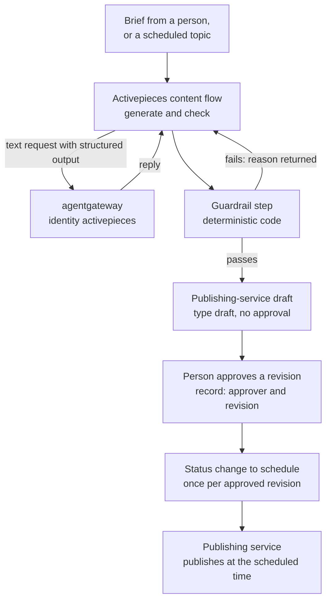
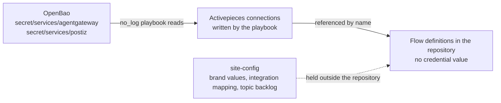

# 28 — Social Content Automation

> **Depends on:** 14 (Postiz), 26 (deploy-activepieces), 27 (agentgateway-content-generation)
>
> Plans 26 and 27 are cited here by their OpenSpec change names. Their design is not restated in this plan.

**Author:** Joseph A. Wisneski IV
**Date:** 2026-11-16
**Status:** PROPOSED

**Context:** Social posts for the instance's brands are written and scheduled by hand. This plan sets the pipeline that drafts those posts with a text model, checks them, and hands them to the publishing service as drafts. A person's recorded approval stands in front of every scheduled or published post. The plan records the decisions taken on 2026-11-12, the risks still open, and the phases that carry the work. The work is tracked as the OpenSpec change [social-content-automation](openspec/changes/social-content-automation/), whose tasks carry the Plane keys.

---

## Problem

- Posts for the instance's brands are written and scheduled by hand.
- A text model can draft them, but its output must not reach a public account without an approval, and generation must not be able to publish directly.
- The publishing service already holds the connected accounts and schedules publication (plan 14). What is missing is generation, checks, a handoff that is safe to retry, and a recorded approval for every schedule.
- The earlier flow engine, n8n, was retired on 2026-11-10. Activepieces replaces it (plan 26). No file in the repository mentions Activepieces at the base commit.

## Design Principles

1. **Approval before every schedule and every publish.** Drafting needs no approval. Scheduling and publishing need a recorded approval that names the approver and the revision (AC-795). This is a platform rule, not a property of one flow.
2. **One publisher.** The publishing service keeps scheduling and publishing (D1). No flow publishes immediately.
3. **Through the platform, never around it.** Generation goes through the inference gateway under its own client identity. Credentials come from OpenBao through a playbook. Config is code: flows and connections are declared in the repository and applied by a playbook, as `AGENTS.md` requires.
4. **Foundational over one-shot.** Flows, connections and checks are code. They are re-runnable and converge on a second run. No production flow is built by hand.
5. **Brand values stay private.** The repository holds the schema, placeholders and code. Brand values, account mappings, the topic backlog and banned terms live in site-config, as the standing convention in `AGENTS.md` requires.
6. **Prove before connecting accounts.** Everything that does not need a connected social account is proven first (D12).

## Decisions

| # | Decision | Why |
|---|---|---|
| D1 | The publishing service keeps scheduling and publishing. Activepieces generates, checks and hands off. | The publishing service owns the account connections, the per-platform publishing code and its own Temporal-backed execution. Its use-case record states "The client does not publish. It schedules." ([use-cases.md](../../platform/services/postiz/context/use-cases.md), lines 43 to 60; [14-postiz-social-publishing.md](14-postiz-social-publishing.md), D1). |
| D2 | Approval rule (AC-795, Done, Joseph, 2026-11-12). Generation, automatic or recommended, MAY create drafts with no approval. Scheduling and publishing need a person's approval every time, and the approval records who approved which revision. Flows never send the immediate post type. The only write made without an approval record is a draft. A post becomes scheduled only through the status change that follows an approval. | A public post must not appear on an account without a person's decision on that exact revision. |
| D3 | Flows are code. Definitions are versioned in `platform/services/activepieces/flows/` (planned) and applied by a `Manage Activepieces Flows` playbook. A dry run shows the diff, a re-run converges, and the playbook never deletes a flow it does not own. No hand-built production flow. | Engineering principles 3 and 4 in `AGENTS.md`. Whether the Community edition supports this path is risk R1. |
| D4 | No credential in flow JSON. The gateway client key (`secret/services/agentgateway:client_activepieces`) and the publishing service's API key (`secret/services/postiz:postiz_api_key`) are written into Activepieces connections by a `no_log` playbook that reads OpenBao. Neither is pasted into a flow, and neither is copied under another service's path. | A flow definition is committed and readable. The publishing key is organisation-wide (R5). |
| D5 | The gateway is reached through the HTTP piece. The OpenAI piece's base URL is fixed, and the AI provider setting that would allow another base URL needs a plan that includes AI providers. Structured output uses `response_format` with a json_schema, which the gateway deploy already proves (`platform/playbooks/deploy-agentgateway.yml:40-41` and `:1396-1411`). | Upstream facts below. |
| D6 | The publishing service is reached through the Postiz piece, with custom auth (`base_url` and `api_key`). The HTTP piece or a custom API call covers the routes the piece lacks, such as the status change. | Upstream facts below. |
| D7 | Exactly once. The publishing service's create-post call is not idempotent. The flow therefore records the post identifier the service returns against its draft, keyed by a stored external identifier, and checks that record before every create or schedule. | The lesson carried from the earlier flow engine: idempotent writes keyed by a stored external identifier. |
| D8 | Brand profiles. The schema comes first (AC-828), planned at `platform/content/brand-profile.schema.json` with a placeholder example. Then one profile per brand, with values in site-config. Schema fields: name, domain and parent brand; colour tokens with light and dark roles; type families and weights; logo and mark references, favicon and open-graph card; voice rules with example lines; audiences; allowed claims, and forbidden or unbacked claims; imagery rules; social accounts per platform mapped to publishing integrations; and a provenance source for each field. Profiles serve three uses: hand-seeded profiles, profiles extracted by the studio (AC-810, undecided), and the system and image prompts of generation. | One source of voice and claims for every generated draft. |
| D9 | Brand isolation. The brand-to-integration mapping is declared, with its values in site-config. The handoff refuses a target integration that the mapping does not assign to the draft's brand. A draft names exactly one target account, which may be a page or a person's account. Fan-out to another account needs its own approval. | A post for one brand must not reach another brand's account. |
| D10 | Guardrail. A deterministic code step inside the flow checks each platform's length limit, a banned-term list from site-config, that links resolve to allowed domains, and that no internal hostname or credential-shaped string appears. The step installs no package, which fits the sandbox mode (`SANDBOX_CODE_ONLY`) that AC-768 proposes. A failing draft is returned with its reason and never reaches approval. | Model output may name internal systems or make claims that nothing backs (R7). |
| D11 | Failure alerting goes through the existing observability alert path, which is the Discord webhook route. A failed run is not left in run history alone. | A failed run must be seen by a person. |
| D12 | Order of work. Everything that does not need a connected X or LinkedIn account comes before Gate A, so drafts are proven end to end first. Risk R2 limits what this order can prove. | Keeps the unproven part to the publishing leg alone. |

Decision sources: the Plane items named above and the decisions recorded on 2026-11-12. The upstream facts are listed under [Upstream facts used](#upstream-facts-used).

## Architecture

### Pipeline

### Where the secrets come from

## Implementation Phases

The six phases match the phases of the OpenSpec change `social-content-automation`, and each task keeps its id and Plane key. Task ids are permanent. The task file carries the per-task acceptance lines. Each phase below gives its goal, its acceptance criteria and its gate, which is the spec scenario that proves the phase. [`openspec/changes/social-content-automation/tasks.md`](openspec/changes/social-content-automation/tasks.md) holds the full text.

### Phase 1: Plan and decisions (done)

**Goal:** Record the pipeline, the decisions and the approval rule.

**Tasks:** 1.1 this plan and change (AC-793); 1.2 the approval policy (AC-795).

**Acceptance criteria:**
- Plan 28 and the change exist and carry the decision table.
- The approval rule of D2 is recorded with the approver-and-revision requirement.

**Gate:** Scenario "Schedule refused without a recorded approval".

### Phase 2: Brand profiles (needs nothing outside this change)

**Goal:** A schema for brand profiles, and one validated profile per brand of the instance.

**Tasks:** 2.1 schema and placeholder example (AC-828); 2.2 the rollup for all profiles (AC-794); 2.3 the first brand, which is on the Gate A critical path (AC-829); 2.4 the second brand (AC-830); 2.5 the third brand (AC-831).

**Acceptance criteria:**
- The schema holds the fields of D8, and the placeholder example validates against it.
- Each brand's profile validates against the schema, and each field records its source.
- No brand value appears in the repository. Every value is in site-config.

**Gate:** Scenario "Target integration not mapped to the brand is refused". No requirement covers brand profiles directly, so the gate maps to brand isolation (see Open Questions).

### Phase 3: Flows as code and connections (needs a running Activepieces, change deploy-activepieces)

**Goal:** Flows and connections are declared in the repository, applied by playbook, and proven against the gateway and the publishing service.

**Tasks:** 3.1 the `Manage Activepieces Flows` playbook, whose first spike is R1 (AC-796); 3.2 the gateway connection, whose spike is R3 (AC-797); 3.3 the publishing-service connection (AC-798).

**Acceptance criteria:**
- The spike for R1 runs first. If the Community edition does not support the flow API path, work stops and the decision returns to the operator (edition, AC-768).
- A dry run shows the diff, and a second run with unchanged declarations reports no change. An unowned flow is left in place.
- One completion returns through the gateway under the `activepieces` identity, and no key appears in a flow definition.
- The publishing-service connection upserts by its external identifier and reads its key from OpenBao.

**Gate:** Scenario "Re-run of the apply playbook converges".

### Phase 4: Text pipeline (no connected social account needed, except where R2 says)

**Goal:** Generate, check, approve and hand off text drafts, with the handoff proven exactly once.

**Tasks:** 4.1 generate one draft per platform from a brief (AC-799); 4.2 the guardrail step (AC-800); 4.3 the brand-to-integration mapping and its refusal (AC-836); 4.4 the handoff, with the approval surface chosen by spike (AC-801); 4.5 scheduled generation from a topic backlog held in site-config (AC-802); 4.6 failure alerting (AC-804).

**Acceptance criteria:**
- One draft per target platform, each reply parsing against its schema, and a prompt built from the brand profile.
- A draft over a platform's length limit, or naming an internal hostname, is returned with its reason and does not reach approval.
- The handoff records one post per draft. A retried handoff creates no second post. The approval surface is chosen by spike and recorded in Open Questions.
- The declared cadence of scheduled generation stays under the lower documented ceiling (R6).
- A forced failing run raises an alert on the observability alert route.

**Gate:** Scenarios "Retried handoff creates no second post", "Draft naming an internal hostname is refused" and "Failed run raises an alert".

### Phase 5: Gate A (needs connected X and LinkedIn accounts, operator action)

**Goal:** Gate A. Publish one AI-drafted, human-approved text post to the first brand's X and LinkedIn accounts through the publishing service in production.

**Tasks:** 5.1 Gate A (AC-805). It is blocked by 4.2 and 4.4, the gateway text gate (AC-791), the Activepieces gate (AC-781), and the X and LinkedIn apps and accounts (AC-760 and AC-761). The publishing-service change tasks 6.5 (the OAuth redirect destinations at each social platform), 7.1 (seeding the platform credentials into the production secret store) and 7.7 (connecting the accounts) are the operator steps that precede it.

**Acceptance criteria:**
- One approved revision of the post is published to each of the two accounts.
- A rerun of the handoff adds no post.

**Gate:** Scenarios "Approval of one revision does not schedule the next revision" and "Retried handoff creates no second post".

### Phase 6: Images (blocked on the image path of plan 27)

**Goal:** Gate B. Gate A, plus an approved AI-generated brand image attached to an approved text post.

**Tasks:** 6.1 the image step (AC-803), blocked by the gateway image gate (AC-792) and the licence decision (AC-870). 6.2 Gate B (AC-806).

**Acceptance criteria:**
- The image is generated through the gateway, approved with its text, and attached to the post in the publishing service.
- Gate A holds.

**Gate:** Scenarios "Schedule refused without a recorded approval" and "Failing draft returned with its reason", applied to the attached image. This change has no image scenario yet (see Open Questions).

### Dependency order

Tasks 1.1 and 1.2 are done and have no edges. The graph below shows the remaining tasks with their Plane keys and the external gates they wait on.

```mermaid
flowchart TD
    T21["2.1 schema (AC-828)"] --> T22["2.2 rollup (AC-794)"]
    T21 --> T23["2.3 first brand (AC-829)"]
    T21 --> T24["2.4 second brand (AC-830)"]
    T21 --> T25["2.5 third brand (AC-831)"]
    T23 --> T22
    T24 --> T22
    T25 --> T22
    EXT1["Activepieces local bring-up (AC-772)"] --> T31["3.1 flows as code (AC-796)"]
    EXT27["Plan 27 identity, client leaf, egress spike (AC-785, AC-825, AC-826)"] --> T32["3.2 gateway connection (AC-797)"]
    T31 --> T32
    T31 --> T33["3.3 Postiz connection (AC-798)"]
    EXT763["Production Postiz key (AC-763)"] --> T33
    T32 --> T41["4.1 generate drafts (AC-799)"]
    T23 --> T41
    T41 --> T42["4.2 guardrail (AC-800)"]
    T21 --> T43["4.3 brand mapping (AC-836)"]
    T33 --> T44["4.4 handoff (AC-801)"]
    T42 --> T44
    T43 --> T44
    T44 --> T45["4.5 scheduled generation (AC-802)"]
    T31 --> T46["4.6 failure alerts (AC-804)"]
    T42 --> T51["5.1 Gate A (AC-805)"]
    T44 --> T51
    EXT791["Gateway text gate (AC-791)"] --> T51
    EXT781["Activepieces gate (AC-781)"] --> T51
    EXT760["X and LinkedIn apps and accounts (AC-760, AC-761)"] --> T51
    T51 --> T62["6.2 Gate B (AC-806)"]
    EXT792["Gateway image gate (AC-792)"] --> T61["6.1 image step (AC-803)"]
    EXT870["Licence decision (AC-870)"] --> T61
    T61 --> T62
```

## Validation Criteria

The requirement numbers in the rows below follow the order of the requirements in the change's spec.

| Check | Pass condition |
|---|---|
| OpenSpec change validates | `openspec validate social-content-automation --strict` reports the change valid, run from `plan/development`. |
| Approval gate (Requirement 1) | A schedule with no recorded approval of the current revision is refused and nothing is scheduled. Approval of revision N does not schedule revision N+1. |
| No immediate publication (Requirement 2) | The static test over committed flow definitions fails on the immediate post type, on a literal credential, and on a schedule call that no approval step precedes. |
| Exactly once (Requirement 3) | A retried handoff finds the stored post identifier, and one post and one schedule remain for the draft. |
| Guardrail (Requirement 4) | A draft over a platform's length limit, or naming an internal hostname, is returned with its reason and never reaches approval. |
| Brand isolation (Requirement 5) | A handoff naming an integration the mapping does not assign to the draft's brand is refused before any post is created. |
| Converge re-run (Requirement 6) | A second apply of unchanged declarations reports no change, and an unowned flow is untouched. |
| No credential in definitions (Requirement 6) | The committed flow definitions contain no literal credential value. |
| Gateway identity (Requirement 7) | A completion made by a flow is recorded under the `activepieces` identity, and no flow calls a model backend directly. |
| Failure alert (Requirement 8) | A forced failing run raises an alert on the observability alert route, and a successful run raises none. |
| Gate A | One AI-drafted, human-approved text post is published to the first brand's X and LinkedIn accounts through the publishing service in production, and a rerun of the handoff adds no post. |
| Gate B | Gate A holds, and an approved AI-generated brand image is attached to an approved text post. |
| Post-creation ceiling | The scheduled cadence stays under the lower documented ceiling until the pinned version is checked (R6). |

## Security Considerations

- **Credentials (D4).** The gateway client key and the publishing service's API key are read from OpenBao by a `no_log` playbook and written into Activepieces connections. Neither appears in a flow definition, in a copy under another service's path, or in a printed task result. The `activepieces` identity is its own gateway client, so it can be revoked on its own with the `Manage agentgateway Client Key` playbook.
- **Organisation-wide publishing key (R5).** The publishing service's API key is organisation-wide. Any holder can schedule a post, and can send one immediately. The approval guarantee therefore rests on flow logic and on a static test. The service cannot scope the key, so the control lives in the repository: the test refuses the immediate post type, literal secrets, and a schedule call that no approval step precedes.
- **Model output (R7).** The guardrail (D10), the forbidden-claims list in each brand profile, and the human approval act together. Neither the guardrail nor the approval is sufficient alone.
- **Blast radius.** A failing or compromised flow can create drafts. It cannot schedule a post without an approval record, provided that the flow logic and the static test hold (R5). Brand isolation (D9) keeps a draft to its own brand's mapped account.
- **Budget.** The gateway's per-client budgets bound generation for each identity. The publishing service's post-creation ceiling (R6) bounds post creation, and the cadence of scheduled generation stays under the lower of its two documented values until the pinned version is checked.
- **Network exposure.** The Activepieces Community edition sits behind the platform's forward-auth gate at the edge, as change `deploy-activepieces` sets it. Gateway calls use the gateway's internal listener with a step-ca client leaf, not the public inference edge (AC-783). Whether outbound client certificates are supported is spike AC-826, and an mTLS egress proxy is the fallback (R4).
- **Edition (R1).** The upstream documentation ties API keys to the Platform and Enterprise editions. Flows as code (D3) and connections as code (D4) depend on a spike against the edition the platform runs.

## Risks

| # | Risk | Mitigation and where it is decided |
|---|---|---|
| R1 | The Community edition may not support the flow API path that D3 needs: its API keys are documented for the Platform and Enterprise editions, and the `IMPORT_FLOW` operation's semantics are not documented. There is no export endpoint. | Spike first, in task 3.1. If it fails, work stops and the decision goes back to the operator (edition, AC-768). No workaround is designed in this plan. |
| R2 | A publishing-service draft may need a connected integration, and the local publishing service has none (the operator declined local OAuth callbacks on 2026-08-30). | Spike in task 4.4 on the pinned v2.23.0: whether a draft can exist with no integration, and whether the status-change route exists on the pin. If a draft needs an integration, it lives in the flow until approval, and the publishing leg is proven at Gate A. |
| R3 | The HTTP piece may not be able to take its key from a stored connection. | Spike in task 3.2. If it cannot, another mechanism is chosen before task 3.2 closes. A key in a flow definition is never an acceptable fallback. |
| R4 | Outbound calls may not support a client certificate. | Spike AC-826 (plan 27). An mTLS egress proxy is the fallback. |
| R5 | The publishing service's API key is organisation-wide. | The approval guarantee rests on flow logic and the static test described under Security Considerations. |
| R6 | The post-creation ceiling bounds burst generation. The configuration reference gives a default of 90 per hour on create-post, while the shipped compose file and `.env.example` set 30. | The scheduled cadence stays under the lower figure. Check the pinned version before any cadence is raised. |
| R7 | Model output may name internal systems or make claims that nothing backs. | The guardrail (D10), the forbidden-claims list in each profile and the human approval. |

## Open Questions

1. **Approval surface (decided in task 4.4).** The options are:
   - (a) The person schedules the draft in the publishing service's interface, signed in through the platform's identity provider. This plan recommends (a) for Gate A only if the spike shows that the publishing service records who changed a post's state.
   - (b) An Activepieces approval step or a form behind the forward-auth gate records the approver and the revision, then sends the status change.
   - (c) The studio (AC-810). It is the intended long-term interface and is outside the v0.17.0 scope.
2. **R1 outcome (task 3.1).** Not yet known. If the Community edition does not support the flow API path, the decision returns to the operator.
3. **R2 outcome (task 4.4).** Not yet known.
4. **Image path and licence (phase 6).** The image step waits on the image path of plan 27 (AC-792) and on the licence decision (AC-870). This change has no image scenario in its spec, so one must be added before task 6.1 starts. Phase 6 also carries no requirement of its own.
5. **Phase 2 gate mapping (task 2.5).** The phase 2 gate maps to brand isolation because no requirement covers brand profiles directly. Whether brand profiles need a requirement of their own is open.
6. **Post-creation ceiling.** The documented values conflict (90 and 30 per hour). The pinned version must be checked before a cadence is set.
7. **Publishing-service key revocation.** The procedure to revoke the key is not yet established. It is an open item for task 3.3.

## Upstream facts used

Every fact in this section was checked on upstream main on 2026-11-16. Each one must be re-verified on the pinned version before the task that depends on it closes.

- **Publishing service API.** Create post is `POST /posts`, and its `type` is one of `draft`, `schedule` or `now`. A `draft` is "stored against the integration but not scheduled or published". [https://docs.postiz.com/public-api/posts/create](https://docs.postiz.com/public-api/posts/create)
- **Draft to scheduled.** `PUT /posts/{id}/status` takes a `status` of `draft` or `schedule`. [https://docs.postiz.com/public-api/posts/change-status](https://docs.postiz.com/public-api/posts/change-status)
- **Connected channels.** `GET /integrations` lists the connected channels with their identifiers. [https://docs.postiz.com/llms.txt](https://docs.postiz.com/llms.txt)
- **Authentication.** The `Authorization` header carries the raw API key. [https://docs.postiz.com/public-api](https://docs.postiz.com/public-api)
- **Post-creation ceiling.** The configuration reference gives a default of 90 per hour on create-post. The shipped compose file and `.env.example` set 30. [https://docs.postiz.com/self-host/configuration/reference.md](https://docs.postiz.com/self-host/configuration/reference.md)
- **Activepieces publishing piece.** The Create Post action takes a post type of draft, schedule or now. Its custom auth takes `base_url` for a self-hosted service and `api_key`. The action is declared not idempotent: "each call creates a new post". [https://www.activepieces.com/pieces/postiz](https://www.activepieces.com/pieces/postiz), [create-post.ts](https://github.com/activepieces/activepieces/blob/main/packages/pieces/community/postiz/src/lib/actions/create-post.ts), [auth.ts](https://github.com/activepieces/activepieces/blob/main/packages/pieces/community/postiz/src/lib/common/auth.ts)
- **Activepieces OpenAI piece.** Its base URL is fixed to the OpenAI API, with no custom base URL. [common.ts](https://github.com/activepieces/activepieces/blob/main/packages/pieces/community/openai/src/lib/common/common.ts). The "Other (OpenAI Compatible)" AI provider needs a plan that includes AI providers. [setup-ai-providers.md](https://www.activepieces.com/docs/admin-guide/guides/setup-ai-providers.md). Gateway calls therefore use the HTTP piece. [https://www.activepieces.com/pieces/http](https://www.activepieces.com/pieces/http)
- **Approval pieces.** The Approval (Legacy) piece pauses a flow with "Wait for Approval" and creates approval links. How an approver responds or is identified is not documented. [https://www.activepieces.com/pieces/approval](https://www.activepieces.com/pieces/approval). The Human Input (Forms) piece has a Web Form trigger and no approval action. [https://www.activepieces.com/pieces/forms](https://www.activepieces.com/pieces/forms). Flow Approvals is a publish-time review gate on the Enterprise or Cloud plan with Environments. It is not a runtime pause. [https://www.activepieces.com/docs/flows/flow-approvals](https://www.activepieces.com/docs/flows/flow-approvals)
- **Schedule piece.** It has six triggers, including Cron Expression. [https://www.activepieces.com/pieces/schedule](https://www.activepieces.com/pieces/schedule)
- **Flow API.** `POST /v1/flows` creates an empty flow from a display name and a project identifier. [https://www.activepieces.com/docs/endpoints/flows/create](https://www.activepieces.com/docs/endpoints/flows/create). `POST /v1/flows/{id}` applies an operation. One operation type, `IMPORT_FLOW`, takes a display name, a trigger and optionally a schema version, and its semantics are not documented. [https://www.activepieces.com/docs/endpoints/flows/update.md](https://www.activepieces.com/docs/endpoints/flows/update.md). There is no export endpoint. `GET /v1/flows/{id}` returns the version, including its trigger. [https://www.activepieces.com/docs/endpoints/flows/get.md](https://www.activepieces.com/docs/endpoints/flows/get.md)
- **Connections.** `POST /v1/app-connections` upserts by `externalId`. Its types include `SECRET_TEXT` and `CUSTOM_AUTH`, the latter with `props`. [https://www.activepieces.com/docs/endpoints/connections/upsert.md](https://www.activepieces.com/docs/endpoints/connections/upsert.md)
- **Editions.** API keys are "only available in the Platform and Enterprise editions". [https://www.activepieces.com/docs/endpoints/overview.md](https://www.activepieces.com/docs/endpoints/overview.md). Project Releases and Git Sync are on the Ultimate tier. [https://www.activepieces.com/pricing](https://www.activepieces.com/pricing), [https://www.activepieces.com/docs/admin-guide/guides/project-releases.md](https://www.activepieces.com/docs/admin-guide/guides/project-releases.md)

Repository facts:

- The publishing service's automation endpoint, its key and its public-host rule are in [use-cases.md](../../platform/services/postiz/context/use-cases.md), at lines 14, 22 to 26, 28 to 41 and 43 to 60. Postiz is pinned at v2.23.0 (plan 14, D1).
- The gateway deploy proves one `response_format` json_schema completion (`platform/playbooks/deploy-agentgateway.yml:40-41` and `:1396-1411`).
- The Plane sync builds the external identifier of a task as `<owner/repo>/<change>/<task id>` (`platform/services/plane/lib/openspec_to_plane.py:159`). The module identifier is `<owner/repo>/<change>` (`:188`). Checked tasks are skipped as done before import (`:27-31`). Task ids are permanent (`:33-38`).
- The production OpenBao store holds no `secret/services/postiz` path (Check Secrets, task 17396, 2026-11-16). The X and LinkedIn developer-app credentials are not yet stored anywhere (AC-760 and AC-761).
- No file in the repository mentions Activepieces at the base commit.

## Cross-references

| Document | Relationship |
|---|---|
| [14-postiz-social-publishing.md](14-postiz-social-publishing.md) | The publishing service that drafts are handed to. D1 here repeats its scheduling decision. |
| [deploy-postiz-social-publishing](openspec/changes/deploy-postiz-social-publishing/) | The change that delivers the publishing service, its API key and its capability `platform/postiz-publishing`. |
| Change `deploy-activepieces` (plan 26) | Delivers the flow engine this plan builds on. Cited by change name. |
| Change `agentgateway-content-generation` (plan 27) | Delivers the gateway text path, the image path and the `activepieces` client identity. Cited by change name. |
| [social-content-automation](openspec/changes/social-content-automation/) | The OpenSpec change that carries this plan's design, tasks and spec. |
| [use-cases.md](../../platform/services/postiz/context/use-cases.md) | The publishing service's automation endpoint and key. |
| [10-release-policy.md](../architecture/10-release-policy.md) | Policy 10: at most 100 pull requests and 120 changed files per release. The planned build's size is measured against it. |
| [AGENTS.md](../../AGENTS.md) | Platform standards. The index entry for this plan sits in its Sub-directory Documentation list. |

## Revision History

| Date | Change |
|---|---|
| 2026-11-16 | Initial draft (PROPOSED). Decisions D1 to D12, risks R1 to R7, and the six phases of change `social-content-automation`. |
