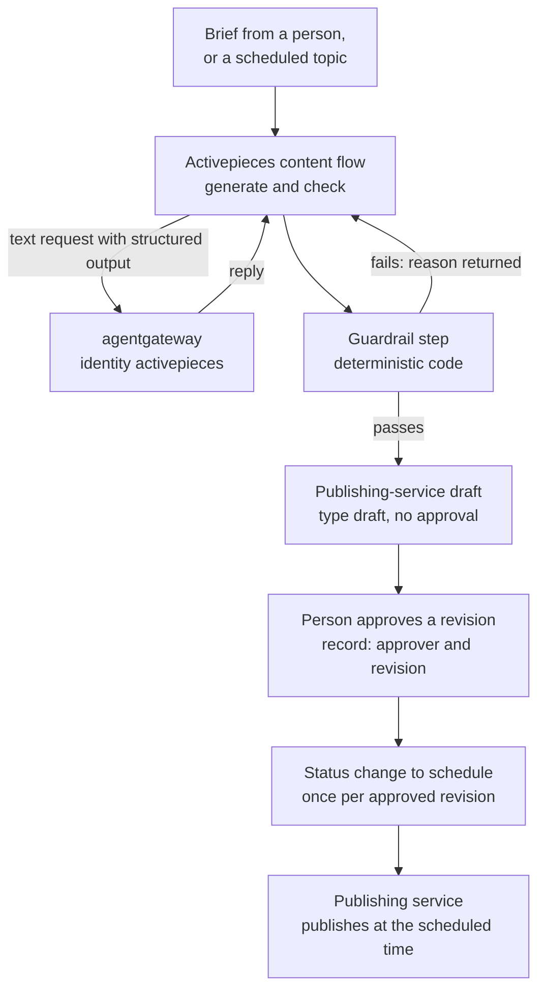
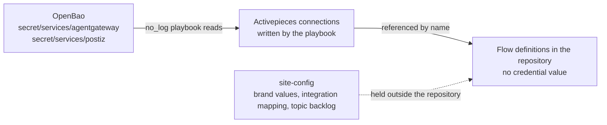

# 28 — Social Content Automation

> **Depends on:** 14 (Postiz), 26 (deploy-activepieces), 27 (agentgateway-content-generation)
>
> Plans 26 and 27 are cited here by their OpenSpec change names. Their design is not restated in this plan. Plan 27 ([27-agentgateway-content-generation.md](27-agentgateway-content-generation.md)) is on `dev` since 2026-11-17. Plan 26 is not yet, so facts attributed to change `deploy-activepieces` are unverified here until it merges.

**Author:** Joseph A. Wisneski IV
**Date:** 2026-11-16
**Status:** PROPOSED

**Context:** Social posts for the instance's brands are written and scheduled by hand. This plan sets the pipeline that drafts those posts with a text model, checks them, and hands them to the publishing service as drafts. A person's recorded approval stands in front of every generated post the pipeline schedules or publishes (scheduling by hand is Open Question 8). The plan records the decisions taken on 2026-11-12, the risks still open, and the phases that carry the work. The work is tracked as the OpenSpec change [social-content-automation](openspec/changes/social-content-automation/), whose tasks carry the Plane keys.

---

## Problem

- Posts for the instance's brands are written and scheduled by hand.
- A text model can draft them, but its output must not reach a public account without an approval, and generation must not be able to publish directly.
- The publishing service schedules publication and will hold the connected accounts once the publishing change connects them (plan 14; change `deploy-postiz-social-publishing` task 7.7). What is missing is generation, checks, a handoff that is safe to retry, and a recorded approval for every schedule of a generated post.
- The earlier flow engine, n8n, was retired on 2026-11-10 (`platform/semaphore/retired-templates.yml:86-88`). Activepieces replaces it (plan 26).

## Design Principles

1. **Approval before every schedule and publish of a generated post.** Drafting needs no approval. Scheduling and publishing a generated post need a recorded approval that names the approver and the revision (AC-795). It holds for every generated post the flows and the handoff schedule; a member scheduling a post by hand in the publishing interface is outside this plan, and for a generated draft it is Open Question 8.
2. **One publisher.** The publishing service keeps scheduling and publishing (D1). No flow publishes immediately.
3. **Through the platform, never around it.** Generation goes through the inference gateway under its own client identity. Credentials come from OpenBao through a playbook. Config is code: flows and connections are declared in the repository and applied by a playbook, as `AGENTS.md` requires.
4. **Foundational over one-shot.** Flows, connections and checks are code. They are re-runnable and converge on a second run. No production flow is built by hand.
5. **Brand values stay private.** The repository holds the schema, placeholders and code. Brand values, account mappings, the topic backlog and banned terms live in site-config, as the standing convention in `AGENTS.md` requires.
6. **Prove before connecting accounts.** Everything that does not need a connected social account is proven first (D12).

## Decisions

| # | Decision | Why |
|---|---|---|
| D1 | The publishing service keeps scheduling and publishing. Activepieces generates, checks and hands off. The publishing capability also lets automation create a scheduled post; D2 restricts flows further. | The publishing service connects the social accounts (plan 14, scope update of 2026-11-12) and its workflow engine executes scheduled posts (plan 14, D1). Its automation contract states "The client does not publish. It schedules." ([use-cases.md](../../platform/services/postiz/context/use-cases.md), line 60), and its capability requires scheduled posts to publish without operator action ([postiz-publishing spec](openspec/changes/deploy-postiz-social-publishing/specs/platform/postiz-publishing/spec.md), lines 65 to 68). |
| D2 | Approval rule (AC-795, Done, Joseph, 2026-11-12). Generation, automatic or recommended, MAY create drafts with no approval. Scheduling and publishing a generated post need a person's approval every time, and the approval records who approved which revision. Flows create posts of type draft only, never schedule or now. The only writes a flow makes to the publishing service without an approval record are uploading a draft's media, creating the draft, and deleting a superseded draft (D7). Only a revision whose post is still a draft can be superseded, and superseding it voids its approval; an edit to a revision whose post is scheduled is refused. The delete removes only that draft, which the R2 spike in task 3.3 proves holds no other post in its group. A flow gets a post scheduled only through the status change that follows an approval. A revision is identified by a sha256 over the post's canonical text, the sha256 of each attached media file, its target integration identifier and its publish time, computed over the post as the publishing service holds it, read back at approval and again at schedule; a mismatch refuses the schedule. At schedule the hash is taken over the post as the publishing service holds it, read back just before the status change, so a post edited in the publishing interface after approval is refused. The guardrail (D10) runs again on every revision before it is offered for approval, and the schedule also refuses a revision with no passing guardrail verdict for its hash. The approval record (revision, approver as named by the identity provider, time) is append-only and kept outside the run history of the flow that generated the draft; its store is chosen with the approval surface in task 4.4. | A public post must not appear on an account without a person's decision on that exact revision. |
| D3 | Flows are code. Definitions are versioned in `platform/services/activepieces/flows/` (planned) and applied by one `Manage Activepieces Flows` playbook, which writes the connections first (an included task file) and then the flows; a connection or flow the playbook owns and the declaration no longer lists is removed. It runs the static check of "Flows never publish immediately" before it applies anything and applies nothing when the check fails. A dry run shows the diff, a re-run converges, and the playbook never deletes a flow it does not own. No hand-built production flow. | Engineering principles 3 and 4 in `AGENTS.md`. Whether the Community edition supports this path is risk R1. |
| D4 | No credential in flow JSON. The gateway client key (`secret/services/agentgateway:client_activepieces`) and the publishing service's API key (`secret/services/postiz:postiz_api_key`) are written into Activepieces connections by a `no_log` playbook that reads OpenBao. Neither is pasted into a flow, and neither is copied under another service's path. | A flow definition is committed and readable. The publishing key is organisation-wide (R5). |
| D5 | The gateway is reached through the HTTP piece. The OpenAI piece's base URL is fixed, and the AI provider setting that would allow another base URL needs a plan that includes AI providers. Structured output uses `response_format` with a json_schema, which the gateway deploy already proves (`platform/playbooks/deploy-agentgateway.yml:40-42` and `:1396-1450`). | Upstream facts below. |
| D6 | The publishing service is reached through the Postiz piece, with custom auth (`base_url` and `api_key`). The HTTP piece or a custom API call covers the routes the piece lacks, such as the status change, and takes its key from the same Postiz connection (R2; checked in task 3.3), so removing that connection stops it too. Every call to the publishing service's base URL goes through the one handoff call site; the static check refuses any other step that targets that host, whatever piece it uses. Whether Activepieces can share one call site across flows (a sub-flow) is checked in spike 3.1. | Upstream facts below. |
| D7 | Exactly once. The publishing service's create-post call is not idempotent. The flow therefore writes a record keyed uniquely by the draft's revision before it calls the service, then stores the post identifier the service returns; the schedule step keeps its own record keyed by the revision. A new revision of a post still held as a draft replaces it: the handoff deletes the superseded draft post and creates one for the new revision, because the public API has no route that edits a post's content or date. A retry finds the pending record and reconciles it against the service's post list (the Postiz piece has a List Posts action) instead of creating again. The hourly create-post count lives in the same store. The store is chosen in task 4.4. | A check-then-create without a unique record lets two runs (a scheduled run and a retried handoff) both pass the check. The lesson carried from the earlier flow engine: idempotent writes keyed by a stored external identifier. |
| D8 | Brand profiles. The schema comes first (AC-828), planned at `platform/content/brand-profile.schema.json` with a placeholder example. Then one profile per brand, with values in site-config. Schema fields: name, domain and parent brand; colour tokens with light and dark roles; type families and weights; logo and mark references, favicon and open-graph card; voice rules with example lines; audiences; allowed claims, and forbidden or unbacked claims; imagery rules; social accounts per platform mapped to publishing integrations; and a provenance source for each field. Profiles serve three uses: hand-seeded profiles, profiles extracted by the studio (AC-810, undecided), and the system and image prompts of generation. | One source of voice and claims for every generated draft. |
| D9 | Brand isolation. The brand-to-integration mapping is declared, with its values in site-config. The handoff refuses a target integration that the mapping does not assign to the draft's brand. A draft names exactly one target account, which may be a page or a person's account. Fan-out to another account needs its own approval. | A post for one brand must not reach another brand's account. |
| D10 | Guardrail. The checks are a pure module in the repository with unit tests; the apply playbook inlines the same bytes into the flow's code step, records the module's sha256 in the flow declaration, and reads the applied flow back to compare it; a mismatch fails the run. They check each platform's length limit, a banned-term list from site-config, that links point to allowed domains, and that no hostname under a declared internal zone (a suffix match, no DNS lookup) and no credential-shaped string appears. The step installs no package, which fits the sandbox mode (`SANDBOX_CODE_ONLY`) that AC-768 proposes. A failing draft is returned with its reason and never reaches approval. | Model output may name internal systems or make claims that nothing backs (R7). A module tested in the repository is testable before Activepieces runs (R1). |
| D11 | Failure alerting goes through the existing observability alert path (the Discord webhook route). The producer is chosen in task 4.6: a Semaphore-scheduled playbook that starts the flow, reads its result and pushes a run line through `platform/playbooks/tasks/push-loki-lines.yml`, with the job declared in `o11y_scheduled_jobs` and a rule on failure lines; or a push from the flow itself, if Activepieces can reach Loki (unverified). The existing silent-job rule counts only success lines, so a failing run is reported only after the job's declared silence window (`platform/services/o11y/deployment/templates/alerts.yml.j2:739-746`); a new rule on failure lines, still to be added, which `platform/playbooks/renew-internal-certs.yml` already pushes (`:1063-1064`), reports it on the run and serves every job in `o11y_scheduled_jobs`. | A failed run must be seen by a person. |
| D12 | Order of work. Everything that does not need a connected X or LinkedIn account comes before Gate A, so drafts are proven end to end first. Risk R2 can stop the work before phase 4. | Keeps the unproven part to the publishing leg alone. |
| D13 | Kill switch. One switch stops every flow that creates a draft or schedules a post, thrown by a playbook. Its mechanism depends on R1 and is chosen in task 3.1. Removing the publishing-service connection through the apply playbook also stops every handoff, once task 3.3 shows the status-change call uses that connection (R2). | A lesson carried from the earlier flow engine (decision of 2026-11-12). |

Decision sources: the Plane items named above and the decisions recorded on 2026-11-12. The upstream facts are listed under [Upstream facts used](#upstream-facts-used).

## Architecture

### Pipeline

### Where the secrets come from

## Implementation Phases

The six phases match the phases of the OpenSpec change `social-content-automation`, and each task keeps its id and Plane key. Task ids are permanent. The task file carries the per-task acceptance lines. Each phase below gives its goal, its acceptance criteria and its gate, which points at the gate of the phase's last task in `tasks.md`. [`openspec/changes/social-content-automation/tasks.md`](openspec/changes/social-content-automation/tasks.md) holds the full text.

### Phase 1: Plan and decisions (done)

**Goal:** Record the pipeline, the decisions and the approval rule.

**Tasks:** 1.1 this plan and change (AC-793); 1.2 the approval policy (AC-795).

**Acceptance criteria:**
- Plan 28 and the change exist and carry the decision table.
- The approval rule of D2 is recorded with the approver-and-revision requirement.

**Gate:** the gate of task 1.2 in [`tasks.md`](openspec/changes/social-content-automation/tasks.md).

### Phase 2: Brand profiles (needs the schema-validator decision, Open Question 7)

**Goal:** A schema for brand profiles, and one validated profile per brand of the instance.

**Tasks:** 2.1 schema and placeholder example (AC-828); 2.2 the rollup for all profiles (AC-794); 2.3 the first brand, which is on the Gate A critical path (AC-829); 2.4 the second brand (AC-830); 2.5 the third brand (AC-831).

**Acceptance criteria:**
- The schema holds the fields of D8, and the placeholder example validates against it.
- Each brand's profile validates against the schema, and each field records its source.
- No brand value appears in the repository. Every value is in site-config.

**Gate:** the gate of task 2.5 in [`tasks.md`](openspec/changes/social-content-automation/tasks.md).

### Phase 3: Flows as code and connections (needs a running Activepieces, change deploy-activepieces)

**Goal:** Flows and connections are declared in the repository, applied by playbook, and proven against the gateway and the publishing service.

**Tasks:** 3.1 the `Manage Activepieces Flows` playbook, whose first spike is R1 (AC-796); 3.2 the gateway connection, whose spike is R3 (AC-797); 3.3 the publishing-service connection (AC-798).

**Acceptance criteria:**
- The spike for R1 runs first. If the Community edition does not support the flow API path, work stops and the decision returns to the operator (edition, AC-768).
- A dry run shows the diff, and a second run with unchanged declarations reports no change. An owned connection or flow dropped from the declaration is removed, and an unowned flow is left in place.
- The kill switch (D13) is built, and the static check of "Flows never publish immediately" runs in the repository's tests. The kill switch is proven at the phase 4 gate, once there are flows for it to stop.
- One completion returns through the gateway under the `activepieces` identity, and no key appears in a flow definition.
- The publishing-service connection upserts by its external identifier and reads its key from OpenBao.

**Gate:** the gate of task 3.3 in [`tasks.md`](openspec/changes/social-content-automation/tasks.md).

### Phase 4: Text pipeline (no connected social account needed)

**Goal:** Generate, check, approve and hand off text drafts, with the handoff proven exactly once.

**Tasks:** 4.1 generate one draft per platform from a brief (AC-799); 4.2 the guardrail step (AC-800); 4.3 the brand-to-integration mapping and its refusal (AC-836); 4.4 the handoff, with the approval surface chosen by spike (AC-801); 4.5 scheduled generation from a topic backlog held in site-config (AC-802); 4.6 failure alerting (AC-804).

**Acceptance criteria:**
- One draft per target platform, each reply parsing against its schema, and a prompt built from the brand profile.
- A draft over a platform's length limit, or naming an internal hostname, is returned with its reason and does not reach approval.
- A target integration that the brand mapping does not assign to the draft's brand is refused before any post is created.
- The handoff records one post per draft. A retried handoff creates no second post. The approval surface is chosen by spike and recorded in Open Questions.
- Scheduled generation and brief runs share the handoff's create-post budget (R6).
- A forced failing run raises an alert on the observability alert route.

**Gate:** the gate of task 4.6 in [`tasks.md`](openspec/changes/social-content-automation/tasks.md).

### Phase 5: Gate A (needs connected X and LinkedIn accounts, operator action)

**Goal:** Gate A. Publish one AI-drafted, human-approved text post per account to the first brand's X and LinkedIn accounts through the publishing service in production.

**Tasks:** 5.1 Gate A (AC-805). Its blockers are in `tasks.md`; the operator steps among them are the decision on Open Question 8 and the publishing-service change tasks 6.5 (the OAuth redirect destinations at X and LinkedIn), 7.1 (seeding the platform credentials into the production secret store) and 7.7 (connecting the accounts).

**Acceptance criteria:**
- One approved draft per target account is published on X and on LinkedIn, each target account named in site-config.
- A rerun of the handoff adds no post.

**Gate:** the gate of task 5.1 in [`tasks.md`](openspec/changes/social-content-automation/tasks.md).

### Phase 6: Images (blocked on the image path of plan 27)

**Goal:** Gate B. Gate A, plus an approved AI-generated brand image attached to an approved text post.

**Tasks:** 6.1 the image step (AC-803), whose gateway image gate (AC-792) waits on the dgx-spark fit test of the model chosen by the AC-870 decision (2026-11-16, plan 27). 6.2 Gate B (AC-806).

**Acceptance criteria:**
- The image is generated through the gateway, approved with its text, and attached to the post in the publishing service.
- Gate A holds.

**Gate:** the gate of task 6.2 in [`tasks.md`](openspec/changes/social-content-automation/tasks.md).

### Release budget

The build these phases describe adds about 16 files (an estimate, not a measurement): the brand-profile schema and its placeholder example (2), three flow definitions for generation, handoff and scheduled generation (3), the apply playbook and its connections task file (2), the Semaphore template entries in `platform/semaphore/templates.yml` (1), the guardrail module and its unit test (2), the static check over flow definitions in the Rust suite (1), the alert rule and its job declaration (1), the Activepieces and Postiz context documents (2), the `AGENTS.md` workflow table (1) and the task tick-offs in this change (1). The kill switch lives in the apply playbook and adds no file. Literal credentials in flow JSON need a check too: the existing scan's key pattern does not match a quoted JSON key (`platform/tests/suite/credential_leaks.rs:838-839`); widening that shared pattern is preferred over a second scanner, decided at build. The limits are rules R2, R3 and R7 of policy 10 ([10-release-policy.md](../architecture/10-release-policy.md)).

### Dependency order

Each task's blockers, inside and outside this change, are the "Blocked by" lines in [`tasks.md`](openspec/changes/social-content-automation/tasks.md).

## Validation Criteria

| Check | Pass condition |
|---|---|
| OpenSpec change validates | `openspec validate social-content-automation --strict` reports the change valid, run from `plan/development`. |
| Approval gate | A handoff's schedule with no recorded approval of the current revision is refused and nothing is scheduled. Approval of revision N does not schedule revision N+1. |
| No immediate publication | Scenarios "Static check over the committed flow definitions" and "Flow definition requests immediate publication" pass and fail as the spec states. |
| Guardrail verdict and read-back | Scenarios "Schedule refused without a passing guardrail verdict" and "Applied guardrail differs from the module" pass and fail as the spec states. |
| Exactly once | A retried handoff finds the stored post identifier, and one post and one schedule remain for the draft. |
| Guardrail | A draft over a platform's length limit, or naming an internal hostname, is returned with its reason and never reaches approval. |
| Brand isolation | A handoff naming an integration the mapping does not assign to the draft's brand is refused before any post is created. |
| Converge re-run | A second apply of unchanged declarations reports no change, an owned connection or flow dropped from the declaration is removed, and an unowned flow is untouched. |
| No credential in definitions | A check refuses a committed flow definition with a literal value in an auth, connection-property or header field. |
| Kill switch | With the switch thrown, no brief or scheduled run creates a draft or schedules a post; released, drafting resumes. |
| Gateway identity | A completion made by a flow is recorded under the `activepieces` identity, and no flow calls a model backend directly. |
| Failure alert | A forced failing run raises an alert on the observability alert route, and a successful run raises none. |
| Brand profiles | Every profile validates against the schema with a source on each field, and the repository example holds placeholders only. |
| Gate A | One AI-drafted, human-approved text post per account is published to the first brand's X and LinkedIn accounts through the publishing service in production, and a rerun of the handoff adds no post. |
| Gate B | Gate A holds, and an approved AI-generated brand image is attached to an approved text post; an image replaced after approval is not scheduled. |
| Post-creation ceiling | The handoff refuses a create-post call past the hourly window of R6, for brief and scheduled runs alike. |

## Security Considerations

- **Credentials (D4).** The gateway client key and the publishing service's API key are read from OpenBao by a `no_log` playbook and written into Activepieces connections. Neither appears in a flow definition, in a copy under another service's path, or in a printed task result. The `activepieces` identity is its own gateway client, so it can be revoked on its own with the `Manage agentgateway Client Key` playbook.
- **Organisation-wide publishing key (R5).** The publishing service's API key is organisation-wide. Any holder can schedule a post, and can send one immediately. The approval guarantee therefore rests on flow logic and on the static check (scenario "Static check over the committed flow definitions"). The check sees only committed flows; a flow edited outside the repository escapes it. Open Question 6 records the stronger alternative.
- **Model output (R7).** The guardrail (D10), the forbidden-claims list in each brand profile, and the human approval act together. Neither the guardrail nor the approval is sufficient alone.
- **Blast radius.** A failing flow can create drafts. Two controls stand between a draft and a post the pipeline schedules, and neither is built yet: the static check (scenario "Static check over the committed flow definitions") and the handoff, which refuses a schedule without an approval record for that revision (task 4.4). A compromised Activepieces, or a flow edited outside the repository, holds the publishing key and is bounded by neither (R5); Open Question 6 is the control that would close this. Brand isolation (D9) keeps a committed flow's drafts to their brand's mapped account.
- **Budget.** The gateway's per-client budgets bound generation for each identity. The publishing service's post-creation ceiling (R6) bounds post creation through the handoff's shared budget.
- **Network exposure.** The Activepieces Community edition sits behind the platform's forward-auth gate at the edge, as change `deploy-activepieces` sets it. Gateway calls take the path plan 27 decides ([27-agentgateway-content-generation.md](27-agentgateway-content-generation.md), D1 and D8; AC-783, AC-825, AC-826), not the public inference edge.
- **Edition (R1).** The upstream documentation ties API keys to the Platform and Enterprise editions. Flows as code (D3) and connections as code (D4) depend on a spike against the edition the platform runs.

## Risks

| # | Risk | Mitigation and where it is decided |
|---|---|---|
| R1 | The Community edition may not support the flow API path that D3 needs: its API keys are documented for the Platform and Enterprise editions, and the `IMPORT_FLOW` operation's semantics are not documented. There is no export endpoint. | Spike first, in task 3.1. If it fails, work stops and the decision goes back to the operator (edition, AC-768). No workaround is designed in this plan. |
| R2 | A publishing-service draft may need a connected integration, and the local publishing service has none (the operator declined local OAuth callbacks on 2026-08-30). | Spike in task 3.3 on the pinned v2.23.0: whether a draft can exist with no integration, whether the status-change route exists on the pin, and whether the status-change call can take its key from the Postiz connection, whether a post can be read back with its content, media and date, and whether deleting a superseded draft removes no other post (the delete route removes a post's whole group). If any answer is no, work stops and the decision returns to the operator before task 3.3 closes (a pin bump, or a spec change for where a draft lives before approval). |
| R3 | The HTTP piece may not be able to take its key from a stored connection. | Spike in task 3.2. If it cannot, another mechanism is chosen before task 3.2 closes. A key in a flow definition is never an acceptable fallback. |
| R4 | Outbound calls may not support a client certificate. | Plan 27 D8: spike AC-826, with an mTLS egress sidecar as the fallback. |
| R5 | The publishing service's API key is organisation-wide, and Activepieces holds it. | The approval guarantee rests on flow logic and the static check (Security Considerations). Open Question 6. |
| R6 | The post-creation ceiling bounds burst generation. Every create-post caller shares it: the instance's `postiz_api_limit` (site-config; template fallback `platform/services/postiz/deployment/templates/postiz.env.j2:66`; contract in [use-cases.md](../../platform/services/postiz/context/use-cases.md), "Endpoint and auth"). | Every create-post call goes through the handoff, which counts calls against that hourly window and refuses past it, for brief and scheduled runs alike. |
| R7 | Model output may name internal systems or make claims that nothing backs. | The guardrail (D10), the forbidden-claims list in each profile and the human approval. |

## Open Questions

1. **Approval surface (decided in task 4.4).** For v0.17.0, an Activepieces approval step or a form behind the forward-auth gate records the approver and the revision, then the handoff sends the status change; task 4.4 chooses between the two and shows that an approval counts only from a person the identity provider authenticated. The studio (AC-810) is a candidate long-term interface; its decision is open and outside the v0.17.0 scope. Scheduling a generated draft by hand in the publishing service's interface was considered and dropped as the approval surface: it bypasses the approval record and the revision check that D2 requires for generated posts.
2. **R1 outcome (task 3.1).** Not yet known. If the Community edition does not support the flow API path, the decision returns to the operator.
3. **R2 outcome (task 3.3).** Not yet known.
4. **Image path (phase 6).** The image step waits on the image path of plan 27 (AC-792). The image-model decision (AC-870) was taken on 2026-11-16 and is recorded in plan 27.
5. **Publishing-service key revocation.** The procedure to revoke the key is not yet established. It is an open item for task 3.3.
6. **A publish gate holding the publishing key (operator decision).** R5 leaves the approval guarantee in flow logic because Activepieces holds a key that can schedule or publish immediately. A small service on the launch gate's pattern (`platform/services/launch-gate/deployment/CLAUDE.md`) could hold the key, the approval records, the brand mapping and the kill switch, and give flows only a caller token. It is a new service and is not designed here.
7. **Schema validator (task 2.1).** The repository has no JSON Schema validator (`pyproject.toml`, `uv.lock`); adding one is a new dependency and needs the operator's approval.
8. **A member scheduling a generated draft in the publishing interface (operator decision).** The rule of D2 holds for the handoff, but a signed-in member of the publishing service can still schedule a generated draft by hand, bypassing the approval record. Accept this as a residual risk, or add a control; not decided here.

## Upstream facts used

Every fact in this section was checked on upstream main on 2026-11-16. Each one must be re-verified on the pinned version before the task that depends on it closes.

- **Publishing service API.** Create post is `POST /posts`, and its `type` is one of `draft`, `schedule` or `now`. A `draft` is "stored against the integration but not scheduled or published". [https://docs.postiz.com/public-api/posts/create](https://docs.postiz.com/public-api/posts/create)
- **Draft to scheduled.** `PUT /posts/{id}/status` takes a `status` of `draft` or `schedule`. [https://docs.postiz.com/public-api/posts/change-status](https://docs.postiz.com/public-api/posts/change-status)
- **Delete and edit.** `DELETE /posts/{id}` deletes a post and every post in its group. No public route edits a post's content or publish date: the update routes cover settings, status and release identifier only. [https://docs.postiz.com/public-api/posts/delete](https://docs.postiz.com/public-api/posts/delete), [https://docs.postiz.com/llms.txt](https://docs.postiz.com/llms.txt)
- **Connected channels.** `GET /integrations` lists the connected channels with their identifiers. [https://docs.postiz.com/llms.txt](https://docs.postiz.com/llms.txt)
- **Authentication.** The `Authorization` header carries the raw API key. [https://docs.postiz.com/public-api](https://docs.postiz.com/public-api)
- **Post-creation ceiling.** The configuration reference gives a default of 90 per hour on create-post; upstream's compose and `.env.example` set 30. [https://docs.postiz.com/self-host/configuration/reference.md](https://docs.postiz.com/self-host/configuration/reference.md)
- **Activepieces publishing piece.** The Create Post action takes a post type of draft, schedule or now. Its custom auth takes `base_url` for a self-hosted service and `api_key`. The action is declared not idempotent: "each call creates a new post". [https://www.activepieces.com/pieces/postiz](https://www.activepieces.com/pieces/postiz), [create-post.ts](https://github.com/activepieces/activepieces/blob/main/packages/pieces/community/postiz/src/lib/actions/create-post.ts), [auth.ts](https://github.com/activepieces/activepieces/blob/main/packages/pieces/community/postiz/src/lib/common/auth.ts)
- **Activepieces OpenAI piece.** Its base URL is fixed to the OpenAI API, with no custom base URL. [common.ts](https://github.com/activepieces/activepieces/blob/main/packages/pieces/community/openai/src/lib/common/common.ts). The "Other (OpenAI Compatible)" AI provider needs a plan that includes AI providers. [setup-ai-providers.md](https://www.activepieces.com/docs/admin-guide/guides/setup-ai-providers.md). Gateway calls therefore use the HTTP piece. [https://www.activepieces.com/pieces/http](https://www.activepieces.com/pieces/http)
- **Approval pieces.** The Approval (Legacy) piece pauses a flow with "Wait for Approval" and creates approval links. How an approver responds or is identified is not documented. [https://www.activepieces.com/pieces/approval](https://www.activepieces.com/pieces/approval). The Human Input (Forms) piece has a Web Form trigger and no approval action. [https://www.activepieces.com/pieces/forms](https://www.activepieces.com/pieces/forms). Flow Approvals is a publish-time review gate on the Enterprise or Cloud plan with Environments. It is not a runtime pause. [https://www.activepieces.com/docs/flows/flow-approvals](https://www.activepieces.com/docs/flows/flow-approvals)
- **Schedule piece.** It has six triggers, including Cron Expression. [https://www.activepieces.com/pieces/schedule](https://www.activepieces.com/pieces/schedule)
- **Flow API.** `POST /v1/flows` creates an empty flow from a display name and a project identifier. [https://www.activepieces.com/docs/endpoints/flows/create](https://www.activepieces.com/docs/endpoints/flows/create). `POST /v1/flows/{id}` applies an operation. One operation type, `IMPORT_FLOW`, takes a display name, a trigger and optionally a schema version, and its semantics are not documented. [https://www.activepieces.com/docs/endpoints/flows/update.md](https://www.activepieces.com/docs/endpoints/flows/update.md). There is no export endpoint. `GET /v1/flows/{id}` returns the version, including its trigger. [https://www.activepieces.com/docs/endpoints/flows/get.md](https://www.activepieces.com/docs/endpoints/flows/get.md)
- **Connections.** `POST /v1/app-connections` upserts by `externalId`. Its types include `SECRET_TEXT` and `CUSTOM_AUTH`, the latter with `props`. [https://www.activepieces.com/docs/endpoints/connections/upsert.md](https://www.activepieces.com/docs/endpoints/connections/upsert.md)
- **Editions.** API keys are "only available in the Platform and Enterprise editions". [https://www.activepieces.com/docs/endpoints/overview.md](https://www.activepieces.com/docs/endpoints/overview.md). Project Releases and Git Sync are on the Ultimate tier. [https://www.activepieces.com/pricing](https://www.activepieces.com/pricing), [https://www.activepieces.com/docs/admin-guide/guides/project-releases.md](https://www.activepieces.com/docs/admin-guide/guides/project-releases.md)

Repository facts:

- The publishing service's automation endpoint, its key and its public-host rule are in [use-cases.md](../../platform/services/postiz/context/use-cases.md), at lines 12 to 14, 22 to 26, 28 to 41 and 43 to 60. Postiz is pinned at v2.23.0 (plan 14, D1).
- The gateway deploy proves one `response_format` json_schema completion (`platform/playbooks/deploy-agentgateway.yml:40-42` and `:1396-1450`).
- The Plane sync builds the external identifier of a task as `<owner/repo>/<change>/<task id>` (`platform/services/plane/lib/openspec_to_plane.py:159`). The module identifier is `<owner/repo>/<change>` (`:188`). Checked tasks are skipped as done before import (`:27-31`). Task ids are permanent (`:33-38`).
- The production OpenBao store holds no `secret/services/postiz` path (Check Secrets, task 17396, 2026-11-16). The X and LinkedIn developer-app credentials are not yet stored anywhere (AC-760 and AC-761).

## Cross-references

| Document | Relationship |
|---|---|
| [14-postiz-social-publishing.md](14-postiz-social-publishing.md) | The publishing service that drafts are handed to. D1 here repeats its scheduling decision. |
| [deploy-postiz-social-publishing](openspec/changes/deploy-postiz-social-publishing/) | The change that delivers the publishing service, its API key and its capability `platform/postiz-publishing`. |
| Change `deploy-activepieces` (plan 26) | Delivers the flow engine this plan builds on. Cited by change name. |
| [27-agentgateway-content-generation.md](27-agentgateway-content-generation.md), change `agentgateway-content-generation` | Delivers the gateway text path, the image path and the `activepieces` client identity. |
| [social-content-automation](openspec/changes/social-content-automation/) | The OpenSpec change that carries this plan's design, tasks and spec. |
| [use-cases.md](../../platform/services/postiz/context/use-cases.md) | The publishing service's automation endpoint and key. |
| [10-release-policy.md](../architecture/10-release-policy.md) | Policy 10: at most 100 pull requests and 120 changed files per release. The planned build's size is measured against it. |
| [AGENTS.md](../../AGENTS.md) | Platform standards. The index entry for this plan sits in its Sub-directory Documentation list. |

## Revision History

| Date | Change |
|---|---|
| 2026-11-16 | Initial draft (PROPOSED). Decisions D1 to D13, risks R1 to R7, and the six phases of change `social-content-automation`. |
