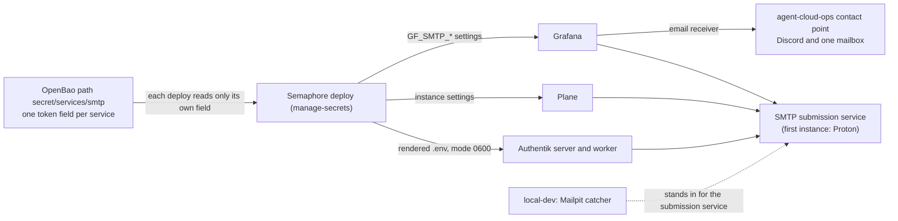

# 29 — Platform Mail

> **Depends on:** 00 (local dev, `00-foundation-local-dev.md`), 01 (secrets, `01-secrets-credentials.md`), 02 (sso-auth, `02-sso-auth.md`), 05 (observability, `05-observability.md`), 12 (RBAC user provisioning, `12-rbac-user-provisioning.md`), 13 (Cloudflare IaC, `13-cloudflare-iac.md`), 16 (Plane, `16-plane-work-management.md`), 22 (console access requests, `22-console-access-requests.md`)
>
> Read 12, 13 and 22 first. This plan unblocks two items in 12 and 22, and changes the mail line in 13.

Author: Joseph A. Wisneski IV <stray@uhstray.io>

**Date:** 2026-11-27

**Status:** ACCEPTED 2026-11-27 by the operator. Units S1 to S9, Plane AC-1122 to AC-1130. Production actions are approved one at a time.

**Plane:** module `proton-smtp`, milestone `v0.18.0`. S1 is AC-1122, S2 is AC-1123, S3 is AC-1124, S4 is AC-1125, S5 is AC-1126, S6 is AC-1127, S7 is AC-1128, S8 is AC-1129 and S9 is AC-1130. The DigitalOcean work is AC-1131 to AC-1133, module `digitalocean-foundation`, milestone `v0.19.0`.

**Context:** Platform services need outbound mail for enrollment, recovery and alert delivery. This repository is a public template, so this plan names the mechanism and not any one instance. The first instance sends through Proton, which it chose as its SMTP submission service, and its values live in site-config. There is no OpenSpec change in this batch. It was decided on 2026-11-27 that the Plane OpenSpec sync would create duplicates of AC-1123 to AC-1130. S1 is this plan only. The AGENTS.md secrets-table row for `secret/services/smtp` lands with S3, not here.

## Problem

The repository says that enrollment and recovery links need production SMTP (`platform/playbooks/print-platform-user-credentials.yml:13`), and plans 12 and 22 wait for it. Plan 12 gives each new user an initial password that OpenBao generates and that is reused across redeploys (`platform/services/authentik/deployment/blueprints/platform-users.yaml:16-18`). That note says to move to enrollment and recovery links once SMTP is configured, and plan 12 records the same wait (`12-rbac-user-provisioning.md:15` and `:75`). Plan 22 is still PROPOSED (`22-console-access-requests.md:10`). Its A6 holds new accounts until SMTP and enrollment links exist, because the alternative prints a live password into Semaphore task output (`22-console-access-requests.md:158`).

Grafana alerts reach one Discord receiver (`platform/services/o11y/deployment/templates/alert-contact.yml.j2:8-12`), and deploy verify counts only that receiver (`platform/playbooks/deploy-o11y.yml:1987-1996`).

The mail DNS records already exist in the zone but sit outside OpenTofu. Plan 13 lists the Proton mail records as outside tofu (`13-cloudflare-iac.md:53`), and the ownership comment in `platform/infra/cloudflare/dns.tf` says email records are not managed (lines 5-7). Per the batch plan's zone read of 2026-11-27, not verified in this repo, there are eight of them.

## Design Principles

1. **One token, read by field.** Each deploy reads only its own field from the shared path. No service reads another service's field.
2. **The token stays in OpenBao and in the rendered environment of its own container.** It never appears in a repository, log, task output, survey field or command line (G6).
3. **Mail is off where it is not declared.** A deploy with `smtp_host` undefined makes no read and renders no mail settings.
4. **The repository holds placeholders.** Host, port, addresses and DNS values live in site-config.
5. **Plan before apply.** Nothing is applied to DNS until the plan prints no changes (G5).

## Goal and validation criteria

Platform services send mail through an SMTP submission service with one shared token, and the mail DNS records already in the zone become code. Stalwart, a new mail host name, and the Proxmox and DigitalOcean mail builds are dropped.

| ID | Where | Done when |
|---|---|---|
| G2 | Local | Authentik, Plane and Grafana each deliver a test message to the local mail catcher through their own Semaphore deploy, and a test asserts it. |
| G3 | Local | An Authentik recovery mail for a test account arrives in the catcher, and its link opens the reset step. |
| G4 | Production | `ak test_email`, a Plane test mail and a Grafana contact point test each arrive at a mailbox named in site-config, sent from the (Dev) deploy templates. |
| G5 | Production | Apply Cloudflare Tofu (Dev) in plan mode prints no changes after the eight Proton records are imported. |
| G6 | Both | The token value appears in no repository, log, task output, survey field or command line. OpenBao holds it, and site-config keeps the recovery copy it has today. |
| G7 | Docs | Plan 12 D2 and plan 22 A6 say mail exists, with the date and the proof. |

The count of eight records is per the batch plan's zone read of 2026-11-27, not verified in this repo.

## Scope

**In scope**

- **IN-1** A local-only mail catcher for local-dev, and a shared check that a message arrived.
- **IN-2** OpenBao path `secret/services/smtp`, with one token field per service. All three fields hold the same token for now.
- **IN-3** Authentik outbound mail settings, and enrollment and recovery flows by email.
- **IN-4** Plane outbound mail, as instance settings that the deploy sets.
- **IN-5** Grafana SMTP settings and an email receiver.
- **IN-6** The eight Proton records in the zone, imported into OpenTofu with no change: two MX, one SPF, one Proton verification TXT, one DMARC and three DKIM CNAME. The count and breakdown are per the batch plan's zone read of 2026-11-27, not verified in this repo.
- **IN-7** site-config holds the SMTP host, port, sender address, alert mailbox and DNS record values as inventory variables. Their values live in site-config and never in this repo.
- **IN-8** This plan document. No OpenSpec change (see Context).

**Out of scope**

- **OUT-1** The DigitalOcean MCP skill, the DigitalOcean token in OpenBao, and the DigitalOcean tofu foundation. These are v0.19.0, module `digitalocean-foundation`, in their own batch.
- **OUT-2** Stalwart on any host. Dropped (see Rejected).
- **OUT-3** One token per service. A later item. Each service already reads its own field, so a split is a seed and a redeploy.
- **OUT-4** Tightening the DMARC policy. A later item, after sending is observed.
- **OUT-5** The three non-Proton TXT records (two Microsoft, one domain verification). Left unmanaged. The count is per the batch plan's zone read of 2026-11-27, not verified in this repo.
- **OUT-6** The existing mail host name in the zone. Left as it is (Q1).
- **OUT-7** Postiz, NetBox, Activepieces and honcho mail. Not asked for.
- **OUT-8** The console request screen of plan 22.

## Decisions

| # | Decision | Why |
|---|---|---|
| D1 | Milestone `v0.18.0` with module `proton-smtp`. The DigitalOcean work is milestone `v0.19.0` with module `digitalocean-foundation`. Each milestone is named after the release tag its work ships in. | A reader can see which release carries the work. |
| D2 | Authentik enrollment and recovery flows by email (S5). Plan 22 A6 and plan 12 D2 are unblocked. The console request screen stays in plan 22 (OUT-8). | Both plans wait on outbound mail (`12-rbac-user-provisioning.md:15` and `:75`; `22-console-access-requests.md:158`). |
| D3 | An email receiver is added to the existing `agent-cloud-ops` contact point. Every alert goes to Discord and to one mailbox named in site-config. | The contact point and its Discord receiver already exist (`alert-contact.yml.j2:7-12`). One contact point keeps one alert path. |
| D4 | Stored first-login passwords and Print User Credentials stay in this batch. A later item retires them, after a real person has enrolled by mail in production. | The repository's note says to drop the stored passwords once enrollment and recovery work (`platform-users.yaml:16-18`). Print User Credentials prints a live password into task output (`22-console-access-requests.md:158`). |
| B1 | One shared token now. Split later (OUT-3). | Each service reads its own field, so a later split is a seed and a redeploy. |
| B2 | Services reach the SMTP service directly, through one shared OpenBao path. | The Semaphore read policy already covers `secret/data/services/*` (`platform/services/openbao/deployment/config/policies/semaphore-read.hcl:9-11`), so no policy changes. |
| B3 | Local-dev uses a mail catcher container. | Local runs deliver to the catcher and not to a real mailbox. |
| B4 | Proton DNS: existing records only, and the values never appear in this repo. | The records already exist (`13-cloudflare-iac.md:53`). Tofu adopts them with no change, and their values come from site-config. |
| B5 | No OpenSpec change. | Decided 2026-11-27: the Plane OpenSpec sync would create duplicates of AC-1123 to AC-1130. |
| B6 | Calls made in the batch plan: Mailpit as the catcher; token fields named per service; host, port and addresses in site-config inventory and not in OpenBao; DNS values as tofu variables and not committed. | The host, port and addresses are not secrets. DNS values stay out of a public repo. |

## Rejected: self-hosted mail server

Stalwart is dropped on any host (OUT-2). DigitalOcean blocks SMTP on Droplets. Its page "Why is SMTP blocked?" says that SMTP ports 25, 465 and 587 are blocked on Droplets to prevent spam and abuse, and it advises a third-party email service provider instead (https://docs.digitalocean.com/support/why-is-smtp-blocked/; read 2026-11-27; page last modified 2026-04-07). The Proxmox and DigitalOcean mail builds go with it. This section records the decision so that it is not reopened.

## Architecture

Each deploy reads its own token field and hands it to its service: through the rendered environment for Authentik and Grafana, and on stdin for the Plane settings script. Each service then sends through the submission service. Locally, a catcher stands in for the submission service.

## Design

### Token and inventory

- The path is `secret/services/smtp`, with three fields: `authentik_smtp_token`, `plane_smtp_token` and `grafana_smtp_token`. All three hold the same token for now (B1).
- Each deploy reads only its own field through `_shared_reads`, with `from_service: smtp`. The read is in `platform/playbooks/tasks/manage-secrets.yml:120-180`. It starts at line 127, checks for missing and shadowing keys at lines 144-160, fails on a key requested twice across reads at lines 162-170, and merges keys under their own names at lines 172-177. The field names carry the service name for that reason.
- Semaphore's read policy already covers `secret/data/services/*` (`semaphore-read.hcl:9-11`), so no OpenBao policy changes.
- Inventory variables hold placeholders in this repo and values in site-config: `smtp_host`, `smtp_port`, `smtp_from_address`, `smtp_username` and `o11y_alert_email`.
- When `smtp_host` is undefined, each deploy skips the read and renders no mail settings. Plane already does this for its Authentik read (`platform/playbooks/deploy-plane.yml:129-131`).
- Locally, bootstrap writes a placeholder into the three fields and points `smtp_host` at the catcher. The real token never enters local OpenBao.

### Local mail catcher

Mailpit runs from `platform/services/mailpit/deployment/`, which holds a compose file and `deploy.sh`. A (Local) template goes in `platform/semaphore/templates-local.yml`, and nothing else: no production template and no inventory group. The image is `axllent/mailpit`, pinned by digest (unverified: the image name, its license, its run-as user and its message-list API path are read first in S2). SMTP listens on 1025, and the web view and API on 8025, on the local-dev network (unverified: these ports come from the batch plan and were not read in this task; S2's first step confirms them). A Caddy route serves the web view. The catcher accepts any login (`MP_SMTP_AUTH_ACCEPT_ANY`, unverified: the variable is named in the batch plan and not read in this repo), so local services send with a placeholder token.

The compose file sets `restart: always`. `platform/tests/suite/restart_policy.rs` (lines 102-130) requires that of every service that is not a labelled one-shot.

The shared check is `platform/playbooks/tasks/assert-mail-captured.yml`. It asks the catcher's API for a message by recipient and subject, and it fails when none arrived.

### Per-service wiring

- **Authentik.** Outbound settings go in `platform/services/authentik/deployment/templates/env.j2`, beside the image pin at line 6 (2024.12.3). The rendered `.env` is written with mode 0600 (`platform/playbooks/deploy-authentik.yml:55`), so the token reaches the container only through that file.
- **Plane.** Outbound mail is instance settings, written by `platform/services/plane/deployment/configure_instance.py`. That script reads its settings document from stdin and refuses any setting name the running release does not have (lines 41-43). The OIDC client secret already travels the same way, inside the settings document (`platform/playbooks/deploy-plane.yml:212` and `:240`). Plane's inbound email container is disabled by profile and stays disabled (`platform/services/plane/deployment/compose.agentcloud.yml:110`).
- **Grafana.** `GF_SMTP_*` settings go in `platform/services/o11y/deployment/templates/env.j2`. The email receiver goes in `platform/services/o11y/deployment/templates/alert-contact.yml.j2`, beside the Discord receiver (lines 8-12). Deploy verify counts only the Discord uid today (`platform/playbooks/deploy-o11y.yml:1987-1996`).

### Mail DNS records as code

- `platform/infra/cloudflare/mail.tf` declares the MX, SPF, verification TXT, DMARC and three DKIM CNAME records, none proxied. Their contents come from tofu variables. The public repository holds record types and resource names only, never values.
- `platform/playbooks/apply-cloudflare-tofu.yml` passes two `TF_VAR_` values today: `TF_VAR_zone_id` and `TF_VAR_caddy_origin_ip` (lines 203-204, inside the task at lines 197-205). The mail values join them, taken from site-config inventory.
- Import blocks adopt the live records. A read-only step reads the record IDs from the Cloudflare API first.
- Gate: a plan that prints any change blocks the apply. A diff means a variable is wrong, and the fix is the variable.
- Test: `tofu validate` and the existing dry-run backend test pattern (`platform/tests/suite/cloudflare_dry_run_backend_playbook.rs`). Validate and plan passing does not prove that the API accepts a create (`docs/MISTAKES.md` 10.13), so this plan creates nothing.
- S8 updates the ownership comment in `platform/infra/cloudflare/dns.tf` (lines 5-7), the Cloudflare README at `platform/infra/cloudflare/README.md`, and the mail line of plan 13 (`13-cloudflare-iac.md:53`).

## Implementation phases: units S1 to S9

Merge order is unit order, with these dependencies. S3 follows S2. S4, S6 and S7 follow S3. S5 follows S4. S8 does not depend on S2 to S7. The site-config change (host, port, sender, mailbox and DNS values) is its own change. It merges after S3 to S7 and before S9. No agent-cloud unit writes to site-config. Lanes and estimates are the batch plan's, not re-derived here.

| Unit | Plane | Lane | Estimate (time, tokens) |
|---|---|---|---|
| S1 | AC-1122 | A | 1 h, 40k |
| S2 | AC-1123 | B | 2 h, 80k |
| S3 | AC-1124 | B | 1 h, 40k |
| S4 | AC-1125 | A | 2 h, 70k |
| S5 | AC-1126 | B | 4 h, 130k |
| S6 | AC-1127 | A | 2 h, 70k |
| S7 | AC-1128 | A | 2 h, 80k |
| S8 | AC-1129 | B | 3 h, 90k |
| S9 | AC-1130 | C | 2 h, 50k |

**S1, this plan.** One new document and one index line in `AGENTS.md`, after the plan 28 line. No code.

**S2, local mail catcher.**

- Unverified first step: read the Mailpit license, whether the image runs as non-root, the API path that lists messages, the SMTP and web ports (1025 and 8025), and the `MP_SMTP_AUTH_ACCEPT_ANY` setting.
- Add `platform/services/mailpit/deployment/` (compose file and `deploy.sh`) and one (Local) template in `platform/semaphore/templates-local.yml`. No production template and no inventory group.
- Pin the image by digest. SMTP on 1025, web view and API on 8025, on the local-dev network. Add a Caddy route for the web view.
- The catcher accepts any login (`MP_SMTP_AUTH_ACCEPT_ANY`), so services send with a placeholder token locally.
- Add `platform/playbooks/tasks/assert-mail-captured.yml`. It asks the catcher API for a message by recipient and subject, and it fails when none arrived.
- Compose restart: always.

**S3, inventory variables and token layout.** Agent-cloud and site-config. No site-config value is committed here.

- Inventory variables, placeholders here and values in site-config: `smtp_host`, `smtp_port`, `smtp_from_address`, `smtp_username` and `o11y_alert_email`.
- OpenBao path `secret/services/smtp` with fields `authentik_smtp_token`, `plane_smtp_token` and `grafana_smtp_token`. Each deploy reads only its own field through `_shared_reads` (`from_service: smtp`).
- No OpenBao policy change. This unit adds the `secret/services/smtp` row to the AGENTS.md secrets layout table.
- Local-dev bootstrap writes a placeholder into the three fields and points `smtp_host` at the catcher.
- Token tasks run under `no_log`. Each deploy skips the read and renders no mail settings when `smtp_host` is undefined.

**S4, Authentik outbound mail.**

- Unverified first step: confirm the `AUTHENTIK_EMAIL__*` names with `ak dump_config` in local-dev. The names come from the 2026.8 docs as the batch plan records them. The repository pins 2024.12.3 (`platform/services/authentik/deployment/templates/env.j2:6`).
- Add `AUTHENTIK_EMAIL__HOST`, `AUTHENTIK_EMAIL__PORT`, `AUTHENTIK_EMAIL__USERNAME`, `AUTHENTIK_EMAIL__PASSWORD`, `AUTHENTIK_EMAIL__USE_TLS`, `AUTHENTIK_EMAIL__FROM` and `AUTHENTIK_EMAIL__TIMEOUT` to `platform/services/authentik/deployment/templates/env.j2`, inside the `smtp_host` condition.
- Verify: `ak test_email` to a declared address in the worker container, and assert the message locally in the catcher. The token reaches the container only through the rendered `.env` (mode 0600).

**S5, Authentik enrollment and recovery flows.** Over 100k, because the flow and stage models must be read from the running image first.

- Unverified first step: read the flow and stage models on the pinned version from the running image. No file under `platform/` declares an Authentik flow or stage model today (a search for `model: authentik_flows` and `model: authentik_stages` finds none). Flows appear only as `!Find` lookups of default flows (for example `platform/services/authentik/deployment/blueprints/honcho-docs-forward-auth.yaml:26`).
- One new blueprint with a recovery flow and an invitation-based enrollment flow. Each flow has an email stage that uses the global connection settings.
- Register the blueprint in `_shared_blueprints` (`platform/playbooks/deploy-authentik.yml:63`, used at `:295-296`). Otherwise the deploy prunes it (`:332-338`).
- The brand points at the recovery flow, so the sign-in page offers a reset. Deploy verify reads the flows back from the API.
- Local proof: trigger recovery for a test account, assert the mail in the catcher, and open the link.
- Self sign-up stays off, and enrollment is by invitation only. The executor for this unit runs on the larger model.

**S6, Plane outbound mail.**

- Unverified first step: list the instance setting keys on local Plane, through the same configurations endpoint that `configure_instance.py` reads (line 38), and read the mail ones. The Plane docs name only the admin screen.
- Add the mail settings inside the `smtp_host` condition. The token goes on stdin, as the OIDC client secret does (`platform/playbooks/deploy-plane.yml:212` and `:240`). `configure_instance.py` refuses unknown names (lines 41-43), so a wrong key fails the deploy and does not pass silently.
- Verify: `python manage.py test_email` in the Plane worker container, asserted locally in the catcher.
- The disabled email container stays disabled. It is Plane's inbound mail (`platform/services/plane/deployment/compose.agentcloud.yml:110`).

**S7, Grafana SMTP and email receiver.**

- Unverified first step: confirm, on the running local Grafana, the environment name for the mandatory STARTTLS policy. The batch plan's name is not confirmed.
- Add `GF_SMTP_*` settings to `platform/services/o11y/deployment/templates/env.j2`: enabled, host and port, user, token, from address, and mandatory STARTTLS.
- Add the email receiver to `platform/services/o11y/deployment/templates/alert-contact.yml.j2`, with its address from `o11y_alert_email`. The contact point is rendered only when `o11y_alerts_enabled` is set (line 4). The disabled branch deletes the contact point by the Discord uid alone (lines 19-22), so this unit must decide how the email receiver goes away with it.
- Extend deploy verify (`platform/playbooks/deploy-o11y.yml:1987-1996`) to require the email receiver when mail is configured.
- Local proof: run the contact point test through the Grafana API, and assert the message in the catcher.

**S8, Proton DNS into OpenTofu.** Agent-cloud and site-config.

- Add `platform/infra/cloudflare/mail.tf`: MX, SPF, verification TXT, DMARC and three DKIM CNAME records, none proxied. Their contents come from tofu variables.
- `platform/playbooks/apply-cloudflare-tofu.yml` passes the mail values as `TF_VAR_*` from site-config inventory, next to the two it passes today (lines 197-205).
- Import blocks adopt the live records. A read-only step reads the record IDs from the Cloudflare API first.
- Update the ownership comment in `platform/infra/cloudflare/dns.tf` (lines 5-7), the Cloudflare README, and plan 13's mail line (`13-cloudflare-iac.md:53`).
- Gate: the plan must print no changes before any apply. A diff means a variable is wrong, and the fix is the variable.
- Test: `tofu validate` and the existing dry-run backend test pattern (`platform/tests/suite/cloudflare_dry_run_backend_playbook.rs`). Validate and plan passing does not prove that the API accepts a create (`docs/MISTAKES.md` 10.13), so nothing is created in this unit.

**S9, production rollout and proof (closing step, no pull request).** Runs only after S2 to S8 are merged to dev and the site-config change is merged.

- Each action is first asked of the coordinator session. Each production action is approved one at a time.
- Order: sync the inventory, seed the token three times, deploy Authentik, Plane and o11y, then run tofu plan and apply. Each deploy runs in check mode first.
- Timing: a manual production task starts in a minute that no declared schedule uses, and at least five minutes after the last slot (`docs/MISTAKES.md` 3.20). A launch in an allowed minute can still run into the next slot (`docs/MISTAKES.md` 3.22), so the run is watched to its end.
- Proof: G4 and G5, then the notes on plan 12 D2 and plan 22 A6 (G7).

## Production actions

Each action is asked of the coordinator session first and approved one at a time. A run that is not on this list is out of scope.

| Action | Target | Way back |
|---|---|---|
| `scripts/semaphore-sync-inventory.py --apply`, after a preview (the script's default is `--check`) | production Semaphore inventory record | apply the previous site-config commit |
| Seed OpenBao Key (Dev), three times, the value staged by `scripts/semaphore-seed-input.py` | `secret/services/smtp` fields `authentik_smtp_token`, `plane_smtp_token` and `grafana_smtp_token` | Retire OpenBao Fields (`platform/semaphore/templates.yml`) |
| Deploy Authentik (Dev), check mode, then the real run | Authentik host | redeploy from the previous dev commit |
| Deploy Plane (Dev), same order | Plane host | redeploy from the previous dev commit |
| Deploy o11y (Dev), same order | o11y receiver | redeploy from the previous dev commit |
| Apply Cloudflare Tofu (Dev), plan then apply | Cloudflare zone, mail records only | none needed: apply imports state and changes no record |

## Risks

| ID | Risk | Limit |
|---|---|---|
| R1 | Proton states no SMTP sending limit and forbids mass mailing (per the batch plan's read of Proton's SMTP page, not re-read in this repo). An alert storm could get the account limited. | Grafana groups alerts, so one notification can cover many alerts (per the batch plan; not checked here). |
| R2 | One token for three services. Deleting it stops all three. | Accepted for this batch. A split is OUT-3, and each service already reads its own field. |
| R3 | Every message is sent as one address and lands in that mailbox's Sent folder, where whoever reads the mailbox can see it. Recovery links are in those messages. This is per the batch plan and was not checked here. | Accepted for this batch. Access to the mailbox is access to those links. |
| R4 | A wrong DNS variable could change a live record on apply. | The S8 no-changes gate. Apply is a named production action. |
| R5 | A shared-inventory switch merged before its code was proven stopped every o11y deploy once (`docs/MISTAKES.md` 3.21). | The site-config change merges after S3 to S7, and mail is off wherever `smtp_host` is undefined. |
| R6 | A token printed by a failing task (`docs/MISTAKES.md` 4.6). | Token tasks run under `no_log`, and test commands take no token argument. The existing credential leak checks (`platform/tests/suite/credential_leaks.rs`) scan committed files for private addresses, literal passwords and secret files. Whether they also check `no_log` on new tasks is unverified. |
| R7 | The plan touches `AGENTS.md`, `docs/LESSONS.md` and `platform/semaphore/templates-local.yml`, which another batch also touches. | Each pull request merges dev at its own turn. |

## Security considerations

- **Token handling.** G6 governs. Token tasks run under `no_log`. Test commands take no token argument. Each container gets its token only through its rendered `.env`, written with mode 0600 (`platform/playbooks/deploy-authentik.yml:55`).
- **Storage.** OpenBao holds the token. Site-config keeps the recovery copy it has today.
- **Blast radius.** One token serves three services (R2).
- **Mail content.** Recovery links travel in mail that sits in one mailbox's Sent folder (R3).
- **Access.** Accounts are created by invitation and recovered by email. Self sign-up stays off (S5).
- **DNS.** A wrong variable could change a live record on apply. The no-changes gate and the named production action guard against it (R4).

## Open questions

- **Q1** The mail host name in the zone already resolves. What is it for? It is left as it is (OUT-6).
- **Q2** Answered: the alert mailbox is a mailbox named in site-config.
- **Q3** Can different sender names sit on one address? Open. Whether Proton keeps a display name that a client sets is not on the page the batch plan read.
- **Q4** Is the Proton plan a business plan? Open. The SMTP page names paid Mail plans, and the business plan page was not read.

## Cross-references

| Document | Relationship |
|---|---|
| `00-foundation-local-dev.md` | The local-dev stack that gains the catcher (S2, S3). |
| `01-secrets-credentials.md` | The OpenBao path and token handling (S3, G6). |
| `02-sso-auth.md` | Authentik, which gains outbound mail and the recovery and enrollment flows (S4, S5). |
| `05-observability.md` | Grafana and its alert contact point (S7). |
| `12-rbac-user-provisioning.md` | D2 waits on SMTP. This plan unblocks it (D2, G7). |
| `13-cloudflare-iac.md` | Its mail line changes in S8. |
| `16-plane-work-management.md` | Plane, which gains instance mail settings (S6). |
| `22-console-access-requests.md` | A6 waits on enrollment links. This plan unblocks it (D2, G7). |
| `AGENTS.md` | The index line for this plan (S1) and the secrets layout table (S3). |
| `docs/MISTAKES.md` | Entries 3.20, 3.21, 3.22, 4.6 and 10.13, which shape S8, S9, R5 and R6. |

## Revision History

| Date | Change |
|---|---|
| 2026-11-27 | Accepted by the operator, from the batch plan's approved Draft 2. |
