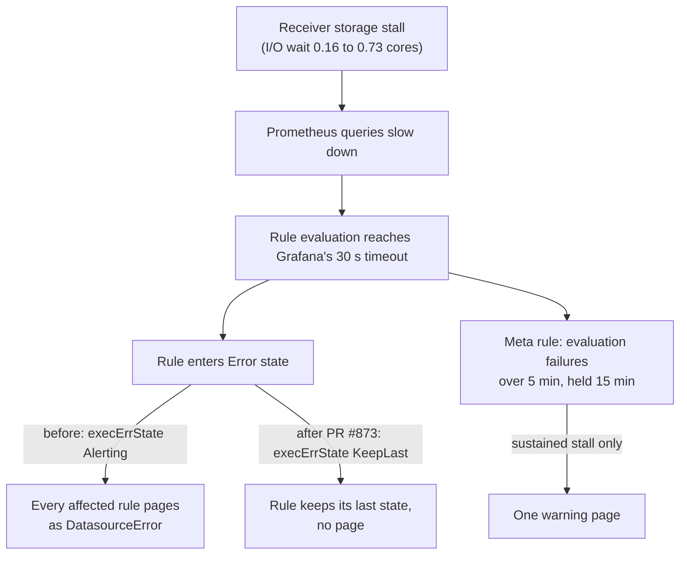

# O11y alert review, 2026-10-21 to 2026-11-04

**Date:** 2026-11-04
**Status:** PROPOSED
**Author:** Joseph A. Wisneski IV
**Context:** A review of the production o11y alerts sent to the operations Discord channel, to plan follow-up work. It separates real outages from alert noise, ties alerts to the Semaphore changes that ran at the same time, explains what drove the noise, and lists the work that follows.

## Problem

The alert channel mixed real outages, a planned drill and a large volume of false alarms, and nothing in the channel told them apart. Operators could not tell from the channel which alerts needed action, and a real alert arriving during a noisy burst would be easy to miss.

### Sources and scope

All times are UTC.

- **Grafana alert state history** (annotations backend). The query covered 2026-10-21 23:46 to 2026-11-04 and returned 3,159 state transitions. The earliest recorded transition is 2026-10-24 04:59. Whether no alert changed state before that, or the history is absent, was not established. **Every alert count in this document therefore covers 2026-10-24 to 2026-11-04.**
- **Grafana's own metrics in Prometheus:** rule evaluation duration, rule evaluation failures, datasource request results.
- **The receiver host's node exporter:** CPU (including I/O wait) and memory.
- **Production Semaphore task history:** 3,176 tasks from 2026-10-21, read per template with GET requests only.
- **Declared schedules** in `platform/semaphore/templates.yml`.
- **`docs/MISTAKES.md`** §3.18 and §3.19 for the Semaphore disk outage timeline.

The Discord channel itself was not cross-checked. The review's bot is not allowlisted for it, and a desktop read was blocked. Grafana's history covers every alert Grafana routes to the channel; messages from other senders, such as the liveness watcher, were not reviewed.

### What the channel received

| Category | Firing notifications | Where |
|---|---|---|
| Real: vLLM outages on the DGX head | 12 | Three windows, four rules each (Findings, C1) |
| Real: scheduled job silent | 1 | Daily certificate renewal missed during the Semaphore outage (Findings, A and C2) |
| Planned drill | 2 | Alert-delivery drill on 2026-10-31 (Findings, A) |
| False noise: query errors | 64 | "Alerting (Error)" during evaluation stalls (Findings, B) |
| **Total** | **79** | 15 "Alerting" plus 64 "Alerting (Error)" |

The 64 "Alerting (Error)" notifications are Grafana DatasourceError alerts: they report that a rule's query failed, not that the watched condition was true.

## Design Principles

- **An alert that fires must mean its condition is true.** A failure to evaluate is reported once, as its own signal, not as every rule firing.
- **Fix the mechanism, not the symptom** (`PRINCIPLES.md`, and the engineering principles in root `CLAUDE.md`). Silencing the channel is not a fix; the error handling in the rule definitions and the storage stall underneath it are.
- **Correlation is evidence, not cause.** A change that overlaps an alert is recorded as an overlap until a second source confirms it.
- **Config as code.** Alert rules change through `platform/services/o11y/deployment/templates/alerts.yml.j2` and `Deploy o11y (Dev)`, never in the Grafana UI.

## Architecture

How a storage stall turned into a page from every rule, and what PR #873 changes:

The external liveness watcher (`Check o11y Liveness (Dev)`, every ten minutes from the Semaphore host) sits outside this path and still reports Grafana or Prometheus being fully down.

## Findings

### A. Alerts tied to a scheduled or operator change

| Window | Alerts | Change | Verdict |
|---|---|---|---|
| 2026-10-31 21:43 | "Service telemetry scrape failed" for two loopback test targets | Semaphore task 11062, "Drill o11y Active Alert Delivery (Dev)", ran 21:39–21:44, after Deploy o11y (Dev) task 11054 (21:20–21:28) | Planned drill, expected. In the channel these alerts looked identical to real ones. |
| 2026-10-28 16:29 | "Scheduled job silent" for job `renew-internal-certs` | The daily Renew Internal Certs (Dev) run (`17 4 * * *`) did not run on 2026-10-28: task 9536 ran at 2026-10-27 04:17 and the next, task 10040, at 2026-10-29 04:17. Semaphore was down from 02:16 to 15:18 that day (`docs/MISTAKES.md` §3.18), which covers the 04:17 slot. The rule's 36-hour silence window from the 10-27 run ends at 16:17. | The alert was correct; the cause is a real outage (C2). |

**Error bursts that overlap change work.** These are bursts of "Pending (Error)" transitions, the state a rule enters while its query keeps failing, counted in ten-minute buckets. Overlap only; cause not established (Validation Criteria).

- 2026-10-29 22:40–23:00: Provision VM tasks 10296 and 10297 (22:45–23:06), which clone a template on Proxmox and could load shared storage.
- 2026-10-28 18:10–19:10: Apply Firewall tasks 9903 and 9904, Ensure and Verify Service Persistence, Back Up Credentials to site-config, and Deploy console tasks 9927 and 9928.
- 2026-10-30 07:00–07:40: Read Proxmox Root CA task 10449, Provision Console Proxmox Token, and Deploy console tasks 10456 and 10457.
- 2026-11-04 18:30–20:20: Deploy Plane tasks 12278 and 12279 (18:53–19:04).

**A daily burst with no Semaphore task.** "Pending (Error)" bursts appear at about 07:00 UTC on 2026-10-28, 10-29 and 10-31, and at 08:00 UTC on 2026-11-02. No Semaphore task falls in those windows (2026-10-30 also had a 07:00 burst, but it overlaps the tasks listed above). The one-hour move matches a fixed 03:00 schedule in US Eastern time, which left daylight saving time on 2026-11-01 (EDT on 2026-10-31, EST on 2026-11-02). The likely source is the Proxmox backup job for the o11y VM: the private inventory declares the job, and its schedule lives only on Proxmox. Not verified; the Proxmox host's time zone was not read either.

### B. Flapping and false noise

64 of the 79 firing notifications were "Alerting (Error)". They arrived together, every rule at once:

- 2026-10-29 at 14:18 and 17:38.
- 2026-10-30 from 13:34 to 15:29: all 11 scrape targets at once, twice.
- 2026-11-03 from 15:58 to 17:05: all 10 missing-telemetry groups.
- 2026-11-04 at 13:49 (all 11 targets) and 19:18.

Behind them sit 1,154 "Pending (Error)" transitions. The noisiest rules:

| Rule | Pending (Error) transitions | Status |
|---|---|---|
| Service metrics endpoint down | 748 | Retired; not in the current rule template |
| Service telemetry scrape failed | 556 | Live |
| Internal CA leaf certificate expires within seven days | 166 | Live |
| DGX Spark scrape target down | 156 | Live |

**Mechanism.** Grafana's rule evaluation p99 (`grafana_alerting_rule_evaluation_duration_seconds`) is about one second normally and rose to 25–31 seconds in every burst, reaching Grafana's 30-second evaluation timeout ([Grafana: No Data and Error states](https://grafana.com/docs/grafana/latest/alerting/fundamentals/alert-rule-evaluation/nodata-and-error-states/)). Every live rule set `execErrState: Alerting`, so a timed-out evaluation fired the rule. The paused tombstone rules use `OK` and evaluate a constant, so they cannot error. The service-telemetry rules wait two minutes (`for: 2m`) before firing; others wait 5, 10 or 15 minutes. A stall longer than a rule's wait therefore paged it, and because the stall hit every rule at once, each burst paged the whole set.

**Why the queries stall.**

- The receiver host (4 vCPUs) showed I/O wait rise from about 0.16 to about 0.73 cores during bursts, while user and system CPU fell and about 84% of memory stayed available. The stall is storage wait, not compute.
- Grafana's datasource requests and Prometheus's HTTP handlers show no errors; their requests returned 200.
- The o11y stack restarted once in the window (2026-10-31 19:00). Restarts do not explain the bursts.
- The receiver's node exporter runs only the cpu, meminfo, filesystem (root) and loadavg collectors (`platform/services/o11y/deployment/compose.yml`), so there are no disk I/O (diskstats) or pressure (PSI) metrics to see the storage side.
- Most "Pending (Error)" bursts have no Semaphore task: 2026-11-03, most of 2026-11-04, the 2026-10-29 burst at 06:40–07:20, and the daily 03:00-local burst. The source appears to lie outside Semaphore, for example in shared Proxmox storage or backups. Not verified.

**Fix proposed in PR #873 (open, not yet merged or deployed).**

- Every live rule's `execErrState` becomes `KeepLast`, so a query error keeps the rule's last known state instead of firing. Grafana 11.4.0, the pinned version, accepts `KeepLast` (Grafana source at tag v11.4.0, `pkg/services/ngalert/models/alert_rule.go:105`). Grafana's documentation recommends Keep Last State against temporary data source issues, paired with a separate rule for prolonged disruption.
- A new rule, "Alert rule evaluations failing" (uid `o11y_alert_evaluations_failing`, severity `warning`), is that separate rule: `sum(increase(grafana_alerting_rule_evaluation_failures_total{job="grafana"}[5m])) > 5`, held for 15 minutes, `execErrState: Alerting`. It pages only while failures keep happening for about fifteen minutes. Backtested against production for 2026-10-21 to 2026-11-04, it would have paged 4 times, each a stall of 15 minutes or more; a 15-minute counting window would have paged 17 times.
- The change takes effect only after the PR merges and `Deploy o11y (Dev)` runs.

### C. Real outages to address

**C1. vLLM on the DGX head went down three times.** Alerting windows: 2026-10-24 05:04–05:15, 2026-10-26 20:15–20:30 and 2026-10-26 21:14–21:25, each about five minutes after onset. Each fired the same four rules: Service metrics endpoint down on the DGX head's vLLM endpoint (since retired), vLLM metric families absent, DGX Spark scrape target down, and Synthetic inference probe failing. These titles come from the production Grafana rule list. No agent-cloud Semaphore task touched the DGX in these windows; the agentgateway redeploys on 2026-10-26 (tasks 9411–9413, 20:53–21:01) do not explain a vLLM metrics outage. Cause not verified. The alerts worked as designed and resolved on their own.

**C2. The production Semaphore root disk filled on 2026-10-28.** Per `docs/MISTAKES.md` §3.18 and §3.19: the root filled and Postgres crashed at 02:16:35, the root was grown online to 61G over operator-authorised SSH at about 03:50, and the containers were restarted at 15:18. Grow Semaphore Root (Dev) task 9846 ran at 15:23, after the recovery. The orchestrator missed the 04:17 certificate renewal, which the Scheduled job silent alert caught. No alert watches the orchestrator's disk: plan 18 (`plan/development/18-semaphore-task-retention.md`) is PROPOSED, and its decision D8 proposes a node-exporter target on the Semaphore host and a Grafana alert at 80% root usage. The o11y alert template has no Semaphore-host rule.

**C3. Receiver storage stalls.** PR #873 removes the noise but not the stall. While queries time out, the affected rules cannot change state, so a real condition that starts during a stall stays invisible until it ends. The existing rule `o11y_receiver_root_disk_low` covers free space on the receiver's root, not I/O wait.

## Implementation Phases

| # | Phase | Acceptance |
|---|---|---|
| 1 | Merge PR #873 and run `Deploy o11y (Dev)` | Production Grafana lists every live o11y rule with error state KeepLast and the new rule `o11y_alert_evaluations_failing`; the next storage stall sends at most one warning instead of a burst |
| 2 | Make storage visible: enable the diskstats and pressure collectors on the receiver's node exporter | Prometheus holds disk I/O and PSI series for the receiver. Needs a decision first, because the bounded collector set is deliberate |
| 3 | Read the Proxmox task log (backup and clone tasks) for the burst windows; consider moving the o11y VM disk off contended storage or moving the backup window | Each burst window in this review is matched to a Proxmox task or ruled out |
| 4 | Put change markers in Grafana: each Semaphore deploy or provision task writes a start and end annotation | A dashboard shows change markers beside alert state, so the next review is a query instead of a log join |
| 5 | Make drills announce themselves: alert-delivery drills carry a drill label or title prefix | A drill notification in the channel is distinguishable from a real one by its text |
| 6 | Mark planned DGX and vLLM restarts: the DGX side records restarts, or silences vLLM alerts during planned work | A vLLM alert window can be classified as planned or unplanned from a record |
| 7 | Build the orchestrator root-disk alert from plan 18, decision D8 | A Grafana rule alerts at 80% root usage on the Semaphore host |
| 8 | Allowlist the alert channel for the Discord bot | Future reviews can read messages from senders other than Grafana |

## Validation Criteria

What this review could not verify, and the check that would settle each item:

| Claim | Check | Passes when |
|---|---|---|
| Alerts from 2026-10-21 to 10-23 | Grafana alert history for that range, or Discord history | Either source lists them, or confirms there were none |
| The daily 03:00-local burst is the o11y VM's Proxmox backup job | Proxmox task log for the job; the Proxmox host's time zone | A backup task starts at each burst |
| Bursts come from shared storage contention | Receiver diskstats/PSI (phase 2) or Proxmox storage metrics | I/O saturation lines up with the bursts |
| The change tasks in Findings A caused their overlapping bursts | Proxmox task log for the same windows | A storage-heavy task matches each window |
| Cause of the three vLLM windows | DGX-side records of vLLM restarts | Each window matches a recorded restart or failure |
| Contents of the Discord channel, including other senders | Allowlist the bot, then read the channel | Every message is classified into one of this review's categories |

## Security Considerations

- **Public repository.** This document names no IP addresses, internal hostnames, usernames or tokens. Targets are described by role.
- **Read-only evidence.** The Semaphore history was read with GET requests using the bootstrap `admin` recovery token, on the operator's explicit authorisation for this review. The token was passed on standard input and never printed. Getting an operator token minted per the Semaphore operating guide would remove the need for the recovery token in future reviews.
- **PR #873 lowers alert sensitivity to query errors on purpose.** The meta rule and the external liveness watcher keep a prolonged or total outage visible.
- **Phase 8 widens a bot's read access.** Allowlisting the alert channel lets the Discord bot read that channel's history.

## Cross-references

- PR #873: the noise fix described in Findings B
- `plan/development/18-semaphore-task-retention.md`: orchestrator disk headroom and the proposed root-disk alert (D8)
- `plan/development/O11Y-GRAFANA-AUTH-INCIDENT.md`: earlier o11y incident record
- `platform/services/o11y/deployment/README.md`: alert rules, the alert-delivery drill and the liveness watcher
- `docs/MISTAKES.md` §3.18 and §3.19: the Semaphore disk outage
- Root `CLAUDE.md`: the o11y service and the `Check o11y Liveness (Dev)` and `Deploy o11y (Dev)` workflows
