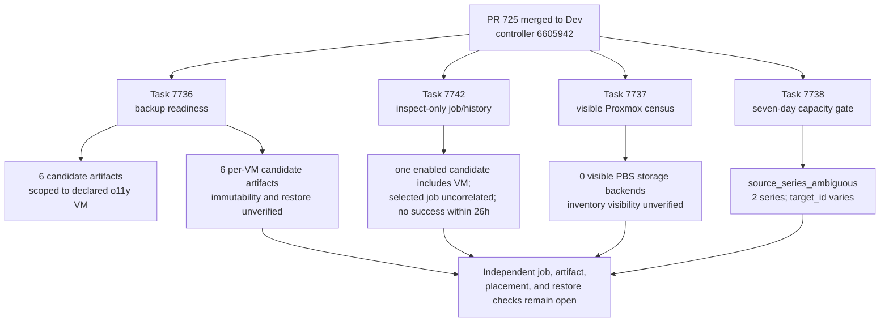

# o11y Backup and PBS Capacity Readiness Receipt

**Date:** 2026-10-21
**Status:** READ-ONLY EVIDENCE; restore, placement, and capacity gates remain open.
**Context:** This note records task results from existing Dev-bound backup readiness, PBS census, seven-day capacity, and inspect-only backup-job checks after PR 725 merged to Dev at `6605942ea7218989d10ab03376c4dc15908cadb3`. It distinguishes observed candidates from verified recoverability; it does not authorize or record PBS provisioning, allocation, backup, or restore work.

## Problem

A listed backup artifact is only a candidate. Task 7736 did not inspect backup-job configuration or history, test artifact readability, prove immutability, or perform an isolated restore. The inspect-only follow-up task 7742 found one enabled job candidate that includes the declared VM, but did not correlate the private inventory-selected job ID to that candidate; its bounded VM history reports a successful latest task but no success within 26 hours, with job attribution unavailable. The Proxmox census is ACL-filterable and reports visible inventory only. The seven-day telemetry gate refuses to assess capacity when multiple source series are present. No verified usable backup or successful backup within the 26-hour freshness window is established by these results.

## Design Principles

1. **Candidate evidence stays a candidate** — listing an artifact does not prove it is complete, retained, readable, immutable, or restorable.
2. **Read-only receipts preserve authority boundaries** — these surveys describe existing state and make no allocation or configuration changes.
3. **Refusal remains a gate** — ambiguous telemetry is diagnosed without joining series, relaxing the single-source condition, or pruning history.
4. **Source and live evidence remain distinct** — the merged source and successful survey tasks do not complete restore, PBS service, or capacity acceptance.

## Architecture

## Implementation Phases

### Phase 1: Read-only evidence refresh (completed 2026-10-21)

**Goal:** Run only existing, exact-SHA Dev-bound read-only checks and preserve fixed sanitized outputs.

**Tasks:**

1. Task 7736, `Survey o11y Backup Readiness (Dev)`, completed successfully at controller revision `6605942ea7218989d10ab03376c4dc15908cadb3`.
2. Task 7737, `Survey PBS VM Census (Dev)`, completed successfully at the same controller revision.
3. Task 7738, `Survey o11y Seven-Day Capacity History (Dev)`, read back that controller revision and receiver revision `67b9cffcdda8b3b10e840c50357c1b23f8410cbb`; it refused the unchanged gate with `source_series_ambiguous`.
4. Task 7742, `Reconcile o11y Backup Job (Dev)` with `inspect_only=true`, completed successfully at the same controller revision. Its source performs GET requests in inspect-only mode and ends the play before the sole PUT path.
5. Sanitized receipts are stored outside the repository at `/private/tmp/o11y-backup-readiness-latest-receipt.json` and `/private/tmp/o11y-capacity-latest-receipt.json`, both mode `0600`.

**Acceptance criteria:**

- Each task readback reports the exact controller commit above.
- The capacity task confirms the exact receiver commit before querying bounded history.
- Receipts contain only fixed fields and aggregate counts, not storage or artifact identifiers, addresses, label values, or raw metrics.

### Phase 2: Close independent restore and capacity gates (open)

**Goal:** Establish artifact usability and isolated recovery evidence, and resolve the capacity source-series ambiguity without weakening the gate.

**Tasks:**

1. Extend the reviewed inspect-only report with a fixed boolean for the privately declared selected job membership, computed in memory without exposing the job ID. Task 7742 reports aggregate candidates but does not associate the selected private job with one candidate, so selected-job inclusion remains unverified. Its bounded VM history reports `latest_success_within_26h: false` and `job_attribution: unavailable`; it does not prove a recent success by the selected job.
2. Verify a specific candidate artifact can be read and meets the applicable immutability/retention requirement.
3. Verify an isolated restore target is available, then complete and read back an isolated restore test before considering guest growth.
4. Diagnose why the capacity query returns two source series. Preserve the single-source refusal until the source is understood; do not prune history or infer a cause from label variation alone.
5. Re-run the capacity gate only after the source condition is corrected through reviewed configuration and the exact reviewed controller/receiver revisions are pinned.
6. Verify target storage and allocation availability immediately before any future allocation. The census has no reservation semantics and its inventory visibility is unverified.

**Acceptance criteria:**

- Job inclusion, latest successful backup freshness, artifact readability, immutability/retention, and isolated restore are each supported by their own readback evidence.
- A destination is confirmed available immediately before allocation; this census alone does not reserve or prove it.
- Capacity passes only when the unchanged seven-day history gate returns its ready status with the exact reviewed receiver.

### Source-only selected-job inspection follow-up (prepared; not merged)

The source change associates the existing private inventory-selected job with the bounded Proxmox job-list response. It reports only whether that identity is unique, missing, or ambiguous; enabled state; a fixed selector category; and explicit-VMID membership when the existing validator can prove it. Job identifiers, VMIDs, schedules, raw selectors, and candidate rows are excluded from durable output. `all`, pool, exclude, malformed, and unsupported selectors remain unverified. Inspect mode remains GET-only and ends before the apply path.

This is source readiness only. The change has not completed independent review, merged, published to Semaphore, or run against Dev. The earlier inspect task remains the only live read-only receipt and still does not establish that the privately selected job includes o11y. No backup success, freshness, artifact readability, immutability, or restore evidence is added by this source change.

## Validation Criteria

| Check | Evidence | Result |
|---|---|---|
| Backup readiness task 7736 | Exact controller readback; declared VM verified; 3 active backup-capable storages, 0 PBS and 3 non-PBS; 6 candidate artifacts | Survey succeeded; artifact/job/restore acceptance remains open |
| Candidate scope | Source queries backup content with `content=backup` and the declared VM ID after verifying exactly one matching QEMU VM at the declared node | Six candidates are scoped to that declared VM; they are not verified usable backups |
| Backup job inclusion | Task 7742 inspect-only report found 3 candidates, 2 enabled; one enabled candidate includes the declared VM and one excludes it. The sanitized output does not correlate the privately selected job ID to a candidate. | Selected-job membership unverified |
| Latest successful backup age | Task 7742 reports one archived VM task with outcome `success`, `latest_success_within_26h: false`, and `job_attribution: unavailable`. | No successful VM task within 26 hours; selected-job attribution unverified |
| PBS placement census task 7737 | 11 visible nodes (7 online, 4 offline), 31 visible VMs, 2 templates, 6 storages, 0 PBS storage backends; `inventory_visibility: unverified` | Survey succeeded; counts are visible rows only |
| Capacity task 7738 | Exact controller and receiver assertions passed; diagnostic reports 2 source series, `target_id` variation, 0 unrecognized label keys, 1 series at latest evaluation, 1 overlapping evaluation and event | Gate refused with `source_series_ambiguous`; no capacity pass or forecast |
| Selected job destination and scheduler | Task 7742 fixed summary reports an active backup-capable destination in the `below_10_percent` free-space band and a running scheduler. | Storage headroom is a separate unresolved gate; no storage identity is recorded here |
| Isolated restore and immutability | Explicitly false in task 7736 output | Not verified |

## Security Considerations

- The tasks used existing GET-only Dev survey templates. No backup job, VM, disk, storage, retention, capacity, credential, or receiver state was changed.
- The census marks inventory visibility unverified because Proxmox may filter rows under the survey identity. Its counts do not prove that no other eligible node or storage exists.
- Candidate counts and storage backend counts are aggregate evidence only; this note contains no private storage, VM, job, artifact, or address values.
- The telemetry diagnostic compares only fixed allowlisted label keys and reports variation booleans/counts. `target_id` variation is observed; its cause is unknown.

## Cross-references

| Document or source | Relationship |
|---|---|
| `platform/playbooks/survey-o11y-backup-readiness.yml` | Read-only per-VM storage/content survey and fixed candidate summary |
| `platform/playbooks/survey-pbs-vm-census.yml` and `platform/playbooks/files/inspect_pbs_vm_census.py` | Sanitized visible-inventory and storage counts; visibility is explicitly unverified |
| `platform/playbooks/reconcile-o11y-backup-job.yml` and `platform/playbooks/files/reconcile_proxmox_backup_job.py` | Inspect-only GET path reports sanitized job candidates and bounded task history, then ends before apply-mode writes |
| `platform/playbooks/survey-o11y-seven-day-capacity.yml` and `platform/playbooks/files/survey-o11y-seven-day-capacity.py` | Exact-revision bounded history gate and fixed-schema ambiguity diagnostics |
| `plan/development/openspec/changes/pbs-vm-and-restore-gate/` | PBS service, backup-access, guest, restore-target, and acceptance implementation notes; source readiness does not close live acceptance tasks |
| PR 725 merge commit `6605942ea7218989d10ab03376c4dc15908cadb3` | Exact controller revision read by all three tasks |

## Revision History

| Date | Change |
|---|---|
| 2026-10-21 | Recorded tasks 7736, 7737, 7738, and inspect-only task 7742 with remaining acceptance gates. |
