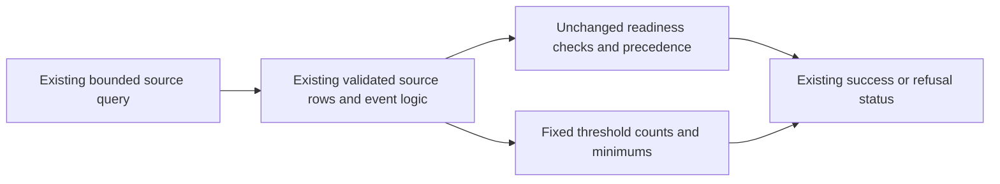

# O11Y CAPACITY HISTORY THRESHOLD DIAGNOSTICS

**Date:** 2026-10-24
**Status:** IMPLEMENTED (source and focused tests; live acceptance remains open)
**Context:** A reviewed Dev-bound, read-only capacity-history survey refused with its existing `source_history_too_short` reason. Its sanitized receipt showed one source series and no overlapping evaluations or source events, but did not expose whether the source evaluation-point count, canonical distinct-event count, or event span missed its existing threshold. This plan adds only bounded aggregate diagnostics to the survey receipt.

## Problem

The survey checks source history in stages: enough Prometheus evaluation points, then enough distinct timestamp events spanning at least seven days after duplicate-sample collapse and carried-in sample exclusion. The current refusal category intentionally remains `source_history_too_short`, but its receipt cannot identify which threshold failed. Repeating the same read-only survey would return the same insufficiently specific evidence.

The diagnostic must explain those existing checks without changing the query, parsing accepted by the gate, event selection, failure precedence, readiness outcome, or any forecast, retention, and growth gate. It must not expose raw samples, timestamps, labels, or series values.

## Design Principles

1. Preserve every existing query, the eight-day range, five-minute step, all thresholds, and failure precedence.
2. Reuse the validated source parsing and the same duplicate-collapse and carried-in-event exclusion used by assessment; do not maintain a second event algorithm.
3. Report fixed-schema counts and configured minimums only. If source structure is malformed or ambiguous, report typed unavailable values (`null`) for threshold measurements rather than a healthy-looking zero.
4. Keep the survey read-only. Diagnostics do not filter, join, normalize, clamp, accept ambiguous samples, or authorize forecasting, retention changes, or capacity growth.

## Architecture

For a structurally valid single source series, expose: evaluation point count versus `MIN_METRIC_POINTS`; canonical distinct source-event count after the existing dedupe and carry-in exclusion versus the existing minimum of eight; and event span in seconds versus `MIN_HISTORY_SECONDS`. On ambiguous or malformed source data, the three measured counts are `null`; configured minimums remain fixed constants. Existing diagnostics and failure reason remain intact.

## Implementation Phases

### Phase 1: Additive threshold evidence

**Goal:** Add sanitized threshold context to success and insufficient receipts while preserving all readiness behavior.

1. Add a fixed-schema source-history diagnostics result computed from the already parsed source rows and canonical event sequence.
2. Use the same canonical event sequence for assessment and diagnostics so duplicate and carry-in handling cannot drift.
3. Add focused tests for short evaluation history, too few canonical events, insufficient span, carry-in exclusion, duplicate/quiet counts, malformed and non-finite input, and ambiguous series.
4. Compare the existing fixture outcomes before and after the change, including refusal precedence and successful readiness.

**Acceptance criteria:**

- The `source_history_too_short` reason, success status, all query strings, gate thresholds, and failure precedence are unchanged.
- A valid single series exposes the three measured values and their fixed minimums without printing timestamps, values, labels, or arbitrary keys.
- Malformed or ambiguous source history exposes `null` measured values, not zero counts that could imply healthy evidence.
- Existing deduplication and carried-in sample exclusion produce the same assessment outcome as before.
- No live survey, Semaphore task, retention change, forecast acceptance, or growth authorization is part of this work.

## Validation Criteria

| Check | Pass condition |
|---|---|
| Focused capacity-history tests | Existing fixtures preserve their assessment decisions and new threshold cases pass |
| Ruff and Python syntax | Modified Python files pass the repository's applicable Ruff and syntax checks |
| Diff and scope review | Only this plan, the survey helper, and its existing focused test module change |
| Live and forecast status | No live readiness or forecast claim is made from source tests |

## Security Considerations

The survey reads a bounded Prometheus response through its existing exact-revision, read-only playbook. The new receipt fields contain only fixed field names, threshold constants, integer counts, spans, and `null`. Do not emit raw response samples, timestamps, label names or values, URLs, addresses, or command output. The feature does not alter selectors, source identity rules, or operational permissions.

## Cross-references

- [Capacity source diagnostics](O11Y-CAPACITY-SOURCE-DIAGNOSTIC.md)
- [Observability signal and capacity OpenSpec](openspec/changes/o11y-signal-labeling-profiling-alerting/design.md)
- [Observability estate OpenSpec](openspec/changes/observability-estate/tasks.md)
- [Repository principles](../../PRINCIPLES.md)
- [Repository architecture](../../ARCHITECTURE.md)

## Revision History

| Date | Change |
|---|---|
| 2026-10-24 | Implemented sanitized diagnostics for the existing source-history thresholds. |
