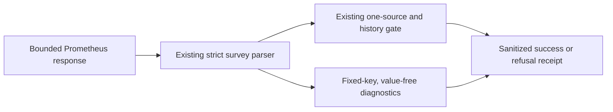

# O11Y CAPACITY SOURCE DIAGNOSTIC

**Date:** 2026-10-20
**Status:** IMPLEMENTED (source and tests; live acceptance remains open)
**Context:** The Dev-bound seven-day capacity survey returned its existing `source_series_ambiguous` refusal. This plan adds bounded, sanitized evidence to help diagnose that refusal without changing source selection or capacity acceptance.

---

## Problem

The survey requires exactly one source series and correctly refuses when Prometheus returns more than one. Its fixed refusal receipt does not currently say how many series were returned or whether their evaluation/event histories overlap. That limits diagnosis while preserving the gate.

## Design Principles

1. Preserve the single-source requirement and all current refusal categories.
2. Emit only fixed schema keys, counts, and booleans; never emit metric label values, raw samples, or arbitrary label names.
3. Bound diagnostic work by the existing response size, query range, and returned rows.
4. Keep this read-only evidence separate from forecast, retention, and capacity decisions.

This source change does not close task 5.3 in `openspec/changes/o11y-signal-labeling-profiling-alerting/tasks.md`. The prior Dev receipt remains an ambiguous-source refusal with two returned series; neither that receipt nor these local diagnostics establish why both series were returned. Reviewed deployment/readback and qualifying seven-day evidence remain required.

## Architecture

Diagnostics count returned source series, fixed allowlisted label variation, series present at the latest evaluation, overlapping evaluation timestamps, and overlapping sampled source-event timestamps. Any diagnostic parse limitation produces fixed unavailable fields and does not replace the existing gate result.

## Implementation Phases

### Phase 1: Additive diagnostics

**Goal:** Add the same bounded diagnostic object to survey success and refusal receipts.

**Tasks:**
1. Compute only aggregate counts and fixed allowlisted label-variation booleans from the source matrix.
2. Preserve the current `source_series_ambiguous` refusal for every multi-series response.
3. Add tests for disjoint and overlapping series, output secrecy, and unchanged readiness/refusal behavior.

**Acceptance criteria:**
- Two returned series still produce `status=insufficient` and `reason=source_series_ambiguous`.
- Diagnostics distinguish disjoint from overlapping evaluations/events without exposing values or label names.
- Existing source-history, backend, host-metric, and transport gates remain unchanged.

## Validation Criteria

| Check | Pass condition |
|---|---|
| Focused capacity history tests | Existing gate cases plus disjoint/overlapping diagnostic receipts pass |
| Ruff | Modified Python files pass repository Ruff checks |
| Output inspection | Receipts contain fixed field names and aggregate values only |
| OpenSpec status | Capacity task remains open pending Dev-bound live readback and seven-day evidence |

### Follow-on: canonical scrape-label variation (2026-10-20)

The read-only survey task 7721 on reviewed Dev `fad68aea3330230afc1908c4523b14f030df8150`
matched receiver revision `67b9cffcdda8b3b10e840c50357c1b23f8410cbb`
(`revision_matches=true`) and returned
`status=insufficient`, `reason=source_series_ambiguous`. It reported two historical source
series, one at the latest evaluation, one overlapping evaluation, no overlapping source
events, all five existing allowlisted label-variation checks false, and one unrecognized
label key. This does not establish why Prometheus returned two series. The receiver-host
scrape declares the static `target_id` label in
`platform/services/o11y/deployment/templates/prometheus.yml.j2:58-61`, while the capacity
emitter's timestamp metric has no intrinsic labels
(`platform/services/o11y/deployment/capacity/collect-o11y-capacity.py:52`). Add only
`target_id` and `component` to the fixed diagnostic variation allowlist and test that
their variation is reported as booleans while their names and values remain hidden.
Leave the query, historical series, selection, one-source refusal, and every readiness
gate unchanged. This diagnostic cannot identify the cause or prove a label migration.

**Source receipt:** implemented and covered by the capacity-history tests. The diagnostic
now reports only variation booleans for the two additional fixed keys. The selector and
single-source assessment are unchanged. No live survey was repeated; the existing Dev
receipt and capacity readiness gates remain unchanged, and no label-migration cause is
established.

## Security Considerations

The diagnostic operates on an already bounded read-only query response. It must not print metric bodies, label values, timestamps, URLs, addresses, or unknown label names. It does not join or filter series, alter query selectors, prune history, or authorize retention/growth changes. The existing exact-revision controller and receiver guards remain authoritative.

## Cross-references

- [OpenSpec observability signal and capacity change](openspec/changes/o11y-signal-labeling-profiling-alerting/design.md)
- [OpenSpec capacity task 5.3](openspec/changes/observability-estate/tasks.md)
- [Testing and linting plan](../architecture/TESTING-AND-LINTING-PLAN.md)
- [Repository principles](../../PRINCIPLES.md)
- [Repository architecture](../../ARCHITECTURE.md)

## Revision History

| Date | Change |
|---|---|
| 2026-10-20 | Implemented bounded diagnostics for existing ambiguous-source refusal; no live cause established. |
