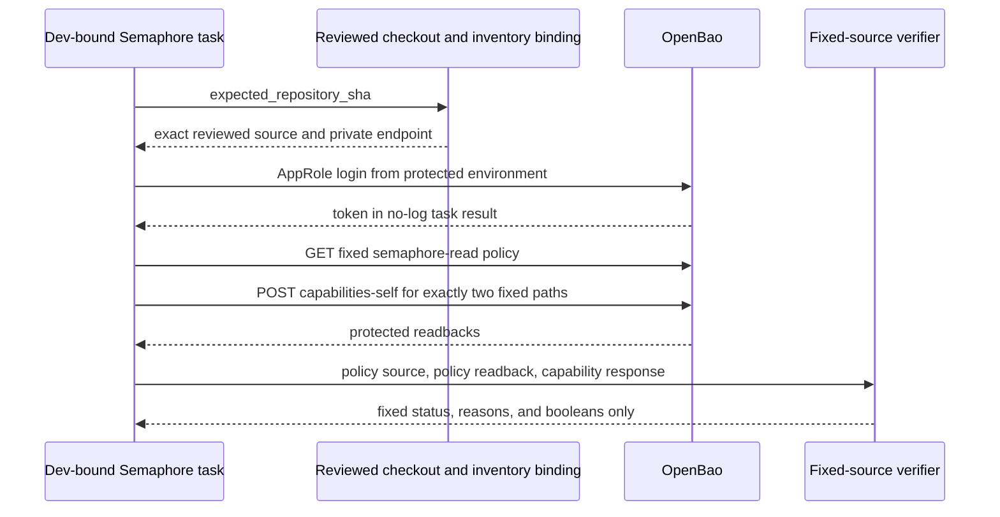

# O11Y Restore Capability Acceptance

**Date:** 2026-10-24
**Status:** ACTIVE
**Context:** The isolated-restore coordination guard now has source policy for one fixed KV v2 record, but policy source alone does not prove what the Semaphore controller's injected AppRole can do. This plan adds a reviewed, read-only Dev workflow to compare the effective role grants and the stored policy to the exact reviewed source before any guarded writer is activated.

## Problem

`semaphore-read.hcl` declares `create`, `read`, and `update` on the coordination data path and `read` on its metadata path. The policy is applied separately through Semaphore. A successful apply run or matching source file does not prove the token injected into a later writer has those effective capabilities. Reading the coordination record also cannot prove access: KV v2 returns 404 for both an absent record and one hidden by policy.

The source workflow must verify the actual protected AppRole token without reading or changing the coordination record. It must also read back the stored `semaphore-read` policy and compare its documented `policy` field with the reviewed HCL bytes.

## Design Principles

- Use only the existing protected Semaphore AppRole and the sole `openbao_svc` inventory endpoint. Never accept URLs, role credentials, paths, or capability requirements from surveys or extra vars.
- Require the controller checkout to match the exact reviewed Dev SHA before credential use.
- Verify the complete closed capability sets for the two fixed paths. Extra grants are a refusal, including `root`, `sudo`, `delete`, `list`, `patch`, and `deny`.
- Keep policy source equality and `sys/capabilities-self` evidence distinct: one proves which policy is stored; the other proves the injected token's effective capabilities.
- Make every request read-only, TLS-validated, redirect-free, proxy-free, and safe under `--check`. Never query or mutate the coordination record.
- Print only the reviewed SHA, fixed status/reason, and boolean match results. Keep credentials, URLs, raw policy text, and API response bodies out of output.

## Architecture

The dedicated Dev-only template accepts only `expected_repository_sha`. Its entrypoint rejects internal and protected-input overrides, requires the exact reviewed checkout, and includes the shared credential-free OpenBao destination-binding task. It then logs in using `BAO_ROLE_ID` and `BAO_SECRET_ID` from the protected Semaphore environment.

The workflow performs exactly two OpenBao reads after login: `GET /v1/sys/policies/acl/semaphore-read`, and `POST /v1/sys/capabilities-self` with exactly `secret/data/coordination/o11y-restore-target` and `secret/metadata/coordination/o11y-restore-target`. The policy response must use the documented `data.policy` field and match the reviewed `semaphore-read.hcl`; ambiguous or mismatched duplicate policy fields fail closed. The multi-path capability response must contain exactly both requested paths. No single-path compatibility fallback is accepted.

Required effective capabilities are exactly `{create, read, update}` for the data path and `{read}` for the metadata path. Missing, extra, malformed, or unrecognized capabilities refuse the check. The workflow makes no request to the KV v2 data or metadata endpoints and performs no write.

## Implementation Phases

1. Add a bounded stdlib helper that validates the documented API envelopes, exact path set, exact capability sets, and policy/source equality. Return only fixed status and reason values, the reviewed 40-character SHA, and boolean matches.
2. Add the Dev-only read-only playbook and shared task. Clear inherited URI authorization, TLS, proxy, redirect, client-certificate, and URL-auth settings for each request. Keep login and API results no-log; mark the capability POST unchanged and execute the read-only calls in check mode.
3. Declare one `Verify o11y Restore Coordination Capabilities (Dev)` Semaphore template bound directly to `agent-cloud dev`, with only the required reviewed-SHA survey field. Pin the entrypoint, helper, task, reviewed-checkout helper, destination-binding task, transport task, catalog, and policy source in its bounded reviewed payload set.
4. Add focused helper, rendered-request, catalog, and synthetic HTTP tests. Record this source gate and the separate policy-application step in this plan. Do not run the workflow against live OpenBao as part of source validation.

## Validation Criteria

| Check | Pass condition |
|---|---|
| Helper unit tests | Exact policy and capability sets pass; missing, extra, malformed, ambiguous, or unrecognized fields refuse with fixed output. |
| Playbook and catalog tests | Only the fixed endpoints, exact two paths, protected environment credentials, Dev repository, and reviewed-SHA survey are declared. |
| Check-mode contract | Read-only POST is unchanged and safe in check mode; mutating POSTs remain classified as writes. |
| Synthetic HTTP integration | Login, policy GET, and capabilities POST are the only calls; no coordination record request or write occurs; output contains no raw response or credential. |
| Lint and diff | Focused Ruff/YAML checks and `git diff --check` pass. |
| Live activation | Separately verify Dev catalog binding, apply the reviewed policy through the existing Dev policy template, then run this verifier and review its receipt before enabling any guarded writer. |

## Security Considerations

The API token, login response, policy text, and capabilities response are protected Ansible values and remain hidden from task output. The helper uses fixed path names and exact expected grants; no caller-controlled route or expected capability list is accepted. A policy match does not substitute for the effective capability check, and a successful local test does not establish a live role binding. No VM, coordination record, policy, or Semaphore runtime object is changed by this verifier.

## Cross-references

- [O11Y Restore Coordination](O11Y-RESTORE-COORDINATION.md)
- [PBS and restore Dev publication runbook](openspec/changes/pbs-vm-and-restore-gate/implementation/dev-bootstrap-publication-runbook.md)
- [Apply Semaphore policy](../../platform/playbooks/apply-policy-semaphore.yml)
- [OpenBao capabilities-self API](https://openbao.org/docs/api/system/capabilities-self/)
- [OpenBao policy API](https://openbao.org/docs/api/system/policies/)
- [PRINCIPLES.md](../../PRINCIPLES.md)

## Revision History

- 2026-10-24: Approved the source-only capability and policy readback gate; live activation remains separate.
