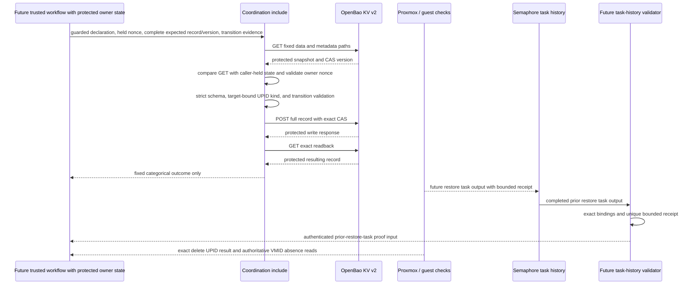

# O11Y Restore Coordination

**Date:** 2026-10-21  
**Status:** ACTIVE  
**Context:** This plan defines a source-only shared coordination primitive for the PBS isolated-restore workflow in OpenSpec `pbs-vm-and-restore-gate`, task 5.2. The OpenSpec change currently lives on the separate PBS bootstrap branch pending PR #726; no PBS artifacts are ported here. This branch is based on `dev` `fad68aea`; PR #725 is already merged to Dev at `6605942e`, and a normal Dev merge into this branch remains pending before integration.

## Problem

An isolated restore and its later cleanup can overlap or be retried after an uncertain API response. A target declaration in private inventory identifies what may be used, but does not serialize cooperating workflow runs. Semaphore task output is the durable acceptance record, but an Ansible `set_stats` value alone cannot authenticate a completed restore or authorize deletion. The platform needs a fixed-path, version-CAS record that requires each owner to present its held nonce and complete prior record/version; a fresh GET alone must never grant ownership.

This component is coordination only. It does not restore, stop, delete, or otherwise mutate a VM. It does not make an inventory declaration or a nonce into proof of identity, and it does not independently authenticate Semaphore task output.

## Design Principles

- The private Git inventory owns the exact target and artifact declaration. Public source contains only schema and workflow logic.
- OpenBao KV v2 at the fixed `secret/data/coordination/o11y-restore-target` path serializes cooperative transitions with version compare-and-set. The path is not an extra var or inventory input.
- A completed Semaphore task with a separately authenticated, exact-bound receipt is the acceptance authority. A caller-provided boolean, nonce, or `set_stats` field is not sufficient proof.
- Every write uses a full validated record and the version read with it. No merge patch, TTL, automatic takeover, release, rescue cleanup, or silent retry is allowed.
- Every later transition compares the fresh GET with the caller's protected complete prior record and version, then checks the matching held owner nonce. The fresh GET is only a comparison target; it is never adopted as caller state.
- Unknown write outcome, failed exact readback, malformed data, a tombstone, or any ownership/fingerprint drift retains the claim and target for operator investigation.
- Do not claim a live Proxmox or Semaphore proof from local source tests.

## Architecture

```mermaid
stateDiagram-v2
    [*] --> absent
    absent --> reserved: CAS 0 after data and metadata both prove absence
    reserved --> restore_active: held restore nonce + expected record/version
    restore_active --> awaiting_receipt: held owner nonce + exact expected record/version + generated receipt
    awaiting_receipt --> cleanup_active: held restore nonce + exact awaiting record/version + authenticated prior task proof
    cleanup_active --> cleaned: held cleanup nonce + expected record/version + exact delete and VMID absence proofs
    cleaned --> cleaned: same expected record/version and owner; no automatic new restore
```

The record uses schema version 1 and exact keys only: reviewed target/declaration/artifact fingerprints, public source SHA and private inventory SHA, stable operation identity, generation, phase, restore nonce, active nonce, and phase-specific action, Proxmox UPID, restore-receipt fingerprint, and prior authenticated restore-task ID. The target, artifact, and private inventory remain private; only SHA-256 fingerprints enter the coordination record. `target_fingerprint` is SHA-256 of the canonical compact JSON object `{"node": <exact node>, "vmid": <exact integer VMID>}` serialized with sorted keys and no whitespace. It binds the transient protected node/VMID reference used for UPID and absence checks. `declaration_fingerprint` separately binds the complete reviewed target declaration, including storage and network choices; it is not substituted for the node/VMID identity fingerprint. The transient target reference is never persisted, and a swapped reference with an unchanged record, expected snapshot, and nonce is refused. The caller holds the most recently verified complete record, its KV version, and owner nonce in protected controller state. The helper creates one `secrets.token_hex(32)` nonce when reserving and one fresh nonce when transferring ownership to cleanup. No secret credential is stored there.

The task reads both KV v2 data and metadata at the fixed path. It refuses a version tombstone or metadata-only record. A reservation is the sole CAS-0 creation. Each later transition requires the caller-supplied complete prior record and version to equal the fresh read and requires the caller-held owner nonce to match that record. It then uses the matched KV version as `options.cas`. The include cannot adopt state from a fresh GET when caller-held expected state is absent or stale. After a write, the task performs an exact readback before reporting a fixed categorical result. The pure helper checks schemas, ownership-state continuity, nonce format, pending-action rules, exact UPID node/type/VMID shape, and proof structure; it does not authenticate the source or assert that the caller obtained those facts from Proxmox or Semaphore.

## Implementation Phases

1. **Strict record and transition helper.** Implement pure functions to validate declaration fingerprints, KV v2 snapshots, exact record shape, phase transitions, held-owner nonce, complete expected prior record/version, exact node/type/VMID UPID binding, and typed proof structure. Return safe categorical refusal reasons without echoing payloads. Accept no unsupported action and no truthy proof booleans. Typed proof validation is not authentication.
2. **OpenBao coordination include.** Add an Ansible task include using the repository transport and internal-var guard conventions. Keep reads, full-record writes, and readbacks `no_log`; use fixed path and redirects disabled. Show only a fixed sanitized status. A lost or ambiguous write response fails closed and requires manual reconciliation.
3. **Focused regression coverage and documentation.** Exercise production helper functions, actual rendered include requests, and KV v2 payload shapes, including competing callers, stale expected record/version, held-nonce refusal, CAS-loser readback, drift, tombstones, exact UPID binding, pending UPID, forged proof, and cleaned rerun behavior. Record all still-open wrapper, task-history, policy, and live gates.

Acceptance requires the helper to reject malformed and stale transitions, the include to send only fixed-path full-record CAS writes and exact reads, and every protected request/result to be hidden from normal Ansible output. The task is not ready for live use until its caller authenticates task output and its OpenBao permissions are declared and reviewed.

## Validation Criteria

| Check | Pass condition |
|---|---|
| Focused Python tests | Exercise production helper functions and serialized KV v2 response/write payloads; all fail-closed cases reject. |
| Ruff | New Python helper and test file pass repository Ruff configuration. |
| YAML syntax / static inspection | Task include parses and uses only the fixed path, KV v2 version CAS, protected reads/writes/readback, no redirects, and fixed visible status. |
| Whitespace and introduced-history scan | `git diff --check` passes; count-only secret scanning of introduced commits finds no credential material. |
| Runtime boundaries | No live OpenBao, Proxmox, Semaphore API, deployment, or state mutation is performed as part of this source task. |

## Security Considerations

- The fixed path prevents launch-time path selection, but the existing Semaphore policy inspected at the implementation base only grants `secret/data/services/*` and `secret/metadata/services/*`. A future least-privilege policy change must explicitly authorize the coordination path and its metadata read before activation; this component does not broaden policy.
- The repository's play-level `refuse-internal-extra-vars.yml` and `refuse-var-overrides.yml` patterns protect reserved names. A shared include cannot authenticate the values passed by its caller. The future wrapper must refuse every input/evidence name as an extra var before it constructs and passes the include vars.
- A 256-bit nonce correlates transitions and is one part of lease ownership; it is not authorization by itself. A new transition also requires the complete expected prior record and KV version from prior protected state. Stable operation identity and generation prevent accidental cross-operation reuse but do not prove human or task identity.
- After acquisition, the caller must keep the returned record, readback version, and owner nonce in protected controller state. Every later transition supplies those exact values. A mismatch, absent expected record, stale expected version, or missing nonce refuses before CAS; reading the latest record does not enable adoption or resume by a new run.
- `awaiting_receipt` records the restore run's generated receipt fingerprint only. It does not authorize cleanup. Cleanup must be a separate invocation that fetches and authenticates the prior completed successful restore task through the Semaphore API, confirms exact project/template/revision/inventory bindings, validates one unique bounded receipt, and supplies the complete `awaiting_receipt` record and KV version from that completed task's protected output. The helper compares that expected record/version to the fresh GET and only validates the resulting typed proof structure; it does not authenticate API output. It records the authenticated prior restore task ID when transferring the CAS lease to `cleanup_active`. No environment variable for the current task ID is assumed.
- `cleaned` is written after the exact recorded delete UPID is proven stopped with successful exit status, authoritative target absence is proven, and the OpenBao CAS write is read back exactly. Target absence needs an exact-VMID authoritative check, such as `cluster/nextid?vmid=<exact-id>` returning HTTP 200 with the same VMID plus validated absence from the declared node's VM configuration endpoint. An arbitrary 500, ACL-filtered list result, or caller boolean is insufficient. The helper validates the proof structure only; future trusted workflow code must perform the live checks. It does not require a third task to authenticate its own cleanup completion.
- The coordination phase/action fields are a lease and state journal for the currently supported restore and delete transitions. Future NIC isolation and any start/stop writes must also record intent before each Proxmox write and record returned UPIDs after the response. An unknown write outcome stops further action. This bounded primitive does not claim that its `restore`/`delete` action values journal every future lifecycle mutation; wrapper/action-journal integration is a gate before live activation.
- Restore target stopped/no-pending-action state and task success must be proven by the future workflow from live, exact-target readbacks. The helper requires UPIDs to match the transient private target reference's node, VMID, and expected `qmrestore`/`qmdelete` kind, and recomputes `target_fingerprint` from the exact node/VMID pair before accepting any transition. The wrapper must derive and guard that reference from the private declaration and compute `declaration_fingerprint` over the complete reviewed declaration, including storage and network. The helper does not authenticate API responses or prove that the wider declaration was reviewed. Source tests cannot prove these external facts.
- Never release or automatically expire an active claim. If OpenBao reports an uncertain write or readback drift, retain target and claim, stop further action, and investigate the stored version and task history.
- `cleaned` is terminal for the exact operation. A rerun must not silently recreate a reservation or start another restore generation.

## Cross-references

- [Platform principles](../../PRINCIPLES.md)
- [Architecture map](../../ARCHITECTURE.md)
- [Ansible automation standards](../architecture/08-ansible-automation-standards.md)
- [Credential and access architecture](../architecture/04-credentials-access.md)
- [Testing and quality gates](../architecture/03-testing-ci-quality.md)
- Existing Proxmox task status / exit-status pattern: [snapshot-vm.yml](../../platform/playbooks/snapshot-vm.yml)
- Existing node-bound UPID validation pattern: [reconcile_proxmox_backup_job.py](../../platform/playbooks/files/reconcile_proxmox_backup_job.py)
- [Observability development plan](05-observability.md)
- PBS VM and restore gate OpenSpec change `pbs-vm-and-restore-gate` — currently pending PR #726; this branch does not contain the change yet.
- [Repository operating instructions](../../AGENTS.md)

## Revision History

- 2026-10-21: Initial approved implementation plan for the source-only coordination primitive.
- 2026-10-21: Clarified restore-proof lifecycle, authoritative exact-VMID absence evidence, and future action-journal integration gate.
- 2026-10-21: Recorded the pending normal Dev merge and source-only boundary; specified safe command/result diagnostics without exposing protected payloads.
- 2026-10-21: Required held nonce and complete expected record/version for every owner transition; bound UPIDs to transient private target node/VMID and operation kind.
- 2026-10-21: Defined canonical node/VMID identity fingerprint binding for the transient target reference; documented separate full-declaration binding.
