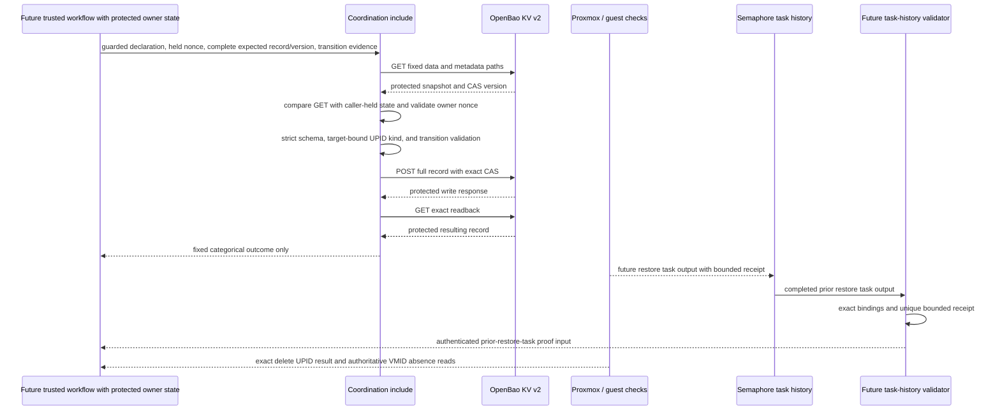

# O11Y Restore Coordination

**Date:** 2026-10-21

**Status:** ACTIVE
**Context:** This plan defines source-only coordination and reserved-target guards for the PBS isolated-restore workflow in OpenSpec `pbs-vm-and-restore-gate`, task 5.2. PR #726 merged to Dev at verified merge commit `c4eee56be4860702df537d40b71d8d85ad229a33` with reviewed PBS source head `e149fe641cf9f2a9034969dc9b3c2daf51032b09`. The Dev catalog readback confirms all five reviewed task definitions point to the expected repository, playbook, inventory, and environment and expose only the exact `expected_repository_sha` survey field. Four catalog-publication task runs succeeded at `c4eee`; a fifth invocation at reviewed PR #727 merge `391a4f7` stopped after creating the template. The independent readback confirms the catalog definitions, not success of all five invocations or acceptance of the created Proxmox template. This worktree normally merged the verified Dev commit; PBS files were not copied. Private inventory/IP prerequisites still block disk allocation, and this source work does not imply policy publication, effective-role verification, or restore/live acceptance.

## Problem

An isolated restore and its later cleanup can overlap or be retried after an uncertain API response. A target declaration in private inventory identifies what may be used, but does not serialize cooperating workflow runs. Semaphore task output is the durable acceptance record, but an Ansible `set_stats` value alone cannot authenticate a completed restore or authorize deletion. The platform needs a fixed-path, version-CAS record that requires each owner to present its held nonce and complete prior record/version; a fresh GET alone must never grant ownership.

This component is coordination only. It does not restore, stop, delete, or otherwise mutate a VM. It does not make an inventory declaration or a nonce into proof of identity, and it does not independently authenticate Semaphore task output.

## Design Principles

- The private Git inventory owns the exact target and artifact declaration. Public source contains only schema and workflow logic.
- OpenBao KV v2 at the fixed `secret/data/coordination/o11y-restore-target` path serializes cooperative transitions with version compare-and-set. The path is not an extra var or inventory input.
- A completed Semaphore task with a separately authenticated, exact-bound receipt is the acceptance authority. A caller-provided boolean, nonce, or `set_stats` field is not sufficient proof.
- Every write uses a full validated record and the version read with it. No merge patch, TTL, automatic takeover, release, rescue cleanup, or silent retry is allowed.
- Every later transition compares the fresh GET with the caller's protected complete prior record and version, then checks the matching held owner nonce. The fresh GET is only a comparison target; it is never adopted as caller state.
- Unknown write outcome, failed exact readback, malformed data, a tombstone, or any ownership/fingerprint drift retains the claim and target for operator investigation.
- Do not claim a live Proxmox or Semaphore proof from local source tests.

## Architecture

```mermaid
stateDiagram-v2
    [*] --> absent
    absent --> reserved: CAS 0 after data and metadata both prove absence
    reserved --> restore_active: held restore nonce + expected record/version
    restore_active --> awaiting_receipt: held owner nonce + exact expected record/version + generated receipt
    awaiting_receipt --> cleanup_active: held restore nonce + exact awaiting record/version + authenticated prior task proof
    cleanup_active --> cleaned: held cleanup nonce + expected record/version + exact delete and VMID absence proofs
    cleaned --> cleaned: same expected record/version and owner; no automatic new restore
```

The record uses schema version 1 and exact keys only: reviewed target/declaration/artifact fingerprints, public source SHA and private inventory SHA, stable operation identity, generation, phase, restore nonce, active nonce, and phase-specific action, Proxmox UPID, restore-receipt fingerprint, and prior authenticated restore-task ID. The target, artifact, and private inventory remain private; only SHA-256 fingerprints enter the coordination record. `target_fingerprint` is SHA-256 of the canonical compact JSON object `{"node": <exact node>, "vmid": <exact integer VMID>}` serialized with sorted keys and no whitespace. It binds the transient protected node/VMID reference used for UPID and absence checks. `declaration_fingerprint` separately binds exactly the five normalized target declaration fields `vmid`, `node`, `storage_id`, `network_mode`, and `headroom_percent`, serialized as sorted-key compact UTF-8 JSON and hashed with SHA-256. Booleans are not integers for this schema; malformed or noncanonical fields are refused rather than coerced. Artifact identity remains separately fingerprinted. The transient target reference is never persisted, and a swapped reference with an unchanged record, expected snapshot, and nonce is refused. The caller holds the most recently verified complete record, its KV version, and owner nonce in protected controller state. The helper creates one `secrets.token_hex(32)` nonce when reserving and one fresh nonce when transferring ownership to cleanup. No secret credential is stored there.

## Reserved-target guard and writer boundary

Before any PVE or guest-side preparatory write, each managed writer must authenticate the fixed coordination state through the private OpenBao endpoint and check its candidate VMID. The guard takes the endpoint only from the sole `openbao_svc` inventory host's `service_url`, validates the private declaration, and uses protected Semaphore environment `BAO_ROLE_ID` and `BAO_SECRET_ID` inputs. It must refuse lowercase credential overrides, URL/path variables, reserved internal inputs, launch values that redirect the endpoint, and internal controller names using existing extra-var guard conventions. It must not reject the protected uppercase Semaphore environment inputs. The trusted endpoint and environment are part of the Semaphore/inventory launch boundary; source code cannot defeat a privileged launcher that controls those inputs or permissions.

Every assigned writer first imports a separate credential-free input/destination preflight, after `refuse-internal-extra-vars.yml` and before any AppRole or Proxmox credential lookup. The preflight pins the sole private inventory `service_url`, requires the existing downstream `openbao_addr` to match it exactly, rejects launch-time endpoint aliases, protected AppRole environment names, and restore-target declaration fields, and checks the existing transport guard without authenticating or reading credentials. The full GET guard reuses the same input checks before its own OpenBao login. Ordinary inventory and protected Semaphore environment inputs remain available; no play-level URI defaults may redirect authentication or supply a Proxmox bearer header to OpenBao.

Each OpenBao URI task explicitly sets its own headers, requires certificate validation, disables proxy use and redirects, and clears inherited client-certificate, CA-path, and URL-authentication fields. AppRole login replaces inherited PVE `Authorization` headers with an empty header map; metadata/data reads carry only their own `X-Vault-Token`. Tests apply the installed Ansible URI module-default merge function to these rendered request arguments, so parent play defaults cannot silently add PVE credentials or disable TLS checks.

The private inventory declaration has one group `o11y_restore_target_svc` with `o11y_restore_target_vmid`, `o11y_restore_target_node`, `o11y_restore_target_storage_id`, `o11y_restore_target_network_mode`, and `o11y_restore_target_headroom_percent`. Its target VMID is protected clusterwide even when the coordination record is absent or cleaned. With a valid declaration and both fixed KV v2 paths truly absent, only that declared VMID is denied; unrelated VMIDs remain usable. With a valid matching record, the declared target remains denied. Malformed, tombstoned, unauthorized, unreachable, mismatched, or removed-declaration-with-record states refuse all PVE side effects. Only a 404 from both exact metadata/data reads proves absence; an ACL denial is never absence.

The guard is source-only and read-only. The mutator wiring covers `provision-vm.yml` (candidate and source-template VMIDs), `provision-template.yml`, `provision-pbs-debian-template.yml`, `resize-vm.yml`, `destroy-vm.yml` (including VMID-derived storage cleanup), `snapshot-vm.yml`, and `attach-pbs-data-disk.yml`; `provision-pbs-vm.yml` must pin the exact dependency paths for the shared guard and provisioner. Include the guard before staging, uploads, seed generation, or other preparatory writes, and refresh it before each separate mutating group, recovery path, and rescue write. Every managed writer, including direct PVE-token operator modes, fails closed when the Bao guard cannot authenticate. This does not guard privileged users or unmanaged code outside the cooperative writer boundary. Reviewed-checkout payload limits remain bounded at 16 entries, sufficient for the exact attach workflow dependency closure; tests accept that bound and reject an additional path.

The exact `semaphore-read.hcl` additions are metadata `read` on `secret/metadata/coordination/o11y-restore-target` and data `create`, `read`, and `update` on `secret/data/coordination/o11y-restore-target`. Ordinary guard invocations use GET only. No wildcard, list, patch, delete, TTL, or metadata-write grant is part of this change. The source policy does not establish the capabilities of an actual injected Semaphore role; activation must verify that role's binding and effective capabilities through the reviewed Semaphore mechanism.

The task reads both KV v2 data and metadata at the fixed path. It refuses a version tombstone or metadata-only record. A reservation is the sole CAS-0 creation. Each later transition requires the caller-supplied complete prior record and version to equal the fresh read and requires the caller-held owner nonce to match that record. It then uses the matched KV version as `options.cas`. The include cannot adopt state from a fresh GET when caller-held expected state is absent or stale. After a write, the task performs an exact readback before reporting a fixed categorical result. The pure helper checks schemas, ownership-state continuity, nonce format, pending-action rules, exact UPID node/type/VMID shape, and proof structure; it does not authenticate the source or assert that the caller obtained those facts from Proxmox or Semaphore.

## Implementation Phases

1. **Strict record and transition helper.** Implement pure functions to validate declaration fingerprints, KV v2 snapshots, exact record shape, phase transitions, held-owner nonce, complete expected prior record/version, exact node/type/VMID UPID binding, and typed proof structure. Return safe categorical refusal reasons without echoing payloads. Accept no unsupported action and no truthy proof booleans. Typed proof validation is not authentication.
2. **OpenBao coordination include.** Add an Ansible task include using the repository transport and internal-var guard conventions. Keep reads, full-record writes, and readbacks `no_log`; use fixed path and redirects disabled. Show only a fixed sanitized status. A lost or ambiguous write response fails closed and requires manual reconciliation.
3. **Reserved-target guard and bounded writer integration.** Implement a credential-free fixed-destination preflight before all secret lookups, followed by a separate GET-only guard that authenticates against the fixed private OpenBao endpoint, validates declaration and record state, and denies the declared target VMID. Explicitly override inherited URI authentication/TLS/proxy settings. Wire it before every assigned mutator's preparatory and PVE write groups, including recovery/rescue and storage cleanup paths. Extend only the exact semaphore-read policy paths/capabilities described above. Do not add any PVE action or lifecycle mutator to the guard.
4. **Focused regression coverage and documentation.** Exercise production helper functions, actual rendered include requests, and KV v2 payload shapes, including competing callers, stale expected record/version, held-nonce refusal, CAS-loser readback, drift, tombstones, exact UPID binding, pending UPID, forged proof, and cleaned rerun behavior. Test guard outcomes and writer ordering on each candidate path. Record all still-open wrapper, task-history, policy-binding, rollout, and live gates.

Acceptance requires the helper to reject malformed and stale transitions, the include to send only fixed-path full-record CAS writes and exact reads, and every protected request/result to be hidden from normal Ansible output. The task is not ready for live use until its caller authenticates task output and its OpenBao permissions are declared and reviewed.

## Validation Criteria

| Check | Pass condition |
|---|---|
| Focused Python tests | Exercise production helper functions and serialized KV v2 response/write payloads; all fail-closed cases reject. |
| Ruff | New Python helper and test file pass repository Ruff configuration. |
| YAML syntax / static inspection | Task include parses and uses only the fixed path, KV v2 version CAS, protected reads/writes/readback, no redirects, and fixed visible status. Caller tests pin credential-free preflight ordering and the exact reviewed payload closure. |
| Ansible URI default merge | The installed Ansible merge behavior leaves AppRole login headers empty and metadata/data reads with only `X-Vault-Token`, certificate checks enabled, and proxy disabled. |
| Whitespace and introduced-history scan | `git diff --check` passes; count-only secret scanning of introduced commits finds no credential material. |
| Runtime boundaries | No live OpenBao, Proxmox, Semaphore API, deployment, or state mutation is performed as part of this source task. |

## Security Considerations

- The fixed path prevents launch-time path selection. The exact policy change in this source task grants only metadata `read` and coordination data `create`, `read`, `update`; guard requests themselves are GET only. Effective capabilities of the Semaphore-injected role remain unverified and are an activation gate.
- The guard pins the login URL to `service_url` on exactly one private inventory `openbao_svc` host and accepts the protected uppercase AppRole values from the Semaphore process environment. It does not source its login URL from public `openbao_addr` or a launch `service_url` extra var. Semaphore environment binding and launch/edit permissions are part of the trust boundary; no playbook assertion can defeat a privileged launcher that can choose arbitrary extra vars or alter the trusted environment.
- The repository's play-level `refuse-internal-extra-vars.yml` and `refuse-var-overrides.yml` patterns protect reserved names. A shared include cannot authenticate the values passed by its caller. The future wrapper must refuse every input/evidence name as an extra var before it constructs and passes the include vars.
- A 256-bit nonce correlates transitions and is one part of lease ownership; it is not authorization by itself. A new transition also requires the complete expected prior record and KV version from prior protected state. Stable operation identity and generation prevent accidental cross-operation reuse but do not prove human or task identity.
- After acquisition, the caller must keep the returned record, readback version, and owner nonce in protected controller state. Every later transition supplies those exact values. A mismatch, absent expected record, stale expected version, or missing nonce refuses before CAS; reading the latest record does not enable adoption or resume by a new run.
- `awaiting_receipt` records the restore run's generated receipt fingerprint only. It does not authorize cleanup. Cleanup must be a separate invocation that fetches and authenticates the prior completed successful restore task through the Semaphore API, confirms exact project/template/revision/inventory bindings, validates one unique bounded receipt, and supplies the complete `awaiting_receipt` record and KV version from that completed task's protected output. The helper compares that expected record/version to the fresh GET and only validates the resulting typed proof structure; it does not authenticate API output. It records the authenticated prior restore task ID when transferring the CAS lease to `cleanup_active`. No environment variable for the current task ID is assumed.
- `cleaned` is written after the exact recorded delete UPID is proven stopped with successful exit status, authoritative target absence is proven, and the OpenBao CAS write is read back exactly. Target absence needs an exact-VMID authoritative check, such as `cluster/nextid?vmid=<exact-id>` returning HTTP 200 with the same VMID plus validated absence from the declared node's VM configuration endpoint. An arbitrary 500, ACL-filtered list result, or caller boolean is insufficient. The helper validates the proof structure only; future trusted workflow code must perform the live checks. It does not require a third task to authenticate its own cleanup completion.
- The coordination phase/action fields are a lease and state journal for the currently supported restore and delete transitions. Future NIC isolation and any start/stop writes must also record intent before each Proxmox write and record returned UPIDs after the response. An unknown write outcome stops further action. This bounded primitive does not claim that its `restore`/`delete` action values journal every future lifecycle mutation; wrapper/action-journal integration is a gate before live activation.
- Restore target stopped/no-pending-action state and task success must be proven by the future workflow from live, exact-target readbacks. The helper requires UPIDs to match the transient private target reference's node, VMID, and expected `qmrestore`/`qmdestroy` kind, and recomputes `target_fingerprint` from the exact node/VMID pair before accepting any transition. The wrapper must derive and guard that reference from the private declaration and compute `declaration_fingerprint` over the complete reviewed declaration, including storage and network. The helper does not authenticate API responses or prove that the wider declaration was reviewed. Source tests cannot prove these external facts.
- The cleanup UPID task type follows Proxmox's upstream `qemu-server` `src/PVE/API2/Qemu.pm`: its VM DELETE route forks `qmdestroy` (upstream `master`, reviewed 2026-10-21; see [official source around line 2751](https://github.com/proxmox/qemu-server/blob/master/src/PVE/API2/Qemu.pm#L2751)). `qmrestore` remains the restore worker. This source reference is branch-based because the upstream commit SHA could not be retrieved in this environment; it does not establish which qemu-server revision is installed on any target.
- Never release or automatically expire an active claim. If OpenBao reports an uncertain write or readback drift, retain target and claim, stop further action, and investigate the stored version and task history.
- `cleaned` is terminal for the exact operation. A rerun must not silently recreate a reservation or start another restore generation.

## Cross-references

- [Platform principles](../../PRINCIPLES.md)
- [Architecture map](../../ARCHITECTURE.md)
- [Ansible automation standards](../architecture/08-ansible-automation-standards.md)
- [Credential and access architecture](../architecture/04-credentials-access.md)
- [Testing and quality gates](../architecture/03-testing-ci-quality.md)
- Existing Proxmox task status / exit-status pattern: [snapshot-vm.yml](../../platform/playbooks/snapshot-vm.yml)
- Existing node-bound UPID validation pattern: [reconcile_proxmox_backup_job.py](../../platform/playbooks/files/reconcile_proxmox_backup_job.py)
- [Observability development plan](05-observability.md)
- PBS VM and restore gate OpenSpec change `pbs-vm-and-restore-gate` — PBS source merged to Dev through PR #726 at `c4eee56`; restore workflow acceptance remains open.
- [Repository operating instructions](../../AGENTS.md)

## Revision History

- 2026-10-21: Initial approved implementation plan for the source-only coordination primitive.
- 2026-10-21: Clarified restore-proof lifecycle, authoritative exact-VMID absence evidence, and future action-journal integration gate.
- 2026-10-21: Recorded the pending normal Dev merge and source-only boundary; specified safe command/result diagnostics without exposing protected payloads.
- 2026-10-21: Required held nonce and complete expected record/version for every owner transition; bound UPIDs to transient private target node/VMID and operation kind.
- 2026-10-21: Defined canonical node/VMID identity fingerprint binding for the transient target reference; documented separate full-declaration binding.
- 2026-10-21: Recorded the inspected Semaphore policy paths and the include's metadata/data GET plus data CAS-POST requirements without changing policy.
- 2026-10-21: Corrected the cleanup UPID kind to upstream `qmdestroy`; the branch-based official source reference is not installed-version compatibility evidence.
- 2026-10-21: Approved the five-field normalized declaration fingerprint and added the read-only reserved-target guard, narrow policy, and mutator coverage as source scope; no live or policy-application claim.
- 2026-10-21: Added credential-free destination preflight before all caller secret lookups, explicit OpenBao URI auth/TLS/proxy isolation, and a bounded reviewed-payload limit of 16.
