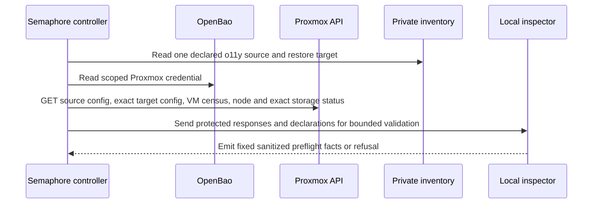

# O11Y-RESTORE-TARGET-PREFLIGHT

**Date:** 2026-10-20
**Status:** PROPOSED
**Context:** OpenSpec change `pbs-vm-and-restore-gate`, task 5.1, needs a repeatable read-only check of one privately declared, isolated restore target before a later restore workflow is designed or run.

## Problem

The existing restore feasibility survey counts eligible storage and an unused next VMID candidate. It does not prove that one exact target VMID is free on the declared node, that the declared storage has capacity for the exact selected backup artifact's complete restore layout plus headroom, or that the target is explicitly isolated from the source network. Current source disks cannot certify an older backup's restore size. A read-only observation is not a reservation and cannot authorize allocation or restore.

## Design Principles

1. Read private target identity from inventory; accept no launch-time placement overrides.
2. Use only authenticated Proxmox and OpenBao reads. Refuse malformed, incomplete, contradictory, or ambiguous authority responses.
3. Require the target declaration to state `network_mode: disconnected`. This target gets no LAN address or NetBox reservation; the later restore workflow must strip or disable restored NICs before first boot.
4. Report only fixed sanitized categories. Do not print real VMIDs, node or storage names, addresses, artifact names, API responses, or credentials.
5. Report “available now” only. Never claim VMID reservation, allocation authorization, successful restore, or a passed capacity gate.

## Architecture

The playbook pins the reviewed checkout, uses the shared OpenBao transport guard, and keeps credential-bearing requests and inspector input under `no_log`. It binds the exact private artifact selector through the existing artifact census, then requests `GET /nodes/{node}/vzdump/extractconfig?volume={volid}` for that exact volume. Upstream PVE master registers this as a GET method and calls `PVE::Storage::extract_vzdump_config`; upstream PBS storage code extracts `qemu-server.conf` for `pbs-vm` archives. These master-branch sources establish the route and PBS path, but do not prove compatibility with the installed PVE/PBS runtime. The inspector validates the target is distinct from the source, absent from the cluster VM census, and has an exact `GET /cluster/nextid?vmid={vmid}` response matching its declaration; the node-local VM-config read accepts 404 or 500 as absence only when that cluster check matches. This remains a time-sensitive availability snapshot, not a reservation, and census visibility is explicitly not claimed as globally complete. The target is declared disconnected on a different online node and backed by exactly one active non-shared image-capable storage record. Capacity uses every non-CD-ROM disk in the exact selected artifact's extracted configuration and the declared residual-headroom percentage; current source VM configuration is insufficient evidence for an older artifact.

The private inventory contract is one declaration host in group `o11y_restore_target_svc` with `o11y_restore_target_vmid`, `o11y_restore_target_node`, `o11y_restore_target_storage_id`, `o11y_restore_target_network_mode: disconnected`, and `o11y_restore_target_headroom_percent` (30–90). These values and the source artifact selector are inventory-only; the playbook refuses launch-time overrides. No address or NetBox record is declared for this disconnected guest.

## Implementation Phases

1. Add a GET-only Dev-bound playbook for the exact declared target and exact selected artifact. It performs no create, clone, reservation, restore, guest boot, or network connection.
2. Add a standalone inspector that validates declarations and Proxmox responses and emits an allowlisted fixed receipt.
3. Add focused fixtures for occupied IDs, source/target collisions, inactive or wrong storage, insufficient capacity, conflicting authority, and malformed responses.
4. Integrate the declaration contract into private site-config and the later restore workflow separately. The restore workflow must ensure NICs are absent or disabled before first boot; this preflight does not prove that behavior. Verify the GET extraction route against the installed PVE/PBS versions during Dev validation.

## Validation Criteria

| Check | Pass condition |
|---|---|
| Read-only contract | Every Proxmox request is GET; tests reject writes or unbounded output |
| Identity | One source and one distinct declared target; exact target is absent, exact cluster next-ID matches, and census has no collision |
| Placement | Target node is uniquely present and online; target storage is unique, active, and image-capable |
| Capacity | Every disk in the exact selected artifact's verified restore configuration fits with declared residual headroom |
| Isolation | Inventory explicitly declares `network_mode: disconnected` |
| Privacy | Receipt contains only a fixed schema and no private response values |
| Claim boundary | Receipt records `vmid_reserved: false` and does not claim allocation, restore, or capacity-gate success |

## Security Considerations

The Proxmox credential and every response that can contain private inventory or placement identity stay in protected Ansible memory and are supplied to the local inspector through `no_log` tasks. User-visible refusal text comes from a closed set of generic messages. Target network isolation is declared because no target VM exists to inspect; the later restore workflow remains responsible for suppressing copied NICs before any guest boot. Proxmox-reported capacity is an observation that can become stale and is not a reservation or proof of physical capacity.

## Cross-references

- [PBS VM and restore gate design](openspec/changes/pbs-vm-and-restore-gate/design.md)
- [PBS VM and restore gate task list](openspec/changes/pbs-vm-and-restore-gate/tasks.md)
- [PBS VM restore gate spec](openspec/changes/pbs-vm-and-restore-gate/specs/pbs-vm-restore-gate/spec.md)
- [PVE upstream GET extract-config route](https://github.com/proxmox/pve-manager/blob/master/PVE/API2/VZDump.pm)
- [PVE upstream PBS archive config extraction](https://github.com/proxmox/pve-storage/blob/master/src/PVE/Storage/PBSPlugin.pm)
- [Platform principles](../../PRINCIPLES.md)
- [Testing and CI quality](../architecture/03-testing-ci-quality.md)
- [Credential access](../architecture/04-credentials-access.md)

## Revision History

- 2026-10-20: Initial task 5.1 implementation fragment; target isolation is explicit and disconnected, with NIC suppression deferred to task 5.2.
