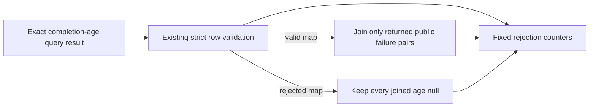

# O11Y Workflow Age Diagnostics

**Date:** 2026-10-24

**Status:** IMPLEMENTED

**Context:** The dashboard verifier safely refuses to join completion ages when returned rows do not match the public workflow identity contract, but its sanitized report does not say which fixed validation category rejected the age map or why a returned failure pair has no numeric age.

## Problem

`verify-o11y-dashboard-data.py` preserves null ages and fails closed, but map rejection currently collapses several causes into `completion_age_status: unverified`. When the map is valid, the report also combines an absent pair with a returned row whose age is null. Operators cannot distinguish these cases from the fixed-schema receipt.

## Design Principles

- Keep exact dashboard titles, datasource, query expressions, label contract, allowlists, and failed-pair join unchanged.
- Report only fixed aggregate counters; never emit raw labels, unknown identities, sample values, timestamps, or URLs.
- Keep malformed/unavailable distinct from valid empty results, and preserve current age and status outcomes.
- Treat completion age as workflow provenance, never application health.

## Architecture

The verifier will add fixed counters for registry/result/label/identity rejection, duplicate pairs, unavailable age values, and failure pairs absent from an otherwise accepted map. Existing status fields and age values retain their current semantics.

## Implementation Phases

1. Add one fixed counter schema to the age-map helper and observation attachment path; keep counters zero when the age panel is not selected.
2. Add focused tests for each map rejection category, accepted empty/valid maps, missing versus null pair ages, and absence of identity/sample leakage.

## Validation Criteria

| Check | Pass condition |
|---|---|
| Focused verifier tests | Pass: 208 tests; existing outcomes remain unchanged and fixed categories are counted |
| Ruff | Pass: no lint errors in changed Python files |
| Diff review | Pass: query strings, allowlists, and raw-output boundaries are unchanged |

## Security Considerations

Only bounded integer counters with fixed field names are added. Existing public service/step pairs remain the only identities in `failed_steps`; unknown identities and Loki labels are never copied into diagnostics.

## Cross-references

- [Observability dashboard accuracy change](openspec/changes/o11y-dashboard-accuracy/)
- [Observability platform principles](../../PRINCIPLES.md#7-observability)
- [Dashboard data verifier](../../platform/playbooks/files/verify-o11y-dashboard-data.py)
- [Verifier tests](../../platform/tests/test_verify_o11y_dashboard_data.py)
- [Repository instructions](../../AGENTS.md)

## Revision History

- 2026-10-24: Initial bounded plan for fixed completion-age rejection diagnostics.
- 2026-10-24: Implemented fixed map-rejection and pair-join counters with focused coverage.
