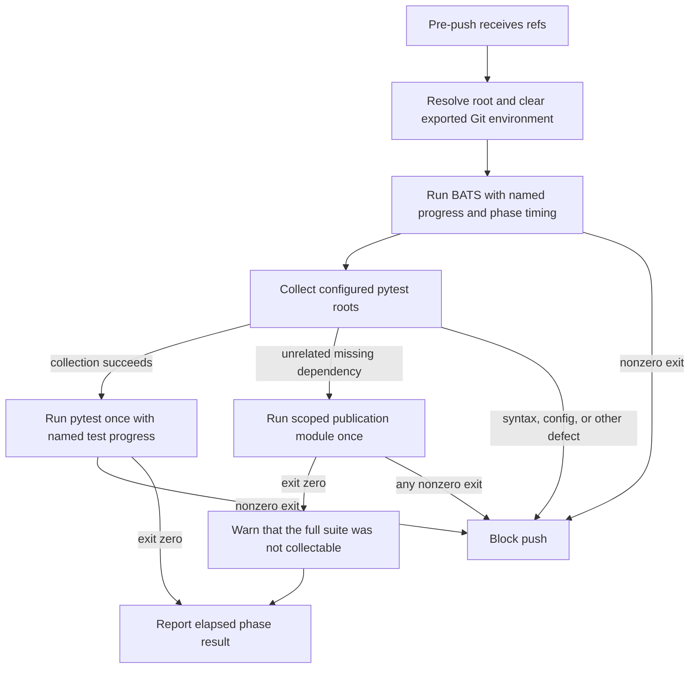

# Pre-Push Pytest Ownership

**Date:** 2026-10-01
**Status:** ACTIVE
**Context:** The pre-push hook currently executes the scoped Semaphore publication scenarios twice on a healthy machine: once by a BATS wrapper and once through pytest's configured roots. This approved first-pass change assigns normal ownership to pytest, preserves the scenarios when an unrelated dependency prevents full collection, and improves bounded diagnostics without changing CI selection or the scenarios themselves. A measured follow-up in the same worktree batches the credential-leak BATS file's repeated tracked-file setup while preserving its detector and exclusion contract. Post-implementation review found two gaps in that preservation claim; both are resolved below, and final full-hook validation remains pending.

---

## Problem

`platform/semaphore/tests/test_scoped_publication.py` is both invoked directly by a BATS test and collected through the root pytest configuration. The measured baseline at source commit `9517715b05fb79d009cae19dc967ccf8f29054a8` found:

- 1,359 pytest nodes across all four configured roots, including 40 scoped-publication nodes;
- 1,357 passed, 2 skipped, and 29 passing subtests in 617.80 seconds of pytest execution;
- one BATS wrapper taking 233.002 seconds to execute the same scoped module;
- 40 scoped test methods, 29 subtests, and 76 Ansible launches per execution.

The implementation base is the verified remote `dev` commit `935f85f9ad0b3070a02ebfbe9cf36f892b17bd3e`. The source and base diverge outside this contract, but `.githooks/pre-push`, both target BATS files, `pyproject.toml`, and the scoped test module are byte-identical between them.

Simply deleting the BATS invocation would lose the scoped scenarios when full pytest collection encounters an unrelated missing dependency. Treating every collection failure as a dependency gap would instead allow syntax and configuration defects to bypass the gate.

## Design Principles

1. **One healthy-path owner** -- pytest collects the unchanged scoped module through `platform/semaphore/tests` exactly once; BATS verifies ownership rather than running the module.
2. **Narrow fallback, fail closed** -- only a collection failure classified as a missing dependency invokes the scoped module directly. Every nonzero fallback status, including another missing dependency, blocks the push.
3. **No collection-error widening** -- syntax, pytest configuration, and non-dependency import failures remain blocking and do not invoke the fallback, including when the same collection output also reports a missing dependency.
4. **Security-preserving diagnostics** -- fallback output is reduced to test identifiers, statuses, counts, and missing dependency names. Fixture values, tracebacks, and environment values are not printed.
5. **Existing hook boundaries remain** -- Git environment cleanup, branch-deletion handling, explicit `SKIP_TESTS=1`, the normal unrelated-dependency warning, and BATS runner absence semantics remain intact.
6. **No selection shortcuts** -- no changed-file or docs-only skip, global pytest ignore or marker, parallelism, pytest-root change, or CI-selection change is part of this work. Phases 1-3 do not alter the credential scan; Phase 4 is a separately measured batching change that retains the same tracked-file and line exclusions.

## Review Finding Disposition

1. **Mixed collection failure classified by any dependency marker -- accepted and repaired.** The pre-review classifier entered fallback whenever collection output contained one missing-dependency marker, even when another collected module raised `SyntaxError`, a pytest configuration error, or another exception. The hook now accepts fallback only when the captured failure is dependency-only. Mixed errors block without invoking fallback in either error order, and collection diagnostics are reduced to dependency names and exception/error classes rather than raw traceback content. Pure missing-dependency collection still exercises the existing passing, failing, and missing-dependency fallback cases; every nonzero fallback status blocks.
2. **Comment exclusions evaluated before accounting for the grep prefix -- accepted and repaired.** Batched grep adds `file:line:` before the downstream exclusions, so the retained raw-line `^[[:space:]]*#` predicate could not match any comment. Password and API-key comment predicates now begin after the file-and-line prefix. The regression fixture covers leading and indented comments and retains uncommented findings in a filename containing `#`, `:`, and the exclusion word `example`.

This repair is intentionally **not source-equivalent** to the reviewed snapshot: it strengthens mixed-error classification and restores the historical comment exclusion at the prefixed representation. Detector expressions, tracked-path exclusions, other line exclusions, and the masked clean status remain unchanged.

## Architecture

## Implementation Phases

### Phase 1: Pin Ownership and Behavior in Tests

**Goal:** Add red tests for the approved execution matrix before modifying the hook.

**Tasks:**

1. Replace the BATS direct execution with structural ownership assertions.
2. Assert that `pyproject.toml` still includes `platform/semaphore/tests` and that no BATS test directly invokes the scoped module.
3. Add a narrow fake-runner harness for the hook's BATS, collection, full-pytest, and direct-fallback commands.
4. Cover healthy collection, missing-dependency fallback pass/fail/missing-dependency, mixed dependency-plus-syntax/config/other failures in either order, normal pytest failure, Git-environment cleaning, output sanitization, and exact execution counts.

**Acceptance criteria:**

- New behavior tests fail against the current hook for the missing-dependency fallback and diagnostic contracts.
- The existing 40 scoped test methods and 29 subtests are untouched.

### Phase 2: Implement Hook Ownership and Diagnostics

**Goal:** Make pytest the healthy-path owner while preserving fail-closed scoped coverage.

**Tasks:**

1. Remove the stale duration claim and emit start/end timestamps, elapsed seconds, and named phase statuses.
2. Keep root collection and classify fallback positively as dependency-only; a dependency marker may not override another collection failure.
3. On healthy collection, run full pytest once with named test progress and no direct fallback.
4. On a missing-dependency collection result, run the scoped module once from the repository root with the same `PYTHONPATH`.
5. Sanitize fallback diagnostics and mark every nonzero fallback as a blocking failure.
6. Preserve all existing Git cleanup, explicit skip, branch deletion, and unavailable-runner behavior.

**Acceptance criteria:**

- Every behavior and ownership test passes.
- Syntax/config collection failures and normal pytest failures block.
- A fallback missing-dependency result blocks rather than inheriting the full-suite warning's fail-open outcome.

### Phase 3: Mutation and Static Validation

**Goal:** Prove the new guards fail when each load-bearing behavior is removed or weakened.

**Tasks:**

1. Remove the fallback invocation; the missing-dependency behavior test must fail.
2. Reintroduce direct BATS invocation; the ownership test must fail.
3. Remove `platform/semaphore/tests` from `testpaths`; the ownership test must fail.
4. Restore the any-marker collection classifier; all mixed dependency-plus-defect behavior tests must fail.
5. Restore each mutation and rerun the focused green suite.
6. Run shell syntax, ShellCheck when available, diff whitespace validation, changed-file secret/private-path audits, and the scoped 40-method/29-subtest ledger.

**Acceptance criteria:**

- All four mutations produce the expected red result and clean restoration produces green results.
- No file is staged, committed, pushed, or published.

### Phase 4: Batch Credential-Leak Scan Setup

**Goal:** Remove per-file process launches from the five repository-wide credential detectors without changing their grep engine, patterns, exclusions, output prefixes, or passing status.

**Tasks:**

1. Build the tracked-file name manifest once in `setup_file`, after applying the existing exclusion set in one `awk` process.
2. Pass the eligible relative paths as one quoted array to the installed `grep`, retaining filenames with spaces and the historical `file:line:content` diagnostics.
3. Keep the line exclusions after the file/line prefix so words such as `test` and `example` in a filename cannot suppress a content finding.
4. Exercise the batched scan and a per-file reference scan against fake scratch repositories only.
5. Cover positive password/API-key, all three RFC1918 ranges, and workstation-path-shaped matches; every path and line exclusion; clean negatives; no-match status; and filenames containing spaces and exclusion words.
6. Retain all 23 prior TAP names, the two batching regressions, and the post-review source-named comment-prefix regression.

**Manifest lifecycle:** The cached artifact contains names only; every scan still reads current file content. All tests in this BATS file are read-only against the checkout, and synthetic tests pass an explicit scratch root that rebuilds its own manifest. Bats 1.13.0's installed `bats-exec-file` runs `setup_file` before launching the test children; a two-child proof run read the same exported file artifact and passed 2/2 in 0.228 seconds. No persistent cache is created.

**Preserved exclusion and detector ledger:**

| Layer | Preserved cases |
|---|---|
| Tracked paths | `platform/services/netbox/deployment/netbox-docker/`; `.gitkeep`; `.png`; `.svg`; `.ico`; `test_credential_leaks.bats`; `.md`; `.MD`; `plan/`; `docs/`; `test_*.py`; `test_*.bats`; `conftest.py`; `.example`; `.j2` |
| RFC1918 lines | `target`, `host:`, `subnet`, `scope`, `example`, `RFC1918`, `CIDR`, `placeholder`, `template`, `test`, `.md:`; plus `inventory_hostname` for the 192.168 detector |
| Password lines | template braces, environment references, leading and indented comments after the `file:line:` prefix, `example`, `REPLACE_ME`, `changeme`, `placeholder` |
| API-key/token lines | template braces, environment references, leading and indented comments after the `file:line:` prefix, `example`, `REPLACE_ME`, `placeholder`, `dummyKey`, `dummy_key`, `LOCAL_FAKE` |
| Matchers | unchanged 192.168, 10/8, 172.16-31/12, password/passwd, and API-key/token EREs with their original case flags |
| Diagnostics/status | relative `file:line:content`; a clean scan still emits no output and returns the historical masked success status |

The generic workstation-path-shaped fixture proves batching preserves the same grep output for that security pattern; it does not add a new repository detector. Fixture values are assembled at runtime, stay in Bats scratch repositories, and are never printed by passing tests.

**Measured target timing:** Local `bats --help` and `bats --version` verified Bats 1.13.0 and `-T`; every run was serial and bounded to its own process group for 120 seconds. No concurrent Bats or pytest process was present.

| Revision | Run 1 | Run 2 | Mean | TAP result |
|---|---:|---:|---:|---|
| Before batching | 16.248 s | 15.904 s | 16.076 s | 23/23 passed |
| After batching, before review repair | 6.277 s | 5.763 s | 6.020 s | 25/25 passed |

The measured mean fell 62.6%, despite the two added regression tests. These figures are historical evidence from the pre-review 25-test snapshot, not timing or full-hook evidence for the repaired manifest. The bounded runner did not signal either run (`timeout_stage=none`). Removing the `.example` exclusion made the exclusion fixture fail, and inverting the batched grep made the findings fixture fail; restoring the exact pre-mutation SHA returned both fixtures to 2/2 green.

**Acceptance criteria:**

- The original 23 test names remain byte-for-byte present, both batching fixture tests pass, and the comment-prefix regression brings the focused file to 26/26.
- The fake-repository batched output equals the per-file reference output for representative private-IP, secret, and workstation-path patterns.
- Every historical path and content exclusion has a fixture, and a positive filename containing spaces plus `example`/`test` remains detectable.
- Two serial before runs and two serial after runs show a repeatable reduction without relaxing a matcher.

## Validation Criteria

| Check | Pass condition |
|---|---|
| Feature isolation | Worktree branch is `fix/prepush-pytest-ownership`, based on verified remote `dev`, with no staged files |
| Healthy ownership | BATS once, collection once, full pytest once, fallback zero times |
| Missing dependency with passing fallback | Full pytest zero times, fallback once, warning retained, hook exits zero |
| Missing dependency with failing fallback | Fallback once, sanitized identifier/status output, hook blocks |
| Missing dependency inside fallback | Dependency name shown without traceback/fixture values, hook blocks |
| Syntax/config collection defect | Hook blocks and fallback is not invoked, alone or mixed with a missing dependency in either order |
| Scoped pytest failure | Hook blocks after one normal pytest execution |
| Git environment | All eight Git variables are cleared before every suite runner |
| Pytest roots | All four configured roots remain, including `platform/semaphore/tests` |
| Scoped scenario ledger | 40 test methods and 29 subtests remain unchanged |
| Credential scan ledger | 23 original TAP names retained; 2 batching fixture tests and 1 comment-prefix regression added; all path/line exclusions and five detectors accounted for |
| Credential scan timing | Two bounded serial before/after runs complete with the measured reduction recorded above |
| Shell validation | `sh -n .githooks/pre-push` and ShellCheck on the hook/harness pass; the credential file adds no error beyond its four inherited `SC2314` findings |
| Repository hygiene | `git diff --check` and changed-file secret/private-path audits pass; staged file count is zero |

The full 1,359-node baseline comparison is intentionally reserved for later assembled validation. This first pass runs bounded focused behavior, ownership, security, and static checks. The first assembled hook run on the pre-review manifest completed in 853.373 seconds with 730/730 BATS and 1,380 passed plus 2 skipped pytest tests; that run is historical evidence for the prior hash, not final validation of this repair. A fresh full hook and follow-up review are explicitly pending.

## Post-Review Focused Validation

- Before implementation, the four mixed collection scenarios all failed their new blocking regressions, and the prefixed-comment regression failed because the comment fixture remained in scanner output.
- After implementation, the final focused ownership/Git-environment/scanner run passed 63/63 across `test_pre_push_git_env.bats`, `test_credential_leaks.bats`, and `test_semaphore_repositories.bats` (13 + 26 + 24).
- Restoring the any-marker collection classifier made all four mixed scenarios red; restoring both raw-line comment filters made the comment-prefix regression red. Restoring the recorded final hashes returned the focused suites to green.
- `sh -n .githooks/pre-push` and ShellCheck on the hook plus harness passed. Error-severity ShellCheck on the credential file still reports the same four inherited `SC2314` findings; this repair adds no ShellCheck error.
- No final full-hook result or review approval is claimed.

## Security Considerations

- The fallback never prints raw captured output. It emits only whitelisted test identifiers, statuses, counts, and dependency names; blocking collection diagnostics emit only dependency names and exception/error classes.
- The hook continues to clear `GIT_DIR`, `GIT_WORK_TREE`, `GIT_INDEX_FILE`, `GIT_COMMON_DIR`, `GIT_OBJECT_DIRECTORY`, `GIT_ALTERNATE_OBJECT_DIRECTORIES`, `GIT_PREFIX`, and `GIT_NAMESPACE` before invoking test tools.
- Credential scanning changes are limited to local BATS process batching; pre-commit behavior, private repositories, live systems, and production processes are untouched.
- Test commands use finite local fixture processes only; no process outside a test's own descendants is signaled.
- Credential-scan regression repositories live only under Bats scratch directories, clear inherited Git repository variables, and never access `site-config`.
- The scratch credential/IP/path-shaped values are synthesized at runtime and are not printed in TAP output.

## Cross-references

| Document | Relationship |
|---|---|
| [Platform principles](../../PRINCIPLES.md) | Requires foundational, reusable fixes and automated leak prevention |
| [Testing, CI and quality gates](../architecture/03-testing-ci-quality.md) | Defines pytest/BATS ownership and local-versus-CI boundaries |
| [CI test runtime](CI-TEST-RUNTIME.md) | Records the existing measured CI/runtime diagnostic work |
| [Contributing guide](../../CONTRIBUTING.md) | Defines BATS assertion and mutation-proof requirements |
| [Mistakes ledger](../../docs/MISTAKES.md) | §2.1 records the post-prefix false green; §3.7 protects Git state; §4.6 protects diagnostics; §5.2/§5.5/§5.6 motivate the hook |

## Revision History

| Date | Change |
|---|---|
| 2026-10-01 | Initial approved implementation plan with measured baseline, execution matrix, and staged validation |
| 2026-10-01 | Added the measured credential-scan batching phase, equivalence ledger, synthetic regression fixtures, mutations, and before/after timing |
| 2026-10-01 | Accepted and repaired the mixed collection-error and prefixed-comment review findings; added failing regressions, mutation evidence, and marked fresh full-hook validation/review pending |
