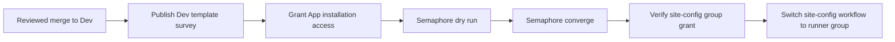

# Site-Config Runner Group Access

**Date:** 2026-10-11
**Status:** ACTIVE
**Context:** Add the private `site-config` repository to the declared access list for the existing `uhstray-selfhosted` runner group so its workflow can use the platform runners.

## Problem

The runner group declaration now admits `site-config`, but the runner automation GitHub App installation cannot see that private repository. App installation access must be granted before the group playbook can resolve every declared repository. Group convergence replaces its repository grants, so App access, group dry run, convergence, grant check, and workflow switch must happen in order.

## Design Principles

1. Keep group membership declared and reviewable in Agent Cloud.
2. Preserve the public-repository guard and keep public `agent-cloud` outside the group.
3. Keep private site values and inventory data out of this public repository.

## Architecture

The playbook remains the authority for the selected repository list. Its public-repository check must pass before group membership is changed.

## Implementation Phases

1. Update the declared list, its exact structural test, and runner documentation. **Acceptance:** focused BATS test passes; `agent-cloud` remains excluded.
2. Merge the reviewed change to Dev. **Acceptance:** the reviewed Dev revision contains the allowlist change.
3. Use `Publish Semaphore Template Surveys (Dev)` to publish the updated `Manage GitHub Runner Group (Dev)` survey and read it back. **Acceptance:** the live template requires the App client id.
4. Publish a separate Dev-bound App installation grant template. Its reviewed playbook reads the existing GitHub PAT and runner App key from OpenBao, validates the exact private repository and App identity, and grants only `site-config`. **Acceptance:** check mode makes no selection write; a real run adds at most one repository; fresh App-token readback proves visibility; a rerun makes no write. Missing PAT scope or admin permission refuses before any grant. No credential is printed or passed on a command line.
5. Run `Manage GitHub Runner Group (Dev)` in Semaphore dry-run mode with the required App client id survey input, then converge. **Acceptance:** dry run reports the intended six-repository list; convergence completes.
6. Verify `site-config` is granted to `uhstray-selfhosted`, then switch its workflow to that group. **Acceptance:** the grant is visible before the workflow is changed.

## Dry-Run Failure Evidence

Dev-bound Semaphore task 4333 failed during declaration validation because `_issuer | length > 0` was false. The playbook accepts `github_app_client_id`, but the runner-group template exposed only `dry_run`, so the required App issuer was not available as a launch-time survey input. The template now requires the App client id; provide that identifier when launching the dry run. No actual client id or site-specific value is recorded here.

After survey publication, check-mode task 4345 reached GitHub but received HTTP 404 when the runner App token resolved `site-config`. The App installation uses selected repositories and does not yet include that repository. GitHub's single-repository installation grant API provides an additive operation; the separate Dev-bound playbook will use it before group convergence. The existing group and private workflow were not changed by task 4345.

## App Installation Grant

`Grant GitHub Runner App Repository (Dev)` is a separate, directly Dev-bound
Semaphore template. It has only two survey inputs: the reviewed repository SHA and the
runner App client id. The playbook fixes the target to `uhstray-io/site-config`; it
does not accept a repository, owner, installation, or API destination from inventory or
survey input.

The controller reads the classic PAT from OpenBao `secret/services/github:pat` and the
App private key from `secret/services/github-runner:app_private_key`. The helper receives
both only on stdin and emits an allowlisted phase/outcome/status/grant/verification
summary. PAT repo scope, exact private repository metadata and admin permission, App
slug/owner, and the selected, active organization installation are validated before a
grant. Complete installation-repository pagination must establish absence; a repository
404 by itself is not evidence of absence.

Check mode and `--tags verify` inspect without a selection PUT. An ordinary run can issue
one additive PUT, accepts only `204` or `304`, then reads back with a fresh App token.
An ambiguous write or incomplete readback is reported as unverified and is never rolled
back; a rerun observes current visibility before considering a grant.

## Validation Criteria

| Check | Pass condition |
|---|---|
| Focused structural test | `bats platform/tests/test_manage_github_runner_group.bats` passes |
| Public-repository protection | Playbook still refuses any declared repository whose visibility is public |
| Semaphore dry run | Reports the intended access list without changing it |
| App installation access | Check-mode refusal is safe; real grant is additive and independently verified with a fresh App token |
| Grant verification | `site-config` appears in the selected group before workflow switch |

## Security Considerations

The group remains selected-only with public repositories disabled. `agent-cloud` stays excluded, and the playbook must continue validating repository visibility before applying grants. Runner jobs can access files available to the runner account, so access is limited to the named private repositories. No site-specific values or inventory data belong in this public repository.

## Cross-references

- [Runner service operating notes](../../platform/services/github-runner/CLAUDE.md)
- [Runner group playbook](../../platform/playbooks/manage-github-runner-group.yml)
- [Ansible automation standards](../architecture/08-ansible-automation-standards.md)
- [Root operating guidance](../../CLAUDE.md)
