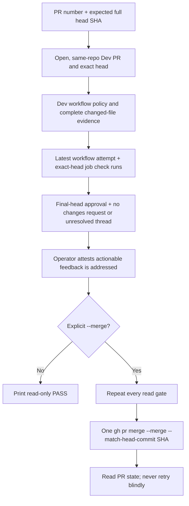

# Dev PR Merge Guard

**Date:** 2026-10-10
**Status:** IMPLEMENTED
**Context:** PR #531 was merged while checks for its final head were still running. Dev intentionally has no required-check rule because the main-to-Dev reconciliation workflow pushes directly to `dev`.

## Problem

A pull-request status rollup can describe an earlier head. Since Dev has no required checks, `gh pr merge --auto` can arrange a merge before the final-head jobs finish. The operator needs one repeatable gate that checks the exact head, complete CI, independent review, and cleared feedback before any merge.

## Design principles

- Read-only validation is the default. A merge needs `--merge` and an explicit feedback-addressed attestation.
- Fail closed on missing, pending, failed, skipped-unconditionally, unknown, stale, or incompletely paginated evidence.
- Pin every gate and the final merge to one full expected head SHA.
- Use installed `gh` for authentication and API access; add no runtime dependency.
- Leave the Dev ruleset compatible with main-to-Dev sync. This CLI is an operator convention and can be bypassed by another merge path.

## Architecture



`scripts/merge-when-green.py` verifies the `dev` copy of `.github/workflows/lint-and-test.yml` still matches the reviewed job names, trigger, and path filters. It refuses any PR that changes that workflow path, including a rename away from it, because the Dev copy cannot prove the candidate workflow retained its reviewed steps. It requires the eight unconditional quality jobs, the `Detect changes` classifier, and all three Go jobs to appear in the latest workflow attempt. A Go job may be skipped only when paginated PR file evidence proves its path condition false; rename evidence includes both the prior and current path. Exact-head commit statuses are paginated and checked by context in GitHub's newest-first order; CodeRabbit is review-only and optional, while every other context must be successful. Workflow jobs must map through `check_run_url` to completed check runs for the exact expected SHA; the latest run/attempt is selected by workflow identity. Unknown workflow/check policy refuses.

The tool also requires an approval on the expected SHA from a non-author reviewer, or a structured operator-attested JSON receipt with `repository`, `pr`, `head_sha`, `reviewer`, `session`, `verdict: "APPROVED"`, and `evidence`. The receipt is not cryptographic proof of reviewer independence. All review pages are read in GitHub's chronological order, with the later item winning equal submission timestamps; any latest non-dismissed changes-requested verdict or unresolved review thread refuses. Thread pagination metadata and every `isResolved` value must be boolean, and a continuing page must provide a cursor. `--feedback-addressed` is a separate operator attestation for actionable feedback in reviews and ordinary PR comments; the CLI does not classify comment prose.

## Implementation phases

1. Implement a standard-library CLI using `gh api`; make validation read-only unless `--merge` is present.
2. Bind PR identity, CI, review, feedback, and merge command to the full expected head SHA.
3. Test success, pagination, workflow drift, stale/pending/failing evidence, skips, reruns, review/thread failures, and zero merge calls on refusal.
4. Document the safe operator sequence and retain the intentional Dev ruleset limitation.

## Safe invocation

Start with read-only validation:

```sh
python3 scripts/merge-when-green.py --pr 532 --head aaaaaaaaaaaaaaaaaaaaaaaaaaaaaaaaaaaaaaaa
```

After review and explicit authorization for that PR/head, attest feedback is addressed and request one merge:

```sh
python3 scripts/merge-when-green.py --pr 532 --head aaaaaaaaaaaaaaaaaaaaaaaaaaaaaaaaaaaaaaaa --feedback-addressed --merge
```

Use `--review-receipt PATH` only for a structured Sol/Claude review receipt when the approval is recorded outside GitHub. Do not use `--auto`, `--admin`, or another merge path for a feature-to-Dev PR.

## Validation criteria

| Check | Pass condition |
|---|---|
| PR identity | Open, not draft, same-repository head, base `dev`, exact requested SHA |
| Workflow policy | PR does not change `.github/workflows/lint-and-test.yml`; Dev workflow trigger, expected names, and declared gates match the reviewed policy |
| CI | Every expected job is present on the latest PR workflow attempt and has a successful exact-head check run; every latest exact-head commit status context succeeds except optional CodeRabbit; only path-proven Go skips are allowed |
| Review | One independent exact-head approval or valid receipt; no latest outstanding changes request; no unresolved thread |
| Merge | Only explicit `--merge`; revalidate all reads and issue one `--merge --match-head-commit SHA`; read back ambiguous results without retry |
| Refusal | Every gate failure exits nonzero before a merge call |

## Security considerations and limits

The CLI does not change GitHub rulesets or the main-to-Dev sync. Direct use of `gh pr merge` can bypass this operator gate. Reads and the merge are separate API operations, so a concurrently started rerun or review can race the final merge despite immediate revalidation and SHA matching. An operator-attested receipt and feedback flag are trust inputs, not cryptographic evidence. Pagination caps refuse rather than treating partial responses as complete. An unfamiliar workflow or check requires a reviewed policy update before it can pass.

## Cross-references

- [AGENTS.md](../../AGENTS.md) — feature-to-Dev merge procedure
- [docs/MISTAKES.md §5.16](../../docs/MISTAKES.md#516-merged-on-a-status-rollup-that-still-described-the-previous-head)
- [PRINCIPLES.md](../../PRINCIPLES.md)
- [Testing and CI architecture](../architecture/03-testing-ci-quality.md)

## Revision history

- 2026-10-10: Implemented exact-head operator gate after the PR #531 recurrence.
