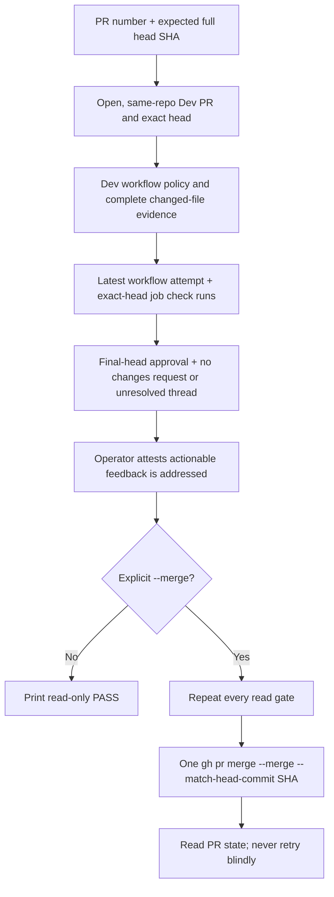

# Dev PR Merge Guard

**Date:** 2026-10-10
**Status:** IMPLEMENTED
**Context:** PR #531 was merged while checks for its final head were still running. Dev intentionally has no required-check rule because the main-to-Dev reconciliation workflow pushes directly to `dev`.

## Problem

A pull-request status rollup can describe an earlier head. Since Dev has no required checks, `gh pr merge --auto` can arrange a merge before the final-head jobs finish. The operator needs one repeatable gate that checks the exact head, complete CI, independent review, and cleared feedback before any merge.

## Design principles

- Read-only validation is the default. A merge needs `--merge` and an explicit feedback-addressed attestation.
- Fail closed on missing, pending, failed, skipped-unconditionally, unknown, stale, or incompletely paginated evidence.
- Pin every gate and the final merge to one full expected head SHA.
- Use installed `gh` for authentication and API access; add no runtime dependency.
- Leave the Dev ruleset compatible with main-to-Dev sync. This CLI is an operator convention and can be bypassed by another merge path.

## Architecture



`scripts/merge-when-green.py` reads `.github/workflows/lint-and-test.yml` from the PR's pinned base and head commit SHAs. For each version it checks the Contents response's path, type, base64 encoding, size, and Git blob SHA, then checks the matching recursive tree entry is one regular `100644` blob with the same SHA and size; incomplete or truncated tree evidence refuses. The only accepted workflow transition is the exact pre-partition blob `da998c35a6bc5d3ea7eedc72ea228e48f9fc6b38` directly to the exact credential-safe Python Playbook Safety partition blob pinned in `scripts/merge-when-green.py`. That final blob includes `persist-credentials: false` on the safety job checkout. Later PRs must keep that workflow byte-identical. The intermediate partition without this credential setting is refused as either base or head. Each accepted state is validated against its required job names, trigger, and path-filter policy. The transition requires one GitHub file record with status `modified` and no prior filename. Any other base/head pair, extra byte, rename/add/delete/copy, malformed evidence, different mode, or unsupported workflow edit refuses. The workflow path remains in changed-file classification, so all three Go jobs remain required when it changes. Once the transition merges, the new `Python Playbook Safety` check is mandatory for subsequent PRs. A second transition follows the same pattern: from that Playbook Safety partition blob (`a4bd0d3db1de56fb2d7e0cf53fbbd879490838a0`, kept as the legal predecessor) directly to the exact Agentgateway partition blob `AGW_PARTITIONED_WORKFLOW_BLOB_SHA` in `scripts/merge-when-green.py`, which adds the `python-agentgateway` job named `Python Agentgateway`. That transition needs the same single `modified` record with no prior filename, and both sides are policy-checked against their own job set. From then on the Agentgateway partition must stay byte-identical, and `Python Agentgateway` is a required job. Pre-partition directly to the Agentgateway partition refuses. The predecessor bytes are kept as `platform/tests/fixtures/lint-and-test-playbook-safety-partition.txt`.

A third transition follows the same pattern: from that Agentgateway partition blob (`0756135a07f33f103b1ea4b4bdd44f03e9af31a8`, kept as the legal predecessor) directly to the exact Node pi provider blob `NODE_PARTITIONED_WORKFLOW_BLOB_SHA` in `scripts/merge-when-green.py`, which adds the `node-pi-provider` job named `Node pi provider`. That job runs `node --test gateway.test.ts` in the pi-provider client directory, so the client's tests run in CI rather than only locally. That transition needs the same single `modified` record with no prior filename, and both sides are policy-checked against their own job set; the Node state also requires the `Python Agentgateway` job. From then on the Node partition must stay byte-identical, and `Node pi provider` is a required job. Pre-partition or Playbook Safety directly to the Node partition refuse. The Agentgateway predecessor bytes are kept as `platform/tests/fixtures/lint-and-test-agw-partition.txt`, and a test asserts that file's blob matches the pinned Agentgateway constant. A pull request opened before this transition still runs the Agentgateway workflow, so it has no `Node pi provider` job and the required-job gate refuses it until it merges `dev`.

A fourth transition follows the same pattern: from that Node pi provider blob (`159efa1d6d6e2048a0d2cd84f8f185a92580a232`, kept as the legal predecessor, fixture `platform/tests/fixtures/lint-and-test-node-partition.txt`) directly to the exact Rust console blob `CONSOLE_PARTITIONED_WORKFLOW_BLOB_SHA` in `scripts/merge-when-green.py`, which adds the `rust-console` job named `Rust (console)`. That job is not path-gated: `Unit Tests` requires every job in its `needs` list to succeed and a skipped job is not a success, so the job runs on every pull request. It runs the console crate's format check, Clippy for the server and wasm32 web builds, and the server tests, on a Rust 1.96 toolchain. That transition needs the same single `modified` record with no prior filename, and both sides are policy-checked against their own job set; the console state also requires the `Node pi provider` and `Python Agentgateway` jobs. From then on the console partition must stay byte-identical, and `Rust (console)` is a required job. Pre-partition, Playbook Safety, or Agentgateway directly to the console partition refuse. The Node predecessor bytes are kept as `platform/tests/fixtures/lint-and-test-node-partition.txt`, and a test asserts that file's blob matches the pinned Node constant. A pull request opened before this transition still runs the Node workflow, so it has no `Rust (console)` job and the required-job gate refuses it until it merges `dev`.

A fifth transition follows the same pattern: from that Rust console blob (`ccd27624f66f4923bacea51976f708fa4b870a33`, kept as the legal predecessor, fixture `platform/tests/fixtures/lint-and-test-console-partition.txt`) directly to the exact Playbook Runs blob `RUNS_PARTITIONED_WORKFLOW_BLOB_SHA` in `scripts/merge-when-green.py`, which adds the `python-playbook-runs` job named `Python Playbook Runs`. It exists because Python core reached its 30-minute timeout again (2026-10-31, `docs/MISTAKES.md` 5.22). It runs the six slowest whole-playbook test files, about 2,300 of core's 5,900 worker-seconds: firewall convergence, the step-ca backup, the clean-deploy confirmation, host observability instrumentation, internal-certificate renewal and the VM lifecycle step results. Core deselects them. The job uses core's dependencies, collections, `PYTHONPATH` and xdist options, and the partition test requires its environment to equal core's. The transition needs the same single `modified` record with no prior filename, and both sides are policy-checked against their own job set; the Playbook Runs state also requires every job the console state requires. From then on the Playbook Runs partition must stay byte-identical, and `Python Playbook Runs` is a required job. A base other than the console partition refuses. A pull request opened before this transition still runs the console workflow, so it has no `Python Playbook Runs` job, and the required-job gate refuses it until it merges `dev`. The pull request that carries it passes the gate only when the gate is run from that pull request's own head, whose script knows the new pin: the gate on `dev` before the merge refuses any candidate other than the console blob.

The Python core job keeps pytest's configured root discovery active and deselects only the NetBox, Semaphore, the two complete playbook-safety files, the `test_agw_*.py` files named by the Agentgateway job, and the six files named by the Playbook Runs job. The new required Python Playbook Safety job runs `test_rollback_inference_route.py` and `test_executor_internal_overrides.py` explicitly with the same Python dependencies, Ansible collections, and xdist options. The required Python Agentgateway job runs those `test_agw_*.py` files explicitly, by path, with the same dependencies, collections and xdist options, and exists because Python core reached its 30-minute timeout. The `Unit Tests` aggregate runs under `if: always()` and requires a successful result from each shard. `platform/tests/test_ci_python_partition.py` derives collection commands and selectors from the workflow, then collects root, core, safety, Agentgateway, Playbook Runs, NetBox, and Semaphore node IDs. Collection errors fail the test; the six shards must be pairwise disjoint, their union must exactly equal root, and the safety, Agentgateway and Playbook Runs shards must be nonempty. A new `test_agw_*.py` file stays in core until it is added to both the Agentgateway job and core's deselect list, which is a workflow edit and so needs a new pinned blob.

The gate requires the thirteen unconditional quality jobs (`EXPECTED` in `scripts/merge-when-green.py` less `Detect changes` and the three Go jobs; counted 2026-10-31), the `Detect changes` classifier, and all three Go jobs to appear in the latest workflow attempt. A Go job may be skipped only when paginated PR file evidence proves its path condition false; rename evidence includes both the prior and current path. Exact-head commit statuses are paginated and checked by context in GitHub's newest-first order; CodeRabbit is review-only and optional, while every other context must be successful. Workflow jobs must map through `check_run_url` to completed check runs for the exact expected SHA; the latest run/attempt is selected by workflow identity. Every check run must come from GitHub Actions, except CodeRabbit's own review check run (app `coderabbitai`), which passes only when completed with `success` (reviewed) or `neutral` (skipped at its review limit); the approval rule below still applies. Unknown workflow/check policy refuses.

The tool also requires an approval on the expected SHA from a non-author reviewer, or a structured operator-attested JSON receipt with `repository`, `pr`, `head_sha`, `reviewer`, `session`, `verdict: "APPROVED"`, and `evidence`. The receipt is not cryptographic proof of reviewer independence. All review pages are read in GitHub's chronological order, with the later item winning equal submission timestamps; any latest non-dismissed changes-requested verdict or unresolved review thread refuses. Thread pagination metadata and every `isResolved` value must be boolean, and a continuing page must provide a cursor. `--feedback-addressed` is a separate operator attestation for actionable feedback in reviews and ordinary PR comments; the CLI does not classify comment prose.

## Implementation phases

1. Implement a standard-library CLI using `gh api`; make validation read-only unless `--merge` is present.
2. Bind PR identity, CI, review, feedback, and merge command to the full expected head SHA.
3. Test success, pagination, workflow drift, stale/pending/failing evidence, skips, reruns, review/thread failures, and zero merge calls on refusal.
4. Document the safe operator sequence and retain the intentional Dev ruleset limitation.

## Python CI partition acceptance

The partition moves both complete test files into the required parallel job without reducing root discovery. Keep the Python core timeout at 30 minutes and preserve `-v -x -n auto --dist worksteal --durations=20` in both jobs. Do not raise timeouts or skip cases. Verify exact pytest node-ID equality and disjointness across root discovery, Python core, Python Playbook Safety, Python NetBox, and Python Semaphore; record collection errors as failures. Run focused guard/partition tests, Ruff, and whitespace checks before independent final-head review. Measure on GitHub after the transition: target Python core under 25 minutes and full CI under 40 minutes; report queue delay separately. A two-file timing improvement is unverified until those runs complete. Existing unrelated skips remain visible and must not be presented as zero skips. The Agentgateway shard applies the same acceptance: its timing gain is unverified until GitHub runs after the transition complete, and Python core, Python Agentgateway and the other shards each keep the 30-minute timeout.

## Safe invocation

Start with read-only validation:

```sh
python3 scripts/merge-when-green.py --pr 532 --head aaaaaaaaaaaaaaaaaaaaaaaaaaaaaaaaaaaaaaaa
```

After review and explicit authorization for that PR/head, attest feedback is addressed and request one merge:

```sh
python3 scripts/merge-when-green.py --pr 532 --head aaaaaaaaaaaaaaaaaaaaaaaaaaaaaaaaaaaaaaaa --feedback-addressed --merge
```

Use `--review-receipt PATH` only for a structured Sol/Claude review receipt when the approval is recorded outside GitHub. Do not use `--auto`, `--admin`, or another merge path for a feature-to-Dev PR.

## Validation criteria

| Check | Pass condition |
|---|---|
| PR identity | Open, not draft, same-repository head, base `dev`, exact requested SHA |
| Workflow policy | Base/head are the exact pre-partition-to-credential-safe-partition transition, the exact Playbook Safety-to-Agentgateway partition transition, or a byte-identical credential-safe or Agentgateway partition; the intermediate partition is refused as base or head; the matching schema is valid and tree mode is `100644` |
| CI | Every expected job is present on the latest PR workflow attempt and has a successful exact-head check run; every latest exact-head commit status context succeeds except optional CodeRabbit; a CodeRabbit check run must be completed with `success` or `neutral`; any other non-Actions check run refuses; only path-proven Go skips are allowed |
| Review | One independent exact-head approval or valid receipt; no latest outstanding changes request; no unresolved thread |
| Merge | Only explicit `--merge`; revalidate all reads and issue one `--merge --match-head-commit SHA`; read back ambiguous results without retry |
| Refusal | Every gate failure exits nonzero before a merge call |

## Security considerations and limits

The CLI does not change GitHub rulesets or the main-to-Dev sync. Direct use of `gh pr merge` can bypass this operator gate. Reads and the merge are separate API operations, so a concurrently started rerun, review, or base movement can race the final merge despite immediate revalidation and head SHA matching. The gate checks base/head identity before and after evidence collection and compares both validations, but cannot make those API reads atomic with the merge. The workflow transition trusts the independently reviewed candidate blob SHA; future edits need a reviewed merge-gate policy update. An operator-attested receipt and feedback flag are trust inputs, not cryptographic evidence. Pagination caps and truncated trees refuse rather than treating partial responses as complete. An unfamiliar workflow or check requires a reviewed policy update before it can pass.

## Cross-references

- [AGENTS.md](../../AGENTS.md) — feature-to-Dev merge procedure
- [docs/MISTAKES.md §5.16](../../docs/MISTAKES.md#516-merged-on-a-status-rollup-that-still-described-the-previous-head)
- [PRINCIPLES.md](../../PRINCIPLES.md)
- [Testing and CI architecture](../architecture/03-testing-ci-quality.md)

## Revision history

- 2026-10-10: Implemented exact-head operator gate after the PR #531 recurrence.
- 2026-10-11: Permit only a pinned-base byte-exact insertion of the Bash job's canonical 1–30 minute timeout; all other protected workflow edits still refuse.
- 2026-10-11: Permit the pre-partition workflow to transition directly to the exact credential-safe Python partition; reject the unmerged intermediate blob as base or head.
- 2026-10-14: Permit the Playbook Safety partition to transition directly to the exact Agentgateway partition (new required job `Python Agentgateway`); the Playbook Safety blob stays a legal predecessor and the Agentgateway blob is pinned from the final workflow bytes.
- 2026-10-15: Permit the Agentgateway partition to transition directly to the exact Node pi provider partition (new required job `Node pi provider`, running the pi-provider client's `node --test gateway.test.ts`); the Agentgateway blob stays a legal predecessor and the Node blob is pinned from the final workflow bytes. The `test_agw_openrouter.py` file moves from Python core into the Python Agentgateway shard in the same change.
- 2026-10-26: Permit the Node pi provider partition to transition directly to the exact Rust console partition (new required job `Rust (console)`, not path-gated); the Node blob stays a legal predecessor and the console blob is pinned from the final workflow bytes.
- 2026-10-31: Permit the Rust console partition to transition directly to the exact Playbook Runs partition (new required job `Python Playbook Runs`, the six slowest playbook test files moved out of Python core); the console blob stays a legal predecessor and the Playbook Runs blob is pinned from the final workflow bytes.
