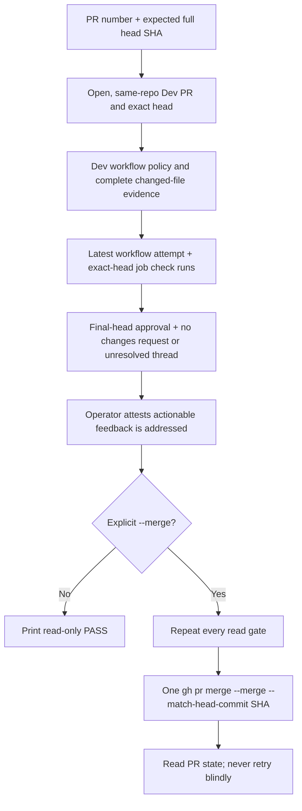

# Dev PR Merge Guard

**Date:** 2026-10-10
**Status:** IMPLEMENTED
**Context:** PR #531 was merged while checks for its final head were still running. Dev intentionally has no required-check rule because the main-to-Dev reconciliation workflow pushes directly to `dev`.

## Problem

A pull-request status rollup can describe an earlier head. Since Dev has no required checks, `gh pr merge --auto` can arrange a merge before the final-head jobs finish. The operator needs one repeatable gate that checks the exact head, complete CI, independent review, and cleared feedback before any merge.

## Design principles

- Read-only validation is the default. A merge needs `--merge` and an explicit feedback-addressed attestation.
- Fail closed on missing, pending, failed, skipped-unconditionally, unknown, stale, or incompletely paginated evidence.
- Pin every gate and the final merge to one full expected head SHA.
- Use installed `gh` for authentication and API access; add no runtime dependency.
- Leave the Dev ruleset compatible with main-to-Dev sync. This CLI is an operator convention and can be bypassed by another merge path.

## Architecture



`scripts/merge-when-green.py` reads `.github/workflows/lint-and-test.yml` from the PR's pinned base and head commit SHAs. For each version it checks the Contents response's path, type, base64 encoding, size, and Git blob SHA, then checks the matching recursive tree entry is one regular `100644` blob with the same SHA and size; incomplete or truncated tree evidence refuses. The pinned base must still match the gate's reviewed job names, trigger, and path-filter policy. Any other workflow path change refuses. The protected workflow path may be changed only when the pinned base blob SHA is the reviewed `05826a7e56e75d53b4bbeb680d8b4e05fa1f2d98`, there is one GitHub file record with status `modified` and no prior filename, and the head bytes equal the base bytes plus exactly `    timeout-minutes: N\n` directly between the `bats` job's existing `runs-on: ubuntu-latest` and `steps`, where `N` is an unquoted decimal integer from 1 through 30. The job header must be unique and in that location; any `timeout-minutes` occurrence in the pinned Bash job body (including quoted keys or spacing variants), moved/missing/ambiguous job, rename/add/delete/copy, malformed evidence, different mode, or any other byte change refuses. The base SHA pin applies only to a workflow edit; identical base/head bytes continue through normal policy checks after the timeout lands. A later edit from a new base blob requires a reviewed merge-gate policy update. This is an insertion-only exception; replacing an existing timeout requires a reviewed policy change. The workflow path remains in changed-file classification, so all three Go jobs are required when it changes. The exception proves byte equality to the pinned base except for the timeout line; it does not independently review every byte already present in that base.

The gate requires the eight unconditional quality jobs, the `Detect changes` classifier, and all three Go jobs to appear in the latest workflow attempt. A Go job may be skipped only when paginated PR file evidence proves its path condition false; rename evidence includes both the prior and current path. Exact-head commit statuses are paginated and checked by context in GitHub's newest-first order; CodeRabbit is review-only and optional, while every other context must be successful. Workflow jobs must map through `check_run_url` to completed check runs for the exact expected SHA; the latest run/attempt is selected by workflow identity. Unknown workflow/check policy refuses.

The tool also requires an approval on the expected SHA from a non-author reviewer, or a structured operator-attested JSON receipt with `repository`, `pr`, `head_sha`, `reviewer`, `session`, `verdict: "APPROVED"`, and `evidence`. The receipt is not cryptographic proof of reviewer independence. All review pages are read in GitHub's chronological order, with the later item winning equal submission timestamps; any latest non-dismissed changes-requested verdict or unresolved review thread refuses. Thread pagination metadata and every `isResolved` value must be boolean, and a continuing page must provide a cursor. `--feedback-addressed` is a separate operator attestation for actionable feedback in reviews and ordinary PR comments; the CLI does not classify comment prose.

## Implementation phases

1. Implement a standard-library CLI using `gh api`; make validation read-only unless `--merge` is present.
2. Bind PR identity, CI, review, feedback, and merge command to the full expected head SHA.
3. Test success, pagination, workflow drift, stale/pending/failing evidence, skips, reruns, review/thread failures, and zero merge calls on refusal.
4. Document the safe operator sequence and retain the intentional Dev ruleset limitation.

## Safe invocation

Start with read-only validation:

```sh
python3 scripts/merge-when-green.py --pr 532 --head aaaaaaaaaaaaaaaaaaaaaaaaaaaaaaaaaaaaaaaa
```

After review and explicit authorization for that PR/head, attest feedback is addressed and request one merge:

```sh
python3 scripts/merge-when-green.py --pr 532 --head aaaaaaaaaaaaaaaaaaaaaaaaaaaaaaaaaaaaaaaa --feedback-addressed --merge
```

Use `--review-receipt PATH` only for a structured Sol/Claude review receipt when the approval is recorded outside GitHub. Do not use `--auto`, `--admin`, or another merge path for a feature-to-Dev PR.

## Validation criteria

| Check | Pass condition |
|---|---|
| PR identity | Open, not draft, same-repository head, base `dev`, exact requested SHA |
| Workflow policy | Pinned base workflow trigger, expected names, and declared gates match policy; head is byte-identical except for the one permitted Bash timeout insertion, if present; tree mode is `100644` |
| CI | Every expected job is present on the latest PR workflow attempt and has a successful exact-head check run; every latest exact-head commit status context succeeds except optional CodeRabbit; only path-proven Go skips are allowed |
| Review | One independent exact-head approval or valid receipt; no latest outstanding changes request; no unresolved thread |
| Merge | Only explicit `--merge`; revalidate all reads and issue one `--merge --match-head-commit SHA`; read back ambiguous results without retry |
| Refusal | Every gate failure exits nonzero before a merge call |

## Security considerations and limits

The CLI does not change GitHub rulesets or the main-to-Dev sync. Direct use of `gh pr merge` can bypass this operator gate. Reads and the merge are separate API operations, so a concurrently started rerun, review, or base movement can race the final merge despite immediate revalidation and head SHA matching. The gate checks base/head identity before and after evidence collection and compares both validations, but cannot make those API reads atomic with the merge. The timeout exception trusts the pinned base's existing bytes after applying the narrower policy checks above. An operator-attested receipt and feedback flag are trust inputs, not cryptographic evidence. Pagination caps and truncated trees refuse rather than treating partial responses as complete. An unfamiliar workflow or check requires a reviewed policy update before it can pass.

## Cross-references

- [AGENTS.md](../../AGENTS.md) — feature-to-Dev merge procedure
- [docs/MISTAKES.md §5.16](../../docs/MISTAKES.md#516-merged-on-a-status-rollup-that-still-described-the-previous-head)
- [PRINCIPLES.md](../../PRINCIPLES.md)
- [Testing and CI architecture](../architecture/03-testing-ci-quality.md)

## Revision history

- 2026-10-10: Implemented exact-head operator gate after the PR #531 recurrence.
- 2026-10-11: Permit only a pinned-base byte-exact insertion of the Bash job's canonical 1–30 minute timeout; all other protected workflow edits still refuse.
