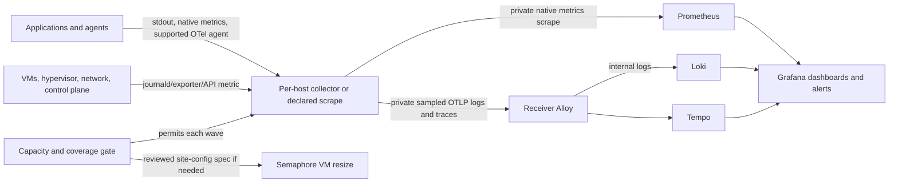

## Context

### Cross-signal identity and profile adoption baseline

The initial receiver contract uses the bounded `service` identity for metrics
and Loki, `service.name` for OTLP resources, and `service_name` for profiles.
`cluster` and `environment` come from controlled inventory values. Alert rules
add bounded `owner` and `severity` values. Request/user identifiers, trace IDs,
timestamps, raw paths, addresses, prompts, and secrets are not indexed metric
or Loki stream labels. Container and instance details remain for drill-down.

Service Overview lists metric-enabled services from Prometheus and queries Loki
by `service`; log-only coverage remains visible in the estate inventory and
Logs Drilldown. Missing telemetry remains a gap rather than a healthy default.
Profiling begins with one opt-in, measured Alloy self-profile target after its
resource and privacy gates pass. Add no other producer until measured ingestion,
retention, host headroom, and a successful profile receipt support the next wave.

See [proposal.md](proposal.md) for motivation and [the capability spec](specs/platform/estate-instrumentation/spec.md) for the behavior contract. The production receiver uses Prometheus for metrics, Loki for logs, and a private Alloy OTLP/gRPC path into single-node Tempo with local persistent storage (`platform/services/o11y/deployment/config/`, `compose.yml`). Grafana self-monitoring and agentgateway dashboards are provisioned. On 2026-09-28, a Dev-bound production deploy of reviewed commit `970dfa3ab545fa64f3c3829f99cf8ab29b7d32f2` passed live checks for all five stack components, the data sources, both dashboards, provisioned cross-signal link settings, alert rules, and the Discord contact point. Separate successful Semaphore receipts proved a named metrics target, a recent trace, alert delivery, retention, and cardinality; their IDs remain in private inventory. A user-visible trace-pivot click-through and some owning OpenSpec task checkboxes remain open. Production Alloy has no engine-socket mount, so its local container log/metrics discovery is not a production coverage receipt. These facts establish a receiver baseline, not estate-wide coverage; the broader rollout remains tracked by `observability-estate` and `inference-telemetry-production`. The architecture's old socket-scraped Prometheus and future Mimir sketches are not current collection mechanisms (`plan/architecture/06-observability-instrumentation.md`, as-built amendments).

The candidate set is generated from the current `platform/services/` and `agents/` trees at census time, including empty scaffolds. A directory is not proof of deployment: the first implementation phase must reconcile every candidate with private inventory, Semaphore templates, and live read-only discovery. The inventory also includes Proxmox, guest OS and container hosts, pfSense/network, DGX Spark, and external endpoints that Agent Cloud actually manages; scope is based on a declared managed target, not an indiscriminate network scan.

## Goals / Non-Goals

**Goals:** Reuse the receiver and onboarding verifier; give each deployed target an explicit signal contract; favor automatic runtime instrumentation; make cost, capacity, privacy, and recovery visible before increasing telemetry.

**Non-Goals:** Require traces from non-request infrastructure, claim traces from unsupported runtimes, switch to Mimir/object storage or high availability in this change, expose OTLP publicly, or clean-redeploy o11y and delete its current data. Future Kubernetes injection is a separate migration concern; the present estate uses Compose/Podman and VMs.

## Architecture

## Decisions

### 1. Inventory the actual estate before choosing exporters

Create one coverage declaration keyed by stable `service.name`/target identity, with lifecycle (`deployed`, `planned`, `retired`, `excluded`), owner, runtime/language, environment, host, signal applicability, method, expected endpoint, budget, and verification receipt. Generate an expected-target report from public service/agent definitions and private inventory; compare it with live read-only discovery, then resolve each discrepancy by a reviewed declaration. The public repo holds the schema and generic methods; `site-config` owns real hosts and network details. Extend the existing `Verify o11y Service` exact-target pattern instead of adding a separate verifier per service.

The audit enumerates every current service and agent directory at run time, including scaffolds, then adds managed infrastructure represented by deployment/inventory (Proxmox, guest OS/container runtimes, pfSense, DGX, and any supported edge dependencies). Every candidate gets an explicit lifecycle classification. This is a **candidate audit**, not a claim that all entries are running.

Alternative rejected: mark every repository directory covered. Several are scaffolds or retired; that would create false-green coverage.

### 2. Use the simplest supported signal source per target

Container stdout/stderr and journald/file logs go through a least-privilege, independently deployable host collector where central socket discovery cannot reach the host; the production receiver is the first such pilot because its engine socket is not mounted. Host collectors send OTLP logs and traces to receiver Alloy, which forwards them internally to Loki and Tempo. Native application/exporter `/metrics` is preferred over a second instrumentation library; two existing required opt-in labels (`scrape`, `port`) and optional `path`/`high_churn` labels serve co-located local containers, while remote targets use private inventory-rendered Prometheus scrape declarations. Do not expose Loki push or Prometheus remote-write as new external ingress. A process that serves HTTP/RPC requests gets a compatibility pilot for the current [OpenTelemetry zero-code mechanism](https://opentelemetry.io/docs/concepts/instrumentation/zero-code/) of its runtime, using deployment parameters rather than a source fork. Zero-code covers supported libraries, not the application's own domain operations; add a small explicit span only for a critical unobserved boundary. Default to no body/prompt/token capture, stable resource attributes, context propagation, bounded attribute values, and sampled traces. Do not inject unreviewed agents into privileged control-plane processes or require eBPF privileges across the fleet.

**Receiver-host journal pilot decision (2026-10-09):** Dev-bound Semaphore survey 3662 at reviewed `dev` revision `7c863948` observed rootless Podman's `journald` default, seven running o11y containers using that driver, and 216 exact-name entries in a bounded user-journal metadata read. Receiver Alloy has no read-only host journal mount. This proves a journal source exists for the receiver host; it does not prove container-side file access or log delivery. Pilot an independent Alloy v1.9.2 collector with only declared read-only journal directories, persistent collector state, no engine socket, no host network, and no published listener. Use [Alloy's journal source](https://grafana.com/docs/alloy/latest/reference/components/loki/loki.source.journal/) and [Loki-to-OTLP bridge](https://grafana.com/docs/alloy/latest/reference/components/otelcol/otelcol.receiver.loki/) to send bounded, allowlisted container records to the existing private receiver OTLP endpoint. Keep `service`, `signal`, `cluster`, and `environment` bounded; exclude raw journal fields, request identifiers, and content from labels. The read-only survey uses only a cached receiver Alloy v1.5.1 image, with `--pull=never`, as a rootless UID `0:0` file-read probe; it does not validate collector configuration. If that cached probe image is absent, report the fixed `probe_unavailable` result and do not pull. Apply separately acquires the exact Alloy v1.9.2 collector image if absent, then runs the official [Alloy `validate` command](https://grafana.com/docs/alloy/latest/reference/cli/validate/) before any collector recreation. The command performs supported static configuration validation of syntax, components, and properties, with runtime stability flags matched; v1.9.2's [official changelog](https://github.com/grafana/alloy/blob/main/CHANGELOG.md) includes a validator fix for `livedebugging` blocks. First prove the exact host journal directory exists and is readable by the rootless collector, then require a receiver-side Loki query for the declared pilot container. Refuse ambiguous directories, permissions, an empty source, or a missing receiver receipt. Explicit stop and failed-delivery rollback stop and remove only the pilot container without `podman rm -v`, verify that it is absent from Podman's reboot restart set, and verify the named positions volume remains. This matches [Podman's restart behavior](https://docs.podman.io/en/latest/markdown/podman-create.1.html) and [container removal semantics](https://docs.podman.io/en/latest/markdown/podman-rm.1.html). Deploy and rollback through separate Dev-bound Semaphore workflows without changing or deleting the receiver's volumes. The current local socket pipeline remains local-only; a later cohort may reuse this collector mechanism after its privacy and volume gates pass.

**Positions-volume survey and repair gate (2026-10-09):** The explicit `survey` action resolves the one existing local `journal-collector-state` volume by Compose project and logical-volume labels, including when the journal collector is absent. It reads bounded root and direct-child metadata in the rootless Podman user namespace and never mounts the volume or reads positions content. A fixed `podman volume inspect --format` template reads `NeedsChown` and `NeedsCopyUp` as literal `false`/`true`; JSON field presence remains a separate diagnostic because Podman v4.9.3 may omit false-valued fields. Inventory, named JSON reads before/after the template, and template identity are cross-checked; invalid output or identity races refuse every gate. The separate `repair-positions` action retains its initialized-volume path: after fresh evidence proves an unused initialized volume's root ownership alone blocks `0:0`, it changes only root owner/group, verifies readback, and runs the restricted Alloy create/write/rename/delete probe. **Narrow pending-volume exception:** for exactly one empty unused volume with `NeedsChown=false`, `NeedsCopyUp=true`, blocked non-`0:0` root ownership, and fresh identity/metadata checks, repair may change only the root owner/group to `0:0` when mode is already safe. The source-level pending mode-reduction implementation additionally permits clearing only group/other write bits before that owner change; reviewed live Semaphore repair and collector/Loki acceptance remain pending. It performs no access-probe mount, preserves contents, and verifies identity, owner, the exact expected mode, and emptiness; repair success does not authorize first mount or collector apply; after any pending-volume mutation, failure preserves the volume and returns bounded uncertain status; no automatic owner restoration is attempted because a mount followed by removal cannot be ruled out from current state. No owner rollback or state deletion is permitted after Compose's first mount. Free-byte and free-inode thresholds are checked independently from stable metadata: above-threshold counter changes do not invalidate root/child/ACL/mount evidence, while low or unavailable counters refuse repair. Pending repair checks both GraphRoot and volume-filesystem capacity; initialized repair checks the volume filesystem. Both paths refuse ACLs, mount boundaries, symlinks, non-regular or multiply linked children, and child ownership mismatch. Unsafe modes refuse except for the implemented pending-only group/other write reduction; initialized-volume repair retains mode unchanged. Check mode reports `check_mode_unverified` without Podman or filesystem calls.

**Pending-volume repair diagnostics (2026-10-09):** Survey and the initial `pending_volume_unsupported` refusal share one fixed checklist derived from the strict pending owner-only gate. The implemented mode-reduction exception evaluates the same checks while permitting only the combined write/special-bit check to fail from group/other write bits alone; a present write-bit diagnostic remains unsafe until actual reduction and fresh readback prove otherwise. Expose only owner-RWX and unsafe-mode-bit enums, separate volume/GraphRoot byte and inode categories (`sufficient`, `low`, `unverified`), and the bounded `failed_checks` enum list. The diagnostic uses the existing discovery snapshot; it adds no Podman command, probe mount, content read, or ownership change. Repair refusal remains `refused`; the receipt explains only the initial observation and does not replace fresh identity rechecks or authorize mutation. Check mode and exception fallback preserve the schema with all evidence unverified.

**Pending-volume mode-bit follow-up (2026-10-09):** The Dev-bound read-only survey 3917 at exact merged Dev SHA `63946505875639b8b0080a045fa1e0ae08ab4a9b` confirmed the existing combined group/other-write-or-special-bit check failed while the pending volume remained otherwise available for diagnosis. Add five separate fixed categories (`group_write`, `other_write`, `setuid`, `setgid`, and `sticky`) from the same metadata snapshot. Preserve the combined category and `failed_checks` predicate; these extra fields explain the combined result but do not alter any acceptance or repair condition. Missing mode, check mode, and survey exception output use `unverified`. No raw mode, ownership, path, or capacity values are exposed, and the change adds no runtime probe or mutation.

**Pending mode reduction implementation (2026-10-09):** User-supplied sanitized evidence records successful read-only Dev-bound Semaphore task 3925 at exact merged Dev SHA `8050f2768903e09f68285f90c1598cb120006219`: the pending positions volume was unused, empty and unmounted, owner mismatched, owner RWX complete, ACL absent, collector absent, and volume/GraphRoot byte and inode capacity sufficient. Only `group_other_write_or_special_absent` failed; `group_write` was present while `other_write`, `setuid`, `setgid`, and `sticky` were absent. Earlier repair task 3899 refused before mutation. These receipts were supplied by the user, not independently reread here; they bound the implemented exception but do not authorize mutation, establish repair readback, collector readiness, or Loki delivery.

Retain the safe-mode pending owner-only path and the initialized-volume path. Add only an explicit pending repair exception when fresh evidence proves exactly one local expected volume, `NeedsChown=false`, `NeedsCopyUp=true`, no collector in all containers (including stopped), zero consumers/mounts, exactly empty root, owner mismatch with collector access blocked, complete owner RWX, ACL absent, and all identity, metadata and capacity guards passing. The only permitted initial failed check is `group_other_write_or_special_absent`, and its cause must be proven group/other write alone: special bits absent and mode an exact integer in `0..0o7777`. Unknown or malformed observations refuse. Derive `target_mode = original_mode & ~0o022`; never substitute a fixed `0700`, add owner permissions, strip group/other read/search, clear special bits to make an unsafe case eligible, or apply this exception to initialized/nonempty state. Keep the combined diagnostic and failed-check list truthful for the original snapshot; separate mode-bit diagnostics do not authorize repair.

Pin the volume creation timestamp, configuration, expected name/project and mountpoint, root device/inode, original owner/group and mode. The mode and owner changes use separate rootless helper processes, so one open descriptor cannot span the required full Podman discovery between mutations. Before each mutation, open the exact directory without following symlinks and compare descriptor metadata with the pinned root device/inode and the exact expected owner/mode. The first helper reduces permissions to `original_mode & ~0o022` and verifies exact target mode plus unchanged identity/owner/emptiness. Then repeat full discovery and emptiness/ACL/use/mount/capacity checks with the reduced mode as the sole expected metadata change. Only after that readback passes may the second helper change root owner/group to `0:0`; it independently pins and rechecks the same root device/inode before changing ownership. Verify fresh discovered identity, exact target mode, new owner, empty contents, initialization flags, collector absence, zero consumers/mounts, ACL absence and capacity. No recursive operation, content read/write, probe mount, volume creation/deletion, or Compose start belongs to pending repair. A rerun of an already converged safe volume must not mutate it again or start a collector.

Any failure before mutation refuses with no change. Once permission reduction or ownership change may have occurred, every command failure, exception, identity/metadata drift or failed readback returns bounded `uncertain`, preserves the volume, and never automatically restores mode or owner. Descriptor pinning protects the selected inode but does not serialize Podman, other same-user processes, child creation, ACL changes, or mount history; repeated snapshots cannot rule out mount-then-remove races. Require an operator-controlled quiescent repair window and fresh checks; refuse observed races, retain uncertainty after mutation, and require separately reviewed recovery if certainty cannot be re-established. No claim of atomicity or historical first-mount proof is made.

Alternatives rejected: fixed `0700` removes unrequested read/search permissions; owner-first leaves write exposure during the owner transition; automatic restoration can reintroduce write permissions or alter state after an unobserved mount; broad mode normalization admits unsafe special-bit or owner-access cases. The permission reduction is deliberately limited to the empty pending root.

Implementation: the pending branch retains the original failed-check list and permits only exact write-bit reduction for an empty, unused pending volume when it is the sole failed guard. The mode helper pins and verifies the root descriptor; complete fresh discovery/readback then gates the existing owner helper, which independently pins the same device/inode. Post-mutation failures return bounded `uncertain` with no restore. Focused coverage includes write-bit combinations with read/search preservation, safe-mode owner-only behavior, initialized-path behavior, converged rerun, malformed/special modes, missing owner RWX, unrelated failed guards, pre/post-mutation races, readback, capacity and sanitized failure results. Check mode remains unverified and runtime-free. Source-level validation does not accept the live repair: after independent exact-head review and green CI, run the Dev-bound check-mode workflow, a fresh read-only survey at exact merged SHA, a separately selected `repair-positions` task, and a separate read-only post-repair survey. Record sanitized task IDs/SHA and safe-mode `0:0` readback; this implementation session runs none of those live tasks. Only a separately authorized later collector-apply task, with its full pre-apply and immediate pre-start gates, may perform Compose's first mount. Require live mount/cursor/access/health, unchanged receiver set and fresh exact-target Loki delivery before closing task 1.2.

**First-start bootstrap and bounded survey fallback (2026-10-09):** The pre-apply and immediately-before-start read-only gates may return `bootstrap_allowed` for a missing expected volume only after complete bounded inventory, no expected-name collision, and an all-container inventory (including stopped containers) proves the journal collector absent. An existing pending volume is eligible only with one exact local identity, zero users and mounts, effective `NeedsChown=false` and `NeedsCopyUp=true`, and an empty, unambiguous root already owned by `0:0` with owner RWX and no group/other write, special bits, ACL, nested mount, or metadata ambiguity. The narrowly scoped root-only repair and implemented mode-reduction exception above may establish that same safe ownership and mode before first mount only after comparing volume `CreatedAt`, volume configuration, and root device/inode across observations; Compose `up` remains the sole creator/initializer. The first-mount headroom gate requires at least 16 MiB available and 128 available inodes on both GraphRoot and the pending volume filesystem; this does not replace or weaken the independent 30% retention headroom gate. The immediate pre-start check runs outside rollback handling. After Compose's first mount, a persistent `NeedsCopyUp=true` flag is not success by itself: require the exact live RW mount, namespace create/write/rename/delete, bounded allowlisted Alloy layout, the parsed `positions.yml` map entry for `cursor-loki.source.journal.o11y_alloy` with an empty label set and a valid journal cursor, collector health, unchanged seven receiver containers, and a fresh exact-target Loki receipt. Empty image destination can leave copy-up pending; partial copy or unexpected files refuse and preserve the volume. Rollback removes only the pilot container, without `-v`; it never restores ownership or deletes copied state. The strict cursor gate can expose first-start failure or replay risk when initialization is partial. Unexpected survey exceptions remain bounded as `survey_failed`; the positions helper remains `check_mode_unverified` in check mode without its own Podman or filesystem operations. These are source-level facts, not live receiver evidence; task 1.2 remains open.

The helper's `verify` action is the pre-start gate; `verify-live` is the post-start gate. Pre-start may return `ready` without a cursor only for a complete observed volume with both initialization flags false, no collector in the all-container inventory, zero consumers and mounts, an exact safe identity, root `0:0`, access and capacity evidence on GraphRoot and the volume filesystem, no ACL or nested mount, an allowlisted empty/seed/component layout, and explicitly observed absence of `positions.yml`. This permits one bounded Compose start attempt and is not delivery proof. A present invalid or unreadable file, unknown cursor presence, or incomplete/unsafe component layout refuses. Here, partial copy means a present invalid/unreadable cursor file, a pending temporary positions file, or any layout outside the allowlist; proven cursor absence before start is a separate retry case. Post-start always requires the valid parsed cursor plus the live mount and access evidence; it never returns `bootstrap_allowed`. No phase deletes or replaces positions state or automatically restores ownership after pending mutation. Empty or allowlisted state cannot establish historical copy-up or cursor-loss history, so replay/loss safety remains unproven until live evidence is recorded.

**Collector state-path permission correction (2026-10-09):** The pinned [Alloy v1.9.2 Dockerfile](https://github.com/grafana/alloy/blob/v1.9.2/Dockerfile) creates `/var/lib/alloy` for UID/GID 473 with mode `770`. The journal pilot intentionally runs as `0:0` with all capabilities dropped, so its named state volume must not sit below that image-owned parent. Keep the existing named volume and mount it at `/alloy-state`, set `--storage.path=/alloy-state`, and require the helper's exact destination check plus the playbook's live write probe and rollback volume lookup to use that same path. This avoids relying on copy-up through an inaccessible image ancestor and preserves the UID/capability boundary. Dev task 3973 failed health and rolled back after 80 permission-denied log lines, with the fixed positions target and fixed TCP readiness probe both failing; read-only task 3977 found the collector absent and the existing named volume empty, unused, unmounted, owned by UID 0 with RWX mode and no ACL. These receipts do not establish successful collector health or Loki delivery; task 1.2 remains open.

**Positions initialization-schema diagnostic follow-up (2026-10-09):** Dev survey 3856 succeeded with `volume_initialization_unverified`, zero consumers and entries, root owner mismatch, blocked access, ACL absent, clear mount state, and safe direct children. The journal source was available while the target positions path was denied. Keep initialization flags fail-closed for every gate. The survey alone adds a second exact-name volume inspection and Podman client/server version query after unique volume identity is established; it reports only field presence/type, actual boolean values, named-query outcome, identity comparison, and validated bounded version strings. Unrecognized values, command failures, and malformed or duplicate named results remain categorical/unavailable. Check mode performs no Podman calls and returns the same diagnostic shape as unverified. The extra named-volume identity diagnostic and version query run only during survey and never change gate decisions; the identity-bracketed initialization-flag read is required by every gate and does control decisions.

**Extra positions-directory diagnostic (2026-10-10):** Our read-only Dev-bound Semaphore API survey task 4009 succeeded at merged Dev SHA `9bc543d7d0f80be77ddab3983f9db6a983257f06`. The receipt reported a pending initialization volume with three top-level entries: the seed file, the existing journal component directory, and one unidentified other directory. It also reported no collector or volume users, matching root owner, RWX, no ACL, clear mount, sufficient free space, ambiguous children, unavailable cursor, and live mount/namespace fields unverified or not run. The third directory's identity and purpose remain unknown; do not infer a persistent queue or any other state from its existence. A diagnostic-only extension compares only the exact public `otelcol.receiver.loki.journal` and `otelcol.exporter.otlp.journal` component names. It emits bounded fixed-role counts and, for a matching directory, owner/access, ACL, mount, and direct-child categories. Reads are descriptor-relative with no-follow opens and identity rechecks; unsafe links, metadata errors, and races return `unverified`. Unknown names remain aggregated. Recognized and unknown extra directories both keep `component_layout=false`; no pre-start or live acceptance predicate changes. The extension adds no survey write, probe, or mount. Task 1.2 remains open.

**Unmatched-directory metadata and Dev receipt (2026-10-10):** Our read-only Dev-bound Semaphore API survey task 4016 succeeded at exact Dev merge `736af5b16917f28a243b3715d56c76c00bfe7a8a`. The sanitized receipt reported `volume_initialization_pending`, no collector, no valid cursor, three direct entries, `seed_file=1`, `journal_component=1`, `other_directories=1`, and zero recognized receiver/exporter directories. Volume identity, capacity, root owner, and root RWX were good; `NeedsCopyUp=true` and the `NeedsChown` field was missing. `component_layout` failed. The pending-repair `failed_checks` included `children_empty`, `child_count_zero`, `owner_mismatch`, and `collector_access_blocked`. These are our API-observed sanitized results, not user-provided evidence. The helper now reports aggregate categorical owner/access/ACL/mount/direct-child-empty status over anonymous unmatched direct child directories, bounded by the existing 32-entry cap. Descriptor-pinned no-follow access and post-observation identity/listing checks make races, symlink substitutions, ACL or mount ambiguity, malformed data, and incomplete observations `unverified`. This is diagnostic only: unmatched directories remain outside the accepted layout and cannot pass repair, pre-start, or live gates. Stop on remaining or unverified entries; do not infer queue state or mutate/apply the volume. Obtain a fresh reviewed Dev survey after merge. Task 1.2 remains unchecked.

### 2a. Ansible-owned direct Podman collector and fresh positions switch (2026-10-10; partial source, operational gates unverified)

**Read-only plan reconciliation (2026-10-10):** The partial source progress under
task 1.2a is not an operational proof or permission to apply/repair. The following
admission, intent, checkout, binding, preservation and attribution requirements
are acceptance gates for the same coupled PR. Their exact implementation needs
discovery and independent review; no lock backend, durable-record location or
Semaphore environment marker is accepted by this artifact update. The
conditional native task-JWT authentication decision and its remaining verifier
gates are recorded below.

**Installed Semaphore API observation (2026-10-10; directly queried read-only by the agent via the site-config HTTPS launch URL; sanitized output):** HTTPS
`/api/info` reported version `v2.19.11-0c3f373-1787751354` and
`use_remote_runner=false`. `/api/runners` returned two records: the default
runner was active, offline, with `max_parallel=1`; the nondefault runner was
inactive and online. The response exposed no tag counts. Historical task 4038
in project 1/template 312 reported the reviewed Dev SHA and an empty playbook
override; its template points to the journal-collector playbook and has
repository/inventory IDs. Neither task nor template exposed `runner_id` or a
runner tag. This suggests local execution but does not prove task-specific
runner isolation, runner-token scope, or current behavior. Verify the installed
execution path and isolation before relying on task attribution or admitting
runtime proof; task 1.2a remains unchecked.

**Conditional native task-JWT decision (2026-10-10; design only):** Use
Semaphore's task JWT as the authentication input only when its signer is
configured and the selected template explicitly enables JWT parameters. The
pinned v2.19.11 source review reports local `TaskRunner` issuance only under
both conditions and continuation without a token on signing failure
([TaskRunner.go:248-277](https://github.com/semaphoreui/semaphore/blob/0c3f3738ea5ed988165afe499d896ff78b428c44/services/tasks/TaskRunner.go#L248-L277)).
Its ES256 claim set binds task, project, template and user IDs plus
`iss`/`sub`/`aud`/`exp`/`nbf`/`iat`/`jti`; its single-key JWKS has no checkout
SHA, inventory, host, action or policy claims. Treat the currently observed
`jwt.enabled=false` and missing `jwt_params` on templates 224/234/312 as an
activation gap: no issuance or runtime containment is established.
The pinned signer/claim implementation is in
[`pkg/jwt`](https://github.com/semaphoreui/semaphore/tree/0c3f3738ea5ed988165afe499d896ff78b428c44/pkg/jwt).

The protected root supervisor remains the authorization/admission boundary.
Its verifier must pin the trusted issuer, JWKS, audience and ES256 algorithm;
read task status/context through a protected path; and independently derive
the consumed checkout, inventory and policy binding. Require a receiver-issued
one-use challenge, running-status/context checks at the mutation boundary, a
durable replay fence, full worker-tree containment with cancellation and reboot
recovery, and reviewed key rotation with drain. Never place a broad Semaphore
API token on the target. Keep OpenBao Transit only as a key-custody alternative
if independent or overlapping signing keys become mandatory. These are design
requirements, not evidence of JWT issuance, verifier operation or runtime
containment; journal mutation gates remain closed and task 1.2a remains
unchecked.

**JWT activation risks (source-level, not installed-runtime findings):** The
pinned [`local_executor.go:723-732`](https://github.com/semaphoreui/semaphore/blob/0c3f3738ea5ed988165afe499d896ff78b428c44/services/tasks/local_executor.go#L723-L732)
appends `getSurveyEnvVars()` after `getEnvironmentENV()`. A survey environment
key named `SEMAPHORE_JWT` can therefore create a later entry that may shadow the
minted token. Template/setup validation and the verifier must reject this name
collision; environment-variable presence alone is not authentication. Local
task processes may also share Semaphore's OS user, so require installed
read-only proof of token isolation from neighboring tasks and the server, or
hardening that provides it, before relying on the token. These are activation
risks; the pinned source ordering does not prove either collision exploitation
or an installed-runtime isolation failure.

**Admission remains unimplemented (2026-10-10):** The partial durable admission
state helper and premature receiver refusal includes were removed because they
did not establish shared, authenticated admission. Receiver deploy and clean/reset
do not share an admission gate. Ordinary receiver deploy remains available through
its prior source path. Clean/reset is unconditionally refused immediately before
shared destructive cleanup, after the existing reset-confirmation, reviewed-checkout,
and retention gates. The journal action gate permits only check-mode survey; runtime
survey/proof/apply/repair/stop/rollback remain closed. Task 1.2a remains incomplete; admission, durable intent,
recovery, attribution and preservation requirements below remain acceptance gates.

**Accepted task 1.2a admission design (2026-10-10; not implemented):** Use one
root-owned, host-local durable intent namespace outside the repository checkout
and Podman stores. Keep a permanent flock inode for the namespace; never replace
or unlink that inode. A root-protected supervisor owns the lock and durable state,
then launches only the verified rootless worker. Persist each mutation's intent
before crossing that mutation boundary and read it back; after the operation,
persist and read back its outcome before another mutation can begin. Replace the
intent atomically from a same-filesystem temporary file, fsync the file and parent
directory, then read back the committed record. The lock and record together must
establish cross-play active ownership for journal actions and every competing
receiver lifecycle path. There is no expiry-based takeover, and a terminal status
alone does not authorize takeover; uncertain or interrupted intent requires
explicit reconciliation. Any receiver lifecycle path that cannot participate in
the same admission and intent protocol must refuse. Check mode performs zero
target writes. OpenBao KV CAS alone is insufficient for the monolithic target
helper: without a credential path and controller/target rendezvous to acquire,
renew, and read back ownership at each mutation boundary, CAS cannot establish
host-local cross-play admission. This is the accepted design only; implementation,
recovery, and operational acceptance remain open.

**Receiver deployment admission execution contract (design; not implemented):**
The first mutating consumer is the ordinary receiver deployment. One operation
must begin admission before target repository placement or rendering, and retain
ownership through configuration and alert rendering, privileged probe
installation/removal, image pull and receiver recreation, acceptance probes, and
any Prometheus reload or permitted cleanup. These boundaries span
`platform/playbooks/tasks/place-monorepo.yml`,
`platform/playbooks/deploy-o11y.yml`,
`platform/playbooks/tasks/o11y-alert-provision.yml`, and
`platform/services/o11y/deployment/deploy.sh`; the acceptance play is part of
the same operation because it also performs probes and reloads. A lock acquired
only around `deploy.sh`, container startup, or a final play cannot protect this
transaction.

The root-protected supervisor is the sole host-side owner of the permanent
admission lock and durable intent for that operation. Ansible sends one bounded,
action-specific request at a time; the supervisor validates it, writes and
reads back the intent for that mutation boundary, launches and tracks only its
fixed worker, waits for that worker to become quiescent, reconciles the observed
result, then writes and reads back the outcome before accepting the next
request. The worker set is fixed by the reviewed supervisor implementation;
requests do not carry shell text, executable paths, arbitrary environment, or
unbounded target selectors. Ansible must not issue an equivalent target-side
mutation outside the supervisor while the operation is admitted. The same
persisted operation identity and monotonic boundary sequence rendezvous across
the placement, deploy, and acceptance plays; a Semaphore extra var, Ansible
fact, task-ID string, or caller-supplied operation ID is correlation data, not
proof of authority.

Every durable pre-mutation record binds the independently authenticated owner
and Semaphore task, operation and boundary sequence, action, exact reviewed
checkout, independently derived consumed inventory and effective
configuration/policy context, and bounded read-only identities of the assets
the boundary may affect. The record is root-protected, atomically replaced on
the same filesystem, fsynced with its parent directory, and read back before
the worker starts. After the worker exits, the supervisor records and reads
back its bounded result and observed post-state before allowing another
mutation. A missing, malformed, mismatched, or unreadable record, failed
readback, changed binding, or unclassified result refuses the next boundary.

**Authority and containment remain unresolved implementation gates.** The
contract requires an authenticated cross-play rendezvous independently bound
to the running Semaphore task and reviewed execution context, but does not
select an authentication mechanism. The existing task-attribution diagnostic
that reports `partial` is not authority. The mechanism must resist forgery,
replay, cross-task reuse, and caller-controlled checkout/config claims before
any receiver mutation is admitted. The implementation must also prove that the
supervisor can track and stop the complete worker tree, including descendants,
after controller loss or cancellation; a detached lock-holder beside ordinary
Ansible mutations does not satisfy this contract. Until both decisions are
implemented and independently verified, the supervisor refuses receiver
mutation requests and no journal runtime gate opens.

Root owns admission, durable intent, and fixed privileged host handlers. The
receiver's Podman operations run only in the verified declared receiver
identity and its bound storage/environment context. A root supervisor may
launch that worker as the rootless receiver account, but must never execute
checkout-writable code as root. Privileged probe changes use separately
enumerated, narrowly parameterized handlers; root access does not authorize
rootful Podman operations. A declared rootful receiver context is a distinct
storage namespace and must be explicitly bound and supported by a reviewed
handler; otherwise it refuses. Rootless and rootful clients cannot select
different admission locks or durable-intent namespaces.

Before and after receiver lifecycle work, compare both the legacy journal
positions volume and the fresh `journal-collector-state-v2` volume by their
independently observed identities, effective initialization flags, and stable
root/child metadata. Receiver deployment must not mount, initialize, normalize,
adopt, or delete either volume. Receiver recreation may proceed only when the
admitted preservation readbacks pass; ambiguity or drift refuses. This receiver
transaction does not authorize collector apply, repair, stop, proof, or rollback.

Until converted to this same authenticated supervisor and intent protocol, the
following exact competing entry points refuse before their first target-side
mutation: `platform/playbooks/clean-deploy-o11y.yml`,
`platform/playbooks/drill-o11y-alert-canary.yml` (which invokes `deploy.sh`),
`platform/playbooks/o11y-fault-drill.yml` (which stops/starts Grafana),
`platform/playbooks/restore-o11y-alert-baseline.yml`, and
`platform/playbooks/instrument-host-o11y.yml` (which reloads Prometheus).
The journal workflow
`platform/playbooks/deploy-o11y-journal-collector.yml` remains limited to its
existing read-only diagnostic/check-mode path; its mutating actions remain
refused. No unconverted caller may infer admission from a recent receiver
snapshot or from the diagnostic-only lock.

On a worker error, controller disconnect, task cancellation, supervisor
process failure, or failed result readback, no later mutation request is
accepted. A live supervisor retains ownership until it proves the complete
worker tree is quiescent; if the supervisor exits, its unresolved durable
intent fences successors even after the kernel lock is released. A successor
cannot take over because a timeout elapsed, a lock became available, Semaphore
reports a terminal task, or a task-ID field disappeared. After reboot,
unresolved intent still blocks all new receiver and journal mutations. Recovery
first authenticates the prior task, proves its host workers cannot continue,
acquires the same admission namespace, and performs
read-only reconciliation against the recorded boundary and current asset
identities. It may close intent only when that readback establishes one
recorded, safe terminal outcome; otherwise it retains `uncertain` intent and
assets for reviewed recovery. Recovery does not automatically roll back, adopt,
normalize, or delete assets. Check mode performs no target write and cannot
create an admission or intent record.

**Diagnostic-only lock source slice (2026-10-10; not host-wide admission):** A
separate Dev-bound Ansible bootstrap creates the permanent root-owned empty inode
`/var/lib/agent-cloud/o11y-journal-positions-diagnostic.lock` only when absent.
It refuses unsafe existing parents or lock objects and resolves the effective
mount with a bounded read-only `findmnt --kernel=mountinfo --json --target`
query before any target creation. When the lock is absent, the precheck targets
its existing parent; after creation, a second query targets the full lock path.
Both responses must contain exactly one well-formed result on the same effective
mount with an allowlisted filesystem and `/dev/` source; missing, malformed,
nonlocal, or changed evidence refuses. If the lock already exists, final stat
must retain its original device and inode. Supported filesystems are `ext2`,
`ext3`, `ext4`, `xfs`, and `btrfs`. The exact reviewed receiver checkout is verified as
its owning rootless account, while root retains ownership of the lock inode. The inode is
root-owned mode `0644` so the rootless receiver account can open it read-only; the
diagnostic takes a nonblocking exclusive flock with a one-second deadline and
verifies the same inode before and after observing bounded positions metadata.
Check mode skips both creation tasks. This lock serializes only this diagnostic:
no other journal or receiver lifecycle action acquires it, so it does not
establish quiescence, authenticated ownership, mutation admission, or recovery.
Synthetic coverage includes an NFS findmnt result omitted from Ansible mount
facts, malformed output, changed pre/post evidence, and existing inode identity;
no live filesystem or rootless flock proof is implied. Normal journal
runtime actions remain refused, and task 1.2a remains unchecked.

**Private attribution binding status (2026-10-10):** Site-config PR #71 adds the
scoped `o11y_attribution_project_id` binding. An independent Sol Medium review
of its final head `46a44ad1a35dce9aba61ca5b7aa43b0f1f4ca881` passed;
CodeRabbit approved the earlier head. GitHub Actions job annotations on both
attempts say account payments failed or the spending limit must increase, and
the inventory job started no steps. The PR is open and unmerged. No live
attribution receipt exists, so no journal runtime action is enabled.

**Receiver reconciliation orphan guard (2026-10-10; partial source):** The ordinary
o11y deploy opts into preserving only a receiver-project container whose verified
Compose service label is exactly `journal-collector`. On an o11y recreate, the shared
helper omits `--remove-orphans` and sets `COMPOSE_REMOVE_ORPHANS=0`; an unexpected
orphan or missing/unreadable service label refuses before `compose up`, including
when `FORCE_RECREATE=true`. Other shared-helper callers retain explicit orphan
removal. Synthetic BATS coverage checks changed-input and forced recreation, no-op
rerun, unknown/unexpected orphan refusal, and the default removal path. This is only
source-level protection: provider behavior with a direct collector sharing receiver
project labels, live receiver preservation, and installed Podman Compose behavior
remain unverified. Task 1.2a remains unchecked.

**Semaphore task-output authority audit (v2.19.11 source; installed behavior
unverified):** Local executor stdout/stderr is attached to its `TaskRunner`
logger and persisted against that runner's task ID ([executor wiring](https://github.com/semaphoreui/semaphore/blob/0c3f3738ea5ed988165afe499d896ff78b428c44/services/tasks/TaskPool.go#L1028-L1045), [output pipes](https://github.com/semaphoreui/semaphore/blob/0c3f3738ea5ed988165afe499d896ff78b428c44/services/tasks/TaskRunner_logging.go#L60-L65), [persistence](https://github.com/semaphoreui/semaphore/blob/0c3f3738ea5ed988165afe499d896ff78b428c44/services/tasks/TaskPool.go#L353-L396)). The ordinary task-output API exposes GET/HEAD routes; the inspected source has no ordinary-user append route ([routes](https://github.com/semaphoreui/semaphore/blob/0c3f3738ea5ed988165afe499d896ff78b428c44/api/router.go#L497-L506)). An assigned remote runner holding its runner token can append task output through its update endpoint ([runner authentication](https://github.com/semaphoreui/semaphore/blob/0c3f3738ea5ed988165afe499d896ff78b428c44/api/runners/runners.go#L20-L51), [runner updates](https://github.com/semaphoreui/semaphore/blob/0c3f3738ea5ed988165afe499d896ff78b428c44/api/runners/runners.go#L265-L340)); therefore a task-row challenge is not proof that Ansible emitted it or that the runner is isolated. The existing project API credential is user-scoped and project-resource permission applies to output routes, so it is not inherently a read-only credential ([bearer authentication](https://github.com/semaphoreui/semaphore/blob/0c3f3738ea5ed988165afe499d896ff78b428c44/api/auth.go#L218-L242), [project middleware](https://github.com/semaphoreui/semaphore/blob/0c3f3738ea5ed988165afe499d896ff78b428c44/api/router.go#L295-L308)).

The current controller diagnostic generates its nonce on the controller, accepts `waiting`, derives template/repository/inventory IDs from task metadata, and returns `partial` after marker readback ([prepare](../../../../../platform/playbooks/files/diagnose-semaphore-task-attribution.py#L57-L70), [metadata checks](../../../../../platform/playbooks/files/diagnose-semaphore-task-attribution.py#L130-L174), [result](../../../../../platform/playbooks/files/diagnose-semaphore-task-attribution.py#L294-L307)). A receiver-generated challenge bound to a receiver session/key, pinned numeric project/template/repository/inventory IDs, exact playbook and reviewed SHA, effective inputs, `running`-only checks before verification and consumption, and atomic one-use consumption is proposed diagnostic evidence only. It is not authority for a Transit signer or mutating permit until installed runner assignment/isolation and a protected verifier are established. Remote-runner trust and a protected cancellation/admission fence remain open; status readback is a snapshot and does not make cancellation atomic with receiver mutation. The existing controller OpenBao runtime-token flow is `platform/semaphore/tasks/runtime-access.yml`. Before cleanup or journal proof can be admitted, require exact receiver-only selectors and verify both journal volumes and the collector container are preserved.

**Task-output attribution diagnostic (2026-10-10; controller-only source route
locally verified, partial):** The Dev-bound controller playbook requires the
exact reviewed clean checkout and obtains its runtime API token through the
shared controller OpenBao include. Two controller action plugins keep OpenBao
credentials and the attribution nonce out of module arguments. The runtime
plugin reads the URL, AppRole values, and injected-token fallback from task
variables or controller environment. The attribution plugin imports the fixed
helper relative to its source, accepts only non-secret context arguments, and
reads `_token` plus the protected prepare result from task variables. Both run
in process without module execution, connection calls, subprocesses, or
persistent credential files. OpenBao requests disable redirects, cap response
reads at 64 KiB, and enforce a ten-second total request deadline. The existing
transport assertion, injected Semaphore token fallback, `no_log` boundaries,
safe rescue, and `uri`-compatible protected register shapes
(`json.auth.client_token` and `json.data.data.api_token`) remain, including
compatibility with callers that inspect `_runtime_login.json`. Prepare keeps
the 256-bit nonce only in a `no_log` registered result; only its framed digest
marker reaches visible task output. Verify reuses the helper's redirect-disabled
bounded readback and aggregate 30-second deadline over task/template/repository
metadata and output rows. Check mode returns `check_mode_unverified` before
nonce generation or API access. Only a matching marker returns `partial`;
failures return fixed reasons and bounded counts, never `authenticated`.
Focused local tests passed (42), including actual Ansible 2.21.0 action-plugin
discovery/check-mode execution, callback redaction, and synthetic OpenBao
responses. This verifies source behavior only: installed Semaphore plugin
discovery/execution, its API response shape, task-ID injection, and process
isolation remain unverified. No Semaphore/OpenBao task or live receipt was run,
and no journal action is enabled. This remains a partial diagnostic, not an
authorization gate or completion of task 1.2a.

**Clean/reset refusal gate:** `clean-service.yml` includes `compose.journal.yml`
in its `down -v` overlay set, removes every container whose name has the service
prefix, and removes the production checkout/config; its production teardown uses
`become: true`, which may inspect a different rootful Podman store from the
collector's rootless owner. Until host-wide admission and complete, distinct-store
read-only inventories prove the exact old and fresh volume identities and
collector absence before teardown, clean/reset must refuse before any mutation.
If any protected asset exists, refuse the entire reset. Make no selective-cleanup
or preservation claim without installed-provider proof. Keep the existing reset
confirmation, reviewed-SHA and retention gates.

**Previously recorded receipt and stop (not rerun here):** Independently read
Dev-bound read-only task **4038** at
merged SHA `a052555060b4c9ca5fb59fb44fa64906fc38bd69` reports
`initialization_pending`, collector absent, volume use count 0, three entries
(`seed_file=1`, `journal_component=1`, `other_directories=1`), unknown-directory
count 1 fully verified as collector-owned, RWX, ACL absent, same mount and empty.
There is no cursor; `component_layout` failed; live mount/UID proof was not run.
The prior context records this receipt as read from Semaphore after the merged deployment. Empty
unknown-directory metadata does not identify
its purpose or origin and does not relax the layout gate. Ownership repair is
inapplicable: the root already matches the collector and the volume is nonempty.
Preserve the old volume without mount, chmod/chown, copy, rename, cursor read,
content change, or deletion throughout proof, switch, stop and rollback.

**Selected lifecycle owner:** The existing Dev-bound Semaphore journal playbook
will own the collector through idempotent Ansible tasks invoking direct rootless
Podman. Compose remains the sole lifecycle owner of the seven receiver services.
Remove the collector's executable Compose service/mount path in the coupled
implementation; do not leave two start paths or a selectable Compose fallback.
Retaining receiver project labels is an identity contract, not permission for
receiver Compose reconciliation to manage this collector. Guard ordinary receiver
redeploy/stop and orphan cleanup against selecting it; no broad project-wide
teardown, volume cleanup or receiver network recreation belongs to this switch.
This is a declared collector-only capability deviation within o11y, not a second
receiver stack, environment fork, manual host command or new orchestrator.
It follows the Semaphore/read-guard/idempotency boundary in `PRINCIPLES.md` §5.

**Host-wide admission and interrupted operations (unverified):** Journal survey,
proof, apply, repair, stop and rollback must share admission keyed to the verified
receiver host across tasks and runtime user/storage contexts. Every competing
receiver lifecycle path that can affect these assets must participate, including
deploy/reconcile, stop, clean/reset, orphan cleanup and network/volume lifecycle.
Require a consistent survey observation and exclusive admission throughout each
mutating operation, including cleanup and acceptance readback. Survey admission
must retain its read-only target contract; the implementation must establish how
it participates without target volume, collector or receiver writes. A lock local
to the journal action or one runner does not satisfy host-wide admission. Map all
competing entry points and prove participation before runtime proof; unsupported
paths or inability to establish a quiescent window block execution. Admission
does not claim atomicity against arbitrary same-user Podman commands outside
the controlled workflow.

Before any mutation, including proof asset/image preparation, explicit volume
creation, lifecycle changes or cleanup, persist and read back a protected durable
operation intent binding the authenticated owner/task, exact reviewed checkout,
derived inventory/policy context, action, observed asset identities and intended
mutation boundary. Reconcile the intent with actual identity/state after each
boundary and retain unresolved intent on interruption; a later success receipt
cannot replace the pre-mutation record. Do not release unresolved work as safely
complete or erase its intent to make a retry pass. Elapsed time, lease expiry,
task-ID absence or runner restart alone cannot authorize stale takeover. Recovery
requires authenticated prior-task status, evidence that its host execution can no
longer mutate, and reconciliation of durable intent with current owned assets
under shared admission. Terminal task status alone is insufficient. If ownership,
quiescence, durable persistence/readback or recovery evidence is uncertain, stop
before another mutation and retain uncertain assets for reviewed recovery.

**Exact checkout and independently derived binding (unverified):** Before executing
the helper or any runtime proof/lifecycle operation, verify the actual controller
and target code against the exact independently reviewed, CI-green merged Dev
commit. Remove moving-branch placement from this workflow in the future coupled
implementation; checking a branch name or checking SHA only after execution
cannot pass. Do not move a shared checkout underneath another task. Resolve and
verify the actual inventory revision/content and effective rendered policy/config
from the inputs consumed by the run, cross-checking their authoritative source
and authenticated task context. An echoed caller-supplied expected revision or
digest is not observed binding. Include these derived values in the proof,
operation intent and creation receipts and match them at apply. The discovery
must establish which execution paths and consumed inputs need verification;
missing, changed or unverifiable checkout/inventory/policy evidence blocks them.

**Current public Dev source guard (2026-10-10; source-only):** Before receiver
verification or journal proof work, the controller must pass the existing exact
expected-SHA and clean-checkout checks, its local `refs/remotes/origin/dev` must
equal that SHA, and a bounded noninteractive read-only `git ls-remote` against
the fixed canonical public agent-cloud HTTPS URL must return exactly that SHA
for `refs/heads/dev`. On the receiver, the existing read-only checkout verifier
also requires its local `refs/remotes/origin/dev` to equal the expected SHA; it
does not fetch or contact a remote. Missing or stale refs, a different remote
head, malformed output, command failure or timeout refuse before journal proof
or asset mutation. Check mode performs no target write, and the runtime action
refusal remains in force. This proves only that these observed refs match the
exact current public Dev head at check time. It does not prove independent
review, green CI, inventory binding, or authenticated task ownership, and it
does not satisfy or complete task 1.2a.

**Git invocation isolation (2026-10-10; source-only):** Local checkout reads and
the public-head query use the fixed `/usr/bin/git` and fail closed if it is
unavailable. Both receive only a controlled environment: no inherited Git,
proxy, certificate-override, or XDG configuration variables, and system and
global Git configuration are disabled. The public query runs from `/`, outside
the inspected checkout, and explicitly keeps HTTPS certificate verification on,
clears configured proxies, disables credential helpers, and disables prompts.
The expected public-ref output remains an exact comparison. This closes the
reviewed environment/config redirection path in source; it does not establish
live network, review, CI, inventory-binding, or authenticated-task evidence.

Every fixed Git invocation also passes command-line `-c core.fsmonitor=false`. A
checkout-local fsmonitor executable can run during `git status`, so the receiver
verifier now performs that status read only after exact root, `HEAD`, and local
`origin/dev` validation succeeds. A disposable-repository regression confirms
plain `git status` executes a configured marker hook, while `verify_checkout`
returns `verified` without creating the marker; wrong-root and wrong-revision
fixtures confirm status is skipped. These are source and synthetic-test results
only, not live checkout or receiver proof.

**Preservation and authenticated attribution (unverified):** Capture and compare
the old volume's exact identity, effective initialization flags and stable root
and bounded direct-child metadata before and after every operation, without
mounting it or reading its contents/cursor. Preserve ownership, modes, ACL/mount
boundaries and child identities; incomplete, raced or changed evidence refuses
success. Capture all seven receiver IDs, states and health plus backend health
and the existing signal/active-alert baseline; container count or running state
alone is insufficient. Unavailable baseline evidence blocks proof/apply, and
drift blocks acceptance with only identity-guarded collector cleanup permitted.

Task attribution and proof/creation/intent receipt readback must use an
independently authenticated authority tied to the actual Dev-bound run, reviewed
checkout and derived context. A Semaphore task-ID environment value, operator
extra var, stdout claim or matching label is not authentication. Establish the
trust path and protected durable receipt readback through implementation discovery;
missing, forged, stale, partial or context-mismatched evidence keeps apply/repair
refused. Do not name an environment variable as trusted without verifying its
provenance and resistance to caller substitution. Source checks and a `partial`
proof result cannot satisfy any of these operational gates.

**Evidence and rejected alternatives:** On 2026-10-10, the inspected upstream
[podman-compose main source](https://github.com/containers/podman-compose/blob/main/podman_compose.py)
contains no no-copy handling in `mount_desc_to_mount_args`; `parse_short_mount`
rejects unknown options rather than accepting `nocopy`. Upstream
[issue #1459](https://github.com/containers/podman-compose/issues/1459) reports
long-form `volume.nocopy` ignored. These are upstream source/report evidence,
not proof of the installed production provider. Official
[Podman volume option documentation](https://github.com/containers/podman/blob/main/docs/source/markdown/options/volume.md)
includes direct `--volume` copy/no-copy options. Select an explicit direct
Podman RW/no-copy mount at `/alloy-state`; its installed-version behavior,
initialization flags, image destination contents and UID mapping remain
**unverified** until the separately selected proof below passes. Do not infer
behavior from `NeedsCopyUp`, rendering or documentation. Keep the existing
Compose provider copy-behavior subproof diagnostic only: success cannot approve
the selected direct mount, and failure is not a reason to switch providers,
relax layout, enable copy or normalize old state. A provider upgrade, another
Compose backend, passthrough wrapper, or ownership patch is not the selected
solution. Earlier Compose bootstrap/repair sequences above are historical;
this section supersedes their lifecycle and creation assumptions for all future
fresh/missing-volume apply. Task 4038 does not authorize old-volume repair.

**Minimal declared identity:** In the single future public implementation PR,
change only the journal collector's logical state key to
`journal-collector-state-v2`, still mounted at `/alloy-state`, with matching
logical-volume label, helper lookup, pre/live gates, stop/rollback lookup and
operating tests/docs updated together. Keep `journal-collector-state` as the
protected legacy identity; never select it by a fallback. Resolve both exact
physical names using the receiver's verified Compose project and rendered
identity model, cross-checked against runtime receiver/legacy-volume labels; do
not guess a prefix. Resolve the existing `o11y` network to its exact runtime
name/ID and project labels from the same receiver context; require the expected
receiver membership and refuse missing, foreign or ambiguous networks. Direct
Podman attaches only to that verified existing network, never creates a replacement.
Retain `com.docker.compose.project` and `io.podman.compose.project` project
labels, the exact `com.docker.compose.volume=journal-collector-state-v2` volume
label, and the reviewed collector config digest label consistently in creation,
verification and cleanup. Extra ownership/receipt attribution must not turn
project-label matches into permission for broad selection. Do not use a volume
`name:` override, external alias or arbitrary operator-supplied volume selector.
The public versioned logical key is a mechanism, not private site identity;
existing private host/journal/endpoint declarations remain in site-config, so
no new private volume-name setting or private-repo PR is required. If the
resolved fresh name already belongs to anything else, stop rather than select
another name, adopt it or delete it.

**Selected direct Podman proof, separately selected through reviewed Dev-bound Semaphore:**
Extend the existing guarded workflow/helper, not a laptop experiment or live
receiver deploy. Enforce the shared admission, durable intent, exact pre-execution
checkout and authenticated derived binding above. Pin the reviewed code SHA,
independently observed inventory revision/content and effective policy, rootless user
and storage context, actual Podman executable identity and client/server versions,
exact direct lifecycle arguments/security/mount policy, receiver-derived
project/network identity and rendered config digest, and resolved image digest/ID
for pinned
`docker.io/grafana/alloy:v1.9.2`. Use the same resolved image for proof and apply;
a version tag alone must not let changed image bytes reuse an old proof. Any
Podman executable/version, image, mount policy, UID/storage context, receiver
project/network identity or relevant configuration
change invalidates the proof. Check mode and survey emit unverified, never a
proof receipt. Missing direct Podman capability or image/config validation stops. Compose
executable/version evidence belongs only to the separate diagnostic; it cannot
satisfy or substitute for the direct lifecycle proof tuple.

1. Enter the host-wide shared admission above before observation; take all seven
   receiver IDs/states/health and signal/alert/backend-health baseline. Verify old
   identity, effective flags and stable root/direct-child metadata read-only
   without mounting it. Require a verified quiescent window and durable intent
   before mutation; repeated snapshots cannot replace admission. Inspect complete bounded container
   and volume inventories. Use isolated task-owned direct Podman test identities,
   scratch config and synthetic journal fixture, disposable uniquely labelled
   test container and volume, with no old/fresh-volume aliases, receiver service
   definitions, engine socket, live journal bind, host network or published port.
   Run test containers with networking disabled and the sink in-process; observe
   the receiver network identity read-only for context binding, without attaching
   proof containers to it.
2. Observe the pinned image's `/alloy-state` without a positions volume using an
   owned disposable image-inspection container. Record bounded destination
   layout/ownership and identity, not a provenance claim. With the actual
   installed Podman and selected direct mount syntax, test ordinary copy
   behavior and the explicit RW/no-copy mount policy
   in **separate new disposable volumes**, never by retesting a used volume as
   fresh. Compare pre-first-mount, effective container mount and post-mount
   contents/flags/ownership. Use explicit guarded volume creation and creation
   receipts before container creation, matching the selected operational lifecycle.
   Verify the direct mount actually enforces no-copy; rendering, the Compose
   diagnostic or documentation alone is insufficient. The selected
   switch policy is explicit no-copy, with no silent fallback to copy. If
   `/alloy-state` is absent/empty, additionally use an independently observed
   nonempty, benign directory from the SAME pinned image as a positive control
   for copy versus no-copy in separate disposable volumes; then verify the
   actual `/alloy-state` first mount. Do not modify/derive the image to invent
   evidence. If no bounded positive control establishes behavior, return
   copy-behavior-unverified and stop; do not infer success from flags.
3. Under the proved no-copy policy and actual collector `0:0`, read-only root,
   capability drop and storage path, validate and run an isolated Alloy config
   against a bounded synthetic journal fixture, retaining the production
   `loki.source.journal.o11y_alloy` identity. Use a local synthetic-only sink
   ([loki.echo](https://grafana.com/docs/alloy/latest/reference/components/loki/loki.echo/)
   is the candidate; support must pass validation in the pinned image), no
   receiver export. Prove safe root/child ownership, live RW mount and effective
   UID mapping/access; classify the bounded layout against explicit reviewed
   component names. Never allow arbitrary directories based on emptiness.
   Require the expected parsed cursor after consuming fixture records; stop
   gracefully, read back the cursor under protected output, restart the same
   test volume, and prove resume plus cursor advancement with a second fixture
   batch. Container health alone or a synthetic cursor written by the helper
   cannot pass. Fixture generation and pinned-image sink support remain
   implementation checks: absent support refuses rather than using live logs.
4. Repeat the chosen first-mount case on another new disposable volume to prove
   repeatability. Cleanup only exact task-owned container IDs, volume creation
   identities/labels and scratch paths after rechecks, absence of foreign users
   and zero mounts; never broad Compose down, prune, wildcard deletion or `-v`.
   Identity drift/uncertain cleanup retains assets and reports a bounded stop.
   Verify test assets absent, old volume identity/effective flags/stable root and
   direct-child metadata unchanged, and all seven receiver IDs/states/health and
   baseline unchanged. Reconcile the durable intent and record the authenticated
   Semaphore task/SHA and derived proof tuple for independent receipt readback;
   operator extra vars or a survey boolean cannot forge direct Podman success.

**Fresh switch through the same reviewed implementation:** Apply must independently
read back a successful Dev-bound proof task at the reviewed merged SHA and match
its authenticated, independently derived direct Podman tuple. Verify the exact
checkout before execution, hold host-wide admission and persist/read back durable
intent before mutation; then repeat fresh preflight immediately before first mount,
outside collector rollback handling. Require complete inventories, exact old
and fresh names distinct, exact project/logical labels, local driver with no
unexpected options, no name/label collisions, and no collector including stopped
containers for a first start or stopped-state resume. An already accepted live
collector uses the no-op verification path below, with exactly one verified
consumer/mount and no foreign users; it cannot reuse the absent-collector gate.
For a missing fresh volume, Ansible alone explicitly creates that exact local
volume after proof and absent-name/collision preflight pass, before any collector
container creation or mount. Record an independently attributable creation
receipt binding Semaphore task/reviewed SHA/inventory, exact resolved name,
project/logical labels, driver/options, creation timestamp, mountpoint and root
device/inode; verify safe initial metadata/flags and preserve a protected receipt
for independent readback. Repeat identity/use/mount/capacity checks after creation
and immediately before container creation/mount. If creation/readback is partial,
receipt persistence fails, or identity drifts, preserve the asset and refuse;
never adopt an unreceipted volume by name/emptiness, silently recreate a missing
receipted volume, or let implicit Podman creation replace this step. Verify the
created container's exact volume/network identities and effective policy before
start; any unreceipted implicit creation refuses and preserves uncertain state.
An existing fresh volume requires the prior owned creation receipt and full
metadata/layout/cursor checks. Receiver Compose never creates or initializes it.
Pin volume creation identity, mountpoint and root device/inode once created;
refuse symlinks, ACL/special-bit or nested-mount ambiguity, unexpected children,
identity drift, foreign consumers or unknown inventory. Pending fresh state
must be empty, unused/unmounted and satisfy the proved ownership/flag policy;
never repair or normalize it to pass. Require independently sufficient bytes
and inodes on GraphRoot and volume backing filesystem (at least the existing
16 MiB/128-inode first-mount floor, including bounded test/image/fixture peak
space); image acquisition must not consume the reserved first-mount floor.
This is separate from retention forecast/headroom, not permission to grow disk.
A failed proof/preflight changes no collector or receiver service. A refusal
after explicit fresh-volume creation retains that receipted/uncertain volume;
no pre-first-mount failure promises that no task-owned asset was created.

Create/start only the exact receipt-owned journal container through guarded
Ansible direct Podman tasks using the proved explicit RW/no-copy policy; never
invoke Compose for the collector or reconcile the seven-service receiver stack.
Preserve pinned image bytes, `0:0`, read-only root, all capabilities dropped,
no-new-privileges, read-only declared journal/config binds, loopback-only readiness
listener, bounded health schedule and restart policy. No engine socket, host
network, published listener or recursive ownership/relabel option is permitted.
Before each mutating lifecycle task require an exact identity/state read-guard
and truthful changed reporting; unexplained config/security/network drift refuses
rather than adopting or force-replacing a container. Validate the
real collector config with the pinned image before start. Post-start require
exact fresh-volume name/source/destination/RW mount, `0:0` mapping and namespace
write/rename/delete access, strict production component layout, a valid expected
parsed cursor, automatic health/readiness, and a fresh exact-target Loki query
for `service=o11y/alloy`, `signal=container` and the declared cluster/environment,
with source identity bound to the observed `o11y-alloy` receiver ID and a receipt
newer than this apply's start. Synthetic proof receipts and stale matching Loki
streams are not delivery. Local-sink proof does not establish the production
pipeline layout: inspect the real layout against the explicit allowlist and
refuse any extra/partial/unknown state without deletion. Prove cursor persistence
and continued exact-target delivery after a bounded collector-only restart,
while all seven receiver IDs/states, backend health and existing signal/alert
baseline remain unchanged. Private ingress requires the declared private bind,
no published collector listener/socket/host network, source-scoped admission
and a denied unapproved-vantage receipt; do not mutate firewall in this switch.

**Stop, rerun and risk:** Explicit stop or failed post-start proof removes only
the verified collector container under the same host-wide admission, durable
intent and authenticated ownership guards, without volume removal, and verifies absence
from restart sets, BOTH volume identities/preservation and the seven receivers.
Never remount the unsupported old volume automatically; rollback means returning
to collector-absent receiver baseline, not historical cursor recovery. Failure
before collector mount leaves collector/receivers unchanged and retains any
explicitly created fresh asset with its receipt or bounded uncertainty. Failure
after first mount preserves
fresh state and reports uncertainty; no reset, ownership restore, seed removal,
or new v3 name on retry. Interrupted proof retains only its own uncertain test
assets for identity-verified cleanup. Proof reruns reuse no first-mount volume;
apply reruns verify an already healthy exact collector/config/image/volume and
return no-op without restart. After stop/failure, resume the same fresh volume
only with a proven valid cursor and safe exclusive metadata; proven cursor
absence may permit one bounded retry only under the verified first-mount policy
and fully accepted layout, never after a previously recorded valid cursor is
lost. Invalid/unreadable/unknown cursor or unexplained state requires reviewed
recovery. A new volume starts without the old cursor: retained/max-age journal
records can replay and expired/rotated records can be missed. Record the switch
window, source retention/max-age and measured duplicates/gaps; do not promise
exactly-once or historical continuity. Start the representative seven-day
baseline only after live acceptance, and keep tasks 1.2/1.3 and cohort/retention
expansion gates open until their separate receipts pass.

**One future PR and tests:** Keep direct lifecycle/mount proof, proof and creation
receipt authentication, receiver-derived project/volume/network identity
resolution, all apply/survey/stop/rollback callers, removal of the executable
collector Compose path and guards against competing receiver lifecycle ownership,
Semaphore action/schema guards, focused fixtures/tests and operating docs in
ONE reviewed implementation PR; no short-term layout relaxation or patch.
Tests must cover shared admission across survey/journal/competing receiver lifecycle,
interruption before/after each mutation, durable-intent persistence/readback failure,
expiry-only takeover refusal and authenticated stale-owner recovery, exact checkout
verification before execution, echoed expected revision unable to satisfy derived
inventory/policy binding, spoofed task-ID environment/receipt refusal, old effective
flags and root/child metadata plus seven IDs/states/health/signal/alert preservation,
missing direct Podman capability/ineffective no-copy, diagnostic
Compose results unable to unlock apply, competing owners/project-orphan cleanup,
missing/foreign network or project labels, explicit creation/no implicit adoption,
interrupted or unpersisted creation receipts, inconclusive empty image,
image/version/context mismatch, spoofed or stale proof, old-volume never mounted
or mutated, foreign/colliding fresh names, use/mount and metadata races,
capacity/ACL/link/overflow failures, first-mount copy contamination, invalid or
lost cursor, restart resume, check-mode unverified, no-op rerun, interrupted
cleanup and failure after mount preserving BOTH volumes/seven IDs. Run focused
journal tests, render/Ansible checks and strict worktree-local OpenSpec validation;
review and green final-head CI precede live proof, then separate apply acceptance.
No installed-provider result, direct Podman proof, fresh-volume creation or
switch is claimed by this plan. Task 1.2 remains open.

Signal selection per cohort:

| Cohort | Default collection | Trace decision |
|---|---|---|
| o11y, Caddy, DNS, step-ca, OpenBao, OPA, Authentik, Semaphore, NetBox | host/container logs; native or vetted exporter metrics; readiness | request-serving components only after runtime compatibility/security pilot |
| App and data services: n8n, Postiz, tududi, honcho, UhhCraft, ERPNext, OpenHands, Nextcloud/NocoDB/WikiJS if deployed | stdout plus DB/queue/app metrics; request/worker identity | runtime agent where supported, manual span for an important workflow gap |
| Agent and inference workloads: agentgateway, DGX, NemoClaw, NetClaw, WisBot, WebSmith, ComfyUI, Hunyuan3D | retain proven gateway/DGX paths; add worker/job and GPU/model metrics where supported | keep existing gateway trace path; pilot agent/runtime tracing with prompt redaction |
| Proxmox, guest OS, container engine, pfSense and other managed devices | node/hypervisor/device exporter or read-only API metrics, system logs, health | not applicable unless a request-serving software component has safe support |
| GitHub runner hosts | host health and bounded metrics first; job logs only after an entitlement and redaction decision | job tracing is not assumed |

Alternative rejected: mandate the same three signals for every process. A router or database can be fully diagnosable with logs and metrics while a fabricated trace requirement obscures missing real coverage.

### 3. Preserve one private receiver and bound every signal

Collectors use site-config source allowlists enforced by the reviewed host firewall; this is source-IP admission, not cryptographic host identity. OpenBao supplies any credentials through Ansible memory. Prometheus scrapes only declared private targets; OTLP ingress stays on a private interface behind source-scoped rules. Task 3.4 tests a rejected connection from a named, unapproved vantage host. Receiver Alloy gets explicit memory/backpressure handling and exporter retry/queue limits before more senders are added, following [Alloy's access and permission guidance](https://grafana.com/docs/alloy/latest/access_permissions/). Per-target scrape sample limits, allowed labels, log redaction/volume controls, trace head sampling, backend ingestion limits, and retention are declared and verified. Set a non-zero Prometheus size retention and receiver disk-free alert before the first expansion wave. Normalize the environment/cluster label from inventory in both Prometheus and Alloy before cross-environment joins; migrate existing dashboards and alerts with the label change. Alert on receiver refusal, collector drops, unhealthy scrape, missing logs, and absent expected traces. Correlate by normalized `service`/`service.name`, environment, and bounded instance identity; never put request IDs, user IDs, prompts, secrets, or raw URLs in metric labels.

Alternative rejected: allow every discovered host to export all telemetry. It expands network and cardinality risk before a service has a budget or owner.

### 4. Resize from evidence, not a guessed VM size

First deploy and verify a receiver-host node metric source through Semaphore; the current five-component scrapes do not provide VM CPU, memory, or filesystem capacity. This bounded source is the only sender allowed before the baseline. Start the representative seven-day clock at its first successful exact-target receipt, then measure peak log bytes/day, active and new Prometheus series, samples/s, Tempo spans/s and bytes/span, p95 host CPU/memory, guest disk use and growth by backend, Alloy drops/queue, and dashboard query pressure. Extend the window if traffic is unrepresentative. Pilot one workload in each cohort to estimate the next wave. Extend the existing production budget verifier and comparator for a read-only forecast rather than creating a parallel receipt path. Forecast retained bytes using measured ingestion and compression per backend multiplied by the declared retention, then add the pilot's peak factor and at least 30% free disk headroom. Require at least 25% memory headroom at observed peak and p95 CPU below 70%; a refusal/drop or unhealthy query is a stop even if the numeric margins pass. Record the forecast, assumptions, and receipt without private addresses in the public repo.

If the capacity gate fails, change `site-config` VM resource declarations and inventory together, review them, then run existing `platform/playbooks/resize-vm.yml` through its Dev-bound Semaphore template. That playbook grows only the Proxmox disk; before any disk resize, implement and check an idempotent Semaphore-managed guest partition/LV/filesystem growth path for the receiver's actual layout. Refuse unsupported layouts and require a backup/restore receipt. The receipt must identify an immutable backup artifact and exact source disk/layout, prove restoration to an isolated target, validate the restored guest filesystem and preserved telemetry-volume access, and record cleanup of the isolated target. Snapshot creation and snapshot-list presence are insufficient: existing `snapshot-vm.yml` does not restore data. No such restore-test workflow currently exists, so guest growth remains prohibited until it is designed, reviewed, and successfully exercised. Its reboot remains opt-in; first read the current-vs-desired diff and confirm Proxmox storage, schedule any required reboot, then read back VM capacity, guest filesystem capacity, stack readiness, and preserved telemetry. A size increase is a measured gate, not a preselected number. Tempo's own [sizing guidance](https://grafana.com/docs/tempo/latest/set-up-for-tracing/setup-tempo/plan/size/) depends on span rate, span size, query rate, and retention; the same variables are recorded here.

2026-09-28: read-only receiver task 1801 confirmed the exporter runtime boundary (private PID, read-only host-root mount, one private network, no published ports). It found guest root is ext4 on an LVM-backed virtual disk and Podman's volume/graph paths share that filesystem; only 6.88% free remains, below the retention-expansion threshold. Exact device identifiers/capacities are private. No restore-test receipt exists; the current snapshot workflow is not a substitute.

Alternative rejected: immediately allocate a larger o11y VM. It could waste resources or still under-size the wrong bottleneck; retention and label cardinality must be measured first.

### 5. Deliver coverage in controlled cohorts

Complete the remaining o11y/agentgateway user-visible and owning-task receipts first. Build the coverage census and budget gate next. Pilot receiver-host metrics/log collection, then one other infrastructure VM and one application VM before expanding to control-plane/network, stateful applications, and agent/inference cohorts. For each remote target, probe from the receiver, apply the reviewed source-scoped firewall rule, prove HTTP 200 or OTLP admission, and only then merge its scrape/export declaration; an early `up=0` fires the existing service-down alert. Runner hosts stay a separate decision gate: their private-repository job output cannot enter shared Loki without an entitlement/redaction review, and their egress and OpenBao restrictions require a reviewed collector design. Each wave is a reviewed feature-to-`dev` change with one completed CodeRabbit or Claude review and green final-head CI, followed by Dev-bound Semaphore dry-run/check mode where meaningful, apply, exact-target proof, dashboards/alert drill, and an operator-driven reviewed revert/redeploy drill. Keep tightly related public changes in few PRs; private site-config declarations get their own reviewed PR because that repository owns production facts. Reconcile the coverage report after each wave; only a complete deployed-target inventory with fresh receipts closes this change.

## Risks / Trade-offs

- **Host collector permissions or remote logs expose sensitive data** → pilot least privilege; filter/redact before export; verify secrets and request bodies do not appear in Loki or task output.
- **Automatic agents alter process behavior or create high-cardinality telemetry** → compatibility matrix and one-service pilot per runtime; explicit version pin, startup/rollback switch, sampling and attribute limits.
- **Single-node local Tempo storage or receiver VM fills** → capacity gate, retention, disk alerts, no clean-volume validation; document backup/restore and separate storage migration if the measured load outgrows this topology.
- **A green `up` masks the wrong target** → exact instance and fresh log/trace checks; failed or stale receipts remain visible.
- **A VM resource change requires downtime** → keep reboot opt-in, verify guest filesystem and health after it, and pause the next wave until the previous baseline is restored.

## Migration Plan

1. Reconcile remaining receiver and agentgateway acceptance tasks with their live receipts; verify a user-visible trace pivot. Deploy a receiver-host node metric source and log collector, obtain an exact-target receipt, then begin the seven-day measurement window.
2. Add census declarations and extend the existing production budget verifier for read-only coverage/capacity reports; resolve all unclassified deployed targets. No other sender is enabled in this phase.
3. Pilot reusable host collection and runtime auto-instrumentation, then gate and release one cohort at a time. Add code-provisioned dashboards and alerts only for metrics and traces actually present.
4. When a wave needs capacity, merge the private resource declaration, converge it via Semaphore, run the reviewed guest-growth playbook if disk grew, verify preserved state, and rerun the budget forecast before enabling the wave.
5. On failure, an operator reverts the reviewed declaration through the branch workflow and redeploys from `dev`, verifies the old signal/alert baseline, and retains data. Disk growth is not rolled back by shrinking; unused capacity is left in place.

## Open Questions

- Which source-only service directories correspond to current production workloads? Resolve from private inventory and Semaphore/live readback in the census, then record lifecycle explicitly.
- What are the actual per-backend daily ingestion and compression factors? Measure after current acceptance; they determine the VM number but do not change this design.

## 2026-09-28 production receipts and bounded follow-up

Non-destructive production o11y deploy task 1822 succeeded on reviewed `dev`
SHA `c0f65d9b4dca84a3c5b2e33f7e876e72ccac8b25` and passed the receiver-host
versus guest-root metric check. Read-only budget task 1823 resolved all five
named volumes to the shared guest-root backing filesystem and measured 7.06%
free. The deploy preserved existing volumes and they remained mounted and
observed; this does not establish historical data continuity inside every
volume. Retention remains Prometheus 15d, Loki 7d, Tempo 168h, and the
Prometheus size cap remains 0B. Task 1823 observed 13,088 active head series,
87.55% guest memory headroom, and sample limit 2,000. These are point-in-time
readings, not a seven-day capacity forecast or Loki/Tempo growth trend. Log
delivery and the seven-day baseline remain open.

The provisioned root-filesystem warning is scoped to the verified
`receiver-host` job, `o11y/receiver-host` service, and `/` mountpoint. It uses a
less-than-10% threshold for 15 minutes, warning severity, and the existing ops
contact; missing filesystem samples become alerting. Source and render tests
are not live firing evidence; see the 2026-09-29 production receipt below.

The Dev-bound backup readiness survey uses OpenBao-sourced Proxmox credentials
and read-only API requests against the single declared `o11y_svc` VM. Its
sanitized result contains aggregate counts only: active storage entries that
declare backup content, their PBS versus non-PBS backend classes, and matching
backup-content records for the VM. Missing or malformed backend types refuse
the result; storage identifiers, paths, and free-form values are never shown.
Listed records are candidates only: the survey cannot establish immutable
retention, choose an artifact, identify an isolated restore target, or prove a
restore. The separately reviewed restore workflow must validate the restored
guest filesystem and telemetry-volume access, then record isolated-target
cleanup before guest growth is allowed.

Read-only Semaphore survey task 1835 succeeded against exact reviewed `dev`
SHA `fb7e5315f4f8d85a6b5b26a4f24d93f4692dbc7a`; it reported three active
backup-capable storage entries and zero matching backup artifacts. Later,
read-only Dev-bound survey task 1945 succeeded and reported one candidate
artifact, three non-PBS backup-capable stores, zero PBS stores, and a verified
target VM. Its listing was complete, while artifact immutability, isolated
target verification, and restore verification were all false. It did not
select storage or alter Proxmox state. These facts still do not identify an
immutable source or restore destination, so tasks 4.2 and 4.6 remain gated.

The new Dev-bound `survey-o11y-backup-artifact.yml` is read-only and reports
only allow-listed candidate metadata (backend class, format, byte size,
creation epoch, and protection status) plus source VM disk device/size/backup
inclusion layout, including EFI and TPM state disks. Raw API results, volume
IDs, storage names, and free-form values remain under `no_log`; no hash or
reversible identifier is included in the visible receipt. A future restore
workflow must use a separately declared private artifact selector. The
inspector validates PBS VM records in the official `backup/vm/<vmid>/<UTC
timestamp>` form with `pbs-vm` format, and requires the volume storage prefix to
match the listing source. See the [Proxmox PBS storage implementation](https://github.com/proxmox/pve-storage/blob/master/src/PVE/Storage/PBSPlugin.pm).
An absent protection field remains `unknown`; a reported protection flag is
not immutability evidence. The survey always reports immutability and restore
verification as false. Reviewed Dev task 1953 succeeded with one non-PBS
candidate and complete source disk sizes. At least one backup-inclusion flag was
absent, so backup inclusion remains unverified; parsed layout does not prove
guest state was included. The run did not establish immutability, an isolated
target, or restore success. Read-only Proxmox cluster validation task 1955
reported image-storage capacity facts, but did not inspect physical disks, LVM,
or filesystems. Use these facts to declare any artifact selector and then
design the isolated target and immutable storage mechanism in private
site-config before implementing a restore workflow.

**Private selector proposal compatibility (task 4359, 2026-10-11):** the
proposal refused before recensus and before any private inventory write. After
flow-style sequences were admitted, valid nested flow mappings in firewall
lists and coverage records still failed the global mapping-style guard; after
that guard was scoped, a standard finite YAML float in an unrelated gateway
sampling value failed the tag whitelist. The insertion validator now requires
block style for the root, each mapping along the literal
`agent_cloud.children.o11y_svc.hosts` path, and the target-host mapping. It
recursively validates all nodes, accepts nested flow
maps/lists and standard finite floats elsewhere (including below the target
host), and continues to refuse duplicate keys, aliases, merge keys, custom
tags, nonfinite floats, an existing selector, or semantic changes beyond the
new selector. In-memory private-catalog and inventory compatibility passed
without printing values. This parser compatibility result does not establish
private-layout acceptance, select an artifact, or complete OpenSpec `4.6e`.

The follow-on restore-feasibility receipt is deliberately narrow. It reports
source-layout parse and size completeness separately from whether exactly one
supported artifact candidate is present. It reports the count of distinct
storage IDs that Proxmox reports active, non-shared, and image-capable on at
least one online node other than the source VM's node, with enough
point-in-time `avail`/`total` capacity for the complete source disk layout while
retaining at least 30% of reported total capacity. If any source disk size is
unknown, no storage qualifies. EFI and TPM state disks are included in the
aggregate size. An absent or malformed `shared` field fails closed for an
active image-capable storage; shared storage is not counted. It does not choose
a storage; non-shared storage IDs count once. Malformed or incomplete
node/storage reads fail closed. A returned
`cluster/nextid` value means only that a candidate was available at read time:
the value is suppressed and no ID is reserved. Neither result proves a future
restore can be placed or that an artifact is usable.

Reviewed Dev task 1964 at merged SHA
`2c8382c77b8ccf2542b69faf72044a18d2c7f9fc` completed this feasibility
receipt; publisher tasks 1962 (check mode) and 1963 (apply) passed. It reported
one supported non-PBS candidate, complete source disk sizes, backup inclusion
unverified, three distinct off-source non-shared image-storage IDs meeting the
point-in-time capacity/headroom test, and a current VMID candidate that was not
reserved. Immutability, an isolated target, and restore success remain
unverified. The storage count is based on Proxmox status rows, not a physical
device mapping or a reservation.

The selected backup destination remains local-only PBS on a separately declared
cluster node; the node declaration belongs in private `site-config`. The
current image-capacity and VMID checks do not establish that node's physical
disk safety or PBS datastore readiness. The new Dev-bound physical-storage
survey reads only `/nodes/{node}/disks/list?include-partitions=1`, `/disks/lvm`,
`/disks/lvmthin`, `/disks/directory`, and `/nodes/{node}/storage`, after
validating the private node declaration against the live node list. These
official Proxmox endpoints expose device paths, usage classes, VG/PV and thin
pool sizes, managed mount paths/devices/types/options, and storage status. The
survey maps these to allow-listed aggregate counts and coarse reported-capacity
bands under `no_log`; it emits no names, IDs, paths, serials, mount details, or
exact capacities. See the upstream [disk inventory API](https://github.com/proxmox/pve-storage/blob/master/src/PVE/API2/Disks.pm),
[LVM API](https://github.com/proxmox/pve-storage/blob/master/src/PVE/API2/Disks/LVM.pm),
[thin-pool API](https://github.com/proxmox/pve-storage/blob/master/src/PVE/API2/Disks/LVMThin.pm),
[directory API](https://github.com/proxmox/pve-storage/blob/master/src/PVE/API2/Disks/Directory.pm),
and [storage status API](https://github.com/proxmox/pve-storage/blob/master/src/PVE/API2/Storage/Status.pm).
The Proxmox API token needs `Sys.Audit` for node/disk inventory and
`Datastore.Audit` (or `Datastore.AllocateSpace`) for each visible storage
status read.
An absent disk `used` field remains unknown. Directory entries can represent
local directories or mounted shares; the survey does not establish locality.
Storage capacity bands are reported as per-storage counts rather than summed
capacity, since separate storage declarations may overlap backing resources.
All reported capacity is descriptive, not PBS suitability or physical
readiness. The survey is GET-only and never selects a device. Separately
reviewed idempotent disk/LVM/filesystem automation must match the private
declared layout before any write; no unused device may be presumed safe or
selected automatically. Live survey execution remains pending.

The physical survey succeeded as Dev-bound Semaphore task 1981 at merged SHA
`ab98eaa3489937a854431ad046ddc5cd19c5c196`; publisher tasks 1978 (check mode)
and 1979 (apply) passed. Its sanitized receipt reported 7 physical devices,
3 partitions, 3 disk-usage values unknown, 4 LVM volume groups containing 4
physical volumes, 1 thin pool, 0 Proxmox-managed directories, 6 visible
storage-status rows (5 active), 3 explicitly non-shared rows, 3 shared rows,
and 5 rows with positive reported capacity while 1 capacity was unreported.
Device selection/safety, filesystem readiness, PBS suitability/readiness, and
write authorization remained false. A first invocation refused because the
private VM-image storage declaration was absent; the existing code-managed
inventory synchronization reconciled that private declaration before task
1981 succeeded. Private identifiers and exact capacities remain outside this
repository.

The local-only PBS placement strategy is a VM with a new virtual data disk on
the separately declared image store; this does not authorize initializing a
physical host disk. The GET-only preflight requires the exact declared active,
non-shared `lvmthin` `images` row, reads its storage configuration to resolve
`vgname`/`thinpool`, and requires one matching thin-pool record. The node
storage-status `total`/`used`/`avail` must agree with the linked thin-pool
`lv_size`/`used`; any disagreement refuses the receipt. The content request
has no `content=images` filter, so it can include every visible image and
rootdir row. Each volume ID must have the exact declared storage prefix, a
supported `vm-` or `base-` owner/name form, a unique ID, an allowed content
type, a raw format, and a positive size. IDs and capacities are never printed.
However, this is only a visible-volume inventory: Proxmox's LVM-thin
`list_images` excludes `snap_*` logical volumes, while its snapshot operations
create those volumes. The preliminary calculation also requires the storage
configuration to declare exactly both `images` and `rootdir`: an images-only
configuration could omit preexisting rootdir volumes from the content API
listing. No snapshot-complete read is established in this survey.
Therefore `snapshot_inventory_complete_verified` is always false and the
256/512/1024-GiB results are named
`snapshot_unverified_visible_volume_preflight_passes_*`; they are preliminary
facts only, not safe-allocation guidance. VM/disk provisioning requires a
separate reviewed snapshot-complete audit gate before any allocation.

The preliminary visible-volume calculation passes only if the listed virtual
sizes plus the proposed disk leave at least 30% of pool size, a hypothetical
full write of the proposal leaves at least 30% of pool size in reported
physical availability, and current thin-pool metadata free space is at least
30% of metadata size. The metadata condition is a current threshold, not a
forecast of metadata use caused by a new unwritten disk. These are
point-in-time, non-reserving facts and never authorize allocation or establish
PBS, guest filesystem, physical safety, or restore readiness. The Proxmox
LVM-thin plugin reports volume `size` from `lv_size`, while its status reports
pool size, used, and available; the thin-pool API exposes metadata size and
used bytes. The storage-content API can silently filter rows using per-VM
`VM.Config.Disk` permissions, so HTTP 200 alone does not prove the visible
listing is permission-complete. Before interpreting it, the survey reads the
caller's effective permissions for the exact declared storage and requires
both `Datastore.Allocate` (which upstream `check_volume_access` uses to bypass
per-VM filtering) and `Datastore.Audit` (required by the content endpoint).
If either privilege is absent from a valid permissions response, the fixed
`visible_volume_permissions_verified` fact and all preliminary size booleans
remain false. If the private declaration is missing or malformed, or a
required Proxmox API request fails (including permission-denied content
listing), the task can stop before producing a sanitized receipt; raw request
details remain hidden by `no_log`. No API-token ACL is changed here. Exact
pool/status `used` equality is required across separate GET requests; concurrent
writes can cause a fail-closed refusal, in which case rerun the survey after
activity settles. No tolerance is applied. See the [Proxmox storage
guide](https://pve.proxmox.com/pve-docs/pvesm.1.html) and [LVM-thin status
implementation](https://github.com/proxmox/pve-storage/blob/master/src/PVE/Storage/LvmThinPlugin.pm), [storage-content API](https://github.com/proxmox/pve-storage/blob/master/src/PVE/API2/Storage/Content.pm), [thin-pool API](https://github.com/proxmox/pve-storage/blob/master/src/PVE/API2/Disks/LVMThin.pm), and [effective-permissions API](https://github.com/proxmox/pve-access-control/blob/master/src/PVE/API2/AccessControl.pm).
Live execution of the expanded virtual-disk preflight remains pending.

## 2026-09-29 thick-LVM visible-store preflight

Task 1998's sanitized result showed one directory, two LVM, one LVM-thin, and
two other visible storage backends. The follow-on uses the existing Dev-bound
physical-storage survey with one added protected `GET /storage`. It joins
visible storage config/status rows to `/nodes/{node}/disks/lvm` by validated
storage ID and `vgname`. Only active `lvm` rows with explicit `shared=0` and
`images` content are candidates; each must map to exactly one unique volume
group. Status total/used/available must exactly match that VG's size/free
extents. Malformed or duplicate IDs/VG mappings and inconsistent values fail
closed. Because configuration fields such as `content` can be optional, rows
are validated for storage ID and type globally; `content` is required and
validated only when a matching active, non-shared LVM status row advertises
image content. A config row with `disable=1` is excluded even if node status
reports it active. Any other visible `lvm` or `lvmthin` config row naming the same
VG excludes that candidate, including shared, inactive, non-image, or
foreign-node rows; incomplete or node-unmapped local VG mappings
suppress only thick-LVM candidate and headroom counts, while aggregate
diagnostic counts remain available.
Either a local-applicable LVM/LVM-thin config row without same-type target-node
status (including disabled configs), or a target-node status row without a
matching same-type local-applicable config row, makes the mapping incomplete
and suppresses only thick-LVM candidate and headroom counts. A matching
foreign-scoped config/status pair marked `enabled=0` is excluded from local
completeness; local-applicable configs remain checked even when disabled. An
invalid or duplicate storage ID, or a missing/non-string
type, in the new visible cluster-config response can refuse the entire sanitized
survey; types may repeat. Only the candidate's linked capacity tuple is
required to match exactly. Existing unrelated node-status and VG validation
remains governed by the original survey.

Task 2011 completed the GET-only survey at reviewed SHA
`4c1806652ed15cab8d1a4b50fd241bab52724646`; the receipt showed incomplete
thick-LVM mappings and zero candidate/headroom counts but did not identify the
cause. Do not infer that cause. Proxmox's `/storage` config API emits optional
`nodes` as an encoded comma-separated string; omission means no node restriction,
while an explicit list restricts applicability. The inspector validates this
scope only for LVM/LVM-thin configs and builds local VG joins and candidate
selection from configs applicable to the declared online node. Alias exclusion
checks each local candidate against every visible LVM/LVM-thin config, including
foreign-node rows, because backing identity is not established by node scope. It
reports only aggregate counts for foreign LVM config rows, incomplete local VG
joins, unmatched local status/config rows, and visible alias-suppressed
candidates. Malformed LVM node scopes fail closed; unrelated storage types do
not need the field. These are
permission-filtered visible facts; hidden config/status rows cannot be ruled out.
Source behavior: [Config.pm](https://github.com/proxmox/pve-storage/blob/master/src/PVE/API2/Storage/Config.pm), [Plugin.pm](https://github.com/proxmox/pve-storage/blob/master/src/PVE/Storage/Plugin.pm), [Storage.pm](https://github.com/proxmox/pve-storage/blob/master/src/PVE/Storage.pm), [Status.pm](https://github.com/proxmox/pve-storage/blob/master/src/PVE/API2/Storage/Status.pm).

The existing private declared-store detail/config/permissions/content reads now
support either the existing LVM-thin path or a separately declared thick-LVM
candidate. The thin path and its snapshot-unverified booleans are unchanged. For
thick LVM, the inspector requires an exact candidate plus equality between the
detail config and visible config/status facts, then emits only an exact-match
boolean and fixed 256/512/1024-GiB reported-VG-headroom booleans. A mismatch or
ineligible row leaves them false. These facts neither change the private store
declaration nor establish backing locality, complete visibility, PBS readiness,
reservation, allocation authority, or write authority; all authorization and
physical-backing flags remain false. No API request is added.

The sanitized output contains aggregate visible-candidate counts and fixed
256/512/1024-GiB headroom counts. A count includes only a candidate whose
reported free extents after the hypothetical size retain at least 30% of
reported VG size. It does not identify/select a store, reserve capacity, or
authorize allocation. Proxmox's current [storage guide](https://pve.proxmox.com/pve-docs/pvesm.1.html)
states regular LVM allocates blocks when a volume is created; the [LVM plugin](https://github.com/proxmox/pve-storage/blob/master/src/PVE/Storage/LVMPlugin.pm)
reports status from VG size/free and checks free extents before allocation.
The [storage config API](https://github.com/proxmox/pve-storage/blob/master/src/PVE/API2/Storage/Config.pm)
and [node status API](https://github.com/proxmox/pve-storage/blob/master/src/PVE/API2/Storage/Status.pm)
silently filter rows without per-store `Datastore.Audit` or
`Datastore.AllocateSpace`, so counts are visible-store facts and may be
incomplete. Explicit `shared=0` does not establish direct local physical media
or rule out thin allocation behind a SAN/LUN.

The existing private `proxmox_pbs_vm_storage_id` declaration still names the
thin store until a separate site-config review. Thick-LVM candidate counts do
not use or modify that declaration; if it still selects the thin store, the
separate snapshot-complete allocation audit remains required before
provisioning. Physical backing, device safety, filesystem readiness, PBS
readiness, and write authorization remain false; raw API data is protected by
`no_log`.

Dev task 2024 succeeded at reviewed SHA
`fc967ca1faf17e4fe31ce51dcce2e9227b625357`. Its sanitized receipt reported one
visible thick-LVM candidate with reported headroom and complete config/VG
mappings; physical backing remained unverified. This completes the visible-store
thick-LVM survey step only.

Task 2070 ran at reviewed SHA
`fc967ca1faf17e4fe31ce51dcce2e9227b625357`. Subsequent sanitized artifact/job
survey receipts report two non-PBS artifacts and one backup-job membership;
those inspect runs did not select an exact job ID. Multiple artifacts leave
artifact selection unresolved. No immutability or isolated restore was
verified; membership is not restore evidence.

## Candidate PV path lineage follow-on

The next code-only extension reuses the disk and LVM API responses already held
by the survey. For eligible visible thick-LVM candidates, compare each PV path
with the reported disk paths and, for a reported partition, its parent path.
Report only aggregate candidate-PV totals and counts of exact direct path
matches, exact partition-parent matches, exact path joins with absent `used`,
missing paths, unverifiable relations, and candidate VGs whose PV child list is
absent or empty. Malformed or duplicate disk/PV inventory refuses the sanitized
receipt; ambiguity is not reported as a count because duplicate paths are
malformed input. Candidate PV names that are not exact disk paths are
unverifiable; unrelated VG PV names retain the broader LVM inventory
validation. When `used` is present, only exact `LVM` is accepted; absent `used`
stays unknown and is reported separately from path lineage. Exact path joins
describe only the two API inventories. They cannot prove physical locality,
underlying media identity, safe device use, or filesystem readiness. No new API
request or write is added, and physical-backing, allocation, and write
authorization remain false. The implementation is present on
`dev` after PR #361. Dev-bound task 2085 ran at merged, reviewed SHA
`700de080ffd19d3eea1a8859bd1e8a73dbda2384` and a clean controller checkout.
It reported one candidate PV, one exact direct disk-path join with `LVM` use,
no other join or incomplete-inventory count, and one visible thick-LVM store
meeting each fixed reported-headroom check. Backing, allocation, PBS readiness,
and write authorization remained false. The path fields follow Proxmox's
[disk-list API](https://github.com/proxmox/pve-storage/blob/master/src/PVE/API2/Disks.pm),
where `parent` is supplied for partitions, and its
[LVM inventory API](https://github.com/proxmox/pve-storage/blob/master/src/PVE/API2/Disks/LVM.pm),
whose child rows represent underlying PVs. The
[disk usage classifier](https://github.com/proxmox/pve-storage/blob/master/src/PVE/Diskmanage.pm)
reports exact `LVM` usage for paths recognized as PVs. Its disk scan admits
several block-device classes while excluding iSCSI, so this API path join
does not prove directly attached physical media. Separate physical-origin
evidence and a reviewed private store declaration remain required before
PBS VM disk allocation.

The 90d/45d retention target remains blocked: keep the effective 15d
Prometheus / 7d Loki / 168h Tempo settings and 0B Prometheus size cap until the
representative seven-day forecast, nonzero cap, at least 30% backing-filesystem
headroom, and immutable isolated-restore receipt pass review.

The backup-job reconciliation is a separate Dev-bound Semaphore workflow.
It reads the Proxmox job list before mutation, reports candidate job IDs only
in the private task receipt, and takes the selected `o11y_backup_job_id` from
private inventory. The selected job must be enabled and use an explicit VMID
list. A `PUT /cluster/backup/{id}` with only the unioned `vmid` membership is
safe for that mode; Proxmox clears `all`, `exclude`, and `pool` on a `vmid`
update, so those modes are refused. The playbook changes no schedule, storage,
retention, or other job option, reads the job back, and converges to a no-op
on a second run. Check mode issues no write. Backup artifact and isolated
restore validation remain independent follow-on gates.

## 2026-09-29 production disk-alert receipt

Non-destructive production deploy task 1830 and read-only budget task 1831
passed with retention unchanged at Prometheus 15d / 0B size cap, Loki 7d, and
Tempo 168h. At approximately 04:56 UTC, Grafana showed
`o11y_receiver_root_disk_low` firing with healthy evaluation while the
service-down rule remained normal. Grafana showed one notification routed to
the existing ops contact, and matching Discord delivery was independently
verified. This verifies the low-space warning and delivery path for this event.
It does not establish a seven-day capacity forecast, backup/restore readiness,
or delivery of other alert classes.

## 2026-10-10 exact artifact selection preflight

The read-only artifact survey accepts an optional private inventory selector with
exactly `volid`, `backend`, `format`, `creation_time_epoch`, and `size_bytes`.
It validates strict field types and schema, then requires those values to match
exactly one artifact in the complete VM/store enumeration. An absent selector
preserves the existing census; the survey never chooses the newest candidate.
Missing, duplicate, stale, or mutated selections fail with fixed sanitized
refusals. The protected inspector receipt adds only the selected candidate's
zero-based census index and already-sanitized metadata; it never returns its
identifier. The feasibility inspector receives that index and metadata and
revalidates them against the census while retaining the total candidate count.
Selecting an artifact does not establish immutability or restore success, and
the source VM's current `backup` flags cannot prove the selected archive's disk
contents, so `backup_inclusion_verified` remains false for a selected artifact.
Raw API rows, private selector values, and helper stderr remain protected from
visible task output. This work adds no Proxmox write, secret change, restore,
provisioning, or site-config declaration.

The root agent's sanitized read-only receipts 4293, 4295, and 4296 ran at exact
Dev SHA `7362aaa7080d87b91606c4d6a65f884dbf67b0b0`; the reported census had six
non-PBS `vma.zst` candidates. This count does not select an artifact or prove
archive disk inclusion, immutability, an isolated restore, or restore cleanup.

## 2026-10-10 private artifact capture and selector proposal slice

The public automation adds distinct Dev-bound capture and proposal playbooks.
Both use the existing artifact inspector and the same GET-only VM, node-storage,
backup-content, and VM-config census inputs. An exact existing proposal is
verified before any Proxmox request; new work validates the complete census and
stores a versioned catalog at the fixed private path
`catalogs/o11y/backup-artifacts.json`. The private catalog holds the exact
volid-to-row mapping, target identity, storage scope, runner-generated UTC epoch,
and reviewed public/private base SHAs. Its visible report contains only ordered
row numbers and sanitized metadata.

Proposal requires the full capture commit, explicit one-based row, reviewed
public revision, and reviewed private integration branch/base. The capture
commit must have one parent at that private base and change only the fixed
catalog. A new proposal repeats the GET-only census, requires age 0–1,800 seconds,
and compares complete normalized storage and artifact sets independent of API
ordering. It writes only `inventory/production.yml`, adding the existing
five-field selector to the literal sole-host location proposed for
`agent_cloud.children.o11y_svc.hosts`. The root, each mapping along that path,
and the target-host mapping must use block style; unrelated or descendant flow
maps and sequences and standard finite YAML floats are accepted. Recursive
validation refuses duplicate YAML keys, aliases, anchors, merge keys, custom
tags, nonfinite floats, alternate layouts, identity mismatch, an existing
selector, and any semantic diff beyond that selector. Task 4359 refused before
recensus and before a private write: after flow sequences were admitted, valid
nested flow maps in firewall lists and coverage records failed the global
mapping-style guard; after that guard was scoped, an unrelated gateway sampling
float failed the tag whitelist. In-memory private compatibility passed without
printing values; actual private-layout acceptance remains unverified.

The deterministic proposal ref is
`proposal/o11y-artifact-<capture-commit>-row-<row>`. A matching existing branch
is accepted only after its base, one-parent provenance, exact one-file diff,
commit metadata, remote tip, and reconstructed inventory bytes agree. It returns
the existing branch and commit without a new commit or freshness claim. The
shared Git helpers add optional reviewed-base and deterministic-ref handling;
legacy fresh-branch callers keep their existing mode. Base-tip checks before
and after push detect observed drift but are not atomic with the separate
proposal-ref update. A post-push drift refuses and preserves the unmerged branch.

Private site-config compatibility is not established by public source or
synthetic tests. Runtime must refuse any layout that differs from the proposed
literal schema. Catalog selection does not prove immutability, archive contents,
isolated restore, cleanup, or restore success; OpenSpec 4.6e remains unchecked.
