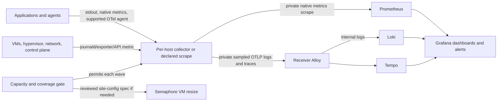

## Context

### Cross-signal identity and profile adoption baseline

The initial receiver contract uses the bounded `service` identity for metrics
and Loki, `service.name` for OTLP resources, and `service_name` for profiles.
`cluster` and `environment` come from controlled inventory values. Alert rules
add bounded `owner` and `severity` values. Request/user identifiers, trace IDs,
timestamps, raw paths, addresses, prompts, and secrets are not indexed metric
or Loki stream labels. Container and instance details remain for drill-down.

The receiver identity pilot adds `target_id="service:o11y"` to the receiver's
seven static Prometheus targets, Alloy-discovered local container logs and
opt-in metrics from the exact `o11y` Compose project, and the fixed journal
source. Existing `service` values remain unchanged. The journal collector
upserts its source-local OTLP-to-Loki label hint to `service,signal,target_id`
before export. The shared receiver retains its `service,signal` insert default,
which preserves the journal-provided hint without adding `target_id` to other
OTLP inputs. The already declared Alloy profile target keeps its existing
identity. This source change does not claim a trace producer or a live receipt;
private inventory and live acceptance remain open under task 2.2.

Service Overview lists metric-enabled services from Prometheus and queries Loki
by `service`; log-only coverage remains visible in the estate inventory and
Logs Drilldown. Missing telemetry remains a gap rather than a healthy default.
Profiling begins with one opt-in, measured Alloy self-profile target after its
resource and privacy gates pass. Add no other producer until measured ingestion,
retention, host headroom, and a successful profile receipt support the next wave.

See [proposal.md](proposal.md) for motivation and [the capability spec](specs/platform/estate-instrumentation/spec.md) for the behavior contract. The production receiver uses Prometheus for metrics, Loki for logs, and a private Alloy OTLP/gRPC path into single-node Tempo with local persistent storage (`platform/services/o11y/deployment/config/`, `compose.yml`). Grafana self-monitoring and agentgateway dashboards are provisioned. On 2026-09-28, a Dev-bound production deploy of reviewed commit `970dfa3ab545fa64f3c3829f99cf8ab29b7d32f2` passed live checks for all five stack components, the data sources, both dashboards, provisioned cross-signal link settings, alert rules, and the Discord contact point. Separate successful Semaphore receipts proved a named metrics target, a recent trace, alert delivery, retention, and cardinality; their IDs remain in private inventory. A user-visible trace-pivot click-through and some owning OpenSpec task checkboxes remain open. Production Alloy has no engine-socket mount, so its local container log/metrics discovery is not a production coverage receipt. These facts establish a receiver baseline, not estate-wide coverage; the broader rollout remains tracked by `observability-estate` and `inference-telemetry-production`. The architecture's old socket-scraped Prometheus and future Mimir sketches are not current collection mechanisms (`plan/architecture/06-observability-instrumentation.md`, as-built amendments).

The candidate set is generated from the current `platform/services/` and `agents/` trees at census time, including empty scaffolds. A directory is not proof of deployment: the first implementation phase must reconcile every candidate with private inventory, Semaphore templates, and live read-only discovery. The inventory also includes Proxmox, guest OS and container hosts, pfSense/network, DGX Spark, and external endpoints that Agent Cloud actually manages; scope is based on a declared managed target, not an indiscriminate network scan.

## Goals / Non-Goals

**Goals:** Reuse the receiver and onboarding verifier; give each deployed target an explicit signal contract; favor automatic runtime instrumentation; make cost, capacity, privacy, and recovery visible before increasing telemetry.

**Non-Goals:** Require traces from non-request infrastructure, claim traces from unsupported runtimes, switch to Mimir/object storage or high availability in this change, expose OTLP publicly, or clean-redeploy o11y and delete its current data. Future Kubernetes injection is a separate migration concern; the present estate uses Compose/Podman and VMs.

## Architecture

## Decisions

### 1. Inventory the actual estate before choosing exporters

Create one coverage declaration keyed by stable `service.name`/target identity, with lifecycle (`deployed`, `planned`, `retired`, `excluded`), owner, runtime/language, environment, host, signal applicability, method, expected endpoint, budget, and verification receipt. Generate an expected-target report from public service/agent definitions and private inventory; compare it with live read-only discovery, then resolve each discrepancy by a reviewed declaration. The public repo holds the schema and generic methods; `site-config` owns real hosts and network details. Extend the existing `Verify o11y Service` exact-target pattern instead of adding a separate verifier per service.

The audit enumerates every current service and agent directory at run time, including scaffolds, then adds managed infrastructure represented by deployment/inventory (Proxmox, guest OS/container runtimes, pfSense, DGX, and any supported edge dependencies). Every candidate gets an explicit lifecycle classification. This is a **candidate audit**, not a claim that all entries are running.

Alternative rejected: mark every repository directory covered. Several are scaffolds or retired; that would create false-green coverage.

### 2. Use the simplest supported signal source per target

Container stdout/stderr and journald/file logs go through a least-privilege, independently deployable host collector where central socket discovery cannot reach the host; the production receiver is the first such pilot because its engine socket is not mounted. Host collectors send OTLP logs and traces to receiver Alloy, which forwards them internally to Loki and Tempo. Native application/exporter `/metrics` is preferred over a second instrumentation library; two existing required opt-in labels (`scrape`, `port`) and optional `path`/`high_churn` labels serve co-located local containers, while remote targets use private inventory-rendered Prometheus scrape declarations. Do not expose Loki push or Prometheus remote-write as new external ingress. A process that serves HTTP/RPC requests gets a compatibility pilot for the current [OpenTelemetry zero-code mechanism](https://opentelemetry.io/docs/concepts/instrumentation/zero-code/) of its runtime, using deployment parameters rather than a source fork. Zero-code covers supported libraries, not the application's own domain operations; add a small explicit span only for a critical unobserved boundary. Default to no body/prompt/token capture, stable resource attributes, context propagation, bounded attribute values, and sampled traces. Do not inject unreviewed agents into privileged control-plane processes or require eBPF privileges across the fleet.

**Reusable host-metrics identity source slice (2026-10-21):** The host exporter workflow gains the boolean `o11y_host_metrics_identity_enabled`, default false/absent. False preserves legacy behavior (including legacy `service_name` launch overrides) and makes no strict identity receipt claim. True requires a valid, present estate inventory and refuses before exporter or scrape mutation on malformed inventory, launch-time override, missing/non-unique declaration, or any failed identity check; it never falls back to legacy. Validate the full existing inventory with the coverage census schema, require every host in the selected group to use the same reviewed inventory revision, then resolve one declaration by exact `inventory_host == inventory_hostname` and exact match to the established effective `service_identity`; require one globally unique resolved target ID, lifecycle `deployed`, a correctly prefixed existing target ID, applicable metrics, and no duplicate target identity, ambiguous host/service binding, or exporter endpoint in the selected group. Existing `service`/`agent` declarations are valid identities for their explicitly associated host metrics; existing `vm`/`guest` declarations are also valid when that same association is exact. This follows the receiver's existing `service:o11y` identity pattern and introduces neither a parallel VM namespace nor a second private ID field. Render the declared `target_id` with `component="node-exporter"` and `metrics_scope="host"`, preserving existing service, host, cluster, and environment labels. Keep the private `signals.metrics.selector` unchanged: its existing schema validates applicability and bounded selector shape, but an application-specific selector remains unverified by this host probe. A host series can count only against an exact declared host selector; it cannot be promoted into application coverage or health/logs/traces/profiles coverage. The named node metric response must carry the exact target ID, component, scope, and host; generic `up` proves reachability only. Prometheus's default `honor_labels: false` attaches configured target labels on conflicts, so exporter-supplied labels cannot replace the declared `target_id`; keep that default and do not enable honor-labels. See the [Prometheus scrape configuration reference](https://prometheus.io/docs/prometheus/latest/configuration/configuration/) and [security model](https://prometheus.io/docs/operating/security/).

**Receiver capability survey prerequisite (source only, 2026-10-11):** The generic shared checkout guard compares the pinned commit tree, index entries/flags, and raw tracked worktree bytes/types/modes under bounded non-writing Git reads (10 seconds per Git command, 30 seconds total, 1 MiB metadata, 8,192 entries, 4 MiB per blob, 64 MiB aggregate); split-index and unsupported index formats refuse without repair. It does not impose a remote-ref policy on its five callers. The receiver survey retains its local `origin/dev`-to-reviewed-SHA gate and receives only helper bytes captured from the checked commit; check mode skips receiver probes. This is conditional checkout consistency, assuming a trusted launcher and verifier, not authenticated pre-execution launch or proof that the loaded Ansible config/plugins and playbook were approved. The survey reports bounded Linux, systemd, cgroup, and declared receiver-user categories; it does not inspect the Podman store or service configuration, and its checkout/category report proves neither journal delivery nor restart, delegation, cancellation, or containment. Keep the separate 1.2a admission/lifecycle work incomplete and task 1.2 open until their existing telemetry and baseline acceptance gates pass.

**Coverage receipt checkout prerequisite (source only, 2026-10-11):** Reuse `require-reviewed-checkout.yml` before Census can read OpenBao credentials or execute its Semaphore receipt helper. The strict exact-target verifier imports the same guard only in strict mode, before inventory-digest calculation and receiver helper execution; legacy verification keeps its prior path. The guard establishes conditional consistency of the pinned commit, index, and tracked checkout bytes, types, and modes under the existing trusted-launcher boundary. This does not authenticate the Semaphore launch or close tasks 2.2/2.3: private inventory reconciliation and installed acceptance remain required.

**Receiver-host journal pilot decision (2026-10-09):** Dev-bound Semaphore survey 3662 at reviewed `dev` revision `7c863948` observed rootless Podman's `journald` default, seven running o11y containers using that driver, and 216 exact-name entries in a bounded user-journal metadata read. Receiver Alloy has no read-only host journal mount. This proves a journal source exists for the receiver host; it does not prove container-side file access or log delivery. Pilot an independent Alloy v1.9.2 collector with only declared read-only journal directories, persistent collector state, no engine socket, no host network, and no published listener. Use [Alloy's journal source](https://grafana.com/docs/alloy/latest/reference/components/loki/loki.source.journal/) and [Loki-to-OTLP bridge](https://grafana.com/docs/alloy/latest/reference/components/otelcol/otelcol.receiver.loki/) to send bounded, allowlisted container records to the existing private receiver OTLP endpoint. Keep `service`, `signal`, `cluster`, and `environment` bounded; exclude raw journal fields, request identifiers, and content from labels. The read-only survey uses only a cached receiver Alloy v1.5.1 image, with `--pull=never`, as a rootless UID `0:0` file-read probe; it does not validate collector configuration. If that cached probe image is absent, report the fixed `probe_unavailable` result and do not pull. Apply separately acquires the exact Alloy v1.9.2 collector image if absent, then runs the official [Alloy `validate` command](https://grafana.com/docs/alloy/latest/reference/cli/validate/) before any collector recreation. The command performs supported static configuration validation of syntax, components, and properties, with runtime stability flags matched; v1.9.2's [official changelog](https://github.com/grafana/alloy/blob/main/CHANGELOG.md) includes a validator fix for `livedebugging` blocks. First prove the exact host journal directory exists and is readable by the rootless collector, then require a receiver-side Loki query for the declared pilot container. Refuse ambiguous directories, permissions, an empty source, or a missing receiver receipt. Explicit stop and failed-delivery rollback stop and remove only the pilot container without `podman rm -v`, verify that it is absent from Podman's reboot restart set, and verify the named positions volume remains. This matches [Podman's restart behavior](https://docs.podman.io/en/latest/markdown/podman-create.1.html) and [container removal semantics](https://docs.podman.io/en/latest/markdown/podman-rm.1.html). Deploy and rollback through separate Dev-bound Semaphore workflows without changing or deleting the receiver's volumes. The current local socket pipeline remains local-only; a later cohort may reuse this collector mechanism after its privacy and volume gates pass.

**Positions-volume survey and repair gate (2026-10-09):** The explicit `survey` action resolves the one existing local `journal-collector-state` volume by Compose project and logical-volume labels, including when the journal collector is absent. It reads bounded root and direct-child metadata in the rootless Podman user namespace and never mounts the volume or reads positions content. A fixed `podman volume inspect --format` template reads `NeedsChown` and `NeedsCopyUp` as literal `false`/`true`; JSON field presence remains a separate diagnostic because Podman v4.9.3 may omit false-valued fields. Inventory, named JSON reads before/after the template, and template identity are cross-checked; invalid output or identity races refuse every gate. The separate `repair-positions` action retains its initialized-volume path: after fresh evidence proves an unused initialized volume's root ownership alone blocks `0:0`, it changes only root owner/group, verifies readback, and runs the restricted Alloy create/write/rename/delete probe. **Narrow pending-volume exception:** for exactly one empty unused volume with `NeedsChown=false`, `NeedsCopyUp=true`, blocked non-`0:0` root ownership, and fresh identity/metadata checks, repair may change only the root owner/group to `0:0` when mode is already safe. The source-level pending mode-reduction implementation additionally permits clearing only group/other write bits before that owner change; reviewed live Semaphore repair and collector/Loki acceptance remain pending. It performs no access-probe mount, preserves contents, and verifies identity, owner, the exact expected mode, and emptiness; repair success does not authorize first mount or collector apply; after any pending-volume mutation, failure preserves the volume and returns bounded uncertain status; no automatic owner restoration is attempted because a mount followed by removal cannot be ruled out from current state. No owner rollback or state deletion is permitted after Compose's first mount. Free-byte and free-inode thresholds are checked independently from stable metadata: above-threshold counter changes do not invalidate root/child/ACL/mount evidence, while low or unavailable counters refuse repair. Pending repair checks both GraphRoot and volume-filesystem capacity; initialized repair checks the volume filesystem. Both paths refuse ACLs, mount boundaries, symlinks, non-regular or multiply linked children, and child ownership mismatch. Unsafe modes refuse except for the implemented pending-only group/other write reduction; initialized-volume repair retains mode unchanged. Check mode reports `check_mode_unverified` without Podman or filesystem calls.

**Historical v2 recovery decision (2026-10-15; superseded for the next apply by the v3 decision below):** The Dev-bound read-only survey 6032 found the old `journal-collector-state` initialization-pending with no collector or users, three top-level entries including one unidentified directory, no valid cursor, and `component_layout` refusal. Do not admit, repair, delete, or mount that legacy volume. Point Compose and every positions helper only at a fresh versioned `journal-collector-state-v2` volume. Declare its mount with long syntax and `volume.nocopy: true`; only a proven-absent v2 volume may use the fresh bootstrap path, while unexpected existing v2 state without a valid cursor refuses. Add an explicit Dev-bound `stage` action that uses shared `place-monorepo.yml` pinned to `expected_repository_sha`, reads receiver `HEAD` back, refuses check mode, and never starts/recreates a container or inspects, mounts, or changes either positions volume. Required order is stage, read-only survey, separate apply; survey never places the checkout. Stage, survey, and apply first require installed receiver `HEAD` to equal the reviewed SHA, then run the installed `podman-compose config` parser with output hidden and require the exact resolved v2 source, `/alloy-state` destination, and `nocopy: true`. Stale SHA refuses before provider config is read. This proves provider-rendered configuration only, not runtime mount behavior. Keep strict identity, access, cursor, health, unchanged seven-receiver, and exact-target Loki gates. A fresh start can replay only the supported Alloy `max_age` window, not older journal entries. After merge require stage, fresh read-only Dev survey recording resolved provider configuration and exact v2 volume identity, then separate apply and exact-target Loki receipt. Task 1.2 remains open until live acceptance passes.

**Historical journal pilot diagnostic follow-up (2026-10-15):** The inherited receipt record reports that its originating session launched Dev-bound Semaphore tasks 6049 (publisher), 6052 (stage), 6053 (read-only survey), 6054 (apply), and 6056 (post-rollback read-only survey), and observed their receipts through the API. Survey 6053 reported the v2 volume missing. Apply 6054 failed closed at the live positions `component_layout` gate with `seed_file=1`, `journal_component=1`, and one unknown, safely owned, empty top-level directory; the reported mount, UID-map, and namespace-access checks matched, and the pilot was healthy. Rollback removed only the pilot and preserved v2. Survey 6056 reported the collector absent, v2 `volume_initialization_pending`, three entries, and the journal source available. These receipts do not establish the unknown directory's identity or a root cause. The survey now separately classifies only the exact configured `otelcol.processor.attributes.journal_labels` directory using the existing bounded owner/access/ACL/mount/children categories; it still includes that directory in unmatched-directory totals and keeps it outside `component_layout`. At that point, the next decision required a fresh read-only survey after the diagnostic reached Dev: determine whether the exact processor directory accounts for the previously unknown entry, then review disposition separately. Do not repair, apply, or change the volume based on classification alone. Task 1.2 remains open.

### 2a. Bounded remotecfg layout exception and fresh v3 bootstrap (historical launch plan, 2026-10-16; next steps superseded by 2b)

This decision supersedes the historical v2 recovery/diagnostic next steps above, not their receipts. It is one implementation/review unit under task 1.2, with no collector rollout in this planning edit.

**Receipt provenance.** This session launched Dev-bound stage 6067 and read-only survey 6068 at merged `dev` `6b63ccd4e330bdc04d9c69a87675adf2b00d6b47` and independently read back their successful task records. Survey 6068 reports v2 pending, collector absent, `seed_file=1`, `journal_component=1`, `other_directories=1`, `attributes_processor_component=0`, and only `component_layout` failed. The unknown directory is empty, accessible, owner-matching, ACL-free and mount-clear; the survey does not establish a valid parsed v2 cursor. The processor hypothesis is unsupported by its zero count; these aggregate receipts do not name the unknown directory. They neither authorize v2 reuse nor prove delivery.

**Pinned upstream evidence.** Official Alloy v1.9.2 [cmd_run.go lines 335–343](https://github.com/grafana/alloy/blob/v1.9.2/internal/alloycli/cmd_run.go#L335-L343) constructs the remote-config service without a configuration-block condition and passes `fr.storagePath`. [remotecfg.go lines 87–88](https://github.com/grafana/alloy/blob/v1.9.2/internal/service/remotecfg/remotecfg.go#L87-L88) names it `remotecfg`; [lines 151–157](https://github.com/grafana/alloy/blob/v1.9.2/internal/service/remotecfg/remotecfg.go#L151-L157) join that name to storage and call `MkdirAll` with `0750`. Those sources were fetched read-only during this pass. This explains why an empty service directory can exist without an explicit remote-config block; identifying the surveyed unknown entry as that directory remains an inference until exact classification. No remote-config enablement or permission normalization is part of this fix.

**Acceptance boundary.** Extend the existing bounded metadata/layout observer for exactly one optional direct child named `remotecfg`, not a prefix, suffix, arbitrary safe directory, or configured processor. Require a real directory opened descriptor-relative with no-follow semantics and identity rechecks against the pinned parent/child; rootless namespace owner/group exactly `0:0`, complete owner RWX, no group/other write or special bits, no ACL (including default ACL), and no mount boundary or exact bind mount. Require a bounded emptiness check that includes hidden entries and verifies the same descriptor/identity after enumeration. Missing, malformed or unstable metadata refuses. Absence of `remotecfg` remains allowed. A matching name alone never passes; any content, unsafe mode/owner, link, mount, ACL, race, or unverified observation refuses. Keep every existing seed, journal component, cursor, volume identity, capacity, access and live-mount check. Other extra directories, including receiver/exporter/attributes-processor directories, remain diagnostic-only and refused.

Add fixed bounded `remotecfg` role/count and safe-state categories throughout metadata parsing, summary, check-mode and error fallbacks. Keep unknown names aggregated and diagnostics truthful: recognized safe `remotecfg` is distinct from unknown extras, while unsafe exact `remotecfg` is explicitly refused. Survey remains nonmutating, without probe mounts or cursor-content reads. Share the exception across survey and strict layout evaluation, but do not turn a survey layout pass into start permission. Pre-start still refuses any existing cursorless volume; post-start still requires a valid parsed expected journal cursor and every live gate.

**Single-change scope.** Update `platform/playbooks/files/o11y-journal-positions.py`, `platform/services/o11y/deployment/compose.journal.yml`, `platform/playbooks/files/verify-o11y-journal-compose.py`, and all exact-volume selectors in `platform/playbooks/deploy-o11y-journal-collector.yml` together. Audit all callers, access-probe mounts, live-mount checks and rollback lookups; update `platform/tests/test_o11y_journal_collector.py` fixtures/assertions and neighboring o11y deployment guidance. Resolve only `journal-collector-state-v3` at `/alloy-state`, retain `--storage.path=/alloy-state` and long-syntax `volume.nocopy: true`, and never fall back to v1/v2. Preserve both old volumes without inspection, repair, mount or deletion by the new pilot workflow. Existing pending repair is not a recovery route for either old volume or cursorless v3. No image upgrade, generic directory allowlist, cursor synthesis, recursive repair, additional producer, or retention change.

**Historical execution gates after implementation (next-launch instructions superseded by 2b).**

1. Verify focused regression tests for absent/safe empty `remotecfg`; nonempty/hidden/nested contents; wrong name/type/owner/mode; symlink; ACL; mount/bind mount; inaccessible/unverified state; identity/emptiness races; bounded output and check-mode/error schemas. Retain all existing unknown-directory, cursorless-bootstrap, cursor parsing and rollback refusals. Assert v3 identity consistently in Compose/provider/helper/probe/live/rollback fixtures and reject v1/v2 selectors. Obtain one independent review, fix findings, pass final-head CI and the exact-head Dev merge guard before merging this single change.
2. Stage the resulting reviewed merged Dev SHA (not 6b63ccd4) through shared placement and read it back. Refuse check mode; do not start/recreate containers or inspect/mount/mutate positions volumes. Require exact installed SHA before the protected provider parser proves one v3 nocopy mount at `/alloy-state`.
3. Run a fresh separate read-only survey at that same SHA. Require collector absent including stopped containers, complete bounded inventories proving the exact v3 name absent without collisions, sufficient GraphRoot capacity, valid source/access prerequisites and provider configuration. Do not reuse 6068 as current eligibility. An unexpected existing v3 without a valid cursor refuses; no retry, repair or fourth-volume fallback is automatic.
4. Run a separate apply at that SHA only after those receipts pass. Recompute pre-start eligibility immediately before Compose alone creates v3. Require exact live RW v3 mount, namespace write/rename/delete, safe allowlisted layout including the conditional empty `remotecfg`, parsed expected journal cursor, collector health, unchanged seven receiver containers, and fresh exact-target Loki delivery. Any failed gate fails the pilot; remove only its container without `-v`, verify removal and v3 preservation, and preserve v1/v2. Do not roll configuration back onto an old cursorless volume.
5. Record sanitized task IDs, exact SHA, categories and acceptance/refusal outcome. Keep 1.2 open until all its log, metric, private-ingress and seven-day baseline gates pass; this bounded fix alone is not estate acceptance.

**Unresolved risks.** Source evidence does not identify v2's unknown entry or prove the v3 runtime will create only this safe empty directory. Concurrent same-user/Podman changes can outlive metadata snapshots; descriptor pinning and fresh rechecks detect observed races but do not serialize the host or prove mount history. Use a controlled quiescent launch window and fail closed on uncertainty. A new volume cannot recover entries outside the supported replay window and can replay duplicates within it. Provider-rendered `nocopy` is not runtime proof; exact mount, cursor and Loki receipts remain mandatory. A failed cursorless v3 is preserved and blocks automatic reuse, requiring a separate reviewed recovery decision. No v3 live receipt is claimed.

Alternatives rejected: broad safe-directory acceptance hides unrelated state; admitting the attributes processor is not supported by 6068; reusing v2 bypasses the no-cursor first-start guard; deleting/renaming its directory or resetting state destroys evidence; changing Alloy or disabling services expands this bounded fix.

### 2b. Journal component metadata diagnostic only (2026-10-15)

This small source-only follow-up under parent 1.2 supersedes 2a's next-launch instructions. It does not change that decision's layout or cursor predicates. PR #674 implemented this diagnostic; its merge and live read-only follow-up are recorded in decision 2c.

**Receipt provenance and first failed gate.** This session launched production Dev-bound Semaphore tasks 6082, 6083, 6084, 6085 and 6087 and independently read back their receipts through the Semaphore API. These are this session's directly observed API receipts, not user-supplied or external evidence. Stage 6082 failed inventory parsing before mutation. Identical stage 6083 succeeded at exact merge `0540ec86c8e62cbdeccb88958af4a1d3da5ff829` with v3 nocopy. Read-only survey 6084 reported v3 missing, collector absent and journal available. Apply 6085 started a healthy collector, then first failed the live positions status `!= ready` assertion, before the Loki query. Its bounded live diagnostic reported reason `volume_initialization_pending`, `failed_checks=['component_layout']`, a passed namespace probe, safe `remotecfg`, `seed_file=1`, `journal_component=1`, and zero other top-level categories apart from the classified `remotecfg`. Rollback removed only the collector and preserved v3. Read-only survey 6087 reported v3 unused, collector absent, safe root owner/access/ACL/mount categories, `entry_count=3`, no valid parsed cursor and failed `component_layout`. A metadata-only survey does not parse cursor content; absence of a valid parsed receipt does not establish file absence or corruption. Neither receipt identifies the failing journal subpredicate or proves root cause, historical copy-up behavior, replay safety or Loki delivery.

**Pinned source evidence, not runtime diagnosis.** Alloy v1.9.2 [journal.go lines 46–56](https://github.com/grafana/alloy/blob/v1.9.2/internal/component/loki/source/journal/journal.go#L46-L56) calls `MkdirAll(o.DataPath, 0750)`, selects `filepath.Join(o.DataPath, "positions.yml")`, and sets a 10-second sync period. Its [positions.go lines 21–25](https://github.com/grafana/alloy/blob/v1.9.2/internal/component/common/loki/positions/positions.go#L21-L25) declares file mode `0600`. These pinned sources were read during this reconciliation. They motivate observing directory mode and positions-file structure separately; they do not establish observed permissions, successful persistence, a sync delay as cause, or a reason to wait/retry. Do not alter the gate to match a hypothesis.

**Smallest diagnostic surface.** Extend `platform/playbooks/files/o11y-journal-positions.py` using the existing descriptor-relative no-follow observation and identity-recheck pattern (`role_observation`), with bounded metadata observation for only the exact configured journal component and its direct children. Expose fixed categories for component presence/type, owner match, owner RWX, group/other write and special bits, link-count predicate match, ACL, mount boundary and direct-child layout. Classify the exact positions-file role by presence/type, owner match, required owner RW/forbidden mode bits, single-link predicate, ACL and mount safety; classify temporary-file count and unknown direct-child kinds without emitting names. Use bounded counts (0 through 32) or `unverified`; distinguish absent from unverified, empty/nonempty from parsed validity, and never emit raw modes, IDs, paths, names, hashes, file sizes, cursor values, contents, stderr or exception text. Do not enumerate deeper descendants or open file contents. Any unsafe link, inaccessible metadata, ACL/mount ambiguity, overflow, identity or enumeration race yields unverified/refusal, never a fabricated passing category. Reuse existing survey observation; add no probe container, mount, write or new action.

Carry the fixed diagnostic through the protected helper parsing, allowlisted summary, and check-mode/error fallbacks in `platform/playbooks/deploy-o11y-journal-collector.yml`; malformed fields must not reach visible output. Keep all existing repair, pre-start and verify-live predicates unchanged, including the parsed-cursor requirement. Change only the rescue message's misleading `exact-target delivery gate` clause to `startup, positions, or exact-target delivery verification gate`; do not imply the Loki query ran when positions failed. Preserve collector-only rollback and every volume.

**Validation and stop boundary.** Extend `platform/tests/test_o11y_journal_collector.py` with metadata fixtures covering safe/unsafe component and file categories, absence versus unverified, link counts, mode bits, ACLs, mount/bind boundaries, symlinks, hidden/unknown children, temporary-file counts, overflows and descriptor/identity/enumeration races. Assert no file-content read, mutation, mount or probe, no private/raw output, strict malformed-schema refusal, and complete unverified check-mode/error schemas. Test the rescue message for an early positions failure without claiming a Loki receipt. Retain existing cursor parsing, cursorless-v3 pre-start refusal, verify-live refusal and rollback preservation regressions; a diagnostic category must not convert a refusal into readiness. Run the focused journal suite and repository-required checks for the eventual implementation, plus local strict OpenSpec validation. Source tests do not close live acceptance. No automatic apply retry, repair, deletion, permission normalization, cursor synthesis, v4 bootstrap or fallback to v1/v2. Stop after the source diagnostic; a later fresh read-only survey and any recovery decision are separate reviewed work. Parent 1.2 remains unchecked.

### 2c. Seed metadata and remaining layout diagnostic only (2026-10-15; current task 1.2c)

**Evidence and provenance.** This session merged PR #674 as `d97c68026490a731ec7bec19c15db0e53f45c97d` after independent Sol review fixes and green final-head CI. It then launched and read back Dev-bound Semaphore stage 6099 and separate read-only survey 6100 through the API. Stage verified the exact v3 nocopy mount. Survey 6100 reports `volume_initialization_pending`, collector absent, zero volume users, three top-level entries: seed=1, journal component=1, remotecfg=1; all other top-level counts zero. Only `component_layout` failed. Root owner/access/ACL/mount/special-bit categories and remotecfg categories are safe. Journal-component and positions metadata report present correct types, matching owner and permissions, matching link counts, ACL absent, mounts clear, and no temporary or unknown children. Cursor evidence is unavailable/unverified. The journal source is available with 78 exact-name entries; this is source availability, not Loki delivery. Earlier apply 6085 and rollback remain historical evidence; 6099/6100 did not run another apply.

**Inference, not confirmed root cause.** At this merge, `platform/playbooks/files/o11y-journal-positions.py:382-485` computes `component_layout` from root mode, exact top-level roles, seed metadata, journal directory metadata and nested-file layout. The seed branch at lines 414-420 checks exact role/type, owner/group, single link and forbidden mode bits, while `journal_observation` at lines 206-324 diagnoses the journal component and positions file separately. Seed count alone does not establish seed safety. This observation gap motivates the next diagnostic; it does not prove a seed failure, permission defect, corrupt cursor, copy-up history or persistence failure. Independent observations may differ under a race; passing categories must not be presented as a complete explanation of a failed predicate without stable evidence.

**Smallest proposed source delta.** Extend only the existing descriptor-safe metadata scan in that helper for the exact seed-file role. Report fixed categories for presence (`absent`, `present`, `unverified`), type (`absent`, `regular_file`, `directory`, `symlink`, `other`, `unverified`), owner (`matches_collector`, `mismatch`, `unverified`), link-count predicate (`match`, `mismatch`, `unverified`), forbidden owner-execute, group/other-permission and special-bit presence (`absent`, `present`, `unverified`), ACL (`absent`, `present`, `unverified`) and mount (`clear`, `ambiguous`, `unverified`). Mirror the existing seed mask exactly: no group/other permissions, no owner execute or special bits. Do not import the positions-file owner-RW requirement or tighten/relax seed acceptance. Observe metadata only with descriptor-relative no-follow access and pinned parent/child identity, mode/link, ACL and mount rechecks; never read seed or positions contents.

Account for every remaining condition in the existing `component_layout` conjunction using existing observations before adding a field. Reuse the root-mode, exact top-level-role counts, journal/positions categories and temporary/unknown-child counts. Add only missing fixed predicate categories needed to distinguish a refused seed, nested child-count limit, nested-role/file-metadata failure, or incomplete/unstable observation; do not add a general debug dump or a new acceptance evaluator. Relate categories to the same stable scan where possible; any inability to reconcile independently observed categories with the failed conjunction remains explicitly `unverified`, not an invented cause or a passing result. Preserve the current scan bound: at most 32 reported entries/counts, descriptor-relative enumeration stopping on the 33rd entry with overflow unverified/refused, no deeper traversal, no new Podman call, probe, mount or action. Emit no observed names, paths, raw modes/IDs/link counts, sizes, hashes, contents, cursor, stderr, exceptions or secrets; fixed public role labels do not authorize emitting observed identifiers.

**Protected schema and checks.** Carry only the minimal fixed diagnostic fields through existing helper validation, protected parsing and summary construction in `platform/playbooks/deploy-o11y-journal-collector.yml`. Validate exact keys, mapping shapes, allowlisted enum values, and true integer counts in 0..32 (reject booleans); reject missing/extra keys, malformed types and injected raw text before visible output. Raw helper results and parsing/validation remain protected with scoped `no_log`; the visible summary prints only the validated categories. Keep complete unverified check-mode and error schemas, with no check-mode runtime probe and no raw failure output. Extend `platform/tests/test_o11y_journal_collector.py` with focused seed fixtures isolating each existing condition: safe metadata, absent/wrong type/owner, hard links, each forbidden mode class, allowed owner-bit combinations, ACL/mount ambiguity, symlinks, metadata errors, overflow and parent/child/identity/enumeration races. Cover any newly exposed remaining layout condition, strict schema rejection and fallback shapes; prove no file-content read, mutation, probe or private/raw output. Keep existing cursorless-v3, verify-live and volume-preserving rollback regressions. Run the focused suite and repository-required checks for a later implementation; this plan-only session runs strict OpenSpec validation from `plan/development` and diff checks only.

**Explicit production no-apply gate.** Task 1.2c authorizes source implementation in this session under the existing user-approved goal. The diagnostic cannot change source acceptance predicates, repair eligibility, parsed-cursor requirements, pre-start/verify-live decisions or collector-only rollback. Preserve v1/v2/v3; no collector apply/retry, repair, delete/recreate, mount, content read, permission normalization, cursor synthesis, v4 bootstrap or fallback to v1/v2. After independent review and green final-head CI, a Dev-bound stage and separate read-only survey may verify the diagnostic at the exact merge SHA. Neither this plan nor passing source tests authorize collector apply. Parent 1.2 remains unchecked; root cause and live delivery remain unproven.

### Decision 2d: accept Alloy's read-only seed mode without touching the volume

This session merged PR #675 as `779db4b07bd71de0b2873191c7083fadf75bcbd3`, then launched and read back successful exact-revision Dev-bound stage 6113 and separate read-only survey 6114 through the Semaphore API. The collector remains absent, the v3 volume has zero users and three expected top-level entries, and only `component_layout` fails. The new categorical seed receipt is present/regular/single-link/owner-matching/ACL-free/mount-clear, with no owner execute or special bits, but group/other permissions are present. Root, journal component, positions and `remotecfg` categories are safe. This identifies the seed permission-presence check as the observed failed conjunct; the bounded receipt does not distinguish read-only from unsafe group/other bits, prove why Alloy wrote the file, establish a valid cursor, or prove Loki delivery.

The pinned [Alloy v1.9.2 seed writer](https://raw.githubusercontent.com/grafana/alloy/v1.9.2/internal/alloyseed/alloyseed.go) uses `os.WriteFile(..., 0644)` for a generated instance identity containing UID, creation time and version. Our helper's seed predicate simultaneously requires no group/other permissions and applies a second mask that already forbids owner execute, group/other write or execute, and special bits. The first mask rejects Alloy's normal read-only file. Accept read-only group/other bits for this exact, owner-matching seed role by removing only the redundant `0o077` exclusion. Keep the second mask, regular-file/single-link/owner checks, ACL and mount boundaries, exact role and bounded scan unchanged. The `group_other_permissions` category remains an observation, not an unsafe verdict; the raw mode stays private. Add regression coverage for upstream `0644`, stricter `0600`, and group/other write/execute refusal.

This is a source acceptance correction, not permission normalization or an in-place repair. Do not chmod, read seed contents, mount, delete, recreate or start the collector as part of this change. Keep the existing v3 pending/cursorless pre-start refusal: a reviewed stage/survey after merge can test whether the live mode satisfies the narrower unsafe-bit mask, but a separate reviewed read-only cursor proof and safe resume design are required before any collector apply. Preserve v1/v2/v3 and parent 1.2's open status.

### Decision 2e: explicit read-only cursor proof before any pending-state resume

PR #677 received an independent Sol Medium approval with no findings, passed final-head CI and merged to Dev as `67447737f65d3336e8f2cf1155cd0bdd21fddbc0`. This session launched and read back successful exact-revision stage 6121 and separate read-only survey 6122. The survey reports no failed live-layout checks, three expected entries, zero users and no collector. Its status remains `volume_initialization_pending`; ordinary survey intentionally did not read positions content, so `journal_cursor=unavailable` and cursor validity is unverified. Layout success therefore does not authorize apply.

Add a distinct `survey-cursor` action to the existing Dev-bound collector playbook and its declared Semaphore enum. Publish only that existing template's survey change through the Dev-bound scoped publisher after merge. The action shares the reviewed checkout/provider gate, volume discovery, protected helper output, strict existing summary/diagnostic schema and check-mode unverified fallback with `survey`. Only the explicit action sets the existing helper's `read_cursor=True` path. That path may read only the exact `positions.yml` inside the exact journal component after safe type, owner, link, mode, ACL and mount checks; it reads at most 65,537 bytes to enforce the 64 KiB size ceiling, then checks stable descriptor identity and parses the expected journal cursor in memory. It emits only the existing `journal_cursor` valid/unavailable category and fixed `failed_checks`/`unverified_checks`; neither content nor cursor value enters stdout, Ansible logs, PR text or public source. Ordinary `survey` remains metadata-only. Check mode performs no Podman or filesystem reads.

This change adds no repair, permission mutation, mount, collector start or rollback adjustment. A valid cursor is necessary but not sufficient: the v3 pending initialization flag still fails the current pre-start gate when the collector is absent. After the read-only proof, separately design and review any safe resume around that flag using exact volume identity, no users, stable metadata, valid parsed cursor and existing receiver-preservation/Loki gates. If cursor validity is absent, invalid or unverified, keep the collector stopped and preserve the volume for diagnosis. No destructive v4/redeploy or fallback to v1/v2.

### Decision 2f: resume a populated v3 volume with a verified cursor

PR #678 passed final-head CI and merged to Dev as `05716caa25fcfdc464517c73a8e6c6e5b9b2c91c`. The scoped Semaphore template publisher 6132, exact-revision stage 6133, and separate read-only `survey-cursor` 6134 succeeded. Survey 6134 reports `volume_initialization_pending`, effective `NeedsChown=false` and `NeedsCopyUp=true`, exactly three expected top-level entries, safe owner/mode/ACL/mount and journal-component categories, a **valid parsed cursor**, no collector, no volume users, and no failed layout checks. The reported Podman client is 4.9.3; server version was unavailable. This is a source and live-read receipt, not a restart or Loki-delivery receipt. Task 1.2 remains open.

Pinned [Podman v4.9.3 container source](https://github.com/podman-container-tools/podman/blob/v4.9.3/libpod/container_internal.go) checks `NeedsCopyUp` only when neither the mount nor volume has `nocopy`; before copying it reads the destination volume directory and **returns without copying when that directory is nonempty**. Its [ownership path](https://github.com/podman-container-tools/podman/blob/v4.9.3/libpod/container_internal_common.go) runs only when `NeedsChown` is true. Thus the observed nonempty v3 volume with `NeedsChown=false` can be considered for a guarded resume even if the long-syntax Compose `nocopy` setting is not carried into the Podman invocation. An [open podman-compose issue](https://github.com/containers/podman-compose/issues/1459) reports that long-syntax `nocopy` can be ignored; resolved Compose output alone is not the preservation proof. This inference is bounded to the reviewed Podman 4.9.3 source and requires live checks after start. It supersedes the earlier empty-pending-only launch guidance in this design for a populated v3 volume with a valid cursor; it does not admit a cursorless pending volume or authorize repair.

In the existing `verify` pre-start action, recognize only this populated pending state: exact v3 project/name/labels/mountpoint from the identity-bracketed discovery, literal `NeedsChown=false` and `NeedsCopyUp=true`, complete inventory with no collision, no collector including stopped containers, zero users and mounts, nonempty bounded allowlisted layout, safe root/journal/seed/remotecfg metadata, a stable parsed expected cursor, no ACL or mount ambiguity, collector RWX access, sufficient volume and GraphRoot bytes/inodes, and a validated local Podman client version exactly `4.9.3`. Recheck the same gate immediately before Compose mount. Return the existing `ready` category with a fixed distinct reason; do not rewrite Podman's flags or mutate the volume. Every other pending state and every missing or changed observation refuses. Preserve `verify-live` exact mount, namespace write/rename/delete, cursor, health, receiver-identity and Loki acceptance gates; rollback removes only the collector, never the named volume. Keep the first mount outside rollback and preserve v1/v2. If any live check fails, stop and diagnose from the preserved v3 state rather than retrying blindly.

Implement this as one reviewed source slice with focused positive and negative tests. After one independent review and green final-head CI, stage the exact Dev merge and run a fresh read-only cursor survey; only then run a separate non-destructive `apply` through Semaphore. The review must confirm that the provider parser still proves the exact v3 mount and that no other service is recreated. Capture bounded post-start mount, cursor, health, receiver and exact-target Loki receipts. Do not expand retention or VM size on this evidence; the separate backup/isolated-restore and capacity gates remain closed.

### Decision 2g: count a plain local volume's container mount correctly

PR #679 received an independent Sol 6.1 Medium approval and green final-head CI, then merged to Dev as `f47283c4dbe9c8095076b29050ef0e9120bf20b4`. Exact-revision stage 6143 and read-only cursor survey 6144 succeeded. The separate non-destructive apply 6145 started the collector, but `verify-live` refused at its positions gate with `volume_initialization_pending`; the playbook removed only the collector and asserted that the named positions volume survived. Its bounded diagnostic reported all six actual container-mount fields matching, equal host/collector UID maps, a passed in-container create/write/rename/delete probe and a healthy collector. It did not reach exact-target Loki acceptance. Post-rollback read-only cursor survey 6147 still reports a valid parsed cursor, the same three allowlisted entries, no collector or volume users, sufficient free space, and literal `NeedsChown=false`/`NeedsCopyUp=true`. These receipts establish a safe rollback, not log delivery.

The live predicate required `MountCount=1`. For a local volume with empty options, Podman v4.9.3 [`needsMount`](https://github.com/podman-container-tools/podman/blob/v4.9.3/libpod/volume_internal.go) is false and its [mount path](https://github.com/podman-container-tools/podman/blob/v4.9.3/libpod/volume_internal_common.go) returns before incrementing the host-mount counter. [Volume inspection](https://github.com/podman-container-tools/podman/blob/v4.9.3/libpod/volume_inspect.go) reports that counter, not the container's bind-mount count. This source behavior explains the observed refusal, though task 6145 did not expose the numeric live counter. The existing identity-bracketed discovery already requires a plain local volume with empty options and separately proves the single collector consumer and exact container mount. Require `MountCount=0` for that plain local state in both post-start helper paths; retain the single-user, six-field mount, namespace, cursor, health, receiver, and Loki gates. Values other than zero and any identity/options ambiguity refuse. After review and green CI, repeat exact-revision stage, read-only cursor survey, and one separate non-destructive apply. Stop again on any failure without deleting the volume.

**Positions-volume capacity timing (current v3 target):** When v3 is absent, first-start verification checks GraphRoot bytes and inodes before Compose creates the volume. Volume-filesystem counters are available only for an existing volume; pending-volume repair requires both GraphRoot and that existing volume filesystem. This does not replace the separate retention headroom gate.

**Pending-volume repair diagnostics (2026-10-09):** Survey and the initial `pending_volume_unsupported` refusal share one fixed checklist derived from the strict pending owner-only gate. The implemented mode-reduction exception evaluates the same checks while permitting only the combined write/special-bit check to fail from group/other write bits alone; a present write-bit diagnostic remains unsafe until actual reduction and fresh readback prove otherwise. Expose only owner-RWX and unsafe-mode-bit enums, separate volume/GraphRoot byte and inode categories (`sufficient`, `low`, `unverified`), and the bounded `failed_checks` enum list. The diagnostic uses the existing discovery snapshot; it adds no Podman command, probe mount, content read, or ownership change. Repair refusal remains `refused`; the receipt explains only the initial observation and does not replace fresh identity rechecks or authorize mutation. Check mode and exception fallback preserve the schema with all evidence unverified.

**Pending-volume mode-bit follow-up (2026-10-09):** The Dev-bound read-only survey 3917 at exact merged Dev SHA `63946505875639b8b0080a045fa1e0ae08ab4a9b` confirmed the existing combined group/other-write-or-special-bit check failed while the pending volume remained otherwise available for diagnosis. Add five separate fixed categories (`group_write`, `other_write`, `setuid`, `setgid`, and `sticky`) from the same metadata snapshot. Preserve the combined category and `failed_checks` predicate; these extra fields explain the combined result but do not alter any acceptance or repair condition. Missing mode, check mode, and survey exception output use `unverified`. No raw mode, ownership, path, or capacity values are exposed, and the change adds no runtime probe or mutation.

**Pending mode reduction implementation (2026-10-09):** User-supplied sanitized evidence records successful read-only Dev-bound Semaphore task 3925 at exact merged Dev SHA `8050f2768903e09f68285f90c1598cb120006219`: the pending positions volume was unused, empty and unmounted, owner mismatched, owner RWX complete, ACL absent, collector absent, and volume/GraphRoot byte and inode capacity sufficient. Only `group_other_write_or_special_absent` failed; `group_write` was present while `other_write`, `setuid`, `setgid`, and `sticky` were absent. Earlier repair task 3899 refused before mutation. These receipts were supplied by the user, not independently reread here; they bound the implemented exception but do not authorize mutation, establish repair readback, collector readiness, or Loki delivery.

Retain the safe-mode pending owner-only path and the initialized-volume path. Add only an explicit pending repair exception when fresh evidence proves exactly one local expected volume, `NeedsChown=false`, `NeedsCopyUp=true`, no collector in all containers (including stopped), zero consumers/mounts, exactly empty root, owner mismatch with collector access blocked, complete owner RWX, ACL absent, and all identity, metadata and capacity guards passing. The only permitted initial failed check is `group_other_write_or_special_absent`, and its cause must be proven group/other write alone: special bits absent and mode an exact integer in `0..0o7777`. Unknown or malformed observations refuse. Derive `target_mode = original_mode & ~0o022`; never substitute a fixed `0700`, add owner permissions, strip group/other read/search, clear special bits to make an unsafe case eligible, or apply this exception to initialized/nonempty state. Keep the combined diagnostic and failed-check list truthful for the original snapshot; separate mode-bit diagnostics do not authorize repair.

Pin the volume creation timestamp, configuration, expected name/project and mountpoint, root device/inode, original owner/group and mode. The mode and owner changes use separate rootless helper processes, so one open descriptor cannot span the required full Podman discovery between mutations. Before each mutation, open the exact directory without following symlinks and compare descriptor metadata with the pinned root device/inode and the exact expected owner/mode. The first helper reduces permissions to `original_mode & ~0o022` and verifies exact target mode plus unchanged identity/owner/emptiness. Then repeat full discovery and emptiness/ACL/use/mount/capacity checks with the reduced mode as the sole expected metadata change. Only after that readback passes may the second helper change root owner/group to `0:0`; it independently pins and rechecks the same root device/inode before changing ownership. Verify fresh discovered identity, exact target mode, new owner, empty contents, initialization flags, collector absence, zero consumers/mounts, ACL absence and capacity. No recursive operation, content read/write, probe mount, volume creation/deletion, or Compose start belongs to pending repair. A rerun of an already converged safe volume must not mutate it again or start a collector.

Any failure before mutation refuses with no change. Once permission reduction or ownership change may have occurred, every command failure, exception, identity/metadata drift or failed readback returns bounded `uncertain`, preserves the volume, and never automatically restores mode or owner. Descriptor pinning protects the selected inode but does not serialize Podman, other same-user processes, child creation, ACL changes, or mount history; repeated snapshots cannot rule out mount-then-remove races. Require an operator-controlled quiescent repair window and fresh checks; refuse observed races, retain uncertainty after mutation, and require separately reviewed recovery if certainty cannot be re-established. No claim of atomicity or historical first-mount proof is made.

Alternatives rejected: fixed `0700` removes unrequested read/search permissions; owner-first leaves write exposure during the owner transition; automatic restoration can reintroduce write permissions or alter state after an unobserved mount; broad mode normalization admits unsafe special-bit or owner-access cases. The permission reduction is deliberately limited to the empty pending root.

Implementation: the pending branch retains the original failed-check list and permits only exact write-bit reduction for an empty, unused pending volume when it is the sole failed guard. The mode helper pins and verifies the root descriptor; complete fresh discovery/readback then gates the existing owner helper, which independently pins the same device/inode. Post-mutation failures return bounded `uncertain` with no restore. Focused coverage includes write-bit combinations with read/search preservation, safe-mode owner-only behavior, initialized-path behavior, converged rerun, malformed/special modes, missing owner RWX, unrelated failed guards, pre/post-mutation races, readback, capacity and sanitized failure results. Check mode remains unverified and runtime-free. Source-level validation does not accept the live repair: after independent exact-head review and green CI, run the Dev-bound check-mode workflow, a fresh read-only survey at exact merged SHA, a separately selected `repair-positions` task, and a separate read-only post-repair survey. Record sanitized task IDs/SHA and safe-mode `0:0` readback; this implementation session runs none of those live tasks. Only a separately authorized later collector-apply task, with its full pre-apply and immediate pre-start gates, may perform Compose's first mount. Require live mount/cursor/access/health, unchanged receiver set and fresh exact-target Loki delivery before closing task 1.2.

**First-start bootstrap and bounded survey fallback (2026-10-09):** The pre-apply and immediately-before-start read-only gates may return `bootstrap_allowed` for a missing expected volume only after complete bounded inventory, no expected-name collision, and an all-container inventory (including stopped containers) proves the journal collector absent. An existing pending volume is eligible only with one exact local identity, zero users and mounts, effective `NeedsChown=false` and `NeedsCopyUp=true`, and an empty, unambiguous root already owned by `0:0` with owner RWX and no group/other write, special bits, ACL, nested mount, or metadata ambiguity. The narrowly scoped root-only repair and implemented mode-reduction exception above may establish that same safe ownership and mode before first mount only after comparing volume `CreatedAt`, volume configuration, and root device/inode across observations; Compose `up` remains the sole creator/initializer. The first-mount headroom gate requires at least 16 MiB available and 128 available inodes on both GraphRoot and the pending volume filesystem; this does not replace or weaken the independent 30% retention headroom gate. The immediate pre-start check runs outside rollback handling. After Compose's first mount, a persistent `NeedsCopyUp=true` flag is not success by itself: require the exact live RW mount, namespace create/write/rename/delete, bounded allowlisted Alloy layout, the parsed `positions.yml` map entry for `cursor-loki.source.journal.o11y_alloy` with an empty label set and a valid journal cursor, collector health, unchanged seven receiver containers, and a fresh exact-target Loki receipt. Empty image destination can leave copy-up pending; partial copy or unexpected files refuse and preserve the volume. Rollback removes only the pilot container, without `-v`; it never restores ownership or deletes copied state. The strict cursor gate can expose first-start failure or replay risk when initialization is partial. Unexpected survey exceptions remain bounded as `survey_failed`; the positions helper remains `check_mode_unverified` in check mode without its own Podman or filesystem operations. These are source-level facts, not live receiver evidence; task 1.2 remains open.

The helper's `verify` action is the pre-start gate; `verify-live` is the post-start gate. Pre-start may return `ready` without a cursor only for a complete observed volume with both initialization flags false, no collector in the all-container inventory, zero consumers and mounts, an exact safe identity, root `0:0`, access and capacity evidence on GraphRoot and the volume filesystem, no ACL or nested mount, an allowlisted empty/seed/component layout, and explicitly observed absence of `positions.yml`. This permits one bounded Compose start attempt and is not delivery proof. A present invalid or unreadable file, unknown cursor presence, or incomplete/unsafe component layout refuses. Here, partial copy means a present invalid/unreadable cursor file, a pending temporary positions file, or any layout outside the allowlist; proven cursor absence before start is a separate retry case. Post-start always requires the valid parsed cursor plus the live mount and access evidence; it never returns `bootstrap_allowed`. No phase deletes or replaces positions state or automatically restores ownership after pending mutation. Empty or allowlisted state cannot establish historical copy-up or cursor-loss history, so replay/loss safety remains unproven until live evidence is recorded.

**Collector state-path permission correction (2026-10-09):** The pinned [Alloy v1.9.2 Dockerfile](https://github.com/grafana/alloy/blob/v1.9.2/Dockerfile) creates `/var/lib/alloy` for UID/GID 473 with mode `770`. The journal pilot intentionally runs as `0:0` with all capabilities dropped, so its named state volume must not sit below that image-owned parent. Keep the existing named volume and mount it at `/alloy-state`, set `--storage.path=/alloy-state`, and require the helper's exact destination check plus the playbook's live write probe and rollback volume lookup to use that same path. This avoids relying on copy-up through an inaccessible image ancestor and preserves the UID/capability boundary. Dev task 3973 failed health and rolled back after 80 permission-denied log lines, with the fixed positions target and fixed TCP readiness probe both failing; read-only task 3977 found the collector absent and the existing named volume empty, unused, unmounted, owned by UID 0 with RWX mode and no ACL. These receipts do not establish successful collector health or Loki delivery; task 1.2 remains open.

**Positions initialization-schema diagnostic follow-up (2026-10-09):** Dev survey 3856 succeeded with `volume_initialization_unverified`, zero consumers and entries, root owner mismatch, blocked access, ACL absent, clear mount state, and safe direct children. The journal source was available while the target positions path was denied. Keep initialization flags fail-closed for every gate. The survey alone adds a second exact-name volume inspection and Podman client/server version query after unique volume identity is established; it reports only field presence/type, actual boolean values, named-query outcome, identity comparison, and validated bounded version strings. Unrecognized values, command failures, and malformed or duplicate named results remain categorical/unavailable. Check mode performs no Podman calls and returns the same diagnostic shape as unverified. The extra named-volume identity diagnostic and version query run only during survey and never change gate decisions; the identity-bracketed initialization-flag read is required by every gate and does control decisions.

**Extra positions-directory diagnostic (2026-10-10):** Our read-only Dev-bound Semaphore API survey task 4009 succeeded at merged Dev SHA `9bc543d7d0f80be77ddab3983f9db6a983257f06`. The receipt reported a pending initialization volume with three top-level entries: the seed file, the existing journal component directory, and one unidentified other directory. It also reported no collector or volume users, matching root owner, RWX, no ACL, clear mount, sufficient free space, ambiguous children, unavailable cursor, and live mount/namespace fields unverified or not run. The third directory's identity and purpose remain unknown; do not infer a persistent queue or any other state from its existence. A diagnostic-only extension compares only the exact public `otelcol.receiver.loki.journal` and `otelcol.exporter.otlp.journal` component names. It emits bounded fixed-role counts and, for a matching directory, owner/access, ACL, mount, and direct-child categories. Reads are descriptor-relative with no-follow opens and identity rechecks; unsafe links, metadata errors, and races return `unverified`. Unknown names remain aggregated. Recognized and unknown extra directories both keep `component_layout=false`; no pre-start or live acceptance predicate changes. The extension adds no survey write, probe, or mount. Task 1.2 remains open.

**Unmatched-directory metadata and Dev receipt (2026-10-10):** Our read-only Dev-bound Semaphore API survey task 4016 succeeded at exact Dev merge `736af5b16917f28a243b3715d56c76c00bfe7a8a`. The sanitized receipt reported `volume_initialization_pending`, no collector, no valid cursor, three direct entries, `seed_file=1`, `journal_component=1`, `other_directories=1`, and zero recognized receiver/exporter directories. Volume identity, capacity, root owner, and root RWX were good; `NeedsCopyUp=true` and the `NeedsChown` field was missing. `component_layout` failed. The pending-repair `failed_checks` included `children_empty`, `child_count_zero`, `owner_mismatch`, and `collector_access_blocked`. These are our API-observed sanitized results, not user-provided evidence. The helper now reports aggregate categorical owner/access/ACL/mount/direct-child-empty status over anonymous unmatched direct child directories, bounded by the existing 32-entry cap. Descriptor-pinned no-follow access and post-observation identity/listing checks make races, symlink substitutions, ACL or mount ambiguity, malformed data, and incomplete observations `unverified`. This is diagnostic only: unmatched directories remain outside the accepted layout and cannot pass repair, pre-start, or live gates. Stop on remaining or unverified entries; do not infer queue state or mutate/apply the volume. Obtain a fresh reviewed Dev survey after merge. Task 1.2 remains unchecked.

Signal selection per cohort:

| Cohort | Default collection | Trace decision |
|---|---|---|
| o11y, Caddy, DNS, step-ca, OpenBao, OPA, Authentik, Semaphore, NetBox | host/container logs; native or vetted exporter metrics; readiness | request-serving components only after runtime compatibility/security pilot |
| App and data services: n8n, Postiz, tududi, honcho, UhhCraft, ERPNext, OpenHands, Nextcloud/NocoDB/WikiJS if deployed | stdout plus DB/queue/app metrics; request/worker identity | runtime agent where supported, manual span for an important workflow gap |
| Agent and inference workloads: agentgateway, DGX, NemoClaw, NetClaw, WisBot, WebSmith, ComfyUI, Hunyuan3D | retain proven gateway/DGX paths; add worker/job and GPU/model metrics where supported | keep existing gateway trace path; pilot agent/runtime tracing with prompt redaction |
| Proxmox, guest OS, container engine, pfSense and other managed devices | node/hypervisor/device exporter or read-only API metrics, system logs, health | not applicable unless a request-serving software component has safe support |
| GitHub runner hosts | host health and bounded metrics first; job logs only after an entitlement and redaction decision | job tracing is not assumed |

Alternative rejected: mandate the same three signals for every process. A router or database can be fully diagnosable with logs and metrics while a fabricated trace requirement obscures missing real coverage.

### Decision 2h: keep the Loki receipt probe compatible and bounded

Dev-bound task 6156 started a healthy journal collector and passed exact positions mount/namespace and unchanged-receiver checks, then failed the Loki receipt and rolled back only the collector while preserving the positions volume. Independent production Grafana MCP evidence for that window found six exact `service="o11y/alloy"`, `signal="container"` samples and an increase in the receiver's accepted-log counter. A later Dev-bound task 6169 at exact SHA `21450230d7265d4c2649b7a191c79712b8300678` again passed collector health, exact positions mount/namespace, and unchanged-receiver checks, but its receipt category was `request_failed`; collector-only rollback preserved the positions volume. Independent production Grafana MCP evidence found ten samples with those same exact labels during task 6169's window. Follow-up read-only survey 6172 reported the collector absent and positions state safe; it authorized no apply. Neither query history proves the playbook's post-start timestamp assertion or authorizes a retry or volume recovery.

Read-only Dev-bound task 6170 succeeded for `expected_service=o11y/alloy` and `expected_log_signal=container` with metrics and traces disabled. Its Loki query uses the Grafana-container `wget -q -O -` form and a 15-minute window. This proves that the receiver-side client and endpoint can return a successful Loki response in that read-only workflow; it is not an apply receipt. The 6169 protected stderr was not retained, so attributing the failure to wget's `-T` option remains an inference. Grafana 11.4.0's tagged Dockerfile uses Alpine 3.19.1 as its base; BusyBox's `timeout -s KILL SECS PROG ARGS` syntax is present in the 1.36 source ([Grafana 11.4.0 Dockerfile](https://github.com/grafana/grafana/blob/v11.4.0/Dockerfile), [BusyBox timeout source](https://github.com/mirror/busybox/blob/1_36_stable/coreutils/timeout.c)). Run that in-container deadline around `wget -q -O -`, with an outer 12-second host timeout as a safety bound. A preflight must successfully complete this exact client/URL shape and return Loki JSON `status=success` before any collector config promotion; a missing applet, stalled request, failed command, or malformed response refuses without config promotion or collector start. Empty preflight results are valid. Keep bodies protected and expose only fixed `available`, `request_failed`, or `response_unverified` categories. After config promotion and the remaining pre-start gates, recapture the nanosecond lower bound immediately before the collector start; the post-start receipt uses that fresh value. Preserve 36 Ansible retries (37 total attempts), five-second inter-attempt delay, and exact label checks. The in-container `timeout` kills the direct wget process before a later retry can begin; the outer timeout remains a final task bound. Tests exercise a stalled wget through the actual nested timeout argv and verify that it exits promptly. This source change does not authorize apply retry or volume recovery. After review and merge, exact-SHA stage, separate read-only cursor survey, and separately launched apply remain required. Parent task 1.2 and subtask 1.2f.2 stay open until all live gates, including a successful post-start Loki receipt, pass.

### 3. Preserve one private receiver and bound every signal

Collectors use site-config source allowlists enforced by the reviewed host firewall; this is source-IP admission, not cryptographic host identity. OpenBao supplies any credentials through Ansible memory. Prometheus scrapes only declared private targets; OTLP ingress stays on a private interface behind source-scoped rules. Task 3.4 tests a rejected connection from a named, unapproved vantage host. Receiver Alloy gets explicit memory/backpressure handling and exporter retry/queue limits before more senders are added, following [Alloy's access and permission guidance](https://grafana.com/docs/alloy/latest/access_permissions/). Per-target scrape sample limits, allowed labels, log redaction/volume controls, trace head sampling, backend ingestion limits, and retention are declared and verified. Set a non-zero Prometheus size retention and receiver disk-free alert before the first expansion wave. Normalize the environment/cluster label from inventory in both Prometheus and Alloy before cross-environment joins; migrate existing dashboards and alerts with the label change. Alert on receiver refusal, collector drops, unhealthy scrape, missing logs, and absent expected traces. Correlate by normalized `service`/`service.name`, environment, and bounded instance identity; never put request IDs, user IDs, prompts, secrets, or raw URLs in metric labels.

Alternative rejected: allow every discovered host to export all telemetry. It expands network and cardinality risk before a service has a budget or owner.

### 4. Resize from evidence, not a guessed VM size

First deploy and verify a receiver-host node metric source through Semaphore; the current five-component scrapes do not provide VM CPU, memory, or filesystem capacity. This bounded source is the only sender allowed before the baseline. Extend the existing production budget verifier and comparator for a read-only forecast rather than creating a parallel receipt path. The forecast has separate **live readback** and **candidate proposal** inputs: live retention and size cap are read from the current receiver, normalized, and compared with their separate current private declarations; proposed retention and the proposed Prometheus size cap are separate private candidate values and are never written by this operation. The documented 90d Prometheus / 45d Loki / 45d Tempo target and a nonzero Prometheus cap are candidates only. A reviewed live-setting change is evaluated against its updated declaration and its own gates. A forecast pass grants no permission to change retention, resize a VM, or enable a sender.

The initial baseline starts at the first successful exact-target receiver-host receipt. Later wave forecasts use the most recent independently observed complete seven-consecutive-day window after that receipt. Windows and bins are UTC timestamps on a 24-hour grid anchored to the first receipt; all seven bins must be complete and contiguous. A window ends no more than 24 hours before evaluation; live capacity and health readback is no older than 15 minutes. Require at least 95% of cadence-expected samples and no observed gap over one hour. Missing, stale, incomplete, nonfinite, negative, or invalidly timestamped evidence makes the forecast `unavailable`; never turn missing data into zero. A measured zero is valid only when an actual sample records zero. The declared pilot sources and schedules must cover known peak periods, with owner confirmation that no outage, maintenance, or abnormal operation invalidated the window. Otherwise extend and recapture; do not extrapolate from a shorter or unrepresentative sample.

Keep timestamp provenance explicit: raw scrape timestamps identify source observations, while Prometheus `query_range` timestamps identify query evaluation times and do not prove distinct scrapes. Preserve source timestamps and deduplicate reused observations; do not relabel evaluation timestamps as scrape receipts. Prometheus sample counters count samples, not bytes. Loki and Tempo received-byte counters describe received input and are not proof of end-to-end persisted bytes.

The current shared running backends cannot prove same-batch persisted-byte conversion or transient compaction allowance through the existing read-only interface. Background ingestion, older-block compaction, retention deletion, and temporary allocations are not attributable to one pilot batch through those readbacks. Therefore the forecast remains `unavailable` until an independently observed seven-day baseline and either a repeatable isolated calibration or a separately proven conservative storage upper bound establish all required inputs. The planned calibration path follows a verified backup and isolated restore: run the pinned runtime and configuration on a restored or disposable isolated target, submit an attributable batch, observe accepted input and persisted bytes after normal compaction, and measure peak transient storage through that cycle. Keep unrelated writers and retention deletion out of the calibration interval. Record private evidence and expose only sanitized projections. A conservative-bound route is a later reviewed alternative, not the default path; no assumed multiplier or ratio substitutes for evidence.

For each backend, derive peak incoming bytes per day as the maximum of seven timestamped complete 24-hour totals in the accepted window. Measure the conversion ratio only from the isolated same-batch calibration above. Require the exact-target task receipt to be no older than 15 minutes and carry a positive numeric Semaphore task ID. Measure pilot-to-wave ingest, series/cardinality, CPU p95, and peak-memory increments against a comparable baseline, bound to the deployed receiver runtime/configuration and accepted window. Missing or incomparable pilot evidence makes the forecast `unavailable`.

Normalize live retention and size-cap readback to days and bytes and compare with separate current private declarations to verify the current configuration; use separate candidate 90d Prometheus / 45d Loki / 45d Tempo retention and candidate Prometheus cap for projection and the candidate gate. A later reviewed live change passes only when fresh readback matches its changed declaration. Keep candidate retention fixed at 90d Prometheus / 45d Loki / 45d Tempo with a nonzero Prometheus cap. Calculate full projected retained bytes as `(baseline_peak_ingest_bytes_per_day + scaled_wave_ingest_bytes_per_day) * candidate_retention_days * measured_storage_conversion_ratio + transient_allowance_bytes`. Compare full projected Prometheus retained bytes with the candidate cap. Charge each backend's full projected retained bytes, including the full candidate-retention baseline, scaled wave, and transient allowance, against current filesystem free bytes; grant no resident-byte credit unless a separately specified and independently verified resident-byte measurement proves it. This intentionally double-counts bytes already resident in the backend because current free space already reflects them. Obtain filesystem groups only from the current complete five-volume named-volume receipt and join backend volumes by their known volume names; never accept a group from backend forecast input. Group all backend volumes by their shared backing filesystem, sum each backend's full projected retained bytes exactly once, and subtract that sum once per filesystem. Hypothetical deletion, cleanup, retention expiry, or moving data receives no capacity credit. Require `(current_free_bytes - summed_full_projected_retained_bytes) / filesystem_total_bytes >= 0.30` for every affected filesystem, projected peak memory headroom of at least 25% of declared VM memory, and projected CPU p95 below 70% of declared VM CPU capacity. A measured drop/refusal or unhealthy representative backend query refuses the wave regardless of numeric margins. Missing or stale query-health evidence is `unavailable`; an observed unhealthy result is `refused`.

Keep the controller and deployed-receiver Git SHAs separate from the 64-character effective-inventory digest; they identify different evidence and must not be copied into one another's fields. Require a successful exact-target receipt with a positive numeric Semaphore task ID and bind it through an independent trusted verifier. A standalone evaluator or source fixture can establish arithmetic and validation behavior only, never production measurements or live capacity. Emit a versioned sanitized `pass`, `refused`, or `unavailable` receipt with fixed categories, bounded windows, assumptions, projections, and margins; omit private topology, raw backend responses, identifiers, credentials, and exception text. Live acceptance requires a fresh read-only Dev-bound Semaphore run tied to reviewed source and effective-inventory evidence. Forecast evaluation never changes retention, resizes a VM, or enables a sender. A separate live resize still requires the existing VM/guest readback, isolated restore, and preserved-telemetry gates.

If the capacity gate fails, change `site-config` VM resource declarations and inventory together, review them, then run existing `platform/playbooks/resize-vm.yml` through its Dev-bound Semaphore template. That playbook grows only the Proxmox disk; before any disk resize, implement and check an idempotent Semaphore-managed guest partition/LV/filesystem growth path for the receiver's actual layout. Refuse unsupported layouts and require a backup/restore receipt. The receipt must identify an immutable backup artifact and exact source disk/layout, prove restoration to an isolated target, validate the restored guest filesystem and preserved telemetry-volume access, and record cleanup of the isolated target. Snapshot creation and snapshot-list presence are insufficient: existing `snapshot-vm.yml` does not restore data. No such restore-test workflow currently exists, so guest growth remains prohibited until it is designed, reviewed, and successfully exercised. Its reboot remains opt-in; first read the current-vs-desired diff and confirm Proxmox storage, schedule any required reboot, then read back VM capacity, guest filesystem capacity, stack readiness, and preserved telemetry. A size increase is a measured gate, not a preselected number. Tempo's own [sizing guidance](https://grafana.com/docs/tempo/latest/set-up-for-tracing/setup-tempo/plan/size/) depends on span rate, span size, query rate, and retention; the same variables are recorded here.

2026-09-28: read-only receiver task 1801 confirmed the exporter runtime boundary (private PID, read-only host-root mount, one private network, no published ports). It found guest root is ext4 on an LVM-backed virtual disk and Podman's volume/graph paths share that filesystem; only 6.88% free remains, below the retention-expansion threshold. Exact device identifiers/capacities are private. No restore-test receipt exists; the current snapshot workflow is not a substitute.

Alternative rejected: immediately allocate a larger o11y VM. It could waste resources or still under-size the wrong bottleneck; retention and label cardinality must be measured first.

### 5. Deliver coverage in controlled cohorts

Complete the remaining o11y/agentgateway user-visible and owning-task receipts first. Build the coverage census and budget gate next. Pilot receiver-host metrics/log collection, then one other infrastructure VM and one application VM before expanding to control-plane/network, stateful applications, and agent/inference cohorts. For each remote target, probe from the receiver, apply the reviewed source-scoped firewall rule, prove HTTP 200 or OTLP admission, and only then merge its scrape/export declaration; an early `up=0` fires the existing service-down alert. Runner hosts stay a separate decision gate: their private-repository job output cannot enter shared Loki without an entitlement/redaction review, and their egress and OpenBao restrictions require a reviewed collector design. Each wave is a reviewed feature-to-`dev` change with one completed CodeRabbit or Claude review and green final-head CI, followed by Dev-bound Semaphore dry-run/check mode where meaningful, apply, exact-target proof, dashboards/alert drill, and an operator-driven reviewed revert/redeploy drill. Keep tightly related public changes in few PRs; private site-config declarations get their own reviewed PR because that repository owns production facts. Reconcile the coverage report after each wave; only a complete deployed-target inventory with fresh receipts closes this change.

### 2026-10-16 receiver-host and gateway acceptance receipts

PR #682 head `8e32c3dbe0da05e58e303a2aab7c5647fa7780fa` passed independent review/fixes and green final-head CI, then merged to `dev` as `dbd06dd74b73f61e9cf464123729eb653fdb3af7`. Dev-bound stage 6182 and separate read-only cursor survey 6183 succeeded at that exact merge SHA. Survey 6183 reported a valid cursor, collector absent, no volume users, sufficient space, zero failed live checks, `NeedsChown=false`, and `NeedsCopyUp=true`. Non-destructive apply 6184 succeeded at 07:22:52–07:25:04 UTC: preflight, collector health, exact mount fields, UID-map equality, namespace write/rename probe, unchanged seven-container receiver set, and no-failed-task checks passed. The exact `{service="o11y/alloy",signal="container"}` Loki receipt succeeded after one retry. Independent read-only Grafana MCP readback found six exact-label samples in 07:23:56–07:25:56 UTC. Post-apply read-only survey 6185 reported the collector present, one volume user, valid cursor, no failed or unverified live checks, and `NeedsCopyUp=true`. This closes only the bounded 1.2f.2 collector gate. Parent 1.2 remains open for private ingress and the complete seven-day baseline. The baseline starts at 2026-10-16 07:25:04 UTC; its earliest full seven-day window ends at 2026-10-23 07:25:04 UTC, subject to completeness and representative coverage.

The separate controlled gateway verification task 6186 completed 100 anonymous `401` requests to `/v1/models`, then failed the exact `signal=access-log` Loki check; its trace check did not run. Independent read-only Loki inspection found approximately 100 unlabelled `service=agentgateway` INFO records in 07:20–07:40 UTC (99 matched 401 `/v1/models`) and 14 `signal=span` records. Tempo search found 14 agentgateway traces started 07:28:31–07:30:28 UTC. The current gateway template's OTLP access fields include service and identity/path but no `signal`, while Alloy's label hints are `service,signal`. This remains a gateway-owned dependency; these observations do not prove every canary request correlated to a trace, and do not complete parent task 1.4.

Read-only expected-target survey task 6189 succeeded at the same exact merge SHA with `status=observed`, `reason=exact_match`, expected=11, active=11, matched=11, missing=0, unexpected=0, unhealthy=0. This point-in-time result does not prove seven-day coverage, loaded budget acceptance, alert delivery, or recovery. Retention, VM growth, and PBS allocation remain unauthorized.

## Risks / Trade-offs

- **Host collector permissions or remote logs expose sensitive data** → pilot least privilege; filter/redact before export; verify secrets and request bodies do not appear in Loki or task output.
- **Automatic agents alter process behavior or create high-cardinality telemetry** → compatibility matrix and one-service pilot per runtime; explicit version pin, startup/rollback switch, sampling and attribute limits.
- **Single-node local Tempo storage or receiver VM fills** → capacity gate, retention, disk alerts, no clean-volume validation; document backup/restore and separate storage migration if the measured load outgrows this topology.
- **A green `up` masks the wrong target** → exact instance and fresh log/trace checks; failed or stale receipts remain visible.
- **A VM resource change requires downtime** → keep reboot opt-in, verify guest filesystem and health after it, and pause the next wave until the previous baseline is restored.

## Migration Plan

1. Reconcile remaining receiver and agentgateway acceptance tasks with their live receipts; verify a user-visible trace pivot. Deploy a receiver-host node metric source and log collector, obtain an exact-target receipt, then begin the seven-day measurement window.
2. Add census declarations and extend the existing production budget verifier for read-only coverage/capacity reports; resolve all unclassified deployed targets. No other sender is enabled in this phase.
3. Pilot reusable host collection and runtime auto-instrumentation, then gate and release one cohort at a time. Add code-provisioned dashboards and alerts only for metrics and traces actually present.
4. When a wave needs capacity, merge the private resource declaration, converge it via Semaphore, run the reviewed guest-growth playbook if disk grew, verify preserved state, and rerun the budget forecast before enabling the wave.
5. On failure, an operator reverts the reviewed declaration through the branch workflow and redeploys from `dev`, verifies the old signal/alert baseline, and retains data. Disk growth is not rolled back by shrinking; unused capacity is left in place.

## Open Questions

- Which source-only service directories correspond to current production workloads? Resolve from private inventory and Semaphore/live readback in the census, then record lifecycle explicitly.
- What are the actual per-backend daily ingestion and compression factors? Measure after current acceptance; they determine the VM number but do not change this design.

## 2026-09-28 production receipts and bounded follow-up

Non-destructive production o11y deploy task 1822 succeeded on reviewed `dev`
SHA `c0f65d9b4dca84a3c5b2e33f7e876e72ccac8b25` and passed the receiver-host
versus guest-root metric check. Read-only budget task 1823 resolved all five
named volumes to the shared guest-root backing filesystem and measured 7.06%
free. The deploy preserved existing volumes and they remained mounted and
observed; this does not establish historical data continuity inside every
volume. Retention remains Prometheus 15d, Loki 7d, Tempo 168h, and the
Prometheus size cap remains 0B. Task 1823 observed 13,088 active head series,
87.55% guest memory headroom, and sample limit 2,000. These are point-in-time
readings, not a seven-day capacity forecast or Loki/Tempo growth trend. Log
delivery and the seven-day baseline remain open.

The provisioned root-filesystem warning is scoped to the verified
`receiver-host` job, `o11y/receiver-host` service, and `/` mountpoint. It uses a
less-than-10% threshold for 15 minutes, warning severity, and the existing ops
contact; missing filesystem samples become alerting. Source and render tests
are not live firing evidence; see the 2026-09-29 production receipt below.

The Dev-bound backup readiness survey uses OpenBao-sourced Proxmox credentials
and read-only API requests against the single declared `o11y_svc` VM. Its
sanitized result contains aggregate counts only: active storage entries that
declare backup content, their PBS versus non-PBS backend classes, and matching
backup-content records for the VM. Missing or malformed backend types refuse
the result; storage identifiers, paths, and free-form values are never shown.
Listed records are candidates only: the survey cannot establish immutable
retention, choose an artifact, identify an isolated restore target, or prove a
restore. The separately reviewed restore workflow must validate the restored
guest filesystem and telemetry-volume access, then record isolated-target
cleanup before guest growth is allowed.

Read-only Semaphore survey task 1835 succeeded against exact reviewed `dev`
SHA `fb7e5315f4f8d85a6b5b26a4f24d93f4692dbc7a`; it reported three active
backup-capable storage entries and zero matching backup artifacts. Later,
read-only Dev-bound survey task 1945 succeeded and reported one candidate
artifact, three non-PBS backup-capable stores, zero PBS stores, and a verified
target VM. Its listing was complete, while artifact immutability, isolated
target verification, and restore verification were all false. It did not
select storage or alter Proxmox state. These facts still do not identify an
immutable source or restore destination, so tasks 4.2 and 4.6 remain gated.

The new Dev-bound `survey-o11y-backup-artifact.yml` is read-only and reports
only allow-listed candidate metadata (backend class, format, byte size,
creation epoch, and protection status) plus source VM disk device/size/backup
inclusion layout, including EFI and TPM state disks. Raw API results, volume
IDs, storage names, and free-form values remain under `no_log`; no hash or
reversible identifier is included in the visible receipt. A future restore
workflow must use a separately declared private artifact selector. The
inspector validates PBS VM records in the official `backup/vm/<vmid>/<UTC
timestamp>` form with `pbs-vm` format, and requires the volume storage prefix to
match the listing source. See the [Proxmox PBS storage implementation](https://github.com/proxmox/pve-storage/blob/master/src/PVE/Storage/PBSPlugin.pm).
An absent protection field remains `unknown`; a reported protection flag is
not immutability evidence. The survey always reports immutability and restore
verification as false. Reviewed Dev task 1953 succeeded with one non-PBS
candidate and complete source disk sizes. At least one backup-inclusion flag was
absent, so backup inclusion remains unverified; parsed layout does not prove
guest state was included. The run did not establish immutability, an isolated
target, or restore success. Read-only Proxmox cluster validation task 1955
reported image-storage capacity facts, but did not inspect physical disks, LVM,
or filesystems. Use these facts to declare any artifact selector and then
design the isolated target and immutable storage mechanism in private
site-config before implementing a restore workflow.

**Private selector proposal compatibility (task 4359, 2026-10-11):** the
proposal refused before recensus and before any private inventory write. After
flow-style sequences were admitted, valid nested flow mappings in firewall
lists and coverage records still failed the global mapping-style guard; after
that guard was scoped, a standard finite YAML float in an unrelated gateway
sampling value failed the tag whitelist. The insertion validator now requires
block style for the root, each mapping along the literal
`agent_cloud.children.o11y_svc.hosts` path, and the target-host mapping. It
recursively validates all nodes, accepts nested flow
maps/lists and standard finite floats elsewhere (including below the target
host), and continues to refuse duplicate keys, aliases, merge keys, custom
tags, nonfinite floats, an existing selector, or semantic changes beyond the
new selector. In-memory private-catalog and inventory compatibility passed
without printing values. This parser compatibility result does not establish
private-layout acceptance, select an artifact, or complete OpenSpec `4.6e`.

The follow-on restore-feasibility receipt is deliberately narrow. It reports
source-layout parse and size completeness separately from whether exactly one
supported artifact candidate is present. It reports the count of distinct
storage IDs that Proxmox reports active, non-shared, and image-capable on at
least one online node other than the source VM's node, with enough
point-in-time `avail`/`total` capacity for the complete source disk layout while
retaining at least 30% of reported total capacity. If any source disk size is
unknown, no storage qualifies. EFI and TPM state disks are included in the
aggregate size. An absent or malformed `shared` field fails closed for an
active image-capable storage; shared storage is not counted. It does not choose
a storage; non-shared storage IDs count once. Malformed or incomplete
node/storage reads fail closed. A returned
`cluster/nextid` value means only that a candidate was available at read time:
the value is suppressed and no ID is reserved. Neither result proves a future
restore can be placed or that an artifact is usable.

Reviewed Dev task 1964 at merged SHA
`2c8382c77b8ccf2542b69faf72044a18d2c7f9fc` completed this feasibility
receipt; publisher tasks 1962 (check mode) and 1963 (apply) passed. It reported
one supported non-PBS candidate, complete source disk sizes, backup inclusion
unverified, three distinct off-source non-shared image-storage IDs meeting the
point-in-time capacity/headroom test, and a current VMID candidate that was not
reserved. Immutability, an isolated target, and restore success remain
unverified. The storage count is based on Proxmox status rows, not a physical
device mapping or a reservation.

The selected backup destination remains local-only PBS on a separately declared
cluster node; the node declaration belongs in private `site-config`. The
current image-capacity and VMID checks do not establish that node's physical
disk safety or PBS datastore readiness. The new Dev-bound physical-storage
survey reads only `/nodes/{node}/disks/list?include-partitions=1`, `/disks/lvm`,
`/disks/lvmthin`, `/disks/directory`, and `/nodes/{node}/storage`, after
validating the private node declaration against the live node list. These
official Proxmox endpoints expose device paths, usage classes, VG/PV and thin
pool sizes, managed mount paths/devices/types/options, and storage status. The
survey maps these to allow-listed aggregate counts and coarse reported-capacity
bands under `no_log`; it emits no names, IDs, paths, serials, mount details, or
exact capacities. See the upstream [disk inventory API](https://github.com/proxmox/pve-storage/blob/master/src/PVE/API2/Disks.pm),
[LVM API](https://github.com/proxmox/pve-storage/blob/master/src/PVE/API2/Disks/LVM.pm),
[thin-pool API](https://github.com/proxmox/pve-storage/blob/master/src/PVE/API2/Disks/LVMThin.pm),
[directory API](https://github.com/proxmox/pve-storage/blob/master/src/PVE/API2/Disks/Directory.pm),
and [storage status API](https://github.com/proxmox/pve-storage/blob/master/src/PVE/API2/Storage/Status.pm).
The Proxmox API token needs `Sys.Audit` for node/disk inventory and
`Datastore.Audit` (or `Datastore.AllocateSpace`) for each visible storage
status read.
An absent disk `used` field remains unknown. Directory entries can represent
local directories or mounted shares; the survey does not establish locality.
Storage capacity bands are reported as per-storage counts rather than summed
capacity, since separate storage declarations may overlap backing resources.
All reported capacity is descriptive, not PBS suitability or physical
readiness. The survey is GET-only and never selects a device. Separately
reviewed idempotent disk/LVM/filesystem automation must match the private
declared layout before any write; no unused device may be presumed safe or
selected automatically. Live survey execution remains pending.

The physical survey succeeded as Dev-bound Semaphore task 1981 at merged SHA
`ab98eaa3489937a854431ad046ddc5cd19c5c196`; publisher tasks 1978 (check mode)
and 1979 (apply) passed. Its sanitized receipt reported 7 physical devices,
3 partitions, 3 disk-usage values unknown, 4 LVM volume groups containing 4
physical volumes, 1 thin pool, 0 Proxmox-managed directories, 6 visible
storage-status rows (5 active), 3 explicitly non-shared rows, 3 shared rows,
and 5 rows with positive reported capacity while 1 capacity was unreported.
Device selection/safety, filesystem readiness, PBS suitability/readiness, and
write authorization remained false. A first invocation refused because the
private VM-image storage declaration was absent; the existing code-managed
inventory synchronization reconciled that private declaration before task
1981 succeeded. Private identifiers and exact capacities remain outside this
repository.

The local-only PBS placement strategy is a VM with a new virtual data disk on
the separately declared image store; this does not authorize initializing a
physical host disk. The GET-only preflight requires the exact declared active,
non-shared `lvmthin` `images` row, reads its storage configuration to resolve
`vgname`/`thinpool`, and requires one matching thin-pool record. The node
storage-status `total`/`used`/`avail` must agree with the linked thin-pool
`lv_size`/`used`; any disagreement refuses the receipt. The content request
has no `content=images` filter, so it can include every visible image and
rootdir row. Each volume ID must have the exact declared storage prefix, a
supported `vm-` or `base-` owner/name form, a unique ID, an allowed content
type, a raw format, and a positive size. IDs and capacities are never printed.
However, this is only a visible-volume inventory: Proxmox's LVM-thin
`list_images` excludes `snap_*` logical volumes, while its snapshot operations
create those volumes. The preliminary calculation also requires the storage
configuration to declare exactly both `images` and `rootdir`: an images-only
configuration could omit preexisting rootdir volumes from the content API
listing. No snapshot-complete read is established in this survey.
Therefore `snapshot_inventory_complete_verified` is always false and the
256/512/1024-GiB results are named
`snapshot_unverified_visible_volume_preflight_passes_*`; they are preliminary
facts only, not safe-allocation guidance. VM/disk provisioning requires a
separate reviewed snapshot-complete audit gate before any allocation.

The preliminary visible-volume calculation passes only if the listed virtual
sizes plus the proposed disk leave at least 30% of pool size, a hypothetical
full write of the proposal leaves at least 30% of pool size in reported
physical availability, and current thin-pool metadata free space is at least
30% of metadata size. The metadata condition is a current threshold, not a
forecast of metadata use caused by a new unwritten disk. These are
point-in-time, non-reserving facts and never authorize allocation or establish
PBS, guest filesystem, physical safety, or restore readiness. The Proxmox
LVM-thin plugin reports volume `size` from `lv_size`, while its status reports
pool size, used, and available; the thin-pool API exposes metadata size and
used bytes. The storage-content API can silently filter rows using per-VM
`VM.Config.Disk` permissions, so HTTP 200 alone does not prove the visible
listing is permission-complete. Before interpreting it, the survey reads the
caller's effective permissions for the exact declared storage and requires
both `Datastore.Allocate` (which upstream `check_volume_access` uses to bypass
per-VM filtering) and `Datastore.Audit` (required by the content endpoint).
If either privilege is absent from a valid permissions response, the fixed
`visible_volume_permissions_verified` fact and all preliminary size booleans
remain false. If the private declaration is missing or malformed, or a
required Proxmox API request fails (including permission-denied content
listing), the task can stop before producing a sanitized receipt; raw request
details remain hidden by `no_log`. No API-token ACL is changed here. Exact
pool/status `used` equality is required across separate GET requests; concurrent
writes can cause a fail-closed refusal, in which case rerun the survey after
activity settles. No tolerance is applied. See the [Proxmox storage
guide](https://pve.proxmox.com/pve-docs/pvesm.1.html) and [LVM-thin status
implementation](https://github.com/proxmox/pve-storage/blob/master/src/PVE/Storage/LvmThinPlugin.pm), [storage-content API](https://github.com/proxmox/pve-storage/blob/master/src/PVE/API2/Storage/Content.pm), [thin-pool API](https://github.com/proxmox/pve-storage/blob/master/src/PVE/API2/Disks/LVMThin.pm), and [effective-permissions API](https://github.com/proxmox/pve-access-control/blob/master/src/PVE/API2/AccessControl.pm).
Live execution of the expanded virtual-disk preflight remains pending.

## 2026-09-29 thick-LVM visible-store preflight

Task 1998's sanitized result showed one directory, two LVM, one LVM-thin, and
two other visible storage backends. The follow-on uses the existing Dev-bound
physical-storage survey with one added protected `GET /storage`. It joins
visible storage config/status rows to `/nodes/{node}/disks/lvm` by validated
storage ID and `vgname`. Only active `lvm` rows with explicit `shared=0` and
`images` content are candidates; each must map to exactly one unique volume
group. Status total/used/available must exactly match that VG's size/free
extents. Malformed or duplicate IDs/VG mappings and inconsistent values fail
closed. Because configuration fields such as `content` can be optional, rows
are validated for storage ID and type globally; `content` is required and
validated only when a matching active, non-shared LVM status row advertises
image content. A config row with `disable=1` is excluded even if node status
reports it active. Any other visible `lvm` or `lvmthin` config row naming the same
VG excludes that candidate, including shared, inactive, non-image, or
foreign-node rows; incomplete or node-unmapped local VG mappings
suppress only thick-LVM candidate and headroom counts, while aggregate
diagnostic counts remain available.
Either a local-applicable LVM/LVM-thin config row without same-type target-node
status (including disabled configs), or a target-node status row without a
matching same-type local-applicable config row, makes the mapping incomplete
and suppresses only thick-LVM candidate and headroom counts. A matching
foreign-scoped config/status pair marked `enabled=0` is excluded from local
completeness; local-applicable configs remain checked even when disabled. An
invalid or duplicate storage ID, or a missing/non-string
type, in the new visible cluster-config response can refuse the entire sanitized
survey; types may repeat. Only the candidate's linked capacity tuple is
required to match exactly. Existing unrelated node-status and VG validation
remains governed by the original survey.

Task 2011 completed the GET-only survey at reviewed SHA
`4c1806652ed15cab8d1a4b50fd241bab52724646`; the receipt showed incomplete
thick-LVM mappings and zero candidate/headroom counts but did not identify the
cause. Do not infer that cause. Proxmox's `/storage` config API emits optional
`nodes` as an encoded comma-separated string; omission means no node restriction,
while an explicit list restricts applicability. The inspector validates this
scope only for LVM/LVM-thin configs and builds local VG joins and candidate
selection from configs applicable to the declared online node. Alias exclusion
checks each local candidate against every visible LVM/LVM-thin config, including
foreign-node rows, because backing identity is not established by node scope. It
reports only aggregate counts for foreign LVM config rows, incomplete local VG
joins, unmatched local status/config rows, and visible alias-suppressed
candidates. Malformed LVM node scopes fail closed; unrelated storage types do
not need the field. These are
permission-filtered visible facts; hidden config/status rows cannot be ruled out.
Source behavior: [Config.pm](https://github.com/proxmox/pve-storage/blob/master/src/PVE/API2/Storage/Config.pm), [Plugin.pm](https://github.com/proxmox/pve-storage/blob/master/src/PVE/Storage/Plugin.pm), [Storage.pm](https://github.com/proxmox/pve-storage/blob/master/src/PVE/Storage.pm), [Status.pm](https://github.com/proxmox/pve-storage/blob/master/src/PVE/API2/Storage/Status.pm).

The existing private declared-store detail/config/permissions/content reads now
support either the existing LVM-thin path or a separately declared thick-LVM
candidate. The thin path and its snapshot-unverified booleans are unchanged. For
thick LVM, the inspector requires an exact candidate plus equality between the
detail config and visible config/status facts, then emits only an exact-match
boolean and fixed 256/512/1024-GiB reported-VG-headroom booleans. A mismatch or
ineligible row leaves them false. These facts neither change the private store
declaration nor establish backing locality, complete visibility, PBS readiness,
reservation, allocation authority, or write authority; all authorization and
physical-backing flags remain false. No API request is added.

The sanitized output contains aggregate visible-candidate counts and fixed
256/512/1024-GiB headroom counts. A count includes only a candidate whose
reported free extents after the hypothetical size retain at least 30% of
reported VG size. It does not identify/select a store, reserve capacity, or
authorize allocation. Proxmox's current [storage guide](https://pve.proxmox.com/pve-docs/pvesm.1.html)
states regular LVM allocates blocks when a volume is created; the [LVM plugin](https://github.com/proxmox/pve-storage/blob/master/src/PVE/Storage/LVMPlugin.pm)
reports status from VG size/free and checks free extents before allocation.
The [storage config API](https://github.com/proxmox/pve-storage/blob/master/src/PVE/API2/Storage/Config.pm)
and [node status API](https://github.com/proxmox/pve-storage/blob/master/src/PVE/API2/Storage/Status.pm)
silently filter rows without per-store `Datastore.Audit` or
`Datastore.AllocateSpace`, so counts are visible-store facts and may be
incomplete. Explicit `shared=0` does not establish direct local physical media
or rule out thin allocation behind a SAN/LUN.

The existing private `proxmox_pbs_vm_storage_id` declaration still names the
thin store until a separate site-config review. Thick-LVM candidate counts do
not use or modify that declaration; if it still selects the thin store, the
separate snapshot-complete allocation audit remains required before
provisioning. Physical backing, device safety, filesystem readiness, PBS
readiness, and write authorization remain false; raw API data is protected by
`no_log`.

Dev task 2024 succeeded at reviewed SHA
`fc967ca1faf17e4fe31ce51dcce2e9227b625357`. Its sanitized receipt reported one
visible thick-LVM candidate with reported headroom and complete config/VG
mappings; physical backing remained unverified. This completes the visible-store
thick-LVM survey step only.

Task 2070 ran at reviewed SHA
`fc967ca1faf17e4fe31ce51dcce2e9227b625357`. Subsequent sanitized artifact/job
survey receipts report two non-PBS artifacts and one backup-job membership;
those inspect runs did not select an exact job ID. Multiple artifacts leave
artifact selection unresolved. No immutability or isolated restore was
verified; membership is not restore evidence.

## Candidate PV path lineage follow-on

The next code-only extension reuses the disk and LVM API responses already held
by the survey. For eligible visible thick-LVM candidates, compare each PV path
with the reported disk paths and, for a reported partition, its parent path.
Report only aggregate candidate-PV totals and counts of exact direct path
matches, exact partition-parent matches, exact path joins with absent `used`,
missing paths, unverifiable relations, and candidate VGs whose PV child list is
absent or empty. Malformed or duplicate disk/PV inventory refuses the sanitized
receipt; ambiguity is not reported as a count because duplicate paths are
malformed input. Candidate PV names that are not exact disk paths are
unverifiable; unrelated VG PV names retain the broader LVM inventory
validation. When `used` is present, only exact `LVM` is accepted; absent `used`
stays unknown and is reported separately from path lineage. Exact path joins
describe only the two API inventories. They cannot prove physical locality,
underlying media identity, safe device use, or filesystem readiness. No new API
request or write is added, and physical-backing, allocation, and write
authorization remain false. The implementation is present on
`dev` after PR #361. Dev-bound task 2085 ran at merged, reviewed SHA
`700de080ffd19d3eea1a8859bd1e8a73dbda2384` and a clean controller checkout.
It reported one candidate PV, one exact direct disk-path join with `LVM` use,
no other join or incomplete-inventory count, and one visible thick-LVM store
meeting each fixed reported-headroom check. Backing, allocation, PBS readiness,
and write authorization remained false. The path fields follow Proxmox's
[disk-list API](https://github.com/proxmox/pve-storage/blob/master/src/PVE/API2/Disks.pm),
where `parent` is supplied for partitions, and its
[LVM inventory API](https://github.com/proxmox/pve-storage/blob/master/src/PVE/API2/Disks/LVM.pm),
whose child rows represent underlying PVs. The
[disk usage classifier](https://github.com/proxmox/pve-storage/blob/master/src/PVE/Diskmanage.pm)
reports exact `LVM` usage for paths recognized as PVs. Its disk scan admits
several block-device classes while excluding iSCSI, so this API path join
does not prove directly attached physical media. Separate physical-origin
evidence and a reviewed private store declaration remain required before
PBS VM disk allocation.

The 90d/45d retention target remains blocked: keep the effective 15d
Prometheus / 7d Loki / 168h Tempo settings and 0B Prometheus size cap until the
representative seven-day forecast, nonzero cap, at least 30% backing-filesystem
headroom, and immutable isolated-restore receipt pass review.

The backup-job reconciliation is a separate Dev-bound Semaphore workflow.
It reads the Proxmox job list before mutation, reports candidate job IDs only
in the private task receipt, and takes the selected `o11y_backup_job_id` from
private inventory. The selected job must be enabled and use an explicit VMID
list. A `PUT /cluster/backup/{id}` with only the unioned `vmid` membership is
safe for that mode; Proxmox clears `all`, `exclude`, and `pool` on a `vmid`
update, so those modes are refused. The playbook changes no schedule, storage,
retention, or other job option, reads the job back, and converges to a no-op
on a second run. Check mode issues no write. Backup artifact and isolated
restore validation remain independent follow-on gates.

### Read-only Proxmox scheduler snapshot

The inspect-only backup-job workflow also reads the declared node's
`pvescheduler` service state after verifying node-scoped `Sys.Audit`, using the
existing OpenBao-sourced Proxmox token. This is one read-only snapshot, not
evidence that a scheduled run occurred or produced an artifact. Validate the
exact service identity and field types, then emit only `running`,
`not_running`, or `unknown` with a fixed reason; permission gaps, request
errors, malformed data, and unrecognized state remain unknown. Raw responses
stay under `no_log`. Add no survey variables or credentials. This diagnostic
does not close the backup-job, artifact, immutability, isolated-restore, or
retention gates.

### Archived task history recency summary

The inspect-only archived `vzdump` summary adds exactly one sanitized field,
`latest_success_within_26h`. It reuses the latest task's validated `starttime`
and the existing archive query's `until` cutoff; it adds no API request and
does not expose either timestamp or a computed age. The cutoff must be a
positive integer (with booleans, strings, and other coercible values rejected).
The fixed window is 93,600 seconds, inclusive at both ends: the field is
`true` only for a classified success whose age is from zero through 93,600
seconds, and `false` for a known failure or warning, an older success, or a
verified empty archive. It is `null` whenever the existing outcome is unknown,
including permission, request, pagination, identity, schema, cutoff, or
conflicting-latest-status ambiguity. Existing outcome, reason, task count,
`job_attribution: unavailable`, the 30-day query, and inspect-only guards stay
unchanged. Task rows remain VMID-filtered and cannot establish which scheduled
job produced an archive; this field is not job attribution, artifact presence,
immutability, or restore readiness. An empty result or stale latest task means
only that no recent VMID-identified task was returned by this query.

### Bounded node-wide archived vzdump history diagnostic

Inspect mode MAY issue an additional read-only `GET /nodes/{node}/tasks` using
the existing OpenBao Proxmox token only after the existing exact-node
`/access/permissions?path=/nodes/{node}` check reports integer `Sys.Audit: 1`.
Zero, booleans, strings, missing rights, a different path, or a failed
permission response return `permission_unverified` without issuing the task
GET. The query
fixes `source=archive`, `typefilter=vzdump`, a 72-hour `since`/`until` window,
and omits `vmid`. Reuse the existing 50-row page size and 250-row total cap;
failed, malformed, truncated, or over-cap responses return a fixed `unknown`
reason with all counts and recency unknown. Validate every row's `vzdump`
type, unique task identifier, start time within the fixed window, task-ID
shape, and nonempty status before summarizing. Keep raw API data, task
identifiers, node, VMID, status text, and credentials under `no_log`.

The sanitized receipt may report only total recent node-level `vzdump` tasks,
the count whose task ID equals the declared VMID, and
`potential_multi_vm_or_unattributed_task_count`, which counts rows with a
missing or empty task ID. A missing task ID is not proof of a multi-VM run.
Every receipt fixes `job_attribution` to `unavailable`; it cannot prove the
selected job ran or included o11y. If the latest task outcome is unknown, return
the fixed `task_status_unavailable` unknown receipt with counts and recency
unknown. Task success is not backup success without a matching fresh artifact.
This is a source-only diagnostic, not live proof, and does not close parent
4.6e, immutable-artifact, isolated-restore, capacity, or retention gates.

### Failed-task identity and selected destination capacity snapshot

The inspect-only workflow may compare the unique recent failed task's already
protected one-line metadata response with the private selected job and o11y
VM. Parse only a line beginning with the exact Proxmox
`INFO: starting new backup job: vzdump ` prefix, using `shlex.split` as a
parser only; never execute its contents. Accept options only as `--name value`
or `--name=value`; every standalone option consumes the next token literally,
including values beginning with `-`. Reject malformed option names, empty or
missing values, short options, and positional VMIDs after the first option.
Interpret `--job-id` and `--storage` only when they are option names, never
when those strings occur inside another option's value. Compare the exact
declared VMID against unique positional VMIDs, and compare only one
`--job-id` value and one `--storage` value with the private
declared VMID, selected job ID, and the exact selected job detail's storage.
Duplicate or malformed compared options, malformed/oversized/synthetic lines,
invalid private inputs, unavailable metadata, or an unreadable job detail
produce unknown/null fields. Before any comparison, require every backup-list
row to have a unique well-formed ID and require the one exact selected list row
to match the selected detail under the existing `_stable_config` convention;
malformed or duplicate identities anywhere in the list, missing/duplicate
selection, or stable-configuration drift make every comparison unknown/null.
An absent `--job-id` is unavailable. Matching
VMID or storage does not establish selected-job attribution. Emit only
fixed-schema comparison outcomes; never expose the command, identifiers,
UPID, raw line, or API response. Keep the existing final-100-line `no_space`
classifier unchanged.

In inspect mode, read `/nodes/{declared node}/storage` through the existing
protected Proxmox token. Compare the storage value from the exact selected job
detail only after its stable configuration matches the unique exact-ID row in
the protected backup-job list, and only with one exact storage ID in a
complete, well-formed response;
require that row to be active and declare `backup` content. Missing/ambiguous
job identity or storage, failed response, absent selected row, malformed or
duplicate rows, missing capacity fields, or permission-limited visibility
produce `unknown`; capacity is never inferred from another visible row. Report
only the destination state and a coarse free-space band
(`zero`, `below_10_percent`, `10_to_30_percent`, `at_least_30_percent`, or
`unknown`); never emit storage IDs, sizes, node, URL, or raw data. This is a
point-in-time observation and is not proof that a full backup will fit or that
the prior `no_space` failure came from this destination. It does not authorize
backup execution, immutability, restore, VM growth, or retention changes.

## 2026-09-29 production disk-alert receipt

Non-destructive production deploy task 1830 and read-only budget task 1831
passed with retention unchanged at Prometheus 15d / 0B size cap, Loki 7d, and
Tempo 168h. At approximately 04:56 UTC, Grafana showed
`o11y_receiver_root_disk_low` firing with healthy evaluation while the
service-down rule remained normal. Grafana showed one notification routed to
the existing ops contact, and matching Discord delivery was independently
verified. This verifies the low-space warning and delivery path for this event.
It does not establish a seven-day capacity forecast, backup/restore readiness,
or delivery of other alert classes.

## 2026-10-10 exact artifact selection preflight

The read-only artifact survey accepts an optional private inventory selector with
exactly `volid`, `backend`, `format`, `creation_time_epoch`, and `size_bytes`.
It validates strict field types and schema, then requires those values to match
exactly one artifact in the complete VM/store enumeration. An absent selector
preserves the existing census; the survey never chooses the newest candidate.
Missing, duplicate, stale, or mutated selections fail with fixed sanitized
refusals. The protected inspector receipt adds only the selected candidate's
zero-based census index and already-sanitized metadata; it never returns its
identifier. The feasibility inspector receives that index and metadata and
revalidates them against the census while retaining the total candidate count.
Selecting an artifact does not establish immutability or restore success, and
the source VM's current `backup` flags cannot prove the selected archive's disk
contents, so `backup_inclusion_verified` remains false for a selected artifact.
Raw API rows, private selector values, and helper stderr remain protected from
visible task output. This work adds no Proxmox write, secret change, restore,
provisioning, or site-config declaration.

The root agent's sanitized read-only receipts 4293, 4295, and 4296 ran at exact
Dev SHA `7362aaa7080d87b91606c4d6a65f884dbf67b0b0`; the reported census had six
non-PBS `vma.zst` candidates. This count does not select an artifact or prove
archive disk inclusion, immutability, an isolated restore, or restore cleanup.

## 2026-10-10 private artifact capture and selector proposal slice

The public automation adds distinct Dev-bound capture and proposal playbooks.
Both use the existing artifact inspector and the same GET-only VM, node-storage,
backup-content, and VM-config census inputs. An exact existing proposal is
verified before any Proxmox request; new work validates the complete census and
stores a versioned catalog at the fixed private path
`catalogs/o11y/backup-artifacts.json`. The private catalog holds the exact
volid-to-row mapping, target identity, storage scope, runner-generated UTC epoch,
and reviewed public/private base SHAs. Its visible report contains only ordered
row numbers and sanitized metadata.

Proposal requires the full capture commit, explicit one-based row, reviewed
public revision, and reviewed private integration branch/base. The capture
commit must have one parent at that private base and change only the fixed
catalog. A new proposal repeats the GET-only census, requires age 0–1,800 seconds,
and compares complete normalized storage and artifact sets independent of API
ordering. It writes only `inventory/production.yml`, adding the existing
five-field selector to the literal sole-host location proposed for
`agent_cloud.children.o11y_svc.hosts`. The root, each mapping along that path,
and the target-host mapping must use block style; unrelated or descendant flow
maps and sequences and standard finite YAML floats are accepted. Recursive
validation refuses duplicate YAML keys, aliases, anchors, merge keys, custom
tags, nonfinite floats, alternate layouts, identity mismatch, an existing
selector, and any semantic diff beyond that selector. Task 4359 refused before
recensus and before a private write: after flow sequences were admitted, valid
nested flow maps in firewall lists and coverage records failed the global
mapping-style guard; after that guard was scoped, an unrelated gateway sampling
float failed the tag whitelist. In-memory private compatibility passed without
printing values; actual private-layout acceptance remains unverified.

The deterministic proposal ref is
`proposal/o11y-artifact-<capture-commit>-row-<row>`. A matching existing branch
is accepted only after its base, one-parent provenance, exact one-file diff,
commit metadata, remote tip, and reconstructed inventory bytes agree. It returns
the existing branch and commit without a new commit or freshness claim. The
shared Git helpers add optional reviewed-base and deterministic-ref handling;
legacy fresh-branch callers keep their existing mode. Base-tip checks before
and after push detect observed drift but are not atomic with the separate
proposal-ref update. A post-push drift refuses and preserves the unmerged branch.

Private site-config compatibility is not established by public source or
synthetic tests. Runtime must refuse any layout that differs from the proposed
literal schema. Catalog selection does not prove immutability, archive contents,
isolated restore, cleanup, or restore success; OpenSpec 4.6e remains unchecked.
## 2026-10-13 observed-window scrape-budget candidate preview

The Dev-bound baseline survey has an optional, source-only candidate preview.
It validates the existing bounded public receipt and the reviewed finite
`o11y_scrape_limits` inventory object, then compares all five observed maxima
for every fixed public job category. `receiver-host` and `host-node` use the
smaller of the global sample limit and the existing
`o11y_scrape_sample_limit` candidate (the committed source default is 2,000).
Strict headroom is required: an observed maximum equal to a candidate is
incompatible. Missing or unreviewed candidates produce a fixed unavailable
category without changing or rejecting the existing baseline receipt. The
preview returns only fixed status/reason values and fixed public job names; it
does not return private inventory values or measured maxima.

This preview is not live enforcement or acceptance of Prometheus's effective
loaded configuration. Reading a mounted config file would establish only its
on-disk contents, not that the running process loaded those bytes. The next
source slice establishes a bounded read-only status-config receipt for inline
jobs only; scrape-file jobs remain unverified. It does not upgrade Prometheus,
read mounted config as runtime proof, or claim runtime rejection.

The operational context recorded for this slice is Dev Alloy-health task 5057,
successful deployment check-mode task 5058, real prior deployment tasks 5037
and 5042, and baseline task 5062. Task 5062 reported 11 healthy targets, 24-hour
sample maxima of 3,059 for Loki and 2,285 for Grafana, three DGX-category
targets, and a 24-hour stored-series label maximum of 42. Response-body size is
measured by one point-in-time GET and remains distinct from the 24-hour sample
and series-label observations. These receipts inform candidate review but do
not close runtime acceptance or task 3.3.

## 2026-10-13 loaded inline scrape-limit coverage source slice

Extend the existing exact-SHA-guarded Dev scrape survey with a best-effort
loaded-limit receipt, separate from its required active-load baseline and the
source-only candidate preview. Use the pinned Prometheus v3.1.0 GET APIs
`/api/v1/status/buildinfo`, `/api/v1/status/runtimeinfo`, and
`/api/v1/status/config`. The pinned source exposes build `version`, runtime
`reloadConfigSuccess`/`lastConfigTime`, and config as a YAML string produced
from the in-memory config object. Bound every response with the survey's
existing API byte ceiling, timeout, curl transport, and protected helper task.
Read config twice between runtime snapshots; require version `3.1.0`, successful
reload state, identical process/config timestamps and config bytes. Any HTTP,
shape, size, parse, reload, or stability
failure returns only a fixed `unavailable` reason and cannot suppress the
existing baseline or candidate preview. The multi-request readback is not an
atomic Prometheus snapshot and cannot detect an unobserved change-and-revert
between matching observations; a matched result describes only the checked
readback point.

Parse the loaded YAML with duplicate-key rejection. Compare the five reviewed
inventory limits (`body_size_limit`, `sample_limit`, `label_limit`,
`label_name_length_limit`, and `label_value_length_limit`) against every
exposed inline scrape job after Prometheus's serialized effective defaults.
Use the active target's exact `scrapePool` association, not a guessed match
from labels; reject missing or ambiguous associations. Apply the existing
stricter `o11y_scrape_sample_limit` to the `receiver-host` pool. Missing,
invalid, or mismatched loaded values never pass. Emit only fixed overall and
per-public-category statuses/reasons; never include config, paths, target
labels, inventory values, raw responses, or exception details.

Prometheus 3.1.0's status-config handler serializes the main `Config` object.
Its `scrape_config_files` patterns do not expand into the serialized
`scrape_configs` list, so any pools supplied by scrape files (including
conditional DGX and host-node jobs) are explicitly `unverified`; do not read
mounted files or claim coverage for those jobs. This receipt demonstrates
only that exposed inline loaded values match reviewed candidates at the
readback point. It does not prove over-budget runtime rejection or close task
3.3. Preserve the 2026-10-13 observed-window baseline evidence in its separate
receipt and keep all task 3.3 acceptance gates open.

Verified live evidence supplied for this slice: Dev survey task 5194 at reviewed
SHA `ed547385` succeeded with 11 targets across nine public categories and a
compatible candidate preview for all nine. The task predates these source edits
and did not read loaded limits or prove runtime rejection; it validates only the
separate baseline and candidate-preview inputs. No live task or deployment is
part of this source change.

## 2026-10-13 alert-input availability source slice

Extend the same read-only baseline survey with an independent best-effort
availability receipt for the six fixed raw counter families referenced by the
provisioned Alloy receiver/exporter, Loki discard, and Tempo discard alerts:
`otelcol_receiver_refused_log_records_total`,
`otelcol_receiver_refused_spans_total`,
`otelcol_exporter_enqueue_failed_spans_total`,
`otelcol_exporter_send_failed_spans_total`, `loki_discarded_samples_total`,
and `tempo_discarded_spans_total`. Query each raw family without the alert
expressions' `or vector(0)` so absence remains visible.

Set `lookback_delta=5m` explicitly on every raw selector query and do not add
`or vector(0)`. An empty vector is reported as `missing_or_stale`; do not compare
the response `value[0]` (the query evaluation timestamp) with a local clock or
claim it is the original sample timestamp. Validate the vector response shape,
then join each returned `job`/`instance` privately against the exact active-target
set. Accept multiple distinct reason series; require well-formed unique label
sets and finite nonnegative counter values. Report one fixed public family/status/reason row per
family: `observed_zero`, `observed_nonzero`, `missing_or_stale`, or `unavailable`.
No labels, sample values/timestamps, selectors, URLs, response bodies, or
exceptions enter the receipt. A per-family query or validation failure does not
fail or replace the required active-load baseline, source-only candidate
preview, or loaded-limit receipt. Check mode reports the new receipt as
`check_mode_unverified`.

This is source-level availability evidence only. It does not prove pinned-image
metric exposition, controlled refusals/discards, alert firing or delivery, or
close task 3.3. Agentgateway and DGX split-file jobs remain `unverified`; do not
promote them into loaded-limit coverage.

Operator-supplied verified sanitized evidence for Dev survey task 5208 reports
11 healthy targets in nine public categories; seven inline categories matched
reviewed loaded limits, while agentgateway and dgx-spark remained unverified
split-file jobs. The independent source-only candidate preview was compatible
for all nine categories. This receipt predates the alert-input source edits and
does not validate their runtime behavior. No live survey or deployment is part
of this source change.

## 2026-10-13 split scrape-file source-drift receipt

Extend the same exact-SHA-guarded receiver survey with a separate read-only
source receipt for the exact generated `agentgateway.yml` and `dgx-spark.yml`
files in the receiver's declared deployment checkout. Open each file without
following symlinks; require a regular single-link file, bounded size, valid
UTF-8/YAML, no aliases or duplicate keys, and only the expected fixed job names.
Read only the five scrape-limit fields. Compare their finite positive values
with the reviewed inventory limits using the existing controller filter.

Keep raw bytes, paths, job names beyond the fixed public categories, and limit
values inside the protected survey task. Its visible result contains only
`agentgateway` and `dgx-spark` categories with fixed matched/mismatch/unavailable
statuses and reason codes. An unexpected path or filesystem object, missing
file, malformed YAML, duplicate or unexpected job, invalid limit, or inventory
mismatch does not pass. Check mode reports `check_mode_unverified`.

This receipt establishes only that the exact on-disk source files read during
the survey match the reviewed five-field limits. It does not show that
Prometheus mounted or loaded those bytes, that its runtime enforces the limits,
or that an over-budget scrape is rejected. Keep agentgateway and dgx-spark
`unverified` in the separate loaded-limit receipt, preserve all other survey
receipts, and leave task 3.3 unchecked. This is a source-only change; no live
survey or deployment is claimed.

## 2026-10-13 expected metrics target contract source slice

Keep the production rule path disabled until private inventory review sets
`o11y_expected_metrics_targets_reviewed: true`; the variable defaults false.
When production alerts are enabled and the flag is true, the declaration must
contain one to 100 active targets, or a non-empty explicit retirement set for a
retirement-only rollout. Each active row contains exactly `uid`, `job`,
`instance`, `service`, `cluster`, and `environment`. Use a stable UID in the
owned `o11y_missing_<suffix>` namespace. Identity values are bounded printable
ASCII restricted to letters, digits, `_`, `.`, `:`, `/`, `@`, and `-`; template
values are JSON-serialized into YAML and PromQL. Duplicate identities/UIDs,
invalid values, and more than 100 active or retired entries refuse. An
in-memory parse of the provisioned alert document then checks that rule UIDs
remain unique and retired UIDs do not collide with any active provisioned rule
before repository placement or file writes.

When the reviewed flag is false, the production template does not render
per-target rules even if unreviewed target values are present. Local mode keeps
its current Caddy pilot fallback and paused/routed behavior. The existing rule
uses all five exact matchers in `absent_over_time(up{...}[5m])`, holds for two
minutes, and uses `agent-cloud-ops` routing. `up=0` remains the endpoint-down
case; absence from the active target set is the disappeared-target case.
Explicit retired UIDs use the existing `deleteRules` list and are refused if
they match another rendered rule; there is no group-wide deletion.

Keep coverage as a separate read-only action, `Survey o11y Expected Metrics
Targets (Dev)`. It privately reads `/api/v1/targets?state=active`, validates
each target's five identity labels, includes unhealthy targets, and compares
unique exact tuples with the reviewed declaration. The receipt exposes only
status, a fixed reason, and expected/active/matched/missing/unexpected/unhealthy
counts. Invalid or ambiguous API identities return bounded unavailable output;
missing/unreviewed declarations and check mode are unverified. Private targets,
selectors, API payloads, URLs, and exception text stay under `no_log`. This
action does not alter the scrape baseline, loaded-limit, candidate-preview, or
alert-input receipts.

Sanitized Dev-bound read-only survey task 5221 observed 11 healthy active
targets across nine public categories. Four loss counters had current zero
samples; two optional error-only counters had no sample in a five-minute
lookback. The latter absence is not telemetry-loss evidence. This receipt
predates the expected-target survey and does not validate this source slice or
production rules. Production currently has alerts enabled without an expected
target declaration, so the reviewed flag remains false until the private
declaration rollout is separately reviewed.

Live acceptance requires a reviewed private inventory change, a reviewed
Dev-bound non-destructive Deploy o11y run, exact rule UID/readback, and a fresh
expected-target survey with all expected identities matched, no missing,
unexpected, or ambiguous identities, and unhealthy targets resolved. The config
digest change may recreate the receiver Compose project; do not clean-deploy,
delete volumes, or claim data continuity from a container restart. Task 3.3
remains unchecked; the task 5221 receipt is context, not live acceptance for
this implementation.

### Expected-target alert disable and restore transition

Grafana retains omitted provisioned rules, so turning off production alerts or
the reviewed-target gate SHALL keep each previously owned expected-target UID
in the generated file as a paused, unrouted `vector(0)` rule with generic
metadata. The prior file is the ownership record and is read before placement;
ownership requires the expected-target rule structure, exact identity labels,
and the `agent-cloud` / `service-telemetry` folder-group contract. A UID prefix
alone grants no authority. Before placement, live rules must have the exact
owned UID set and match the prior query, labels, pause state, notification
route, rule group, and the UID of the uniquely resolved `agent-cloud` folder.
Missing live rules, unowned live target UIDs, folder drift, or rule drift refuse.
Retired rules remain generic paused `vector(0)` tombstones, making ownership
durable across gate-off, canary restoration, and interrupted retries without
deleting live rules. A retired UID cannot be reactivated; a new identity needs a
new stable UID. Canary restoration and interrupted retries use the same
preparation and validation path. Render/readback tasks carrying private identities suppress
Ansible output and diffs; only fixed summaries and counts are visible. Check
mode performs source validation only, skips rendering, and does not claim a live
transition. Live acceptance remains separate; task 3.3 and the private rollout
gate remain open/off.

Alert probes and active-drill recovery also protect raw Prometheus/Grafana
responses and every identity-bearing assertion. Their visible success receipts
use fixed wording and contain no target labels or endpoints.

## 2026-10-14 bounded Proxmox backup-task failure diagnostic

Extend inspect-only backup reconciliation only after its exact-node
`Sys.Audit=1` permission check and complete bounded 72-hour node-task listing
pass. A unique latest failed `vzdump` task within 26 hours permits a read-only
task-log GET: read one line to obtain `total`, then fetch at most the last 100
lines. Proxmox `start` is a zero-based offset while returned `n` values are
one-based (`n = start + 1` for the first returned row); require contiguous
one-based numbering on metadata and final pages. Reject malformed UPIDs,
unknown statuses, ties, synthetic `no content` or `unable to open file` rows,
invalid numbering or schema, oversized output, and changed totals. Match the
upstream UPID shape exactly: validated node, eight-hex PID, eight- or nine-hex
process start, eight-hex start time, `vzdump`, an empty or decimal VMID, a
supported `user@realm` or `user@realm!tokenid`, and a final colon. Classify
status using Proxmox's normalization: `OK` is success, `WARNINGS: N` is
incomplete, exact `unexpected status` is unknown, and other nonempty status
text is failure ([`PVE::UPID`](https://raw.githubusercontent.com/proxmox/pve-common/master/src/PVE/UPID.pm#L15-L97)).
Keep task identity, status, raw log, URL, URI result, parser input/output, and errors
under scoped `no_log`; keep only sanitized history and diagnostic `set_fact`
results visible. Publish only fixed status/reason and `no_space`,
`storage_unavailable`, `permission_denied`, `guest_lock`, `transport`, or
`unknown` hints. Without an eligible unique recent failure, do not request the
task log.

At exact Dev merge `5b628700fccb2abdae1961428783a9e1c9f9a39e`, inspect-only task
5571 succeeded: scheduler running; one enabled explicit-VMID job included
o11y; VMID-filtered history count was one with no success in 26 hours; and the
72-hour node archive contained three tasks, zero task IDs matching the declared
VMID, three missing/empty IDs, and a latest failure within 26 hours. Job
attribution remained unavailable. Read-only artifact-details task 5572
succeeded with six dated candidates, the newest about 225.3 hours old, and all
protected flags unknown. No evidence ties that failure to the selected job or
o11y VM. Backup readiness, immutability, isolated restore, capacity, and
retention gates remain open.

## 2026-10-14 thick-LVM candidate identification source slice

Add a dedicated Dev-bound Semaphore template and importing playbook for private
review of the single eligible thick-LVM image-store candidate. The wrapper imports
the existing GET-only physical-storage survey, then invokes its inspector against
the already registered, protected response payload; it makes no duplicate API
reads. Refactor `_thick_lvm_facts` to return the same validated candidate rows
alongside its sanitized aggregate facts. Normal `inspect` continues to emit no
candidate IDs. The selector requires complete visible config/VG mappings, complete
PV-child inventory and exact disk-path lineage with reported `used=LVM` for each
candidate, plus exactly one candidate meeting the existing 1024-GiB reported VG
headroom rule. Its only successful identifier is the storage ID; ambiguity,
malformed input, incomplete lineage, or insufficient headroom yields one fixed
refusal.

This is candidate identification for a later reviewed private `site-config`
declaration only. It does not establish local physical media, device safety,
allocation, PBS suitability/readiness, guest filesystem readiness, backup
immutability, restore success, VM growth, or retention eligibility. It performs no
Proxmox mutation. The reviewed Dev-bound selector acceptance is recorded below;
parent tasks 4.6c, 4.6d, and 4.6e remain unchecked.

PR #628 merged to `dev` as `36c89cbc6d0bc9bbe3a16f62c7002e93706ff347` after
independent approval and green CI. Semaphore publisher check 5614 and apply 5615
passed, and unique-candidate selector task 5616 succeeded at that revision.
Private site-config PR #84 selected the candidate, and official inventory-sync
readback matched the merged source. This proves 4.6d1's unique-selector
acceptance only; it does not establish physical backing, allocation authority,
PBS readiness, restore, disk growth, or retention eligibility.

### Declaring thick-LVM exact-match diagnostics

The regular survey exposes four identifier-free booleans alongside the existing
exact-match and headroom results: whether the declared storage ID is in the
visible eligible candidate set; whether the required detail fields (`type`,
`content`, `vgname`) match visible cluster config; whether optional `nodes` and
`disable` fields match in both presence and value; and whether target-node status
content matches visible config content. If there is no visible eligible
candidate, all four diagnostics remain false. The exact-match result still
requires candidate presence and every comparison, and declared headroom remains
false unless exact match passes. These facts reuse existing protected responses;
they add no reads, selection, authorization, or private values to output.

Dev-bound GET-only survey task 5621 succeeded after private inventory
synchronization. Its sanitized outcome was one visible eligible thick-LVM image
candidate meeting the fixed 1024-GiB headroom threshold, while declared
exact-match and all declared headroom booleans remained false. This source
diagnostic separates the candidate-presence and config/status comparison
outcomes. Task 4.6d1 is complete based on selector task 5616; tasks 4.6c, 4.6d,
and 4.6e remain unchecked pending their separate proof gates. Backing media,
allocation, PBS readiness, and restore remain unverified.

**Order-insensitive list comparison follow-up (2026-10-14):** Dev-bound
GET-only survey task 5631 succeeded at merged `dev` SHA
`17390a4735b7525fec8499d5efea45bd82a92f45`. The receipt found one visible
eligible candidate, confirmed the declared candidate was in that set, and
reported matching status/config content, while required and optional detail
config comparisons remained false. Proxmox source shows `/storage` index and
`/storage/{id}` read both call `api_storage_config`
([Config.pm lines 24-37, 140-158, 161-180](https://github.com/proxmox/pve-storage/blob/master/src/PVE/API2/Storage/Config.pm));
the shared encoder joins `nodes` from hash keys and `content_hash_to_string`
also iterates unsorted hash keys
([Plugin.pm lines 249-257, 526-539](https://github.com/proxmox/pve-storage/blob/master/src/PVE/Storage/Plugin.pm)).
This is a source-supported explanation for order-only false mismatches, not
proof that either live mismatch was only ordering. Compare validated `content`
and optional `nodes` sets across the protected responses; malformed or changed
sets remain mismatches. Keep scalar comparisons, exact-match/headroom gates, and
all allocation, backing, readiness, and write-authority fields fail-closed. The
survey and source review add no Proxmox reads or writes and do not complete
parent tasks 4.6c, 4.6d, or 4.6e.

**Live comparison readback (2026-10-14):** PR #630 merged to `dev` as
`93520fc6246afcc6d9550dff777d49cf1eaac214` after independent approval and
green final-head CI. Dev-bound GET-only survey task 5644 succeeded at that exact
revision. The declared thick-LVM candidate was visible and matched the required
and optional config fields, status content, and exact candidate check. Its fixed
256/512/1024-GiB reported-VG-headroom checks were true. The result is consistent
with a list-order mismatch in the previous run, but a changed live response
cannot be excluded by these point-in-time receipts. It does not establish
physical backing, device safety,
allocation authority, PBS readiness, filesystem readiness, write authority, or
restore. Those fields stayed false, and parent tasks 4.6c, 4.6d, and 4.6e
remain open.

### Declared backing-disk identity capture source slice

The separate private identity-capture workflow consumes the already protected
GET payload. The existing `Identify o11y PBS Storage Candidate (Dev)` selector
and its storage-ID-only output contract remain unchanged. Identity capture
accepts only one eligible
visible candidate whose storage ID matches the private declaration exactly,
whose declared config/status content and optional fields match, whose visible
VG mappings are complete and unique, and whose reported VG retains the fixed
1024-GiB headroom. It then requires exactly one PV, an exact direct PV-to-disk
path join, and the literal reported disk use `LVM`. A nonblank, well-formed
serial must be unique across visible disk rows. A reported WWN is optional, but
when present it must be well-formed and unique; absence is reported explicitly.
Refuse a direct PV path beginning `/dev/vd` and any selected-disk `model` or
`vendor` value containing a QEMU, Virtio, VMware, or virtual-device marker,
case-insensitively. Present `model`/`vendor` fields must be strings. These
positive virtual-device signals fail closed while ordinary paths such as
`/dev/sda` remain eligible; missing model/vendor data remains unknown.

Only the separate private identity task may print the storage ID and reported
serial/optional WWN. The existing candidate selector continues to print only
the storage ID. The general physical-storage receipt remains aggregate and
contains no disk identity fields. All selector failures use fixed sanitized
text. These Proxmox-reported identifiers and joins do not establish physical
locality or device safety; `thick_lvm_backing_media_verified`,
`thick_lvm_allocation_authorized`, `device_safety_verified`, and
`write_authorized` remain false. No Proxmox API request or write was added, and
parent tasks 4.6c, 4.6d, and 4.6e remain open. Operator attestation remains
mandatory because the identity still does not prove physical locality. This
records a source slice only; no live candidate-identity receipt is claimed.

The private identity result now includes a fixed SMART health category for
the exact selected disk, read from the existing protected Proxmox
`disks/list` payload. Its optional `health` field is produced with SMART
checks enabled by default. Exact `PASSED` or `OK` maps to `passed`; exact
`FAILED` or `FAILED!` maps to `failed`; absent, malformed, or unrecognized values map to
`unknown`. The category is informational and does not gate identity capture.
Only the category is emitted, never raw health text. This does not prove
physical locality, device safety, allocation, PBS readiness, or restore
success, and does not authorize a write. The user attested the hardware is
local, but no physical serial comparison with chassis/BMC evidence was made
or claimed. No additional API request or write is introduced; this is source
and regression-test evidence only. Proxmox documents the optional `health`
field and `skipsmart=0` default in [`PVE/API2/Disks.pm`](https://github.com/proxmox/pve-storage/blob/master/src/PVE/API2/Disks.pm);
[`PVE/Diskmanage.pm`](https://github.com/proxmox/pve-storage/blob/master/src/PVE/Diskmanage.pm)
captures SMART status strings and uses `UNKNOWN` when SMART status is absent.
Smartmontools emits `PASSED` for successful ATA self-assessment and `OK` for a
successful SCSI health-status response ([ATA output](https://www.smartmontools.org/static/doxygen/ataprint_8cpp_source.html),
[SCSI output](https://www.smartmontools.org/static/doxygen/scsiprint_8cpp_source.html)).

## 2026-10-17 read-only production receipts

Inspect-only Semaphore task 6594 reported the selected-disk SMART category as
`passed`; no physical serial-to-chassis comparison was made. Readiness task
6599 found six non-PBS candidates across three active backup-capable non-PBS
stores, with immutability and restore still false. Artifact-detail task 6600
found six candidates, no selected artifact, and backup inclusion false; it
reported three off-source storage candidates with capacity and one unused VMID
candidate, none reserved. Inspect-only task 6603 reported one of three jobs
includes o11y and the scheduler is running, while the latest target-VMID success
within 26 hours is false. Its bounded `no_space` failure hint had no job
attribution. The selected destination was active and backup-capable but below
10% free. These snapshots authorize no PBS allocation, VM growth, or retention
change; backup immutability and isolated restore remain unverified.

The same date's read-only Grafana inspection showed 19 tracked services, five
current failing workflow-step states, an inventory marker about 15 minutes old,
10 Prometheus service labels, and 20 Loki service labels. Those counts and age
are point-in-time observations. Agentgateway appeared in both signal sources,
so Service Overview now stores it as the initial Metrics service and Logs
service selection while retaining each source's independent selector.

The read-only dashboard-data evaluator can reproduce a query variable's saved
current value only when it is a literal service name matching
`[A-Za-z0-9_/-]{1,128}`, is not the `All` selection, and the variable is
single-select with `multi` and `includeAll` false or omitted (Grafana's
single-select defaults). The evaluator substitutes literals directly, while
Grafana regex-escapes multi-select values; accepting those would change query
semantics. The character class also excludes regex metacharacters such as the
dot, which would act as a wildcard under raw substitution. It does not evaluate
Grafana's variable query or accept computed/unsafe values. A missing or
rejected default still requires a caller-provided override. The pre-existing
`$__all` plus explicit `allValue` handling remains a separate supported path
(used by the Agentgateway identity dashboard); this new literal-default path
still refuses `All` and computed selections. The no-override receipt is
bounded to the dashboard's stored selection and does not claim to resolve the
live option list.

## Bounded endpoint availability (source proposal, 2026-10-28)

Continuous endpoint availability belongs in this existing estate-instrumentation
change. It is separate from metrics coverage: an HTTP(S) health response can
prove only the reviewed endpoint contract, not application metrics or full
service health. Keep it opt-in and disabled until the private target contract,
bounded work budget, and receiver-side route isolation are reviewed and
verified. No target URL, host, credential, or private topology belongs in this
public change.

The implementation candidate is Alloy's native
`prometheus.exporter.blackbox` component in the repository-pinned Alloy v1.5.1
image. The component is source-confirmed for that image, but installation and
effective runtime behavior are not verified. It does not require another
container or exporter package. Each enabled target must come from the reviewed
private estate declaration and bind its stable service, environment, cluster,
and `target_id` identity to one exact HTTP(S) endpoint and supported health
contract, including expected statuses, redirect policy, TLS trust/name, and
receiver-vantage egress. Authenticated endpoints without an honest public
health contract remain undeclared. Do not infer a Semaphore health target from
its deployment-time `/api/ping` check or the reported `/api/info` 502.

Reject launch overrides, duplicate or malformed declarations, userinfo,
query/fragment data, arbitrary headers/auth/proxies/body matchers, unreviewed
redirect destinations, and destinations outside reviewed private topology.
Use bounded HTTP GET probes with certificate verification and environment
proxying disabled. Review finite target count, interval, timeout, response-body
cap, and aggregate work/series budget before rendering; probe timeout must be
less than scrape timeout, which must not exceed the interval. Retain the
existing scrape limits and forbidden-label policy. Export only fixed labels
from the reviewed identity; never label endpoint text, request/client/trace
data, or secrets. A reviewed hostname alone does not prevent DNS rebinding.

The native component's HTTP handler accepts caller-provided probe parameters,
so target inventory validation alone is not a boundary. Before activation,
isolate the component handler from sibling containers and prove the effective
network denial. The source candidate is to bind Alloy's HTTP listener to
loopback and have the native exporter use its in-process address. Migrate the
existing Prometheus Alloy self-scrape to the shared remote-write path and the
profile pilot to loopback first; preserve `job=alloy`, service/environment/
cluster/`target_id`, exporter counter families, and owned `instance` selectors
without duplicate self-scrapes. Reuse the existing private Prometheus
remote-write receiver and environment-specific transport; extract the existing
bounded relabel/write path for reviewed probe mode rather than adding a second
writer or publishing a port. If exact-binary validation and effective
isolation cannot preserve these consumers, activation stays blocked.

The existing Grafana rules own notifications. Keep three states distinct:
`probe_success=0` is a failed endpoint contract, scrape `up=0` is a failed
collector scrape, and an absent exact declared probe series is missing
telemetry. None is a healthy fallback. Add only the bounded probe-failed and
exact-target missing-probe rules after existing alert gates and routing are
reused. Source tests and config validation cannot satisfy deployment
acceptance: live proof still needs the loaded pinned component, finite runtime
limits, isolated caller path, fresh target series, controlled failure,
recovery, absence handling, and delivery through the existing Discord route.

The endpoint-contract source and alert work is tracked under tasks 2.2, 2.3,
3.3, 5.1/5.3, and 6.2. The existing [production observability plan](../../../05-observability.md)
remains the rollout and capacity owner. Shared Alloy template ownership and
sequencing are subject to that plan and the PR756 dependency; this design records
the candidate only and authorizes no new traffic or deployment.
