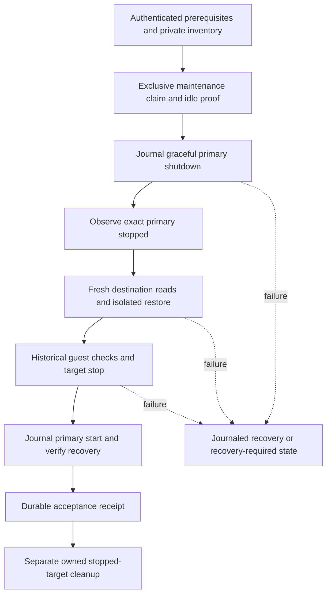

# Primary-unavailable protected restore plan

**Date:** 2026-10-24

**Status:** PROPOSED

**Context:** Bounded implementation child of existing PBS OpenSpec task 4.4c.
This is a source-only proposal, not outage authorization, implemented behavior,
private prerequisite acceptance or runtime evidence.

## Problem

The ordinary restore consumes authenticated protected-copy readiness but does
not establish primary PBS unavailability. Its schema-2 target journal and
`restore_receipt/v3` remain valid only for their existing ordinary restore and
stopped-target cleanup contracts. Neither can satisfy 4.4c alone. This child
adds evidence of destination recovery with the primary guest unavailable;
retention, VM growth and seven-day capacity remain separate gates.

## Design principles

Follow [PRINCIPLES](../../../../../../PRINCIPLES.md),
[automation](../../../../../architecture/01-automation-model.md) and
[credential authority](../../../../../architecture/04-credentials-access.md).
Git owns workflow, policy and catalog definitions; private site-config owns
the distinct live o11y, primary PBS, destination PBS and isolated-target
identities. Every mutation runs through a reviewed Dev-bound Semaphore
playbook, with credentials from OpenBao into protected controller memory.
Do not overwrite or destroy service guests, data volumes or backup artifacts.
Do not widen the existing target-only ordinary restore into a primary writer.

## Architecture

Propose a separate acceptance entrypoint composing the existing restore steps
with explicit primary power and recovery actions. Factor shared tasks rather
than copy the ordinary workflow. Launch selectors are reviewed public/private
SHA pins and authenticated prerequisite task IDs, never caller VMIDs, URLs,
nonces, receipts or outage attestations. Exact runtime inventory bytes must
match the reviewed private revision. Keep the dedicated destination Reader
distinct from the copy Manager and primary credential.

### Primary outage choice

Use exact-node/exact-VMID PVE graceful shutdown with a finite timeout and
`forceStop=false`, then exact returned UPID completion and stopped-state
readback. Recover with one journaled start and verified running/PBS health and
read-only datastore/artifact checks. The official
[PVE generated synopsis](https://github.com/proxmox/pve-docs/blob/master/generated/qm.1-synopsis.adoc)
documents graceful shutdown and the optional force-stop flag. Installed API
schema, parameter spelling, handle binding and effective privileges remain
activation prerequisites, not inferred live facts. Refuse HA-managed guests,
initially stopped/paused state, locks, pending config, migration, identity drift
and unaccounted restart/watchdog behavior. No hard-stop fallback or host reboot.

Network isolation avoids power cycling but requires complete IPv4/IPv6,
interface, endpoint and restore/sync path coverage plus reversible rule writes;
it proves a network cut rather than a stopped guest. Datastore maintenance
leaves the guest available. Neither is selected for this bounded child. A
single failed connection or operator attestation is insufficient.

### Closed writer census and exclusion decision

Current `guard_o11y_restore_target.py::check_reserved_target` checks a fixed
target reservation but permits unrelated VMIDs. A primary operation can race
its GET-only check. The ordinary guard is therefore not an outage lock.
The current test census in `test_o11y_restore_target_guard.py` assigns
provision-vm, provision-template, provision-pbs-debian-template, resize-vm,
destroy-vm, snapshot-vm and attach-pbs-data-disk, including their wrappers,
preparatory groups and direct-token/fallback variants. Close this census by
adding only current workflows/jobs able to affect these declared guests or
stores: PBS provisioning/configuration, backup/storage job writers, backup,
verify, copy sync and restore/cleanup. Do not expand to hypothetical platform
writers. Any newly discovered relevant current writer blocks activation until
accounted for.

Proposed default: extend fixed-path versioned CAS coordination with atomic
participant admission. Each assigned writer holds an admission across its
mutation and authoritative effect; the outage claim requires no pending or
active participant. Admission and outage acquisition racing each other must
have one CAS loser. An unknown outcome retains its admission; no TTL takeover.
Use one subject-aware transaction for primary and target actions, not two locks
without a reviewed acquisition protocol. Compatible guards must be published
and old queued/running variants drained before activation.

A narrower alternative can avoid per-writer admissions if a declarative
Semaphore maintenance gate demonstrably excludes launches of the exact
censused entrypoints, drains already admitted/queued tasks, and excludes
relevant scheduled PVE/PBS jobs for the whole transaction. A UI toggle,
check-then-write list query or hoped-for quiet window does not meet this bar.
No such exclusion is established by the current source, so this is an
implementation decision gate rather than permission to bypass coordination.
Do not add both mechanisms speculatively. Privileged unmanaged users remain
trusted under either choice.

Refuse active/queued relevant backup, sync, verify, prune/GC, restore or VM
operations; do not cancel them. Require authoritative visibility, because
filtered empty task lists do not prove idle. Current protected sync explicitly
uses `schedule: ''`, but this does not prove every server scheduler disabled.
Prefer a proven non-overlapping window; if exact-job pause/resume is necessary,
implement it as digest-bound journaled configuration preserving original state.
Recheck idle after exclusion and immediately before shutdown.

### Journal, observations and receipts

Propose a new journal version with subject fingerprints and typed primary
shutdown/start actions, distinct from existing target actions. Persist intent
before mutation, returned handle immediately after submission and verified
effect after exact task/state readback. Reject active legacy-state migration,
subject confusion, stale versions and unexpected CAS results. Keep explicit
ordinary legacy receipt validation for its existing cleanup path; never
reinterpret old evidence as outage proof.

Observe exact primary stopped state, placement/config identity and node
availability before the first destination read used for acceptance, throughout
restore and QGA historical checks, and through final target-stop verification.
Repeat destination manifest/content/config checks after outage proof rather
than rely only on cached pre-outage data. All primary-dependent prerequisites
must finish before shutdown. The exact observation cadence, maximum gap,
duration, clock checks and bounded record size are fixed by the reviewed
implementation contract. Missing observations, source running/drift, API
failure, watcher death or excessive gaps invalidate acceptance.

Run observation polling independently of long restore/QGA waits; serial
before/after checks are insufficient. One coordinator serializes lifecycle
CAS and bounded observation-batch checkpoints so the watcher cannot overwrite
pending actions or race journal versions. Persist observation digests and
interval bounds durably. This proves bounded observations plus cooperating
writer exclusion, not mathematically continuous fencing against a malicious
hypervisor administrator. A negative TLS probe is supplementary only.

Propose a closed versioned `protected_restore_acceptance/v1` envelope binding
the full versioned restore proof, artifact/destination Reader/storage identity,
primary initial-state fingerprint, shutdown/start UPIDs/effects, observation
digest and coverage/gap policy, exclusion proof, revisions and task identity.
Successful final acceptance requires recovered primary, stopped isolated
target, no pending action and complete outage/data proof. Copy readiness stays
`pending_isolated_restore`. If embedded restore fields change, bump that
receipt version and all consumers together; do not append unknown fields to
v3. Cleanup validates explicitly supported versions and still deletes only
the same owned stopped isolated target, separately from the acceptance task.

### Failure and recovery

On data-check failure retain the isolated target and journal, and recover the
primary through a distinct failed-acceptance branch. A bounded recovery branch
may start only the same initially running guest that this operation proves it
cleanly stopped, with unchanged configuration, no pending mutation and fresh
exact stopped readback. Record a new start intent; this is recovery, not retry.
Never delete a failed target automatically or force-stop the primary.

Unknown shutdown/start submission, missing handle or ambiguous CAS means
`recovery_required`, not a speculative second request. A separate reviewed
Semaphore recovery entrypoint authenticates the original task and journal,
resolves the exact known task/readback and only then makes a permitted CAS
ownership transfer/recovery transition. No blind nonce adoption. Controller
loss can leave primary stopped; require a monitored maintenance window and
available recovery workflow before activation. Preserve durable state even
when the task fails. A failed proof with recovered service is not acceptance.

## Implementation phases

1. Close API, identity, visibility and writer/job prerequisites; choose proven
   exclusion before implementation is enabled. Acceptance: exact closed census
   and reviewed exclusion/recovery contract with no assumed API privileges.
2. Implement subject-aware journal, chosen exclusion, receipt validators and
   recovery transitions. Acceptance: CAS race, legacy/subject refusal and
   unknown-outcome tests pass without weakening ordinary target boundaries.
3. Compose Dev-only outage acceptance, bounded observations and recovery using
   shared restore logic. Acceptance: mocked API ordering and failure tests
   cover the spec scenarios; source-only checks cannot close 4.4c.
4. After independent review, final-head CI, Dev merge and declarative
   publication/readback, verify private/effective gates and a separately scoped
   maintenance run. Acceptance: authenticated complete outage/data/recovery
   evidence, then separate owned-target cleanup. Keep all live tasks unchecked
   until their actual evidence is recorded.

## Validation criteria

| Check | Pass condition |
|---|---|
| Authority and busy refusal | Exact private provenance, distinct guests, effective roles, complete task visibility; busy/ambiguous state causes zero power writes |
| Exclusion | Closed census covered; admission/outage races or proven maintenance gate exclude every relevant current writer/job |
| Outage interval | Authoritative stopped proof and bounded observations span fresh destination reads, restore and historical checks; any gap fails |
| Recovery failures | Timeout/unknown UPID/CAS, controller loss and drift retain durable state without retry/adoption; permitted recovery preserves data |
| Ordinary compatibility | Existing schema-2/v3 success never closes 4.4c; legacy cleanup remains owned stopped-target only |
| Data and secrets | No primary/destination/source overwrite or delete; no secret argv, public identities, raw request/telemetry payloads or forged launch attestations |
| Source gates | Focused production validator/orchestration tests, check-mode/extra-var/PVE-token/URI boundary checks, configured lint/syntax and strict OpenSpec validation pass |
| Live acceptance | Exact completed Dev task authenticates new envelope and journal, recovered primary and separate cleanup; shared admin/storage trust remains explicit |

Read exact test/lint commands from current repository configuration at
implementation time. Cover wrong subjects, active/queued jobs, incomplete
visibility, source restart during QGA, watcher failure, observation gaps,
shutdown/start ambiguity, data failure with successful recovery, changed job
resume state, legacy cleanup and zero-write check mode. Run required final-head
CI and independent review before publication. OpenSpec validation checks spec
structure, not implementation or live behavior.

## Security considerations

Use only the declared OpenBao endpoint and protected Semaphore AppRole binding;
apply policy/catalog changes through code and verify effective scope before
activation. New power or coordination capabilities are proposals, not applied
grants. Reject internal/URL/credential overrides before lookup. Keep credentials
and identity-bearing evidence private, public output fixed categories/counts/
hashes, and no secret files or command-line tokens. Semaphore receipts remain
trusted-controller attestations, not immutable historical metadata. Destination
PBS administrators, hypervisor administrators and shared backing storage remain
trusted failure domains; protection is not absolute immutability.

## Cross-references

- [Parent design](../design.md), [capability spec](../specs/pbs-vm-restore-gate/spec.md), [tasks](../tasks.md)
- [Ordinary restore runbook](isolated-restore-executor-runbook.md)
- [Observability plan](../../../../05-observability.md)
- [Architecture map](../../../../../../ARCHITECTURE.md) and [operating rules](../../../../../../AGENTS.md)
