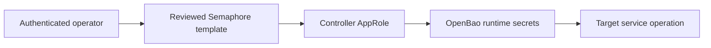

# Semaphore access and scoped publication

## Use the executor's credentials

For an existing service template, use the authenticated operator session to
launch the reviewed Semaphore automation. The controller authenticates with its
existing OpenBao AppRole and reads the target credentials in memory:



A missing workstation `SEMAPHORE_TOKEN`, or a cached workstation `bao` login
receiving HTTP 403, says nothing about the controller AppRole. Do not require a
workstation OpenBao login before work that an existing Semaphore template can
execute. Never export the controller AppRole from the browser or use backup
credentials to manufacture workstation access.

**Verified production evidence:** task 411, `Verify tududi-github Sync (Dev)`,
authenticated through the controller AppRole, read runtime secrets, checked the
GitHub App's repository coverage and reached n8n. It stopped at an absent
credential-visible sync workflow with `changed=0`; it did not verify task/issue
correspondence. This proves that executor's access at the time of the run, not
every credential's validity or ongoing AppRole health.

## The production Semaphore host (recorded 2026-09-26)

Production Semaphore runs under rootful podman from a legacy standalone compose directory
(site-config's `scripts/semaphore-upgrade.sh` is its upgrade path), not from
`platform/services/semaphore/deployment`. Three containers: Postgres and the app, both on no
restart policy, and the runner on `always`. `agent-cloud-boot-semaphore.service` starts the first
two at boot (`plan/architecture/05-platform-infra.md` section 11). The root filesystem was
grown from 15 GB to 25 GB on 2026-09-26 after it filled and stopped Postgres (see "Troubleshoot at
the failing boundary"). Never have a Semaphore job restart or recreate these containers: a
running task would kill itself.

## Declared production repository records: `main` and `dev`

The production templates use the two repository records declared in
[`repositories.yml`](repositories.yml): `agent-cloud` (branch `main`) and
`agent-cloud dev` (branch `dev`). A template names its record with `repository:`
in `templates.yml`; `dev_variant: true` generates the `(Dev)` twin bound to `dev`,
its `service_branch` survey defaulting to `dev`. That default is a form value only:
Semaphore never applies survey defaults to a task created through the API (upstream
issue #2244; no default merge in v2.17.31 `LocalJob.go` or v2.19.11
`local_executor.go`), so the launcher below fills them, and the shared placement
(`tasks/assert-placement-branch.yml`) refuses to check out `main` on a target from a
playbook running on another named branch unless `-e allow_cross_branch_placement=true`
(`docs/MISTAKES.md` 3.12).
**No production feature-branch record is declared, and a production template cannot run a
feature branch either.** On v2.19.11, the pinned production version, the runner applies a
task's `git_branch` only when the template sets `allow_override_branch_in_task`
(`services/tasks/local_executor.go:938`), and `setup-templates.yml` sets it on no template.
v2.18.12 applied a task's branch unconditionally and checked the flag only in the web UI
(`services/tasks/LocalJob.go:817`, `docs/MISTAKES.md` 1.9), so a controller still on that
version runs any pushed branch an API token names. Code that a Semaphore task
must execute — a new playbook, a new OpenTofu file, a changed template — has to
be merged into `dev` (feature → `dev` PR, checks green, reviewed) before the
`(Dev)` variant can run it, and into `main` before the base template can. Plan
the live step after the merge, not after the commit. Recorded 2026-09-14, when
`ratelimit.tf` sat committed on its feature branch with nothing able to plan it.

## Who may launch: launch rights are runner rights

A task's `environment` becomes its extra vars with no survey filter, and a templated extra var
can call a lookup that runs a command on the runner (plan 01, "Launch permission is runner
access"). So anyone who can launch a template can run code on the controller, which holds the
controller AppRole and the SSH keys. `task_runner` is therefore granted only to someone trusted
with the controller, exactly like `manager` or `owner`. Four identities can launch: system
admins, project members whose role can run tasks, those users' API tokens, and integrations
(incoming webhooks, which copy payload values into the task environment).

**Manage Semaphore Access** holds all four to a declaration: `semaphore_project_members`
(username to role, the whole team) and the admin roster, all in the private inventory's
top-level `all.vars` (the play runs on implicit `localhost`, which receives no group's vars;
`promote-semaphore-admins.yml` reads them the same way). The admin roster is derived, never
hand-granted: every `platform_admins` entry (the administrator list the Authentik deploy
renders into `platform-admins`) except the service account, plus `semaphore_admin_users` for
Semaphore-only admins such as the local bootstrap account. A platform admin's first SSO sign-in
creates a plain account; **Promote Semaphore Admins** then grants the flag and reads it back,
and the access report names each declared admin still to promote (issue #604). Run it
under check mode first; the report lists the live team, admins and integrations by name. A real
run adds declared accounts, sets declared roles, removes undeclared members and reads the team
back; a declaration naming an account that does not exist stops it before any write. It never demotes a system admin or deletes an integration: each is named and fails the
run for an operator decision. The NemoClaw AppRole's policy denies the path that holds the
controller's own API token.

## Launching a task from outside the controller (the API path)

No workstation path to the production controller was verified in the 2026-09-14
check: no `SEMAPHORE_TOKEN` was set, the operating evidence came from the UI, and an anonymous
request to `https://semaphore.uhstray.io/api/ping` is answered by Cloudflare with
`403` + `cf-mitigated: challenge` (verified 2026-09-14). The pieces of a
scripted path exist and are recorded here so it is built once, deliberately:

1. **Edge.** The WAF skip rule `Semaphore API - bypass challenge for
   token-bearing non-browser clients` (`platform/infra/cloudflare/waf.tf`) lets a
   request through only when it is on `semaphore.uhstray.io`, under `/api/`, AND
   carries a non-empty `Authorization` header. A tokenless probe is challenged by
   design.
2. **Credential.** An API token is minted per user with `POST /user/tokens` and
   sent as the `Authorization` header (`Bearer <token>`); the controller's own
   token is at `secret/services/semaphore:api_token` in OpenBao and is read only
   inside the controller (see the publisher section). A workstation token is an
   operator-held value — provisioned into the workstation environment, never
   into a repo, a survey parameter or a launch argument.

3. **Launch and read back.** `POST /api/project/{project_id}/tasks` with
   `template_id` (or `template_name`) and, for a survey template, `environment`
   as a JSON string of the survey values. Semaphore v2.17.31 merges EVERY key of that
   JSON into the run's extra vars; it does not filter by the survey
   (`services/tasks/TaskRunner.go` `populateTaskEnvironment`). The launcher's
   declared-fields check is client-side only, not a server control. **Check mode and diff go inside
   `params`:** `"params": {"dry_run": true, "diff": true}` (v2.17.31 `db/Task.go`,
   `AnsibleTaskParams`). A top-level `dry_run` is silently ignored and the task
   runs for real (`docs/MISTAKES.md` 3.8). Semaphore starts a task the moment it is
   created, so reading it back and stopping it cannot make a launch safe; the stop
   can arrive after secrets are written. Launch with
   [`scripts/semaphore-launch.py`](../../scripts/semaphore-launch.py): it builds the
   body with the flags in `params`, refuses check mode on a server version whose
   shape is unverified, allows only the template's declared survey fields, fills a
   declared field left unset with its declared `default_value` as the web form does,
   and refuses while the template already has a running task, all before the POST.
   Survey fields declared `integer` or `int` are sent as JSON integers, including
   string defaults. Use canonical decimal `--set` values such as `limit=0`,
   `limit=42`, or `offset=-7`; leading zeros, negative zero, a plus sign,
   whitespace, decimals, and exponent notation are refused before submission
   with the field name only. String and enum survey values remain strings.
   Its read-back-and-stop after the POST is only a tripwire for a changed server; `GET /api/project/{project_id}/tasks/{task_id}`
   for status; `GET .../tasks/{task_id}/output` for the log. Endpoint shapes are
   from the upstream `api-docs.yml` on the `develop` branch (read 2026-09-14) and
   the `/api/project/{id}/...` prefix the committed playbooks already use;
   confirm against the running version before scripting.

### Operator token rotation

`scripts/semaphore-rotate-token.py` rotates the calling user's workstation token.
It reads the current backup only from stdin; the mode-`0600` recovery state
holds both token values until revocation is confirmed, then is removed. The
replacement is written atomically to the local backup with mode `0600`. The
command requires the authenticated server's
`/api/info` version to be exactly `2.19.11`, the version whose token create,
list, and prefix-delete behavior this workflow has reviewed. It refuses
wildcard-bearing or ambiguous token IDs and rechecks the complete user-token
inventory before deletion. It never prints a token or ID prefix.

Run the script from a reviewed checkout after publishing the Dev-bound
`Rotate Semaphore Operator Token (Dev)` template and provisioning its isolated
environment. Keep the old token file unchanged as stdin until the command
completes. Example shape (replace only the non-secret values and file paths):

```sh
python3 scripts/semaphore-rotate-token.py \
  --url https://semaphore.example \
  --project 1 \
  --expected-user-id 1 \
  --inventory 1 \
  --backup "$HOME/.config/semaphore/operator-token" \
  --state "$HOME/.config/semaphore/operator-token.rotation" \
  < "$HOME/.config/semaphore/operator-token"
```

The command verifies the replacement token, runs the guarded Dev playbook, and
replaces the workstation backup before it attempts to revoke the old token. The
playbook updates `secret/services/semaphore:api_token` only when its protected
current value exactly matches the old operator token; a different controller
token stays unchanged. The state file makes acknowledged create and later steps
resumable, including a retry after the backup already contains the replacement.
If the create request has an unknown outcome, the state
file blocks another create because the API does not return an existing token's
full value; reconcile that inventory manually before starting a new rotation.
The command holds a private local lock beside the backup and rechecks the
inventory before revocation. Run it during an exclusive token-change window:
the API has no server-side compare-and-delete, so another operator changing
tokens outside this command cannot honor the local lock.

### Getting your own operator token

Every operator mints their own token, under their own Semaphore account, so each
launch is attributed to the person who made it (issue #741). Nobody hands out a
token, and nobody uses another account's token.

1. **Be declared.** An administrator is an entry in `platform_admins`; any other
   operator is an entry in `semaphore_project_members` (username to role). Both are
   in site-config's top-level `all.vars`, so access changes through a reviewed diff. Someone
   who can launch these templates can override the declaration with an extra var, but launch
   rights are already runner rights (above), so that grants nothing they did not hold.
2. **Sign in once** at the controller in a browser, through SSO. The browser passes
   the Cloudflare challenge that blocks a scripted `/api/auth/login`. The first
   sign-in creates a plain account that belongs to no project.
3. **An admin converges access.** For an administrator, **Promote Semaphore Admins (Dev)**
   sets the admin flag and reads it back. For any other operator, **Manage Semaphore
   Access (Dev)** adds the declared membership; run it under check mode first. Until
   one of these runs, the account sees only the **New project** button (issue #604).
4. **Mint the token.** In the user menu, open **API Tokens** (`/tokens`) and choose
   **New Token**. The page is open to every signed-in user, not only admins
   (Semaphore v2.19.11 `web/src/App.vue`, `web/src/views/Tokens.vue`); it calls
   `POST /api/user/tokens` for your own account.
5. **Store it** at `~/.config/semaphore/operator-token`, mode `0600`, and pass it on
   stdin only. A request that carries an `Authorization` header passes the edge's
   WAF skip rule, so `scripts/semaphore-launch.py` works from the workstation.

`site-config/secrets/semaphore/semaphore_api_token.txt` holds the bootstrap `admin`
account's token, as recovery material. It is not anyone's daily operator token.
Rotate your own token with `scripts/semaphore-rotate-token.py` (above).

When the bootstrap `admin` token is rotated, the recovery copy is part of the same change.
The rotation script updates only the `--backup` file it is given, never site-config. Once the
script finishes, open a site-config PR that replaces the recovery copy with the new value
(check it first with `GET /api/user`), or deletes the file. A rotation that skipped this
left the copy revoked and sent an operator down a dead path (`docs/MISTAKES.md` 10.31).

Without a token, the operator launches from the UI and the agent hands over the
exact template name, survey values and verification commands. Do not fabricate
access by reading the controller's own token out of OpenBao from a workstation.

### Synchronize an existing inventory record

Use `scripts/semaphore-sync-inventory.py` to preview the canonical inventory-sync
play with your own Semaphore API token. Preview is the default; `--apply` is
required to update a differing record. The token is read from stdin and passed
to Ansible as JSON on child stdin. The sync child disables debug logging and
inherited log destinations/callback overrides, pins the repository config and
redacting callback, enables supported module pipelining, and disables kept
remote files. Child output is captured and only a fixed outcome is printed.
The script never creates records or changes key bindings.

```sh
python3 scripts/semaphore-sync-inventory.py \
  --url https://semaphore.example \
  --inventory "$HOME/site-config/inventory/production.yml" \
  --name production \
  < "$HOME/.config/semaphore/operator-token"
```

Apply a reviewed preview explicitly:

```sh
python3 scripts/semaphore-sync-inventory.py \
  --apply \
  --url https://semaphore.example \
  --inventory "$HOME/site-config/inventory/production.yml" \
  --name production \
  < "$HOME/.config/semaphore/operator-token"
```

If an apply reports an uncertain outcome, use a read-only check of the existing
record before any retry; a failed process does not prove the server rejected a
write. Existing direct `ansible-playbook platform/semaphore/sync-inventory.yml`
callers continue to use `SEMAPHORE_TOKEN` or the controller AppRole.

## Two catalog rules, enforced by tests

- **A step template new with the service deployment workflow has a `(Dev)` variant.** Its
  playbook is not on `main` until promotion, so the base template cannot run. Enforced by
  `test_workflow_templates_are_dev_bound_until_promoted`; only templates that predate the
  workflow are exempt.
- **A template whose playbook targets `{{ target_service }}` offers that survey field.**
  Without it the play falls back to `ungrouped` and reaches no host, and the launcher
  refuses a non-survey extra var. Enforced by `test_templates_targeting_a_group_ask_for_it`.
  Both tests live in `platform/tests/test_workflow_registry.py`; both rules were found on
  2026-09-28 while onboarding the internal DNS and CA VMs.

## Publish selected survey fields

The declared **Publish Semaphore Template Surveys (Dev)** template runs
[`publish-semaphore-templates.yml`](../playbooks/publish-semaphore-templates.yml).
Its required survey input is `semaphore_template_names_json`, for example:

```json
["Store tududi API Token (Dev)"]
```

It uses the controller AppRole to read the fixed OpenBao
`secret/services/semaphore:api_token` field. The token stays in Ansible memory;
the controller API destination is fixed to its container's loopback port 3000,
not a survey-controlled URL. This entry point assumes execution inside the
declared Semaphore controller container. A separate remote runner needs its own
reviewed transport design; do not redirect this token with a launch argument.

Normally, only exact, nonempty, unique names of existing declared templates are
accepted. To create one missing declared template, set the optional
`semaphore_allow_scoped_create` survey to `true` and enter verified numeric
`semaphore_project_id`, `semaphore_inventory_id`, and
`semaphore_environment_id` values. The default is `false`; the controller
refuses create requests for names without the `(Dev)` suffix, lists with more
than one name, or absent bindings. Leave all three ID fields blank for an
ordinary survey update. The publisher can
first update its own Dev template to expose these fields by selecting
`["Publish Semaphore Template Surveys (Dev)"]` with the existing survey.
Repository URL/branch and template repository/playbook bindings must match the
declaration. The selected surveys are updated and read back; inventory,
environment, arguments and operational settings are preserved. By default, no
schedules, service jobs, repository records, inventory records or credentials
are changed.

To publish one code-declared Dev schedule, set
`semaphore_allow_scoped_schedule=true` and select exactly one existing scheduled
template whose name ends in `(Dev)` and whose declaration binds directly to
`agent-cloud dev`. The publisher refuses missing templates, creation or binding
IDs, main-bound templates, ambiguous schedules, and a same-name schedule already
bound elsewhere. It upserts only that schedule and verifies its saved template,
cadence and active state. Ordinary scoped survey updates keep schedule writes
disabled.

**Deployment status:** installed and used in production. On 2026-09-25 the Dev
publisher updated one survey (Provision NetBox Automation Token (Dev), tasks 1329
dry run, 1330 real) and scoped-created two templates (Provision NetBox Custom
Fields (Dev), 1331/1332; Collect Service Conformance (Dev), 1333/1334), each read
back and verified. Scoped create needs the project, inventory and environment ids
of the templates it sits beside: read them from an existing `(Dev)` template's
bindings on the instance you are publishing to (`GET /api/project/<id>/templates`),
never from documentation, since they are site-specific.

A later full-catalog publication also creates the main-bound base template.
Do not run that base until the publisher code has been selectively promoted to
`main`; the scoped bootstrap installs the Dev variant only.

## Bootstrap the missing entry point once

[`bootstrap-survey-publisher.yml`](bootstrap-survey-publisher.yml) installs only
the generated Dev publisher from `templates.yml`. It requires explicit verified
`semaphore_project_id`, `semaphore_inventory_id` and `semaphore_environment_id`,
plus the approved Semaphore HTTPS endpoint. It uses an already approved injected
runtime token or AppRole; it acquires no browser/cache/backup credential.

1. Review and merge the publisher code to `dev` before its first controller run.
2. Inspect the current project, inventory, variable-group and Dev repository
   bindings through approved metadata access. Preserve the running controller.
3. In an approved bootstrap executor, run the playbook with those non-secret
   bindings. Readback must confirm the new template and its declared survey.
4. Launch that template through Semaphore with the exact selected names.

If no published template can run the publisher and no approved bootstrap
executor has runtime access, report **initial publisher installation** as the
specific gap. A controller AppRole may be healthy while this entry point is
missing. Do not redeploy Semaphore, repurpose a service template, edit a shared
repository binding, publish the entire catalog, or extract credentials to bridge
the gap. Create every template and automation through committed configuration
and its installer, including the initial publisher. Manual UI creation is not
an installation path. Resolve approved executor access before applying the
bootstrap; do not substitute a manually configured template.

## Seed a secret through an isolated environment

A secret an operator holds, and no service generates, reaches OpenBao through a
**seed template**: one that declares `isolated_environment` and `seed_inputs` in
`templates.yml`. Seed OpenBao Key is the general one. The value travels as an
encrypted environment input in that template's own environment. It is never a
survey field or an extra var, because Semaphore persists both and returns them over
its API. It is never staged in the shared environment, where every other template's
task could receive it.

The environment holds only the encrypted AppRole inputs and, during one seed, the staged
value: no extra vars. The OpenBao address comes from the inventory's top-level `all.vars`
(declared there for every host, the implicit `localhost` included). The environment is
checked when it is bound and again by every seed CLI preflight. Before the seed task logs
in to OpenBao it also refuses:

- an address other than the one the inventory file it was given declares (an extra var in
  the environment, or a `-e`, would override the inventory's). This catches drift, a plain
  stray address. It does not stop a deliberate templated extra var: whoever may launch the
  template or edit its environment controls its extra vars, so those Semaphore permissions
  are the boundary (`docs/MISTAKES.md` 1.15; plan 01, "launch permission is extra-var
  control")
- any seed input (`BAO_VALUE`, `SEED_*`) its template does not declare, such as a leftover
  from another seed's interrupted run

An environment provisioned before 2026-09-25 carries an `openbao_addr` pin. Publication
refuses it until **Provision Seed Environment** runs again, which removes the pin and keeps
the AppRole inputs.

If a task launch fails with `cannot decrypt access key, perhaps encryption key was changed`,
Semaphore's encryption key changed under existing inputs. Run **Provision Seed Environment**
for that seed template with `seed_replace_auth=true`: it overwrites the two AppRole inputs in
place from OpenBao (`docs/MISTAKES.md` 3.16). Leave it false on every other run.

1. **Once per seed template and variant:** run **Provision Seed Environment (Dev)**
   with `seed_template` set to the declared base name, plus the verified
   `semaphore_project_id`, `semaphore_inventory_id` and `semaphore_source_environment_id`
   its survey requires, and `seed_variant=dev` (main only after the seed code is
   promoted). It creates the environment, gives it an encrypted copy of the controller
   AppRole, and binds only that template. As of 2026-09-25 both Dev seed templates are
   provisioned and bound; the main variants are not.
2. **Once after provisioning:** prove the environment's AppRole may seed the path,
   without writing anything. It checks the token's own capabilities on the path:
   `read`, plus `create` for a missing path or `patch` for an existing one, the
   capability that seed's write will actually need. A GET alone cannot tell a missing
   path from one the token cannot see:

   ```bash
   scripts/semaphore-seed-input.py --template "Seed OpenBao Key" \
     --set bao_path=services/<svc> --set bao_key=<key> \
     --inventory <approved-id> --url https://semaphore.uhstray.io --verify-only --apply < <token-file>
   ```

3. **Each seed:** put the value in a file, one line, then run a dry run without
   `--apply`, then the real one:

   ```bash
   scripts/semaphore-seed-input.py --template "Seed OpenBao Key" \
     --set bao_path=services/<svc> --set bao_key=<key> \
     --input BAO_VALUE=<value-file> --inventory <approved-id> --url https://semaphore.uhstray.io --apply < <token-file>
   ```

The CLI accepts only the input names the template declares and only its survey
settings. It resolves the template and environment by name and refuses unless they
are bound to each other, the template still runs from its declared repository record
(URL and branch checked against `repositories.yml`) and from the inventory you approve
with `--inventory` (which is also where the seed task takes its OpenBao address), and it
is an Ansible template with no extra arguments. Dry run,
`--verify-only` and the real seed all run that same read-only preflight first, so a
dry run fails on anything the seed would refuse. It refuses a leftover input from an earlier run, runs
exactly one task, removes exactly the input it created, and never prints the value.
An interrupted run leaves the encrypted input in place and names it, so it can be
reconciled rather than silently retried. Postiz provider credentials use
`scripts/postiz-seed-input.py`, which shares the same lookup, preflight and lifecycle code
(`scripts/semaphore_seed.py`, also the Semaphore client `scripts/semaphore-launch.py` uses).

## Isolate protected o11y PBS workflow environments

The five explicit Dev PBS/restore coordination templates also use dedicated
`isolated_environment` declarations because their protected preflight refuses the
controller credentials when they arrive as launch extra vars. Use **Provision o11y
Workflow Environment (Dev)**, which pins an exact reviewed checkout, the controller's
loopback API, the sole inventory `openbao_svc.service_url`, and the supplied project,
inventory, and current source-environment IDs. It accepts only one of these templates:

Before its command-bearing checkout verifier runs, the wrapper refuses every
`ansible_` extra-var name. Put controller and connection settings in inventory;
inventory-sourced context remains valid. The existing bootstrap AppRole inputs
and `openbao_addr` are checked through their separate inventory/transport gates.

- `Verify o11y Restore Coordination Capabilities (Dev)`
- `Preflight o11y Restore Target (Dev)`
- `Provision PBS Debian Cloud Template (Dev)`
- `Attach PBS Data Disk (Dev)`
- `Provision PBS VM (Dev)`

These rows already carry explicit `(Dev)` names and bind to `agent-cloud dev`. The
wrapper passes the selected row to the shared provisioner using its `main` base-instance
mode, which preserves that name and repository without generating another suffix. Run
the wrapper once per target with the exact reviewed repository SHA and the verified
project, inventory, and current shared source-environment IDs. It validates the existing
source `openbao_addr` against the sole private inventory endpoint and uses the source
environment's existing AppRole inputs in memory for this controller operation. It creates
or reuses the target's own empty environment, stores only encrypted AppRole inputs, and
binds only the selected template. The source environment and generic VM/shared templates
remain intact.

Converge the capability-verification template first, then rerun its read-only verifier.
Only after that live capability receipt passes should the other four target environments
be converged one at a time. Environment setup does not accept private declarations,
effective role capabilities, target readiness, backup/restore evidence, or authorize VM,
disk, retention, or deployment writes. Keep the protected extra-var refusal in each
target playbook; do not repair the shared environment or pass credentials as survey data.

The five general VM writers (Provision VM, Resize VM, Destroy VM, Snapshot VM and Create VM
Template) run the same restore-target guard, so each declares its own `isolated_environment`
as well. Give each `(Dev)` copy its environment with `Provision Seed Environment (Dev)`
(`seed_template` = the base name, `seed_variant` = `dev`), the same reviewed provisioner the
seed templates use. Bound to the shared environment they fail at the preflight on every
launch; `platform/tests/test_restore_guard_environment.py` refuses a guarded template without
an isolated environment. Prove each one afterwards with a check-mode run of the `(Dev)` writer
(Destroy VM in check mode only); the seed CLI's `--verify-only` does not apply to these.

**Before promoting `dev` to `main`**, run the same provisioner with `seed_variant=main` for each
of the five. Promotion brings the guard to the `main`-bound copies, which are still bound to the
shared environment until then, and every one of them would then refuse to run. A full-catalog
publication likewise creates the base templates' own environments empty and binds them: run the
provisioner for those before using a `main`-bound copy.

## Publish the local observability alert destination

[`sync-local-o11y-alert-inventory.py`](../../scripts/sync-local-o11y-alert-inventory.py)
reads the two Discord destination IDs already declared under `o11y_svc.vars` in
private site-config's production inventory. It changes only those entries in
Semaphore's existing local static inventory and reads the record back. Run it
from a clean checkout of reviewed, pushed `dev`, with an unchanged private
production inventory file and exact `--expected-dev-sha` and `--site-config-sha`
pins. Supply the
local inventory ID, the verified Semaphore HTTPS origin, and the operator token
on stdin. The default run previews names only; `--apply` performs the scoped,
idempotent update. Do this before the Dev-bound webhook seed or fault drill;
their channel IDs come from Semaphore's stored inventory, not from a survey.
After a matching API readback, `--apply` also writes an owner-only projection
at `~/.agent-cloud-local/o11y-alert-destination.json`. The local bootstrap
reads that generated input when it rebuilds Semaphore inventory; it refuses
to erase an already synced destination if the projection is missing. Refresh
the projection by rerunning the sync after a reviewed private inventory change.
The projection is a local copy, not a new source of truth.

## Troubleshoot at the failing boundary

| Evidence | Next check |
|---|---|
| Operator cannot launch the existing template | Operator session/project permissions |
| Controller AppRole login fails | That task's existing variable-group binding and AppRole validity |
| OpenBao secret read is denied | Controller policy for the named fixed secret path |
| Secret reads pass; target rejects it | Target transport, credential validity and account scope |
| Publisher template is absent | Initial installation through the scoped bootstrap mechanism |
| Survey readback or repository binding fails | Stop; inspect the declared and live values before another write |
| A token that just worked gets an empty-body 401 on every endpoint, and the UI login says "Failed to create session" | Semaphore's own database before the credential. `api/auth.go` (v2.19.11) answers any error from the token or user lookup with 401, so a stopped Postgres reads exactly like a revoked token. Check the Postgres container and the host's disk. That check needs recovery access to the Semaphore host, which requires the operator's authorization |
| A task fails within milliseconds, with no output and no checked-out commit | The Semaphore host (disk, runner) before the task's own inputs |
| `Unable to parse /tmp/semaphore/project_<n>/inventory_<id>.yml`, or `The inventory could not be parsed or contained no hosts` | Concurrent tasks share that one inventory file and the first to finish removes it before another has parsed it (prod task 3878 on 2026-10-09; local tasks 5583 and 5585 on 2026-10-12). Re-run the task on its own, and do not launch it at a scheduled collector minute (the conformance collector runs every 15 minutes). `tasks/runtime-access.yml` checks the inventory first whenever the run was given one with `-i`, as every Semaphore task is, so a lost file now fails with this message and not with "Refusing to send secret material … invalid endpoint". An operator-side tool started with no `-i` is not asked for an inventory |

The 2026-09-26 outage matched both rows: the host's 15 GB root filesystem filled, and
Postgres exited at 22:41:59 UTC when WAL recovery could not extend a file. Growing
the root logical volume into the volume group's unallocated space and starting
Postgres restored service with nothing lost (`docs/MISTAKES.md` 1.18).

Task output is stored in that database. A deploy dry run launched with `diff: true`
records the monorepo placement's whole git diff: about 86,000 lines per task for
Deploy honcho (Dev) and Deploy tududi (Dev) on 2026-09-26. Watch the host's disk
when dry-running deploys whose target checkout is far behind.

Report task ID, observed source revision when available, target names, failed
step and change counts. Do not print secret values, auth IDs or raw variable
groups. A checked branch head is not proof of a task's actual checked-out SHA.

The full-catalog [`setup-templates.yml`](setup-templates.yml), repository
bootstrap and inventory sync remain explicit operator configuration operations.
Their shared runtime access task supports the controller AppRole without making
those broader operations available through the survey-only entry point.

For a missing template already declared on a reviewed branch,
`setup-templates.yml` accepts one exact `semaphore_template_names` entry with
`semaphore_allow_scoped_create=true`. Supply verified non-secret
`semaphore_project_id`, `semaphore_inventory_id` and `semaphore_environment_id`.
It creates only that template, checks its repository URL and branch against
`repositories.yml`, and reads back its repository, inventory, environment and
playbook bindings. Existing templates and schedules remain unchanged; rerunning
an already matching declaration makes no write. Without the explicit create
flag, a missing scoped template still refuses.
